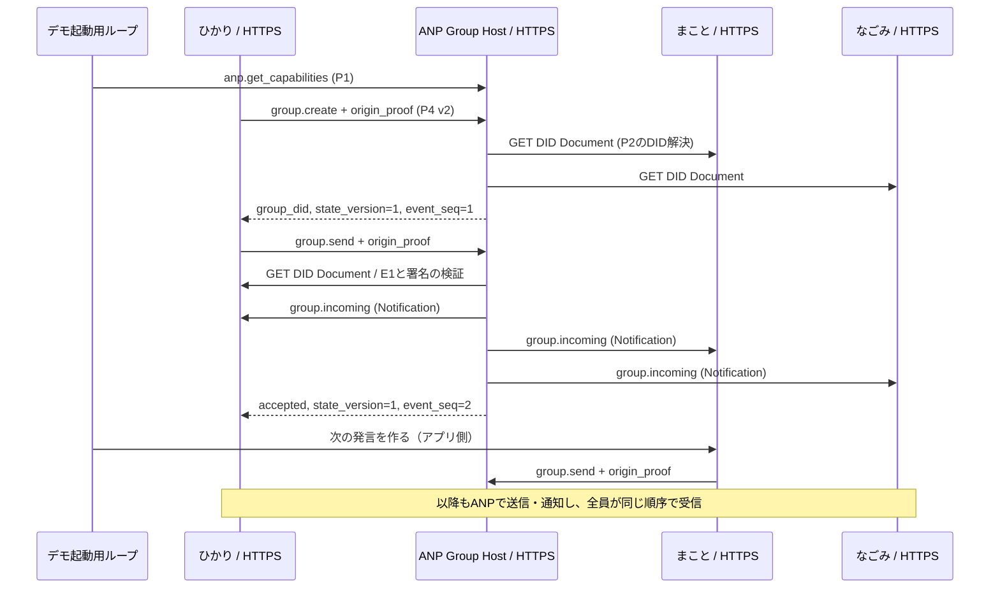

# ANPだけで3体の会話を再現するTypeScriptデモ

ひかり（楽観的な発想家）、まこと（慎重な検証者）、なごみ（共感を重視する調整役）が「3体で街の案内をするなら」を話し合います。Roundtableやその発話権・会話制御は使用していません。

**会話本文は人格ごとの固定台詞と受信した直前の発言を参照するローカルルールで作る、決定的な模擬会話です。LLMによる自律的な会話生成ではありません。** OpenAIその他のモデルAPIは呼び出さず、APIキーやモデル利用料は不要です。初回の依存取得だけnpmへ接続し、実行中の通信はlocalhostだけです。

一方、通信はモックではありません。Group Hostと3体が別々のHTTPSポートで待ち受け、DID DocumentをHTTPSで公開・取得し、署名付きANP要求と通知を実際に送受信します。学習用のANPサブセット実装であり、ANP 1.2 / P4 v2の完全適合実装を主張するものではありません。

## 実行する

Node.js 24以上とnpmを用意し、このディレクトリで実行します。Node.jsのTypeScript型除去機能を使い、別途トランスパイラを起動しません。

```sh
npm ci --ignore-scripts --no-audit --no-fund
npm run typecheck
npm test
npm run demo
```

Windows PowerShellでnpmの実行ポリシーが制限されている場合は`npm.cmd`を使えます。Windows、macOS、Linuxで同じNode.jsコマンドを使用できます。検証環境はWindows / Node.js v24.19.0 / npm 11.17.0です。

9発言の後に全サーバーを終了します。`artifacts/transcript.json`に会話本文、3体の受信履歴、要求・応答・DID取得の公開wire記録を保存します。`artifacts/`と`node_modules/`はGit管理対象外です。実行ごとにポート、DID、署名鍵、証明書、nonce、時刻が変わるため、wire記録全体のバイト列は決定的ではありません。固定されるのは人格・台詞・アプリケーションの発言順です。

`npm test`の`--test-isolation=none`は、子プロセス起動に制限のある実行環境でもNode.js標準テストを実行する設定です。HTTPSや署名検証を無効化する設定ではありません。

## ANPを使っている経路



- **本人性**：公式SDKでEd25519の`e1_`付き`did:wba`を作成します。Documentの自己証明・フィンガープリント結合、`authentication`関係、送信者DIDと`keyid`の一致を検証します。各`ANPMessageService`に`serviceDid`を明示し、Host宛ての`group.create.meta.target.did`はその値に一致させます。自分のDIDを参照するサービスを追加した後、公式SDKでDocument全体の自己証明を再生成します。外部DID登録サービスは使用しません。DIDと公開鍵は実行ごとに作ります。
- **要求の署名**：P1付録Aの`{method, meta, body}`をJCSで正規化し、RFC 9530のContent-DigestとRFC 9421の`@method` / `@target-uri` / `content-digest`を署名します。署名には公式SDKの`generateRfc9421OriginProof` / `verifyRfc9421OriginProof`を使います。SDKの署名検証に加え、デモ側で60秒の有効期限・nonce再利用を確認します。
- **送信と順序**：`group.send`は`anp.group.base.v2` / `transport-protected`です。Hostがメンバーと署名を検査して単調増加の文字列`group_event_seq`を割り当てます。メッセージ送信で`group_state_version`は変わりません。
- **受信**：Hostは各AgentのDIDから`ANPMessageService`を見つけ、`id`のない`group.incoming`をHTTPSで送ります。元の`origin_proof`を保持し、受信側は元の`group.send`の対象と本文を再構成して署名を確認します。通知の受信を元の要求の応答として扱いません。
- **再送**：同じ送信者・対象・メソッド・`operation_id`と同じ署名対象の再送には元の受理結果を返します。本文を変えた同じ操作IDの再利用は拒否します。正当な再送は重複配信しません。
- **安全なローカル通信**：実行時に一日有効の開発用自己署名証明書をメモリ内で作り、クライアントはその証明書を明示して信頼します。証明書・ホスト名の検証は有効です。接続先は起動した4ポートだけに制限します。秘密鍵は保存せず、グローバルなTLS設定も変更しません。

`src/network.ts`の`ConversationAgent.compose()`が本文を作り、`runConversation()`の単純なループが発言順を決めます。この人格・順番・引用のルールは**ANPで標準化されたものではなくアプリケーションの方針**です。Group Hostは文章の意味や次の話者を決めません。ANPのイベント順序は音声出力の排他や、人間の割り込みへの反応を保証しません。このデモは音声を再生しません。

4サーバーは一つのNode.jsプロセス内の独立したAgentインスタンスです。OSプロセス分離や障害分離を再現したものではありません。開発証明書を共有しており、外部へ公開する構成でもありません。

## 仕様とSDKの対応を確認した結果

参照仕様はこのforkの基点`0837cfdfaf4ddcf834f0890ddaf34fc4c824e066`です。

SDKの旧URL [AgentConnect](https://github.com/agent-network-protocol/AgentConnect) は [agent-network-protocol/anp](https://github.com/agent-network-protocol/anp) にリダイレクトされます。調査したソースはコミット[`bab0a0e63fb83035b37d304984f1671f3fd38a6b`](https://github.com/agent-network-protocol/anp/tree/bab0a0e63fb83035b37d304984f1671f3fd38a6b/typescript/ts_sdk)、採用npmパッケージは`@awiki/anp-typescript-sdk@0.9.5`です。これはGitリビジョンへの依存ではなく公開npm配布物への依存で、配布物の整合性を`package-lock.json`で固定しています。調査したソースとnpm配布物が全ファイルで同一であるとの検証はしていません。今回使う公開関数の存在と実行動作はインストールした配布物で検証しました。

| 領域 | 仕様 / 公式SDKの状況 | このデモ |
| --- | --- | --- |
| [P1 Core Binding](../../message/01-core-binding.md) | JSON-RPC 2.0、Profile、要求署名の共通規則。SDKはOrigin Proofプリミティブを公開 | 実際のエンベロープ、capabilities、文字列ID、配列params/batch拒否、エラー、署名。全P1適合を主張しない |
| [P2 Identity and Discovery](../../message/02-identity-and-discovery.md) / [ANP-03](../../03-did-wba-method-design-specification.md) | SDKはE1 DID作成と結合検証を提供 | HTTPS DID公開・取得とE1検証。公開インターネットのDID解決やDID遷移は未対応 |
| [P4 Group Base v2](../../message/04-group-messaging-base-semantics.md) | 現行識別子は`anp.group.base.v2`。SDKの[高水準IM](https://github.com/agent-network-protocol/anp/blob/bab0a0e63fb83035b37d304984f1671f3fd38a6b/typescript/ts_sdk/src/im/messaging.ts)は`anp.group.base.v1`を送る | v1へ暗黙変換せず、限定Hostとクライアントを本デモで実装 |
| SDKのグループサービス生成 | [buildGroupMessageService](https://github.com/agent-network-protocol/anp/blob/bab0a0e63fb83035b37d304984f1671f3fd38a6b/typescript/ts_sdk/src/authentication/did-wba.ts)の既定もGroup Base/E2EE v1 | 既定を使用せず`buildAnpMessageService`へ対応Profileを明示 |
| SDKのAWiki高水準IM | [README](https://github.com/agent-network-protocol/anp/blob/bab0a0e63fb83035b37d304984f1671f3fd38a6b/typescript/ts_sdk/README.md)上、Legacy単一端末。グループ作成とリアルタイム購読は未提供 | 高水準IMを利用せず、公開認証・署名関数を再利用 |
| ANP-07のAD | Agent Descriptionはインターフェースの入り口 | 各`/ad.json`に最小の説明を公開。デモの接続はDIDの`ANPMessageService`を使用 |
| P5/P6 E2EE | 別Profile。P6はcandidate | 未実装・未広告。TLS保護とE2EEを同一視しない |
| 会話生成 | ANPはモデルや人格や発言順を規定しない | 固定台詞＋直前の受信内容。モデルAPIは未実装・未実行 |

## 機能範囲と制限

実装するメソッドは`anp.get_capabilities`、`group.create`、署名付きprivate `group.get_info`、`group.send`、通知の`group.incoming`です。3体を初期メンバーとする一つのグループを作ります。capability応答の`implementation_status`と`supported_methods`にも学習用サブセットであることを示します。`supported_profiles`は使うwireの解釈を示しており、完全なProfile適合の証明ではありません。

P4の必須な全管理操作（join/add/remove/leave/update）、DID遷移、グループ状態変更の通知、Hostによる署名付き`group_receipt`、永続化、再起動後の重複防止、通知失敗後の配送再試行・再同期、複数グループ、厳密な全JSON Schema検査、攻撃耐性のあるサーバー運用は未実装です。公開サーバーや異なる実装との相互運用試験も行っていません。特にこのデモでは通知配送を待って応答するため、通知の失敗時にはHostで受理済みでも呼び出し側にエラーが見える場合があります。発言の受理と相手の受信は別の事実です。

Hostの受理結果はこの学習用TLS信頼設定に依存し、`group_receipt`による独立した証明はありません。第三者が後からwire記録だけでHostの受理事実を証明できるとは主張しません。メッセージIDを変えず別の操作IDで新規送信した場合の追加重複排除も未実装です。

本リポジトリの`AGENTS.md`が参照する外部`awiki-harness`はこのチェックアウトには存在しません。手元の仕様、既存検証方針、追加したネットワークテストを基準にしました。製品E2E・外部の受入検証は未実施です。

## 検証

`test/network.test.ts`は実際のHTTPSサーバーと公式SDKを使い、次を検証します。

1. 3人格・9発言が、全3体で同じ内容と順序になり、9回の`group.send`と27回の`group.incoming`が記録される。
2. 本文改ざん、別送信者への差し替え、期限切れ署名を拒否する。
3. 同じ操作の再送では一回だけ配信し、操作IDの本文衝突とnonce再利用を拒否する。
4. 同時送信でもイベント番号が一意に並び、メッセージ送信では状態バージョンが増えない。owner一体とGroup DIDのHTTPS解決も確認する。
5. batch、数値ID、古いv1 Profile、非メンバーの送信を拒否する。
6. 信頼設定なしでは開発証明書を拒否し、許可外の接続先も拒否する。
7. HTTPSで解決した各DID Documentの自己証明が有効で、`serviceDid`と主体DIDが一致する。`group.create`の対象がHostの`serviceDid`に一致し、別のサービスDIDを対象にした要求は拒否する。

実行記録は[verification.md](verification.md)、固定会話の実行例は[sample-conversation.json](sample-conversation.json)を参照してください。

## Copyright Notice

Copyright (c) 2024 ANP Open Source Community
This file is released under the [Apache License 2.0](../../LICENSE). You are free to use and modify it, but you must retain this copyright notice.
