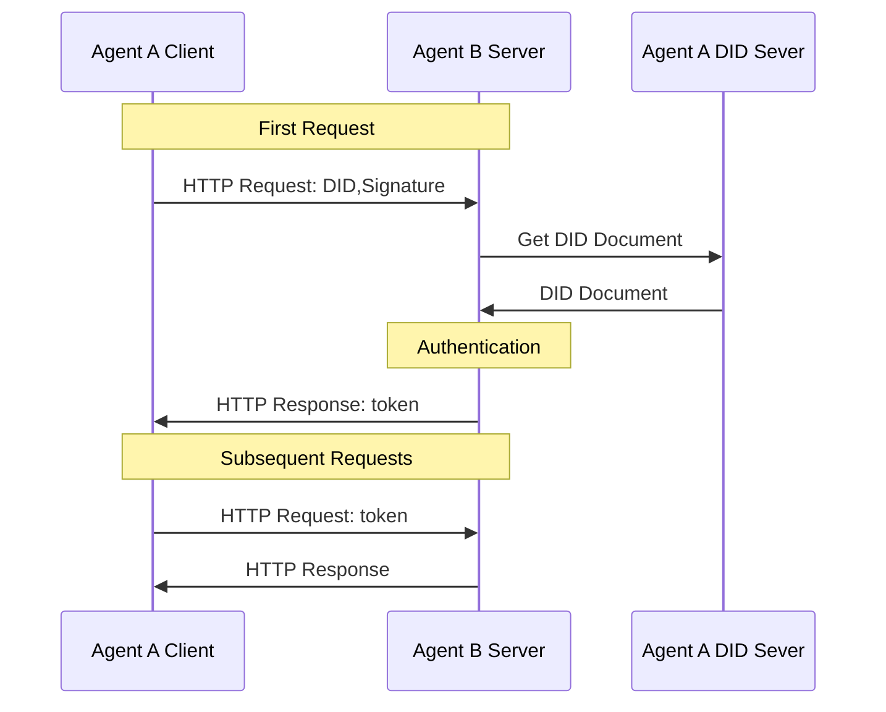

<!-- translation-review: machine-fully-reviewed; scope=source lines 1-344; inventory=japanese/reviews/core-review.json; full prose compared against source -->
> 日本語参考訳（機械翻訳を原文と全文照合し、意味・用語を校閲済み）。規範となるのは原文です。コード例・識別子・規範キーワードは原文を保持しています。
> 原文: [01-agentnetworkprotocol-technical-white-paper.md](../01-agentnetworkprotocol-technical-white-paper.md) / 基準コミット: `0837cfdfaf4ddcf834f0890ddaf34fc4c824e066`

# Agent Network Protocol技術白書:

- 文書ID: ANP-01
- 状態: 参考白書（規範仕様ではありません）
- バージョン: 1.2
- 原文言語: English / このページは日本語参考訳

> この白書は概念的な構造とビジョンを説明します。ANP 1.2の規範要件は各仕様が定めます。[ANP-02](02-anp-did-authentication-protocol-specification.md)が共通認証、ANP-03がWBAメソッドの規則を担当し、ネイティブの`did:web`も同じ認証フローを使います。ANP-06はドラフトのままで、P6の安定版公開には引き続きMLS登録の条件を満たす必要があります。

## 要約

大規模なモデルと自律的な意思決定 AI の開発により、エージェントはモバイル アプリに続くインターネットの新しい存在になりつつあります。しかし、既存のインターネット インフラストラクチャは主に人間との対話を目的として設計されており、データ サイロ、使いにくいインターフェイス、エージェント間のコラボレーション コストの高さを生み出し、大規模なエージェントの相互接続とコラボレーションのニーズをサポートすることが困難になっています。インターネットは大きな変革を遂げており、従来のソフトウェアに代わるエージェント、ユニバーサル エージェントの相互接続、ネイティブ プロトコル ベースの接続、自律的なエージェントの組織とコラボレーションという 4 つの中心的な傾向が見られます。

これらの傾向に合わせて、エージェント ネットワーク プロトコル (ANP) はエージェント Web 用の新世代の通信プロトコルを提案しています。 ANP は AI ネイティブ設計を遵守し、既存のインターネット プロトコルとの互換性を維持し、モジュール式の構成可能なアーキテクチャを採用し、最小限でありながら拡張可能な原則に従い、既存のインフラストラクチャに基づいた迅速な展開を可能にします。 ANP は、アイデンティティおよび暗号化通信層、メタプロトコル ネゴシエーション層、アプリケーション プロトコル層の 3 層プロトコル システムを通じて、エージェント ID 認証、動的ネゴシエーション、および機能検出の相互運用性の問題を体系的に解決します。

アプリケーション層では、エージェント記述プロトコル（ADP）と発見プロトコルでAIに適したネイティブなデータネットワークを構築し、機能の公開と構造化された相互接続を可能にします。セキュリティとプライバシーでは、人の認可とエージェントの認可を区別する仕組み、複数DIDによるプライバシー保護戦略、開示最小化、エンドツーエンド暗号化を取り入れ、開かれたネットワークでユーザーとエージェントの自律性とデータの安全性を確保します。

ANP は将来を見据えて、デジタル サイロを打破し、インターネットの進化をクローズド プラットフォームのエコシステムからオープン プロトコルを中心とした協調ネットワークに戻すよう推進することに取り組んでいます。 「接続は力である」という設計哲学を支持し、高品質で摩擦の少ないエージェント接続とコラボレーションを促進することで集合知の巨大な可能性を解放します。 ANP は単なる通信標準ではなく、エージェントティック Web の時代におけるオープン性、公平性、イノベーションの活力を再構築するための重要なインフラストラクチャを表します。私たちは、世界中の開発者、研究者、組織を、ANP エコシステムの構築に参加し、エージェントによって推進される新しいインターネットの未来を共同創造するよう招待します。

## 1. はじめに

### 1.1 背景と課題

大規模なモデルと自律的な意思決定 AI の開発により、エージェントはモバイル アプリに続くインターネットの新しい存在になりつつあります。エージェントは既存のソフトウェアに取って代わり、インターネットの重要な部分になることが期待されています。しかし、現在のインターネット技術基盤と接続パラダイムは、主に次の側面でエージェントのニーズを満たすのに苦労しています。

- **データのサイロとコンテキストの制限**: エージェントは意思決定を行うために包括的なコンテキスト情報を統合する必要がありますが、現在のインターネット プラットフォームは接続されておらず、データはさまざまなアプリケーションやサーバーに分離されています。このデータサイロ現象により、エージェントによる完全な情報へのアクセスが制限され、インテリジェントな意思決定の利点を活用することが困難になります。

- **不親切なインターフェイス (非ネイティブ)**: 既存のインターネット アプリケーションは主に人間向けに設計されており、GUI を通じてサービスを提供します。エージェントが既存のヒューマン インターフェイスを使用したい場合は、人間の操作をシミュレートする必要がありますが、これは非効率でエラーが発生しやすくなります。エージェントは、API または通信プロトコルを直接使用してデジタル世界と対話することに優れているため、情報処理仲介者を減らし、対話効率を向上させるために、エージェントにはネイティブ データ インターフェイスが必要です。

- **高いコラボレーションコスト**: 現在、さまざまなエージェントが相互に分離されており、直接的な通信メカニズムがありません。大規模な言語モデルにより、エージェントは自然言語を使用してネゴシエートできますが、標準プロトコルのサポートがなければ、自己組織化されたコラボレーションは依然として困難です。エージェントが他のエージェントと直接通信し、自律的に交渉できるようになれば、既存のインターネットよりも費用対効果が高く、効率的な協力ネットワークが構築されるでしょう。

### 1.2 Agentic Webの4つの傾向

上記の分析に基づいて、インターネットはエージェントを中心とした新たな大きな変革を経験していると考えられます。この変化は、次の 4 つの主要なトレンドに反映されています。

#### 1.2.1 エージェントは従来のソフトウェアを完全に置き換えます

将来的には、エージェントは既存のソフトウェア アプリケーションを徐々に置き換え、インターネットの重要なインフラストラクチャになるでしょう。個人レベルでは、AI アシスタントが既存のアプリの大部分を置き換え、ユーザーがインターネットにアクセスするための主要なエントリ ポイントになります。従来のアプリと比較して、パーソナル AI アシスタントは、情報統合、意思決定支援、シナリオ インタラクション エクスペリエンスにおいて桁違いの改善を達成できます。エンタープライズ レベルでは、企業はエージェントを配置することでインターネット上でユーザーと直接接続して対話し、正確かつ効率的なサービスを提供します。一方、パーソナル アシスタントとエンタープライズ エージェント間のポイントツーポイントの非プラットフォーム化接続に代表される、新しい接続パラダイムが形になりつつあります。

#### 1.2.2 エージェント間のユニバーサル相互接続

Agentic Web の 2 番目の中心的なトレンドは、あらゆるエージェント間の自由な接続を実現することです。これにより、現在のインターネットのデータ サイロ パターンが完全に打破され、情報の自由な流れが可能になります。完全に接続されたエージェント ネットワークにより、AI はクロスドメイン、クロスプラットフォームの完全なコンテキスト情報に完全にアクセスできるようになり、個人や企業がより包括的かつ正確な意思決定を行えるようになります。同時に、このオープン接続モードにより、エージェントはネットワーク全体ですべてのツール機能を呼び出すことができるため、エージェントのコラボレーションの深さと複雑さが大幅に拡大され、エージェント間の対話が将来のインターネットで最も主流の接続方法になります。

#### 1.2.3 エージェントのプロトコルベースのネイティブ接続モード

現在、AI とインターネットのやり取りは、主にブラウザやソフトウェア インターフェイス (コンピュータの使用 / ブラウザの使用) などの人間中心の設計手法を介して行われています。しかし、これらの手法は一時的な過渡的な解決策にすぎず、AIの可能性を完全に解放することはできません。 AI は本質的に、ヒューマン インターフェイスや Web ページの HTML よりも、基礎となる構造化データやセマンティック情報を直接処理することに優れています。したがって、将来的には、AI ネイティブ用途に特化して設計された通信プロトコル (プロトコル) を介してエージェントが接続されるようになり、HTTP のように広く適用され、業界標準になると考えられます。このプロトコルに基づいて、AI 向けに特別に設計され、エージェントにとってよりアクセスしやすく、操作しやすい新しいデータ ネットワークも出現します。

#### 1.2.4 エージェントは自己組織化して協力できる

Agentic Webの第4の傾向は、エージェントが自己組織化して協働できることです。標準プロトコルにより自然言語で柔軟に自動交渉し、相互の要望を素早く明確にして、動的に協力関係を作り、複雑なタスクを共に完了できます。固定的な構造化インターフェースを必要としないこの協働形態は、ネットワークの運用効率とタスク応答能力を高め、人の介入や調整の費用を大きく減らします。その結果、柔軟で効率的かつ低費用なエージェントネットワークが徐々に形成されます。

こうした傾向から、Agentic Webの発展を支える新しい通信プロトコルが急務です。Agent Network Protocol（ANP）はこの背景で提案され、開かれた共通の接続機構を提供し、相互接続、ネイティブインターフェース、効率的な協働の3課題を解決して、AIエージェントの可能性を解放することを目指します。

## 2. コア設計原則

Agent Network Protocol (ANP) は、最初から Agentic Web のニーズを中核として設計されており、オープンで柔軟で実装可能なエージェント通信標準の構築に努めています。その設計は次の基本原則に従っています。

### 2.1 AI ネイティブ設計

ANP は、人間とマシンの対話 (HTML や GUI インターフェイスなど) のために設計されたプロトコルではありませんが、AI エージェント間の直接通信のためにネイティブに設計されています。構造化データ、セマンティック表現、自然言語の統合を重視しており、エージェントが人間の操作をシミュレートすることなく理解、発見、共同作業できるようにします。

目標: エージェントが最も効率的かつ自然な方法でインターネットの世界にアクセスできるようにし、AI の意思決定とアクションの可能性を解放します。

### 2.2 互換性と再利用

ANP は、OpenAPI、JSON-RPC、オーディオビデオ プロトコル (WebRTC など) などの広く使用されているインターネット プロトコル標準を尊重し、互換性があります。 ANP は、車輪の再発明を行わずに、これらの既存のプロトコルをセマンティック フレームワークにカプセル化し、エージェントが軽量のメタ プロトコルと記述標準を通じて理解し、ネゴシエートできるようにします。

目標: イノベーションを確実にしながら、学習コストと移行しきい値を最小限に抑えて、既存のエコシステムの Agentic Web への迅速な統合を促進します。

### 2.3 構成可能性

ANP はモジュール設計を採用しており、エージェント ID (DID)、エージェント記述 (ADP)、エージェント検出などのコア コンポーネントを独立して使用することも、自由に組み合わせて使用することもできます。開発者は、単一のプロトコル コンポーネントを使用するか、実際のニーズに基づいて完全に統合するかを柔軟に選択できます。

目標: さまざまな複雑さと段階のアプリケーション シナリオをサポートし、必要に応じて実行可能な最小限のユニットから大規模システムまであらゆるものに適応できます。

### 2.4 シンプルさと拡張性

ANP は最小限の原則 (Keep It Simple) に従い、理解と実装の障壁を下げる、簡潔で直感的なプロトコルを目指しています。同時に、エージェント エコシステムの進化に伴う新しい機能の自然な追加をサポートするために、十分な拡張インターフェイスと柔軟なスキーマ メカニズムを維持します。

目標: 多様なアプリケーション要件に合わせて拡張スペースを確保しながら、小規模で安定したコア プロトコルを維持すること。

### 2.5 実用的な導入可能性

ANP の設計は、実際的な展開の実現可能性を十分に考慮しており、複雑または普及が難しい新しいテクノロジーや独自のコンポーネントに依存することなく、主に既存のインターネット インフラストラクチャ (DNS、HTTPS、Web サーバー、DID システムなど) 上で動作します。どの開発者や企業でも、ANP をサポートするエージェント サービスを迅速に構築できます。

目標: 初期導入の障壁を下げ、現実世界でのプロトコルの迅速な試験運用、適用、導入を促進すること。

### 2.6 最小信頼の原則

ネットワークの参加者（エージェント、ノードなど）を既定で完全に信頼するべきではありません。全ての対話で認証と認可を行い、特定タスクに必要な最小限の権限だけを与える必要があります。そのため、本人性検証、アクセス制御、データ検証の堅牢な機構を設計に組み込み、潜在的な危険や乱用を軽減します。

目標: 信頼できない環境でも安全に動作できるエージェント ネットワークを確立すること。

## 3. コアプロトコル設計

### 3.1 プロトコル層アーキテクチャ

次の図に示すように、3 層のプロトコル アーキテクチャを設計しました。

  

ANP プロトコル アーキテクチャは下から上に 3 つの層に分割されており、それぞれに異なるコア機能があります。

1. アイデンティティと安全な通信層

この層は、エージェント間の ID 認証と暗号化通信の基本標準を定義し、クロスプラットフォームの ID 相互認識とエンドツーエンドの暗号化通信の問題に対処します。

ANP は、W3C DID 標準に基づいて、軽量で拡張可能な分散型 ID 認証メカニズム (did:wba メソッドなど) を設計し、中央機関の介入なしに、任意の 2 つのエージェントが互いの ID を安全に検証し、プライベートで信頼性の高い暗号化通信チャネルを確立できるようにします。

2. メタプロトコル層

この層は、エージェントが自然言語に基づいて動的かつ適応的に通信プロトコルをネゴシエートする方法を定義します。

要件、機能、および連携の意図を自然言語で交換することで、エージェントは現在のシナリオに適した通信の詳細 (要求形式、インターフェイス呼び出し方法、セッション管理戦略など) を柔軟にネゴシエートし、適応性の高いプロトコル調整とランタイムの最適化を実現できます。

3. アプリケーションプロトコル層

この層には、エージェントの説明とエージェントの検出という 2 つのコア モジュールがあります。エージェントは、構造化された記述ドキュメント (ADP エージェント記述プロトコルなど) を通じて機能とインターフェイスを公開し、検出プロトコルに基づいてサービス エントリ ポイントをアクティブまたはパッシブに公開します。

### 3.2 ID と安全な通信層

すべてのエージェント間の相互接続と相互運用性を実現するための主なタスクは、エージェント間の ID 認証の問題を解決することです。現在、ほとんどのインターネット アプリケーションは集中型 ID テクノロジを使用しているため、技術実装の違いにより、システム間でのアカウント認証が困難になっています。 OAuth2.0 テクノロジーはこの問題をある程度軽減します[^2] が、クロスシステム ID 認証用に特別に設計されていないため、プロセスが比較的複雑になり、分散化が制限されます。したがって、便利なクロスプラットフォームの分散型 ID 認証テクノロジーが緊急に必要とされています。

ブロックチェーンベースの分散型 ID 認証ソリューションは潜在的なアプローチを提供しますが、大規模アプリケーションにおけるスケーラビリティの課題のため、まだ最適なソリューションにはなっていません。

これらの問題に対処するために、W3C 分散識別子 (DID) 標準[^3] を導入します。 DID は、従来の集中 ID 管理システムの依存関係を解決するために設計された新しい識別子標準です。これにより、ユーザーは集中システムに依存せずに自分の ID を制御し、相互に認証できるようになります。 DID コア仕様は、分散型識別子を構築するための特定の計算インフラストラクチャを義務付けていないため、既存の成熟したテクノロジーと確立された Web インフラストラクチャを最大限に活用できます。さらに、さまざまなタイプの識別子システムに DID サポートを追加して、集中型、連合型、および分散型の識別子システム間の相互運用性のブリッジを構築できます。これは、既存の一元的な識別子システムを完全に再構築する必要がないことを意味します。基盤上に DID を作成するだけでシステム間の相互運用性が実現され、技術的な実装の困難が大幅に軽減されます。

  

DID の中核コンポーネントは DID ドキュメントです。これには特定の DID に関連する重要な情報が含まれており、DID 所有者の身元を確認し、DID に関連する操作、権限、およびアクセス制御の管理をサポートするために使用されます。

  

認証プロセスでは、DID ドキュメントには、ユーザー ID を検証するためのメソッドと対応する公開キーが含まれています (秘密キーはユーザーによって保管されます)。クライアントは、最初の HTTP リクエスト中に HTTP ヘッダーに DID と署名を含めることができます。インタラクションの頻度を増やすことなく、サーバーは DID ドキュメントの公開キーを使用してクライアントの ID を迅速に検証できます。最初の検証の後、サーバーはクライアントが後続のリクエストに含めるトークンを返すことができるため、サーバーは毎回クライアント ID ではなくトークンを検証できます。このプロセスの核心は、検証者が信頼された公開キーを使用してユーザーの署名情報を検証し、ID 認証、権限の検証、およびデータ交換を 1 つのリクエストで完了することで、プロセスを簡潔かつ効率的に行うことです。

DID メソッドは、DID と DID ドキュメントを作成、解決、更新、非アクティブ化する方法、および認証と認可を実行する方法を定義します。既存の DID メソッドのうち、`did:web` メソッド[^5] は成熟した Web テクノロジに基づいて構築されており、システムは集中テクノロジ (クラウド コンピューティングなど) を使用して DID および DID ドキュメントを作成、更新、非アクティブ化できます。インターネット上の電子メール サービスと同様に、さまざまなシステムが HTTP プロトコルを通じて相互運用性を実現します。各プラットフォームは、プラットフォーム間の相互接続を可能にしながら、一元的な方法で独自のアカウント システムを実装します。

`did:web` メソッドに基づいて、クロスプラットフォーム ID 認証プロセスとエージェント記述サービスを追加して、エージェント通信シナリオ向けに特別に設計された新しい DID メソッド、`did:wba` (Web ベース エージェント) を提案しました。 `did:wba` 方式は、`did:web` の利点を継承しながら、エージェント間の ID 認証メカニズムをさらに最適化し、エージェント ネットワークでの適用性を高めています。

さらに、ユーザーは通常、DID の公開鍵と秘密鍵のペアを 1 つ以上作成します。これは、身元確認だけでなく、エンドツーエンドの暗号化通信にも使用されます。これらの DID キー ペアに基づいて、Elliptic Curve Diffie-Hellman Ephemeral (ECDHE) プロトコル[^6] を使用するエンドツーエンドの暗号化スキームを設計しました。これにより、2 つの DID 間の安全な通信が可能になり、中間ノードが通信コンテンツを復号化できないようになります。エンドツーエンド暗号化はエージェント リバース プロキシに使用できます。たとえば、エージェントは運用コストを削減するためにサードパーティのプラットフォームからポートを借りることができます。この場合、サードパーティのプラットフォームはメッセージを転送しますが、その内容を復号化することはできません。

### 3.3 メタプロトコル層

メタプロトコルは、通信プロトコルの操作、解析、結合、および対話のためのルールを定義するプロトコルです。基本的に、これは通信プロトコルをネゴシエートするためのプロトコルであり、特定のデータ送信を直接処理するのではなく、柔軟で汎用的で拡張可能な通信フレームワークを提供します。

現在、エージェント間の通信には主に 2 つの方法があります。

1. **通信プロトコルを設計する人間のエンジニア**: 一般的な業界標準など。人間のエンジニアは、エージェントの通信プロトコルを設計し、プロトコル コードを開発し、デバッグ、テスト、展開を実行します。ただし、このアプローチは、開発コストの高さ、プロトコルの更新の遅さ、新しいシナリオへの適応の難しさなどの課題に直面することがよくあります。

2. **自然言語を直接使用して通信するエージェント**: エージェントは自然言語を使用して通信し、大規模言語モデル (LLM) を使用してこのデータを内部で処理します。しかし、この方法ではデータ処理コストが高く、処理精度が低いという問題があります。

これらの問題に対処するには、メタプロトコルと AI コード生成を組み合わせて使用できます。メタプロトコルを使用し、AI コード生成テクノロジーを活用することで、柔軟性とパーソナライゼーションを維持しながら、エージェント間の通信効率を大幅に向上させ、コストを削減できます[^7]。

メタプロトコルを使用した通信の基本プロセスは次のとおりです。

1. **メタプロトコルリクエスト**: エージェント A は、最初にメタプロトコルリクエストをエージェント B に送信します。リクエスト本文は自然言語を使用してニーズ、入力、期待される出力を記述し、候補の通信プロトコルを提案します。候補プロトコルには通常、トランスポート層プロトコル、データ形式、データ処理方法などが含まれます。

2. **プロトコルネゴシエーション**: メタプロトコルリクエストを受信した後、エージェント B は AI を使用して自然言語記述を処理し、自身の機能と組み合わせて、A のリクエストと候補プロトコルを受け入れるかどうかを決定します。 B の能力が A の要求を満たすことができない場合、B は直接拒否します。 B が A の候補プロトコルを受け入れない場合は、独自のプロトコルを提案して、次の交渉ラウンドに入ることができます。このプロセスは、双方が合意に達するか、交渉が失敗するまで続きます。

3. ** コードの生成と展開**: 合意に達した後、各当事者は、交渉されたプロトコルに基づいてプロトコル処理コードを生成し、展開します。

4. **共同テスト**: コードの展開後、両当事者はテスト データをネゴシエートして、プロトコルと AI が生成したプロトコル処理コードを共同でデバッグおよびテストします。

5. **正式通信**: テストが完了すると、プロトコルが有効になります。その後、エージェント A と B は、最終的にネゴシエートされたプロトコルを使用して通信を開始し、AI が生成したコードを使用してデータを処理します。

6. **要件変更の処理**: 要件が変更された場合、両当事者が新たな合意に達するまで上記のプロセスが繰り返されます。

  

ただし、メタプロトコルのネゴシエーションには時間がかかり、AI コード生成機能に依存します。通信ごとにメタプロトコルのネゴシエーションが実行されると、膨大なコストが消費され、対話エクスペリエンスが低下します。エージェント間には同一または類似の通信プロセスが多数あるため、エージェントはメタプロトコル ネゴシエーションの結果を保存できます。後で同様のニーズが発生した場合、以前のネゴシエーション結果を通信の正式なプロトコルとして、またはネゴシエーションの候補プロトコルとして直接使用できます。同時に、エージェントは、他のエージェントがクエリして使用できるようにネゴシエーション結果を共有することもできます。

エージェントが交渉結果を積極的にアップロードし、エージェント間のコンセンサスプロトコルを選択するよう経済的にインセンティブを与える方法は、メタプロトコル層での詳細な研究が依然として必要な問題です。

### 3.4 アプリケーションプロトコル層

アプリケーション プロトコル層には、エージェント記述とエージェント検出という 2 つのコア モジュールがあります。

#### 3.4.1 エージェント記述プロトコル (ADP)

エージェント記述プロトコル（ADP）は、各エージェントが標準化された方法で自分を記述する仕組みです。文書はJSON-LD（JSONに基づくLinked Data形式）で書き、schema.orgの一般語彙を拡張し、ANP独自語彙と組み合わせて統一メタデータ形式を定義します。エージェント記述（AD）文書はネットワーク上の名刺やプロフィールに相当し、他エージェントはこれを読んで対話方法を理解できます。

エージェント説明文書には通常、次の重要な情報が含まれます。

- **基本情報**: エージェント名、一意の識別子、関連エンティティ (個人、組織、またはその他のエージェント)、およびその他の識別メタデータ。
- **能力の説明**: エージェントによって提供される機能、製品、またはサービスのリストと、対応する説明。たとえば、チャット アシスタントであるか、データ分析サービスであるか、ロボット実行機能を備えているかなどです。
- **インターフェースとプロトコル**: 呼び出し可能な API エンドポイントやサポートされている通信プロトコルのバージョンまたは仕様など、エージェントと対話するためのメソッド。他のエージェントはこの情報を使用して、エージェントにリクエストやメッセージを送信する方法を把握します。
- **セキュリティと認可**: エージェントの認証方法と権限の要件。たとえば、その身元を確認するためにどの DID 識別子と公開キーが使用されるかなどです。 ADP 仕様では、クロスプラットフォームの ID 認証要件を満たすための統合セキュリティ メカニズムとして Did:wba メソッドを使用することを推奨しています。
- **連絡先情報**: 自動対話以外で人間による介入やデバッグを容易にするための、オプションのテクニカル サポートまたは連絡チャネル (サービス エンドポイント URL、メンテナの連絡先電子メールなど)。

これらの情報はJSON-LDで構造化して提示され、機械が解析でき、豊かな意味を表現する記述になります。JSON-LDコンテキストを通じ、AD文書の語彙を公開オントロジーに結び付けることで、システム間の意味を揃えられます。例えばADPは「Agent」「Service」「Interface」などの中核語彙を定義し、本仕様に従う全エージェントで意味を共通にします。これが相互の機能理解の基盤です。

ADPは分散型の本人性を記述文書のセキュリティ構造に組み込みます。各エージェント記述はDIDと結び付け、本人性認証用の検証メソッドと公開鍵情報を持たせられます。他エージェントは記述を読んで通信するときDID署名を検証し、相手の本人性が信頼できることを確認して、開かれたネットワークで安全な接続を確立できます。この設計は相互信頼を確保し、その後の協働の基盤になります。

最後に、エージェント記述文書はWebサイトのホームページに似たネットワーク上の入口であり、他エージェントはその文書を読むことで対話方法を理解できます。

#### 3.4.2 エージェント検出プロトコル

記述が用意されたら、エージェント同士を発見して接続する仕組みが必要です。エージェント発見プロトコルはその標準として設計されています。ネットワークで記述文書を公開・取得する方法を定め、任意のエージェントや検索サービスが他の入口を見つけやすくします。本質的にはエージェント用の「検索エンジンのプロトコル」であり、エージェントインターネットのノードを発見・利用可能にします。

Agent Discovery Protocol は、次の 2 つの補完的な検出方法を提供します。

1. **能動的発見**: Webで一般的な.well-knownの慣習を使い、既知ドメイン配下の公開エージェント記述を問い合わせます。ドメイン配下に統一ディレクトリ入口（既定パス: /.well-known/agent-descriptions）を設け、このURLで全AD文書のURLを含むJSON-LDマニフェストを返します。文書型はCollectionPageで、各記述へのリンクを列挙し、大規模な件数にはページ分割を使えます。相手のドメイン名だけでディレクトリを取得し、エージェントネットワークを段階的にたどれます。

2. **受動的発見**: 検索エンジンのWeb索引に似て、エージェントから専用の検索サービスエージェントへ情報を登録できます。検索サービスは記述文書に公開した登録APIを提供し、他エージェントはAD文書のURLを登録します。検索サービスはそのURLを定期的に巡回し、最新の記述を取得してデータベースに索引化します。関連サービスの問い合わせがあれば登録エージェント情報を返せます。新しいエージェントはこの仕組みで存在を知らせ、索引に登録され、より多くのノードから発見されます。

両機構は補完的です。能動的発見は分散ドメインディレクトリによる一覧公開、受動的発見は集中型の検索エージェントによる索引集約を重視します。発見情報は全てADPに沿うJSON-LDで表します。どの経路で取得しても、最終的には各エージェントの記述文書を指します。

発見プロトコルによりANPはネットワークの開放性を確保します。新しいエージェントが知られないまま情報の孤島になることを防ぎます。プロトコルに従って記述文書を公開・登録すればネットワークで検索でき、大規模なエコシステム形成の基盤になります。

発見プロトコルは大量のエージェント情報を効率よく扱うため、結果のページ分割とリンク方法も標準化します。ドメイン内の件数が多い場合、.well-known/agent-descriptions文書のnextフィールドで次ページを示し、段階的に読み込めます。検索結果にも同様の仕組みを使えます。これが発見処理の拡張性と堅牢性を支えます。

エージェント記述プロトコルと検出プロトコルの組み合わせにより、ANP はアプリケーション層で閉ループを実現します。つまり、エージェントは ADP を使用して自分自身を記述し、エージェント検出プロトコルを使用して自分自身を公開し、他のエージェントを検出します。このメカニズムは、エージェント インターネットにおける「お互いをどのように認識するか」という課題に対処し、前述のエージェント相互接続の要件を満たします。 ANP は、セキュア ID 層と柔軟なメタプロトコル層と組み合わせることで、エージェント間にオープンで効率的で信頼できる接続を確立するための完全なソリューションを提供します。

### 3.5 AI ネイティブ データ ネットワーク

既存のインターネット インフラストラクチャは人間のアクセスを考慮して設計されています。 Web ページはハイパーリンク (HTML+HTTP) を介して接続されており、情報はページ、フォーム、画像、その他の視覚的なインターフェイスの形式で表示され、主に人間の閲覧と操作に役立ちます。ただし、この人間中心の接続モードは、AI エージェントによる効率的なアクセスと処理には適していません。 AI が既存のインターネットを使用するには、人間の動作 (Web ページのクリック、閲覧、解析) をシミュレートする必要があり、エージェントの能力が大幅に制限されます。

この問題に対処するために、エージェント ネットワーク プロトコル (ANP) は AI ネイティブのデータ ネットワーク構造を提案しています。 Agent description Protocol (ADP) と Agent Discovery Protocol を通じて、各エージェントはそのサービス インターフェイス、機能情報、データ リソースを構造化された標準化された方法で公開し、オープンな検出メカニズムを通じてエージェント ネットワーク全体に自動的に自身を公開できます。

このフレームワークでは、すべてのエージェントとそのエージェントが運ぶデータ リソース (テキスト、API、オーディオ/ビデオ、画像など) が、マシンに優しいオープン ネットワークを形成します。

- 各ノードは、記述可能、検出可能、呼び出し可能なエージェントまたはデータ ユニットです。
- 各リンクは、人間が読むための単なるハイパーテキストではなく、意味的に明確で構造的に統一されたプロトコル接続です。
- エージェントは、統一された標準に基づいて他のエージェントが提供するリソースとサービスを迅速に取得、理解、呼び出すことができます。

この AI ネイティブのデータ ネットワークにより、エージェントは、Web ページのクローリングやインターフェイス シミュレーションに依存することなく、インターネット上に広く分散された機能や知識に直接、効率的にバッチ アクセスできるようになり、自律的な学習、推論、コラボレーションのための AI の可能性が大幅に解放されます。

より多くのパーソナル エージェント、サービス エージェント、および検索エージェントが ANP 経由で接続するにつれて、ノードとしてのエージェントと接続としての構造化データを含むこのネットワークは成長し続け、最終的にはグローバルで動的に進化するエージェント インターネットを形成します。

## 4. セキュリティとプライバシー

エージェント インターネットでは、セキュリティとプライバシー保護が基本的であり、交渉の余地のない要件です。エージェント ネットワーク プロトコル (ANP) には、初期設計から ** ID 認証セキュリティ、操作権限の区別、プライバシー保護、およびきめ細かい権限制御** がコア メカニズムとして組み込まれており、オープン ネットワーク環境におけるエージェント間で信頼できる通信と安全なデータ共有が保証されます。

このセクションでは、ANP のセキュリティとプライバシーの設計を、ID と認可の管理、プライバシー保護メカニズム、通信セキュリティの 3 つの側面から体系的に説明します。

### 4.1 人の認可とエージェントの認可の区別

慎重に扱うべき操作を人の管理下に置くため、ANPは本人性認証と操作の認可を分けます。[ANP-02 v1.2](02-anp-did-authentication-protocol-specification.md)のとおり、`did:wba` DID Documentは`authentication`に使う検証メソッドを宣言しますが、専用の`humanAuthorization`検証関係は定義しません。

- **低リスク操作**（公開情報の問い合わせや閲覧など）は、ローカル認可ポリシーが許す場合、エージェントが自動で開始できます。
- **高リスク操作** (資金移動、重要なデータの提出、個人情報の開示など) は、操作を続行する前に明示的な人間の承認が必要となる場合があります。

人間による承認要件は、DID 層の上に表現されます。

- [ANP-07](07-anp-agent-description-protocol-specification.md)では、インターフェースの`humanAuthorization: true`で人の認可が必要なことを宣言します。
- ドラフトの[ANP-06](06-anp-agent-communication-meta-protocol-specification.md)では、`requiresHumanAuthorization: true`は交渉上の制約であり、認可完了を意味しません。

人間による承認が必要な場合、ユーザー エージェントはまず該当する承認ポリシーで定義された確認プロセスを完了し、次にそのポリシーで許可されている `authentication` キーを使用して署名し、リクエストを開始する必要があります。サーバーは、リクエストが合意された上位レベルの認可ポリシーを満たしているかどうかを検証します。 `authentication` 検証方法で生成されたリクエスト署名は、それ自体では人間が操作を許可したことを証明するものではありません。

この分離により、ID 証明が操作許可とは区別され、上位層のポリシーで機密性の高いアクションに対して人間による制御が必要になることが可能になります。 ANP-02 は、人間による承認がどのように取得または証明されるかを定義していません。これらの詳細は、該当するビジネス プロトコルと認可ポリシーによって定義されます。

### 4.2 秘密キーの管理と権限の分離

エージェント開発者は、以下を含むがこれらに限定されない、高リスク操作で使用される `authentication` キーの厳密な権限分離とセキュリティ管理を実装する必要があります。

- **リスクに基づく管理**: `authentication`鍵を、ポリシーが許可する操作ごとに分類し、その危険度に合う制御を適用します。
- **ローカル暗号化ストレージ**: 秘密キーは、安全に暗号化されたローカル デバイス (TEE、HSM など) または保護されたキー管理システムに保存する必要があります。
- **追加確認**: ポリシーが要求する場合、高リスク操作に`authentication`鍵を使う前に、指紋、顔認証、ワンタイムパスワード、セキュアハードウェアでの承認などを追加で確認します。
- **操作ログ**: イベント後の監査と追跡を容易にするために、機密署名操作ごとに完全な操作ログを記録する必要があります。

これらのメカニズムにより、キーの漏洩、盗難、悪用のリスクに対する保護が最大限に強化されます。

### 4.3 マルチ DID 戦略ときめ細かいプライバシー保護

プライバシー保護と匿名性を強化するために、ANP はユーザーとエージェントが **マルチ DID 管理戦略** を採用することを推奨しています。具体的なアプローチには次のようなものがあります。

- **プライマリ DID とサブ DID の分離**: プライマリ DID は長期的な社会関係 (友人、ビジネス パートナーなど) を維持するために使用され、独立したサブ DID はさまざまなアプリケーション シナリオ (電子商取引ショッピング、食品配達、オンライン サービスなど) に合わせて生成されます。
- **最小権限の原則**: 各サブ DID には、特定のタスクを完了するために必要な最小限の権限と役割のみが付与されます。
- **定期ローテーションと期限**: サブDIDのライフサイクルを定め、用途をまたぐ追跡や本人性の関連付け攻撃を防ぐため、使用後は廃棄して新しいものを申請するべきです。

マルチ DID システムを通じて、ID と行動の効果的な分離を実現でき、全体的な ID セキュリティを向上させながら、大規模なデータ分析によるプライバシー漏洩のリスクを軽減します。

### 4.4 最小限の情報開示と通信プライバシー

エージェント間のコミュニケーションにおいて、ANP は、**最小限の開示原則** の遵守を強調します。

- エージェントは、リクエストを完了するときに必要な情報フィールドのみを送信し、無関係なデータ漏洩を回避する必要があります。
- 機密フィールドはエンドツーエンド暗号化を使用して送信する必要があり、通信リンクが傍受された場合でもデータ内容が保護されたままであることが保証されます。
- 中間者攻撃や通信の偽造を防ぐために、すべての通信セッションは対応する本人確認情報にバインドされる必要があります。

さらに、ANP は、プライベート データの保護とアクセス制御を強化するために、アプリケーション層での匿名通信テクノロジ (検証可能な暗号化、選択的開示資格情報など) のさらなる導入を奨励します。

## 5. 将来の展望: 接続によるオープンネットワークの再構築

インターネットの進化は、「接続は力である」という中心概念を深く証明しています。真にオープンで相互接続されたネットワークでは、ノード間の自由な対話によりイノベーションの可能性が最大化され、莫大な価値が生み出されます。しかし、今日のインターネット エコシステムは、少数の大規模プラットフォームによってますます支配されており、膨大な量のデータとサービスが閉じられた「デジタル サイロ」内に閉じ込められ、接続力が少数のテクノロジー巨人の手に集中しています。

Agentic Web の出現は、この不均衡を再形成する歴史的な機会を提供します。私たちの目標は、インターネットを現在の閉鎖的で断片的な状態から、オープンで自由に接続された原点に戻すことです。将来のエージェント ネットワークでは、すべてのエージェントが情報消費者とサービス プロバイダーの 2 つの役割を同時に果たします。さらに重要なのは、各ノードが障壁なくネットワーク内の他のノードを検出、接続、および対話できる必要があることです。このユニバーサル相互接続のビジョンにより、情報の流れとコラボレーションに対する障壁が大幅に軽減され、すべてのユーザーと個々のエージェントに接続の力が戻ります。

これは、プラットフォーム中心のクローズド エコシステムからプロトコル中心のオープン エコシステムへの重要な移行を示しています。後者の場合、価値の獲得は、クローズド プラットフォーム上の制御に依存するのではなく、参加者がオープン プロトコルに従ってネットワークにもたらす独自の能力と貢献に依存します。この変革は、アプリケーション層のイノベーションと競争をさらに刺激するでしょう。成功の鍵はもはやユーザーを「囲い込む」ことではなく、TCP/IP や SMTP などのオープン プロトコルによって歴史的に推進されてきたイノベーション パターンと同様に、優れたエージェント サービスを提供することだからです。

エージェントのインターネット ネットワークの構築は、広範な協力と共同の努力を必要とする大事業です。基礎的なプロトコル フレームワークとしての ANP の成功は、採用、実装、開発者コミュニティからの継続的な貢献にかかっています。私たちは、エージェント テクノロジーとオープン インターネットの将来に関心のあるすべての研究者、開発者、企業、組織に、ANP の開発、テスト、およびアプリケーションの推進に参加して、効率的なエージェント コラボレーションのより良い未来を構築するために協力するよう呼びかけます。

## 参考資料

[^1]: ビル・ゲイツ、AI はコンピューターの使い方を完全に変えようとしています。 [https://www.gatesnotes.com/AI-agents](https://www.gatesnotes.com/AI-agents)

[^2]: OAuth 2.0認可フレームワーク、[https://tools.ietf.org/html/rfc6749](https://tools.ietf.org/html/rfc6749)

[^3]: 分散型識別子 (DID) v1.0: コア アーキテクチャ、データ モデル、および表現[https://www.w3.org/TR/did-core/](https://www.w3.org/TR/did-core/)

[^4]: 分散型識別子のユースケースと要件 [https://www.w3.org/TR/did-use-cases/](https://www.w3.org/TR/did-use-cases/)

[^5]: Did:web メソッド仕様、 [https://w3c-ccg.github.io/did-method-web/](https://w3c-ccg.github.io/did-method-web/)

[^6]: トランスポート層セキュリティ (TLS) プロトコル バージョン 1.3、[https://www.rfc-editor.org/rfc/rfc8446.html](https://www.rfc-editor.org/rfc/rfc8446.html)

[^7]: 大規模な言語モデルのネットワークのためのスケーラブルな通信プロトコル、 [https://arxiv.org/pdf/2410.11905](https://arxiv.org/pdf/2410.11905)

## 著作権表示
著作権 (c) 2024 ANP コミュニティ
このファイルは[Apache License 2.0](../LICENSE)の下で公開されています。自由に使用・変更できますが、この著作権表示を保持する必要があります。
