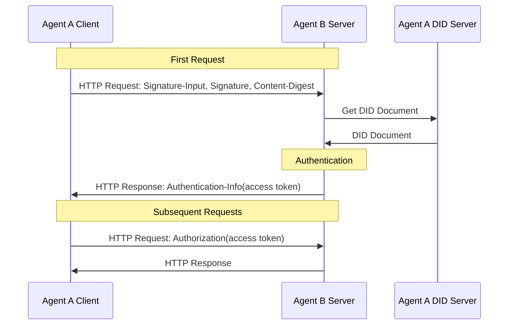
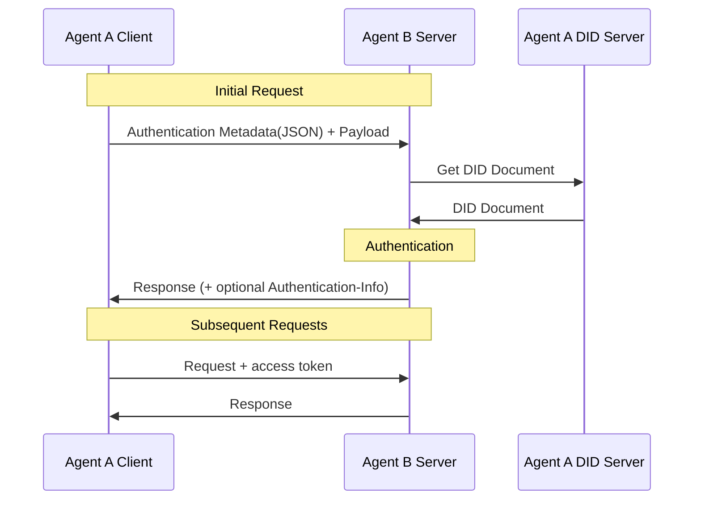

<!-- translation-review: machine-fully-reviewed; scope=source lines 1-522; inventory=japanese/reviews/core-review.json; full prose compared against source -->
> 日本語参考訳（機械翻訳を原文と全文照合し、意味・用語を校閲済み）。規範となるのは原文です。コード例・識別子・規範キーワードは原文を保持しています。
> 原文: [02-anp-did-authentication-protocol-specification.md](../02-anp-did-authentication-protocol-specification.md) / 基準コミット: `0837cfdfaf4ddcf834f0890ddaf34fc4c824e066`

# ANP DID 認証プロトコル

- 文書ID: ANP-02
- ステータス: リリース済み
- バージョン: 1.2
- 原文言語: English / このページは日本語参考訳
- 中国語の対応文書: [ANP DID ベースの認証プロトコル](chinese/02-ANP-基于DID的身份认证协议.md)

<a id="scope"></a>
## 1. 範囲

この仕様では、HTTP リクエスト署名、JSON 認証メタデータ搬送、サーバー検証、チャレンジとエラー、およびオプションのアクセス トークンを含む、DID ベースのクロスプラットフォーム認証を定義します。

認証フローはDIDメソッドに依存しません。`did:wba`とネイティブの`did:web`はそれぞれのメソッドの規則に従ってDID Documentを解決・検証した後、この仕様の共通リクエスト認証フローを使用します。識別情報の取得・検証方法は各メソッドが規定し、この仕様はリクエスト署名、ダイジェスト、認証鍵の認可を規定します。

通常の HTTP API は、ANP メッセージング、WNS、またはデバイス マニフェストを実装せずにこの認証を採用できます。メッセージング P1 ～ P9 または WNS には規範的な依存関係はありません。ビジネス権限、人間による承認、メッセージ発信元の証明、および E2EE オブジェクトの証明は、所有するアプリケーションまたはプロファイルによって定義されます。認証だけではビジネス権限を意味しません。

MUST、MUST NOT、SHOULD、SHOULD NOT、MAY は、BCP 14 で定義されている規範要件を表します。

<a id="identity-input"></a>
## 2. DIDメソッドと識別情報

| DIDメソッド | 識別情報の検証 | リクエスト認証 |
|---|---|---|
| `did:wba` | ANP-03 構文、ドキュメント、キー、解決、更新、非アクティブ化、および継続性。付録 A を参照 | 第 3 章と第 4 章 |
| `did:web` | ネイティブのdid:webの解決と、付録Bの本人性検証要件 | 第3章と第4章 |

Documentの真正性、識別情報との結び付き、ライフサイクルの規則は各DIDメソッドに属します。メソッドに基づく検証の後、この仕様では認証鍵の認可、リクエスト署名、ダイジェストを確認します。メソッド固有の証明や状態の仕組みは定義しません。

アルゴリズムと鍵表現は、選択した検証メソッドと適用されるDIDメソッドの規則に従います。付録Dでは他のメソッドへの適応、付録CではWebVHとの統合を説明します。DID Coreへの適合だけで、その実装が当該メソッドをサポートしていることにはなりません。

<a id="common-model"></a>
<a id="http-binding"></a>
## 3. HTTP リクエスト認証

クライアントが別のプラットフォーム上のサーバーに対してリクエストを開始すると、クライアントは TLS と組み合わせたドメイン名を使用してサーバーを認証でき、サーバーはクライアントの DID ドキュメント内の検証方法に基づいてクライアントの ID を検証します。

クライアントは初回のHTTPリクエストで、[RFC 9421](https://www.rfc-editor.org/rfc/rfc9421)が定義する`Signature-Input`および`Signature`ヘッダーを用いて署名します。リクエストにメッセージ本文がある場合は、[RFC 9530](https://www.rfc-editor.org/rfc/rfc9530)が定義する`Content-Digest`ヘッダーを用いて本文の完全性を結び付けます。初回の検証が成功した後、サーバーはアクセストークンを返すことができ、クライアントは後続のリクエストにそのトークンを付けます。サーバーは毎回クライアントの本人性を検証する必要はなく、アクセストークンを検証するだけで済みます。



### 3.1 最初のリクエスト

現在のクライアントが初めてサーバーに対して HTTP リクエストを開始するとき、次の方法に従って ID 認証を実行する必要があります。

#### 3.1.1 リクエストヘッダー形式

クライアントは、[RFC 9421](https://www.rfc-editor.org/rfc/rfc9421)で定義された`Signature-Input`および`Signature`ヘッダーフィールドで認証情報を送信しなければなりません（MUST）。リクエストにメッセージ本文が含まれる場合、[RFC 9530](https://www.rfc-editor.org/rfc/rfc9530)で定義された`Content-Digest`ヘッダーフィールドも送信しなければなりません（MUST）。

署名が最低限カバーする構成要素は次のとおりです。

- `@method`
- `@target-uri`
- `content-digest` (リクエストにメッセージボディが含まれる場合)

署名対象に追加することが推奨される構成要素は次のとおりです。

- `@authority`
- `content-type`
- `content-length`

`Signature-Input` の主要なパラメータ要件は次のとおりです。

- `keyid`: DID Document内の検証メソッドを指す完全なDID URLでなければなりません（MUST）。例:
  `did:web:identity.example:alice#key-1`
- `created`: 必須（MUST）。署名の作成時刻を示します。
- `expires`: 推奨（SHOULD）。署名の失効時刻を示します。
- `nonce`: 含めてもかまいません（MAY）。サーバーのチャレンジで`nonce`が指定された場合、クライアントはその`nonce`を使用しなければなりません（MUST）。
- `alg`: 必須ではありません。この仕様は`alg`パラメーターの使用を義務付けません。検証者は`keyid`が指すDID検証メソッドの型からアルゴリズムを決定できます。

認証鍵の選択は、適用されるDIDメソッドとローカルの認可ポリシーに従います。選択する検証メソッドは、主体のDocumentの`authentication`関係によって認可されている必要があります。

クライアントリクエストの例:

```plaintext
POST /orders HTTP/1.1
Host: api.example.com
Content-Type: application/json
Content-Digest: sha-256=:BASE64_SHA256_DIGEST:
Signature-Input: sig1=("@method" "@target-uri" "@authority" "content-digest");created=1733402096;expires=1733402156;nonce="abc123";keyid="did:web:identity.example:alice#key-1"
Signature: sig1=:BASE64_SIGNATURE:
```

DID メソッドに固有の署名生成要件は、そのメソッド仕様によって定義されます。セクション 2 を参照してください。

#### 3.1.2 署名生成プロセス

1. HTTPリクエストにメッセージ本文がある場合、クライアントはまず[RFC 9530](https://www.rfc-editor.org/rfc/rfc9530)に従って本文の`Content-Digest`値を計算します。

2. 適用されるDIDメソッドとローカルの認可ポリシーに従って、署名に使用する検証メソッドを選択します。
   - 選択した検証メソッドが`Multikey`で表現されたEd25519鍵を使用する場合、Ed25519アルゴリズムで署名するべきです。
   - その他のアルゴリズムは、対応する検証方法のタイプによって定義されます。

3. 少なくとも`@method`と`@target-uri`をカバーする`Signature-Input`を構築します。メッセージ本文がある場合、`content-digest`も署名対象に含める必要があります。

4. [RFC 9421](https://www.rfc-editor.org/rfc/rfc9421)の規則に従って署名ベース文字列（signature base）を生成します。

5. クライアントの秘密鍵で署名ベースに署名し、得られた署名のバイト列を`Signature`ヘッダーフィールドに書き込みます。

6. `Signature-Input`、`Signature`、および該当する場合は`Content-Digest`をサーバーに送信します。

### 3.2 サーバー側の検証

#### 3.2.1 リクエストヘッダーの検証

クライアント要求を受信した後、サーバーは次の検証を実行します。

1. **リクエスト形式の検証**: `Signature-Input`と`Signature`が存在することを確認します。リクエストにメッセージ本文がある場合は、`Content-Digest`の存在も確認します。

2. **メッセージ本文の完全性の検証**: リクエストに本文がある場合、[RFC 9530](https://www.rfc-editor.org/rfc/rfc9530)に従い、`Content-Digest`が実際の本文と一致することを検証します。

3. **`keyid`の抽出とDIDの解析**: `Signature-Input`から`keyid`を抽出し、対応するDIDと検証メソッドを取得します。

4. **DID ドキュメントの解決と検証**: 該当する DID メソッドに基づいてドキュメントを解決および検証します。その仕様は、アイデンティティの状態と新しい認証の制限を管理します。メソッド固有の応答については、セクション 3.2.4.3 で説明します。

5. **DID バインド関係を確認します**:
   - `keyid`が指す検証メソッドが存在することを検証します。
   - その検証メソッドがDID Documentの`authentication`関係で認可されていることを検証します。
   - メソッド固有の ID バインディング検証は、対応する DID メソッド仕様に従います。セクション 2 とそのメソッド バインディングを参照してください。

6. **署名対象の検証**: `Signature-Input`に基づいて署名ベースを再構築し、署名対象のHTTP構成要素が実際のリクエストと一致することを検証します。

7. **時間枠の検証**: `created` / `expires`が妥当な時間範囲にあることを確認します。推奨する時間枠は1分から5分で、実装者が設定できます。

8. **検証リプレイ保護**:
   - 直接接続証明プロファイルでは、サーバーは`(keyid, nonce)`または同等のキーに対する短期リプレイキャッシュを設けるべきです。
   - チャレンジプロファイルでは、`nonce`がサーバーのチャレンジに由来する場合、その`nonce`は一度限りの使用でなければなりません（MUST）。

9. **DID 権限を確認する**: 認証が成功した後、リクエスト内の DID にサーバー リソースへのアクセス許可があるかどうかを個別に確認します。許可がない場合は、 `403 Forbidden` が返されます。

10. **検証結果**: 署名の検証が成功した場合、リクエストは認証に合格します。そうでなければ、 `401 Unauthorized` チャレンジ情報が添付されて返されます。

DID メソッドに固有の ID 検証要件は、そのメソッド仕様によって定義されます。セクション 2 を参照してください。

#### 3.2.2 署名検証プロセス

1. `Signature-Input`から署名ラベル、署名対象の構成要素、`created`、`expires`、`nonce`、`keyid`などのパラメーターを解析し、`Signature`から対応する署名値を抽出します。

2. [RFC 9421](https://www.rfc-editor.org/rfc/rfc9421)の規則に従い、実際のHTTPリクエストに基づいて署名ベースを再構築します。

3. `keyid`に従ってDID Documentから対応する検証メソッドと公開鍵を取得します。

4.  検証方法のタイプに基づいて検証アルゴリズムを選択します。
   - `Multikey`で表現されたEd25519検証メソッドの場合、Ed25519の64バイト署名形式に従って検証します。
   - その他のアルゴリズムは、対応する検証方法の種類に応じて定義されます。

5. 取得した公開キーを使用して署名を検証し、署名が対応する秘密キーによって生成されたことを確認します。

6. リクエストにメッセージ本文がある場合、`Content-Digest`の検証結果も認証全体の判定に含めるべきです。

<a id="access-tokens"></a>
#### 3.2.3 認証成功時のaccess_tokenの返却

サーバー側の検証が成功すると、アクセス トークンを応答で返すことができます。アクセストークンはJWT（JSON Web Token）形式を使用することを推奨します。クライアントの後続のリクエストにはアクセス トークンが含まれます。サーバーはクライアントの DID ID を毎回検証する必要はなく、アクセス トークンを検証するだけで済みます。次の生成プロセスは仕様で必須ではなく、参照のみを目的としています。実装者は必要に応じてこれを定義して実装できます。

JWTの生成方法は[RFC7519](https://www.rfc-editor.org/rfc/rfc7519)を参照してください。

1. **アクセストークンの生成**

サーバーがアクセス トークン形式として **JWT (JSON Web Token)** を使用すると仮定すると、通常、JWT には次のフィールドが含まれます。

- **header**: 署名アルゴリズムを指定します
- **ペイロード**: ユーザー関連情報を保存します
- **signature**: `header`と`payload`に署名し、両者の完全性を確保します。

ペイロードには次のフィールドを含めることができます (他のフィールドは必要に応じて追加されます)。

```json
{
  "sub": "did:web:identity.example:alice",
  "iat": "2024-12-05T12:34:56Z",
  "exp": "2024-12-06T12:34:56Z",
  "scope": "orders.read orders.write"
}
```

2. **アクセストークンを返す**

サーバーはアクセストークンを`Authentication-Info`レスポンスヘッダーで返さなければならず（MUST）、`Authorization`レスポンスヘッダーで返してはいけません。

例:

```plaintext
Authentication-Info: access_token="eyJhbGciOi...", token_type="Bearer", expires_in=3600, scope="orders.read orders.write"
```

3. **送信者制限トークンに関する提案**

トークンが漏洩後に直接再利用されるリスクを軽減するために、**sender-constrained** アクセス トークンを使用して、クライアントが保持するキーにトークンをバインドすることをお勧めします。

このバージョンの仕様では、この拡張機能は保持されていますが、送信者制約トークンの特定のプロファイルはまだ完全には定義されていません。実装者は、将来の拡張のために次の機能を予約できます。

- トークン内のクライアントの公開キーにバインドされたステートメントを追加します (例: `cnf` または同等のフィールド);
- 後続のリクエストでトークンにバインドされた証明を提供し続けることをクライアントに要求します。
- `token_type`フィールドで異なるトークンプロファイルを区別します。

送信者制限プロファイルが統合される前は、互換性を確保するために、`Bearer` をデフォルトの `token_type` として使用できます。

4. **クライアントがアクセストークンを送信**

クライアントは通常、後続のリクエストで `Authorization` ヘッダー フィールドを介してアクセス トークンを送信します。

```plaintext
Authorization: Bearer <access_token>
```

サーバーから返された`token_type`が`Bearer`以外の場合、クライアントは対応する拡張仕様に従ってトークンを送信しなければなりません（MUST）。

5. **サーバー側でのアクセストークン検証**

クライアントのリクエストを受信すると、サーバーは`Authorization`ヘッダーからアクセストークンを抽出し、署名、有効期限、ペイロード内のフィールドなどを検証します。検証方法は[RFC7519](https://www.rfc-editor.org/rfc/rfc7519)を参照してください。

<a id="challenge-errors"></a>
#### 3.2.4 エラー処理

##### 3.2.4.1 401 応答

サーバーが署名の検証に失敗した場合、`Content-Digest` が検証に失敗した場合、署名が期限切れになった場合、リプレイのリスクがある場合、またはサーバーがクライアントにチャレンジ情報に従って再署名を要求した場合、サーバーは `401 Unauthorized` 応答を返すことができます。

サーバーが、クライアントが署名のためにサーバーによって発行された`nonce`を使用する必要がある場合、クライアントが最初のリクエストを行うときに`401`を返し、レスポンスにチャレンジ情報を追加できます。これにより、実装者が必要に応じて使用するかどうかを選択できる対話が追加されます。

エラー情報は `WWW-Authenticate` ヘッダー フィールドを通じて返され、サーバーは次のリクエストでカバーすることが期待されるコンポーネントを `Accept-Signature` を通じて示すこともできます。例は次のとおりです。

```plaintext
WWW-Authenticate: DIDWba realm="api.example.com", error="invalid_signature", error_description="Signature verification failed.", nonce="xyz987"
Accept-Signature: sig1=("@method" "@target-uri" "@authority" "content-digest");created;expires;nonce;keyid
Cache-Control: no-store
```

次のフィールドが含まれます。

- **realm**: 保護されたリソースが属するドメインを示すオプションのフィールド
- **error**: 必須フィールド、エラー タイプ。次の文字列値が含まれます。
  - `invalid_request`: リクエストの形式が正しくないか、必須フィールドが欠落しているか、サポートされていないパラメータが含まれています
  - `invalid_nonce`: nonceが使用済み、無効、またはサーバーのチャレンジと不一致
  - `invalid_timestamp`: タイムスタンプが範囲外です
  - `invalid_did`: DID 形式が間違っているか、DID に基づいて対応する DID ドキュメントが見つかりません。
  - `invalid_signature`: 署名の検証に失敗しました
  - `invalid_verification_method`: `keyid`に基づいて対応する公開鍵を見つけられない
  - `invalid_content_digest`: `Content-Digest` メッセージ本文と一致しません
  - `invalid_access_token`: アクセストークンの検証に失敗しました
  - `forbidden_did`: DID にはサーバー リソースにアクセスする権限がありません
- **error_description**: オプションのフィールド、エラーの説明
- **nonce**: 任意フィールド。サーバーが生成するランダムな文字列です。含まれている場合、クライアントはその`nonce`を使って署名を再生成し、リクエストを再送する必要があります。

クライアントが `401` 応答を受信した後、その応答に `nonce` が含まれる場合、サーバーの `nonce` を使用して署名を再生成し、リクエストを再開始する必要があります。応答に `nonce` が含まれていない場合、クライアントはローカルの `nonce` を再生成して再試行できます。

無限ループを防ぐために、クライアントとサーバーはそれぞれの実装で再試行の数を制限する必要があることに注意してください。

##### 3.2.4.2 403 応答

サーバー側の認証は成功したが、DID にサーバー側のリソースにアクセスする権限がない場合、`403 Forbidden` 応答が返されることがあります。

##### 3.2.4.3 メソッド固有の応答

ID 状態エラーとその後の処理は、該当する DID メソッドによって定義されます。そのメソッド バインディングを参照してください。一般的な認証エラーでは、セクション 3.2.4.1 および 3.2.4.2 が使用されます。

<a id="json-carriage"></a>
## 4. JSONによる認証メタデータの搬送

前の章では、DID ベースの HTTP 認証を定義しました。他のトランスポートは、アプリケーション層プロトコルで定義されたコンポーネント マッピングを使用して認証メタデータを伝送できます。このセクションでは、セクション 3 の認証情報を JSON メタデータとして運ぶ方法のみを定義し、署名される新しいフィールドのセットを再定義するものではありません。

このセクションは、リクエストのメタデータとビジネス ペイロードをアプリケーション層で分離できるシナリオに適用されます。次に例を示します。

- HTTP ボディのカプセル化
- WebSocketの最初のパケット
- メッセージバスエンベロープ
- カスタム RPC リクエスト ラッピング レイヤー

「認証メタデータ」と「ビジネス ペイロード」の境界を分離できない純粋な JSON のみの送信の場合、このセクションは直接適用されず、後続のバージョンでは特殊なトランスポート プロファイルを定義できます。

他のデータ形式に基づくプロトコルでも、この認証メカニズムを採用できます。

全体的なプロセスは次のとおりです。



### 4.1 最初のリクエスト

現在のクライアントが初めてサーバーへのリクエストを開始するとき、次の方法に従って ID 認証を実行する必要があります。

#### 4.1.1 認証情報データ形式

認証情報を HTTP ヘッダーに配置できない場合は、セクション 3 の認証フィールドを、`auth` フィールドなどの別の JSON メタデータ オブジェクトに配置できます。

推奨される形式は次のとおりです。

```json
{
  "auth": {
    "contentDigest": "sha-256=:BASE64_SHA256_DIGEST:",
    "signatureInput": "sig1=(\"@method\" \"@target-uri\" \"@authority\" \"content-digest\");created=1733402096;expires=1733402156;nonce=\"abc123\";keyid=\"did:web:identity.example:alice#key-1\"",
    "signature": "sig1=:BASE64_SIGNATURE:"
  },
  "payload": {
    "orderId": "12345",
    "action": "create"
  }
}
```

フィールドの説明:

- **auth.contentDigest**: HTTPヘッダーの`Content-Digest`に対応します。業務ペイロードがある場合、その`payload`を結び付けるために使用します。
- **auth.signatureInput**: HTTPヘッダーの`Signature-Input`に対応します。
- **auth.signature**: HTTPヘッダーの`Signature`に対応します。
- **payload**: 業務データ本体

JSONでの搬送モードでは、`contentDigest`は**ペイロード部分**を結び付けます。`auth`を含むカプセル化されたオブジェクト全体は対象にしません。`auth`は外側の認証メタデータであり、業務ペイロードのダイジェスト計算には含めません。

`payload`が生のバイト列ではなくJSONオブジェクトの場合、実装者はそのシリアライズ規則をローカルで固定するべきです。`contentDigest`の計算前に、[RFC8785](https://www.rfc-editor.org/rfc/rfc8785)のJCS（JSON Canonicalization Scheme）を用いて`payload`を安定した形でシリアライズすることを推奨します。

認証情報は、別のリクエストで送信することも、ビジネス リクエスト データと一緒に送信することもできます。

#### 4.1.2 署名生成プロセス

署名生成処理は「3.1.2 署名生成処理」と同様です。違いは次のとおりです。

1. `Content-Digest`、`Signature-Input`、`Signature`をHTTPヘッダーではなく、JSONメタデータオブジェクト（`auth`など）で送信します。
2. `contentDigest`は既定で`payload`のバイト表現に結び付き、カプセル化されたオブジェクト全体は対象にしません。
3. 下位プロトコルがHTTPである場合、`@method`と`@target-uri`の意味は変わりません。HTTP以外の場合、対象メッセージでそれらに相当する構成要素を、対応するアプリケーション層プロトコルで明確に定義するべきです。

### 4.2 サーバー側の検証

#### 4.2.1 リクエストの本人性検証

検証プロセスは、3.2.1 検証リクエストヘッダと同じです。違いは、`contentDigest`、`signatureInput`、および `signature` フィールドをリクエスト データの `auth` オブジェクトから抽出する必要があることです。

また、`contentDigest`を検証するとき、サーバーは`payload`部分だけを対象にダイジェストを検証するべきです。

検証に合格した後、基礎となる送信が依然として HTTP である場合、サーバーは 3.2.3 と同じ方法、つまり `Authentication-Info` 応答ヘッダーを通じてアクセス トークンを返します。

基礎となるトランスポートが応答ヘッダーをサポートしていない場合、この仕様は、上位層プロトコルによって定義されるアクセス トークンの代替返信方法を標準化しません。

#### 4.2.2 エラー処理

エラー処理は「3.2.4 エラー処理」と同じです。

下位トランスポートがHTTPの場合、`WWW-Authenticate`および`Accept-Signature`ヘッダーが、引き続きチャレンジ情報の正本となります。呼び出し元が処理しやすいよう、アプリケーション層はこれらのエラーフィールドをJSONレスポンス本文にも複製できます。

JSON 形式を使用して 401 応答を返す例:

```json
{
  "code": 401,
  "error": "invalid_nonce",
  "error_description": "Nonce has already been used. Please provide a new nonce.",
  "nonce": "1234567890"
}
```

JSON 形式を使用して 403 応答を返す例:

```json
{
  "code": 403,
  "error": "forbidden_did",
  "error_description": "did not have permission to access the resource."
}
```

## 5. 認証とアプリケーションの認可

重要度の低いリクエスト、例えばホテルのエージェントにアクセスしてホテル情報を読む場合、ユーザーエージェントが自動で認可できます。このとき人間による手動確認は不要で、ユーザーエージェントは自らの名義でリクエストを開始できます。

ホテルの部屋の予約などの重要なリクエストの場合、ホテルのエージェントは人間による手動の確認を要求する場合があります。ただし、「人間による確認が必要かどうか」のセマンティクスは、DID ドキュメントの独立したフィールドではなく、上位層の認可ポリシーに属します。 DID ドキュメントは、`authentication` を通じて認証検証方法を宣言します。この認証仕様では、`humanAuthorization` フィールドは定義されていません。

エージェントは、エージェント記述文書で文書やインターフェースの認可種別を定義できます。既定では通常の認可で十分です。リクエストに人間による手動認可が必要な場合、例えば次のように文書で明確に定義するべきです。

- `authorizationLevel: normal`
- `authorizationLevel: user-presence-required`

リクエストに人間による手動認可が必要な場合、ユーザーエージェントは対応する確認手続き（クリックによる確認、生体認証、セキュアハードウェアによる承認など）をまずローカルで完了し、その後にポリシーで許可された`authentication`鍵を使って署名し、リクエストを開始するべきです。

サーバーが検証するのは、リクエストが合意された高レベルの認可ポリシーを満たしているかどうかです。 DID 文書から単に「この署名は人間によって完了されたに違いない」と推測するのではありません。

エージェント開発者は、高い権限を要する操作に使う秘密鍵を安全に保管し、権限を分離する必要があります。例えば、関連する鍵はローカルのセキュリティ確認手続きを通過した後にのみ使用できるようにします。

## 6. プライバシーに関する考慮事項

分散型ネットワークではプライバシー保護が非常に重要です。たとえば、違法なソフトウェアはユーザーの DID を通じてユーザーの行動を記録および追跡し、ユーザーのプライバシーの漏洩を引き起こす可能性があります。

これに関して、DID プロバイダーがマルチ DID 戦略を採用できることを提案します。つまり、1 人のユーザーに対して複数の DID を生成し、各 DID に異なる役割と権限があり、異なるキー ペアを使用してプライバシー保護ときめ細かい権限制御を実現します。

たとえば、マスター DID がユーザーに対して生成されます。この DID は通常は変更されず、社会的関係を維持するなどのシナリオで使用されます。その後、ユーザーに対して一連のサブ DID が生成され、ショッピング、テイクアウトの注文、チケットの予約、その他のシナリオに使用できます。これらのサブ DID はメイン DID に従属し、期限切れの DID を定期的に非アクティブ化し、新しい DID を適用してプライバシーとセキュリティ保護を向上させることができます。

ネーム サービス (WNS/ハンドルなど) は、人間が判読できる安定した名前を提供できます。名前付けバインディングと DID ライフサイクルは、対応する仕様によって管理されます。

<a id="security-privacy"></a>
## 7. セキュリティに関する考慮事項

実装者は、実装する際に次のセキュリティ問題を考慮する必要があります。

1. **鍵管理**

- DIDに対応する秘密鍵は適切に保管し、漏洩してはならない。さらに、秘密鍵を定期的に更新するメカニズムを確立する必要があります。
   - ユーザーは、役割・権限の異なる複数のDIDを生成し、異なる鍵ペアを使って細かな権限制御を実現するべきです。

2. **攻撃対策**

- サーバーはリプレイ防止を**必ず**実装する必要があります。直接接続証明プロファイルでは、`(keyid, nonce)`、`(keyid, jti)`または同等のキーに対する短期リプレイキャッシュを設けるべきです。チャレンジプロファイルでは、サーバーが発行する`nonce`を一度限りの使用にする必要があります。
   - サーバーは時間巻き戻し攻撃を防ぐため、リクエストの`created` / `expires`の時間枠を判定する必要があります。一般に、サーバーのリプレイキャッシュの保持時間は署名の有効期間より長くするべきです。
   - `nonce`の生成には、現代の暗号セキュリティの仕様・標準に従った、OSが提供する安全な乱数生成器を**必ず**使う必要があります。例えば、Pythonの`secrets`などのモジュールで安全な乱数を生成できます。
   - リクエストにメッセージ本文がある場合、改ざんを防ぐため、サーバーは`Content-Digest`を検証する必要があります。
   - 認証の成功は、承認の成功と同じではありません。サーバーは認可判定と身元認証を別々に処理する必要があります。

3. **送信セキュリティ**

- DID Documentを取得するとき、サーバーはセキュリティを高めるためDNS-over-HTTPS（DoH）を使用するべきです。
   - 通信プロトコルにはHTTPSを**必ず**使用し、クライアントは相手のCA証明書が信頼できるかどうかを**必ず**厳密に判定する必要があります。
   - TLSサービスの本人性検証では、クライアントは`subjectAltName`の`dNSName`に従って**必ず**照合し、Common Nameに依存するべきではありません。
   - DID 解決中は、信頼できないクロスオリジン リダイレクトを無条件に追跡することは避けてください。

4. **トークンセキュリティ**

- クライアントとサーバーはアクセストークンを**必ず**適切に保管し、妥当な有効期間を**必ず**設定する必要があります。
   - 原文は「sender-constrainedアクセストークンより優先する**べき**」としていますが、優先する対象が欠落しています。この仕様は拡張機能を確保していますが、具体的なプロファイルはまだ完全には定義していません。（訳注: 英語原文の主語欠落・比較方向の不整合です。§3.2.3の推奨および中国語対応文書ではsender-constrainedアクセストークンを優先しています。）
   - IP アドレス、ユーザー エージェント、その他の情報は補助的なリスク信号としてのみ使用でき、アクセス トークンの唯一のバインド メカニズムとして使用しないでください。
   - アクセストークンはHTTPS接続上でのみ返し、`Authentication-Info`レスポンスヘッダーで送信するべきです（**SHOULD**）。

<a id="wba-binding"></a>
## 付録A. did:wbaメソッドとのバインディング

リクエスト認証に用いるWBAの識別情報とメソッド上の制約は、[ANP-03](03-did-wba-method-design-specification.md#wba-auth-binding)で定義されます。実装はそのメソッドに従った検証と鍵選択を完了してから、第3章・第4章の共通認証フローを使用します。メソッド固有の応答もANP-03が定義します。

<a id="web-binding"></a>
## 付録B. did:webメソッドとのバインディング

ネイティブの`did:web`は、`did:wba`に変換せず、この仕様のHTTP/JSONリクエスト認証を使用します。[did:webメソッド仕様](https://w3c-ccg.github.io/did-method-web/)に従って識別情報のDocumentを解決し、次の検証規則を適用します。

たとえば、`keyid` が `did:web:identity.example:alice#auth` に設定されている場合、サーバーは、did:web で `did:web:identity.example:alice` を解決し、`#auth` の認証権限をチェックしてから、第 3 章と第 4 章に基づいてリクエストを検証します。その ID マテリアルはネイティブ Web メソッドで検証されます。

### B.1 解析および検証ルール

実装はネイティブの`did:web`を受け取った場合、`did:web`メソッド仕様に従って解析し、少なくとも次の確認を完了しなければなりません（MUST）。

1. `did:web`の規則に従ってDID Documentを解析します。
2. DID Documentの`id`が、要求した`did:web`と完全に一致することを確認します。
3. DIDコアルールに従って、関連する検証方法が存在し、正しい検証関係にあるかどうかを確認してください。

実装は、他のDIDメソッド固有の識別子の結び付き、Documentの証明、ライフサイクルに関する規則を、ネイティブの`did:web`の検証成功の前提条件にしてはいけません（MUST NOT）。

ネイティブの`did:web`のDID Document自体が標準の証明（Data Integrity proofなど）を持つ場合、実装はその証明が宣言するプロファイルとローカルポリシーに従って検証してもかまいません（MAY）。他のメソッドのDocument証明要件はネイティブの`did:web`には適用されません。

### B.2 クロスプラットフォーム認証との互換性

ネイティブ `did:web` は、この仕様の第 3 章および第 4 章で定義されているクロスプラットフォーム ID 認証プロセスと互換性があります。

クライアントが `did:web` を使用してクロスプラットフォーム認証に参加する場合:

1. `keyid`は引き続き完全なDID URLでなければなりません（MUST）。
2. サーバーは引き続き DID ドキュメントを解析する必要があります。
3. サーバーは引き続き、`keyid`が指す検証メソッドが存在することを検証する必要があります。
4. サーバーは引き続き、その検証メソッドがDID Documentの`authentication`関係に含まれることを検証しなければなりません（MUST）。
5. 後続の HTTP メッセージ署名 / `Content-Digest` 検証は、第 3 章と第 4 章の一般的な認証フローに従います。

`did:web` の ID バインディング セマンティクスは、独自のメソッド解決および検証ルールに従います。

<a id="webvh-design"></a>
## 付録 C. WebVH 統合 (参考)

`did:webvh`では、そのメソッド仕様に従ってDocumentの履歴・状態を検証した後、認証鍵の情報を提供し、共通リクエスト認証フローを再利用できます。正確なバージョン、履歴・状態の検証方法、適応実装は未規定です。この文書は、そのまま有効にできるWebVHバインディングを定義していません。

<a id="method-template"></a>
## 付録 D. その他の DID メソッド (参考)

他のW3C DID Coreメソッドも、独自の解決・検証規則を通じて識別情報と認証鍵の情報を提供できます。共通リクエスト認証フローを使う前に、適応仕様でメソッドの版、検証メソッドの型、署名アルゴリズム、対応範囲を明らかにするべきです。

<a id="references"></a>
## 参考資料

- [DID コア v1.0](https://www.w3.org/TR/2022/REC-did-core-20220719/)
- [RFC 2119: 規範的要件のキーワード](https://www.rfc-editor.org/rfc/rfc2119)
- [RFC 8174: 規範キーワードの大文字と小文字](https://www.rfc-editor.org/rfc/rfc8174)
- [RFC 9421: HTTP メッセージの署名](https://www.rfc-editor.org/rfc/rfc9421)
- [RFC 9530: ダイジェストフィールド](https://www.rfc-editor.org/rfc/rfc9530)
- [RFC 8785: JSON 正規化スキーム](https://www.rfc-editor.org/rfc/rfc8785)
- [RFC 7519: JSON Web トークン](https://www.rfc-editor.org/rfc/rfc7519)
- [ANP-03: Did:wba メソッドの仕様](03-did-wba-method-design-specification.md)
- [Did:web メソッドの仕様](https://w3c-ccg.github.io/did-method-web/)

## 著作権表示

著作権 (c) 2024 ANP オープンソース コミュニティ
このファイルは[Apache License 2.0](../LICENSE)の下で公開されています。自由に使用・変更できますが、この著作権表示を保持する必要があります。
