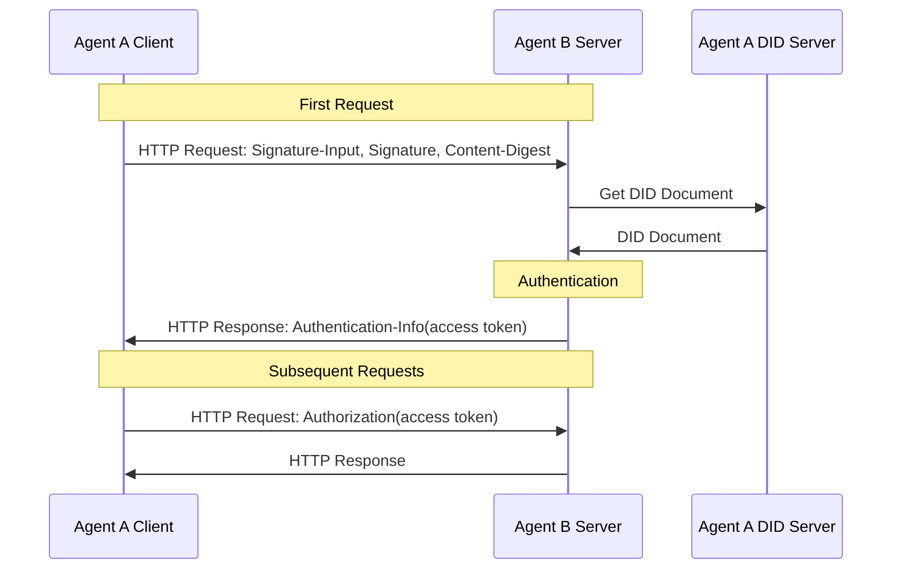
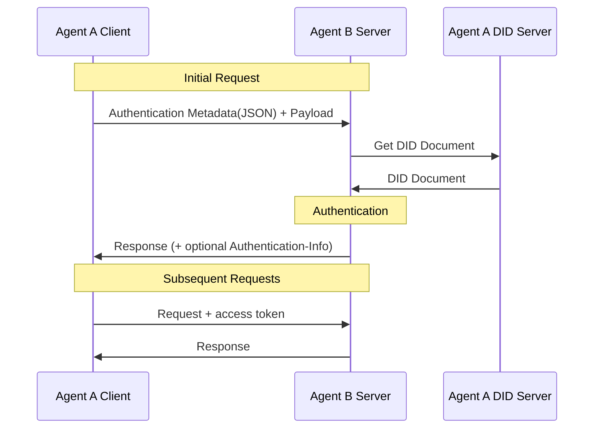

> 日本語参考訳（機械翻訳・未校閲）。規範となるのは原文です。コード例・識別子・規範キーワードは原文を保持しています。
> 原文: [02-anp-did-authentication-protocol-specification.md](../02-anp-did-authentication-protocol-specification.md) / 基準コミット: `0837cfdfaf4ddcf834f0890ddaf34fc4c824e066`

# ANP DID 認証プロトコル

- 文書ID: ANP-02
- ステータス: リリース済み
- バージョン: 1.2
- 原文言語: English / このページは日本語参考訳
- 中国の鏡: [ANP DID ベースの ID 認証プロトコル](chinese/02-ANP-基于DID的身份认证协议.md)

<a id="scope"></a>
## 1. 範囲

この仕様では、HTTP リクエスト署名、JSON 認証メタデータ搬送、サーバー検証、チャレンジとエラー、およびオプションのアクセス トークンを含む、DID ベースのクロスプラットフォーム認証を定義します。

認証フローは DID 方式から独立しています。 `did:wba` とネイティブ `did:web` は、それぞれのメソッド ルールに基づいて DID ドキュメントを解決および検証し、この仕様の共通の要求認証フローを使用します。このメソッドは、ID マテリアルがどのように取得され、検証されるかを管理します。この仕様は、リクエストの署名、ダイジェスト、および認証キーの認可を管理します。

通常の HTTP API は、ANP メッセージング、WNS、またはデバイス マニフェストを実装せずにこの認証を採用できます。メッセージング P1 ～ P9 または WNS には規範的な依存関係はありません。ビジネス権限、人間による承認、メッセージ発信元の証明、および E2EE オブジェクトの証明は、所有するアプリケーションまたはプロファイルによって定義されます。認証だけではビジネス権限を意味しません。

MUST、MUST NOT、SHOULD、SHOULD NOT、MAY は、BCP 14 で定義されている規範要件を表します。

<a id="identity-input"></a>
## 2. DID メソッドと ID マテリアル

| DID メソッド | ID マテリアルの検証 | 認証のリクエスト |
|---|---|---|
| `did:wba` | ANP-03 構文、ドキュメント、キー、解決、更新、非アクティブ化、および継続性。付録 A を参照 | 第 3 章と第 4 章 |
| `did:web` | ネイティブの Did:Web 解決と ID 検証要件（付録 B） | 第 3 章と第 4 章 |

ドキュメントの信頼性、ID バインディング、およびライフサイクル ルールは、各 DID メソッドに属します。メソッドの検証後、この仕様では認証キーの認可、リクエストの署名、およびダイジェストをチェックします。メソッド固有の証明や状態メカニズムは定義されません。

アルゴリズムとキー表現は、選択した検証方法と適用可能な方法ルールに従います。付録 D では他の方式の適応について説明し、付録 C では WebVH の統合について説明します。 DID コアへの準拠だけでは、実装がそのメソッドをサポートしていることを意味しません。

<a id="common-model"></a>
<a id="http-binding"></a>
## 3. HTTP リクエスト認証

クライアントが別のプラットフォーム上のサーバーに対してリクエストを開始すると、クライアントは TLS と組み合わせたドメイン名を使用してサーバーを認証でき、サーバーはクライアントの DID ドキュメント内の検証方法に基づいてクライアントの ID を検証します。

クライアントが最初の HTTP リクエストを行うとき、 `Signature-Input` そして `Signature` によって定義されたヘッダー [RFC 9421](https://www.rfc-editor.org/rfc/rfc9421) 署名用。リクエストにメッセージ本文が含まれる場合は、 `Content-Digest` によって定義されたヘッダー [RFC 9530](https://www.rfc-editor.org/rfc/rfc9530) メッセージ本文の整合性をバインドします。最初の検証に合格すると、サーバーはアクセス トークンを返すことができ、クライアントは後続のリクエストでアクセス トークンを保持します。サーバーはクライアントの ID を毎回検証する必要はなく、アクセス トークンを検証するだけで十分です。



### 3.1 最初のリクエスト

現在のクライアントが初めてサーバーに対して HTTP リクエストを開始するとき、次の方法に従って ID 認証を実行する必要があります。

#### 3.1.1 リクエストヘッダー形式

クライアント MUST を使用して認証情報を送信します。 `Signature-Input` そして `Signature` で定義されたヘッダーフィールド [RFC 9421](https://www.rfc-editor.org/rfc/rfc9421)。リクエストにメッセージ本文が含まれる場合、クライアントは MUST も送ります `Content-Digest` で定義されたヘッダーフィールド [RFC 9530](https://www.rfc-editor.org/rfc/rfc9530).

最小署名範囲セットは次のとおりです。

- `@method`
- `@target-uri`
- `content-digest` (リクエストにメッセージボディが含まれる場合)

カバレッジ用に推奨される追加コンポーネントは次のとおりです。

- `@authority`
- `content-type`
- `content-length`

`Signature-Input` の主要なパラメータ要件は次のとおりです。

- `keyid`: MUST DID ドキュメント内の検証方法を指す、完全な DID URL を指定します。次に例を示します。
  `did:web:identity.example:alice#key-1`
- `created`: MUST、署名の作成時間を示します
- `expires`: SHOULD、署名の有効期限を示します
- `nonce`: MAY 運ばれる。もし `nonce` サーバーチャレンジで与えられる、クライアント MUST それを使って `nonce`
- `alg`: 必須ではないフィールドです。この仕様は、 `alg` パラメーターを使用すると、検証者は、 が指す DID 検証メソッドのタイプに基づいてアルゴリズムを決定できます。 `keyid`

認証キーの選択は、該当する DID メソッドとローカル認可ポリシーに従います。選択した検証方法は、対象ドキュメントの `authentication` 関係によって承認されている必要があります。

クライアントリクエストの例:

```plaintext
POST /orders HTTP/1.1
Host: api.example.com
Content-Type: application/json
Content-Digest: sha-256=:BASE64_SHA256_DIGEST:
Signature-Input: sig1=("@method" "@target-uri" "@authority" "content-digest");created=1733402096;expires=1733402156;nonce="abc123";keyid="did:web:identity.example:alice#key-1"
Signature: sig1=:BASE64_SIGNATURE:
```

DID メソッドに固有の署名生成要件は、そのメソッド仕様によって定義されます。セクション 2 を参照してください。

#### 3.1.2 署名生成プロセス

1. HTTP リクエストにメッセージ本文が含まれている場合、クライアントはまずメッセージ本文を計算します。 `Content-Digest` によるメッセージ本文の値 [RFC 9530](https://www.rfc-editor.org/rfc/rfc9530).

2.  該当する DID 方式とローカル認証ポリシーに基づいて署名検証方式を選択します。
   - 選択した検証方法が次のように表される Ed25519 キーを使用する場合 `Multikey`、Ed25519 アルゴリズムを使用して署名する必要があります。
   - その他のアルゴリズムは、対応する検証方法のタイプによって定義されます。

3. 構築する `Signature-Input`、少なくともカバー `@method` そして `@target-uri`;メッセージ本文が存在する場合、 `content-digest` もカバーする必要があります。

4. で定義されたルールに従って署名ベース文字列 (署名ベース) を生成します。 [RFC 9421](https://www.rfc-editor.org/rfc/rfc9421).

5. クライアントの秘密キーを使用して署名ベースに署名し、署名バイト文字列を取得して、それを `Signature` ヘッダーフィールド。

6. 送信 `Signature-Input`, `Signature`、および (該当する場合) `Content-Digest` サーバーに。

### 3.2 サーバー側の検証

#### 3.2.1 検証リクエストヘッダー

クライアント要求を受信した後、サーバーは次の検証を実行します。

1. **リクエスト形式を確認する**: かどうかを確認します。 `Signature-Input` そして `Signature` 存在する。リクエストにメッセージ本文が含まれている場合は、 `Content-Digest` 存在します。

2. **メッセージ本文の整合性を検証する**: リクエストにメッセージ本文が含まれている場合は、 `Content-Digest` によると、実際のメッセージ本文と一致しています。 [RFC 9530](https://www.rfc-editor.org/rfc/rfc9530).

3. **抜粋 `keyid` そしてDIDを解析します**: 抜粋 `keyid` から `Signature-Input` 対応する DID と検証方法を取得します。

4. **DID ドキュメントの解決と検証**: 該当する DID メソッドに基づいてドキュメントを解決および検証します。その仕様は、アイデンティティの状態と新しい認証の制限を管理します。メソッド固有の応答については、セクション 3.2.4.3 で説明します。

5. **DID バインド関係を確認します**:
   - で示された検証方法が正しいことを確認します。 `keyid` 存在します。
   - 検証方法が認可されていることを確認します。 `authentication` DID 文書の関係。
   - メソッド固有の ID バインディング検証は、対応する DID メソッド仕様に従います。セクション 2 とそのメソッド バインディングを参照してください。

6. **署名範囲を確認する**: に基づいて署名ベースを再構築します。 `Signature-Input`を作成し、署名の対象となる HTTP コンポーネントが実際のリクエストと一致していることを確認します。

7. **検証時間枠**: かどうかを確認します。 `created` / `expires` 妥当な時間範囲内です。推奨される時間枠は 1 分から 5 分で、実装者が構成できます。

8. **検証リプレイ保護**:
   - 直接接続証明プロファイルの場合、サーバーは短期リプレイ キャッシュを確立する必要があります。 `(keyid, nonce)` または同等のキー。
   - チャレンジプロファイルの場合、 `nonce` サーバーチャレンジから来ている場合、 `nonce` MUST 一度に 1 つずつ使用します。

9. **DID 権限を確認する**: 認証が成功した後、リクエスト内の DID にサーバー リソースへのアクセス許可があるかどうかを個別に確認します。許可がない場合は、 `403 Forbidden` が返されます。

10. **検証結果**: 署名の検証が成功した場合、リクエストは認証に合格します。そうでなければ、 `401 Unauthorized` チャレンジ情報が添付されて返されます。

DID メソッドに固有の ID 検証要件は、そのメソッド仕様によって定義されます。セクション 2 を参照してください。

#### 3.2.2 署名検証プロセス

1. 署名タグ、カバレッジコンポーネント、 `created`, `expires`, `nonce`, `keyid` およびその他のパラメータ `Signature-Input`から対応する署名値を抽出します。 `Signature`.

2. によると [RFC 9421](https://www.rfc-editor.org/rfc/rfc9421) ルールに従って、署名ベースは実際の HTTP リクエストに基づいて再構築されます。

3. に従って、DID ドキュメントから対応する検証方法と公開キーを取得します。 `keyid`.

4.  検証方法のタイプに基づいて検証アルゴリズムを選択します。
   - Ed25519 の検証方法の場合、 `Multikey`、Ed25519 の 64 バイト署名形式に従って検証します。
   - その他のアルゴリズムは、対応する検証方法の種類に応じて定義されます。

5. 取得した公開キーを使用して署名を検証し、署名が対応する秘密キーによって生成されたことを確認します。

6. リクエストにメッセージ本文が含まれる場合、 `Content-Digest` 検証結果も全体的な認証の結論に含める必要があります。

<a id="access-tokens"></a>
#### 3.2.3 認証が成功するとアクセス_トークンが返されます

サーバー側の検証が成功すると、アクセス トークンを応答で返すことができます。アクセストークンはJWT（JSON Web Token）形式を使用することを推奨します。クライアントの後続のリクエストにはアクセス トークンが含まれます。サーバーはクライアントの DID ID を毎回検証する必要はなく、アクセス トークンを検証するだけで済みます。次の生成プロセスは仕様で必須ではなく、参照のみを目的としています。実装者は必要に応じてこれを定義して実装できます。

JWT生成方法リファレンス [RFC7519](https://www.rfc-editor.org/rfc/rfc7519).

1. **アクセストークンの生成**

サーバーがアクセス トークン形式として **JWT (JSON Web Token)** を使用すると仮定すると、通常、JWT には次のフィールドが含まれます。

- **header**: 署名アルゴリズムを指定します
- **ペイロード**: ユーザー関連情報を保存します
- **署名**: サイン `header` そして `payload` 誠実さを確保するために

ペイロードには次のフィールドを含めることができます (他のフィールドは必要に応じて追加されます)。

```json
{
  "sub": "did:web:identity.example:alice",
  "iat": "2024-12-05T12:34:56Z",
  "exp": "2024-12-06T12:34:56Z",
  "scope": "orders.read orders.write"
}
```

2. **アクセストークンを返す**

サーバー MUST 経由でアクセストークンを返します `Authentication-Info` 応答ヘッダーではなく、 `Authorization` 応答ヘッダー。

例:

```plaintext
Authentication-Info: access_token="eyJhbGciOi...", token_type="Bearer", expires_in=3600, scope="orders.read orders.write"
```

3. **送信者制限トークンに関する提案**

トークンが漏洩後に直接再利用されるリスクを軽減するために、**sender-constrained** アクセス トークンを使用して、クライアントが保持するキーにトークンをバインドすることをお勧めします。

このバージョンの仕様では、この拡張機能は保持されていますが、送信者制約トークンの特定のプロファイルはまだ完全には定義されていません。実装者は、将来の拡張のために次の機能を予約できます。

- トークン内のクライアントの公開キーにバインドされたステートメントを追加します (例: `cnf` または同等のフィールド);
- 後続のリクエストでトークンにバインドされた証明を提供し続けることをクライアントに要求します。
- さまざまなトークン プロファイルを区別します。 `token_type` フィールド。

送信者制限プロファイルが統合される前は、互換性を確保するために、`Bearer` をデフォルトの `token_type` として使用できます。

4. **クライアントがアクセストークンを送信**

クライアントは通常、後続のリクエストで `Authorization` ヘッダー フィールドを介してアクセス トークンを送信します。

```plaintext
Authorization: Bearer <access_token>
```

サーバーから返された `token_type` が `Bearer` ではない場合、クライアント MUST は、対応する拡張仕様に従ってトークンを送信します。

5. **サーバー側検証アクセストークン**

クライアントのリクエストを受信した後、サーバーはデータベースからアクセス トークンを抽出します。 `Authorization` ヘッダーを取得し、署名の検証、有効期限の検証、ペイロード内のフィールドの検証などの検証を実行します。検証方法とは、 [RFC7519](https://www.rfc-editor.org/rfc/rfc7519).

<a id="challenge-errors"></a>
#### 3.2.4 エラー処理

##### 3.2.4.1 401 応答

サーバーが署名の検証に失敗した場合、`Content-Digest` が検証に失敗した場合、署名が期限切れになった場合、リプレイのリスクがある場合、またはサーバーがクライアントにチャレンジ情報に従って再署名を要求した場合、サーバーは `401 Unauthorized` 応答を返すことができます。

サーバーが、クライアントが署名のためにサーバーによって発行された`nonce`を使用する必要がある場合、クライアントが最初のリクエストを行うときに`401`を返し、レスポンスにチャレンジ情報を追加できます。これにより、実装者が必要に応じて使用するかどうかを選択できる対話が追加されます。

エラー情報は `WWW-Authenticate` ヘッダー フィールドを通じて返され、サーバーは次のリクエストでカバーすることが期待されるコンポーネントを `Accept-Signature` を通じて示すこともできます。例は次のとおりです。

```plaintext
WWW-Authenticate: DIDWba realm="api.example.com", error="invalid_signature", error_description="Signature verification failed.", nonce="xyz987"
Accept-Signature: sig1=("@method" "@target-uri" "@authority" "content-digest");created;expires;nonce;keyid
Cache-Control: no-store
```

次のフィールドが含まれます。

- **realm**: 保護されたリソースが属するドメインを示すオプションのフィールド
- **error**: 必須フィールド、エラー タイプ。次の文字列値が含まれます。
  - `invalid_request`: リクエストの形式が正しくないか、必須フィールドが欠落しているか、サポートされていないパラメータが含まれています
  - `invalid_nonce`: nonce が使用されているか、無効であるか、サーバーチャレンジと一致しません
  - `invalid_timestamp`: タイムスタンプが範囲外です
  - `invalid_did`: DID 形式が間違っているか、DID に基づいて対応する DID ドキュメントが見つかりません。
  - `invalid_signature`: 署名の検証に失敗しました
  - `invalid_verification_method`: に基づいて対応する公開キーが見つかりません `keyid`
  - `invalid_content_digest`: `Content-Digest` メッセージ本文と一致しません
  - `invalid_access_token`: アクセストークンの検証に失敗しました
  - `forbidden_did`: DID にはサーバー リソースにアクセスする権限がありません
- **error_description**: オプションのフィールド、エラーの説明
- **ノンス**: オプションのフィールド。サーバーによって生成されたランダムな文字列。持ち運ぶ場合、クライアントは `nonce` 署名を再生成し、リクエストを再開します。

クライアントが `401` 応答を受信した後、その応答に `nonce` が含まれる場合、サーバーの `nonce` を使用して署名を再生成し、リクエストを再開始する必要があります。応答に `nonce` が含まれていない場合、クライアントはローカルの `nonce` を再生成して再試行できます。

無限ループを防ぐために、クライアントとサーバーはそれぞれの実装で再試行の数を制限する必要があることに注意してください。

##### 3.2.4.2 403 応答

サーバー側の認証は成功したが、DID にサーバー側のリソースにアクセスする権限がない場合、`403 Forbidden` 応答が返されることがあります。

##### 3.2.4.3 メソッド固有の応答

ID 状態エラーとその後の処理は、該当する DID メソッドによって定義されます。そのメソッド バインディングを参照してください。一般的な認証エラーでは、セクション 3.2.4.1 および 3.2.4.2 が使用されます。

<a id="json-carriage"></a>
## 4. JSON 認証メタデータキャリッジ

前の章では、DID ベースの HTTP 認証を定義しました。他のトランスポートは、アプリケーション層プロトコルで定義されたコンポーネント マッピングを使用して認証メタデータを伝送できます。このセクションでは、セクション 3 の認証情報を JSON メタデータとして運ぶ方法のみを定義し、署名される新しいフィールドのセットを再定義するものではありません。

このセクションは、リクエストのメタデータとビジネス ペイロードをアプリケーション層で分離できるシナリオに適用されます。次に例を示します。

- HTTP ボディのカプセル化
- WebSocket の最初のパッケージ
- メッセージバスエンベロープ
- カスタム RPC リクエスト ラッピング レイヤー

「認証メタデータ」と「ビジネス ペイロード」の境界を分離できない純粋な JSON のみの送信の場合、このセクションは直接適用されず、後続のバージョンでは特殊なトランスポート プロファイルを定義できます。

他のデータ形式に基づくプロトコルでも、この認証メカニズムを採用できます。

全体的なプロセスは次のとおりです。



### 4.1 最初のリクエスト

現在のクライアントが初めてサーバーへのリクエストを開始するとき、次の方法に従って ID 認証を実行する必要があります。

#### 4.1.1 認証情報データ形式

認証情報を HTTP ヘッダーに配置できない場合は、セクション 3 の認証フィールドを、`auth` フィールドなどの別の JSON メタデータ オブジェクトに配置できます。

推奨される形式は次のとおりです。

```json
{
  "auth": {
    "contentDigest": "sha-256=:BASE64_SHA256_DIGEST:",
    "signatureInput": "sig1=(\"@method\" \"@target-uri\" \"@authority\" \"content-digest\");created=1733402096;expires=1733402156;nonce=\"abc123\";keyid=\"did:web:identity.example:alice#key-1\"",
    "signature": "sig1=:BASE64_SIGNATURE:"
  },
  "payload": {
    "orderId": "12345",
    "action": "create"
  }
}
```

フィールドの説明:

- **auth.contentDigest**：に対応 `Content-Digest` HTTPヘッダーにあります。ビジネス負荷がある場合は、バインドするために使用されます。 `payload`
- **auth.signature入力**: に対応します `Signature-Input` HTTPヘッダー内
- **認証署名**: に対応します `Signature` HTTPヘッダー内
- **ペイロード**: ビジネスデータオントロジー

JSONベアラーモードでは、 `contentDigest` を結び付ける **ペイロード部分** 以下を含むカプセル化されたオブジェクト全体の代わりに、 `auth`. `auth` は外部認証メタデータであり、ビジネス ロード サマリーには関与しません。

もし `payload` 生のバイト シーケンスではなく JSON オブジェクトである場合、実装者はそのシリアル化ルールをローカルで修正する必要があります。 JCS (JSON 正規化スキーム) を使用することをお勧めします。 [RFC8785](https://www.rfc-editor.org/rfc/rfc8785) 安定して連載するために `payload` 計算する前に `contentDigest`.

認証情報は、別のリクエストで送信することも、ビジネス リクエスト データと一緒に送信することもできます。

#### 4.1.2 署名生成プロセス

署名生成処理は「3.1.2 署名生成処理」と同様です。違いは次のとおりです。

1. `Content-Digest`, `Signature-Input` そして `Signature` HTTP ヘッダーではなく、JSON メタデータ オブジェクト ( `auth`);
2. `contentDigest` デフォルトでは、 のバイト表現にバインドされます。 `payload`カプセル化されたオブジェクト全体ではありません。
3. 基礎となるプロトコルが依然として HTTP である場合、次の意味は `@method` そして `@target-uri` 変更されないままです。基礎となるプロトコルが HTTP ではない場合、ターゲット メッセージの同等のコンポーネントは、対応するアプリケーション層プロトコルによって明確に定義される必要があります。

### 4.2 サーバー側の検証

#### 4.2.1 本人確認リクエスト

検証プロセスは、3.2.1 検証リクエストヘッダと同じです。違いは、`contentDigest`、`signatureInput`、および `signature` フィールドをリクエスト データの `auth` オブジェクトから抽出する必要があることです。

同時に、`contentDigest`を検証する場合、サーバーは`payload`部分に対してのみダイジェスト検証を実行する必要があります。

検証に合格した後、基礎となる送信が依然として HTTP である場合、サーバーは 3.2.3 と同じ方法、つまり `Authentication-Info` 応答ヘッダーを通じてアクセス トークンを返します。

基礎となるトランスポートが応答ヘッダーをサポートしていない場合、この仕様は、上位層プロトコルによって定義されるアクセス トークンの代替返信方法を標準化しません。

#### 4.2.2 エラー処理

エラー処理は「3.2.4 エラー処理」と同じです。

基礎となるトランスポートが HTTP の場合、`WWW-Authenticate` および `Accept-Signature` ヘッダーは依然として権限チャレンジ情報のソースです。アプリケーション層は、呼び出し元の処理を容易にするために、JSON 応答本文のこれらのエラー フィールドをミラーリングすることもできます。

JSON 形式を使用して 401 応答を返す例:

```json
{
  "code": 401,
  "error": "invalid_nonce",
  "error_description": "Nonce has already been used. Please provide a new nonce.",
  "nonce": "1234567890"
}
```

JSON 形式を使用して 403 応答を返す例:

```json
{
  "code": 403,
  "error": "forbidden_did",
  "error_description": "did not have permission to access the resource."
}
```

## 5. 認証とアプリケーションの認可

それほど重要ではないリクエストについては、ユーザー エージェントはホテルのエージェントへのアクセスやホテル情報の読み取りなどを自動的に承認できます。このとき、人による手動確認は必要ありません。ユーザー エージェントは、それ自体に代わってリクエストを開始できます。

ホテルの部屋の予約などの重要なリクエストの場合、ホテルのエージェントは人間による手動の確認を要求する場合があります。ただし、「人間による確認が必要かどうか」のセマンティクスは、DID ドキュメントの独立したフィールドではなく、上位層の認可ポリシーに属します。 DID ドキュメントは、`authentication` を通じて認証検証方法を宣言します。この認証仕様では、`humanAuthorization` フィールドは定義されていません。

エージェントは、エージェント記述文書で文書またはインターフェースの認可タイプを定義できます。デフォルトでは、すべての通常の権限で十分です。リクエストに人間による手動承認が必要な場合は、次のようにドキュメントで明確に定義する必要があります。

- `authorizationLevel: normal`
- `authorizationLevel: user-presence-required`

リクエストに手動による人間による承認が必要な場合、ユーザー エージェントはまず対応する確認プロセス (クリック確認、生体認証、安全なハードウェアの承認など) をローカルで完了し、次にポリシーで許可されている `authentication` キーを使用してリクエストに署名し、開始する必要があります。

サーバーが検証するのは、リクエストが合意された高レベルの認可ポリシーを満たしているかどうかです。 DID 文書から単に「この署名は人間によって完了されたに違いない」と推測するのではありません。

エージェント開発者は、高レベルの操作に使用される秘密キーを安全に保管し、権限を分離する必要があります。たとえば、関連するキーは、ローカルのセキュリティ確認プロセスを通過した後にのみ呼び出すことができます。

## 6. プライバシーに関する考慮事項

分散型ネットワークではプライバシー保護が非常に重要です。たとえば、違法なソフトウェアはユーザーの DID を通じてユーザーの行動を記録および追跡し、ユーザーのプライバシーの漏洩を引き起こす可能性があります。

これに関して、DID プロバイダーがマルチ DID 戦略を採用できることを提案します。つまり、1 人のユーザーに対して複数の DID を生成し、各 DID に異なる役割と権限があり、異なるキー ペアを使用してプライバシー保護ときめ細かい権限制御を実現します。

たとえば、マスター DID がユーザーに対して生成されます。この DID は通常は変更されず、社会的関係を維持するなどのシナリオで使用されます。その後、ユーザーに対して一連のサブ DID が生成され、ショッピング、テイクアウトの注文、チケットの予約、その他のシナリオに使用できます。これらのサブ DID はメイン DID に従属し、期限切れの DID を定期的に非アクティブ化し、新しい DID を適用してプライバシーとセキュリティ保護を向上させることができます。

ネーム サービス (WNS/ハンドルなど) は、人間が判読できる安定した名前を提供できます。名前付けバインディングと DID ライフサイクルは、対応する仕様によって管理されます。

<a id="security-privacy"></a>
## 7. セキュリティに関する考慮事項

実装者は、実装する際に次のセキュリティ問題を考慮する必要があります。

1. **鍵管理**

- DIDに対応する秘密鍵は適切に保管し、漏洩してはならない。さらに、秘密鍵を定期的に更新するメカニズムを確立する必要があります。
   -  ユーザーは、それぞれに異なる役割と権限を持つ複数の DID を生成し、異なるキー ペアを使用して、きめ細かい権限制御を実現する必要があります。

2. **攻撃対策**

- サーバー **しなければならない** リプレイ保護を実装します。直接接続証明プロファイルの場合、短期リプレイ キャッシュを確立する必要があります。 `(keyid, nonce)`, `(keyid, jti)` または同等のキー。チャレンジプロフィールについては、 `nonce` サーバーによって発行されたものは一度に 1 つずつ使用する必要があります。
   - サーバーは、 `created` / `expires` 時間ロールバック攻撃を防ぐために、リクエスト内の時間ウィンドウを変更します。一般に、サーバーのリプレイ キャッシュのキャッシュ時間は、署名の有効期限よりも長くなければなりません。
   - 生成時 `nonce`、あなた **しなければならない** 最新の暗号化セキュリティ仕様および標準に準拠した、オペレーティング システムによって提供される安全な乱数ジェネレータを使用します。たとえば、Python のようなモジュールを使用できます。 `secrets` 安全な乱数を生成します。
   - リクエストにメッセージ本文が含まれている場合、サーバーは検証する必要があります。 `Content-Digest` メッセージ本文が改ざんされるのを防ぐため。
   - 認証の成功は、承認の成功と同じではありません。サーバーは認可判定と身元認証を別々に処理する必要があります。

3. **送信セキュリティ**

-  DID ドキュメントを取得する場合、サーバーはセキュリティを向上させるために DNS-over-HTTPS (DoH) プロトコルを使用する必要があります。
   - 送信プロトコル**は必ず**はHTTPSを使用し、クライアント****は相手のCA証明書が信頼できるかどうかを厳密に判断する必要があります。
   - TLS サービス ID 検証を実行するとき、クライアントは **しなければならない** に従って一致する `dNSName` で `subjectAltName` また、共通名に依存すべきではありません。
   - DID 解決中は、信頼できないクロスオリジン リダイレクトを無条件に追跡することは避けてください。

4. **トークンセキュリティ**

- クライアントとサーバー **しなければならない** アクセストークンを適切に保管し、 **しなければならない** 適切な有効期限を設定します。
   - **** は、送信者制限のアクセス トークンよりも優先されるべきです。この仕様には拡張機能が予約されていますが、特定のプロファイルはまだ完全には定義されていません。
   - IP アドレス、ユーザー エージェント、その他の情報は補助的なリスク信号としてのみ使用でき、アクセス トークンの唯一のバインド メカニズムとして使用しないでください。
   - アクセストークン **SHOULD** HTTPS 接続でのみ返され、 `Authentication-Info` 応答ヘッダー。

<a id="wba-binding"></a>
## 付録 A. Did:wba メソッド バインディング

WBA の ID マテリアルとリクエスト認証のメソッドの制約は、次のように定義されます。 [ANP-03](../03-did-wba-method-design-specification.md#wba-auth-binding)。実装では、第 3 章と第 4 章の共通認証フローを使用する前に、そのメソッドの検証とキーの選択が完了します。 ANP-03 では、メソッド固有の応答も定義されています。

<a id="web-binding"></a>
## 付録 B. Did:Web メソッド バインディング

ネイティブ `did:web` この仕様の HTTP/JSON リクエスト認証を変換せずに使用します。 `did:wba`。に基づいて身分証明書を解決します。 [やった:Web メソッドの仕様](https://w3c-ccg.github.io/did-method-web/) そして、次の検証ルールを適用します。

たとえば、`keyid` が `did:web:identity.example:alice#auth` に設定されている場合、サーバーは、did:web で `did:web:identity.example:alice` を解決し、`#auth` の認証権限をチェックしてから、第 3 章と第 4 章に基づいてリクエストを検証します。その ID マテリアルはネイティブ Web メソッドで検証されます。

### B.1 解析および検証ルール

実装がネイティブを受け取るとき `did:web`、それ MUST に従って解析を実行します `did:web` メソッドの仕様を確認し、少なくとも次のチェックを完了します。

1. 次に従って DID ドキュメントを解析します `did:web` ルール。
2. かどうかを確認してください。 `id` DID 文書の内容は、要求された内容と完全に一致しています。 `did:web`;
3. DIDコアルールに従って、関連する検証方法が存在し、正しい検証関係にあるかどうかを確認してください。

実装 MUST NOT ネイティブを成功させるための別の DID メソッドに固有の識別子バインディング、ドキュメントプルーフ、またはライフサイクル ルールを前提条件にする `did:web` 検証。

ネイティブなら `did:web` DID ドキュメント自体には標準証明 (データ整合性証明など)、実装が含まれています。 MAY 証明の宣言プロファイルとローカルポリシーに従って検証を実行します。他のメソッドのドキュメントプルーフ要件はネイティブには適用されません。 `did:web`.

### B.2 クロスプラットフォーム認証との互換性

ネイティブ `did:web` は、この仕様の第 3 章および第 4 章で定義されているクロスプラットフォーム ID 認証プロセスと互換性があります。

クライアントが `did:web` を使用してクロスプラットフォーム認証に参加する場合:

1. `keyid` まだ MUST 完全な DID URL であること。
2. サーバーは引き続き DID ドキュメントを解析する必要があります。
3. サーバーは、によって示された検証方法が有効であることを検証する必要があります。 `keyid` 存在します。
4. サーバーは引き続き (MUST) 検証メソッドが次の場所にあることを確認します。 `authentication` DID 文書の関係。
5. 後続の HTTP メッセージ署名 / `Content-Digest` 検証は、第 3 章と第 4 章の一般的な認証フローに従います。

`did:web` の ID バインディング セマンティクスは、独自のメソッド解決および検証ルールに従います。

<a id="webvh-design"></a>
## 付録 C. WebVH 統合 (参考)

`did:webvh` は、メソッド仕様に基づいて文書履歴と状態が検証された後、認証キー素材を提供し、共通の要求認証フローを再利用できます。正確なバージョン、履歴/状態の検証、および適応の実装は未指定のままです。このドキュメントでは、すぐに有効になる WebVH バインディングを定義しません。

<a id="method-template"></a>
## 付録 D. その他の DID メソッド (参考)

他の W3C DID コア メソッドは、独自の解決ルールおよび検証ルールを通じて ID および認証キー素材を提供する場合があります。それらの適応仕様では、この仕様の共通の要求認証フローを使用する前に、メソッド リビジョン、検証メソッド タイプ、署名アルゴリズム、およびサポートされる範囲を特定する必要があります。

<a id="references"></a>
## 参考資料

- [DID コア v1.0](https://www.w3.org/TR/2022/REC-did-core-20220719/)
- [RFC 2119: 規範的要件のキーワード](https://www.rfc-editor.org/rfc/rfc2119)
- [RFC 8174: 大文字と小文字の標準キーワード](https://www.rfc-editor.org/rfc/rfc8174)
- [RFC 9421: HTTP メッセージの署名](https://www.rfc-editor.org/rfc/rfc9421)
- [RFC 9530: ダイジェストフィールド](https://www.rfc-editor.org/rfc/rfc9530)
- [RFC 8785: JSON 正規化スキーム](https://www.rfc-editor.org/rfc/rfc8785)
- [RFC 7519: JSON Web トークン](https://www.rfc-editor.org/rfc/rfc7519)
- [ANP-03: Did:wba メソッドの仕様](03-did-wba-method-design-specification.md)
- [Did:web メソッドの仕様](https://w3c-ccg.github.io/did-method-web/)

## 著作権表示

著作権 (c) 2024 ANP オープンソース コミュニティ
このファイルは、 [Apache ライセンス 2.0](../LICENSE)。自由に使用および変更できますが、この著作権表示は保持しておく必要があります。
