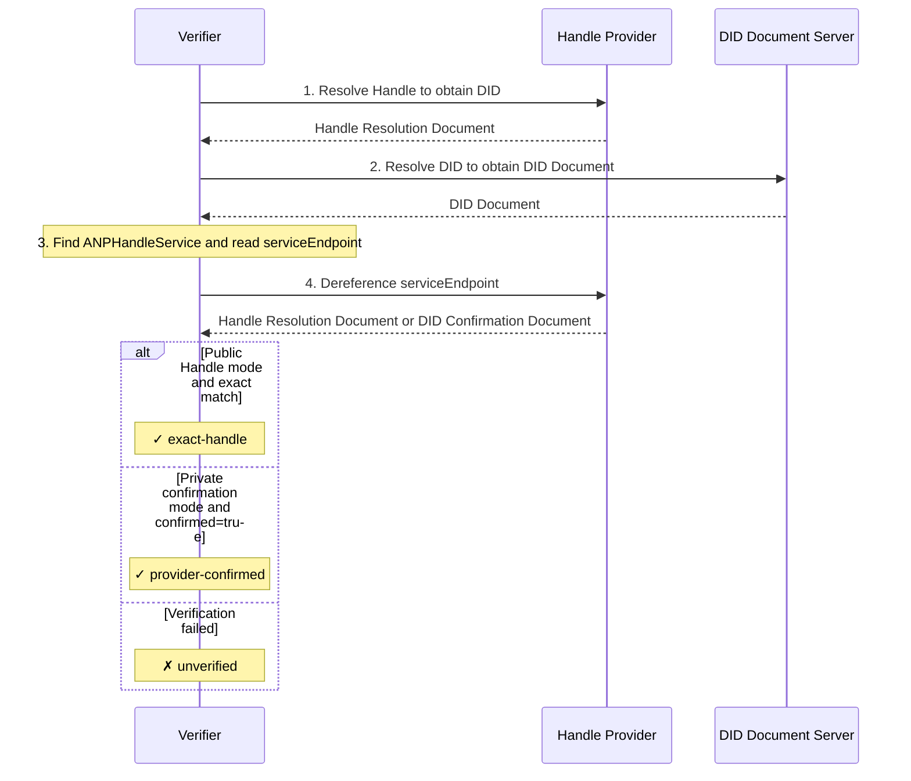

> 日本語参考訳（機械翻訳・未校閲）。規範となるのは原文です。コード例・識別子・規範キーワードは原文を保持しています。
> 原文: [04-anp-did-wba-name-space-specification.md](../04-anp-did-wba-name-space-specification.md) / 基準コミット: `0837cfdfaf4ddcf834f0890ddaf34fc4c824e066`

# ANP-DID:WBA 名前空間の仕様

- 文書ID: ANP-04
- タイトル: ANP-DID:WBA 名前空間仕様
- ステータス: リリース済み
- バージョン: 1.2
- 原文言語: English / このページは日本語参考訳
-  適用性: この仕様は、人間が判読できるハンドル命名、WNS 解決、および ANP での Did:wba 名のマッピングに適用されます。

> ANP 1.2 リリース ノート: 共通 DID 認証は ANP-02 によって定義されています。 DID メソッドと命名規則は、独自の仕様に残ります。中国の鏡は、 [ANP - DID:WBA に基づく名前空間仕様](chinese/04-ANP-基于DID-WBA的命名空间规范.md).

略称：WNS（WBAネームスペース）

このリビジョンでは、既存の WBA 名前マッピング、エンドポイント検証、バインディング管理、キャッシュ、および移行ルールが維持されます。ネイティブ `did:web` を保持します [付録 B.4 の既存のドメイン宣言互換性モデル](../appendix-b-compatibility-with-native-did-web.md#legacy-web-handle)、WBAへの移行やその結果のWBAへの昇格はなし `exact-handle`。 WBA ホスト名の一貫性と以下のセクション 6 の正確/プライベート エンドポイント フローは、Web 互換モードには拡張されません。共通リクエスト認証は、 [ANP-02](02-anp-did-authentication-protocol-specification.md).

## 要約

この仕様は、did:wba に基づく人間が判読可能な名前空間である WNS (WBA 名前空間) を定義します。 WNS ではハンドル (など) が導入されています。 `alice.example.com`) の読み取り可能なエイリアスとして `did:wba` DID。標準化された解決フローを通じて、ハンドルは DID にマッピングされ、DID は DID ドキュメントとサービス機能に応じて解決されます。 [Did:wba メソッドの仕様](03-did-wba-method-design-specification.md).

ハンドルは、DID 識別子が人間にとって使いにくいという問題を解決します。 `did:wba:example.com:user:alice:e1_<fingerprint>` などの識別子はマシンに適していますが、覚えたり共有したりするのが困難です。特に、最新の Did:wba 仕様では、パスタイプ DID はデフォルトでバインドされた公開キーのフィンガープリントを保持し、バインディング キーまたはバインディング プロファイルが変更されるとパスタイプ DID 自体がローテーションされる可能性があります。したがって、WNS は、電子メール アドレスやソーシャル プラットフォームのユーザー名と同様のエクスペリエンスを提供するだけでなく、人間が判読できる安定した名前付けレイヤーとしても機能します。つまり、ハンドルは安定した状態を維持できる一方、基礎となる Did:wba はバインディング キーの変更に応じて回転する可能性があります。

クロスドメイン プロトコルでその安定した名前を安定した参照として安全に使用できるようにするために、この仕様では、すべての準拠するハンドル プロバイダーに対して、次のプロトコル コミットメントを作成および強制することを要求しています。ハンドルは、一度割り当てられると永久に同じサブジェクトに属し、譲渡不可で、失効後に再利用することはできません。ハンドルの安定性とハンドルから DID へのマッピングは、仕様 03 で定義された暗号化 DID 移行証明に代わるものではありません。

この仕様で定義されたハンドル関連の機能は、ネイティブの `did:web` メソッドと互換性を持つこともできます。互換性エントリについては、付録 A を参照してください。

## 1. 背景と動機

### 1.1 問題の説明

の `did:wba` このメソッドは、エージェントに分散型 ID 機能を提供します (「 [Did:wba メソッドの仕様](03-did-wba-method-design-specification.md)) ですが、その識別子の形式は人間にとって使いやすいものではありません。

- **覚えにくい**: `did:wba:example.com:user:alice:e1_<fingerprint>` メソッドのプレフィックス、ドメイン、パス、バインディング フィンガープリントが含まれるため、識別子は比較的長くなります。
- **共有が難しい**: ソーシャル コンテキストで DID 識別子を共有するのは不便で、エラーが発生しやすくなります。
- **入力が難しい**: DID 識別子を手動で入力するユーザー エクスペリエンスは劣悪です。
- **循環する可能性あり**: デフォルトのパス プロファイルを使用するパス タイプ DID の場合、バインディング キーまたはバインディング プロファイルが変更されると、DID 自体が変更される可能性があります。

これらの問題は、次のシナリオで特に顕著になります。

- ソーシャル チャネルを介したエージェント ID の共有
- インスタントメッセージングでの受信者の入力
- 名刺、文書、または口頭でのコミュニケーションにおけるエージェントの身元への言及
- 基礎となる DID のローテーションを許可しながら、安定した公開参照を維持します

### 1.2 設計目標

WNS の設計目標には次が含まれます。

1. **人間が判読できる**: 短く、覚えやすく、入力しやすいエイリアスを提供します。 `alice.example.com`.
2. **ドメイン非依存**: ドメイン名と TLS 証明書を持つエンティティは、特定の集中プラットフォームに依存せずにハンドル サービスをホストできます。
3. **確定的解決**: ハンドルから DID へのマッピングは明示的であり、解決プロセスは標準化されています。
4. **安定参照**: ハンドルは永続的、転送不可、再利用不可の安定した名前付けレイヤーであり、バインディング キーの変更に応じて基になるパス タイプ Did:wba をローテーションできます。
5. **双方向バインディング**: ハンドルと DID は双方向検証をサポートし、一方的な改ざんを防ぎます。
6. **プロトコル統合**: 既存の ANP プロトコル スタックとのシームレスな統合 (仕様 03/07/08/09)。
7. **最小限の設計**: ハンドル登録、管理、またはその他のビジネス プロセスを指定せずに、コアの名前付けおよび解決メカニズムのみを定義します。

### 1.3 既存プロトコルとの関係

- **03-did:wbaメソッド仕様**: WNS ハンドルは、did:wba DID の読み取り可能なエイリアスです。ハンドル解決は最終的には仕様 03 に依存して DID ドキュメントを取得します。デフォルトのパス プロファイルを使用するパス タイプ DID の場合、WNS はバインディング フィンガープリント生成ルールを再定義せず、仕様 03 を直接再利用します。安定したサブジェクト パス、 `successorDid`, `alsoKnownAs`、および移行 `proof` 基礎となる DID ローテーションの仕様も仕様 03 で定義されています。
- **07-エージェント記述プロトコル**: ハンドル解決後、DID ドキュメントの `service` このセクションは、エージェントの説明文書につながります。
- **08-エージェント検出プロトコル**: ハンドル プロバイダーは、エージェント検出の補助エントリ ポイントとして機能できます。
- **09-エンドツーエンド インスタント メッセージング プロトコル**: ハンドルは受信者の表示と入力に使用できますが、メッセージ ルーティングは DID ベースのままです。

## 2. 用語

| 用語 | 定義 |
|------|------------|
| **ハンドル** | 人間が判読できる形式の短い識別子。 `local-part.domain`、など `alice.example.com` |
| ** ハンドル プロバイダー** | ハンドル解決サービスをホストし、ハンドルから DID へのマッピングを維持するドメイン パーティ |
| **ローカルパート** | ハンドルのユーザー識別子部分 (例: `alice` で `alice.example.com` |
| **ドメイン** | ハンドルのドメイン部分。たとえば、 `example.com` で `alice.example.com` |
| ** DID バインディング** | ハンドルから DID への 1 対 1 のマッピング関係 |
| **ハンドル解決** | ハンドルを DID に解決するプロセス |
| ** DID ローテーション** | パスタイプ Did:wba の場合、バインディングキーまたはバインディングプロファイルが変更され、サブジェクトの連続性が仕様 03 に従って確立されるために完全な DID が変更されるプロセス |
| **バインディング生成** | DID 再バインド、ステータス変更、ロールバック攻撃を検出するために使用される WNS ハンドル バインディング状態の単調増加世代。これは、did:wba DID | の生成フィールドではありません。
| **ハンドルの廃棄** | 同じハンドルが再度割り当てられるのを防ぐために、ハンドルの取り消し後に保持される永続的な予約 |
| **WNS** | WBA 名前空間、この仕様によって定義される名前空間システム |
| **ハンドル解決ドキュメント** | ハンドル解決エンドポイントによって返される、ハンドルから DID へのマッピング情報を含む JSON ドキュメント|
| ** DID 確認エンドポイント** | ハンドル プロバイダーのドメインの下にある確認エンドポイント。DID ドキュメント内の特定のハンドルを公開せずに、DID がそのプロバイダーによって実際に解決されていることを確認するために使用されます。 |

## 3. ハンドル形式仕様

### 3.1 ハンドル構文

ハンドルは、`local-part.domain` 形式の DNS スタイルの構文を使用します。

**ABNF 定義:**

```abnf
handle     = local-part "." domain
local-part = (ALPHA / DIGIT) *61(ALPHA / DIGIT / "-") (ALPHA / DIGIT)
domain     = ; A valid Fully Qualified Domain Name (FQDN), see RFC 1035
```

**構文規則:**

- ローカル部分 MUST ASCII 小文字のみを含む `a-z`、数字 `0-9`、ハイフン `-`.
- ローカル部分 MUST 文字または数字で始まり、終わります。
- ローカル部分 MUST NOT 連続したハイフンが含まれている `--`.
- ローカル部分 MUST 長さは 1 ～ 63 文字にする必要があります。
- ドメイン MUST TLS/SSL 証明書によって保護された有効な FQDN である必要があります。
- ハンドルのドメイン部分 MUST NOT ポート番号を持ちます。
- すべての入力 MUST 処理する前に小文字に正規化する必要があります。

**例:**

```text
alice.example.com          ✓ Valid
bob-smith.example.com      ✓ Valid
agent-42.example.com       ✓ Valid
a.example.com              ✓ Valid (single-character local-part)
-alice.example.com         ✗ Invalid (starts with hyphen)
alice-.example.com         ✗ Invalid (ends with hyphen)
al--ice.example.com        ✗ Invalid (consecutive hyphens)
Alice.Example.com          → Normalized to alice.example.com
```

### 3.2 URI 表現

共有シナリオでハンドルを明示的に識別するには、`wba://` プレフィックス MAY を使用します。

```text
wba://alice.example.com
```

`wba://` プレフィックスは、共有および認識シナリオにのみ使用され、意味的にはハンドル自体と同等です。

- クライアント MAY で入力を受け入れます `wba://` 接頭辞。
- クライアントがプレフィックスを受け入れると、 MUST ストリップ `wba://` 解決の前に、その後は標準の解決フローに従います。
- 実装 MUST NOT ～を支援する `wba://` 相互運用性の前提条件を接頭辞として付けます。

> 注: `wba://` は正式な URI スキームとして IANA に登録されていません。実装者は、代わりに次の Web URL を使用することもできます。
> ```テキスト
> https://{domain}/.well-known/handle/{local-part}
> ```

### 3.3 予約語の原則

ハンドル プロバイダー SHOULD は、特定のローカル部分が登録されないように予約語リストを管理します。このプロトコルでは、次の予約語カテゴリが定義されています。特定のリストは各ハンドル プロバイダーによって決定されます。

**a) プロトコルの予約語**: ANP プロトコルのキーワードと競合する単語 (例: `did`, `agent`, `well-known`、そして `service`.

**b) システム予約語**: などの一般的なシステム機能と矛盾する単語。 `admin`, `root`, `system`、そして `api`.

**c) 防御的な予約語**：フィッシングや混乱攻撃に使用される可能性のある言葉（例： `support`, `security`、そして `official`.

ハンドル プロバイダー SHOULD は予約語リストを公開しています。

## 4. ハンドル解決プロトコル

### 4.1 解決フロー

ハンドルの解決は以下のフローに従います。

```text
Handle → Handle Resolution Endpoint → DID → DID Document → service
```

```mermaid
sequenceDiagram
    participant C as Client
    participant H as Handle Provider
    participant D as DID Document Server

    C->>H: GET /.well-known/handle/{local-part}
    H-->>C: Handle Resolution Document (containing DID)
    Note over C: Extract DID from the Resolution Document
    C->>D: Resolve under the applicable method (WBA: 03; Web: Appendix B)
    D-->>C: DID Document
    Note over C: Obtain service endpoints from the DID Document
```

### 4.2 ハンドル解決エンドポイント

ハンドル解決エンドポイントは、ハンドル プロバイダーによって提供される標準化された HTTP エンドポイントです。

- **URL**: `https://{domain}/.well-known/handle/{local-part}`
- **方法**: `GET`
- **応答内容の種類**: `application/json`

ここで、`{domain}` はハンドルのドメイン部分、`{local-part}` はユーザー識別子部分です。

**リクエスト例:**

```http
GET /.well-known/handle/alice HTTP/1.1
Host: example.com
Accept: application/json
```

### 4.3 ハンドル解決文書

ハンドル解決エンドポイントによって返される JSON ドキュメントの形式は次のとおりです。

```json
{
  "handle": "alice.example.com",
  "did": "did:wba:example.com:user:alice:e1_<fingerprint>",
  "status": "active",
  "binding_generation": "8",
  "updated": "2025-01-01T00:00:00Z",
  "versionId": "42",
  "ttl": 300,
  "profile": {
    "type": "DIDSubjectProfile",
    "subject_did": "did:wba:example.com:user:alice:e1_<fingerprint>",
    "subject_type": "person",
    "handle": "alice.example.com",
    "display_name": "Alice",
    "description": "Researcher and AI agent user",
    "avatar_uri": "https://example.com/avatars/alice.png",
    "profile_uri": "https://example.com/alice/",
    "discoverability": "listed",
    "updated": "2025-01-01T00:00:00Z",
    "versionId": "profile-7",
    "ttl": 300
  }
}
```

**フィールドの説明:**

| フィールド | 必須/オプション | 説明 |
|-------|-------------------|-------------|
| `handle` | 必須 | 完全なハンドル識別子 |
| `did` | 必須 | 現在ハンドルにバインドされているdid:wba DID |
| `status` | 必須 | 現在のハンドルのステータス。セクション 4.7 を参照 |
| `binding_generation` | 必須 | 10 進数の文字列 MUST ハンドルのバインディングまたはステータスが変化するたびに厳密に増加します |
| `updated` | オプション | ISO 8601 形式の最終更新時刻 |
| `versionId` | オプション | キャッシュとトラブルシューティングに使用されるマッピング バージョン識別子 |
| `ttl` | オプション | 推奨されるキャッシュ有効期間 (秒単位) |
| `profile` | オプション | このハンドルに現在バインドされている DID サブジェクトのパブリック表示メタデータ。これは、UI の表示、連絡先のプレビュー、検索結果、IM 受信者の確認を目的としています。それ MUST NOT 認証、認可、ルーティング、サービス検出、E2EE バインディング、またはセキュリティ プロファイル ネゴシエーションに使用されます。 |

### 4.3.1 DID 確認エンドポイント

DID 保有者が DID ドキュメント内の特定のハンドルを開示したくない場合、ハンドル プロバイダー MAY は DID 確認エンドポイントを提供します。

**推奨URL:**

```text
https://{domain}/.well-known/handle/by-did?did={urlencoded-did}
```

- **方法**: `GET`
- **応答内容の種類**: `application/json`

**応答例:**

```json
{
  "did": "did:wba:example.com:user:alice:e1_<fingerprint>",
  "confirmed": true,
  "status": "active",
  "updated": "2025-01-01T00:00:00Z",
  "ttl": 300
}
```

**フィールドの説明:**

| フィールド | 必須/オプション | 説明 |
|-------|-------------------|-------------|
| `did` | 必須 | DIDは確認中です |
| `confirmed` | 必須 | MUST なる `true`、この DID が現在のハンドル プロバイダーによって実際に解決されていることを示します。 |
| `status` | オプション | ハンドル プロバイダーでのこの DID の現在の解決ステータス |
| `updated` | オプション | ISO 8601 形式の最終更新時刻 |
| `ttl` | オプション | 推奨されるキャッシュ有効期間 (秒単位) |

DID 確認エンドポイントが使用される場合、応答ドキュメントは SHOULD NOT 特定の値を直接返す `handle`、DID ドキュメントを介してハンドルを間接的に開示することを避けるため。

### 4.3.2 プロファイルオブジェクト

ハンドル解決ドキュメント MAY を含む `profile` オブジェクト。

の `profile` オブジェクトは、解決されたハンドルに現在バインドされている DID サブジェクトのパブリック表示メタデータを表します。この仕様では、そのオブジェクトを **DID 対象者プロファイル**。 JSONフィールド名はそのまま残ります `profile`、そしてオブジェクト `type` SHOULD なる `DIDSubjectProfile`.

`profile` は、一般的な DID サブジェクトのメタデータです。 MUST NOT はエージェント専用のメタデータとして解釈されます。解決された DID サブジェクト MAY は、個人、エージェント、グループ、組織、サービス、アプリケーション、または別の DID サブジェクト タイプです。

の有無 `profile` MUST NOT 権限のあるハンドルから DID へのバインディング セマンティクスを変更します。権威ある解決結果は引き続きトップレベルです `handle` そして `did` フィールド。ルーティング、認証、認可、E2EE セッション バインディング、サービス ディスカバリ MUST 解決された DID、DID ドキュメント、 `ANPMessageService`、および対応する ANP プロファイル。

**推奨プロファイルオブジェクト:**

```json
{
  "type": "DIDSubjectProfile",
  "subject_did": "did:wba:example.com:user:alice:e1_<fingerprint>",
  "subject_type": "person",
  "handle": "alice.example.com",
  "display_name": "Alice",
  "description": "Researcher and AI agent user",
  "avatar_uri": "https://example.com/avatars/alice.png",
  "profile_uri": "https://example.com/alice/",
  "discoverability": "listed",
  "labels": {
    "locale": "en-US"
  },
  "updated": "2025-01-01T00:00:00Z",
  "versionId": "profile-7",
  "ttl": 300,
  "proof": {
    "type": "DataIntegrityProof",
    "cryptosuite": "eddsa-jcs-2022",
    "created": "2025-01-01T00:00:00Z",
    "proofPurpose": "assertionMethod",
    "verificationMethod": "did:wba:example.com:user:alice:e1_<fingerprint>#key-1",
    "proofValue": "z..."
  }
}
```

**フィールドの説明:**

| フィールド | 必須/オプション | 説明 |
|-------|-------------------|-------------|
| `type` | おすすめ | SHOULD なる `DIDSubjectProfile` このオブジェクトを他のプロファイルのようなオブジェクトと区別するため |
| `subject_did` | 必須 | このプロファイルで説明される DID 件名 |
| `subject_type` | おすすめ | DID 件名タイプ。推奨値は次のとおりです。 `person`, `agent`, `group`, `organization`, `service`, `application`、そして `unknown` |
| `handle` | オプション | このプロファイルに対応するハンドル。存在する場合、それは MUST トップレベルに等しい `handle` フィールド |
| `display_name` | おすすめ | UIで使用する表示名 |
| `description` | オプション | 人間が読める説明 (人物の略歴、エージェントの説明、グループの紹介など) |
| `avatar_uri` | オプション | アバター、アイコン、またはグループ画像の URI |
| `profile_uri` | オプション | より充実したパブリック プロファイル ページまたはプロファイル ドキュメント URI |
| `discoverability` | オプション | 発見可能性のヒント。推奨値は次のとおりです。 `private`, `listed`、そして `public` |
| `labels` | オプション | 表示、分類、検索支援のための非セキュリティ拡張ラベル |
| `updated` | オプション | プロフィール更新時間 |
| `versionId` | オプション | プロファイルのバージョン識別子 |
| `ttl` | オプション | 推奨されるプロファイル キャッシュの有効期間 (秒単位) |
| `proof` | オプション | プロファイルオブジェクトに対するオブジェクトレベルのアサーション証明 `proof` 削除されました |

もし `subject_type` クライアントが存在しないか認識されません MUST として扱います `unknown`。クライアントとサーバー MUST NOT 使う `subject_type` 認証入力として。プライベートの件名タイプの拡張子 SHOULD で表される `labels` 推奨される列挙型を拡張する代わりに。

`display_name` は表示フィールドであり、アイデンティティ名、ルート名、または認可名ではありません。それ MAY 異なる DID サブジェクトによって複製される可能性があり、 MAY 時間の経過とともに変化します。それ MUST NOT メッセージ署名、認可チェック、E2EE セッション バインディング、またはサービス エンドポイントの選択に参加します。新しいプロトコルの出力 SHOULD 使う `display_name`;サーバー MAY という名前のレガシー入力を受け入れる `name` 互換性のためですが、標準出力 SHOULD NOT 使う `name`.

**一貫性ルール:**

もし `profile` 存在します、 `profile.subject_did` MUST トップレベルに等しい `did` ハンドル解決文書のフィールド。もし `profile.handle` 存在します、それは MUST トップレベルに等しい `handle` フィールド。不一致を受信したクライアント `profile.subject_did` または `profile.handle` MUST 無視してください `profile` オブジェクトと MAY 解決結果に疑わしいものとしてマークを付けます。

もし `avatar_uri` または `profile_uri` 存在します、それは SHOULD 絶対 HTTPS URI にする必要があります。クライアント MUST NOT DID バインディング、サービス エンドポイント、または承認機能をから推論します。 `profile_uri`。クライアントは、リモート プロファイルおよびアバター コンテンツを通常の外部コンテンツとして扱う必要があり、ローカル命令として実行してはなりません。

`labels` は、セキュリティ以外のプレゼンテーション、分類、および検索支援のみを目的としています。それら MUST NOT は、認可、ルーティング、セキュリティ レベルの決定、グループ メンバーシップの決定、または E2EE 機能の決定に使用されます。

**キャッシュ セマンティクス:**

トップレベル `ttl` ハンドル解決ドキュメント キャッシュ、特に `handle` → `did` マッピング。 `profile.ttl` プロファイルキャッシュを制限します。もし `profile.ttl` 不在です、クライアント MAY トップレベルを使用する `ttl` プロファイルキャッシュの最大有効期間として。クライアント SHOULD NOT キャッシュ `profile` ローカル ポリシーで明示的に許可されていない限り、ハンドル解決ドキュメントよりも長くなります。トップレベルなら `did` 変化、クライアント MUST 古い DID に関連付けられたプロファイル キャッシュ エントリを無効にします。

トップレベル `binding_generation` セキュリティ クリティカルな単調バインディングの生成です。 `updated` そして `versionId` キャッシュ、診断、および調整のための補足的なバージョン情報です。 `profile.updated` そして `profile.versionId` プロファイルのバージョンを説明します。ハンドルバインディングとプロファイルバージョン MAY 独立して変化します。検証者 MUST NOT 使う `updated` または `versionId` のロールバック保護セマンティクスの代替として `binding_generation`.

**証明セマンティクス:**

最初の展開フェーズでは、`profile.proof` はオプションです。 `proof` が存在しない場合、クライアント MUST はプロファイルをプロバイダー提供の UI メタデータとして扱います。 MAY は表示、検索結果、連絡先カード、IM 受信者の確認に使用されますが、MUST NOT は認証、認可、ルーティング、サービス エンドポイントの選択、E2EE バインディング、またはセキュリティ ポリシーの決定に使用されます。

もし `profile.proof` 存在します、それは SHOULD オブジェクトレベルのアサーションとして扱われます。保護されたオブジェクトは全体です `profile` オブジェクト `proof` 削除されました。検証ルールは次のとおりです。

1. `profile.subject_did` MUST トップレベルに等しい `did`.
2. 所有する DID `proof.verificationMethod` MUST 等しい `profile.subject_did`.
3. `proof.verificationMethod` SHOULD によって認可される `assertionMethod` DID ドキュメント内の関係 `profile.subject_did`.
4. 証拠検証が成功すると、クライアントは MAY プロファイルを、DID サブジェクトによって表明された公開の表示メタデータとして扱います。
5. たとえ証拠検証が成功したとしても、 `profile` まだ MUST NOT ルーティング、認可、サービス検出、または E2EE バインディング ルールを置き換えます。

**グループプロファイルの投影:**

Group Base は引き続き、権限のあるグループ状態プレゼンテーション オブジェクトとして `group_profile` を使用します。ハンドルがグループ DID を指している場合、WNS `profile` MAY プロジェクト グループのプレゼンテーション フィールドが簡単に表示されます。

| グループベースフィールド | WNS `profile` フィールド |
|------------------|---------------------|
| `group_did` | `profile.subject_did` |
| `group_profile.display_name` | `profile.display_name` |
| `group_profile.description` | `profile.description` |
| `group_profile.avatar_uri` | `profile.avatar_uri` |
| `group_profile.discoverability` | `profile.discoverability` |
| `group_profile.labels` | `profile.labels` |

WNS `profile` とグループ ベース `group_profile` が競合する場合、グループ管理、グループ権限、グループ メッセージング セマンティクス、および現在のグループ状態は、グループ ホストの `group_profile`、`group_policy`、および `group_state_version` によって決定されます。 WNS `profile` は、ハンドル解像度後の高速ディスプレイ投影のみです。

**クライアントの動作:**

クライアント MAY ディスプレイ `profile.display_name`, `profile.avatar_uri`、そして `profile.subject_type` ハンドル解決の直後。クライアント MUST いつでも仕事を続ける `profile` たとえば、ハンドルまたは短縮された DID を表示することによって、存在しません。混乱を避けるための UI、クライアント SHOULD 特に危険性の高い操作の前には、表示名の横にハンドルまたは DID を表示しておいてください。

### 4.4 ハンドルから DID へのマッピング ルール

ハンドルと DID は、ハンドル プロバイダーによって維持される 1 対 1 の対応関係を持ちます。マッピングは次の規則に従います。

1. **ホスト名の一貫性**: ハンドルのドメイン部分 MUST DID のホスト名と一致します。 DID 機関にポートが含まれている場合、比較 MUST ポートを無視し、ホスト名のみを比較します。
2. **ユニークなバインディング**: ハンドル MUST 正確に 1 つの DID にバインドされる必要があります。
3. **地域の独自性**: ローカル部分 MUST 同じドメイン内で一意である必要があります。
4. **did:wba バインディング フィンガープリントの再定義なし**: ハンドルがデフォルトのパス プロファイルを使用してパス タイプ Did:wba を指す場合、DID パス内の最終バインディング フィンガープリント セグメントの生成、検証、およびプロファイル セマンティクスは仕様 03 によって完全に定義されます。WNS はこれらのルールを再定義したり上書きしたりしません。
5. **永久予約**: ハンドルが割り当てられると、ハンドル プロバイダーは MUST 所有権記録を永久に保持し、 MUST NOT 別の主題に転送または再割り当てします。
6. **単調生成**: 初期割り当てでは、 `binding_generation` MUST 正の 10 進数文字列である必要があります。現在の DID またはハンドルのステータスが変化するたびに、 MUST 厳密に増加し、 MUST NOT 以前の世代をロールバックまたは再利用します。

**マッピング例:**

```text
Handle:  alice.example.com
DID:     did:wba:example.com:user:alice:e1_<fingerprint>
```

```text
Handle:  alice.example.com
DID:     did:wba:example.com%3A8800:user:alice:e1_<fingerprint>
```

2 番目の例では、ハンドル ドメインは `example.com` です。 DID にはエンコードされたポート `%3A8800` が含まれていますが、そのホスト名は依然として `example.com` であるため、マッピングは有効なままです。ハンドル自体にはポート番号がありません。ポートは、ハンドルのテキスト形式ではなく、DID ドキュメントが解決される場所にのみ影響します。

<a id="method-resolution"></a>
### 4.5 Did:wba 標準解像度

DID を取得したら、実装します。 MUST に従って DID ドキュメントを解決します。 [Did:wba メソッドの仕様](03-did-wba-method-design-specification.md)。ネイティブ `did:web` によって参照される既存の Web メソッド解決および認証互換性ルールを使用します。 [ANP-02 付録 B](../02-anp-did-authentication-protocol-specification.md#web-binding);ハンドル バインディングは、既存の付録 B.4 モデルを保持します。

実装者 MUST NOT は、DID ドキュメントをバイパスし、サービス エンドポイント、バインディング キー、またはその他の DID 関連情報をハンドルから直接推測します。 DID ドキュメントは、エージェントの機能とサービスの信頼できる情報源です。

### 4.6 一意性制約のハンドル

- ハンドル MUST 正確に 1 つの DID にバインドされる必要があります。
- ローカル部分 MUST 同じドメイン内で一意である必要があります。
- ハンドルが割り当てられると、 MUST 永久に予約されたままとなり、ハンドルは取り消されます MUST 墓石を残しておく。
- ハンドル MUST NOT 通常の登録フローを通じて転送または再割り当てできます。
- 異なるドメイン MAY 同じローカル部分を持ちます (分散モデル)。

たとえば、`alice.example.com` と `alice.other.com` は、異なる DID を指す 2 つの異なるハンドルです。

### 4.7 ハンドルステータス

ハンドルには次の 3 つの状態があります。

| ステータス | 説明 |
|--------|-------------|
| `active` | 通常の状態。ハンドルは解決できます |
| `suspended` | 一時的には解決できないが回復可能 |
| `revoked` | 永久に取り消され、回復できません。プロバイダー MUST 永続的な墓石を保持し、 MUST NOT 再割り当てする |

### 4.8 エラー応答

ハンドル解決エンドポイント SHOULD は、次の標準 HTTP ステータス コードを返します。

| ステータスコード | 意味 | 説明 |
|-------------|---------|-------------|
| `200 OK` | 解決成功 | ハンドル解決ドキュメントを返します |
| `404 Not Found` | ハンドルが存在しません | ローカル部分が登録されていないか、ハンドルが存在するかどうかをサーバーが開示したくない |
| `410 Gone` | ハンドルが完全に取り消されました | ハンドルは以前に存在していましたが、取り消されました |
| `301 Moved Permanently` | ハンドルが移行されました | の `Location` ヘッダーは新しい解決エンドポイントを指します |
| `308 Permanent Redirect` | ハンドルが移行されました | に似ている `301`ただし、リクエストのセマンティクスをより明示的に保持します。 |
| `429 Too Many Requests` | リクエスト率が高すぎます | レート制限がトリガーされた場合に返されます。含まれる可能性があります `Retry-After` |

`301` または `308` が返された場合:

1. `Location` は移行のヒントにすぎません。
2. クライアント MUST 新しいアドレスでセクション 6 で定義された双方向バインディング検証を再実行します。
3. クライアント MUST NOT HTTP リダイレクトのみに基づいて、新しいハンドル→ DID バインディングを受け入れます。

**エラー応答例:**

```json
{
  "error": "handle_not_found",
  "message": "The handle 'bob.example.com' does not exist"
}
```

## 5. プロフィールURL

### 5.1 プロファイルエントリポイント

ハンドル プロバイダー MAY は、各ハンドルのプロファイル エントリ ポイントを提供します。次の URL 形式が推奨されます。

- サブドメインのスタイル: `https://{local-part}.{domain}/`
- パスのスタイル: `https://{domain}/{local-part}/`

このプロファイル URL は、セクション 4.3.2 で定義された `profile` オブジェクトとは異なります。ハンドル解決ドキュメントに `profile.profile_uri` が含まれている場合、MAY はそのようなプロファイル URL を指しますが、その URL は外部プレゼンテーションまたはビジネス エントリ ポイントのままです。

### 5.2 プロファイルフォーマット

プロフィールはビジネスレベルの文書です。この仕様はプロファイル URL エントリ ポイントのみを定義し、コンテンツ形式を制約しません。プロファイルの特定のコンテンツとプレゼンテーションは、ハンドル ユーザーとハンドル プロバイダーによって定義されます。

プロファイル URL はプレゼンテーションまたはビジネス エントリ ポイントであり、ハンドル → DID バインディングまたはサービス検出の信頼できるソースではありません。実装者 MUST NOT は、プロファイル URL のみから DID、サービス エンドポイント、または承認機能を推測します。セキュリティに敏感な ID バインディング、メッセージ ルーティング、およびサービス検出 MUST は、ハンドル → DID → DID ドキュメントの標準チェーンに従います。

## 6.  リバース検証 (双方向バインディング)

悪意のあるハンドル プロバイダーが任意のハンドルを他人の DID にマッピングすることを防ぐために、WNS は双方向バインディング検証メカニズムを定義します。

### 6.1 ハンドルプロバイダー宣言（転送）

ハンドル プロバイダーは、解決エンドポイントを通じてハンドルから DID へのマッピングを宣言します。これは標準解決フローの一部です (セクション 4)。

### 6.2 DID 文書宣言（裏面）

DID 所有者は、タイプ `ANPHandleService` のエントリを DID ドキュメントの `service` セクションに追加して、使用するハンドル バインディング サービス エンドポイントを宣言します。 `ANPHandleService.serviceEndpoint` は、単にプロバイダー ドメインを表すだけではなくなりました。代わりに、これは逆参照可能な HTTPS エンドポイントです。このエンドポイントは、次の 2 つの互換モードをサポートします。

1. **パブリックハンドルモード**: `serviceEndpoint` そのハンドルの標準解決エンドポイントを直接使用します。
2. **プライベート確認モード**: `serviceEndpoint` DID 確認エンドポイントを指します。これにより、DID ドキュメント内の特定のハンドルを開示することなく、DID がハンドル プロバイダーによって実際に解決されることが確認されます。

**パブリックハンドルモードの例:**

```json
{
  "id": "did:wba:example.com:user:alice:e1_<fingerprint>#handle",
  "type": "ANPHandleService",
  "serviceEndpoint": "https://example.com/.well-known/handle/alice"
}
```

**プライベート確認モードの例:**

```json
{
  "id": "did:wba:example.com:user:alice:e1_<fingerprint>#handle",
  "type": "ANPHandleService",
  "serviceEndpoint": "https://example.com/.well-known/handle/by-did?did=did%3Awba%3Aexample.com%3Auser%3Aalice%3Ae1_%3Cfingerprint%3E"
}
```

**フィールドの説明:**

- `id`: サービスの一意の識別子。を使用して `#handle` サフィックスを付けることをお勧めします。
- `type`: MUST なる `ANPHandleService`.
- `serviceEndpoint`: MUST ハンドルプロバイダーのドメインの下にある逆参照可能な絶対 HTTPS URI である必要があります。パブリックハンドルモードでは、 SHOULD 標準のハンドル解決エンドポイントを直接使用します。プライベート確認モードでは、 MAY DID 確認エンドポイントを使用します。

`ANPHandleService` は、DID 所有者のハンドル バインディング サービスの逆宣言を表現するために使用されます。

- パブリック ハンドル モードでは、DID 保有者は特定のハンドルの解決エンドポイントを明示的に宣言し、検証者は入力ハンドルが DID と正確に一致するかどうかについて強力なチェックを実行できます。
- プライベート確認モードでは、DID 所有者は、承認されたハンドル プロバイダーと DID 確認エンドポイントのみを宣言します。検証者はプロバイダー関係を確認できますが、それだけでは特定のハンドルが正確に逆確認されたかどうかを推測することはできません。

将来のバージョンでは、互換性を維持しながら、より強力なネーム サービス プロバイダー ID や、`providerDid` や `handleCommitment` などのプライバシー保護メカニズムが導入される可能性があります。

<a id="binding-verification"></a>
### 6.3 検証フロー

次のセキュリティが重要なシナリオでは、検証者 MUST が双方向バインディング検証を実行します。

- ID認証
- 認可の決定
- インスタント メッセージ受信者の解決
- 状態の変更、書き込み操作、料金、またはリソースの作成をトリガーする自動呼び出し

UI 表示、検索プレビュー、またはディレクトリの参照のみに使用されるシナリオの場合、ベリファイア MAY は双方向バインディング検証を遅らせます。ただし、セキュリティが重要な操作が実行されようとすると、検証者 MUST が検証を完了します。



**検証手順:**

1. 標準のハンドル解決エンドポイントを通じて入力ハンドルを解決し、ハンドル解決ドキュメントを取得して、そのドキュメントを抽出します。 `did`.
2. それを解決してください `did` 仕様 03 に従って DID 文書を取得します。
3. タイプのエントリを検索 `ANPHandleService` DID ドキュメントの `service` セクション。
4. それを確認してください `serviceEndpoint` 絶対的なものです `https` URI とそのホスト名が入力ハンドルのドメインと一致していること。
5. を送信します `GET` にリクエストする `serviceEndpoint` 返された JSON ドキュメントを解析します。
6. もし `serviceEndpoint` 入力ハンドルの標準の解決エンドポイントと、返されたドキュメントの `did` と同一です `did` ステップ 1 の内容と返された文書の `handle` 入力ハンドルと正確に一致すると、検証者はその特定のハンドルに対する正確な双方向バインディング検証を完了します。
7. 返送された書類に次の内容が含まれていない場合 `handle`、ただし含まれています `confirmed = true`、および返却された書類の `did` と同一です `did` ステップ 1 の場合、これは DID が実際にハンドル プロバイダーによって解決されたことを意味します。この結果はプロバイダー関係のみを確認します。
8. その他のすべてのケース MUST 検証失敗または検証強度不足として扱われます。

特定のハンドルの確認を必要とするセキュリティが重要なシナリオの場合、検証者 MUST は、ステップ 6 で定義された正確な双方向バインディング検証結果を取得します。ステップ 7 のプロバイダー確認結果だけでは、このようなシナリオでは十分ではありません。

### 6.3.1 使用上のルール `ANPHandleService` (v2)

双方向バインディング検証を実行する場合、検証者は次のルールに従って `ANPHandleService.serviceEndpoint` を使用する必要があります。

1. 入力ハンドルからドメインとローカル部分を抽出し、そのハンドルの標準解決エンドポイントを構築します。 `https://{domain}/.well-known/handle/{local-part}`.
2. その解決エンドポイントを通じてハンドルを解決し、ハンドル解決ドキュメントを取得して、そのドキュメントを抽出します。 `did`.
3. そのための DID ドキュメントを解決します `did` 仕様03による。
4. エントリを見つけます。 `type = "ANPHandleService"` DID ドキュメントの `service` セクション。
5. エントリが `serviceEndpoint` 絶対的なものです `https` URI とそのホスト名 MUST ステップ 1 で抽出したハンドル ドメインと一致します。
6. を送信します `GET` にリクエストする `serviceEndpoint` 返された JSON ドキュメントを取得します。
7. もし `serviceEndpoint` ステップ 1 で構築された標準の解決エンドポイントとまったく同じであり、返されたドキュメントの `did` と同一です `did` ステップ 2 の情報と返された文書の `handle` 入力ハンドルと完全に一致する場合、そのハンドルと DID は正確な双方向バインディング検証を完了したものとみなされます。
8. 返送された書類に次の内容が含まれていない場合 `handle`、ただし含まれています `confirmed = true`、および返却された書類の `did` と同一です `did` ステップ 2 の場合、これは、DID が実際にハンドル プロバイダーによって解決されることを意味します。 `ANPHandleService` が住んでいる。この結果はプロバイダーの関係のみを確認し、 MUST NOT それ自体は、特定のハンドルと DID が正確な双方向バインディング検証を完了したことを意味するものとして扱われます。
9. もし `ANPHandleService` 存在しません、 `serviceEndpoint` ではありません `https`、ホスト名が矛盾しているため参照解除されています `serviceEndpoint` 失敗すると、返されたドキュメントの `did` 一貫性がないか、ステップ 7 またはステップ 8 のチェックが失敗した場合、バインディングは MUST NOT 検証済みとして扱われます。
10. ID 認証、認可決定、メッセージ送信前の受信者確認など、特定のハンドルの確認を必要とするセキュリティが重要なシナリオの場合、検証者 MUST ステップ 7 で定義された正確な双方向バインディング検証結果を取得します。ステップ 8 のプロバイダー確認結果は、このようなシナリオには十分ではありません。

**メモ:**

- DID 保有者がハンドルを開示する意思がある場合、 `ANPHandleService.serviceEndpoint` SHOULD そのハンドルの標準解決エンドポイントを直接使用します。
- DID 保有者が DID 文書でハンドルを開示したくない場合、 `ANPHandleService.serviceEndpoint` MAY DID 確認エンドポイントを指します。これは以下を返します。 `did` そして `confirmed = true`.
- 将来のバージョンでは導入される可能性があります `providerDid`, `handleCommitment`、または互換性を維持しながらプライバシーを保護するその他の強力なバインド メカニズム。

### 6.3.2 検証結果のセマンティクス

異なる強度の検証結果が混同されるのを避けるために、実装者 SHOULD は少なくとも次の 3 つの結果を区別します。

| 結果 | 説明 |
|--------|-------------|
| `exact-handle` | 入力ハンドルと DID は正確な双方向バインディング検証を完了しました |
| `provider-confirmed` | DID とハンドルプロバイダー間の解決関係は確認されていますが、特定のハンドルは確認されていません |
| `unverified` | 検証に失敗した、または信頼強度が不十分な結果しか得られなかった |

`provider-confirmed` は、DID ファースト、ディレクトリ参照、またはプライバシーに配慮したハンドル プロバイダー確認シナリオに適しています。 `exact-handle` のみが、特定のハンドルの確認を必要とする高保証シナリオを満たします。

## 7. ANP プロトコル スタックとの統合

### 7.1 DID ドキュメントとの統合 (仕様 03)

DID 文書では、逆検証をサポートするために `ANPHandleService` サービス タイプが追加されています (セクション 6)。

```json
{
  "service": [
    {
      "id": "did:wba:example.com:user:alice:e1_<fingerprint>#ad",
      "type": "AgentDescription",
      "serviceEndpoint": "https://example.com/agents/alice/ad.json"
    },
    {
      "id": "did:wba:example.com:user:alice:e1_<fingerprint>#handle",
      "type": "ANPHandleService",
      "serviceEndpoint": "https://example.com/.well-known/handle/alice"
    }
  ]
}
```

デフォルトのパス プロファイルを使用する Did:wba の場合、WNS はバインディング フィンガープリント形式を定義せず、WNS を通じて `e1_` / `k1_` ルールを再定義しません。これらのセマンティクスは仕様 03 によって完全に処理されます。

上の例はパブリック ハンドル モードを示しています。 DID 保有者が DID 文書内の特定のハンドルを開示したくない場合は、 `ANPHandleService.serviceEndpoint` MAY 代わりに、次のような DID 確認エンドポイントを使用します。

```json
{
  "id": "did:wba:example.com:user:alice:e1_<fingerprint>#handle",
  "type": "ANPHandleService",
  "serviceEndpoint": "https://example.com/.well-known/handle/by-did?did=did%3Awba%3Aexample.com%3Auser%3Aalice%3Ae1_%3Cfingerprint%3E"
}
```

このモードでは、検証者はプロバイダー関係のみを確認でき、それだけに基づいて特定のハンドルを正確な双方向バインディング検証が完了したものとして扱うことはできません。

### 7.2 エージェント記述プロトコル (仕様 07) との統合

エージェント説明文書 MAY オプションを含める `handle` フィールド:

```json
{
  "protocolType": "ANP",
  "protocolVersion": "1.0.0",
  "type": "AgentDescription",
  "did": "did:wba:example.com:user:alice:e1_<fingerprint>",
  "handle": "alice.example.com",
  "name": "Alice's Agent",
  "description": "..."
}
```

`handle` フィールドはオプションであり、他のエージェントが人間が読める識別子を取得するのに役立ちます。その権限のある結合関係は、WNS 解決結果と DID ドキュメントによって引き続き決定されます。

### 7.3 エージェント検出プロトコルとの統合 (仕様 08)

によって返されたコレクション内 `.well-known/agent-descriptions`、各エントリ MAY オプションを含める `handle` フィールド:

```json
{
  "@type": "ad:AgentDescription",
  "name": "Alice's Agent",
  "@id": "https://example.com/agents/alice/ad.json",
  "handle": "alice.example.com"
}
```

さらに、ハンドル プロバイダーの `/.well-known/handle/` パスは、エージェント検出の補助エントリ ポイントとして機能する場合があります。

### 7.4 インスタント メッセージング プロトコルとの統合 (仕様 09)

ハンドルは、インスタント メッセージングのシナリオで受信者の表示と入力に使用できます。

- ユーザーは、次のようなハンドルを入力してメッセージ受信者を指定できます。 `alice.example.com`.
-  クライアントはハンドルを DID に解決し、メッセージ ルーティングを実行します。
- メッセージング UI では、読みやすさを向上させるために、DID の代わりにハンドルが表示される場合があります。
- ハンドル解決文書に有効な `profile`、メッセージング UI が表示される場合があります `profile.display_name`, `profile.avatar_uri`、そして `profile.subject_type` 連絡先のプレビューと受信者の確認用。

メッセージのルーティングとトランスポートは引き続き DID ベースです。ハンドルと WNS `profile` は、人間とコンピューターの対話層での表示と入力にのみ使用されます。

## 8. プロバイダー要件の処理

### 8.1 解決サービスの要件

ハンドル プロバイダー MUST は次の要件を満たしています。

- MUST HTTPS 経由で解決サービスを提供します。
- MUST を実装する `/.well-known/handle/{local-part}` エンドポイント。
- MAY を実装する `/.well-known/handle/by-did` DID 確認エンドポイント。
- SHOULD HTTP キャッシュ ヘッダーをサポートします (少なくとも `Cache-Control` そして `ETag`; `Last-Modified` はオプションです)。
- SHOULD 乱用を防ぐためにレート制限を実装します。
- 返却時 `429 Too Many Requests`, SHOULD 含む `Retry-After`.
- ハンドルが移行ウィンドウまたは基礎となる DID ローテーション ウィンドウにある場合、 SHOULD キャッシュ TTL を減らします。

<a id="binding-management"></a>
### 8.2 ハンドル管理

- ハンドル プロバイダーは、ハンドルの割り当てとライフサイクル管理を担当します。
- ハンドル登録フロー、本人確認方法、長さポリシー、および同様の運用ルールは、各ハンドル プロバイダーによって定義されます。
- ハンドルプロバイダー MUST 同じドメイン内でハンドルの一意性を確保します。
- ハンドルプロバイダー MUST 割り当てられたハンドルを永続的で譲渡不可能なサブジェクト識別子として扱い、 MUST NOT 別の話題に移します。
- ハンドルの取り消し後、プロバイダーは MUST 永続的な墓石を保持します。通常の登録、回復、または管理フローでは、同じハンドルをサブジェクトに再割り当てすることはできません。
- ハンドルプロバイダー MUST 継続して単調増加 `binding_generation` そのため、検証者は再生された履歴バインディングを拒否できます。

### 8.3 ハンドルプロバイダーの移行

ユーザーは、あるハンドル プロバイダーから別のハンドル プロバイダーにハンドルを移行する必要がある場合があります。移行中:

-  このバージョンでは、プロバイダーの移行とは、完全なハンドルとそのドメインを変更せずに、操作またはインフラストラクチャを移動することを意味します。別のドメインに移動すると、別のハンドルが作成され、この仕様では自動的に ID が継続されません。
- プロバイダーの移行 **MUST** 同じ完全なハンドルと同じハンドル サブジェクトを保持し、 **MUST NOT** ハンドルを転送したり、その件名を置き換えたりするために使用されます。
- 新しいプロバイダー **MUST** 受け入れられた最高のものを継承する `binding_generation`、拘束力のある歴史、および永続的な墓石の義務。移行後の次の状態 **MUST** 厳密に大きい世代を使用し、 **MUST NOT** 移行によるリセットまたはロールバック。
- 古いハンドルプロバイダー MAY 戻る `301 Moved Permanently` または `308 Permanent Redirect`、ただし、解決エンドポイントは次のように識別されます。 `Location` **MUST** 入力ハンドル ドメインの検証ルールを依然として満たしています。
- 移行期間中は、新旧のハンドル プロバイダーが SHOULD どちらも解像度能力を維持します。
- DID 所有者は更新する必要があります `ANPHandleService` これにより、同じハンドル ドメイン内の検証可能なパブリック ハンドル解決エンドポイントまたは DID 確認エンドポイントを引き続き参照できるようになります。
- 新しいアドレスで結果を解決した後、クライアントは MUST 双方向バインディング検証を再実行し、 MUST NOT リダイレクトのみに基づいて新しいバインディングを受け入れます。
- 現在の相互運用性モデルを壊すことなく、将来的により強力なプロバイダー ID を表現する必要がある場合は、 `providerDid` このメカニズムは今後のバージョンで導入される可能性があります。

### 8.4 基礎となる DID ローテーション

デフォルトのパス プロファイルを使用するパス タイプ Did:wba の場合、バインディング キーが変更されるか、バインディング プロファイルが `e1_` と `k1_` の間で切り替わると、基になる DID がローテーションします。このシナリオでは、WNS には次の要件があります。

- ハンドル MAY 人間が判読できる安定した名前を提供するために変更されないままになります。
- 新しい DID ドキュメントが利用可能になり、プロバイダーの独立した回復ポリシーまたは ID 検証ポリシーが成功すると、ハンドル プロバイダーは MUST ハンドル マッピングを新しい DID に更新し、厳密に増加します `binding_generation`.
- `binding_generation` ハンドル マッピングの状態のみを表します。それ MUST NOT DID の生成、または DID 移行の暗号化証明として解釈されます。
- DID の再バインド MUST 同じハンドル サブジェクトの資格情報の更新を表し、 MUST NOT ハンドルを転送したり、その件名を置き換えたりするために使用されます。
- ハンドル プロバイダーまたはクライアントが古い DID と新しい DID を同じ継続サブジェクトとして扱う必要がある場合、 MUST 古い DID の仕様 03 に従い、安定したサブジェクト パスとすべてのダイレクトを確認します。 `successorDid`、そして証明有効なアクティブな DID に到達します。有効な古いバインディングまたは事前承認された回復証明により、暗号化の継続性が提供されます。どちらの証拠もなければ、認証された同一オリジン HTTPS 完全チェーン解決によって報告される可能性があります。 `provider_asserted`;ハンドル マッピング、プレフィックスの一致、またはバインディングの生成自体は、依然として結果のみを生成します。 `unverified`.
- 回転ウィンドウ中、ハンドル プロバイダーは SHOULD キャッシュ TTL を減らして、クライアントが古いマッピングを使用する時間を短縮します。
- クライアント MUST NOT ハンドルは常に同じ DID にバインドされていると仮定します。現在の解決結果は、そのハンドルに対する正式な現在の DID です。
- セキュリティが重要な操作の場合、ハンドルを通じて新しい DID を取得した後、クライアントは MUST 双方向バインディング検証を再実行します。
- 上位層の操作で特定のハンドルの確認が必要な場合、クライアントは MUST が必要です `exact-handle` 結果と MUST NOT 受け入れるだけ `provider-confirmed`.
- 古い DID を非アクティブ化するためのルール `successorDid` チェーンと新しい DID `alsoKnownAs` WNS は、安定した名前と現在の DID の間のマッピングのみを担当します。

## 9. セキュリティに関する考慮事項

### 9.1 ドメインのセキュリティ

WNS のセキュリティ モデルは、did:wba 方式と一致しており、TLS/SSL 証明書システムに依存しています。ハンドル MUST のドメイン部分は、有効な TLS 証明書によって保護されている必要があります。ハンドル プロバイダーのセキュリティは、そのドメインおよび TLS 構成のセキュリティと同等です。

### 9.2 フィッシングおよび混乱攻撃

WNS は、次のメカニズムを通じてフィッシングと混乱のリスクを軽減します。

- ローカル部分は、ASCII の小文字、数字、およびハイフンに制限されており、Unicode 同形異義語攻撃を回避します。
- ハンドルプロバイダー SHOULD 予約語リストを維持します (セクション 3.3 を参照)。
- クライアント SHOULD ハンドルを表示するときにドメイン部分を視覚的に強調して、ユーザーがソースを識別できるようにします。

### 9.3 ハンドルしゃがみ

ハンドル プロバイダー SHOULD は、悪意のあるスクワットを防止するための措置を講じます。これには以下が含まれますが、これらに限定されません。

- 予約語リストの維持
- 登録審査メカニズムの実装
- 紛争解決プロセスの提供

特定のポリシーは、各ハンドル プロバイダーによって定義されます。

### 9.4 プライバシーに関する考慮事項

- ハンドル解決エンドポイントは、ハンドルの存在を公開します (たとえば、ハンドル間の差異を通じて) `200`, `404`、そして `410`）。ハンドルプロバイダー SHOULD 列挙型攻撃を軽減するためにレート制限を実装します。
- ハンドルプロバイダー SHOULD NOT 解決エンドポイントのマッピング関係を超えた機密情報を返します。
- ハンドルプロバイダーが戻った場合 `profile`、それ SHOULD 機密性の高い個人、グループ、または組織の情報は、意図的に公開される場合を除き、避けてください。
- ハンドルプロバイダー SHOULD 過度の違いによる不必要な状態の漏洩を避けるために、エラー応答構造を正規化するようにしてください。
- DID 保有者が DID 文書内の特定のハンドルを開示したくない場合は、 MAY DID 確認エンドポイント モードを使用し、プロバイダー レベルの確認情報のみを返します。
- 表示専用のシナリオの場合、クライアント MAY 不必要なクロスサイト解決要求を減らすために、双方向バインディング検証を遅らせます。

### 9.5 改ざん防止

WNS の中核となる改ざん防止メカニズムは、双方向のバインディング検証です (セクション 6)。

1. ハンドル プロバイダーは、標準の解決エンドポイントを介して順方向にハンドル → DID を宣言します。
2. DID 保有者は、次のように宣言します。 `ANPHandleService` DID ドキュメントでは、同じハンドル プロバイダー ドメインの下にある逆方向の逆参照可能な HTTPS エンドポイント。
3. ベリファイアはそのエンドポイントを逆参照し、次のものを区別します。 `exact-handle` そして `provider-confirmed` 返された結果に基づいて。
4. 特定のハンドルの確認を必要とする高保証シナリオの場合、ベリファイア MUST 必要とする `exact-handle` そして MUST NOT 代用 `provider-confirmed`.
5. 将来のバージョンでは、次のようなメカニズムが導入される可能性があります。 `providerDid` そして `handleCommitment` より強力なネーム サービス プロバイダーの ID 検証とプライバシー保護を提供します。

デフォルトのパス プロファイルを使用するパス タイプ Did:wba の場合、DID 自体が仕様 03 で定義されたバインディング フィンガープリント セグメント (`e1_...` や `k1_...` など) を伝送する場合もあります。これは Did:wba メソッド層に属し、WNS によって再定義されません。

WNS は、冗長な定義や、did:wba のデフォルト パス プロファイルとのセマンティックの競合を避けるために、別個の「アルゴリズムとエンコーディングがハンドル プロバイダーによって選択される公開キー フィンガープリント拡張機能」を定義しなくなりました。

## 10. ユースケース

### 10.1 ソーシャル共有

ユーザーのアリスはソーシャルメディアで`wba://alice.example.com`を共有できます。他のユーザーはこれを閲覧すると、次のことができます。

1. 認識する `wba://` 接頭辞を付けて削除し、ハンドルを取得します `alice.example.com`.
2. ハンドルを解決して DID を取得します。
3.  DID ドキュメントを通じて、Alice のエージェントの説明とサービス エンドポイントを取得します。
4. Alice のエージェントとの対話を確立します。

### 10.2 エージェント間の通信

エージェント A は、ハンドルが `bob.example.com` であるエージェント B と通信する必要があります。

1. ハンドルを解決する `bob.example.com` DID を取得します。
2. 仕様 03 に従って DID ドキュメントを解決します。
3. DID ドキュメントから AgentDescription エンドポイントを取得します。 `service` セクション。
4. エージェント B の機能とインターフェイスを理解するために、エージェント説明文書を取得します。
5. インターフェース定義に従って通信を開始します。

### 10.3 インスタント メッセージング

ユーザーはインスタント メッセージング アプリケーションで受信者のハンドル `carol.example.com` を入力します。

1. クライアントはハンドルを解決して DID を取得します。
2. 解決文書に有効な内容が含まれている場合、 `profile`、クライアントは表示する場合があります `profile.display_name` そして `profile.avatar_uri` 受取人確認のため。
3. クライアントは、DID ドキュメントを通じてメッセージング サービス エンドポイントを取得します。
4. クライアントは、仕様 09 で定義されているインスタント メッセージング プロトコルを使用してメッセージを送信します。
5.  メッセージング インターフェイスには、DID だけではなく、受信者の表示名とハンドルが表示されます。

### 10.4 安定したハンドルと DID 回転

アリスはハンドル `alice.example.com` を長期にわたって公に使用しています。しばらくすると、バインディング キーのローテーションにより、基になるパス タイプ Did:wba が次からローテーションされます。

```text
did:wba:example.com:user:alice:e1_<old-fingerprint>
```

に:

```text
did:wba:example.com:user:alice:e1_<new-fingerprint>
```

このプロセス中:

1. アリスのハンドル `alice.example.com` は変わらないままです。
2. 古い DID ドキュメント セット `deactivated = true` そして `successorDid = <new DID>` ドキュメント全体の `proof` 仕様03による。
3. 新しい DID ドキュメントは、次の方法で古い DID を参照する場合があります。 `alsoKnownAs` と宣言し続けています `ANPHandleService`.
4. ハンドル プロバイダーは、ハンドルの新しい DID へのマッピングを更新し、厳密に増加します。 `binding_generation` 以前の値から。
5.  仕様 03 に従って DID 移行関係を検証し、WNS 双方向バインディング検証を再実行した後、リゾルバーは引き続き同じハンドルを通じてアリスの現在の DID を検索します。
6. Alice がハンドル自体を取り消した場合、プロバイダーは同じハンドルを新しいサブジェクトに割り当てるのではなく、そのトゥームストーンを永久に保持します。

## 11. 規格要件の概要

以下にすべてを要約します MUST / SHOULD / MAY この仕様の要件 (用語ごとに定義されています) [RFC 2119](https://www.rfc-editor.org/rfc/rfc2119)):

### MUST

1. ハンドルのローカル部分 MUST 文字または数字で始まり、終わります。
2. ハンドルのローカル部分 MUST NOT 連続したハイフンが含まれています。
3. ハンドルのドメイン MUST TLS/SSL 証明書によって保護された有効な FQDN である必要があります。
4. すべてのハンドル入力 MUST 小文字に正規化されます。
5. クライアントが入力を受け入れる場合、 `wba://` 接頭辞、それ MUST 解決前にプレフィックスを削除します。
6. ハンドルのドメイン部分 MUST DID のホスト名にマッチします。 DID がポートを含む場合、比較 MUST ポートを無視します。
7. ハンドル MUST 正確に 1 つの DID にバインドされる必要があります。
8. ローカル部分 MUST 同じドメイン内で一意である必要があります。
9. DID取得後、DID文書 MUST 仕様 03 に従って解決します。
10. 導入事例 MUST NOT DID 文書をバイパスし、サービスエンドポイント、バインディングキー、またはハンドルから直接他の DID 情報を差し込みます。
11. ハンドルプロバイダ MUST HTTPS 経由での解像度サービスを提供します。
12. ハンドルプロバイダ MUST 実装する `/.well-known/handle/{local-part}` エンドポイント
13. 本人認証、承認決定、即時メッセージング受信者の解像度、その他のセキュリティに敏感なシナリオ、検証 MUST 双方向の結合検証を実行します。
14. `ANPHandleService.serviceEndpoint` MUST ハンドルプロバイダのドメインの下にある絶対HTTPS URIになります。 検証中、そのホスト名 MUST 入力ハンドルのドメインにマッチします。
15. 双方向結合検証を実行すると、整流器 MUST リファレンス `ANPHandleService.serviceEndpoint`.
16. 特定のハンドルを検証された結合として扱うためには、修飾語 MUST 取得する `exact-handle` 結果。
17. ツイート `provider-confirmed` 結果発表 MUST NOT 特定のハンドルとDIDが精密な二方向結合検証を完了しているという意味で、それ自体によって処理されます。
18. クライアントがフォローした後 `301` / `308` 新たな決議エンドポイントにリダイレクトする、 MUST 双方向結合の検証を再実行し、 MUST NOT リダイレクトに基づいて、新しいバインディングを単独で受け入れます。
19. DID の回転を基くことの後のセキュリティに敏感な操作のために、顧客は MUST 双方向結合検証を再実行します。
20. プロフィールURL MUST NOT ハンドル→DID結合またはサービス検出のための権威あるソースとして扱われます。
21. 場合 `profile` プレゼント `profile.subject_did` MUST 上位レベルを等しい `did` フィールド。
22. 場合 `profile.handle` プレゼント、 MUST 上位レベルを等しい `handle` フィールド。
23. クライアント MUST NOT 利用条件 `profile` ルーティング、認証、認可、E2EEバインディング、サービスエンドポイント選択、またはセキュリティプロファイルの交渉のためのフィールド。
24. 場合 `subject_type` クライアントが不在または不明である MUST それをとして扱います `unknown`.
25. 場合 `profile.proof` クライアントは、 MUST プロファイルをprovider-supplied UIメタデータとして扱います。
26. 最上位レベルの場合 `did` 顧客の変化 MUST 古い DID に関連付けられているプロファイルキャッシュエントリを無効化します。
27. ハンドルの決断文書 MUST 十二指の弦を含む `binding_generation`.
28. ハンドルの変更の現在の DID またはステータスがいつ変化するか、 `binding_generation` MUST 厳密に増加し、 MUST NOT 以前の値をロールバックまたは再利用します。
29. 割り当てられたらハンドル MUST 同じ主題に永続的に予約され、 MUST NOT 転送またはリアルタイムに割り当てられます。
30. 取消後、ハンドル MUST 永久墓石を保持し、 MUST NOT 通常の登録や回復を通じて再活性化される。
31. ハンドル対DIDの結合 MUST 同一の主題のためのクレデンシャル更新を表わします MUST NOT 身元移転に利用される
32. ハンドルプロバイダーの移行 MUST 同じハンドルの主題を維持し、 MUST NOT 身元移転に利用される
33. 新規プロバイダー MUST 結合された世代、結合の歴史および墓石の義務を継承し、 MUST NOT リセットまたはロールバック `binding_generation`.
34. プロバイダーの移行 MUST 完全なハンドルおよびそのドメインを保存します。異なるドメインに移動しても、自動アイデンティティの継続性はありません。
35. `binding_generation` MUST NOT DID 生成として解釈されるか、DID 移行の暗号化証拠として解釈されます。
36. 暗号化された連続した被写体と同じほど回転前後のDIDを処理する前に、検証済み MUST 安定した被写体パスを検証します。 `successorDid`文書全体 `proof` 仕様 03 に従って。
37. 二つのDID MUST NOT 同じ連続した被写体に同一のハンドルやDID接頭辞を持たせるため、単独で処理されます。

### SHOULD

1. ハンドルプロバイダ SHOULD 保存された単語リストを維持し、公開します。
2. ハンドルの決断エンドポイント SHOULD HTTPキャッシュヘッダをサポート。
3. ハンドルの決断エンドポイント SHOULD レート制限を実装します。
4. ハンドルの移行中に、古いプロバイダ SHOULD 戻り値 `301` または `308` ヒントをリダイレクトします。
5. クライアント SHOULD ハンドルを表示する際にドメイン部分を視覚的に強調表示します。
6. ハンドルプロバイダ SHOULD NOT 決議エンドポイントの機密情報を返します。
7. ハンドルの移行中や、下向きの DID 回転ウィンドウ中、ハンドルプロバイダ SHOULD キャッシュTTLを削減します。
8. 返還する時 `429 Too Many Requests`、ハンドルのプロバイダ SHOULD 含まれるもの `Retry-After`.
9. ハンドルプロバイダ SHOULD 不要な状態の漏れを削減するために、エラー応答構造を正規化しようとします。
10. DIDホルダーが特定のハンドルを開示する意思がある場合、 SHOULD 直接、そのハンドルの標準的な決断のエンドポイントをとして使用して下さい `ANPHandleService.serviceEndpoint`.
11. DID 確認エンドポイントが使用される場合、応答文書 SHOULD NOT 直接特定のリターンを戻して下さい `handle`.
12. 導入事例 SHOULD 区別 `exact-handle`, `provider-confirmed`と `unverified`.
13. ハンドルプロバイダの移行後、DIDホルダー SHOULD 更新情報 `ANPHandleService` DID ドキュメントで。
14. アンダーリーティングパス型 DID が回転すると、ハンドルプロバイダ SHOULD 古いマッピングのキャッシュライフを短縮し、強力な回復検証が成功した後に新しいマッピングを公開します。
15. `profile.type` SHOULD なる `DIDSubjectProfile`.
16. 新しいプロトコル出力 SHOULD 利用条件 `profile.display_name` 遺産ではなく `name`.
17. `avatar_uri` とりあえず `profile_uri`, いつ現在, SHOULD 絶対HTTPSのURIになります。
18. クライアント SHOULD ハンドルかDIDを次へ保つために `profile.display_name` 反融合UIで。
19. ハンドルプロバイダの返還 `profile` SHOULD 意図的に公開されていない限り、機密情報を避けます。

### MAY

1. クライアント MAY で入力を受け入れます `wba://` 接頭辞。
2. ハンドルプロバイダ MAY ハンドルのプロファイルエントリ ポイントを提供します。
3. エージェントの説明文書 MAY 以下を含む `handle` フィールド。
4. エージェントの発見コレクションにエントリー MAY 以下を含む `handle` フィールド。
5. UI表示、検索プレビュー、またはディレクトリ閲覧、検証のためにのみ使用されるシナリオ MAY 双方向結合の検証を遅延させる。
6. ハンドルプロバイダ MAY 実装する `/.well-known/handle/by-did` DID 確認エンドポイント
7. DIDホルダーが特定のハンドルを開示したくない場合、 MAY DID 確認エンドポイントをそのまま使用 `ANPHandleService.serviceEndpoint`.
8. ハンドル MAY アンダーリーティングパス型DIDが回転すると、安定した人間に読める名前が付与されると変更されないままです。
9. ハンドルの決断文書 MAY 以下を含む `profile` オブジェクト。
10. クライアント MAY ディスプレイ `profile.display_name`, `profile.avatar_uri`と `profile.subject_type` ハンドルの決断の後のすぐに。
11. サーバー MAY 名付けられたレガシーの入力を受け入れて下さい `name` 互換性のため、標準出力は使用する必要があります `display_name`.
12. `profile.proof` MAY オブジェクトレベルのアサーションの証拠として含まれている。

## 付録A:ネイティブ `did:web` 互換性

参照文書: [付録B:ネイティブとの互換性 `did:web`](appendix-b-compatibility-with-native-did-web.md)

## リファレンス

- [W3C DIDの中心の指定](https://www.w3.org/TR/did-core/)
- [RFC 2119 - 要件レベルを示すRFCで使用するための重要な単語](https://www.rfc-editor.org/rfc/rfc2119)
- [RFC 1035 - ドメイン名 - 実装と仕様](https://www.rfc-editor.org/rfc/rfc1035)
- [RFC 6585 - 追加 HTTP ステータス コード](https://www.rfc-editor.org/rfc/rfc6585)
- [RFC 8615 - ウェル・クンウンのURI](https://www.rfc-editor.org/rfc/rfc8615)
- [RFC 9110 - HTTP のセマンティクス](https://www.rfc-editor.org/rfc/rfc9110)
- [ANPの技術の白いペーパー](01-agentnetworkprotocol-technical-white-paper.md)
- [DID:WBA 方法設計指定](03-did-wba-method-design-specification.md)
- [エージェントの説明プロトコルの仕様](07-anp-agent-description-protocol-specification.md)
- [エージェントのディスカバリープロトコル仕様](08-ANP-Agent-Discovery-Protocol-Specification.md)
- [エンドツーエンドの即刻のメッセージングプロトコル仕様](09-ANP-end-to-end-instant-messaging-protocol-specification.md)

## コンテンツの著作権について

社会貢献活動の推進に関する基本方針 _ ANPコミュニティ
このファイルは、 [Apache ライセンス 2.0](../LICENSE)。自由に使用および変更できますが、この著作権表示は保持しておく必要があります。
