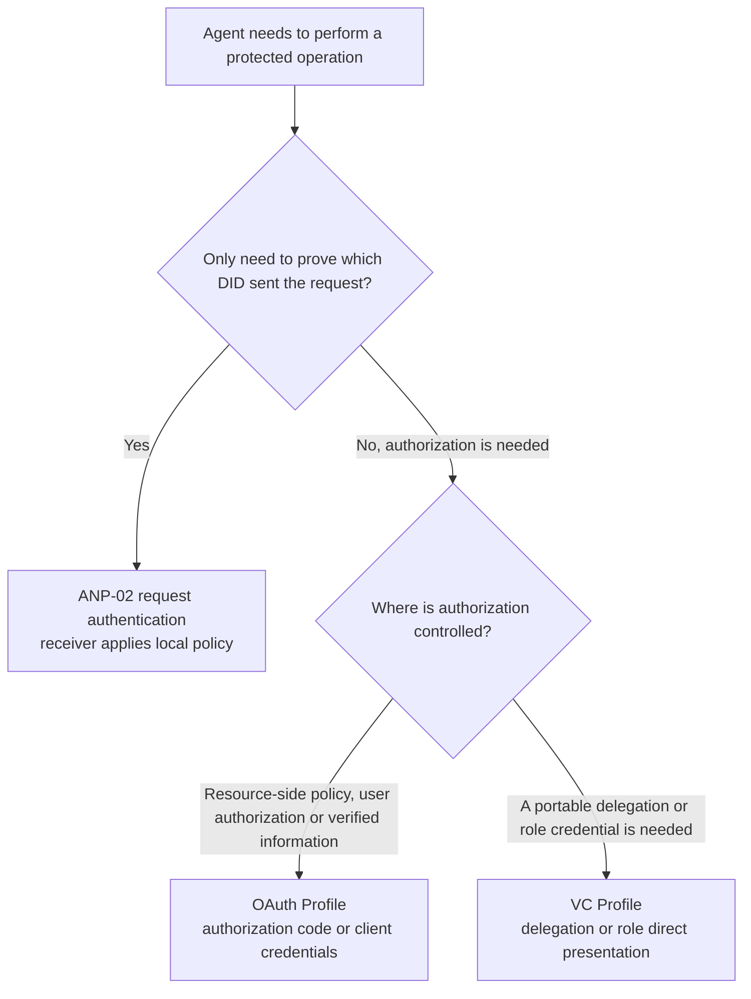
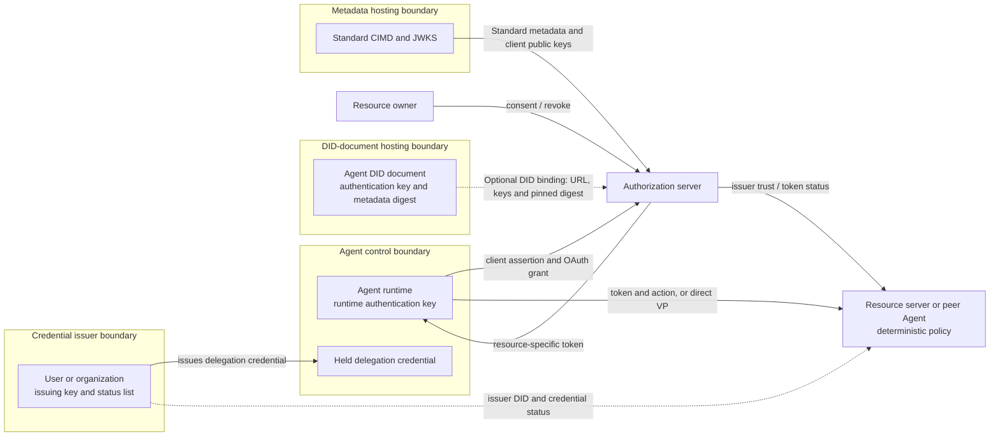
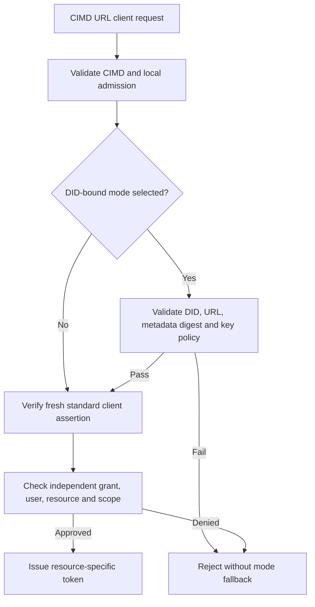
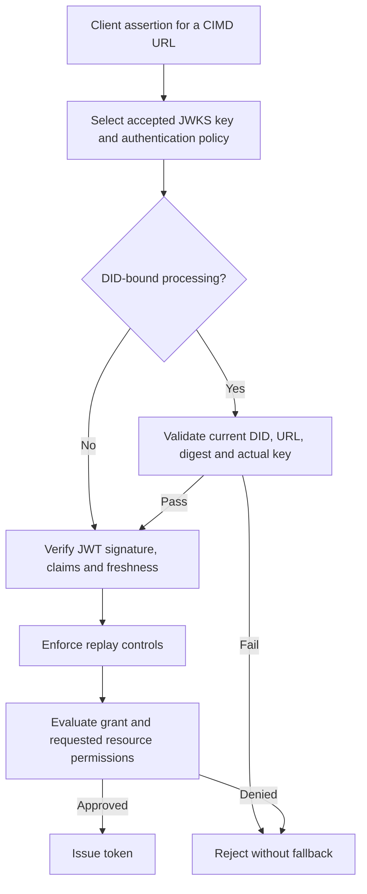
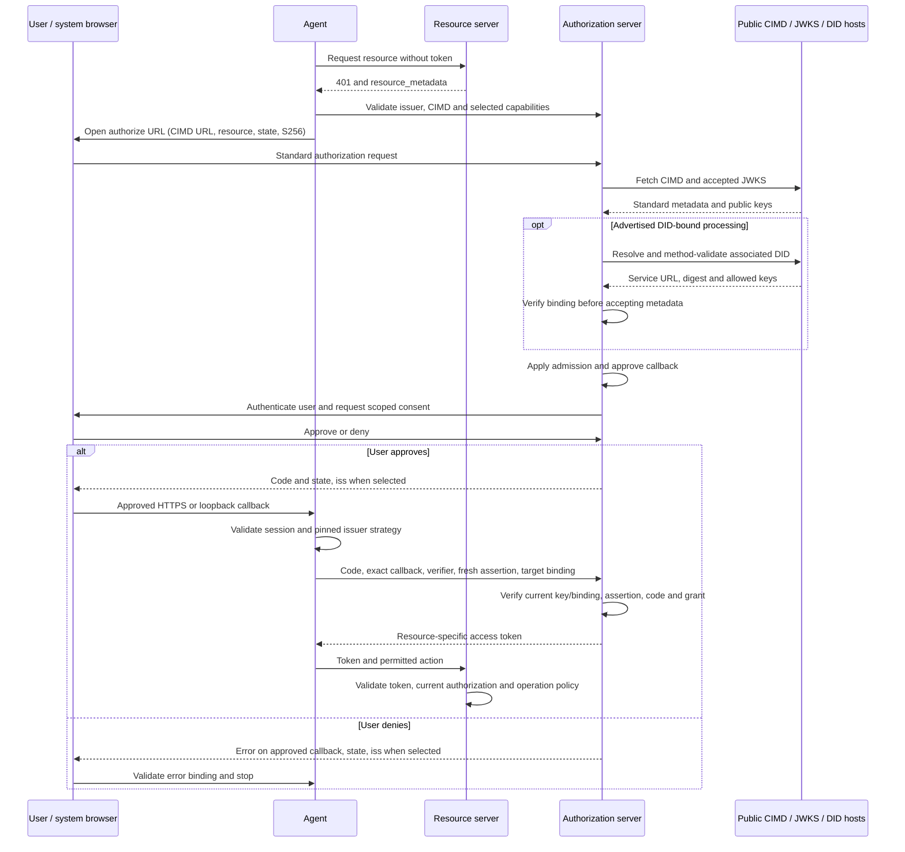
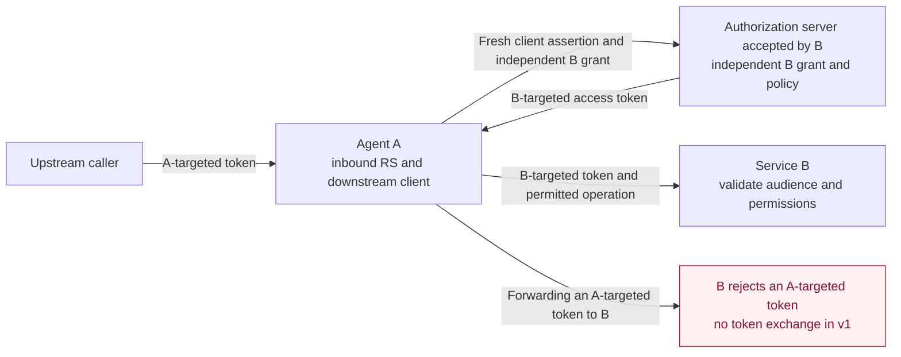
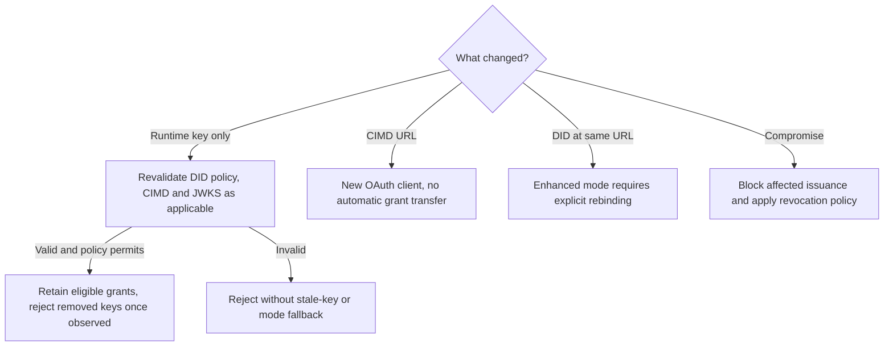

> 日本語参考訳（機械翻訳・未校閲）。規範となるのは原文です。コード例・識別子・規範キーワードは原文を保持しています。
> 原文: [05-anp-did-authorization-protocol-specification.md](../05-anp-did-authorization-protocol-specification.md) / 基準コミット: `0837cfdfaf4ddcf834f0890ddaf34fc4c824e066`

# ANP DID ベースの認証プロトコル

- 文書ID: ANP-05
- ステータス: ドラフト/未リリース
- バージョン: 0.7
- 仕様セット: ANP vNext; ANP 1.2 リリースの一部ではありません
- ドラフトプロファイル識別子: OAuth プロファイル `anp.authorization.oauth2.cimd.v1-draft1`; VCプロフィール `anp.authorization.vc.v1-draft2`
- 原文言語: English / このページは日本語参考訳
- 中国の鏡: [ANP DID ベースの認証プロトコル](chinese/05-ANP-基于DID的授权协议.md)

<a id="scope"></a>
## 1. 範囲、認可の問題、ロードマップ

ANP-05 は、2 つの補完的なメカニズムを備えた DID ベースのエージェント認可ワークストリームを定義します。 **OAuth プロファイル** では、リソース側によって信頼されている認可サーバーがアクセス トークンを発行します。もう 1 つは、権限を保持するユーザーまたは組織が W3C トークンを発行する **VC プロファイル** です。エージェントが保持および提示する検証可能な資格情報 (VC)。 DID は、ANP 層でプリンシパルを識別します。 OAuth パスでは、通常の AS は URL クライアント識別子と独自のリソース所有者 ID を使用します。明示的に検証された DID バインディングのみが、その AS で関連付けられた DID を確立します。 VC パスは、その発行者と承認されたエージェントを DID によって識別します。 **最初のリリース (v1) は、DID–OAuth クライアント ID と基本的な委任アクセス プロファイルに加え、直接提示された単一レベルの VC 委任と組織ロールの資格情報であり、完全なエージェント委任システムではありません。** 現在のドキュメントは未リリースの v0.7 ドラフトです。このドキュメントでは、「v1」は最初にリリースされるスコープの名前です。これは、v1 が出荷されたこと、または以降のロードマップ機能がすべて実装されたことを意味するものではありません。

OAuth プロファイルでは、エージェントはその DID を標準の OAuth クライアント ID メタデータ ドキュメント (CIMD) HTTPS URL に関連付け、公開された認証キーを使用してその URL クライアントを認証します。リソース所有者がアクセスを承認し、認可サーバー (AS) が制限付きトークンを発行し、リソース サーバー (RS) がそれを強制します。このパスには、VC、VP、OIDC ログイン ブリッジ、またはブロックチェーンは必要ありません。 VC プロファイルでは、権限を持つプリンシパルがエージェントに資格情報を発行します。エージェントは、ホルダーにバインドされた検証可能なプレゼンテーション (VP) を通じてそれを提示します。検証者は、発行者、所有者、資格情報ステータス、権限、制約、およびローカル信頼ポリシーを個別に検証し、要求された操作を実行または拒否します。

OAuth プロファイルのベースラインは次のとおりです。 **OAuth 2.0 と公開された拡張機能**これには、RFC 6749 および RFC 9700 と、URL クライアント識別子およびメタデータ検出用に明示的に固定された CIMD ドラフト-02 が含まれます。 CIMD は進行中の依存関係であり、公開された RFC ではありません。 OAuth 2.1 ドラフト 16 および JWT クライアント認証アップデート ドラフト 11 は有益な設計リファレンスであり、公開されている RFC 依存関係ではありません。 VC プロファイルの標準ベースラインは、W3C VC データ モデル 2.0、EdDSA 暗号スイートを備えた VC データ整合性 1.0、およびビットストリング ステータス リスト 1.0 です。大文字で表記 MUST, MUST NOT, SHOULD, SHOULD NOT、そして MAY BCP 14 の意味を使用します。以下の制限はこのプロファイルの規則であり、参照される仕様の修正ではありません。

**ANP-05 v1 では、2 つの独立した認証パスが定義されています。リソース側のアクセス認証用の DID ベースの OAuth、およびポータブルな委任および組織の役割の資格情報用のホルダー バインド VC プレゼンテーションです。 V1 では、VC/VP から OAuth アクセス トークンへの変換は定義されていません。スタンドアロン資格または属性資格情報プロファイルは、このバージョンでは定義されていません。**

文書構造: セクション 1 では、認可の問題とロードマップについて説明します。セクション 2 では、ANP-02 との関係と、OAuth または VC をいつ使用するかについて説明します。セクション 3 ～ 10 では OAuth プロファイルを定義します。セクション 11 では VC プロファイルを定義します。セクション 12 ～ 14 は、共通のエラー処理、セキュリティ、および適合要件です。

<a id="authorization-problem"></a>
### 1.1 実際のエージェント認証の問題 (参考)

中心となる疑問は、「どのエージェントがこの鍵を保持しているのか?」ということだけではありません。しかし、**「誰がどのエージェントにどのアクションを、どのリソースに対して、どの制限の下で実行することを許可しましたか?その権限はどのようにして終了しますか?」** 5 つの要件が作業を推進します。

| 要件 | 解決すべき問題 | v1 境界 |
| --- | --- | --- |
| Human-to-Agent delegation | Record the authorizing user, intended Agent, resource, permitted actions, duration, and withdrawal;自然言語タスク自体はリソースの付与ではありません。 | OAuth: ユーザーの同意または有効な既存の認可を伴う認可コード。個別のユーザーとクライアントのサブジェクト、スコープ、有効期限、取り消し。 VC: a user or organization issues a single-level delegation credential (Section 11) as a portable mandate: any verifier can check its signatures independently, but accepting it still requires a fresh status check;検証者は依然として独立して権限を決定します。 |
| エージェントにその代理を行う権限を与える組織 | 企業が、事前に知られていない採用プラットフォーム、サプライヤー、またはピアエージェントと会社を代表して取引する人事エージェントまたは購買エージェントとしてエージェントを任命します。取引相手は、この代理人が実際に会社を代表していること、代理人ができること、およびその制限を確認する必要があります。 | VC: 組織は、リソースアドレスではなくビジネスアクションごとに機能と制約をリストした役割資格情報 (セクション 11.2) を発行します。取引相手は、発行者がその組織であることを確認し、アクションを自身の業務にマッピングし、受け入れるかどうかを決定します。取引相手を越えた累積予算や、第三者の個人データに対する自動的な権限はありません。 |
| One Agent serving a user across multiple services | Each service controls its own resources, account identity and policy; 1 つのサービスでの許可と同意が、どこでも受け入れられるわけではありません。 | OAuth: 各リソースと受け入れられた AS に対して同じエージェント DID を使用してフローを繰り返します。独立した付与とターゲット限定のトークンを維持します。 VC: 1 つの資格情報に複数のサービスのリソースがリストされる場合があります。各検証者は独自のエントリのみを使用し、それらに対する発行者の権限を独立して確認します。単一のグローバルな同意や AS 間のアカウントの同等性はありません。 |
| マルチレベルの再委任 | 権限を拡大したり、ユーザー/アクターの帰属を失うことなく、A が B に、B が C に委任されます。失効と共有制限は広める必要があります。 | 未定義。 VC プロファイルは、検証者が独自に認識したプリンシパルによってエージェントに直接発行された資格情報のみを受け入れます。 issuing authority cannot be derived from a delegation credential, role credential or access token the issuer itself holds, so a credential re-issued by an Agent holding someone else's delegation is rejected.暗黙的な委任としてのトークン、資格情報、または秘密キーの転送はありません。 |
| 高リスクアクションに対する操作ごとの承認 | 個人の承認を正確な受取人、金額/通貨、データ開示または削除対象、有効期限、およびワンタイム操作識別子にバインドします。 | 一般的なトランザクション承認資格情報がありません。委任資格情報は、事前に付与された範囲を表すものであり、操作ごとの承認でもありません。個別の承認が必要なサービスは、独自の明示的な操作承認を確認するか、アクションをブロックする必要があります。ログイン、広範な範囲、DID 署名、または DPoP だけでは承認とはなりません。 |

基本的な同意レコードと VC 委任資格情報は両方とも、すでに限定されたアクセスをエージェントに委任しています。したがって、v1 が人間による委任をまったく行わないと言うのは不正確です。 VC 委任資格情報は移植可能な権限を提供しますが、単一レベルの委任のみをカバーします。 v1 は行います **そうではない** さらに、委任チェーンや標準化されたトランザクション承認を定義します。ユーザーの指示は実行をガイドできますが、ユーザーまたはエージェントが持たない権限を作成することはできません。

<a id="technical-choices"></a>
### 1.2 技術的な選択と実装コスト (参考)

**認証ライフサイクルに OAuth を再利用します。** RFC 6749 はすでにリソース所有者、クライアント、AS および RS を分離し、同意/許可、アクセス トークン、およびリフレッシュ フローを提供します。 RFC 7523 セクション 2.2 は、クライアント アサーション トランスポートを提供します。 RFC 7636、RFC 8707、RFC 7009、および RFC 7662 は、コード保護、ターゲット制限、失効、ステータス チェックを提供します。これにより、ANP は、別の付与/トークン エコシステムを発明するのではなく、再利用可能なエージェント ID と不足しているエージェント固有の委任セマンティクスに焦点を当てることができます。 OAuth はソリューション全体ではありません。OAuth 自体は、タスク全体の予算、権限の削減、または特定のビジネス アクションに対するユーザーの承認を定義しません。

**DID を権限としてではなくプリンシパルとして使用します。** 同じメソッドで検証された DID と選択された認証キーの関係は、通常の ANP 認証、通信、OAuth クライアント キーの公開に再利用できます。標準 CIMD モードでは、AS は URL クライアントを認証します。追加の DID バインディング チェックを実行する検証者のみが、関連付けられた DID を認証したと主張できます。ネイティブの Did:web は DNS/HTTPS/ホスティングの信頼を保持します。このプロファイルを使用するだけでは、指紋に関連付けられた ID や独自の DID ドキュメント ホストからの保護は得られません。パスベースの Did:wba e1_ は、バインディング キーのフィンガープリントと検証済みの文書証明を追加します。これらのプロパティは、正しいメソッド検証とキーの保管が条件です。どちらの方法もソフトウェアの完全性や人間の同意を証明するものではありません。これは共通の ID/ライフサイクル モデルであり、DID だけがポータブル ID を提供できるという主張ではありません。

**CIMD を再利用して既存の OAuth エコシステムに接続します。** 主な利点は、すでに CIMD と選択された標準 OAuth 機能をサポートしている認可サーバーが、クライアント ID、メタデータ検出、許可、またはトークン フローに対する ANP 固有の変更を行わずにクライアントを処理できることです。 OAuth `client_id` CIMD HTTPS URL のままです。 DID ドキュメントは ANP ID 関連付けを提供し、発行者は選択された認証キーを標準 JWKS としてエクスポートします。これにより、すべての AS で DID リゾルバーが必要になるのではなく、エージェント SDK またはメタデータ パブリッシャーに DID 適応が配置されます。互換性は、AS のアドミッション ポリシー、サポートされている認証アルゴリズム、および選択されたフローによって決まります。すべての OAuth サーバーが CIMD をサポートしていること、または標準の CIMD サーバーが DID を検証していることを意味するものではありません。セクション 4 では、通常の CIMD 処理と、明示的にネゴシエートされるオプションの DID バインディング検証を分離します。将来の拡張機能では、DID 自体を次のように使用することが検討される可能性があります。 `client_id` (セクション 16)、明示的な AS サポートと移行ルールを備えています。秘密キーは、エージェントまたはその明示的に許可された署名者に保管されます。

**リソース側の外部に由来する権限を伝達するためにVCを使用します。** 多くのエージェント承認の根拠はリソース側にはありません。企業がエージェントを購買担当者として任命したり、ユーザーがエージェントに複数の販売者に示すことができる権限を与えたり、機関がエージェントがどの組織に属しているか、またはエージェントがどのような資格を持っているかを証明したりします。 OAuth 同意レコードは各 AS 内に存在します。別のサービスに転送したり、AS を持たないピアによって検証したりすることはできません。 W3C VC 2.0 では、承認者が独自の DID でステートメントに署名できます。エージェントはそれを保持し、その発行者を信頼する検証者にそれを提示します。検証には、発行者と所有者の DID を解決し、ステータス リストを確認するだけが必要で、検証者と発行者を事前に統合する必要はありません。 ANP はすでに、did:wba 文書証明とメッセージング バインディングにデータ整合性 eddsa-jcs-2022 を使用しています。 VC プロファイルは、別の署名スタックを追加するのではなく、その証明メカニズムを再利用します。 VC にもコストがかかります。失効はステータス リストに依存し、キャッシュの待ち時間が発生します。各検証者は、どの発行者をどのクレームに対して信頼するかについて独自のポリシーを維持する必要があります。資格情報が提示されると、その内容が検証者に表示されます。

**VC と OAuth は別個の役割を持ち、相互に置き換えられません。** v1 では、これらは独立した認証パスです。 OAuth は、認可がリソース側で管理され、OAuth 付与およびアクセス トークンを通じて表される場合に使用されます。 v1 VC プロファイルは、独立した検証のために外部の委任または組織の役割の資格情報を保持します。資格または属性の資格情報は、別途合意されたルールに基づいて検証者によって明示的に要求された補足証拠としてのみ使用できます。 OAuth 認可の決定では、役割、資格、組織 ID、またはその他の検証済み情報も使用される場合があります。将来の拡張では、外部で発行された資格情報を OAuth 認可決定への入力として使用する方法が定義される可能性があります。 v1 では、VC からアクセス トークンへの交換が定義されていません。セクション 2.2 では、いつどちらを選択するかについて説明します。後の段階で提案される規格は評価の対象であり、現在の適合要件ではありません。

<a id="v1-scope"></a>
### 1.3 v1 が提供するもの

V1 の成果物は **DID に関連付けられた OAuth クライアント ID と、使用可能で監査可能な基本的なユーザー委任**: 標準の CIMD URL クライアント識別子。 DID から CIMD への検出と公開鍵の公開。オプションの整合性チェック済み DID バインディング。有効な場合、AS ごとの事前登録を行わないポリシー制御のファーストコンタクト アドミッション。 RFC 7523 クライアント認証。適格な機密展開のためのクライアント認証情報。ホスト型 HTTPS およびローカル ループバック クライアント用の S256 PKCE による認証コード。ターゲット固有のトークン、オプションの更新、ライフサイクルの強制。 OAuth プロファイルに基づくユーザー委任サポートを主張する展開 MUST 認可コードパスを実装します。クライアント資格情報のみの実装 MUST NOT OAuth ユーザー委任機能を要求します。 VC プロファイルを通じてのみ委任を受け入れる検証者は、この要件の対象にはなりません。

ユーザーが委任した付与の場合、AS MUST は、発行者/テナントのコンテキスト内の認証されたリソース所有者識別子、URL クライアント識別子、検証時のみ関連するエージェント DID、ターゲット リソース、付与されたスコープ、承認元と時間、適用可能な有効期間/取り消しポリシー、および安定した内部付与参照を保持します。既存の同意または管理者の許可は、文書化されたポリシーに基づいてのみ承認を与えることができます。これは OAuth 認証レコードの要件です。ポータブルなシステム間権限は、VC プロファイルによって定義されます。新しい権限には、別の承認決定が必要です。ユーザーの認証情報とエージェントの認証キーは分離されたままになります。

VC プロファイルはオプションの機能です。これは、委任および組織ロールの資格情報、ホルダーにバインドされたプレゼンテーション、発行者とホルダーの検証、資格情報のステータスのチェック、権限と制約の評価、およびリソース サーバーまたはピア エージェントへの直接プレゼンテーションを提供します。 VC プロファイル MUST がその役割に適用されるセクション 11 の要件を満たしていると主張する実装。 VC サポートなしの実装でも、OAuth プロファイルに完全に準拠できます。有効な委任資格情報は、検証者の承認決定に代わるものではありません。

**セキュリティベースライン:** プロファイルフロー MUST NOT 暗黙的またはリソース所有者のパスワード資格情報の付与、URI クエリ文字列のアクセス トークン、または PKCE プレーンを使用します。認可コードには、S256 PKCE、狭義に定義されたループバック ポート例外との承認されたリダイレクト マッチング、および発行者/セッションの検証が必要です。将来のロードマップ機能 MUST NOT v1 サポートとして宣伝されます。

<a id="roadmap"></a>
### 1.4 段階的なソリューションと受け入れロードマップ (参考)

これらは注文された機能段階であり、約束された納期ではありません。後の段階では、v1 の ID/許可境界を変更せずに、独立した拡張機能として出荷できます。

| 段階 | 解決策の方向性 | 能力を主張する前の証拠 |
| --- | --- | --- |
| v1: アイデンティティと基本的な委任 | セクション 1.3 のスコープを実装します。同じ DID が複数のサービスで個別の承認を取得します。ユーザー/エージェントの帰属と明示的な取り消しを保持します。権限がリソース側の外部から発生する場合は、直接提示を通じて単一レベルの VC 委任またはロール資格情報を使用します。 | CIMD の最初の連絡先とオプションの DID バインド検証。宣言されたホストおよびループバック ユーザー フロー。 2 つのリソースの分離。メタデータの改ざん。キーの回転。取り消し;陽性および陰性の VC 直接提示のケース。セクション 14 に基づく相互運用可能なクライアント/AS の証拠。 |
| 次: 正確な権限と高リスクの承認 | 構造化されたリソース/アクション/制約リクエストについて RFC 9396 RAR を評価します。個別に検証されたワンオペレーション承認、おそらく専用の VC タイプまたは別の認証情報を定義し、エージェント、リソース、正確に正規化されたアクション ダイジェスト、重要なパラメーター、有効期限、および一意の識別子にバインドします。実行時にアトミックにチェックして消費します。 | パラメータの置換、リプレイ、二重実行、有効期限、承認の取り消しは安全に失敗します。新規ログイン、署名されたトランスポート要求、または広範な委任資格情報は、トランザクションの承認の代わりにはなりません。 |
| 次に: 制御された再委任 | VC 委任チェーン (親を参照し権限を絞り込む子資格情報) と RFC 8693 トークン交換アクターの属性を評価します。承認された委任の深さ、親の実効権限を超えない子の権限、対象者/有効期限の絞り込み、グラントファミリーの取り消しと監査を定義します。 AS 間の交換には、明示的な信頼とアカウント/権限のマッピングが必要です。 V1 では、VC から OAuth へのトークン交換もマルチレベルの再委任も定義されていません。 | A-to-B-to-C の委任。拡張の試みまたは間違ったアクターが拒否されました。 root の取り消しにより、新しい子の付与がブロックされます。既存のトークンの無効化の待ち時間が文書化されています。俳優履歴の主張だけを承認として扱わないでください。 |
| これらの段階に加えて、長時間実行および非対話型の実行、プライバシー | リモート/ヘッドレス承認、追加のバックチャネル フロー、検証済みの DID 移行、共有予算/対抗執行について RFC 8628 を評価します。 VC の選択的開示暗号スイートと人間のウォレットの OpenID4VP/OpenID4VCI バインディングを評価します。対応するドメイン プロトコルによって定義および管理される、購買や人事などの一般的なビジネス機能の相互運用可能なアクション語彙を評価します。 V1 ループバックは、すべてのヘッドレス環境ではなく、エージェント自身のデバイス上のブラウザをカバーします。 | ユーザーとデバイス/トランザクションのバインディング、フィッシングおよびポーリングの制御、ユーザー許可の有効期限が切れた後のクライアントのみのフォールバックなし。共有制限は、子アクションの同時実行でも正しいままです。選択的開示では、提示されていない許可エントリが漏洩することはありません。 |

計画された共通モデルは、識別された委任者、対象のエージェント、リソース/アクション、制約、関連する場合の親の付与、承認の証拠、および失効状態です。後続の拡張では、正確なワイヤ スキーマと適用ルールが定義されます。予算を記載する署名済みのクレーム自体はグローバルカウンターを実装しません。トークン交換自体は、取り消しを伝播したり、許可の減衰を証明したりすることはありません。

このドラフトの公開によって、SDK、AS、または製品のサポートが確立されるわけではありません。リビジョン 0.7 は、以前のクライアント ID としての DID OAuth 設計を実験的な `anp.authorization.oauth2.cimd.v1-draft1` に置き換えます。独立した VC プロファイルは `anp.authorization.vc.v1-draft2` のままです。以前の `anp.authorization.oauth2.did.v1-draft4` 識別子は、このリビジョンのエイリアスではありません。リビジョン 0.6 では、VC-to-OAuth トークン交換が削除されました。リビジョン 0.5 では VC プロファイルが追加されました。実装 MUST は正確なリビジョンと一致し、影響を受けるメタデータと保留中のトランザクションを移行前に再検証します。変更されたクライアント識別子は新しい OAuth クライアントであり、既存の許可またはコードに対するプロファイル文字列の更新ではありません。

<a id="anp-boundary"></a>
## 2. ANPとの関係とメカニズムの選択

現在のものを使用する [ANP-02 アイデンティティマテリアルルール](../02-anp-did-authentication-protocol-specification.md#identity-input), [ANP-03 WBAバインディング](../03-did-wba-method-design-specification.md#wba-auth-binding)、そして [ANP-02 ネイティブ Web バインディング](../02-anp-did-authentication-protocol-specification.md#web-binding)。 Git の歴史におけるリリース前のスナップショットは、このドラフトの規範的なベースラインではありません。

ANP-02 は HTTP/JSON リクエスト認証を定義します。 ANP-05 は DID 検証および認証キー認可モデルを再利用します。 **そうではない** HTTP 署名のシリアル化、チャレンジ、またはオプションのトークン応答ヘッダー。 OAuth トークン エンドポイントは次を使用します。 `client_assertion` および標準の OAuth JSON トークン応答。それ MUST NOT このプロファイルを満たすには、2 番目の ANP-02 HTTP 署名が必要です。個別の OAuth 認証方法として HTTP メッセージ署名を必要とする展開には、別の明示的なバインディングが必要です。

ANP-02 認証キャッシュ トークンは、自動的には ANP-05 OAuth 認証トークンにはなりません。実装 MUST 受け入れルールを分離します。メッセージング、WNS、デバイス マニフェスト、E2EE、および人間の存在 UI は、このプロファイルの依存関係ではありません。 VC ダイレクト プレゼンテーションは、プロトコルのルールを変更することなく、ANP-02 認証された HTTP インターフェイスまたは認証されたメッセージング セッションによって実行できます。 DID `authentication` 関係により認証用のキーが認可されます。アプリケーション リソースへのアクセスは許可されません。

### 2.1 ANP-02、OAuth、または VC の選択 (参考)

| | が必要です| 資格情報の意味 | を選択してください
| --- | --- | --- |
| 直接 API リクエストまたは通信ピアを認証します。受信者は、既存のローカル ポリシー | ANP-02 | を適用します。そのオプションのトークンは、その API のポリシーに基づいて受信者の認証されたコンテキストを再利用します。標準化されたユーザー委任許可を確立するものではありません。 |
| ユーザーに代わって制限付きアクセスを取得するか、AS 管理のクライアント許可、リソース オーディエンス、同意、有効期限、取り消しを使用します | ANP-05 OAuth プロファイル | AS は、特定の許可とリソースに対して OAuth アクセス トークンを発行します。 |
| 検証者による直接検証と受諾のために、要求された場合には別途合意された適格性証拠とともに、外部の代表団または組織の任命を提示します。 | ANP-05 VC プロファイル | 発行者が署名した声明。検証者は独自のポリシーに基づいてそれを受け入れるかどうかを決定し、資格情報自体はアクセス トークンではありません。 |

サービスは、明確に分離されたルートまたは宣言されたポリシーで複数のメカニズムを提供する場合があります。 JWT、署名付き JSON、または「トークン」という単語の存在によって、これらが交換可能になるわけではありません。 ANP-05 は最初に ANP-02 トークンを必要とせず、ANP-02 クライアントは通常の認証されたメッセージごとに AS を採用する必要はありません。 RS MUST NOT は、生の VC または VP をベアラー アクセス資格情報として受け入れます。

<a id="mechanism-selection"></a>
### 2.2 OAuthとVCの役割分担（参考）

二人は別々の質問に答えます。 **OAuth は、「リソース側は、現在、このクライアントがこのリソースでこの操作を実行することを許可していますか?」と答えます。**: リソース側によって信頼されている AS は、ローカル ポリシー、ユーザー承認、役割、資格、組織 ID、またはその他の検証済み情報を評価し、ターゲット限定のアクセス トークンを発行します。 **VC は、「どの発行者がこのエージェントについてどのような検証可能なステートメントを作成しましたか?」と回答します。**: エージェントは外部発行者のステートメントをさまざまな第三者に伝えることができ、各検証者は発行者を信頼して操作を許可するかどうかを決定します。役割と資格も OAuth の決定に影響を与える可能性があります。移植可能で独立して検証可能な外部ステートメントの必要性が VC の動機です。

| アスペクト | OAuth アクセス トークン | VC 委任または組織ロールの認証情報 |
| --- | --- | --- |
| 発行者 | リソース側によって信頼された AS | 権限のソース: ユーザー、組織、または認定機関 |
| 認可決定 | トークンを発行する前に AS によって行われます。 RS によって強制されます | 資格情報が直接提示された場合に各検証者によって作成されます |
| 範囲 | リソースが 1 つ。このプロファイルは各トークンを単一のトークンにバインドします。 `resource` | 資格情報にリストされているスコープ (場合によってはサービス全体)。各検証者は独自のエントリのみを使用します |
| 検証は、| 信頼できる AS の署名キーまたはイントロスペクションに依存します。 | 発行者 DID、所有者 DID、ステータス リスト。検証者と発行者の間に事前の統合がありません |
| 有効期間と失効 | 有効期間の短いトークン。 AS は発行を一元的に停止して更新できますが、発行されたトークンは有効期限が切れるか、RS が失効を知るまで使用可能なままになる可能性があります | 通常、有効期間は長くなります。ステータスリストを通じて取り消され、ステータスリストの発行とキャッシュによってレイテンシが設定されます |
| 対話が必要です | ユーザーの委任の場合、ユーザーは AS にサインインして同意します。クライアントと AS の往復 | 認可当事者は発行時に 1 回確認します。プレゼンテーション時に、エージェントと検証者はチャレンジとホルダーバインド VP を交換し、DID、ステータス、ローカル ポリシーをチェックします |
| プライバシー | トークンの内容は通常、クライアントに対して不透明です。 AS はすべての許可を確認します | 提示された資格情報は検証者に表示されます。発行者はプレゼンテーションに関与しませんが、ステータスリストの取得により検証者のネットワークアドレスがリストホスト | に公開されます。

**OAuth が適合する場合:**

-  リソースは、独自のユーザー アカウントを持つサービスによってホストされています。たとえば、エージェントはドキュメント サービス内のユーザーのファイルを読み取るか、ユーザーのカレンダーに書き込みます。ユーザーはそのサービスにサインインして同意し、完全な許可レコードが保持されます。
-  エージェントは、クライアント資格情報を使用して、サービスによって構成されたアクセス許可を使用して、独自の名前でサービスを呼び出します (マシン間)。
-  リソース側には、集中管理された取り消し、有効期限の短いトークン、リソースごとの分離、または増分認可が必要です。
-  リソース側はすでに OAuth を実行しており、RS が変更せずにトークンを検証することを望んでいます。

**VC が適合する場合:**

-  権限はリソース側の外部から生じています。たとえば、企業は、購買担当者が、企業が設定した制限と期間内で、企業の名前でサプライヤーに注文することを許可します。サプライヤーは、企業の従業員がサプライヤーのシステムにサインインして同意したことを確認するのではなく、「この会社が本当にこのエージェントを承認した」ことを確認する必要があります。
- 組織はエージェントを機能的な役割に任命します。たとえば、企業の HR エージェントは求人プラットフォームに求人情報を掲載し、企業に代わって候補者のエージェントとの面接のスケジュールを設定します。また、購買エージェントは新しいサプライヤーに見積もりを要求し、発注します。取引相手は事前に代理店を知らないことが多く、会社は事前にすべての取引相手の住所をリストすることはできません。役割資格情報は、ビジネス アクションごとに「このエージェントが当社に対して何を行うのか、またその制限はどの程度までなのか」を示します。セクション 11.9 を参照してください。
-  相互に統合されていない複数のサービスに同じ権限を示す必要があります。たとえば、ユーザーが 1 つの委任資格情報を発行すると、エージェントは複数のホテルを比較して予約できるようになります。各ホテルは個別に検証し、ユーザーはそれぞれのホテルにサインインする必要はありません。
-  カウンターパーティは、OAuth AS が存在するかどうかに関係なく、ピアツーピア コラボレーションを含む VC 対応インターフェイスを公開します。そのフローでは、ピアはエージェントがどのユーザーまたは組織を代表しているのか、またエージェントが何を実行できるのかを確認する必要があります。
- 組織のメンバーシップ、業界の資格、本人確認結果、または検証者によって明示的に要求されたエージェントとオペレーターの証拠を使用して認可資格情報を補足します。このバージョンでは、委任および組織ロールの承認資格情報のみが定義されています。補足属性タイプ、サブジェクトバインディング、発行者信頼および受け入れルールには個別の合意が必要であり、証拠はセクション 11.3 に基づいて認可資格情報とともに提示されます。このバージョンでは、完全なスタンドアロン資格や属性プレゼンテーション バインディングは定義されておらず、属性資格情報自体はアクセスを許可しません。

**V1 境界。** OAuth と VC は独立した認証エントリ ポイントです。 VC 対応の検証者は、プレゼンテーションと要求された操作を直接チェックします。 OAuth 専用インターフェイスでは、サポートされている OAuth フローによる認証が必要です。 MUST NOT VC 直接プレゼンテーションを通じてバイパスされる可能性があります。 VC-OAuth の構成は、セクション 16 における将来の拡張の方向性にすぎません。



### 2.3 信頼境界 (参考)



アーキテクチャと OAuth/VC の役割分担は変わりません。ソリッド メタデータ パスは通常の CIMD AS で動作します。点線の DID パスは、DID バインディング検証の場合にのみ有効です。この図では、DID ドキュメント ホスティングを別個の境界として描いています。 Did:wba e1_ の場合、ドキュメントの整合性はエージェント制御のバインディング キー証明から得られるため、ホストはサービスを拒否するか、古いドキュメントを再生することしかできません。ネイティブの Did:web の場合、侵害されたホストはキーとダイジェストを置き換える可能性があります (セクション 4.2 を参照)。発行者とリソース所有者は同一人物である可能性がありますが、発行キーは常に発行者の管理下にあり、エージェントに与えられることはありません。

<a id="roles"></a>
## 3. 役割と識別子

セクション 3 ～ 10 では OAuth プロファイルを定義します。セクション 11 では、独立した VC の直接プレゼンテーション フローを定義します。 VC を採用する場合、その所有者または検証者が OAuth クライアントまたは AS の役割を引き受ける必要はありません。 AS は通常のビジネス コンポーネントとして VC ベリファイアを実装できますが、このバージョンでは AS に特別な VC からトークンへの役割を割り当てません。

| 用語 | 意味 |
| --- | --- |
| クライアント/エージェント ランタイム | アクセス トークンを要求および使用するソフトウェア展開。その ID はリソース所有者とは異なります。 |
| エージェント DID | DID ドキュメントを通じて OAuth クライアントに関連付けられた ANP ID。これは OAuth ワイヤ識別子ではなく、必ずしもユーザーの DID である必要もありません。 |
| `client_id` | OAuth クライアント識別子として使用される正確な HTTPS CIMD URL。 |
| リソース所有者 | アクセスを承認する資格のあるユーザーまたは組織。 |
| 認可サーバー (AS) | URL クライアントを認証し、付与とポリシーを検証し、トークンを発行します。 DID バインド処理が有効な場合にのみ、エージェント DID が検証されます。 |
| リソース サーバー (RS) | リソース アクセスを強制するターゲット エージェント、API、またはゲートウェイ。 |

リクエスト `client_id`、CIMD `client_id`、およびクライアントの主張 `iss` そして `sub` MUST まったく同じ CIMD URL である必要があります。クライアントの主張 `sub` クライアントを特定します。アクセストークンの `sub` 認可の対象を識別します。通常、ユーザーが委任したアクセスの場合はリソース所有者、クライアントのみのアクセスの場合は AS によって決定された対象です。実装 MUST NOT アサーションをコピーする `sub` 認証が成功したという理由だけで、ユーザーが委任したトークンに変換されます。

クライアント アサーションの `aud` は、固定された認証ポリシーに基づいて受け入れられた AS を識別します。アクセス トークンの対象者は、対象となる RS を識別します。同じエージェント DID と CIMD URL が複数の AS で使用される場合がありますが、アドミッション、許可、ユーザー アカウント、およびトークンの範囲は各 AS に限定されます。クライアントには DID があるため、トークンはどこでも受け入れられるわけではありません。

クライアントのレコード、許可、トークン キャッシュ MUST (発行者、テナントまたは信頼ドメイン、クライアント) によってスコープが設定される_id)、リソース所有者、許可、ターゲットリソース、および処理モードを個別に保持します。 RFC 9068 JWT アクセス トークンの場合、必要な `client_id` クレームには URL が含まれますが、関連付けられた DID は含まれません。 RFC 7662 イントロスペクションでは、標準のセマンティクスが維持されています。 `client_id`が返されると、URL が返されます。ポリシーがクライアント ID に依存する RS MUST 信頼されたトークン/イントロスペクション コンテキスト、または同等の信頼された状態を通じてその ID を取得します。それ MUST 必要な ID が利用できない場合、呼び出し元が指定したフィールドを信頼するのではなく、そのような決定を拒否します。このプロファイルでは、通常の CIMD AS がそのトークンに DID クレームを追加する必要はありません。

ANP 対応 AS は、正常に検証された DID バインディングを、そのプロファイル リビジョンおよび検証状態とともに個別に記録します。その結果を RS に伝達するには、明示的に信頼されたチャネルまたは合意されたトークン拡張が必要です。ここでは新しいトークンの要求は義務付けられていません。 RS MUST NOT 未検証の DID から検証済みの DID を推測する `anp_did`、 `kid` ラベル、または URL の現在の内容のみ。 AS がバインディングを検証しなかった場合、DID 認証を必要とするリソースには、別途合意されたバインディングに基づいて、実際のリクエスト/トークンにバインドされた独立した証明が必要です。 MUST その操作を拒否します。このような証明の交換は、この改訂版では定義されていません。

共有 CIMD URL は、複数のエージェント インスタンスで使用されている場合でも、1 つの OAuth クライアントを表します。エージェントごとに独立したクライアント ID SHOULD を必要とする展開では、個別の安定した URL と認証キーが発行されます。ユーザー間で共有される URL は、発行者スコープのリソース所有者の ID を置き換えるものではありません。これは ID の関連付けであり、アカウントの自動結合、ソフトウェアの証明書、または許可ではありません。

<a id="enrollment"></a>
## 4. クライアントの登録とバインド

### 4.1 クライアント識別子としての CIMD URL

このリビジョンでは、CIMD ドラフト 02 で定義された HTTPS クライアント識別子 URL を使用します。それ MUST 道があって、 MUST NOT ユーザー情報、フラグメント、または一重ドット/二重ドットのパス コンポーネントが含まれています。このプロフィールのパブリッシャー MUST クエリを省略します。通常形式/JSON デコード ステップを 1 回行った後、文字列の正確な同一性によって識別子を比較します。ポート、大文字小文字、パス、またはエイリアスを正規化して同等にしないでください。 DID または DID URL MUST NOT OAuth の CIMD URL を置き換えます `client_id` フィールド。

2 つの処理モードがあり、トランザクションの開始前に選択されます。

| モード | 検証責任 |
| --- | --- |
| `cimd` | 標準の CIMD メタデータ検出、URL クライアント認証、および OAuth 認可。 AS は、DID を解決したり、ANP 拡張を理解したり、DID 固定ダイジェストをチェックしたりする必要はありません。 |
| `did_bound` | 同じ標準 URL クライアントおよび OAuth メッセージに加え、セクション 4.2 および 6.2 の DID/URL/メタデータ/実際の認証キーのチェック。 AS はセクション 5 に基づいてこの拡張機能を明示的にアドバタイズします。 |

`did_bound` に明示的に割り当てられた要件は、その拡張機能が実装され有効になっている場合にのみ適用されます。これら MUST NOT は、通常の CIMD AS が標準フローを処理するための前提条件です。以下の一般的な OAuth 安全要件は、参加する実装と機能の選択に関する要件です。 CIMD サポートだけでは、ここで使用されるすべてのオプションの OAuth 拡張機能がアドバタイズされるわけではありません。サポートされていない機能を必要とする接続は、ANP 固有の代替プロトコルを要求するのではなく、認証前に失敗します。

クライアント MUST 承認された発行者、URL を固定します `client_id`、認可前に選択されたモードと認証ポリシー。 DID バインドされた ID が必要な場合、正確な拡張機能が存在しないか、そのチェックが失敗する MUST 操作を中止します。それ MUST NOT 自動再試行をトリガーする `cimd` モード。明示的に構成された `cimd` 接続は有効ですが、 MUST NOT AS 検証済み DID 認証として報告されます。将来のクライアント ID としての DID 作業は、別途交渉された拡張機能に属します (セクション 16)。

<a id="anpcimd"></a>
<a id="anp-oauth-keys"></a>
<a id="anp-metadata-sha256"></a>
### 4.2 自己公開 OAuth クライアント メタデータ

ANP パブリッシャーは、エージェント DID をタイプの 1 つのサービスにのみ関連付けます。 `ANPCIMD` このプロフィールについては。それ `id` MUST DID と空ではないフラグメントであること、および `serviceEndpoint` MUST 正確な CIMD HTTPS URL になります。重複するサービス ID または複数の一致するサービスは、ANP 検出によって拒否されます。 `ANPCIMD` は、W3C で定義されたタイプではなく、ANP で定義された実験的な DID サービス タイプです。 JSON-LD のデプロイメントには、明示的な固定された拡張コンテキストが必要です。 DID コア コンテキストでは、これらの拡張用語は定義されません。以前の `ANPOAuthClientMetadata` サービスはこの新しいプロファイルを選択しません。

発行者 MUST は、メソッド検証済みの DID マテリアルと明示的な OAuth アプリケーション構成を組み合わせます。次のマッピングは公開の基準です。 DID 解決を実行するために標準 AS は必要ありません。

| 出力 | ソースとルール |
| --- | --- |
| `client_id` | 正確な DID に関連付けられた CIMD URL。 |
| `jwks` または `jwks_uri` | DID の認可されたものから選択された公開署名キー `authentication` メソッド。秘密鍵マテリアルは決してエクスポートしないでください。あ `jwks_uri` MUST 未変換の DID ドキュメントではなく、標準の JWK セットを提供します。これら 2 つのメタデータ フィールドのうちの 1 つを正確に使用してください。 |
| `client_name`, `client_uri`, `logo_uri` | 明示的なアプリケーション表示構成。自己主張された名前は、検証された組織のアイデンティティではありません。 |
| `redirect_uris` | 実際のアプリケーションのコールバック構成。 DID ドメインのみからコールバックを推測しないでください。 |
| `grant_types`, `response_types`, `scope` | 実装/要求された OAuth 機能とアプリケーション構成。これらの値は権限の付与ではありません。 |
| `token_endpoint_auth_method` | `private_key_jwt` このプロファイルの認証されたクライアント パス。あ `none` パブリッククライアント接続は、DID に基づくクライアント認証要求の範囲外です。 |
| `token_endpoint_auth_signing_alg` | 指定した場合、選択したキーと互換性のあるサポートされる非対称アルゴリズム。実際の使用には AS サポートも必要です。 |

CIMD ドキュメント MUST CIMD ドラフト 02 および該当する RFC 7591 メタデータ セマンティクスに従います。それ MUST 正確な URL を次のように含めます `client_id` そして空ではない `client_name`。認可コードの公開には以下が含まれます `response_types=["code"]` そして設定された `redirect_uris`。文書 MUST HTTP 200 と JSON を返す未認証の HTTPS GET によって利用可能になります。出版社 SHOULD 使う `application/json`。フェッチャー MUST NOT 自動的にリダイレクトに従うか、エラー応答をメタデータとして受け入れます。共有シークレット、秘密キー、ベアラー資格情報を公開しないでください。外部 JWKS フェッチを含む各フェッチはセクション 13 の対象となります。

`anp_profile` と `anp_application_type` は必須の CIMD メンバーではありません。 `cimd` モードには、標準のみの CIMD ドキュメントで十分です。オプションの実験的な `anp_did` メンバーは、リバース ディスカバリ用のベア エージェント DID の候補を識別します。 DID バインドされたチェックが成功するまで、権限はありません。パブリッシャー MAY は、リバースディスカバリが不要な場合、または信頼できる帯域外バインディングが DID を提供する場合、これを省略します。通常の AS はそれを解釈する必要はありません。トランザクションのクライアント ID やセキュリティ モードをサイレントに変更することなく、受け入れられたメタデータとの互換性を確立する必要があります。

`did_bound` の公開と検証のために、`ANPCIMD` サービス MUST には以下がさらに含まれます。

- `anp_oauth_keys`: この DID からの個別の検証メソッド ID の空でない配列 `authentication` 関係を確立し、関連付けられた URL クライアントに対してこれらのキーを明示的に認可します。各参照は、DID コアの相対参照処理の後に、この DID と空ではないフラグメントに解決される必要があります。このフィールドは許可されていません `keyAgreement` または単にリストされている任意のキー `verificationMethod`.
- `anp_metadata_sha256`: CIMD 表現全体の 64 文字の小文字 16 進数 SHA-256 ダイジェスト。 HTTP 転送/コンテンツのデコード後に、空白と最後の改行を含む UTF-8 応答バイトをハッシュします。 JSON を再シリアル化したり、HTTP ヘッダーを含めたりしないでください。 BOM、無効な UTF-8、重複した JSON メンバーを拒否します。シリアル化後にダイジェストを計算し、DID メソッドの認証されたドキュメント更新手順を通じて公開します。

拡張 AS は、コールバックまたは認可の決定にメタデータを使用する前に、 MUST 信頼された構成またはオプションから候補 DID を取得します。 `anp_did` 検出ヒント、DID とサービスの検証、正確な URL と逆方向 DID 合意の要求、ピン留めされたダイジェストの検証。欠落/不正な形式/不一致の必須バインディングは失敗して閉じられます。呼び出し元が提供するオーバーライドや、メタデータ ホストのみが提供するダイジェストは置き換えられません。競合する逆方向 DID MUST NOT 既存の受け入れられたバインディングをオーバーライドします。フェッチされた候補名またはコールバックは、これらのチェックの前には信頼されません。強化されたフェッチャー MUST 最大 5 KiB のドキュメントをサポートし、有限の最大値、タイムアウト、および同時実行制限を課します。

ダイジェストは埋め込まれたものをカバーします `jwks` 値、ただし URL 文字列のみ `jwks_uri`;個別にフェッチされた JWKS バイトは保護されません。どちらの形式でも、 **このクライアントの認証に使用される実際のキー** MUST サービスの一つになる `anp_oauth_keys` 現在、検証済みの DID によって承認されています `authentication` 関係。検証された公開鍵マテリアルまたは RFC 7638 JWK サムプリントを比較するだけでなく、 `kid`、そして曖昧なキーの選択を拒否します。 JWKS 内の他の場所で一致するキーを 1 つ見つけるだけでは不十分です。このリビジョンは、CIMD バイトと実際に許可された認証キーを保護します。外部 JWKS ドキュメント全体のダイジェストは定義されません。

通常の CIMD AS は、受け入れられた HTTPS メタデータとクライアント認証ポリシーを信頼します。パブリッシャーのローカル DID チェックは、AS が同じ状態を取得したこと、または DID を検証したことを証明しません。拡張モードでは、DID 承認ダイジェストにより、メタデータ ホストが独立した変更ではなく配信に制限されます。 Did:wba e1_ の場合、バインディングはメソッド有効文書証明によってカバーされます。 Did:web の場合、DID ドキュメント ホストの制御は引き続きそのキーとダイジェストを置き換えることができます。どちらのモードでも、選択された DID メソッドと鮮度ポリシーを超えるロールバック耐性は得られません。その後のメタデータの更新では、表面的なものであっても、その保護が使用されている固定ダイジェストを再計算する必要があります。

### 4.3 AS ごとの事前登録なしのファーストコンタクト入場

CIMD AS MAY は、以前は不明だったクライアント識別子 URL を許可するか、承認/事前登録されたクライアントに許可を制限します。 CIMD は公募制ではありません。 CIMD のファースト コンタクトを可能にする AS の ANP では、必須の手動登録や登録 API 呼び出しは導入されません。入場によってリソースへのアクセスが許可されるわけではありません。

最初の問い合わせフローの場合:

1. ネットワーク作業を許可する前に、URL 構文、選択したフロー、承認された発行者、およびローカルの一時停止/許可ポリシーを確認してください。キャッシュミス MUST NOT 前のブロックを消去します。
2. CIMD メタデータと公開キー ソースを取得して検証します。で `did_bound` モードはさらに候補 DID を解決し、コールバックまたは設定を使用する前にセクション 4.2 を実行します。で `cimd` モードでは、AS は ANP リゾルバー依存関係のない標準 CIMD に従います。
3.  AS アドミッション ポリシーをクライアント、展開、メタデータの発信元、認証アルゴリズム、コールバック、および要求された許可/リソースに適用します。自己公開された値はそのポリシーをオーバーライドしません。
4. 候補トランザクションを発行者 URL にバインドします。 `client_id`、選択されたモード、受け入れられたメタデータ/コールバック、リソースおよび認証ポリシー。強化されたトランザクションでは、検証された DID、サービス、メタデータ ダイジェストも固定されます。検出/キャッシュ エントリは、秘密キーを所有している証拠にはなりません。
5. で `/token`、受け入れられたクライアント キーに対して新しいセクション 6 のクライアント アサーションを検証し、トークンを発行する前に付与、リソース所有者 (該当する場合)、ターゲット、およびアクセス許可を個別に検証します。強化された検証により、現在のキーの承認とバインディングの鮮度が再チェックされます。バインディングまたはセキュリティ関連のメタデータが変更されると、保留中のトランザクションの値が置き換えられるのではなく、そのトランザクションが無効になります。

認証コードの場合、クライアントの検出とコールバックの承認は `/authorize` で発生します。クライアント キーの所有はコード引き換え時に確認されます。メタデータがフェッチされたという理由だけで、追加のフロントチャネル DID 署名を作成したり、キーの所有を報告したりしないでください。コードをその正確なクライアント、発行者、実際のコールバック、S256 PKCE、リソース、および受け入れられたトランザクション状態にバインドします。クライアント資格情報の場合、最初のトークン要求で承認と証明を完了できますが、既存の AS ポリシー/許可が個別にアクセスを承認する必要があります。更新によって新しい許可が作成されることはありません。

事前に登録された CIMD URL は URL クライアントのままです。受け入れられたメタデータ ソースとバインディング ポリシー MUST は保持されます。新しく発見されたデータは、固定された登録をサイレントに置き換えることはできません。実装 MUST は、ポリシー制御による許可と無条件の許可を区別し、無効になったファースト コンタクトを正確に報告します。

**ファーストコンタクトの入院概要（参考情報）**



### 4.4 クライアント境界

キーを所有していること、または PKCE を使用していること自体は、展開が機密クライアントの保管要件を満たしていることを証明するものではありません。このプロファイルは、すべての分散アプリケーション コピーに埋め込まれた秘密キーではなく、選択されたエージェントごとの認証キーを使用します。 AS で受け入れられるクライアント タイプと認証モデルは展開と一致する必要があります。 CIMD のサポートだけでは、すべてのネイティブのインスタンスごとのキー配置がサポートされることを意味するものではありません。クライアントの認証情報は、引き続き適格な機密展開に制限されます。通常のパブリッククライアント `none` フローは、DID ベースのクライアント認証として要求したり、必要なバインディング チェックが失敗した後のフォールバックとして使用したりすることはできません。

ホストされたコールバックと明示的にサポートされているネイティブ ループバック コールバックは、セクション 7.2.1 を使用します。パブリッシャーは、署名キーを所有していなくても、ローカル エージェントにパブリック CIMD/JWKS を提供できます。同一デバイス ブラウザを持たないリモート/ヘッドレス クライアントには、無制限のコールバック例外ではなく、後続のデバイス/バックチャネル認証拡張機能が必要です。

<a id="discovery"></a>
## 5. AS ディスカバリーと機能アドバタイズメント

動的に検出された HTTP リソースの場合、クライアントは RFC 9728 保護リソース メタデータと、利用可能な場合は RFC 8414 AS メタデータを使用し、リソース/AS の関連付けと正確な発行者を検証します。 `401` チャレンジにより `resource_metadata` を識別できます。信頼できる帯域外構成 MAY は、既存の展開または閉じられた展開に対して同じ関連付けを確立します。任意の DID サービスまたはエージェントの説明には、リソースに対して別の AS を選択する権限はありません。

クライアントのレコード、トランザクション、およびトークン キャッシュ MUST は、AS 発行者およびテナント/信頼ドメインによって分離されたままになります。発行者を変更するには、新しく検証されたリソース関係が必要です。古い AS のコード、リフレッシュ トークン、またはアサーションを決して送信しないでください。新しく受け入れられた AS には、新たな視聴者限定のアサーションが必要です。

`cimd` モードでは、AS メタデータまたは明示的な信頼できる展開構成で `client_id_metadata_document_supported=true` からの CIMD サポートを確立します。 `private_key_jwt`、相互に受け入れ可能な署名アルゴリズム、および選択された許可フローのサポートを確認します。認証コードの場合は、S256 PKCE と承認されたコールバック/発行者検証戦略が必要です。 RFC 8707、RFC 9207、ループバック リダイレクト、DPoP などの追加の標準は、サポートされているか明示的に構成されている場合にのみ選択されます。政策がそれらのいずれかを必要とする場合、サポートが不足するとその流れが中断されます。その安全要件を弱めることは許可されていません。通常の CIMD AS は、`anp_did_oauth` またはその他の ANP 機能をアドバタイズする必要はありません。

AS 製品 `did_bound` 処理 MUST 次の実験的な RFC 8414 拡張機能を宣伝します。 `anp_cimd_binding`。同じ URL クライアントと標準 OAuth フローにバインディング検証を追加します。新しい付与またはトークンエンドポイント認証方法は定義されません。

| フィールド | ルール |
| --- | --- |
| `profile` | 正確な `anp.authorization.oauth2.cimd.v1-draft1`. |
| `did_methods_supported` | セクション 6.2 に基づいて実際に検証されたメソッドの空でない配列。 |
| `client_enrollment_methods_supported` | 有効な空でない配列 `self_published` および/または `pre_registered` CIMD URL モード。 |
| `redirect_uri_modes_supported` | 認証コードが有効になっている場合、サポートされている/有効になっているサブセット `https` そして `loopback`;どちらのモードも CIMD 自体によって暗示されるものではありません。 |

この正確な機能をアドバタイズすると、AS は、アドバタイズされた認可およびトークン エンドポイントで受け入れられたすべての CIMD クライアント トランザクションに対して `did_bound` を強制します。 DID ヒントまたは信頼できるバインディングが欠落している、無効なダイジェスト、未承認のキー、またはサポートされていない DID メソッド MUST がフェールクローズされます。リクエストは通常​​の処理をオプトアウトできません。この初期拡張には、リクエストごとのモード セレクターがありません。通常の CIMD 処理を提供する AS では拡張子が省略されます。両方のポリシーを提供する展開には、個別の明確な発行者/エンドポイント構成が必要です。 DID バインドされた ID MUST を必要とするクライアントは、検出可能なバインディング マテリアルまたは確立された信頼できるバインディングを提供し、認可前に適用する構成を選択します。機能検出は、別のコンテキストからのトークンがそのモードで発行されたことを RS に対してトークンごとに証明するものではありません。

次の拡張 AS の例では、標準の CIMD 機能も公開しています。エンドポイントは例示的なものです。標準 AS は `anp_cimd_binding` を完全に省略できます。

```json
{
  "issuer": "https://auth.example",
  "authorization_endpoint": "https://auth.example/authorize",
  "token_endpoint": "https://auth.example/token",
  "client_id_metadata_document_supported": true,
  "token_endpoint_auth_methods_supported": ["private_key_jwt"],
  "token_endpoint_auth_signing_alg_values_supported": ["RS256", "Ed25519", "EdDSA"],
  "grant_types_supported": ["client_credentials", "authorization_code", "refresh_token"],
  "response_types_supported": ["code"],
  "code_challenge_methods_supported": ["S256"],
  "authorization_response_iss_parameter_supported": true,
  "anp_cimd_binding": {
    "profile": "anp.authorization.oauth2.cimd.v1-draft1",
    "did_methods_supported": ["did:web", "did:wba"],
    "client_enrollment_methods_supported": ["self_published", "pre_registered"],
    "redirect_uri_modes_supported": ["https", "loopback"]
  }
}
```

[ANP-07 エージェントの説明](07-anp-agent-description-protocol-specification.md) MAY この認可要件を説明するインターフェースへのリンク。このようなリンクは説明的なものです。信頼できる発行者、選択されたクライアント ID、または機能チェックは上書きされません。

<a id="client-assertion"></a>
## 6. DID に関連付けられた JWT クライアント認証

### 6.1 トランスポートおよび JWT フィールド

クライアントは、次を使用して、受け入れられたトークン エンドポイントに HTTPS POST を送信します。 `application/x-www-form-urlencoded` ちょうど 1 つで `grant_type`, `client_id`, `client_assertion_type` そして `client_assertion`に、選択した付与パラメータを加えます。アサーションのタイプは、 `urn:ietf:params:oauth:client-assertion-type:jwt-bearer`。セキュリティ関連パラメータの重複 MUST 拒否される。クライアント アサーションは、JWE、切り離されたペイロード、アクセス トークン、または複数の同時認証方法ではなく、コンパクト署名された JWT/JWS シリアル化を使用します。それ MUST NOT URL、通常のタスクデータ、またはログに配置できます。

| ヘッダー | ルール |
| --- | --- |
| `alg` | 選択した公開鍵と互換性のある、相互に承認された非対称 JOSE 署名アルゴリズム。 |
| `kid` | 受け入れられた CIMD/JWKS 内の明確なキー識別子。それ MAY 不透明なラベルとして使用される DID URL にすることもできますが、通常の AS はそれを DID として解析または解決する必要はありません。 |
| `typ` | ターゲット AS でサポートされている標準クライアント認証タイプのポリシーを使用します。 `JWT`、省略、または明示的にサポートされている `client-authentication+jwt` 合意に従って使用することができます。 ANP 固有のタイプは必要ありません。タイプ ラベルがコンテキストと署名のチェックに置き換わることはありません。 |

| クレーム | ルール |
| --- | --- |
| `iss` | 正確な URL `client_id`;クライアントは自身のアサーションに署名します。 |
| `sub` | 正確な URL `client_id`エージェント DID やリソース所有者ではありません。 |
| `aud` | 事前に確立された認証ポリシーに基づいて受け入れられた AS の 1 つの正確な対象者: 検証された発行者、または AS が RFC 7523/OIDC 規則を使用する場合は検証されたトークン エンドポイント URL。それ MUST NOT 信頼できないエラーから選択されるか、自動認証フォールバックとして変更されます。 |
| `iat` | 整数 NumericDate 署名時刻。 |
| `exp` | 整数の数値日付 `0 < exp - iat <= 300` このプロファイルによって生成されたアサーションの場合。 |
| `jti` | 少なくとも 128 ビットの暗号化ランダム性を備えた空ではない新しい識別子。リクエスト、キー、または再試行で再利用されることはありません。 |

JWT クライアント認証更新ドラフト 11 の発行者のみの対象ユーザー ルールと明示的なタイプは、双方がそのルールをサポートしている場合に使用できます。これらは既存の CIMD サーバーに自動的に適用されません。セクション 9 の例では、発行者の対象者を選択します。クライアント MUST は、資格情報を送信する前に、AS の受け入れられる対象ユーザー/タイプ ポリシーを固定します。不一致があると、そのトランザクションは失敗します。追加のクレームは、クライアント ID、ユーザーの同意、アクセス許可、付与をオーバーライドしません。

強化された検証機能 MUST テーブル内のすべてのクレームを要求し、重複した JSON メンバー、不正な形式のエンコーディング、不明な重要な JWS パラメーター、サポートされていないアルゴリズム、および役割が混乱している JWT を拒否します。彼らは MUST 整数の時間値を強制します。 `0 < exp - iat <= 300`, `iat <= now + skew`, `now < exp + skew`、スキュー許容値は 60 秒以下です。もし `nbf` 存在します、それは MUST 整数になる `nbf <= exp` そして `nbf <= now + skew`。通常の AS は、サポートされている標準に準拠した検証ポリシーを使用します。展開 MUST CIMD サポートから ANP の追加制限を推測するのではなく、必要な保証を満たしていることを確認します。

### 6.2 DID 解決とキー認証

`cimd` モードでは、AS は受け入れられた CIMD/JWKS から認証キーを取得します。 ANP 発行者は発行前に DID と選択されたキーを検証しますが、これによって通常の AS の結果が検証済みの DID 認証に変わるわけではありません。

で `did_bound` 検証者をモードにします MUST セクション 4.2 の DID と URL の関係、メタデータ ダイジェスト、および選択されたキーの承認を検証します。候補 DID は、JWT ヘッダーのみからではなく、信頼された状態またはオプションの CIMD 検出ヒントから取得されます。文書 `id` MUST 予想されるベア DID と等しい。 DID は、受け入れられたバインディングと同じサブジェクトを識別する必要があります。 `ANPCIMD` エンドポイントは正確に等しい必要があります `client_id`。少なくとも 1 つのサポートされているメソッド バインディングを実装してアドバタイズする必要があります。

- `did:web`: ネイティブ メソッド解決、HTTPS 検証、正確なドキュメントを適用します `id` チェックと ANP-02 Web ID マテリアル ルール。 WBA のフィンガープリントや文書証明はネイティブ Web DID には適用されません。
- `did:wba`: ANP-03のe1を適用_ パス プロファイルまたはベア ドメイン バインディング。整合性/証明、該当する場合は指紋、アクティブ状態および認証キーのチェックが含まれます。有効な JWT はメソッドの検証に代わるものではありません。 k1_ 拡張機能はこのバインディングの外側にあるため、暗黙的に有効にすることはできません。

`did:webvh` や BID などの他のメソッドでは、拡張サポートが宣伝される前に、ピン留めされたメソッド仕様、状態ルール、サポートされているキー表現、および検証証拠を含む文書化されたアダプターが必要です。通常の CIMD 操作では、AS がこれらのアダプターを実装する必要はありません。

実際の検証キー MUST 両方から承認される `service.anp_oauth_keys` そして現在のDID `authentication` 関係。埋め込みメソッドまたは参照メソッドは、正確な参照解決後に許可されます。クロス DID メソッドは、この初期バインドの外にあります。ただ登場するだけで `verificationMethod`, `assertionMethod` または `keyAgreement` では不十分です。ラベルの一致だけでなく、実際の公開キーまたはその RFC 7638 サムプリントを、アサーションの検証に使用されるキーと照合して確認します。クライアント提供の JWS `jwk`, `jku`, `x5u` または `x5c` MUST NOT この受け入れられたキー ソースを置き換えます。メソッド/スイートに必要な JSON-LD コンテキストは固定するかホワイトリストに登録する必要があります。

DID/URL 宣言と一致する公開キーは、コピーできる公開設定です。新しいアサーションが成功すると、秘密キーの所有の証拠が提供されます。これらの構成チェックだけでは、所有、ユーザーの同意、またはアクセス権を証明することはできません。

### 6.3 アルゴリズムとシリアル化

公開されたキーの機能、有効なクライアント アルゴリズム、およびターゲット AS の宣言/構成ポリシーの交差部分を選択します。 RFC 7523 では、準拠実装のために RS256 の実装が必須であると指定されています。これは、すべてのエージェントが RSA を使用することを要求したり、CIMD AS が Ed25519 をサポートすることを暗示したりする必要はありません。強化された ANP 実装 MUST は、RFC 7523 ベースラインに加えて Ed25519 をサポートします。クライアントは、拡張アルゴリズムが通常モードに存在すると仮定するのではなく、実際のアルゴリズムをネゴシエートします。

Ed25519 の場合、サポートされている場合は、RFC 9864 の完全に指定された `Ed25519` 識別子が優先されます。以前の `EdDSA` 識別子は、Ed25519 キーに制限される明示的に有効な互換性の選択肢です。署名付きヘッダーを書き換えたり、Ed448 を Ed25519 として再解釈したりしないでください。 ES256 またはその他のアルゴリズムには、明示的なキー形式とポリシーのサポートが必要です。この認証されたパスの `none`、共有シークレット `HS*` メソッド、サポートされていない曲線、およびキー/アルゴリズムの不一致を拒否します。

JWK エクスポートは、ある暗号アルゴリズムを別の暗号アルゴリズムに変換するのではなく、表現を変換します。公開キーのタイプと長さを検証します。 RSA キーは少なくとも 2048 ビットである必要があります。 Ed25519 マルチキー変換では、OKP JWK を構築する前に、マルチベース、マルチコーデック、および 32 バイトの公開キーを検証する必要があります。プライベート JWK パラメーターをエクスポートしないでください。 JWT 署名は、ANP-02 HTTP 署名ベースや JCS 再シリアル化ペイロードではなく、JWS 署名入力をカバーします。

### 6.4 検証とリプレイの処理

選択したモード、受け入れられたメタデータ/キー ソース、正確な URL `iss`/`sub`、対象者、アルゴリズム/タイプ ポリシー、および時間制限を使用して、新しいアサーションを検証します。強化された処理により、現在の DID 認証とメタデータの鮮度がさらにチェックされます。無効な ID チェックまたはバインディング チェック MUST はフェール クローズされ、別のキー ソースまたはモードにフォールバックされません。

強化されたAS MUST 原子的に予約する `(AS issuer, client_id, jti)` まで `exp + allowed skew` 暗号化/クレーム検証が成功した後、付与処理前。キー、レプリカ、同時リクエスト間での再利用は失敗します。無効な署名によってリプレイ ストアが汚染されてはなりません。リプレイストアの失敗は失敗して閉じられます。後で許可エラーが発生しても、アサーションは再利用可能になりません。再試行では新しいアサーションが使用され、許可独自の単一使用ルールに従います。通常モードでは、AS でサポートされている再生制御が使用されます。これは、展開に必要な保証を満たす必要があります。

最後に、AS は、許可、該当する場合はリソース所有者、リソース、アクセス許可、およびポリシーを独立して検証します。クライアント認証だけではトークンを発行するには不十分です。アサーションは OAuth フォーム本文またはビジネス トランザクションに署名しません。 HTTPS はトランスポートを保護し、OAuth フローは独自のパラメータを検証してバインドします。

**クライアント アサーションの検証とリプレイ処理 (参考情報)。**



<a id="authorization-flows"></a>
## 7. 認証フロー

実装 MUST 以下の少なくとも 1 つのフローをサポートし、サポートされているフローのみをアドバタイズします。このリビジョンの各付与/トークンは 1 つのターゲット リソースに制限されます。 RFC 8707 がサポートおよび選択されている場合、クライアントは 1 つの絶対 HTTPS を送信します。 `resource` フラグメントのない URI と AS がターゲットを検証します。強化されたバインディングでは、 `resource` MUST 認可、コード引き換え、クライアント資格情報、および更新リクエストを明示的に指定してください。通常の CIMD 接続 MAY 代わりに、クライアント、許可、およびトークンが目的のリソースに明確にバインドされている場合、1 つのリソースに制限されたデプロイメントを含む、AS の既存の明示的に構成されたターゲット バインディング メカニズムを使用します。 RFC 8707 が存在しないと、無制限のトークンを鋳造することが許可されません。認証の前にメカニズムを選択して固定します。 RFC 8707 を必要とする接続 MUST 利用できない場合は失敗します。スコープ名は AS/RS 定義のセマンティクスを保持します。 DID はスコープではありません。

**トークンごとに 1 つのターゲットは分離ルールであり、エージェントごとに 1 つのサービスではありません。** エージェントは、同じ DID と CIMD URL を使用して、カレンダー サービスとドキュメント サービスに対して個別の許可とトークンを保持できます。発行者、テナント、リソース所有者、URL ごとにキャッシュする `client_id`、リソース、スコープ、処理モード、および該当する場合は送信者キー。 DID だけでトークンを選択しないでください。各 AS は独自にユーザー アカウントを認証し、アクセスを承認します。集約タスクは集約トークンではなく、異なる AS にある同一のユーザー名または DID はアカウントをマージしません。複数のリソース インジケーターまたは AS 間許可には、別個の拡張が必要です。

### 7.1 クライアント認証情報

`grant_type=client_credentials` は、自らの代理として動作する機密クライアント、または AS によって認識された事前のリソース所有者認可取り決めに基づいて動作する機密クライアントに対してのみ使用してください。これ MUST NOT は、エージェント DID または CIMD パブリケーションのみに基づいて任意のユーザーの権限を取得するために使用されます。

AS MUST はセクション 6 を検証し、この URL クライアントが選択されたリソースとスコープにアクセスできるようにする現在のポリシー/許可を確認し、許可されたアクセスのみを発行します。このプロファイルでは、クライアント資格情報に対して更新トークンは発行されません。クライアントは別のトークンを再度認証します。

### 7.2 PKCE を使用したユーザー委任認証コード

クライアントは、`response_type=code` の AS 認証エンドポイント、`client_id` の CIMD URL、承認済みの `redirect_uri`、選択されたリソース バインディング、要求された `scope`、新しいセッション バインドの `state`、および PKCE `code_challenge_method=S256` を使用します。 AS は、サポートされている方法を使用してリソース所有者を認証し、同意を取得するか、既存の有効な認可を適用します。オプションの DID バインディング検証を含む URL クライアント認証は、ユーザーを認証したり、同意を置き換えたりするものではありません。

認可の前に、クライアントは MUST 検証された発行者、リソース、URL クライアント識別子、処理モード、認証ポリシー、承認されたリダイレクト URI を保持します。 `state` と PKCE 検証者を 1 つのトランザクション レコードに含めます。成功およびエラーのコールバック MUST コードを送信するかエラーを受け入れる前に、そのレコードにバインドする必要があります。 RFC 9207 がサポートまたは必要な場合は、1 つだけを検証します `iss` 保留された発行者に対して。欠落値、重複値、または不一致の値がある場合は異常終了します。 RFC 9207 を持たない通常の AS は、発行者ごとに個別のリダイレクト URI を使用するなど、明示的に構成された RFC 9700 の混同防止防御を代わりに使用できます。クライアント MUST その戦略を事前に決めておきます。それ MUST NOT 発行者チェックの失敗後にフォールバックします。強化された認証コード処理 MUST RFC 9207 をサポートします。コールバック フィールドでは、未検証の AS またはトークン エンドポイントを選択することはできません。

リダイレクト URI MUST コード発行前に、受け入れられた CIMD メタデータまたは事前登録から承認される。強化された処理では、コールバックを信頼する前に、DID 固定ダイジェストをさらに検証します。唯一のループバック ポート例外を含め、セクション 7.2.1 のマッチングを適用します。ワイルドカードの一致は許可されません。クライアントが送信するトークンエンドポイントで `grant_type=authorization_code`、同じURL `client_id`, `code`、実際の同じ `redirect_uri`, `code_verifier` そしてセクション6の新たな主張。選択したリソース バインディング メカニズムの下で元のターゲットを保持します。 AS MUST クライアント、リダイレクト、PKCE、ターゲット、および付与バインディングを使用して、単一使用コードを検証し、アトミックに消費します。それ MUST NOT 出力認可のリソース所有者をクライアント専用の ID に置き換えます。

### 7.2.1 ホスト型およびローカルのリダイレクト バインディング

クライアント MUST 開始する前にコールバック モードのサポートを確立します。 CIMD サポートだけでは、AS がループバック コールバックやネイティブのインスタンスごとの認証キーを受け入れることを意味するものではありません。拡張 AS は、セクション 5 に基づいて有効なモードをアドバタイズします。実装はサポートするもののみを要求し、テストします。いいえ `anp_application_type` 通常の AS では拡張が必要です。受け入れられるアプリケーション構成と標準メタデータによって、許可されるデプロイメントが決まります。

ホストされたコールバックの場合、フラグメントやユーザー情報を含まない絶対 HTTPS URI、および承認されたリダイレクト URI と完全に一致することが必要です。ネイティブ ループバックが明示的にサポートされている場合は、スキーム `http`、リテラル ホスト `127.0.0.1` または `[::1]`、および空ではない正確なパスを含む承認済みのメタデータ エントリが必要です。クエリ、フラグメント、ユーザー情報、`localhost` 名、代替数値 IP スペル、およびワイルドカードは、この初期ループバック バインディングの範囲外です。メタデータにはポートが省略されたり、具体的な有効なポートが 1 つ含まれたりする場合があります。これは URI テンプレートではありません。 RFC 8252 セクション 7.3 にあるように、認可リクエストとそのエントリを比較する場合、ポートのみが無視されます。要求されたリダイレクト MUST には、1 ～ 65535 の明示的なポートが含まれています。IPv4 エントリと IPv6 エントリは、個別に承認された値です。他のすべてのコンポーネントは、パスをデコードしたり別の値に正規化したりすることなく、正確に一致します。

AS MUST ポートを含む実際の完全なリダイレクト URI をコードにバインドします。償還 MUST その正確な値を繰り返します。ポート例外は、メタデータと認可リクエストの一致にのみ適用されます。一時的なリクエスト ポートはメタデータ スナップショットを変更しません。 S256PKCE、 `state`、選択された発行者検証戦略と新しいクライアント アサーションは引き続き必須です。

ローカル クライアントは、外部システム ブラウザを起動する前にループバック専用リスナーを開き、選択されたループバック インターフェイスのみをバインドし、完了またはタイムアウト時にそれを閉じます。埋め込みログイン Web ビュー、`0.0.0.0` リスナー、または LAN コールバックは代替品ではありません。この HTTP 例外は、AS がコールバックまたはプライベート メタデータ エンドポイントを取得することを許可することはありません。ブラウザは独自のデバイスに戻りますが、AS からメタデータ/DID へのトラフィックは引き続きセクション 13 の対象となります。同じデバイス上にブラウザがないリモート エージェントは、このバインディングの外側にあります。

### 7.2.2 最初の連絡先のユーザー委任シーケンス (参考)



### 7.3 リフレッシュ

AS MAY 認可コードフローのリフレッシュトークンを発行します。リクエストの更新 MUST 元の URL クライアントと処理モード用の新しいセクション 6 アサーションが含まれています。彼らは MUST リソース所有者、付与、および元の単一ターゲットを保持します。スコープ MUST NOT 増加します。拡張処理には明示的な変更が必要です `resource`。通常の処理では、事前に選択された AS メカニズムの下でターゲットが保存されます。省略してもそれを広げることはできません。

AS MUST は、有効期限と失効を強制し、再利用検出またはサポートされている送信者制約のリフレッシュ メカニズムによるリフレッシュ トークンのローテーションを実装します。 DID 関連付けだけでは、リフレッシュ トークンの送信者を制約しません。無効なクライアント バインディングまたは許可 MUST により、更新が妨げられます。既存の有効な許可では、API 呼び出しのたびにユーザーにプロンプ​​トを表示する必要はありませんが、新しい権限では新しい承認の決定が必要です。

<a id="tokens"></a>
## 8. アクセストークンとリソースの強制

### 8.1 トークンの検証と所有証明

トークンエンドポイント MUST 標準の OAuth JSON 応答を返します。 `access_token`, `token_type`, `expires_in`, `scope` 実際の助成金を特定し、 `Cache-Control: no-store`、そして `Pragma: no-cache`。エラー MUST NOT トークンも返します。トークン MUST ポリシーで定義された有限の有効期間があります。 300 秒のアサーション制限は、アクセス トークンの有効期間ではありません。

トークン MAY は不透明または JWT です。 RS MUST は、信頼できる AS、有効性、該当する場合は取り消し/ステータス、対象となるリソースの対象者、範囲、およびローカル ビジネス ポリシーを検証します。不透明なトークンには、RFC 7662 イントロスペクションなどの信頼できる検証パスが必要です。このプロファイル MUST に基づいて ANP-05 AS によって発行される JWT アクセス トークンは、必要なクレームとトークン タイプの分離を含め、RFC 9068 に従います。 AS はそのようなトークンに署名します。エージェントの DID キーは、エージェントを信頼できるアクセス トークンの発行者にはしません。

クライアントの主張 MUST NOT アクセス トークン、ID トークン、リフレッシュ トークン、または認可グラントとして受け入れられます。 `Bearer` アクセスには RFC 6750 が使用されます。DPoP は RECOMMENDED AS と RS の両方がサポートしている場合。この初期プロファイルではオプションのままです。使用される場合は、以下を含む RFC 9449 が適用されます。 `token_type=DPoP`, `Authorization: DPoP`、証明の検証、 `ath` RSで、そして `cnf.jkt` JWTキーバインドの場合。 DPoP はクライアント認証に代わるものではなく、そのキーは有効期間の長い DID キーである必要はありません。 DPoP を必要とするポリシー MUST NOT 静かに Bearer にフォールバックします。

RS は、既存のトークン/ポリシー実装で十分な場合、AS 発行のトークンを受け入れるためだけに DID を解決する必要はありません。 OAuth クライアント ID は CIMD URL のままです。検証済みの DID ID の主張には、セクション 3 で説明されている信頼できる証拠が必要です。DPoP などの交渉された拡張機能のサポートが依然として必要であり、使い慣れた DID が無制限のアクセス権を持っていると想定するのではなく、MUST がアクセス許可を強制します。認証、認可、TLS、メッセージ E2EE は引き続き個別に保証されます。

### 8.2 インバウンドおよびアウトバウンドの承認

RS とダウンストリーム クライアント MUST の両方として機能するエージェントは、2 つの認証を分離します。エージェント A MUST NOT に対して発行されたトークンは、B のリソース資格情報としてサービス B に転送されます。 A は、B が受け入れた AS および許可ルールに基づいて、別の B を対象としたトークンを取得します。独自のクライアント専用アクセス許可 MUST NOT は、欠落しているユーザー委任アクセス許可の代わりとなり、A 対象のユーザー トークンの所有だけでは B トークンを作成する権限にはなりません。

このバージョンでは、トークン交換またはマルチホップ委任フローは定義されていません。必要な独立した認証 MUST を持たないクライアントは、サポートされている認証フローを通じて認証を取得するか、影響を受ける操作を拒否します。

**インバウンドとダウンストリームのリソース認可を分離します (参考)。**



### 8.3 増分認可と実行

有効なトークンを持たない RS は、 `401`;付与された権限の使用が不十分です `403` 該当するものがある `insufficient_scope` 挑戦。動的 HTTP 検出の場合、RS SHOULD 含む `resource_metadata` および操作の最小限のスコープ。クライアント MUST チャレンジが選択された RS と承認された AS 関係に属していることを確認し、独立して承認されたスコープの増加を要求します。それ MUST NOT チャレンジを許可として扱うか、サイレントに特権クライアント資格情報に切り替えます。要求された範囲の拡大は、引き続きリソース所有者の同意とローカル ポリシーの対象となります。再試行 MUST 制限される。

承認 MUST は、単なる既知の DID またはタスク識別子ではなく、実際のリソース/アクションおよび呼び出し元のタスク アクセスをカバーします。各操作の前に、RS MUST は、該当する承認が展開の有効期限/失効ポリシーに基づいてまだ有効であることを確認します。検出、キャッシュされたクライアント バインディング、または以前に成功した操作は、新しい許可ではありません。キャッシュされたステータス結果は、展開の文書化された有効期間内でのみ使用できます。現在のオンライン ステータス MUST を必要とするポリシーは、そのステータスを取得できない場合にフェール クローズされます。保留中の承認により、影響を受ける操作がブロックされます。セッション ID、オープン ストリーム、および成功した以前の呼び出し自体は、将来の権限を付与しません。資格情報 MUST は、通常のプロンプト、タスク テキスト、成果物ではなく、専用の認証/認可チャネルに残ります。

<a id="examples"></a>
## 9.  配線例 (参考)

これらは概略的なメッセージであり、実行可能な暗号化フィクスチャではありません。 `SIGNED_CLIENT_ASSERTION` と `OPAQUE_ACCESS_TOKEN` はプレースホルダーであり、固定された NumericDates はライブ認証情報ではありません。この例では、RFC 8707、発行者の対象者、および `typ=JWT` および Ed25519 を受け入れるサーバーを選択します。互換性のある標準 CIMD AS またはセクション 5 の拡張 AS に対して実行できます。後者のみが DID バインディングを検証します。トークンを発行する前に、入場、キー所有の証明、および有効な独立した許可が必要です。

デコードされた JWS ヘッダーとペイロード: `kid` は JWKS ラベルとして使用される DID URL ですが、`iss` と `sub` は CIMD URL です。

```json
{
  "typ": "JWT",
  "alg": "Ed25519",
  "kid": "did:wba:agents.example:agent-a:e1_RfdmtK_McXAgc6fbIC55GcOjXyXGPWixGhrDaiLsv28#auth-1"
}
```

```json
{
  "iss": "https://agents.example/agent-a/oauth/client.json",
  "sub": "https://agents.example/agent-a/oauth/client.json",
  "aud": "https://auth.example",
  "iat": 1790467200,
  "exp": 1790467500,
  "jti": "wTHzTd4fT8uRPLbI4_QY0g"
}
```

クライアントの資格情報。フォーム本体は 1 行で表示されます。

```http
POST /token HTTP/1.1
Host: auth.example
Content-Type: application/x-www-form-urlencoded

grant_type=client_credentials&client_id=https%3A%2F%2Fagents.example%2Fagent-a%2Foauth%2Fclient.json&client_assertion_type=urn%3Aietf%3Aparams%3Aoauth%3Aclient-assertion-type%3Ajwt-bearer&client_assertion=SIGNED_CLIENT_ASSERTION&resource=https%3A%2F%2Fdocs.example%2Fapi&scope=documents.read
```

```http
HTTP/1.1 200 OK
Content-Type: application/json
Cache-Control: no-store
Pragma: no-cache
```

```json
{
  "access_token": "OPAQUE_ACCESS_TOKEN",
  "token_type": "Bearer",
  "expires_in": 600,
  "scope": "documents.read"
}
```

```http
GET /api/documents HTTP/1.1
Host: docs.example
Authorization: Bearer OPAQUE_ACCESS_TOKEN
```

AS のサーバー側レコードは、不透明トークンを `https://docs.example/api` および承認された URL クライアント/許可にバインドします。不透明なトークンには依然として対象となるユーザーがいます。コード償還では、セクション 7.2 に基づいて、`grant_type=authorization_code`、`code`、`redirect_uri`、`code_verifier` と同じアサーション トランスポートを使用します。

### 9.1 リソースの検出

保護されたリソースのチャレンジと関連する RFC 9728 JSON ドキュメント:

```http
HTTP/1.1 401 Unauthorized
WWW-Authenticate: Bearer resource_metadata="https://docs.example/.well-known/oauth-protected-resource/api", scope="documents.read"
Cache-Control: no-store
```

```json
{
  "resource": "https://docs.example/api",
  "authorization_servers": [
    "https://auth.example"
  ],
  "scopes_supported": [
    "documents.read"
  ],
  "bearer_methods_supported": [
    "header"
  ]
}
```

クライアントは、`https://auth.example` を検出する前に、リソースの関連付けを検証します。メタデータは `documents.read` を付与しません。

### 9.2 DID 関連付けと標準 CIMD 出版物

以下は実行されました:wba e1_ この例では、Ed25519 マルチキー (マルチコーデック 0x、unsigned-varit バイト ed 01、その後に 32 公開キー バイト) を使用します。最後の DID セグメントは、そのキーの RFC 7638 サムプリントです。この概略的な例では、同じキーが認証と文書証明に許可されています。実稼働クライアント SHOULD セクション 10.1 のキー分離を使用します。インライン コンテキストは、この仕様で実験的サービス条件を IRI として定義します。デプロイメントでは、完全なコンテキストとメソッド/スイートの依存関係が固定されます。 `zDOCUMENT_PROOF_PLACEHOLDER` 検証可能な署名ではありません。発行者および強化された検証者は、WBA の指紋と文書証明を検証する必要があります。通常の CIMD AS は、この DID ドキュメントをフェッチしません。

サービス ダイジェストは、最後の LF 改行を含む、以下の正確な UTF-8 CIMD ブロックをハッシュします。埋め込み JWKS はそのダイジェストでカバーされます。変更されたシリアル化には、再計算されたダイジェストが必要です。秘密鍵は含まれません。

```json
{
  "@context": [
    "https://www.w3.org/ns/did/v1",
    "https://w3id.org/security/data-integrity/v2",
    "https://w3id.org/security/multikey/v1",
    {
      "ANPCIMD": "https://github.com/agent-network-protocol/AgentNetworkProtocol/blob/main/05-anp-did-authorization-protocol-specification.md#anpcimd",
      "anp_oauth_keys": {
        "@id": "https://github.com/agent-network-protocol/AgentNetworkProtocol/blob/main/05-anp-did-authorization-protocol-specification.md#anp-oauth-keys",
        "@type": "@id",
        "@container": "@set"
      },
      "anp_metadata_sha256": "https://github.com/agent-network-protocol/AgentNetworkProtocol/blob/main/05-anp-did-authorization-protocol-specification.md#anp-metadata-sha256"
    }
  ],
  "id": "did:wba:agents.example:agent-a:e1_RfdmtK_McXAgc6fbIC55GcOjXyXGPWixGhrDaiLsv28",
  "verificationMethod": [
    {
      "id": "did:wba:agents.example:agent-a:e1_RfdmtK_McXAgc6fbIC55GcOjXyXGPWixGhrDaiLsv28#auth-1",
      "type": "Multikey",
      "controller": "did:wba:agents.example:agent-a:e1_RfdmtK_McXAgc6fbIC55GcOjXyXGPWixGhrDaiLsv28",
      "publicKeyMultibase": "z6Mkk8HzVpDddKLmZ6Bzpxe3xyCGEqFuCTRTFkXZktTuDoqD"
    }
  ],
  "authentication": [
    "did:wba:agents.example:agent-a:e1_RfdmtK_McXAgc6fbIC55GcOjXyXGPWixGhrDaiLsv28#auth-1"
  ],
  "service": [
    {
      "id": "did:wba:agents.example:agent-a:e1_RfdmtK_McXAgc6fbIC55GcOjXyXGPWixGhrDaiLsv28#oauth-client",
      "type": "ANPCIMD",
      "serviceEndpoint": "https://agents.example/agent-a/oauth/client.json",
      "anp_metadata_sha256": "3d03045553c170ab505cc6b3211c903b4b1b23823d8f46881f312a6242b83ff5",
      "anp_oauth_keys": [
        "did:wba:agents.example:agent-a:e1_RfdmtK_McXAgc6fbIC55GcOjXyXGPWixGhrDaiLsv28#auth-1"
      ]
    }
  ],
  "assertionMethod": [
    "did:wba:agents.example:agent-a:e1_RfdmtK_McXAgc6fbIC55GcOjXyXGPWixGhrDaiLsv28#auth-1"
  ],
  "proof": {
    "type": "DataIntegrityProof",
    "cryptosuite": "eddsa-jcs-2022",
    "created": "2026-09-27T00:00:00Z",
    "verificationMethod": "did:wba:agents.example:agent-a:e1_RfdmtK_McXAgc6fbIC55GcOjXyXGPWixGhrDaiLsv28#auth-1",
    "proofPurpose": "assertionMethod",
    "proofValue": "zDOCUMENT_PROOF_PLACEHOLDER"
  }
}
```

HTTPS エンドポイント `https://agents.example/agent-a/oauth/client.json` は、`Content-Type: application/json` と次の本文を含む HTTP 200 を返します。その URL は OAuth `client_id` です。オプションの `anp_did` は、逆発見のヒントにすぎません。発行者は、標準のみの展開ではこれを省略できます。その場合、強化された検証が必要な場合は、ピン留めされたダイジェストを再計算し、信頼できるバインディングを個別に提供する必要があります。

```json
{
  "client_id": "https://agents.example/agent-a/oauth/client.json",
  "client_name": "Example Agent A",
  "token_endpoint_auth_method": "private_key_jwt",
  "token_endpoint_auth_signing_alg": "Ed25519",
  "grant_types": [
    "client_credentials",
    "authorization_code",
    "refresh_token"
  ],
  "response_types": [
    "code"
  ],
  "redirect_uris": [
    "https://agents.example/agent-a/callback"
  ],
  "scope": "documents.read",
  "jwks": {
    "keys": [
      {
        "kty": "OKP",
        "crv": "Ed25519",
        "x": "VEpJi1nTD8okbTyhNIyr-NlO4dH7if8D8FOccCQyxQQ",
        "kid": "did:wba:agents.example:agent-a:e1_RfdmtK_McXAgc6fbIC55GcOjXyXGPWixGhrDaiLsv28#auth-1",
        "use": "sig",
        "alg": "Ed25519"
      }
    ]
  },
  "anp_did": "did:wba:agents.example:agent-a:e1_RfdmtK_McXAgc6fbIC55GcOjXyXGPWixGhrDaiLsv28"
}
```

JWK の `x` は、マルチキーからの検証済みの 32 バイト Ed25519 公開キーの Base64url エンコードです。デプロイメントでは、セクション 4.2 の実際のキーのチェックに従って、別の JWKS を公開し、代わりに `jwks_uri` を使用できます。両方のフィールドを CIMD に配置したり、`jwks_uri` が未変換の DID ドキュメントをポイントしたりすることはできません。

以前に未知のクライアントが CIMD URL を AS に提示し、ファースト コンタクト アドミッションを許可します。 AS は、標準のクライアント メタデータとキーを取得します。拡張 AS のみがさらに `anp_did` を解決し、DID から URL へのバックリンクとダイジェストを検証し、実際の署名キーを `anp_oauth_keys` および `authentication` と照合します。公開しても、検出が成功しても、アクセス許可は付与されません。 AS が自己公開クライアントを許可する場合、登録 API 呼び出しは必要ありません。

### 9.3 ユーザーとエージェントの帰属

このデコードされた RFC 9068 アクセス トークン ペイロードの例は、エージェントではなく AS によって署名されます。そのヘッダーは `typ=at+jwt` と AS 署名キーを使用します。発行者スコープのリソース所有者は `user-248` です。 `client_id` は CIMD URL を識別します。 Bearer トークンは、プレゼンターの秘密キーの所有権をさらに証明するものではありません。アクティブなイントロスペクションが `client_id` を返す場合、同様に URL を返します。非アクティブな応答では、クライアントの ID が開示されません。関連する DID 証拠は、必要に応じてセクション 3 に従いますが、この標準フィールドに DID を置き換えることによって作成されたものではありません。

```json
{
  "iss": "https://auth.example",
  "sub": "user-248",
  "aud": "https://docs.example/api",
  "client_id": "https://agents.example/agent-a/oauth/client.json",
  "iat": 1790467200,
  "exp": 1790467800,
  "jti": "example-access-token-01",
  "scope": "documents.read"
}
```

### 9.4 ローカル エージェント コールバックの例

別のローカル エージェント `did:wba:agents.example:local-a:e1_w9B2uvMlMDEA9CP-FObx92_Y1J8fM3kxEx2ArrEkDiE` は、その DID を `https://agents.example/local-a/oauth/client.json` に関連付け、独自のパブリック JWKS `authorization_code` (オプションで `refresh_token`)、`private_key_jwt` および承認されたループバック コールバックを公開します。まず、AS がその展開とループバック モードを受け入れるかどうかを確認します。通常の CIMD には必須の `anp_application_type` フィールドは追加されません。拡張公開では、独自のメタデータ ダイジェストと許可された DID キーも固定されます。次の一致する値は、完全なクライアント構成またはユーザーの承認を置き換えるものではありません。

| 項目 | 値 |
| --- | --- |
| 承認されたメタデータのリダイレクト | http://127.0.0.1/callback |
| 実際の認可リクエストのリダイレクト | http://127.0.0.1:49152/callback |
| 必要な引き換えリダイレクト | http://127.0.0.1:49152/callback |
| 引換時のみ異なるポート | http://127.0.0.1:49153/callback — 拒否 |
| 異なるパスまたはローカルホストのスペル | http://localhost:49152/callback — 拒否 |

エージェントは、システム ブラウザを呼び出す前にリスナーを開きます。セッションと発行者の検証後、`iss` と `sub` がローカル CIMD URL である新しいアサーションを使用してコードを引き換えます。この例では RFC 8707 を選択します。プレースホルダーはライブ認証情報ではありません。

```http
POST /token HTTP/1.1
Host: auth.example
Content-Type: application/x-www-form-urlencoded

grant_type=authorization_code&client_id=https%3A%2F%2Fagents.example%2Flocal-a%2Foauth%2Fclient.json&code=ONE_TIME_LOCAL_CODE&redirect_uri=http%3A%2F%2F127.0.0.1%3A49152%2Fcallback&code_verifier=LOCAL_PKCE_VERIFIER&client_assertion_type=urn%3Aietf%3Aparams%3Aoauth%3Aclient-assertion-type%3Ajwt-bearer&client_assertion=FRESH_LOCAL_CLIENT_ASSERTION&resource=https%3A%2F%2Fdocs.example%2Fapi
```

<a id="lifecycle"></a>
## 10. キー、ID、付与のライフサイクル

### 10.1 定期的なランタイムキーのローテーションと ID の移行

e1の場合_ 導入、クライアント SHOULD 文書管理のために指紋バインディング キーを保護し、日常的なアサーションには別の許可された認証キーを使用します。パブリッシャーはそのランタイム キーを JWKS にエクスポートします。強化されたベリファイアは、メソッド有効な DID ドキュメントを通じてその承認をチェックし、 `anp_oauth_keys`。これは、他の要求プロファイルに対する ANP-03 のデフォルトを変更したり、ローカル承認を放棄したりすることなく、ANP-03 セクション 3.1.1 の非拘束認証キーの許可を使用します。メソッドに必要なルート キーは、トークン要求ごとにランタイムに公開する必要はありません。

DID と CIMD URL を変更せずにランタイム キーをローテーションしても、新しい OAuth クライアントは作成されません。 DID 認証、選択された OAuth キー リスト、および JWKS を一貫して更新し、CIMD バイトが変更されるたびにメタデータ ダイジェストを再計算します。強化された検証で有効な組み合わせが観察されるように公開を調整します。一貫性のない中間状態はフェールクローズされます。 AS は、現在のポリシーに基づいて承認された記録/許可を保存できます。キーの追加は権限の拡張ではありません。キーを削除すると、関連する検証者が削除を確認すると、アサーションがブロックされます。外部 JWKS 更新では、その URI のみをカバーするダイジェストは変更されません。拡張検証では、実際の現在の DID 認証キーを確認する必要があります。

通常の CIMD サーバーは、サポートされている HTTP メタデータ/JWKS キャッシュおよびキー更新ポリシーに従います。 DID ドキュメントからキーを削除するだけでは、DID を解決しない AS でキーを取り消すには不十分です。また、発行者 MUST は、受け入れられた JWKS からキーを削除し、即時封じ込めが必要な場合には AS がサポートするクライアント/許可制御を使用します。新しいダイジェストの発行によって、標準 AS が何かを再フェッチすることは強制されません。

で `did_bound` モード、DID 解決、CIMD、および認証キーの鮮度 MUST 300 秒以内に制限すること。より厳格な方法またはローカル制限が優先されます。 AS MUST 新しい主張を受け入れる前に、古い資料を再検証してください。再検証の失敗によって、期限切れの古いキーが使用されたり、通常の CIMD にフォールバックされたりしてはなりません。行方不明 `kid` 1 つの制限付きリフレッシュをトリガーする場合があります。ローカルで既知の非アクティブ化、キーの削除、侵害により、影響を受けるキャッシュが直ちに無効になります。現在の状態がキーが不正であることを示すと、そのキーを使用するアサーションは失敗します。 `iat` 削除以前のものです。リモート変更には制限された検出遅延があります。このプロファイルは、即時グローバル取り消しを要求するものではありません。

拡張メタデータ MUST は、現在の DID サービス URL とダイジェストを通じて再検証されます。リダイレクト、許可、認証、バインディング、または選択されたキーに対するセキュリティ関連の変更には、新しいアドミッション/ポリシーの決定と保留中のフローのチェックが必要です。メタデータ MUST NOT を更新すると、同意が自動的に拡張されます。無効な応答は受け入れられるメタデータにはなりません。ネガティブなスロットリング キャッシュは、ポジティブな ID 証拠ではありません。

ID の変更には別の影響があります。

| 変更 | 必要な治療 |
| --- | --- |
| 同じ DID と CIMD URL。承認されたランタイムキーのローテーション | 現在のキーとメタデータを再検証します。 AS の既存のポリシーに基づいてのみ許可を保持します。 |
| 同じ DID です。変更されたCIMD URL | 新しいOAuth `client_id`。既存のクライアントレコード、コード、リフレッシュトークン、および付与 MUST NOT 自動的に転送されます。別途定義された AS 移行プロセスで明示的に許可されていない限り、新しいクライアント/許可と認可を確立します。 |
| 同じ CIMD URL。 WBA後継者を含む関連DIDの変更 | 通常の AS では DID の変更が観察されない可能性があります。強化されたAS MUST 古い DID バインディングを無効にし、明示的な再バインド/許可の決定を要求します。ハンドルからのサイレントグラント継承はありません。 `stableSubjectId` または未確認 `successorDid`。検証された方法の継続性だけでは、補助金の移行は許可されません。 |
| メタデータ/JWKS ホスト、キー、またはバインディングの侵害 | 影響を受けるクライアント/バインディングを無効にし、発行/更新を防止し、デプロイメントの許可/トークン取り消しプロセスを適用します。封じ込めの範囲は、影響を受ける ID と付与に限定されます。 |

このドラフトでは、自動 DID または URL 許可移行プロトコルは定義されていません。バインディングを変更するには、発行者スコープのトークン キャッシュ、保留中のタスク、およびダウンストリームの許可を確認する必要があります。タスクは、承認を失ってもその識別子を保持する可能性があります。 ANP-03 の HTTP 409 後継ヒントは、OAuth トークン エンドポイント エラー形式ではありません。古い DID-as-client-ID プロファイルとこの URL-client プロファイルは別個のクライアントであり、プロファイル識別子を変更するだけでは許可を共有できません。

DID または JWKS キーの取り消し自体は、AS 発行のアクセス トークンを取り消しません。デプロイメント MUST は、セクション 8.3 の発行済みトークンの無効化レイテンシーと RS の操作ごとのチェックを含む、付与/トークンの有効期限と失効を文書化します。 RFC 7009 失効と RFC 7662 イントロスペクション MAY が使用されます。トークン エンドポイントとは別に認証ポリシーを構成します。補助金 MUST を取り消すと、その補助金に基づく新規発行と更新が防止されます。 1 つのサービスでアクセスを取り消すと、通常、その発行者/リソースの許可が取り消されます。エージェントの DID を無効にしたり、無関係なサービスで権限を付与したりする必要はありません。

**ランタイム キーのローテーション、ID の変更、侵害の処理 (参考情報)。**



<a id="vc-authorization"></a>
## 11. VC-based authorization

## 12. エラー

For the OAuth Profile, use OAuth errors;トークンエンドポイントから ANP-02 `DIDWba` チャレンジ、ANP `did_superseded` ペイロード、または作成された DID 付与タイプを返さないでください。

| 状態 | エラー/動作 |
| --- | --- |
| 必須フィールドの欠落、セキュリティパラメータの重複、複数の認証方法 | `invalid_request` |
| クライアントの検出/許可/バインディングが失敗します。不正なアサーション、DID/キー/クレーム/アルゴリズム/時間バインディング、またはリプレイ | `invalid_client` トークンエンドポイントで。ファーストコンタクトアドミッションが有効な場合、不明な URL クライアントだけでは失敗しません。必須の DID バインディングは引き続き検証する必要があります |
| 認証されたクライアントは選択された許可の使用を許可されていません | `unauthorized_client` |
| 無効、期限切れ、使用、取り消し、または正しくバインドされていない認証コード/リフレッシュ トークン | `invalid_grant` |
| 不明な付与タイプ | `unsupported_grant_type` |
| 要求されたスコープが無効または許可できない | `invalid_scope` |
| 受け入れられないターゲット リソース | `invalid_target` RFC 8707に基づく |
| ユーザーが認可エンドポイントで認可を拒否する | `access_denied` 認可エンドポイントルールの下で |
| 一時的なメタデータ/JWKS/リゾルバーまたはリプレイストアの停止 | フェールクローズされました。 HTTP 503 with no token is permitted.認証の成功をアサートしたり、OAuth 応答の成功をでっち上げたりしないでください。 |

ボディキャリー アサーション認証の場合、トークン エラーは通常、HTTP 400 および RFC 6749 セクション 5.2 の JSON 形式を使用します。該当する OAuth HTTP 認証固有のステータス/ヘッダー ルールが引き続き適用されます。一般的な `invalid_client` 説明 SHOULD では、アカウントの存在、発行者が信頼できるかどうか、またはプライベート ポリシーの開示を避けます。 RS 障害は、このトークン エンドポイント テーブルではなく、選択されたベアラー/DPoP 仕様に従います。 VC 直接プレゼンテーションのエラー形式は、伝送インターフェイスによって定義されます。失敗した VP、所有者、ステータス、発行者権限、または制約チェック MUST は操作を拒否し、エラーも同様にどの検証ステップが失敗したかを明らかにすべきではありません。このバージョンでは、これらの失敗に対する新しい OAuth エラーは定義されていません。無効な承認リクエストを未承認の URI にリダイレクトしないでください。

<a id="security"></a>
## 13. Security and privacy requirements

自己公開承認 MUST は、フェッチ/同時実行および候補レコード制限を課し、失敗した試行のレート制限を課し、認証されていないフラッドに対する永続的な割り当てを回避します。キャッシュミス MUST NOT により、一時停止または取り消しポリシーが消去されます。よく知られた名前やロゴ、または公開されているメタデータの許可を承認として解釈しないでください。

CIMD、JWKS、および DID 解決は SSRF 境界です。実装 MUST は、許可されるスキームと宛先を制限します。制御された展開で明示的に許可されていない限り、ループバック、リンクローカル、プライベートネットワーク、クラウドメタデータ、および同等の IPv6 宛先をブロックします。 CIMD リダイレクトを自動的に追跡しません。別のフェッチ プロトコルがリダイレクトを許可している場合は、同じポリシーに対して各ホップと解決されたアドレスを検証します。また、時間、サイズ、リダイレクト、再帰の制限を強制します。 CIMD とそれに含まれる URL については、CIMD ドラフト 02 セクション 8.6 により、一般的な制御展開の例外がオーバーライドされます。つまり、AS MUST NOT は運用環境で特殊用途の IP 宛先をフェッチします。唯一許可されている緩和は、AS 自体がループバックで実行され、解決されたアドレスが同じループバック インターフェイスであるドラフトの開発/テスト ケースです。 DNS 再バインド MUST NOT は宛先チェックをバイパスします。リゾルバーとメタデータの障害 MUST NOT により、HTTPS または ID 検証がダウングレードされます。

AS MUST は、選択された発行者、クライアント レコード、リソース、および承認トランザクションをバインドし、混同防止と CSRF 保護を強制します。 MUST NOT により、アサーション クレーム、自然言語命令、未検証のエージェントの説明、または DID サービス エンドポイントがこれらのバインディングをオーバーライドできます。すべての権限 MUST は、リクエスターの明らかな意図から LLM によって推測されるのではなく、決定的なサーバー側ポリシーによって評価されます。

クライアント SHOULD は、DID メソッドが許可する場合、長期有効の DID 制御キーを制限付きランタイム認証キーから分離します。人間のキーやトークンを暗黙的な委任メカニズムとして別のエージェントにコピーすることはできません。許可された認証キーが侵害されると、既存の AS ポリシー内でクライアントの偽装が許可されます。 DID 署名は、ソフトウェアの完全性、人間の存在、または意図を証明するものではありません。同様に、DPoP は特定のビジネス リクエスト本文への同意を証明しません。

リソースポリシーが操作ごとに個別の承認を必要とする場合、RS MUST は、実行前に実際の操作の承認と適用される 1 回限りの使用/有効期限条件を確認するか、操作を拒否します。一般ユーザーの同意、タスクの指示、クライアント認証および DPoP MUST NOT がそのような承認に代わることができます。これはフェールクローズされたポリシー境界であり、v1 で定義された新しい承認資格情報ではありません。

サービス間で安定した DID または CIMD URL は相関リスクを高めます。デプロイメント SHOULD は、識別子の使用を開示し、トークンの要求とログを最小限に抑え、生の VC、プライベート ユーザー データ、アサーション、またはトークンを公開の説明や操作ログに埋め込むことを回避します。

VC 検証では、DID/メタデータ解決と同じ SSRF 制御が使用されます。発行者の DID、ステータス リスト URL、およびホワイトリスト外のコンテキストはすべて信頼できない入力です。 VC または VP MUST NOT は、ベアラー アクセス資格情報として扱われるか、URL、プロンプト、タスク テキスト、またはアーティファクトに配置されます。人間または組織の発行キー MUST NOT がエージェントにコピーされる。資格情報を保持していても、資格情報を発行できるわけではありません。発行者信頼ポリシー MUST は、資格情報のタイプとリソースによって範囲が定められます。組織がそのスタッフの委任を発行することを信頼することは、組織が他の組織または他のリソースの委任を発行することを信頼することを意味するわけではありません。資格情報テキスト内の自然言語による説明は権威を構成しません。

このバージョンでは、成功した VC または VP 検証 MUST NOT 自体が OAuth アクセス トークンを作成、暗黙、ミント、または承認します。 VC または VP MUST NOT は、このプロファイルの下で OAuth トークン エンドポイントに送信されます。

<a id="conformance"></a>
## 14. 適合性およびリリースの証拠

OAuth クライアントの準拠には、DID から CIMD へのパブリケーション/検出、標準 URL 識別子と JWKS、セクション 6 アサーション、信頼できる AS/機能の選択、宣言された許可フローとトークン処理が必要です。通常の AS の相互運用には、CIMD と選択された標準 OAuth 機能が必要です。 ANP リゾルバー、ダイジェスト チェック、プライベート機能は必要ありません。 `did_bound` AS 準拠の主張には、宣伝された拡張機能、現在のメソッド/URL/ダイジェスト/実際のキーの検証、限定された鮮度、リプレイ保護、ライフサイクル チェックの施行もさらに必要です。アドミッション ポリシーとサポートされていない機能は正確に宣言する必要があります。 CIMD はオープン登録を必要としません。 RS 準拠には、選択されたトークンの検証と実際のリソース ポリシーの適用が必要です。達成されたモードを明示的に報告します。通常の相互運用性は、AS で検証された DID アイデンティティの証拠ではありません。

VC プロファイルが要求されると、保有者はセクション 11.3 の保有者限定の VP 作成とセクション 11.6 のプロファイルのチェックを実装します。検証者は、セクション 11.6 の直接提示とセクション 11.4 の完全な検証順序、所有者の拘束、発行者権限の確認、ステータスのチェック、許可の交差および制約の強制を実装します。セッション モードが使用されている場合は、セクション 11.6 の ID バインディング、操作ごとの認可、および有限有効期間ルールも確認してください。 OAuth 準拠と VC ダイレクトプレゼンテーション準拠は独立しています。発行者の適合性は、正しい資格情報の形式、証明、およびステータスリストの発行のみを対象としています。このバージョンは、発行インターフェイスまたは発行プロトコルを保証しません。

リリースまたは一般公開前に、該当するポジティブ フローと関連するすべての拒否パスをテストします。サポートされていないオプション機能をパスとして報告するのではなく、記録します。詳細なシナリオ カタログ、安定した証拠の識別子、および識別子のメンテナンス ノートは、 [ANP-05実装検証ガイド](docs/anp-05-validation-guide.md) そしてその [中国の鏡](docs/chinese/anp-05-validation-guide.md).

ドラフトまたは実験的なプロトタイプは、1 つの完全な実装と明示的な陰性テストの証拠を伴ってレビューされる場合がありますが、MUST は実験的とラベル付けされます。 OAuth プロファイルの安定した相互運用可能な v1 リリースを主張するには、2 つの独立して開発されたクライアント/AS 実装と相互実装テスト、該当する RS テスト、ANP 拡張機能なしの標準 CIMD 相互運用性、ファーストコンタクトおよび制限付きアドミッション動作、メタデータ/JWKS 更新、宣言されたコールバック モード、キー/URL ライフサイクル、宣言されたフローのマルチリソース分離、および明示的なセキュリティ レビューが必要です。 DID バインドされたクレームにはさらに、メタデータの改ざん、コピーされたキー/実際のキーの置換、バインディング/ダイジェストの強制、メソッドのライフサイクル、およびダウングレード拒否の証拠が必要です。 VC プロファイルが要求される場合、直接の提示、正確なプロファイルの一致、および資格情報の取り消しを対象とした、独立して実装された所有者と検証者の間でのクロステストも必要になります。実装の独立性とは、同じサーバーの 2 つのインスタンスではなく、プロトコルの独立したコード パスを意味します。導入では、共有コンポーネントを文書化する必要があります。このゲートは、ドラフトの公開やレビューを妨げません。

各ターゲット AS でのオプションのメタデータ、署名アルゴリズム、アサーション オーディエンス/タイプ、コールバック モード、およびリソース/発行者バインディング メカニズムについて、記録された互換性の決定が必要です。高リスク承認のテストでは、拒否または展開の明示的なビジネス承認ポリシーを検証します。 v1 が定義していない一般的な承認形式を認証するものではありません。仕様テキスト、図のチェック、ドキュメントのテストだけでは、ランタイムまたは安定リリースの適合性は満たされません。

<a id="references"></a>
## 15. 参考資料

標準、対応する機能が使用される場合:

- [W3C DID コア v1.0](https://www.w3.org/TR/2022/REC-did-core-20220719/); ANP-02 および ANP-03 のバインディングはセクション 2 にリンクされています。
- [RFC 2119](https://www.rfc-editor.org/rfc/rfc2119.html) そして [RFC 8174](https://www.rfc-editor.org/rfc/rfc8174.html): BCP 14 要件言語。
- [RFC 6749](https://www.rfc-editor.org/rfc/rfc6749.html) そして [RFC 9700](https://www.rfc-editor.org/rfc/rfc9700.html): OAuth フレームワークとセキュリティ ベースライン。
- [RFC 7523](https://www.rfc-editor.org/rfc/rfc7523.html): JWT クライアント認証;このプロファイルは、JWT authorization-grant ブランチではなく、client-authentication ブランチを使用します。
- [RFC 7515](https://www.rfc-editor.org/rfc/rfc7515.html), [RFC 7517](https://www.rfc-editor.org/rfc/rfc7517.html), [RFC 7518](https://www.rfc-editor.org/rfc/rfc7518.html), [RFC 7519](https://www.rfc-editor.org/rfc/rfc7519.html)、そして [RFC 8725](https://www.rfc-editor.org/rfc/rfc8725.html): JWS、キー、アルゴリズム、JWT、および JWT セキュリティ。
- [RFC 8037](https://www.rfc-editor.org/rfc/rfc8037.html) そして [RFC 9864](https://www.rfc-editor.org/rfc/rfc9864.html): Edwards キーと完全に指定された JOSE アルゴリズム。
- [RFC 8414](https://www.rfc-editor.org/rfc/rfc8414.html), [RFC 9728](https://www.rfc-editor.org/rfc/rfc9728.html)、そして [RFC 9207](https://www.rfc-editor.org/rfc/rfc9207.html): AS/リソースのメタデータと認可応答発行者のバインディング。
- [OAuth クライアント ID メタデータ ドキュメント ドラフト-02](https://datatracker.ietf.org/doc/html/draft-ietf-oauth-client-id-metadata-document-02): HTTPS URL クライアント識別子とメタデータ検出のための実験的な CIMD 依存関係を固定しました。公開された RFC ではありません。
- [OpenID Connect コア 1.0、セクション 9](https://openid.net/specs/openid-connect-core-1_0.html#ClientAuthentication)：標準 `private_key_jwt` クライアント認証方法と発行者/サブジェクトのセマンティクス。このプロファイルでは、OIDC ログインや ID トークンは必要ありません。
- [RFC 7638](https://www.rfc-editor.org/rfc/rfc7638.html): 表現に依存しないキー比較のための公開キーの拇印。
- [RFC 7591、セクション 2](https://www.rfc-editor.org/rfc/rfc7591.html#section-2): OAuth クライアントのメタデータ名とセマンティクスを再利用しました。 CIMD 検出ではその登録交換は必要ありません。
- [RFC 7636](https://www.rfc-editor.org/rfc/rfc7636.html) そして [RFC 8707](https://www.rfc-editor.org/rfc/rfc8707.html): PKCE とターゲット リソースの制限。
- [RFC 6750](https://www.rfc-editor.org/rfc/rfc6750.html), [RFC 9068](https://www.rfc-editor.org/rfc/rfc9068.html)、そして [RFC 9449](https://www.rfc-editor.org/rfc/rfc9449.html): ベアラー、JWT アクセス トークン、およびオプションの DPoP。
- [RFC 7009](https://www.rfc-editor.org/rfc/rfc7009.html) そして [RFC 7662](https://www.rfc-editor.org/rfc/rfc7662.html): オプションの取り消しとイントロスペクション。

- [RFC 8252、セクション 7.3](https://www.rfc-editor.org/rfc/rfc8252.html#section-7.3): ネイティブ ループバック リダイレクト。このプロファイルは、セクション 7.2.1 で指定されているように、有効な URI フォームを制限します。
- [RFC 6234](https://www.rfc-editor.org/rfc/rfc6234.html): 正確なバイトのメタデータ ダイジェストの場合は SHA-256。 DID サービス フィールドは、このプロファイルによって定義されます。
- [制御された識別子 v1.0: マルチキー](https://www.w3.org/TR/cid/#multikey): マルチコーデック/マルチベースの公開キー表現をサポートしました。

VC プロファイルの規範。そのプロファイルが主張される場合:

- [W3C 検証可能な資格情報データ モデル v2.0](https://www.w3.org/TR/vc-data-model-2.0/): 資格情報とプレゼンテーションのデータ モデル。
- [W3C 検証可能な認証情報データの整合性 1.0](https://www.w3.org/TR/vc-data-integrity/) そして [データの整合性 EdDSA 暗号スイート v1.0](https://www.w3.org/TR/vc-di-eddsa/): `DataIntegrityProof`, `domain`/`challenge`、そして `eddsa-jcs-2022`.
- [W3C ビット文字列ステータス リスト v1.0](https://www.w3.org/TR/vc-bitstring-status-list/): 資格情報の取り消しと一時停止のステータス。

参考情報:

- [RFC 8693](https://www.rfc-editor.org/rfc/rfc8693.html): 将来の VC-OAuth 構成拡張の基礎となる可能性。 v1 では実装されていません。

- [OAuth 2.1 ドラフト-16](https://datatracker.ietf.org/doc/html/draft-ietf-oauth-v2-1-16): 公開された RFC ではなく、進行中の作業です。

- [JWT クライアント認証アップデート ドラフト 11](https://datatracker.ietf.org/doc/html/draft-ietf-oauth-rfc7523bis-11): 唯一の発行者の対象者と明示的なタイプの相互運用性ガイダンス。作業中です。
- [RFC 9396](https://www.rfc-editor.org/rfc/rfc9396.html) そして [RFC 8628](https://www.rfc-editor.org/rfc/rfc8628.html): 構造化認可とデバイス認可のためのロードマップ評価入力。 v1 では拡張要件が実装されていません。再委任に RFC 8693 を使用することも、同様に評価の方向性の 1 つにすぎません。
- [W3C JOSE および COSE を使用した検証可能な資格情報の保護](https://www.w3.org/TR/vc-jose-cose/), [検証可能なプレゼンテーション用の OpenID 1.0](https://openid.net/specs/openid-4-verifiable-presentations-1_0.html)、そして [検証可能な資格情報発行のための OpenID 1.0](https://openid.net/specs/openid-4-verifiable-credential-issuance-1_0.html): ロードマップで評価され、このバージョンでは必須ではない、その他の認証情報保護メカニズムと人間のウォレットのプレゼンテーション/発行バインディング。

<a id="future-extensions"></a>
## 16. 将来の拡張機能 (参考)

将来の拡張機能では、DID 認識 AS または個別に指定されたアダプターを使用して、DID 自体を OAuth `client_id` として使用することが検討される可能性があります。明示的な識別子のネゴシエーション、DID 解決とメタデータ ルール、標準の JWT 発行者/サブジェクトの処理、セキュリティ分析、移行境界が必要になります。この方向では、AS で DID ID をネイティブにすることができますが、標準の CIMD サーバーを超えるサポートが必要です。これは、このリビジョンの URL クライアントまたは DID バインディングが失敗した後のフォールバックではなく、URL クライアントの許可を自動的に継承することはできません。

現在のリビジョンでは、変更されていない CIMD/OAuth インターフェイスを意図的に使用しているため、ANP エージェントは、公開された URL と JWKS を通じて既存の互換性のある認可サーバーに接続できます。将来の直接 DID 作業では、この相互運用可能なパスを維持し、個別にネゴシエートし続ける必要があります。

### 16.1 VC-OAuth 構成

将来の拡張機能では、外部で発行された VC を OAuth AS への認証入力として評価し、その後に独立したポリシー評価とリソース固有のアクセス トークンを評価する可能性があります。このようなバインディングでは、発行者の信頼、権限の減衰、アクションとスコープのマッピング、制約の保存、トークンの対象者、トークンの有効期間、VC 取り消しからトークン取り消しへのレイテンシの伝播、および所有者/クライアントの属性を定義する必要があります。これらの機能は v1 の一部ではありません。

## 著作権表示

著作権 (c) 2026 ANP オープンソース コミュニティ
このファイルは、 [Apache ライセンス 2.0](../LICENSE)。自由に使用および変更できますが、この著作権表示は保持しておく必要があります。
