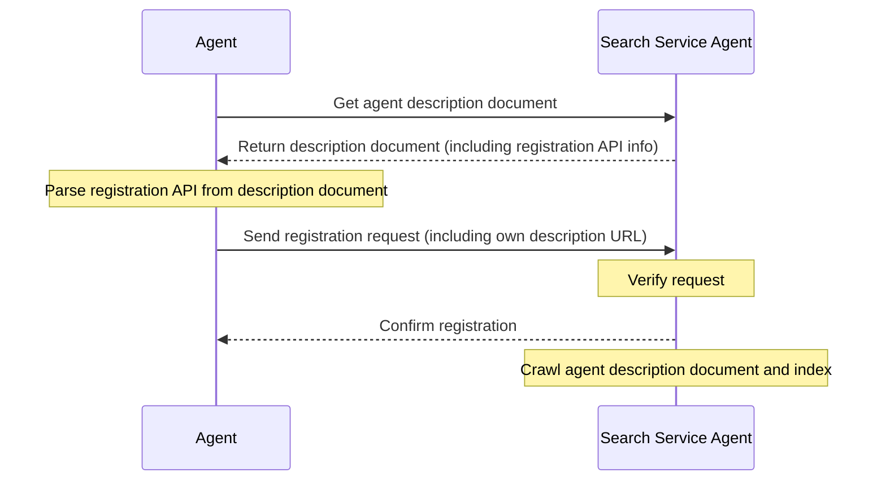

# ANPエージェント発見プロトコル仕様

- 文書ID: ANP-08
- 題名: ANPエージェント発見プロトコル仕様
- 状態: Released（公開済み）
- バージョン: 1.2
- 言語: 日本語（英語原文の翻訳）
- 適用範囲: 本仕様は、ANPにおけるエージェントおよびAgent Description文書の能動的発見と受動的発見に適用されます。

## 概要

本仕様は、エージェントを発見するための標準化されたプロトコルであるAgent Discovery Service Protocol（ADSP）を定義します。JSON-LD形式を基盤とし、能動的発見と受動的発見という2つの発見機構を提供することで、ネットワーク内の他のエージェントや検索エンジンがエージェントを効果的に発見し、アクセスできるようにすることを目指します。

プロトコルの中核要素は次のとおりです。

1. JSON-LDを基盤データ形式として使用し、リンクトデータとセマンティックWebの機能をサポートします。
2. `.well-known` URIパスをエージェント発見の入口として使用する、能動的発見機構を定義します。
3. エージェントが自分の記述を検索サービスへ送信できる、受動的発見機構を提供します。
4. エージェント記述のページ分割とリンクをサポートし、多数のエージェント情報の管理を容易にします。

本仕様は、ネットワーク内におけるエージェントの発見可能性を高め、エージェントネットワークのエコシステムを構築するための基盤を提供することを目指します。

## はじめに

エージェントの数が増え続ける中で、これらのエージェントを効果的に発見し、アクセスする方法が重要な課題になっています。Agent Discovery Service Protocol（ADSP）は、他のエージェントや検索エンジンがエージェントを発見するための標準化された方法を提供することで、この課題に対処することを目指します。

本仕様は、能動的発見と受動的発見という2つのエージェント発見機構を定義します。能動的発見では、検索エンジンや他のエージェントが、既知のドメイン配下にあるすべての公開エージェントを発見できます。受動的発見では、エージェントが自分の記述を検索サービスへ能動的に登録できます。この2つの機構は互いに補完し合い、エージェントの発見可能性を高めます。

## 全体像

Agent Description Protocolと同様に、エージェント発見文書の形式として[JSON-LD](https://www.w3.org/TR/json-ld11/)（JavaScript Object Notation for Linked Data）を使用します。JSON-LDにより、単純さと使いやすさを保ちながら、豊かな意味表現とリンク関係を実現できます。

エージェント記述文書は、[ANPエージェント記述プロトコル仕様](07-anp-agent-description-protocol-specification.md)に示すとおり、エージェント情報を詳細に表現します。エージェント発見文書はコレクションページとして機能し、ドメイン配下のすべての公開エージェント記述文書のURLを含むことで、検索エンジンや他のエージェントによる索引作成とアクセスを容易にします。

## プロトコルの詳細

### 能動的発見

能動的発見とは、検索エンジンやエージェントがドメインだけを知っていれば、そのドメイン配下のすべての公開エージェント記述文書を発見できることを指します。エージェント発見の入口として、Web標準の`.well-known` URIパスを採用します。

#### .well-known URI

[RFC 8615](https://tools.ietf.org/html/rfc8615)に従い、`.well-known` URIはサービスとリソースを発見するための標準化された方法を提供します。エージェント発見では、次のパスを定義します。

```
https://{domain}/.well-known/agent-descriptions
```

このパスは、ドメイン配下のすべての公開エージェント記述文書のURLを含むJSON-LD文書を返すべきです。

#### 発見文書の形式

能動的発見文書はJSON-LD形式を採用し、`CollectionPage`型を使用します。次の中核プロパティを含みます。

- `@context`: 文書で使用するJSON-LDコンテキストを定義します。
- `@type`: 文書の型。値は"CollectionPage"です。
- `url`: 現在のページのURLです。
- `items`: エージェント記述項目の配列です。
- `next`: （任意）次のページのURL。ページ分割に使用します。

各エージェント記述項目には次の内容を含めます。

- `@type`: 型。値は"ad:AgentDescription"です。
- `name`: エージェント名です。
- `@id`: エージェント記述文書のURL（リソースの一意な識別子）です。

例:

```json
{
  "@context": {
    "@vocab": "https://schema.org/",
    "did": "https://w3id.org/did#",
    "ad": "https://agent-network-protocol.com/ad#"
  },
  "@type": "CollectionPage",
  "url": "https://agent-network-protocol.com/.well-known/agent-descriptions",
  "items": [
    {
      "@type": "ad:AgentDescription",
      "name": "Smart Assistant",
      "@id": "https://agent-network-protocol.com/agents/smartassistant/ad.json"
    },
    {
      "@type": "ad:AgentDescription",
      "name": "Customer Support Agent",
      "@id": "https://agent-network-protocol.com/agents/customersupport/ad.json"
    }
  ],
  "next": "https://agent-network-protocol.com/.well-known/agent-descriptions?page=2"
}
```

#### ページ分割の仕組み

ドメイン配下に多数のエージェントが存在する場合は、ページ分割機構を採用するべきです。ページ分割は、次のページのURLを指す`next`プロパティによって実装します。クライアントは`next`プロパティがなくなるまで、すべてのページを再帰的に取得するべきです。

### 受動的発見

受動的発見とは、エージェントが自分のエージェント記述URLを他のエージェント（通常は検索サービスエージェント）へ能動的に送信し、相手が情報を索引化・クロールできるようにすることを指します。

#### 登録API

受動的発見では通常、検索サービスエージェントが提供する登録APIを使用する必要があります。これらのAPIは検索サービスエージェント自身が定義し、そのエージェント記述文書に明示するべきです。エージェントはこれらのAPIを呼び出して、自分の記述URLを検索サービスへ登録できます。

#### 登録手順

1. エージェントが検索サービスエージェントの記述文書を取得します。
2. 記述文書から登録APIのエンドポイントと必要なパラメーターを見つけます。
3. 自分のエージェント記述URLとその他の必要な情報を含む登録要求を構築します。
4. 検索サービスへ登録要求を送信します。
5. 検索サービスが要求を検証し、エージェントを索引に登録します。



### セキュリティ上の考慮事項

エージェント発見の安全性を確保するため、次の対策を推奨します。

1. **内容の検証**: 検索サービスは、エージェント記述文書の妥当性と完全性を検証するべきです。
2. **DID認証**: 共通認証には[ANP-02](02-anp-did-authentication-protocol-specification.md)を使用し、`did:wba`とネイティブの`did:web`を含む、サポート対象のDIDメソッドに従って識別情報を検証します。
3. **レート制限**: 悪意ある要求やDoS攻撃を防ぐため、適切なレート制限を実装します。
4. **権限制御**: 公開エージェントと非公開エージェントを区別し、発見文書には公開エージェントだけを含めます。

## 他のプロトコルとの関係

エージェント発見プロトコルは、次のプロトコルと密接に関係しています。

1. **Agent Description Protocol**: 発見プロトコルは、記述文書の索引作成とアクセスの仕組みを提供します。
2. **ANP-02とDIDメソッド仕様**: ANP-02は共通の要求認証を定義し、ANP-03や他のメソッド仕様は識別情報の検証を定義します。
3. **メタプロトコル**: エージェント間通信では、発見結果に基づいてプロトコルを交渉できます。

## 著作権表示

Copyright (c) 2024 ANP Community  
本書は[Apache License 2.0](../LICENSE)で公開されています。自由に使用・変更できますが、この著作権表示を保持しなければなりません。
