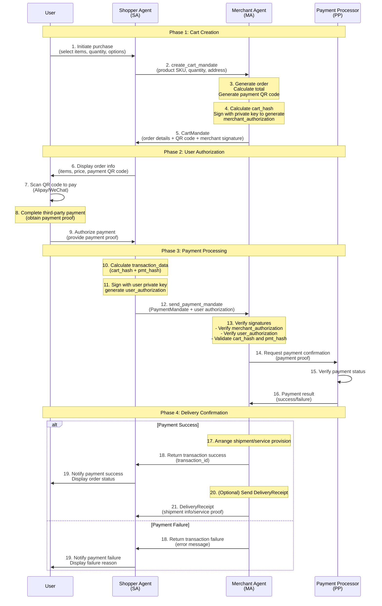

<!-- translation-review: machine-fully-reviewed; scope=source lines 1-867; inventory=japanese/reviews/core-review.json; full prose compared against source -->
> 日本語参考訳（機械翻訳を原文と全文照合し、意味・用語を校閲済み）。規範となるのは原文です。コード例・識別子・規範キーワードは原文を保持しています。
> 原文: [application/10-anp-agent-payment-protocol-specification.md](../../application/10-anp-agent-payment-protocol-specification.md) / 基準コミット: `0837cfdfaf4ddcf834f0890ddaf34fc4c824e066`

# ANP エージェント決済プロトコル仕様(AP2)(ドラフト)

> 状態：本書は、AP2をANPに適応させる方式を記述する。公開済みの安定した決済標準ではなく、引き続き草案である。下記バージョンは、ANPコア仕様群のバージョンとは独立して本書の改訂版を識別する。英語版と中国語版の草案は改訂履歴が異なり、規範的な対訳としてはまだ同期していない。

> 編集上の訂正：以前の英語版の表題と冒頭は草案として説明していたが、メタデータには `Released` と記載されていた。メタデータを草案の状態に合わせて修正した。これは矛盾するラベルの訂正であり、決済フロー、クレデンシャル、文書バージョンは改訂しない。また、core／messagingの1.2への昇格とは別である。

- 文書ID: ANP-10
- タイトル: ANPエージェント決済プロトコルの仕様
- 状態：草案／未公開
- バージョン: 1.1
- 原文言語: English / このページは日本語参考訳
- 適用範囲：本仕様は、ANPアプリケーション層におけるエージェント間の決済および取引のやり取りに適用する。

## 概要

この草案は、エージェント間の決済および取引のやり取りに向け、Agent Payment Protocol（AP2）をANPアプリケーション層に適応させる方式を記述する。提案段階の決済フローとクレデンシャル形式を文書化するものであり、本書の存在によって、安定した相互運用性、実装適合性、本番利用への準備が確立されるわけではない。

**元のAP2プロトコル**：Googleが2025年9月に公開したオープンプロトコルで、AIエージェントがユーザーに代わって安全に決済を完了できるように設計されている。公式サイト：[https://ap2-protocol.org/](https://ap2-protocol.org/)

**本仕様の位置付け**：本書はANPフレームワーク内でAP2プロトコルを適応・拡張したもので、分散型エージェントネットワークの利用場面に最適化している。

この仕様のコアコンテンツには、以下が含まれます。
1. 決済シナリオで4つのコアロールを定義:ショッパーエージェント、マーチャントエージェント、クレデンシャルプロバイダー、および支払いプロセッサー
2. CartMandate、PaymentMandate、DeliveryReceiptという3つの主要なクレデンシャル型を定義する。
3. 認可署名にJWT/JWS標準を用い、取引の完全性と安全性を確保する。
4. QRコード決済(Alipay、WeChat Pay)を含む複数の支払い方法をサポート
5. ANPのDIDに基づく本人認証の仕組みと統合する。

本仕様は、商取引、サービス調達、その他の取引場面を支えるため、エージェントネットワーク向けの標準化された決済のやり取りの方式を提供することを目指す。

## 1. 概観

### 1.1 背景

エージェントネットワークの発展に伴い、エージェントはユーザーに代わってさまざまな商取引や決済操作を完了する必要がある。従来の決済システムは主に人とコンピューターのやり取りを想定して設計されており、エージェント間の決済を標準でサポートしていない。AP2プロトコルは、エージェント間のやり取り専用の決済方式を提供し、この隔たりを埋めるために設計された。

### 1.2 デザイン原則

- **安全性**：暗号学的署名（JWS/JWT）を用い、取引内容の完全性と否認防止を確保する。
- **個人情報保護**: 選択的な開示をサポートし、不要な情報漏洩を最小限に
- **標準化**: 既存の規格(JWT、決済リクエストAPI等)に基づく
- **拡張性**: 複数の決済方法と将来のプロトコル拡張をサポート
- **ユーザーによる制御**：決済にはユーザーの明示的な認可を要求し、ユーザーの主権を確保する。

### 1.3 Google AP2との関係と主な適応点

本仕様はGoogleのAP2プロトコル（公式サイト：[https://ap2-protocol.org/](https://ap2-protocol.org/)）に基づき、ANPの分散型エージェントネットワーク向けに大幅に適応させたものである。

#### 1.3.1 オリジナル Google AP2 デザイン

Google AP2は3つのMandateタイプを使用します。
- **IntentMandate**：人がその場にいない「Human-Not-Present」（HNP）の場面を対象とし、エージェントがユーザーの事前認可に基づいて自律的に取引を完了する。
- **CartMandate**：人がその場にいる「Human-Present」（HP）の場面を対象とし、ユーザーが買い物カートをその場で確認して決済を認可する。
- **PaymentMandate**：決済ネットワークがエージェントによる取引を把握するためのシグナルを提供する。

すべてのMandateは、W3C Verifiable Credentials（VC）標準に基づく。

#### 1.3.2 ANP/AP2の主要適応

ANPフレームワーク内でAP2に次の重要な適応をしました。

| 適応点 | Google AP2 | ANP/AP2 | 理由 |
|------------|------------|---------|-----------|
| **アイデンティティ認証** | 既存の決済ネットワーク ID システムに依存 | DID:WBA の分散型アイデンティティを使用する | 分散型エージェントのアイデンティティ認証をクロスプラットフォームで有効化 |
| **通信プロトコル** | A2A（Agent-to-Agent）およびMCPプロトコルの拡張に基づく | ANPメタプロトコルとメッセージ形式に基づく | エージェント通信の標準を統一し、より豊かなネゴシエーション機能を支える |
| **クレデンシャル形式** | W3C VC仕様に厳密に従う | JWT/JWSによる軽量な実装を用いる | 暗号学的な安全性を維持しつつ、実装の複雑さを減らす |
| **決済方法** | 主にクレジットカード／デビットカード（Pull型決済） | QRコード決済（Alipay／WeChat）を優先する | 中国やアジア市場で主流の決済方法に適応する |
| **IntentMandate** | 事前認可に基づくエージェントの自律的な買い物をサポートする | **未対応**（予定あり） | 最小限実用可能な実装（M1）に注力し、将来のバージョンで拡張する |
| **役割の分離** | 4者モデル（ユーザー、販売者、決済処理者、発行者）を重視する | 役割を統合した簡易実装をサポートする | M1段階ではShopper AgentにCPとPPの機能を統合できる |
| **エージェントディスカバリー** | 明示的に定義されていない | ANPエージェントの記述プロトコル(ADP)で宣言された機能 | エージェント機能の自動検出と交渉を有効にします |

#### 1.3.3 保持された中心の特徴

- ✅ 暗号学的署名による取引の否認防止。
- ✅ ユーザーによる明示的な認可（User Authorization）のサポート。
- ✅ 販売者の署名によるカート内容の保証（Merchant Authorization）。
- ✅ 監査可能な取引クレデンシャルの連鎖。
- ✅ プライバシー保護と最小限の情報開示原則

#### 1.3.4 未来の進化方向

- [ ] M2でIntentMandateを導入し、人がその場にいない「Human-Not-Present」の場面をサポートする。
- [ ] より細かいプライバシー保護のためのSD-JWT(選択開示JWT)対応
- [ ] W3C VC標準と整合させ、検証可能なクレデンシャルの完全な相互運用をサポートする。
- [ ] 決済方法を拡大:暗号通貨、中央銀行デジタル通貨(CBDCs)など

### 1.4 プロトコルの位置付け

AP2はANPのアプリケーション層プロトコルであり、次を基盤とする。
- **アイデンティティ層**：エージェントの本人認証にdid:wbaを用いる。
- **メタプロトコール層**: エージェント通信のANPメッセージ形式を使用する
- **エージェントの説明**: エージェントの記述文書でAP2サポートを宣言

## 2. コアコンセプト

### 2.1 役割

AP2 は 4 つのコア ロールを定義します。

#### 2.1.1 買い物客エージェント(SA)
- 買い手/消費者を表す
- ユーザとのやり取り、注文情報の表示、支払い承認の取得
- 購入リクエストと支払いのマンデートを送信します

#### 2.1.2 商人エージェント(MA)
- 売主/サービスプロバイダを表す
- ショッピングカート情報を生成する、注文を作成、配送レシートを発行するための責任
- 決済のMandateを受け取り、取引を処理する。

#### 2.1.3 Credentials Provider（CP、クレデンシャル提供者）
- ユーザーの身元認証情報を提供
- ユーザ認証と認可署名生成の責任
- 決済操作がユーザーに明示的に許可されていることを確認します

#### 2.1.4 支払プロセッサ(PP)
- 実際の決済業務を処理する
- 決済チャネル（Alipay、WeChat Pay、銀行カードなど）との連携を担う。
- 決済結果を返す。

**注意:**: 最小実装(M1)では、買い物客エージェントはCPとPPの機能を統合できます。

### 2.2 中核となるクレデンシャル

#### 2.2.1 CartMandate（買い物カートの認可）
- 商人エージェントが生成
- 注文の詳細、商品情報、合計金額、支払い方法が含まれています
- 注文情報完全性を確保するために、商人エージェントによって署名
- 方向: MA → SA

#### 2.2.2 PaymentMandate（決済の認可）
- ショッパーエージェントが生成
- 特定の注文に対するユーザーの決済認可を含む。
- ユーザーの秘密鍵で署名し、認可の真正性を保証する。
- 方向: SA → MA

#### 2.2.3 DeliveryReceipt（引き渡しの受領書）
- 商人エージェントが生成
- 注文完了、配送状況、またはサービス提供の確認
- 取引記録の保持と紛争解決のために使用される
- 方向: MA → SA

### 2.3 取引の流れ

ANP/AP2プロトコルは、カート作成、ユーザーによる認可、決済処理、引き渡し確認の4段階を含む、エージェントによる決済取引の一連の流れを定義する。

#### 2.3.1 取引全体のフロー図



#### 2.3.2 流れの記述

**フェーズ1: カート作成** (ステップ1-5)
- ユーザーが項目を選択し、Shopper Agentを通じて注文を提出する
- 買い物客エージェントは、カートのリクエストをマーチャントエージェントに送信します
- 商人エージェントは、注文の詳細や支払いQRコードを含むCartMandateを生成します
- 販売者は、自身の秘密鍵でカート内容に署名する（merchant_authorization）。

**第2段階：ユーザーによる認可**（手順6～9）
- 注文情報と決済QRコードをユーザに表示する
- ユーザーは、第三者決済プラットフォーム(Alipay/WeChat)を通じて支払いを完了します。
- ユーザーは決済の証拠を取得し、Shopper Agentに取引を認可する。

**フェーズ3:支払処理** (ステップ10-16)
- 買い物客エージェントはPaymentMandateを生成します
- ユーザーの秘密鍵で取引データに署名する（user_authorization）。
- Merchant Agentは、すべての署名とハッシュ値を検証する。
- 販売者は、Payment Processorを通じて決済状態を確認する。

**フェーズ4:配達確認** (ステップ17-21)
- 支払を成功させた後、店は郵送物を整理するか、またはサービスを提供します
- 販売者は、任意で引き渡しの証拠としてDeliveryReceiptを送信する。
- トランザクション完了通知を受信する

#### 2.3.3 主セキュリティ機構

| セキュリティの仕組み | 実装 | 目的 |
|-------------------|----------------|---------|
| **データの完全性** | cart_hash = SHA-256(JCS(contents)) | カート内容が改ざんされていないことを確保する |
| **販売者の認証** | merchant_authorization（RS256/ES256K署名） | 正当な販売者が注文を生成したことを証明する |
| **ユーザーによる認可** | user_authorization（transaction_dataを含む） | ユーザーがこの取引を明示的に認可したことを証明する |
| **リプレイ攻撃の防止** | jti（JWT ID）という大域的に一意な識別子 | 認可クレデンシャルの再利用を防ぐ |
| **時間の制約** | iat/expフィールドで有効期間を制御する | クレデンシャルの有効期間を制限する（推奨15分） |
| **アイデンティティの束縛** | cnfフィールドで保持者のDIDを束縛する | 特定のエージェントだけがクレデンシャルを使えるようにする |

## 3. エージェントの説明プロトコルの統合

### 3.1 AD文書でのAP2対応の宣言

AP2プロトコルに対応するエージェントは、そのAgent Description文書で対応を宣言することが望ましい。

```json
{
  "protocolType": "ANP",
  "protocolVersion": "1.0.0",
  "type": "AgentDescription",
  "name": "Grand Hotel Assistant",
  "did": "did:wba:grand-hotel.com:service:hotel-assistant",
  "interfaces": [
    {
      "type": "NaturalLanguageInterface",
      "protocol": "AP2/ANP",
      "version": "0.0.1",
      "url": "https://grand-hotel.com/api/ap2.json",
      "description": "An implementation of the AP2 protocol based on the ANP protocol, used for payment and transactions between agents."
    }
  ]
}
```

### 3.2 AP2インターフェイス記述

`ap2.json` ファイルは、エージェントがサポートする役割とエンドポイントを記述する。

```json
{
  "ap2/anp": "0.0.1",
  "roles": {
    "merchant": {
      "description": "Merchant Agent - generates cart, creates QR orders, issues delivery receipts",
      "endpoints": {
        "create_cart_mandate": "/ap2/merchant/create_cart_mandate",
        "send_payment_mandate": "/ap2/merchant/send_payment_mandate"
      }
    },
    "shopper": {
      "description": "Shopper Agent - handles user interaction, PIN validation, QR code display",
      "endpoints": {
        "receive_delivery_receipt": "/ap2/shopper/receive_delivery_receipt"
      }
    }
  }
}
```

### 3.3インラインインターフェイス記述

あるいは、AD 文書に直接詳細なインターフェイス情報について説明することができます。

```json
{
  "type": "NaturalLanguageInterface",
  "protocol": "AP2/ANP",
  "version": "0.0.1",
  "description": "AP2 protocol implementation supporting payment and transaction operations",
  "content": {
    "roles": {
      "merchant": {
        "description": "Merchant Agent - hotel booking service provider",
        "create_cart_mandate": {
          "description": "Create a cart mandate for a hotel booking",
          "endpoint": "/ap2/merchant/create_cart_mandate",
          "item_schema": {
            "type": "object",
            "properties": {
              "hotel_id": {"type": "integer", "description": "Hotel ID"},
              "rate_plan_id": {"type": "string", "description": "Rate plan ID"},
              "room_num": {"type": "integer", "description": "Number of rooms"},
              "check_in_date": {"type": "string", "format": "date", "description": "Check-in date (YYYY-MM-DD)"},
              "check_out_date": {"type": "string", "format": "date", "description": "Check-out date (YYYY-MM-DD)"}
            },
            "required": ["hotel_id", "rate_plan_id", "room_num", "check_in_date", "check_out_date"]
          }
        }
      }
    }
  }
}
```

## 4. クレデンシャルの定義

### 4.1 CartMandate（買い物カートの認可）

**方向**：MA → SA

**完全なメッセージ構造**:

```json
{
  "contents": {
    "id": "cart_shoes_123",
    "user_signature_required": false,
    "payment_request": {
      "method_data": [
        {
          "supported_methods": "QR_CODE",
          "data": {
            "channel": "ALIPAY",
            "qr_url": "https://pay.example.com/qrcode/abc123",
            "out_trade_no": "order_20250117_123456",
            "expires_at": "2025-01-17T09:15:00Z"
          }
        },
        {
          "supported_methods": "QR_CODE",
          "data": {
            "channel": "WECHAT",
            "qr_url": "https://pay.example.com/qrcode/abc123",
            "out_trade_no": "order_20250117_123456",
            "expires_at": "2025-01-17T09:15:00Z"
          }
        }
      ],
      "details": {
        "id": "order_shoes_123",
        "displayItems": [
          {
            "id": "sku-id-123",
            "sku": "Nike-Air-Max-90",
            "label": "Nike Air Max 90",
            "quantity": 1,
            "options": {"color": "red", "size": "42"},
            "amount": {"currency": "CNY", "value": 120.0},
            "pending": null,
            "remark": "Please ship as soon as possible"
          }
        ],
        "shipping_address": {
          "recipient_name": "Zhang San",
          "phone": "13800138000",
          "region": "Beijing",
          "city": "Beijing",
          "address_line": "Chaoyang District, Street 123",
          "postal_code": "100000"
        },
        "shipping_options": null,
        "modifiers": null,
        "total": {
          "label": "Total",
          "amount": {"currency": "CNY", "value": 120.0},
          "pending": null
        }
      },
      "options": {
        "requestPayerName": false,
        "requestPayerEmail": false,
        "requestPayerPhone": false,
        "requestShipping": true,
        "shippingType": null
      }
    }
  },
  "merchant_authorization": "eyJhbGciOiJSUzI1NiIsInR5cCI6IkpXVCJ9...",
  "timestamp": "2025-08-26T19:36:36.377022Z"
}
```

**主要ポイント**:
- `contents` ショッピングカートの内容、決済リクエスト、QRコード情報を含む
- `merchant_authorization` は、`cart_hash` に対するJWS署名（RS256またはES256K）である。
- `cart_hash = b64url(sha256(JCS(contents)))`

### 4.2 販売者による認可

#### 4.2.1 概要

`merchant_authorization` フィールドは、販売者が買い物カートの内容（`CartContents`）に対して発行する、**デジタル署名付きの短期認可クレデンシャル**であり、カート内容の真正性と完全性を確保する。

このフィールドは従来の `merchant_signature` を置き換え、JOSE/JWT標準に準拠した **JSON Web Signature（JWS）** コンテナー形式を採用する。

#### 4.2.2 データ タイプ

- **仕様**: Base64URL でエンコードされたコンパクトな JWS 文字列 (`header.payload.signature`)
- **アルゴリズム**: `RS256` または `ES256K`
- **フィールド**: `CartMandate.merchant_authorization`

#### 4.2.3 ヘッダー形式

```json
{
  "alg": "RS256",
  "kid": "MA-key-001",
  "typ": "JWT"
}
```

または:

```json
{
  "alg": "ES256K",
  "kid": "MA-es256k-key-001",
  "typ": "JWT"
}
```

#### 4.2.4ペイロード形式

```json
{
  "iss": "did:wba:a.com:MA",
  "sub": "did:wba:a.com:MA",
  "aud": "did:wba:a.com:TA",
  "iat": 1730000000,
  "exp": 1730000900,
  "jti": "uuid",
  "cart_hash": "<b64url>",
  "cnf": {"kid": "did:wba:a.com:TA#keys-1"},
  "extensions": ["anp.ap2.qr.v1", "anp.human_presence.v1"]
}
```

**フィールドの説明**:
- `iss`：発行者（Merchant AgentのDID）。
- `sub`：主体（issと同じでもよい）。
- `aud`: オーディエンス(トランザクションエージェントまたは決済プロセッサ)
- `iat`：発行時刻（秒）。
- `exp`: 有効期限(180日推奨)
- `jti`：大域的に一意な識別子（リプレイ攻撃を防ぐ）。
- `cart_hash`：CartMandate.contentsのハッシュ。
- `cnf`: (推奨) ホルダーの結合情報
- `extensions`: サポートされているプロトコル拡張

#### 4.2.5 cart_hashの計算

```text
cart_hash = Base64URL(SHA-256(JCS(CartMandate.contents)))
```

- [RFC 8785 JSON Canonicalization Scheme（JCS）](https://datatracker.ietf.org/doc/rfc8785/) を用いて `CartMandate.contents` を正規化する。
- 正規化したUTF-8バイト列の `SHA-256` ハッシュを計算する。
- 結果をBase64URLで符号化する（パディングの「=」を除去する）。

#### 4.2.6 署名生成プロセス(マーチャントMA)

1. 計算する `cart_hash`
2. JWTペイロードを構築する（iss/sub/aud/iat/exp/jti/cart_hash/cnf/extensionsを含む）。
3. ヘッダーを構築する（alg=RS256またはalg=ES256K、kid=販売者の公開鍵識別子）。
4. 商人の秘密鍵でペイロードをサインして、コンパクトなJWSを生成
5. 生成したJWSをCartMandateオブジェクトの `merchant_authorization` に書き込む。

#### 4.2.7 検証プロセス(Transaction TA)

1. `CartMandate.contents` から `cart_hash'` を再計算する。
2. `merchant_authorization` を解析する。
   - ヘッダーから `kid` を抽出する。
   - DID 文書またはレジストリを通じて MA の公開鍵を入手
   - JWS 署名 (RS256 または ES256K、マッチングヘッダ) を検証します。
3. クレームを検証:
   - `iss/aud/iat/exp/jti` 仕様書を全て遵守
   - 現在時刻が `[iat, exp]` 内にあること。
   - `jti` 再使用されていない
4. データ結合を検証して下さい:
   - `payload.cart_hash == cart_hash'`、そうでなければ拒否して下さい
5. 拡張機能の特定:
   - `cnf` が存在する場合、後続の保持者の検証に使用できる。

#### 4.2.8 リファレンス実装 (Python)

```python
import json, base64, hashlib, uuid, time
import jwt  # pip install pyjwt

def jcs_canonicalize(obj):
    return json.dumps(obj, ensure_ascii=False, separators=(",", ":"), sort_keys=True)

def b64url_no_pad(b: bytes) -> str:
    return base64.urlsafe_b64encode(b).decode("ascii").rstrip("=")

def compute_cart_hash(contents: dict) -> str:
    canon = jcs_canonicalize(contents)
    digest = hashlib.sha256(canon.encode("utf-8")).digest()
    return b64url_no_pad(digest)

def sign_merchant_authorization(contents: dict, ma_private_pem: str, kid: str,
                                iss: str, aud: str, cnf: dict = None,
                                ttl_seconds: int = 900) -> str:
    now = int(time.time())
    payload = {
        "iss": iss,
        "sub": iss,
        "aud": aud,
        "iat": now,
        "exp": now + ttl_seconds,
        "jti": str(uuid.uuid4()),
        "cart_hash": compute_cart_hash(contents),
        "extensions": ["anp.ap2.qr.v1", "anp.human_presence.v1"]
    }
    if cnf:
        payload["cnf"] = cnf
    headers = {"alg": "RS256", "kid": kid, "typ": "JWT"}
    return jwt.encode(payload, ma_private_pem, algorithm="RS256", headers=headers)
```

### 4.3 PaymentMandate（決済の認可）

**方向**：SA → MA

**メッセージ構成**:

```json
{
  "payment_mandate_contents": {
    "payment_mandate_id": "pm_12345",
    "payment_details_id": "order_shoes_123",
    "payment_details_total": {
      "label": "Total",
      "amount": {"currency": "CNY", "value": 120.0},
      "pending": null,
      "refund_period": 30
    },
    "payment_response": {
      "request_id": "order_shoes_123",
      "method_name": "QR_CODE",
      "details": {
        "channel": "ALIPAY",
        "out_trade_no": "order_20250117_123456"
      },
      "shipping_address": null,
      "shipping_option": null,
      "payer_name": null,
      "payer_email": null,
      "payer_phone": null
    },
    "merchant_agent": "MerchantAgent",
    "timestamp": "2025-08-26T19:36:36.377022Z"
  },
  "user_authorization": "eyJhbGciOiJFUzI1NksiLCJraWQiOiJkaWQ6ZXhhbXBsZ..."
}
```

**フィールドの説明**:
- `payment_details_id`：CartMandateに含まれる決済要求内の明細のID。
- `user_authorization`: トランザクション上のユーザの認可署名

### 4.4 ユーザーによる認可

ユーザーによる認可の生成は、販売者による認可の方式に従うが、次の点が異なる。

**ペイロードは `cart_hash` の代わりに `transaction_data` を使う**。

```json
{
  "iss": "did:wba:a.com:user",
  "sub": "did:wba:a.com:user",
  "aud": "did:wba:a.com:MA",
  "iat": 1730000000,
  "exp": 1730000900,
  "jti": "uuid",
  "transaction_data": [
    "<cart_hash>",
    "<pmt_hash>"
  ],
  "cnf": {"kid": "did:wba:a.com:MA#keys-1"}
}
```

**transaction_dataの計算**：
```text
cart_hash = Base64URL(SHA-256(JCS(CartMandate.contents)))
pmt_hash = Base64URL(SHA-256(JCS(PaymentMandate.payment_mandate_contents)))
```

## 5. メッセージ定義

### 5.1 create_cart_mandate

**方向**：Shopper（SA）→ Merchant（MA）

**API パス**: `POST /ap2/merchant/create_cart_mandate`

**リクエストメッセージの構成**:

```json
{
  "messageId": "cart-request-001",
  "from": "did:wba:a.com:shopper",
  "to": "did:wba:a.com:merchant",
  "data": {
    "cart_mandate_id": "cart-mandate-id-123",
    "items": [
      {
        "id": "sku-id-123",
        "sku": "Nike-Air-Max-90",
        "quantity": 1,
        "options": {"color": "red", "size": "42"},
        "remark": "Please ship as soon as possible"
      }
    ],
    "shipping_address": {
      "recipient_name": "Zhang San",
      "phone": "13800138000",
      "region": "Beijing",
      "city": "Beijing",
      "address_line": "Chaoyang District, Street 123",
      "postal_code": "100000"
    },
    "remark": "Please ship as soon as possible"
  }
}
```

**応答メッセージの構造**（CartMandateを返す）：

```json
{
  "messageId": "cart-response-001",
  "from": "did:wba:a.com:merchant",
  "to": "did:wba:a.com:shopper",
  "data": {
    "contents": {
      "id": "cart-mandate-id-123",
      "user_signature_required": false,
      "payment_request": {
        "method_data": [
          {
            "supported_methods": "QR_CODE",
            "data": {
              "channel": "ALIPAY",
              "qr_url": "https://pay.example.com/qrcode/abc123",
              "out_trade_no": "order_20250117_123456",
              "expires_at": "2025-01-17T09:15:00Z"
            }
          }
        ],
        "details": {
          "id": "order_shoes_123",
          "displayItems": [
            {
              "id": "sku-id-123",
              "sku": "Nike-Air-Max-90",
              "label": "Nike Air Max 90",
              "quantity": 1,
              "options": {"color": "red", "size": "42"},
              "amount": {"currency": "CNY", "value": 120.0},
              "pending": null
            }
          ],
          "total": {
            "label": "Total",
            "amount": {"currency": "CNY", "value": 120.0},
            "pending": null
          }
        }
      }
    },
    "merchant_authorization": "eyJhbGciOiJSUzI1NiIsInR5cCI6IkpXVCJ9...",
    "timestamp": "2025-01-17T09:00:01Z"
  }
}
```

### 5.2 send_payment_mandate

**方向**：Shopper（SA）→ Merchant（MA）

**API パス**: `POST /ap2/merchant/send_payment_mandate`

**リクエストメッセージの構成**:

```json
{
  "messageId": "payment-mandate-001",
  "from": "did:wba:a.com:shopper",
  "to": "did:wba:a.com:merchant",
  "data": {
    "payment_mandate_contents": {
      "payment_mandate_id": "pm_12345",
      "payment_details_id": "order_shoes_123",
      "payment_details_total": {
        "label": "Total",
        "amount": {"currency": "CNY", "value": 120.0},
        "pending": null,
        "refund_period": 30
      },
      "payment_response": {
        "request_id": "order_shoes_123",
        "method_name": "QR_CODE",
        "details": {
          "channel": "ALIPAY",
          "out_trade_no": "order_20250117_123456"
        },
        "shipping_address": null,
        "shipping_option": null,
        "payer_name": null,
        "payer_email": null,
        "payer_phone": null
      },
      "merchant_agent": "MerchantAgent",
      "timestamp": "2025-01-17T09:05:00Z"
    },
    "user_authorization": "eyJhbGciOiJFUzI1NksiLCJraWQiOiJkaWQ6ZXhhbXBsZ..."
  }
}
```

**応答メッセージ構成**:

```json
{
  "messageId": "payment-response-001",
  "from": "did:wba:a.com:merchant",
  "to": "did:wba:a.com:shopper",
  "data": {
    "status": "success",
    "payment_mandate_id": "pm_12345",
    "transaction_id": "txn_67890",
    "message": "Payment processed successfully"
  }
}
```

## 6. メッセージフローシーケンス

1. **SAからの要求** → MA：`create_cart_mandate`（買い物カートの作成要求）。
2. **MAからの応答** → SA：HTTP応答内の `CartMandate`（買い物カートの認可＋QRコード）。
3. **SAからの要求** → MA：`send_payment_mandate`（決済の認可）。
4. **MA 応答** → SA: 決済処理結果

## 7. セキュリティの考慮事項

### 7.1 署名検証

重要な資格情報(CartMandate、PaymentMandate)は署名され、検証しなければなりません。
- Merchant Agentは、自身の秘密鍵でCartMandateに署名する。
- ユーザーは、自身の秘密鍵でPaymentMandateに署名する。
- 受信パーティーは、DID ドキュメントの公開鍵を通して署名を確認しなければなりません

### 7.2 タイムスタンプと有効期限

- すべての資格情報はタイムスタンプを含める必要があります
- CartMandateには、QRコードの有効期限（expires_at）を含めることが望ましい。
- JWTトークンには、妥当な有効期限（推奨15分）を設定することが望ましい。

### 7.3 リプレイ攻撃の防止

- `jti`（JWT ID）を用い、各認可クレデンシャルを大域的に一意にする。
- 受信側は、使用済みの `jti` の一覧を保持し、リプレイ攻撃を防ぐことが望ましい。

### 7.4 HTTPS の伝達

- すべての API エンドポイントは HTTPS プロトコルを使用する必要があります。
- 通信中に機密情報の暗号化された送信を確保

### 7.5 ユーザーによる認可

- 決済操作には、ユーザーの明示的な認可を得なければならない。
- ユーザーの秘密鍵は、安全に保存し、ユーザーのデバイス外に出さないことが望ましい。
- 鍵の保存には、ハードウェアセキュリティモジュールやセキュアエンクレーブをサポートする。

## 8. 拡張の仕組み

### 8.1 決済方法の拡張

AP2は、`supported_methods` フィールドを通じて新しい決済方法を追加できる。
- `QR_CODE`: QRコード決済
- `CARD`: 銀行カード決済
- `CRYPTO`: 仮想通貨決済
- 独自の決済方法。

### 8.2プロトコル拡張フィールド

JWTペイロードは、プロトコル拡張を宣言するための `extensions` フィールドをサポートする。
```json
{
  "extensions": [
    "anp.ap2.qr.v1",
    "anp.human_presence.v1",
    "anp.ap2.subscription.v1"
  ]
}
```

## 9. 導入提言

### 9.1 最小実装(M1)

最小実装は、次を含むことが望ましい。
- QRコード決済方法(AlipayまたはWeChat Pay)のサポート
- CartMandateとPaymentMandateの実装。
- 基本的シグネチャ生成と検証
- DID:WBA 本人認証

### 9.2 完全な実装

完全実装は、さらに次を含むことが望ましい。
- 複数の支払い方法のサポート
- DeliveryReceiptの実装。
- 役割の分離（SA、MA、CP、PP）。
- 返金と紛争処理メカニズム

### 9.3 ライブラリとツールの推奨事項

- JWT処理: PyJWT(Python)、jsonwebtoken(JavaScript)
- JSONの正規化：jcs（複数言語の実装あり）。
- DID解決：Universal Resolver。
- 暗号学的処理：cryptography（Python）、Web Crypto API（JavaScript）。

## 10. シナリオ例

### 10.1 Eコマース購入シナリオ

1. ユーザーはShopper Agentで製品を閲覧します。
2. ユーザーは製品を選び、注文を送信します。
3. Shopper Agentは、Merchant Agentにcreate_cart_mandate要求を送る。
4. Merchant Agentは、決済用QRコードを含むCartMandateを返す。
5. Shopper Agentは、ユーザーに注文情報とQRコードを表示する。
6. ユーザーはコードを読み取って決済を完了します。
7. Shopper AgentはPaymentMandateを生成し、Merchant Agentに送信します。
8. Merchant Agentは支払いを検証し、出荷を手配します。

### 10.2 サービス予約シナリオ(ホテル予約)

1. ユーザーはShopper Agentでホテルを検索します。
2. ユーザーはホテルと部屋の種類を選びます。
3. Shopper AgentはホテルのMerchant Agentに予約要求を送ります。
4. ホテルのMerchant Agentは、総額を含む予約用CartMandateを返す。
5. ユーザーは予約情報を確認し、支払いを承認します
6. Shopper AgentはホテルのMerchant AgentにPaymentMandateを送信します。
7. ホテルのMerchant Agentは支払いを確認し、予約確認を作成します。

## 11. リファレンス

- [RFC 7519] JSON Web Token（JWT）
- [RFC 7515] JSON Web Signature（JWS）
- [RFC 8785] JSON Canonicalization Scheme（JCS）
- [W3C 決済リクエスト API](https://www.w3.org/TR/payment-request/)
- [ANP技術白書](../01-agentnetworkprotocol-technical-white-paper.md)
- [ANPエージェントの記述プロトコル](../07-anp-agent-description-protocol-specification.md)
- [DID:WBAメソッド仕様](../03-did-wba-method-design-specification.md)

## コンテンツの著作権について

Copyright (c) 2024 ANP Community
本ファイルは [Apache License 2.0](../../LICENSE) の下で公開される。自由に利用・変更できるが、この著作権表示を保持しなければならない。
