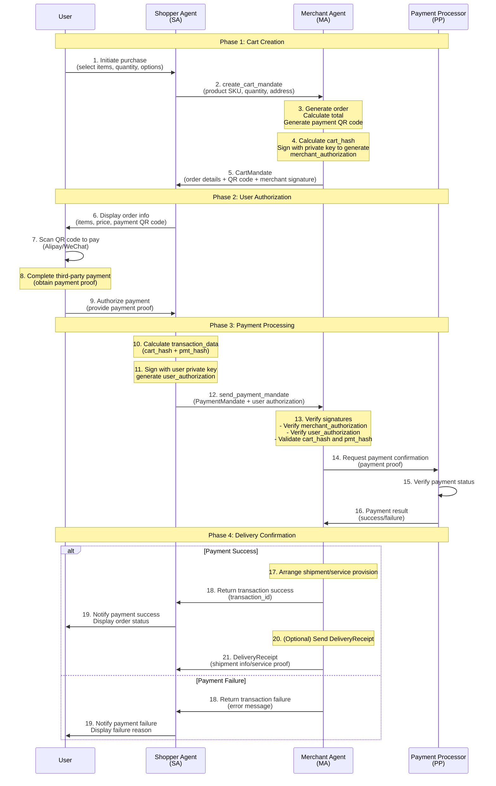

> 日本語参考訳（機械翻訳・未校閲）。規範となるのは原文です。コード例・識別子・規範キーワードは原文を保持しています。
> 原文: [application/10-anp-agent-payment-protocol-specification.md](../../application/10-anp-agent-payment-protocol-specification.md) / 基準コミット: `0837cfdfaf4ddcf834f0890ddaf34fc4c824e066`

# ANP エージェント決済プロトコル仕様(AP2)(ドラフト)

> ステータス:AP2のANP適応について説明しています。 未発表の安定した決済基準ではなく、ドラフトのままに。 下記のバージョンでは、ANPコア仕様設定版の独立してこのドキュメントリビジョンを識別します。 英語と中国語の原稿は異なるリビジョン履歴を持ち、まだ同期的な翻訳ではありません。

> 編集修正:以前の英語タイトルとメタデータが言った間に書かれた草案を開く `Released`. . . メタデータは、ドラフト状態と一致します。 これは矛盾するラベルを修正します。それは支払いの流れ、資格情報、または文書版を見直しず、コア/メッセージ1.2プロモーションとは別です。

- 文書ID: ANP-10
- タイトル: ANPエージェント決済プロトコルの仕様
- ステータス: ドラフト/未発売
- バージョン: 1.1
- 原文言語: English / このページは日本語参考訳
- 適応性:この仕様は、ANPアプリケーションレイヤーのエージェント間の決済と取引相互作用に適用されます。

## アブストラクト

このドラフトは、エージェント間の支払いと取引の相互作用のためのANPアプリケーションレイヤーの適応について説明しています。 決済の流れや認証形式を提案した文書。その存在は、安定した相互運用性、実装適合性、または生産の信頼性を確立しません。

**元のAP2の議定書**: グーグルが2025年9月にリリースしたオープンプロトコル。AIエージェントがユーザーの代わりに安全に決済を完了できるように設計しました。 公式サイト: [https://ap2-protocol.org/](https://ap2-protocol.org/)

**この仕様のポジション**: このドキュメントは、分散型エージェントネットワークシナリオ向けに最適化されたAP2プロトコルの適応版と拡張バージョンです。

この仕様のコアコンテンツには、以下が含まれます。
1. 決済シナリオで4つのコアロールを定義:ショッパーエージェント、マーチャントエージェント、クレデンシャルプロバイダー、および支払いプロセッサー
2. カートマンデート、支払い管理、配送の3つの主要な資格タイプを定義する
3. トランザクションの完全性および保証を保障するために承認の署名のためのJWT/JWS標準を使用して下さい
4. QRコード決済(Alipay、WeChat Pay)を含む複数の支払い方法をサポート
5. ANPのIDベースの認証メカニズムと統合

この仕様は、エージェントネットワーク、サポートコマース、サービス調達、その他の取引シナリオの標準化された決済インタラクションソリューションを提供することを目指しています。

## 1. プロフィール

### 1.1 背景

エージェントネットワークが発展するにつれて、エージェントはユーザーの代わりにさまざまな取引や決済操作を完了する必要があります。 従来の決済システムは、主に人体コンピュータの相互作用のために設計されており、エージェントツーエージェントの支払いシナリオのためのネイティブサポートが欠如しています。 AP2プロトコルは、エージェントのやり取りのために特別に決済ソリューションを提供することで、このギャップに対処するように設計されています。

### 1.2 デザイン原則

- **セキュリティー**: トランザクションコンテンツの完全性および非複製を保証するために、暗号化署名(JWS/JWT)を使用する
- **個人情報保護**: 選択的な開示をサポートし、不要な情報漏洩を最小限に
- **標準化**: 既存の規格(JWT、決済リクエストAPI等)に基づく
- **拡張性**: 複数の決済方法と将来のプロトコル拡張をサポート
- **ユーザー管理**: 支払いの明示的なユーザー認証を要求し、ユーザーの承認を確実にします

### 1.3 Google AP2とKey Adaptationsとの関係

本サイトは、Google社のAP2プロトコル(公式HP)に基づいており、 [https://ap2-protocol.org/](https://ap2-protocol.org/)) ANPの分散型エージェントネットワークシナリオに大きく適応しました。

#### 1.3.1 オリジナル Google AP2 デザイン

Google AP2は3つのMandateタイプを使用します。
- **意図管理**: 「ヒト・ノプレゼント」(HNP)のシナリオでは、エージェントがユーザ事前承認に基づく取引を自動で完結させる
- **カートマンデー**: 「ヒトプレセント」(HP)のシナリオでは、ユーザーがリアルタイムで買い物カートを確認し、支払いを承認する
- **支払方法**: エージェント取引の可視信号を決済ネットワークに提供

すべてのマンデートはW3C検証可能な資格(VC)基準に基づいています。

#### 1.3.2 ANP/AP2の主要適応

ANPフレームワーク内でAP2に次の重要な適応をしました。

| 適応症 | Google AP2の特長 | ANP/AP2(アネックス) | ライエーター |
|------------|------------|---------|-----------|
| **アイデンティティ認証** | 既存の決済ネットワーク ID システムに依存 | DID:WBA の分散型アイデンティティを使用する | 分散型エージェントのアイデンティティ認証をクロスプラットフォームで有効化 |
| **通信プロトコル** | A2A(エージェント・ツー・エージェント)およびMCPプロトコルの拡張機能に基づく | ANPメタプロトコルとメッセージ形式に基づく | エージェント通信規格の統一、より豊かな交渉力をサポート |
| **認証形式** | 厳密にW3C VC仕様に従います | JWT/JWSを軽量化 | 暗号化セキュリティを維持しながら、実装の複雑さを簡素化 |
| **支払方法** | クレジットカード/デビットカード(Pull支払い) | QRコード決済優先(Alipay/WeChat) | 中国およびアジアの市場の主要なストリーム決済方法に適応 |
| **意図管理** | 事前承認された自動代理店の買い物を支えて下さい | **未対応** (予定) | 最小限の実行可能(M1)に焦点を当て、将来のバージョンを拡大 |
| **役割の分離** | サードパーティ製4機種(ユーザー、商人、決済処理者、発行者)をエンファサイズ | 統合したロールで簡単に実装をサポート | M1 フェーズでは、Shopper Agent が CP と PP の機能を統合できる |
| **エージェントディスカバリー** | 明示的に定義されていない | ANPエージェントの記述プロトコル(ADP)で宣言された機能 | エージェント機能の自動検出と交渉を有効にします |

#### 1.3.3 保持された中心の特徴

- ✅ Cryptographic署名により、トランザクション非再帰化が保証されます。
- ✅ 明示的なユーザ認証のサポート(ユーザー認可)
- ✅ カートコンテンツの商品認証(商人認証)
- ✅ 監査可能なトランザクション認証チェーン
- ✅ プライバシー保護と最小限の情報開示原則

#### 1.3.4 未来の進化方向

- [ ] M2版でIntentMandateを導入し、「ヒト・ノ・プレジデント」のシナリオをサポート
- [ ] より細かいプライバシー保護のためのSD-JWT(選択開示JWT)対応
- [ ] W3C VC 規格に準拠し、完全な検証可能な認証相互運用性をサポート
- [ ] 決済方法を拡大:暗号通貨、中央銀行デジタル通貨(CBDCs)など

### 1.4 プロトコル位置決め

AP2は、ANPのアプリケーションレイヤープロトコルで、次のように構築します。
- **アイデンティティレイヤー**: エージェントの本人認証のためにwbaを
- **メタプロトコール層**: エージェント通信のANPメッセージ形式を使用する
- **エージェントの説明**: エージェントの記述文書でAP2サポートを宣言

## 2. コアコンセプト

### 2.1 役割

AP2 は 4 つのコア ロールを定義します。

#### 2.1.1 買い物客エージェント(SA)
- 買い手/消費者を表す
- ユーザとのやり取り、注文情報の表示、支払い承認の取得
- 購入リクエストと支払いのマンデートを送信します

#### 2.1.2 商人エージェント(MA)
- 売主/サービスプロバイダを表す
- ショッピングカート情報を生成する、注文を作成、配送レシートを発行するための責任
- 決済のマンデートと取引プロセスを受け取る

#### 2.1.3 認証プロバイダー(CP)
- ユーザーの身元認証情報を提供
- ユーザ認証と認可署名生成の責任
- 決済操作がユーザーに明示的に許可されていることを確認します

#### 2.1.4 支払プロセッサ(PP)
- 実際の決済業務を処理する
- 決済チャネル(Alipay、WeChat Pay、銀行カードなど)との相互対面対応
- 支払い結果の返還

**注意:**: 最小実装(M1)では、買い物客エージェントはCPとPPの機能を統合できます。

### 2.2 コア認証

#### 2.2.1 カートマンデート(カート認証)
- 商人エージェントが生成
- 注文の詳細、商品情報、合計金額、支払い方法が含まれています
- 注文情報完全性を確保するために、商人エージェントによって署名
- 方向: MA → SA

#### 2.2.2 支払管理(支払い承認)
- ショッパーエージェントが生成
- 特定の順序のためのユーザーの支払の承認を含んで下さい
- 認証認証を認証するために、ユーザー専用の鍵で署名
- 方向: SA → MA

#### 2.2.3 配達レシート(配送レシープ)
- 商人エージェントが生成
- 注文完了、配送状況、またはサービス提供の確認
- 取引記録の保持と紛争解決のために使用される
- 方向: MA → SA

### 2.3 取引の流れ

ANP/AP2 プロトコルは、カート作成、ユーザー認証、決済処理、配送確認など、4 つの主要なフェーズを含む完全なエージェント決済トランザクションフローを定義します。

#### 2.3.1 取引フロー図の完全化



#### 2.3.2 流れの記述

**フェーズ1: カート作成** (ステップ1-5)
- ユーザーが項目を選択し、Shopper Agentを通じて注文を提出する
- 買い物客エージェントは、カートのリクエストをマーチャントエージェントに送信します
- 商人エージェントは、注文の詳細や支払いQRコードを含むCartMandateを生成します
- 商人のサインは、カートの内容を秘密鍵(商人)で署名します。_認証)

**フェーズ2: ユーザー認証** (ステップ6-9)
- 注文情報と決済QRコードをユーザに表示する
- ユーザーは、第三者決済プラットフォーム(Alipay/WeChat)を通じて支払いを完了します。
- ユーザーは、支払い証拠を取得し、ショッパーエージェントにトランザクションを承認します

**フェーズ3:支払処理** (ステップ10-16)
- 買い物客エージェントはPaymentMandateを生成します
- ユーザーのプライベートキー(ユーザー)でトランザクションデータを署名する_認証)
- Merchant Agent は、全ての署名とハッシュ値が確認されます。
- 決済プロセッサーによる決済状況を確認

**フェーズ4:配達確認** (ステップ17-21)
- 支払を成功させた後、店は郵送物を整理するか、またはサービスを提供します
- 任意に配達証拠として配達を送る商人
- トランザクション完了通知を受信する

#### 2.3.3 主セキュリティ機構

| セキュリティメカニズム | 導入事例 | 目的: |
|-------------------|----------------|---------|
| **データ整合性** | カートを見る_ハッシュ = SHA-256(JCS(内容))) | カートの内容が改ざんされていないことを確認してください |
| **商人認証** | 商売品_認可(RS256/ES256K署名) | 正規商人によって生成された注文を証明 |
| **ユーザー認証** | ユーザ名_認可(トランザクションを含む)_データ) | 明示的にこのトランザクションを承認したユーザをプロブ |
| **攻撃防止の再生** | jti (JWT ID) のグローバル一意の識別子 | 認証資格の再利用を防止 |
| **タイム制約** | 有効期間のフィールド制御 | クレデンシャルタイムウィンドウを制限(推奨15分) |
| **アイデンティティの結合** | cnfフィールドは、ホルダーDIDを結合します | 特定のエージェントが特定のエージェントのみで使用できる資格情報を確認する |

## 3. エージェントの説明プロトコルの統合

### 3.1 AD文書でのAP2サポートの決定

AP2プロトコルをサポートするエージェントは、Agent Description ドキュメントで宣言する必要があります。

```json
{
  "protocolType": "ANP",
  "protocolVersion": "1.0.0",
  "type": "AgentDescription",
  "name": "Grand Hotel Assistant",
  "did": "did:wba:grand-hotel.com:service:hotel-assistant",
  "interfaces": [
    {
      "type": "NaturalLanguageInterface",
      "protocol": "AP2/ANP",
      "version": "0.0.1",
      "url": "https://grand-hotel.com/api/ap2.json",
      "description": "An implementation of the AP2 protocol based on the ANP protocol, used for payment and transactions between agents."
    }
  ]
}
```

### 3.2 AP2インターフェイス記述

とりあえず `ap2.json` file は、エージェントがサポートするロールとエンドポイントについて説明します。

```json
{
  "ap2/anp": "0.0.1",
  "roles": {
    "merchant": {
      "description": "Merchant Agent - generates cart, creates QR orders, issues delivery receipts",
      "endpoints": {
        "create_cart_mandate": "/ap2/merchant/create_cart_mandate",
        "send_payment_mandate": "/ap2/merchant/send_payment_mandate"
      }
    },
    "shopper": {
      "description": "Shopper Agent - handles user interaction, PIN validation, QR code display",
      "endpoints": {
        "receive_delivery_receipt": "/ap2/shopper/receive_delivery_receipt"
      }
    }
  }
}
```

### 3.3インラインインターフェイス記述

あるいは、AD 文書に直接詳細なインターフェイス情報について説明することができます。

```json
{
  "type": "NaturalLanguageInterface",
  "protocol": "AP2/ANP",
  "version": "0.0.1",
  "description": "AP2 protocol implementation supporting payment and transaction operations",
  "content": {
    "roles": {
      "merchant": {
        "description": "Merchant Agent - hotel booking service provider",
        "create_cart_mandate": {
          "description": "Create a cart mandate for a hotel booking",
          "endpoint": "/ap2/merchant/create_cart_mandate",
          "item_schema": {
            "type": "object",
            "properties": {
              "hotel_id": {"type": "integer", "description": "Hotel ID"},
              "rate_plan_id": {"type": "string", "description": "Rate plan ID"},
              "room_num": {"type": "integer", "description": "Number of rooms"},
              "check_in_date": {"type": "string", "format": "date", "description": "Check-in date (YYYY-MM-DD)"},
              "check_out_date": {"type": "string", "format": "date", "description": "Check-out date (YYYY-MM-DD)"}
            },
            "required": ["hotel_id", "rate_plan_id", "room_num", "check_in_date", "check_out_date"]
          }
        }
      }
    }
  }
}
```

## 4. 認証定義

### 4.1カートマンデート(カート認証)

**インフォメーション**: MA→SA

**完全なメッセージ構造**:

```json
{
  "contents": {
    "id": "cart_shoes_123",
    "user_signature_required": false,
    "payment_request": {
      "method_data": [
        {
          "supported_methods": "QR_CODE",
          "data": {
            "channel": "ALIPAY",
            "qr_url": "https://pay.example.com/qrcode/abc123",
            "out_trade_no": "order_20250117_123456",
            "expires_at": "2025-01-17T09:15:00Z"
          }
        },
        {
          "supported_methods": "QR_CODE",
          "data": {
            "channel": "WECHAT",
            "qr_url": "https://pay.example.com/qrcode/abc123",
            "out_trade_no": "order_20250117_123456",
            "expires_at": "2025-01-17T09:15:00Z"
          }
        }
      ],
      "details": {
        "id": "order_shoes_123",
        "displayItems": [
          {
            "id": "sku-id-123",
            "sku": "Nike-Air-Max-90",
            "label": "Nike Air Max 90",
            "quantity": 1,
            "options": {"color": "red", "size": "42"},
            "amount": {"currency": "CNY", "value": 120.0},
            "pending": null,
            "remark": "Please ship as soon as possible"
          }
        ],
        "shipping_address": {
          "recipient_name": "Zhang San",
          "phone": "13800138000",
          "region": "Beijing",
          "city": "Beijing",
          "address_line": "Chaoyang District, Street 123",
          "postal_code": "100000"
        },
        "shipping_options": null,
        "modifiers": null,
        "total": {
          "label": "Total",
          "amount": {"currency": "CNY", "value": 120.0},
          "pending": null
        }
      },
      "options": {
        "requestPayerName": false,
        "requestPayerEmail": false,
        "requestPayerPhone": false,
        "requestShipping": true,
        "shippingType": null
      }
    }
  },
  "merchant_authorization": "eyJhbGciOiJSUzI1NiIsInR5cCI6IkpXVCJ9...",
  "timestamp": "2025-08-26T19:36:36.377022Z"
}
```

**主要ポイント**:
- `contents` ショッピングカートの内容、決済リクエスト、QRコード情報を含む
- `merchant_authorization` は、JWS署名(RS256またはES256K)です。 `cart_hash`
- `cart_hash = b64url(sha256(JCS(contents)))`

### 4.2 商人認証

#### 4.2.1 概要

とりあえず `merchant_authorization` フィールドは **短期デジタル署名許可資格認定資格** ショッピングカートのコンテンツ(商品名)`CartContents`)、カートの内容の信頼性そして完全性を保障します。

このフィールドは、レガシーを置き換えます `merchant_signature` そして採用します **JSON Web Signature(JWS) のWeb署名** JOSE/JWT規格に準拠したコンテナ形式

#### 4.2.2 データ タイプ

- **仕様**: Base64URL でエンコードされたコンパクトな JWS 文字列 (`header.payload.signature`)
- **アルゴリズム**: `RS256` または `ES256K`
- **フィールド**: `CartMandate.merchant_authorization`

#### 4.2.3 ヘッダー形式

```json
{
  "alg": "RS256",
  "kid": "MA-key-001",
  "typ": "JWT"
}
```

または:

```json
{
  "alg": "ES256K",
  "kid": "MA-es256k-key-001",
  "typ": "JWT"
}
```

#### 4.2.4ペイロード形式

```json
{
  "iss": "did:wba:a.com:MA",
  "sub": "did:wba:a.com:MA",
  "aud": "did:wba:a.com:TA",
  "iat": 1730000000,
  "exp": 1730000900,
  "jti": "uuid",
  "cart_hash": "<b64url>",
  "cnf": {"kid": "did:wba:a.com:TA#keys-1"},
  "extensions": ["anp.ap2.qr.v1", "anp.human_presence.v1"]
}
```

**フィールドの説明**:
- `iss`: 発行者(商売士DID)
- `sub`: 演題(同等)
- `aud`: オーディエンス(トランザクションエージェントまたは決済プロセッサ)
- `iat`: 時(秒)で発行
- `exp`: 有効期限(180日推奨)
- `jti`: 独自の識別子(再生攻撃を防止)
- `cart_hash`: カートのハッシュMandate.contents
- `cnf`: (推奨) ホルダーの結合情報
- `extensions`: サポートされているプロトコル拡張

#### 4.2.5 カート_ハッシュ計算

```text
cart_hash = Base64URL(SHA-256(JCS(CartMandate.contents)))
```

- 利用条件 [RFC 8785 JSON キヤノン化化学(JCS)](https://datatracker.ietf.org/doc/rfc8785/) 正解化 `CartMandate.contents`
- 参加する `SHA-256` 正規化 UTF-8 バイトのハッシュ
- Base64URL は結果のエンコード ( "=" Padding" を解除)

#### 4.2.6 署名生成プロセス(マーチャントMA)

1. 計算する `cart_hash`
2. 建設JWTペイロード(is/sub/aud/iat/exp/jti/cart付き)_ハッシュ/cnf/extensions
3. ヘッドア(alg=RS256またはalg=ES256K、child=)を構成します<merchant public key identifier>)
4. 商人の秘密鍵でペイロードをサインして、コンパクトなJWSを生成
5. 生成された JWS をそのまま書き込む `merchant_authorization` カートに入れる

#### 4.2.7 検証プロセス(Transaction TA)

1. 再計算 `cart_hash'` から `CartMandate.contents`
2. パーズ `merchant_authorization`:
   - エキスのヘッダー → `kid`
   - DID 文書またはレジストリを通じて MA の公開鍵を入手
   - JWS 署名 (RS256 または ES256K、マッチングヘッダ) を検証します。
3. クレームを検証:
   - `iss/aud/iat/exp/jti` 仕様書を全て遵守
   - 現在の時間内 `[iat, exp]`
   - `jti` 再使用されていない
4. データ結合を検証して下さい:
   - `payload.cart_hash == cart_hash'`、そうでなければ拒否して下さい
5. 拡張機能の特定:
   - 場合 `cnf` 存在し、その後の検証のために使用することができます

#### 4.2.8 リファレンス実装 (Python)

```python
import json, base64, hashlib, uuid, time
import jwt  # pip install pyjwt

def jcs_canonicalize(obj):
    return json.dumps(obj, ensure_ascii=False, separators=(",", ":"), sort_keys=True)

def b64url_no_pad(b: bytes) -> str:
    return base64.urlsafe_b64encode(b).decode("ascii").rstrip("=")

def compute_cart_hash(contents: dict) -> str:
    canon = jcs_canonicalize(contents)
    digest = hashlib.sha256(canon.encode("utf-8")).digest()
    return b64url_no_pad(digest)

def sign_merchant_authorization(contents: dict, ma_private_pem: str, kid: str,
                                iss: str, aud: str, cnf: dict = None,
                                ttl_seconds: int = 900) -> str:
    now = int(time.time())
    payload = {
        "iss": iss,
        "sub": iss,
        "aud": aud,
        "iat": now,
        "exp": now + ttl_seconds,
        "jti": str(uuid.uuid4()),
        "cart_hash": compute_cart_hash(contents),
        "extensions": ["anp.ap2.qr.v1", "anp.human_presence.v1"]
    }
    if cnf:
        payload["cnf"] = cnf
    headers = {"alg": "RS256", "kid": kid, "typ": "JWT"}
    return jwt.encode(payload, ma_private_pem, algorithm="RS256", headers=headers)
```

### 4.3 支払管理(支払い承認)

**インフォメーション**: SA → MA

**メッセージ構成**:

```json
{
  "payment_mandate_contents": {
    "payment_mandate_id": "pm_12345",
    "payment_details_id": "order_shoes_123",
    "payment_details_total": {
      "label": "Total",
      "amount": {"currency": "CNY", "value": 120.0},
      "pending": null,
      "refund_period": 30
    },
    "payment_response": {
      "request_id": "order_shoes_123",
      "method_name": "QR_CODE",
      "details": {
        "channel": "ALIPAY",
        "out_trade_no": "order_20250117_123456"
      },
      "shipping_address": null,
      "shipping_option": null,
      "payer_name": null,
      "payer_email": null,
      "payer_phone": null
    },
    "merchant_agent": "MerchantAgent",
    "timestamp": "2025-08-26T19:36:36.377022Z"
  },
  "user_authorization": "eyJhbGciOiJFUzI1NksiLCJraWQiOiJkaWQ6ZXhhbXBsZ..."
}
```

**フィールドの説明**:
- `payment_details_id`: カートからお支払いのご請求内容の詳細ID
- `user_authorization`: トランザクション上のユーザの認可署名

### 4.4 ユーザー認証

ユーザ認証生成は、これらの違いでマーチャント認可パターンに従います。

**ペイロードの使用 `transaction_data` 代わりに `cart_hash`**:

```json
{
  "iss": "did:wba:a.com:user",
  "sub": "did:wba:a.com:user",
  "aud": "did:wba:a.com:MA",
  "iat": 1730000000,
  "exp": 1730000900,
  "jti": "uuid",
  "transaction_data": [
    "<cart_hash>",
    "<pmt_hash>"
  ],
  "cnf": {"kid": "did:wba:a.com:MA#keys-1"}
}
```

**トランザクション_データ計算**:
```text
cart_hash = Base64URL(SHA-256(JCS(CartMandate.contents)))
pmt_hash = Base64URL(SHA-256(JCS(PaymentMandate.payment_mandate_contents)))
```

## 5. メッセージ定義

### 5.1 作成_カートを見る_マンデート

**インフォメーション**: ショッパー(SA) → 商店 (MA)

**API パス**: `POST /ap2/merchant/create_cart_mandate`

**リクエストメッセージの構成**:

```json
{
  "messageId": "cart-request-001",
  "from": "did:wba:a.com:shopper",
  "to": "did:wba:a.com:merchant",
  "data": {
    "cart_mandate_id": "cart-mandate-id-123",
    "items": [
      {
        "id": "sku-id-123",
        "sku": "Nike-Air-Max-90",
        "quantity": 1,
        "options": {"color": "red", "size": "42"},
        "remark": "Please ship as soon as possible"
      }
    ],
    "shipping_address": {
      "recipient_name": "Zhang San",
      "phone": "13800138000",
      "region": "Beijing",
      "city": "Beijing",
      "address_line": "Chaoyang District, Street 123",
      "postal_code": "100000"
    },
    "remark": "Please ship as soon as possible"
  }
}
```

**応答メッセージ構成** (カートを返却する)

```json
{
  "messageId": "cart-response-001",
  "from": "did:wba:a.com:merchant",
  "to": "did:wba:a.com:shopper",
  "data": {
    "contents": {
      "id": "cart-mandate-id-123",
      "user_signature_required": false,
      "payment_request": {
        "method_data": [
          {
            "supported_methods": "QR_CODE",
            "data": {
              "channel": "ALIPAY",
              "qr_url": "https://pay.example.com/qrcode/abc123",
              "out_trade_no": "order_20250117_123456",
              "expires_at": "2025-01-17T09:15:00Z"
            }
          }
        ],
        "details": {
          "id": "order_shoes_123",
          "displayItems": [
            {
              "id": "sku-id-123",
              "sku": "Nike-Air-Max-90",
              "label": "Nike Air Max 90",
              "quantity": 1,
              "options": {"color": "red", "size": "42"},
              "amount": {"currency": "CNY", "value": 120.0},
              "pending": null
            }
          ],
          "total": {
            "label": "Total",
            "amount": {"currency": "CNY", "value": 120.0},
            "pending": null
          }
        }
      }
    },
    "merchant_authorization": "eyJhbGciOiJSUzI1NiIsInR5cCI6IkpXVCJ9...",
    "timestamp": "2025-01-17T09:00:01Z"
  }
}
```

### 5.2 送信_お支払い_マンデート

**インフォメーション**: ショッパー(SA) → 商店 (MA)

**API パス**: `POST /ap2/merchant/send_payment_mandate`

**リクエストメッセージの構成**:

```json
{
  "messageId": "payment-mandate-001",
  "from": "did:wba:a.com:shopper",
  "to": "did:wba:a.com:merchant",
  "data": {
    "payment_mandate_contents": {
      "payment_mandate_id": "pm_12345",
      "payment_details_id": "order_shoes_123",
      "payment_details_total": {
        "label": "Total",
        "amount": {"currency": "CNY", "value": 120.0},
        "pending": null,
        "refund_period": 30
      },
      "payment_response": {
        "request_id": "order_shoes_123",
        "method_name": "QR_CODE",
        "details": {
          "channel": "ALIPAY",
          "out_trade_no": "order_20250117_123456"
        },
        "shipping_address": null,
        "shipping_option": null,
        "payer_name": null,
        "payer_email": null,
        "payer_phone": null
      },
      "merchant_agent": "MerchantAgent",
      "timestamp": "2025-01-17T09:05:00Z"
    },
    "user_authorization": "eyJhbGciOiJFUzI1NksiLCJraWQiOiJkaWQ6ZXhhbXBsZ..."
  }
}
```

**応答メッセージ構成**:

```json
{
  "messageId": "payment-response-001",
  "from": "did:wba:a.com:merchant",
  "to": "did:wba:a.com:shopper",
  "data": {
    "status": "success",
    "payment_mandate_id": "pm_12345",
    "transaction_id": "txn_67890",
    "message": "Payment processed successfully"
  }
}
```

## 6. メッセージフローシーケンス

1. **SAリクエスト** ツイート `create_cart_mandate` (カート作成依頼)
2. **MA 応答** → SA: `CartMandate` (カート認証+QRコードの保存)
3. **SAリクエスト** ツイート `send_payment_mandate` (支払承認)
4. **MA 応答** → SA: 決済処理結果

## 7. セキュリティの考慮事項

### 7.1 署名検証

重要な資格情報(CartMandate、PaymentMandate)は署名され、検証しなければなりません。
- 商人の代理人はカートに秘密鍵をつけます
- ユーザサインの支払い秘密鍵で管理
- 受信パーティーは、DID ドキュメントの公開鍵を通して署名を確認しなければなりません

### 7.2 タイムスタンプと有効期限

- すべての資格情報はタイムスタンプを含める必要があります
- カートマンデートはQRコード有効期限(終了)を含む必要があります_で)
- JWTトークンは、合理的な有効期限(推奨15分)を設定する必要があります。

### 7.3 攻撃防止の再生

- 利用条件 `jti` (JWT ID) は、各認証資格がグローバルに一意であることを確認します。
- 受取締約国は、使用したままにしておくべき `jti` 再再生攻撃を防ぐリスト

### 7.4 HTTPS の伝達

- すべての API エンドポイントは HTTPS プロトコルを使用する必要があります。
- 通信中に機密情報の暗号化された送信を確保

### 7.5 ユーザー認証

- 支払い操作は明示的なユーザー認証を取得する必要があります
- ユーザーの秘密鍵は、安全に保存され、ユーザーデバイスを離れる必要はない
- ハードウェアセキュリティモジュールをサポートしたり、鍵ストレージの確保を

## 8. 延長メカニズム

### 8.1 支払方法延長

AP2は、新しい決済方法の拡張をサポート `supported_methods` フィールド:
- `QR_CODE`: QRコード決済
- `CARD`: 銀行カード決済
- `CRYPTO`: 仮想通貨決済
- 注文の支払方法

### 8.2プロトコル拡張フィールド

JWTペイロードサポート `extensions` プロトコル拡張を宣言するフィールド:
```json
{
  "extensions": [
    "anp.ap2.qr.v1",
    "anp.human_presence.v1",
    "anp.ap2.subscription.v1"
  ]
}
```

## 9. 導入提言

### 9.1 最小実装(M1)

最小限の実装には、以下が含まれます。
- QRコード決済方法(AlipayまたはWeChat Pay)のサポート
- カートの実装管理と支払い管理
- 基本的シグネチャ生成と検証
- DID:WBA 本人認証

### 9.2 完全な実装

完全な実装には、次のものが含まれます。
- 複数の支払い方法のサポート
- デリバリーレシート実装
- 役割分岐(SA、MA、CP、PP)
- 返金と紛争処理メカニズム

### 9.3 ライブラリとツールの推奨事項

- JWT処理: PyJWT(Python)、jsonwebtoken(JavaScript)
- JSON のキャニシリゼーション: jcs (複数の言語実装)
- DIDの決断:普遍的なレゾルバー
- 暗号化操作: 暗号化 (Python), Web クリプト API (JavaScript)

## 10. シナリオ例

### 10.1 Eコマース購入シナリオ

1. ユーザーは、Shopper Agentを通じて製品を閲覧
2. ユーザーが製品を選択し、注文を提出する
3. Shopper Agent は、作成を送信します_カートを見る_商人エージェントをリクエストする義務
4. 商売担当者がカートを返し、QRコードの支払い
5. 注文情報とQRコードをユーザに表示する
6. ユーザーがコードをスキャンして決済を完了
7. ショッパーエージェントはPaymentMandateを生成し、マーチャントエージェントに送信
8. 商人エージェントは、支払いを検証し、出荷を手配します

### 10.2 サービス予約シナリオ(ホテル予約)

1. Shopper Agent でホテルを検索
2. ユーザはホテルと部屋のタイプを選択します
3. Shopper Agent は、ホテル・マーチャント・エージェントに予約リクエストを送信します。
4. ホテルの商人代理店は予約を予約します カート総費用と日付
5. ユーザーは予約情報を確認し、支払いを承認します
6. 買い物客のエージェントは、ホテルマーチャントエージェントにPaymentMandateを送信します
7. ホテルの商人代理店は支払いを確認し、予約確認を発生させます

## 11. リファレンス

- [RFC 7519の特長] JSON Web トークン (JWT)
- [RFC 7515の特長] JSON Web Signature(JWS) のWeb署名
- [RFC 8785の特長] JSON キヤノン化スキーム(JCS)
- [W3C 決済リクエスト API](https://www.w3.org/TR/payment-request/)
- [ANPの技術の白いペーパー](../01-agentnetworkprotocol-technical-white-paper.md)
- [ANPエージェントの記述プロトコル](../07-anp-agent-description-protocol-specification.md)
- [DID:WBA 方法指定](../03-did-wba-method-design-specification.md)

## コンテンツの著作権について

社会貢献活動の推進に関する基本方針 _ ANPコミュニティ
このファイルは、 [Apache ライセンス 2.0](../../LICENSE)。自由に使用および変更できますが、この著作権表示は保持しておく必要があります。
