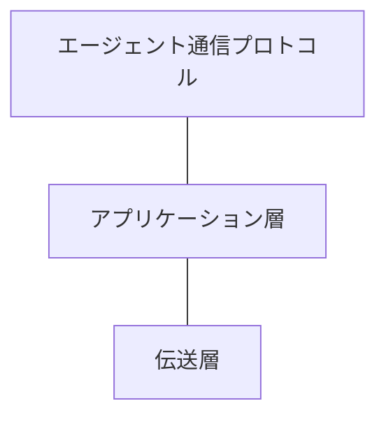

<!-- translation-method: agent-full; source=standard/pic/stack.txt -->
# 図1: プロトコルスタック

原文: [stack.txt](../../../../../standard/pic/stack.txt)。上から順に次の3段を表しています。

| 原文のラベル | 日本語 |
| --- | --- |
| Agent communication protocol | エージェント通信プロトコル |
| Application layer | アプリケーション層 |
| Transmission layer | 伝送層 |
| Figure 1: Protocol Stack | 図1: プロトコルスタック |

