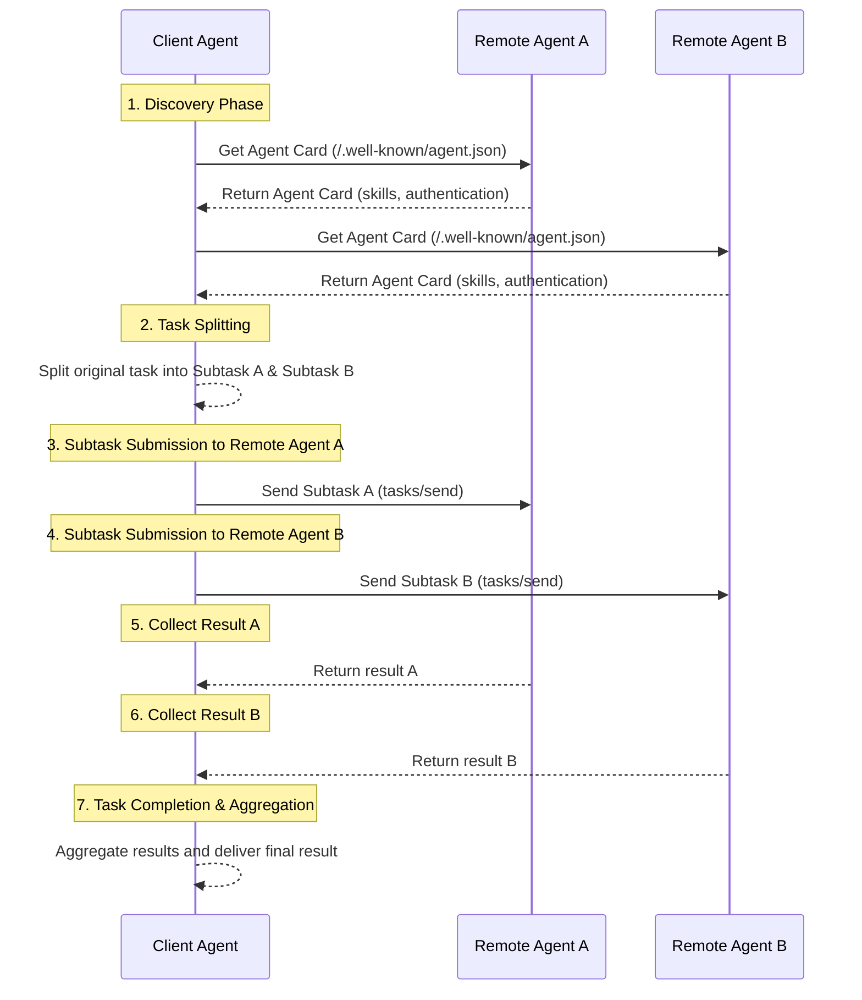

<!-- translation-review: full; source=blogs/Comparing-the-Interaction-Modes-of-MCP-A2A-and-ANP.md -->
> 日本語参考訳（原文全文照合・校閲済み）。以下は、原文公開当時のプロトコルの比較です。
> 原文: [blogs/Comparing-the-Interaction-Modes-of-MCP-A2A-and-ANP.md](../../blogs/Comparing-the-Interaction-Modes-of-MCP-A2A-and-ANP.md) / 基準コミット: `0837cfdfaf4ddcf834f0890ddaf34fc4c824e066`

# MCP、A2A、ANPのやり取りを詳しく比較する：情報の構成方法の違い

MCP、A2A、ANPの比較シリーズの、三つ目の記事です。これまでの二つは、次のとおりです。
- [Googleが公開した最新のA2Aと、ANP、MCPを多角的に比較する](Comprehensive-Comparison-of-Google-A2A-ANP-MCP.md)
- [GoogleのA2AとANPの詳細比較：プロトコルの原点を探る](In-depth-Comparison-of-Google-A2A-and-ANP-Finding-the-Origin-of-Protocols.md)

この記事では、各プロトコルのやり取りの方式を、詳しく比較します。この違いは、ツールやエージェントが情報をどう構成するかを決め、さらに、情報の処理方法や、やり取りの特徴を決めます。

**まず結論を述べます。**

- **MCP（遠隔呼び出し）**：サーバーは、すべてのツールとリソースの一覧を、クライアントに直接公開します。クライアントは、それをモデルに渡し、モデルが、必要に応じてRPCで特定のツールを呼び出したり、リソースにアクセスしたりします。
- **A2A（タスクの外注）**：エージェントは、自分の能力の概要を公開します。クライアントのエージェントは、複雑なタスクを分割し、適した専門性を持つエージェントに割り当てて実行させ、最後に結果をまとめます。
- **ANP（データの巡回取得）**：エージェントは、情報とインターフェースを、URLでつながるネットワークにまとめます。クライアントは、Webクローラーのように記述文書の入り口から、必要に応じて情報を取得し、ローカルで判断し、最後に、発見したインターフェースで操作します。

**三つの中心的な違い：**

- **A2AとMCP**：A2Aは実装の詳細を隠します。クライアントが関心を持つのは、「どう実行するか」ではなく、「何をするか」です。タスクを提出し、結果を待てばよいのです。
- **ANPとMCP**：MCPは、すべてのツールやリソースを一度に返します。ANPは階層的なリンクと説明だけを提供し、エージェントが必要に応じて探索し、情報を取得できるようにします。
- **ANPとA2A**：どちらもエージェントのやり取りを扱います。ただし、A2Aは複雑なタスクの分割と協働を重視し、ANPは、プライバシーの漏えいリスクを減らすため、柔軟な情報取得と、ローカルでの判断を重視します。

ANPは、現代のWeb技術を基盤にしており、ANPをサポートするエージェントは、一般にWebAgentと呼ばれます。

## MCPのやり取りの方式

MCPは、典型的なクライアント・サーバー（C/S）方式を採用します。最初のリクエストで、ツールやリソースへの対応など、双方の能力を確認・調整します。

サーバーは、一般にtools/listとresources/listという、二つの中心的なインターフェースに対応します。クライアントは、それらを使って、すべてのツールとリソースの情報を取得できます。ここには、ツールやリソースの説明というメタデータが含まれ、モデルに、ツールの能力と呼び出し方、リソースの詳細を伝えます。

モデルは、必要に応じて、異なるツールを呼び出し、異なるリソースを読みます。

ツールを例にすると、やり取りは次のとおりです。

この方式では、サーバーは受け身で、ツールとリソースを提供します。判断の権限は、クライアントのモデルにあります。

## A2Aのやり取りの方式

A2Aは、柔軟なP2Pのやり取りの方式です。一つのエージェント（クライアント）は、一つ以上の別のエージェント（リモート）と、直接対話し、協働できます。大きなタスクを小さく分けて、一緒に完了します。複数の専門家のアシスタントが、共同作業するようなものです。

通常の流れは、次のとおりです。

1. **発見と選択**：まず、現在のタスクに適したリモートのエージェントを発見し、特定します。複数の「Agent Card」を調べることができます。得意なことやサービスの方法を示す、能力の履歴書のようなものです。クライアントは要件に応じ、最も適した相手を、一つ以上選びます。
2. **タスクの分割（任意）**：複雑なタスクは、複数のサブタスクに分けられます。
3. **割り当てと協働**：A2Aで選んだ相手に接続し、対応するタスクやサブタスクのリクエストを送ります。例えば、サブタスクAはリモートA、サブタスクBはリモートBに送ります。
4. **複数回のやり取りと結果の収集**：各相手が、割り当てられたタスクを独立して実行します。実行中は、メッセージで何度もやり取りし、進捗の共有、確認の質問、中間結果の返却ができます。クライアントは、各相手からの応答と結果を、個別に受け取ります。
5. **結果の集約と完了**：すべてのサブタスクが完了すると、各相手の結果を集めてまとめ、タスク全体の解決策を作ります。

通信の過程全体に、タスクのコンテキストや状態の追跡を含め、特定のタスクやサブタスクについて、秩序立った対話を進められます。

この方式では、クライアントもリモートも、入力に応じてタスクを処理します。明確なタスクの説明と、結果のやり取りを通じて、双方が協働します。

## ANPのやり取りの方式

ANP（Agent Network Protocol）も、エージェント間の通信を解決するP2Pの方式です。ただし、A2Aとは根本的な違いがあります。

- A2Aは「タスクの外注」です。タスクを分け、ほかのエージェントに実行を割り当てます。
- ANPは「データの巡回取得」です。相手からは情報だけを取得し、ローカルで判断した後、APIの呼び出しによって操作します。

ANPの中心的な特徴は、Linked Dataで、能力、インターフェース、情報のすべてを、たどれるデータネットワークにまとめることです。すべてのツールとリソースの一覧を、直接返すMCPとは異なります。

### ANPのやり取りの流れ

Webクローラーがページを見るように進みます。

1. **入り口の発見**：まず、相手のエージェント記述文書のURLを得ます。ウェブサイトのホームページのようなものです。
2. **能力の発見**：記述文書から、相手の能力、インターフェース、利用できるリソース、および詳しい文書のURLを知ります。
3. **選択的な取得**：現在のタスクに関係のあるURLだけにアクセスし、すべてではなく、必要な情報を得ます。
4. **再帰的な探索**：各文書には、新しいリンクがあるかもしれません。必要に応じ、さらにたどって取得します。
5. **ローカルでの判断**：十分な情報を集めたら、自分のモデルで、論理的な判断と意思決定を行います。
6. **インターフェースの呼び出し**：最後に、発見したAPIで、具体的な操作を実行します。

本当に必要な情報だけを取得するため、データの伝送を節約でき、自分の手元に、判断の権限を保てることが、この方法の利点です。

## 情報の構成方法の違い

ここまで述べたやり取りの違いは、本質的には、エージェントが外部に公開する情報を、各プロトコルがどう構成するかの違いです。

- **MCP（すべて公開）**：RPCで、ツールとリソースの一覧を一度に公開します。クライアントは、必要なツールを直接選んで呼び出せます。
- **A2A（能力のカード）**：Agent Cardで、能力や技能の概要を示し、実装の詳細は公開しません。クライアントは、タスクを提出し、結果を待つだけです。
- **ANP（リンクのネットワーク）**：Linked-Dataで、情報をネットワーク状にまとめます。クライアントは、Webクローラーのように、必要に応じて、特定の情報を選んで取得できます。
