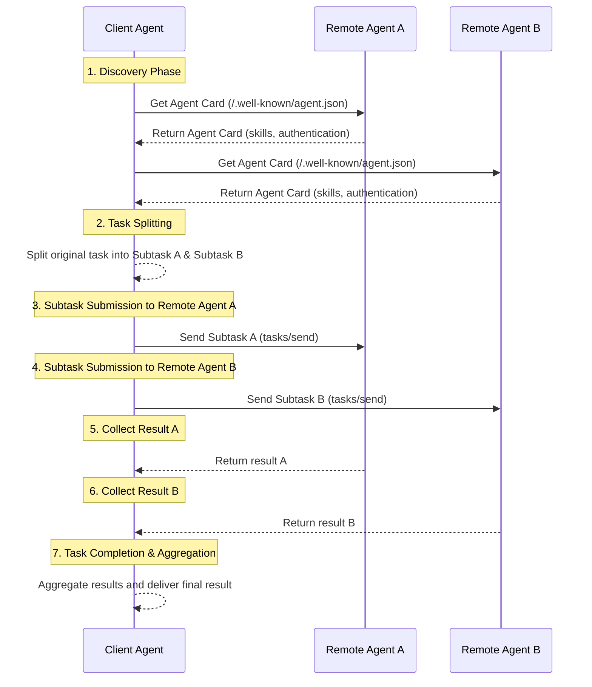

> 日本語参考訳（機械翻訳・未校閲）。規範となるのは原文です。コード例・識別子・規範キーワードは原文を保持しています。
> 原文: [blogs/Comparing-the-Interaction-Modes-of-MCP-A2A-and-ANP.md](../../blogs/Comparing-the-Interaction-Modes-of-MCP-A2A-and-ANP.md) / 基準コミット: `0837cfdfaf4ddcf834f0890ddaf34fc4c824e066`

# MCP、A2A、ANPのインタラクションモードの深い比較:情報機関の違い

MCP、A2A、ANP比較シリーズの3番目の記事です。 前の2つの記事:
- [Googleの最新A2A、ANP、MCPの包括的な比較](Comparing-the-Interaction-Modes-of-MCP-A2A-and-ANP.md)
- [GoogleのA2AとANPの詳細な比較:プロトコルの起源を見つける](In-depth-Comparison-of-Google-A2A-and-ANP-Finding-the-Origin-of-Protocols.md)

この記事では、ツールやエージェントが情報を整理する方法を決定する各プロトコル間の相互作用モードの違いを深く比較します。これにより、情報処理と相互作用特性の方法を判断します。

**まずは結論書**:

- **MCP(リモートコール)**: サーバは、この情報をモデルに渡る全てのツールやリソースリストをクライアントに直接公開します。 特定のツールを呼び出し、必要に応じてRPCを介して特定のリソースにアクセスします。

- **A2A(タスクアウトソーシング)**: エージェントは、能力の概要を提示し、クライアントのエージェントは複雑なタスクをサブタスクに分解し、実行のための対応する専門知識を持つエージェントに配布し、最終的に結果を統合します。

- **ANP(データクロール)**: エージェントは、URL によってリンクされているネットワークに情報とインターフェイスを整理します。 クライアントエージェントは、Webクローラーのようなものが多く、説明文書のエントリーポイントから始まり、必要に応じて情報を入手し、ローカルで決定を下し、最終的に発見されたインターフェイスを使用して操作を実行します。

**3つのコアの違い**:

- **A2A 対 MCP**: A2Aは、クライアントが「何をすべきか」ではなく、「どのようにしてやるのか」という懸念を抱えている実装の詳細をカプセル化し、タスクの送信や結果を待っています。

- **ANP対MCP**: MCP は、すべてのツール/リソースを一度に返し、ANP は階層的なリンクと説明のみを提供し、エージェントが必要に応じて情報を探索および取得できるようにします。

- **ANP対A2A**: アドレスエージェントのインタラクションが、A2Aは複雑なタスク分解とコラボレーションを強調しています。ただし、ANPは柔軟な情報取得とローカル意思決定に焦点を当ててプライバシー漏洩リスクを軽減します。

ANPは、現代のWeb技術に組み込まれており、ANPプロトコルをサポートするエージェントは通常、WebAgentsと呼ばれています。

## MCP の相互作用モード

MCPのインタラクションモードは、古典的なクライアントサーバ(C/S)アーキテクチャを採用しています。 初期リクエストでは、ツールやリソースなどのサポートを含めた機能が交渉されます。

サーバは、一般的に、ツール/リストとリソース/リストの2つのコアインターフェイスをサポートしています。これにより、クライアントはすべてのツールやリソースに関する情報を得ることができます。 この情報は、ツールとリソースの説明、メタデータ、すなわち、ツールの機能やそれらを呼び出す方法、およびリソースに関する詳細な情報についてモデルを通知するなどを含みます。

モデルは、異なるツールを呼び出し、必要に応じてさまざまなリソースを読みます。

例えば、ツールを使ってインタラクションは次のようになります。

このインタラクションモードでは、サーバーは受動的なパーティーとして機能し、クライアントのモデルに頼る意思決定力を持つツールとリソースをパッシブに提供します。

## A2A の相互作用モード

A2Aは、フレキシブルなP2Pインタラクションモードです。 このモードでは、エージェント(クライアントエージェント)が直接1つ以上の他のエージェント(リモートエージェント)と通信し、連携して、大きなタスクを小さくし、他のエージェントと補完することができます。複数のプロフェッショナルアシスタントと同様に、一緒に作業しています。

対話プロセスは、通常、次の手順に従います。
1. **発見と選択**: クライアントエージェントは、現在のタスクに適したリモートエージェントを発見し、見つけることを最初に必要とします。 スキルの履歴書、各エージェントの機能やサービスメソッドをリストするなど、複数のエージェントの「エージェントカード」を問い合わせることができます。 クライアントエージェントは、タスク要件に基づいて、1つ以上の最適なリモートエージェントを選択します。

2. **タスク分割(オプション)**: 複雑なタスクでは、クライアントエージェントは複数のサブタスクに分割できます。

3. **タスクの課題とコラボレーション**: クライアントエージェントは、A2Aプロトコルを介して選択したリモートエージェントとの接続を確立し、対応する(sub)タスクリクエストを送信します。 例えば、リモートエージェントA、サブタスクBからリモートエージェントBにサブタスクAを送信します。

4. **多角的相互作用と結果コレクション**: リモートエージェントは、それぞれに割り当てられたタスクを独立して実行します。 実行中、メッセージを通じてクライアントエージェントとのマルチラウンドインタラクションを行なうことができ、進捗に関するフィードバックを提供し、質問を明確にしたり、中間結果を返したりすることができます。 クライアントエージェントは、異なるリモートエージェントからフィードバックと結果を別々に受け取ります。

5. **結果集計と完了**: サブタスクが完了すると、クライアントエージェントはさまざまなリモートエージェントから結果を収集し、統合し、最終的にタスク全体の完全なソリューションを形成します。

コミュニケーションプロセス全体にはタスクのコンテキストとステータストラッキングが含まれており、特定の(サブ)タスクの周りの対話が順調に進行することを確認します。

このモードでは、クライアントエージェントとリモートエージェントの両方のタスクを入力に基づいて処理し、両方の当事者は明確なタスクの説明と結果の相互作用を介してコラボレーションします。

## ANP の相互作用モード

ANP(エージェントネットワークプロトコル)は、エージェント間の通信問題の解決を目的とするP2Pインタラクションモードです。 A2Aの基本的な違いがあります。

- A2Aは、エージェントがタスクを分割し、実行のために他のエージェントに割り当てる「タスクアウトソーシング」モデルを採用しています。
- ANPは、エージェントが他のエージェントから情報を取得したり、ローカルで決定したり、APIコールを通じて操作を実行したりする「データクローリング」モデルを採用しています。

ANPのコア機能は、全てのエージェントの機能、インターフェイス、情報をナビゲート可能なデータネットワークに整理する「リンクされたデータ」技術を利用しています。 MCPのアプローチは、すべてのツールやリソースリストを直接返すと異なります。

### ANPインタラクションプロセス

ANP のやり取りプロセスは、Web クローラ閲覧 Web ページのようなものです。

1. **エントリー・ディスカバリー**: エージェントは、まず別のエージェントの「エージェントの説明文書」のURLを取得します(ウェブサイトのホームページに類似)

2. **機能障害の発見**: 説明文書から、エージェントは、カウンターパートのスキル、インターフェイス、利用可能なリソース、およびより詳細なドキュメントへのリンクURLについて学習します

3. **選択的買収**: エージェントは、現在のタスクのニーズに関連するURLのみにアクセスし、必要な情報(すべての情報よりもむしろ)を取得する。

4. **再帰的な運行**: 各ドキュメントには新しいURLリンクが含まれている場合があります。エージェントは必要に応じてナビゲートし、プルを継続できるようにします。

5. **ローカル意思決定**: 十分な情報を収集した後、エージェントは自分のモデル内で論理的判断と決定を行います

6. **インターフェイス呼出し**: 最後に、発見されたAPIインターフェイスによって特定の操作を実行します

このアプローチの利点は、エージェントが本当に必要な情報だけを獲得し、データ伝送を節約し、意思決定制御を独自の手で維持することです。

## 情報組織法の違い

上で説明した対話モードの違いは、基本的に、エージェントが外部に公開する情報を各プロトコルが編成する方法の違いです。

- **MCP (完全開示)**: RPC 呼び出しを通じて、すべてのツールとリソースのリストが一度に開示され、クライアント エージェントが必要なツールを直接選択して呼び出すことができます。

- **A2A (能力カード)**: エージェント カードを通じて、エージェントは具体的な実装の詳細を明らかにすることなくスキルと能力の概要を紹介します。クライアントはタスクを送信して結果を待つだけで済みます。

- **ANP (Linked Network)**: Linked Data テクノロジーを使用してエージェント情報をネットワーク構造に整理すると、クライアント エージェントは Web クローラーと同様に、必要に応じて特定の情報を選択的に取得できます。
