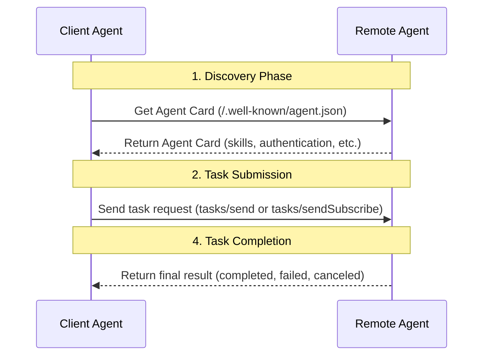
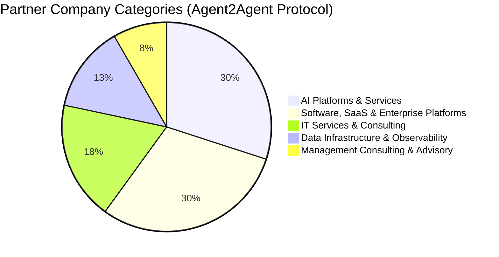

<!-- translation-review: full; source=blogs/In-depth-Comparison-of-Google-A2A-and-ANP-Finding-the-Origin-of-Protocols.md -->
> 日本語参考訳（原文全文照合・校閲済み）。A2Aの用途、認証、発見等に関する評価は、原文公開当時の著者の分析です。例と引用のコードブロックは原文を保持しています。
> 原文: [blogs/In-depth-Comparison-of-Google-A2A-and-ANP-Finding-the-Origin-of-Protocols.md](../../blogs/In-depth-Comparison-of-Google-A2A-and-ANP-Finding-the-Origin-of-Protocols.md) / 基準コミット: `0837cfdfaf4ddcf834f0890ddaf34fc4c824e066`

# GoogleのA2AとANPの詳細比較：プロトコルの原点を探る

A2Aの公開後、ANPを見守る多くの方から、影響への質問や提案をいただきました。改めて感謝します。

最大の影響は、Googleのお墨付きが得られたことだと思います。「ANPの方向は正しく、先を見ている。私も参加します」というわけです。もう、エージェントの通信と協働の重要性を説明する必要はありません。

その日は半日調べ、[A2A、ANP、MCPの多角的な比較](Comprehensive-Comparison-of-Google-A2A-ANP-MCP.md)を書きました。

さらに一日かけて調べ、ANPと詳しく比較すると、A2Aの出発点と、より深い違いが見えてきました。

ひと言で整理すると、次のとおりです。
- MCPの原点：**モデルと、ツールやリソースの接続**。
- A2Aの原点：**企業内のエージェント間の複雑な協働**。
- ANPの原点：**インターネット上のエージェントの接続と協働**。

## 技術的な違い

どちらも通信と協働を扱いますが、大きな違いがあります。

### 記述と、情報の構成

相手に情報をどう公開するかは、設計の重要な問題です。

A2Aは、Agent CardというJSON文書で、能力、技能、認証方法を示します。中心はskillsで、地図の経路計画など、何ができるかを表します。

ANPもJSONですが、JSON-LDとschema.orgに基づき、基本情報、認証、製品やサービス、やり取りのインターフェースを記述します。セマンティックWebによって、理解の一致を高め、公開情報をデータネットワークにつなぎ、記述文書を、その入り口にします。


例えばホテルは、部屋、設備、サービス、インターフェース、画像などを記述し、リンクでつないで、相手が巡回取得し、理解できるようにします。

このため、やり取りも異なります。
- A2Aは、Agent Cardのskillsを相手が読み、JSON-RPCで、自然言語のタスクと、必要な情報を送ります。完了すると、結果が返ります。



- ANPは、製品、サービス、インターフェースなどを、記述文書のURLでつなぎます。相手はWebクローラーのように、必要な情報を取得し続け、途中で、自然言語や構造化インターフェースを使えます。


中心的な違い：
- **A2Aは技能を公開し、相手が処理を依頼し、完了後に結果を返します。**
- **ANPは、インターフェースを含む情報を公開し、相手が取得して処理し、必要に応じて呼び出します。**

### エージェントの発見

どちらも、ドメインの.well-knownにメタデータを置きます。A2Aはagent.json、ANPはagent-descriptionsです。

どちらも、私的なレジストリへの、自発的な登録をサポートします。ローカルネットワークの協働には必要です。

違いは、A2Aが.well-known/agent.jsonにAgent Card自体を置くのに対し、ANPは.well-known/agent-descriptionsに、記述文書のURLを置く点です。

現時点では、A2Aは一つのドメインに一つのAgent Cardのように見えます（要確認）。ANPは、複数のエージェントを置けます。

### 本人認証

ここにも違いがあります。

A2A自体では、アイデンティティの情報を交換しません。トークンなどの認証材料を、帯域外で得て、HTTPヘッダーで渡します。

帯域外とは、別のプロトコルで取得することです。OpenAPIの仕様に従い、HTTP Basic Auth、API Key、OAuth 2.0などをサポートし、各Agent Cardで宣言します。


ANPは、W3C DIDで分散型の本人認証を構築し、本人と、その検証の情報を、プロトコルで直接運びます。自分のアイデンティティで、すべての相手とやり取りでき、帯域外で材料を得る必要はありません。

ただし、特に企業向けなど、帯域外での取得が必要な用途もあります。ANPは、将来それもサポートする予定で、拡張の余地を残しています。


**中心的な違い：**
- A2Aは、米国の主な企業アプリケーションの安全性や規制への要件に合わせ、既存の本人認証を再利用し、軽量、柔軟、安全にします。中心は企業内の問題で、インターネット上のエージェントの相互接続は、解決していません。
- ANPは、将来、任意の二つのエージェントが、インターネット上で相互接続するための認証を解決しようとします。より相互運用性の高い方式が必要です。

### 中心となる概念

大きな違いがあります。

**A2A**は、Skill、Task、Artifact、Message、Partです。

Taskの状態は、submitted、working、input-required、completed、canceled、failed、unknownです。

操作には、Send、Get、Cancelや、通知に関するものがあります。

**ANP**は、説明の情報と、インターフェースです。

情報は、主にJSON-LD文書と、そこからURLでつながる、画像、音声、動画などのリソースです。

インターフェースは、Natural Language InterfaceとStructured Interfaceに分かれます。構造化されたものでは、OpenAPI、JSON-RPCなど、既存の多くの仕様をサポートします。

**中心的な違い：**
- A2Aは、状態や操作を含む、詳しいタスクの協働を、プロトコルで定義します。複雑な協働に役立つ一方、結合が強くなります。
- ANPは、やり取りを単純化し、結合を弱め、プラットフォームをまたぐ協働に優れます。一方、複雑なタスクの協働を、標準のプロトコル自体はサポートせず、インターフェースを定義して実装する必要があります。

## A2AとANPの原点

本当に設計を理解するには、出発点を見つける必要があります。

ANPは、**インターネット上の接続と協働**、MCPは、よりよいエージェントを作るための、**モデルとツールやリソースの接続**です。

分析から、A2Aの原点は、**企業内の複雑な協働**だと確認できます。

公式サイトは明記していませんが、Googleの発表では、一部が示されています。

```
AI agents provide a unique opportunity for people to boost productivity by autonomously handling many routine or complex tasks. Today, businesses are increasingly building and deploying autonomous agents to help scale, automate, and optimize processes across work scenarios—from ordering a new laptop, to assisting customer service representatives, to aiding in supply chain planning. (https://developers.googleblog.com/en/a2a-a-new-era-of-agent-interoperability/)
```

参加企業の多くが、AIプラットフォームやサービス、ソフトウェア、SaaS、企業向けプラットフォームである点にも表れます。




現在の実装は、技術的にも、エージェントインターネットの要件に、あまり適しません。

例えば、個人アシスタントがホテルを予約するなら、価格、部屋、日程などを、自然言語のタスクで送ります。ホテルが処理し、実行情報を返すまで、何度もやり取りし、状態が変わる可能性があります。

二つの問題があります。相手に実行させるため、プライバシーが漏れるかもしれないことと、結合が強すぎることです。

ANPでは、ホテルの情報を取得し、ローカルで処理し、必要なときだけ、インターフェースを呼びます。これが根本的な違いです。また、A2Aには、インターネット上のアイデンティティの相互接続の問題も残ります。

ただし、将来の更新で、用途を広げる可能性は否定しません。

## 将来への予測

短期には、MCPがツールやリソースをつなぐ事実上の標準となったことは、ほぼ確定し、第二のMCPが現れるのは難しいでしょう。

中長期には、**ツールがエージェントに、エージェントがツールになる**傾向が起こると思います。その場合、エージェントプロトコルが、MCPの領域を狭めます。

さらに先、AGIが実現すると、人の設計したプロトコルは、助けではなく制約となり、AIが、自ら設計し、合意できるかもしれません。

それでも現在は、重要な構成要素であり、Computer Use、Browser Use、さらにはAIブラウザーより効率的な、AIに適した接続方法です。

**ANPの最も価値ある部分は、コミュニティの未来像、独自の理念（接続は力である）、DIDとセマンティックWebの方向性です。それが、発展を支える中心的な力です。**

## 革新について

A2Aの公開後、「衝撃」「一夜で変わる」「破壊的」といった見出しには、複雑な思いでした。私たちは一年間ANPに取り組み、長く普及活動をしてきたからです。

「0から1」の革新には、革新者だけでなく、それを見つけるメディアも必要です。

40人を超える、すべてのコントリビューターと開発者に感謝します。

RTE Developer Community、OSC Open Source Community、Founder Park、Juecha Flow、Hou Hongwen Cun、AIGCLink、Agent AIなど（すべてではないかもしれません）、支えてくれる公開アカウントとコミュニティ、発表の機会をくれる組織、サーバー資源を提供するAWSとAlibaba Cloudにも、感謝します。
