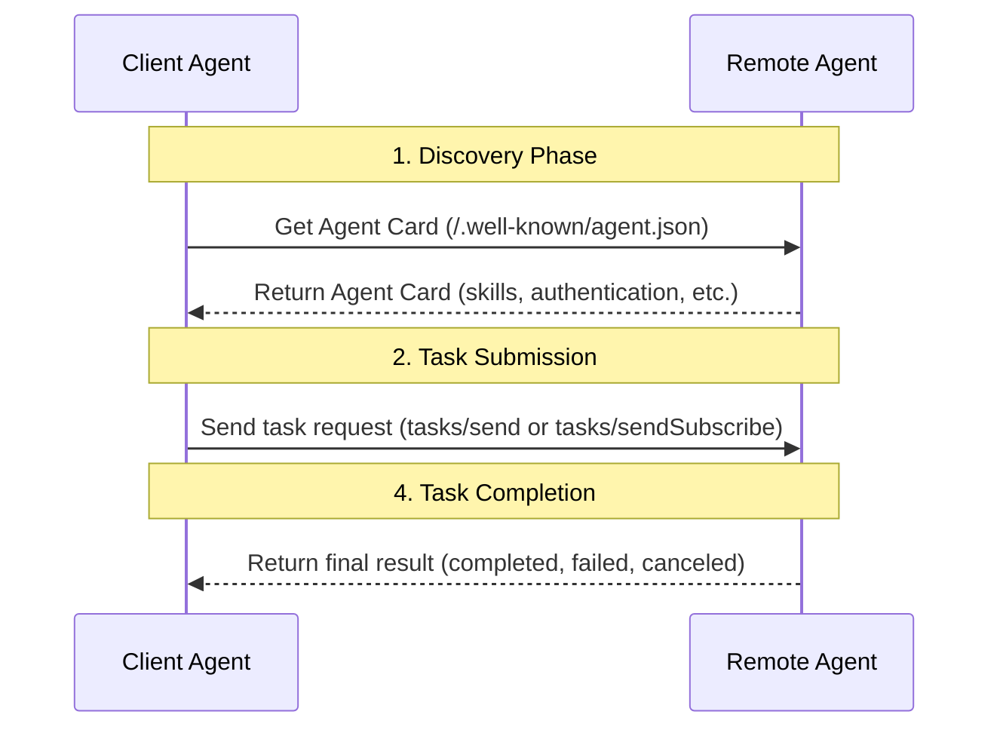
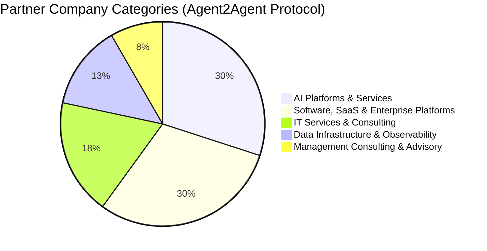

> 日本語参考訳（機械翻訳・未校閲）。規範となるのは原文です。コード例・識別子・規範キーワードは原文を保持しています。
> 原文: [blogs/In-depth-Comparison-of-Google-A2A-and-ANP-Finding-the-Origin-of-Protocols.md](../../blogs/In-depth-Comparison-of-Google-A2A-and-ANP-Finding-the-Origin-of-Protocols.md) / 基準コミット: `0837cfdfaf4ddcf834f0890ddaf34fc4c824e066`

# Google A2AとANPの詳細な比較:プロトコルの起源を見つける

GoogleのA2Aプロトコルがリリースされた後、ANPコミュニティをフォローしている多くの友人がすぐに出てきたので、私たちの影響について尋ねて提案を提供してください。 今後ともよろしくお願い申し上げます。

ANPのA2Aが最大の影響はGoogleの「決裁」であると考えています。ANPのアプローチは正しいと言え、長期ビジョンがあり、今度は次のように参加しています。 エージェントのコミュニケーションとコラボレーションが重要である理由について説明する必要はありません。

そこで、研究の半日を過ごして記事を書きました。 [Googleの最新A2A、ANP、MCPの包括的な比較](Comprehensive-Comparison-of-Google-A2A-ANP-MCP.md).

あとは、A2Aを勉強してANPと深く比較してみることに気づいた。 A2Aの原点を調べ、A2AとANPの違いがより深いと見てきたと思います。

一つの文でまとめる:
- MCPの由来は次のとおりです。 **ツールとリソースでモデルを接続する**
- A2Aの由来は次のとおりです。 **企業内のエージェント間の複雑なコラボレーション**
- ANPの由来は: **インターネット上のエージェントの接続とコラボレーション**

## 技術的な違い

A2AとANPはエージェントのコミュニケーションとコラボレーションを解決する目的でもありますが、それらの間に重要な技術的違いがあります。

### 代理店の記述および情報組織

プロトコル設計では、エージェントが別のエージェントにその情報を露出する方法は重要な問題です。

エージェントの説明では、A2A はエージェントカードと呼ばれる JSON 形式のドキュメントを使用して、エージェントの能力、スキル、認証方法などについて説明しています。 エージェントカードのコアは、地図ルート計画などのエージェントができることを表現するスキルです。

ANPはJSONも使用していますが、JSON-LD(リンクデータ)とschema.orgをベースにしてエージェント情報(基本情報、認証、外部製品/サービス、インタラクションインターフェース)を記述しています。 これは、セマンティックなウェブ技術であり、2つのエージェント間の情報理解の一貫性を改善し、エージェントからのデータネットワークにリンクされるように公開情報を有効化することを目的としています。エージェントの説明文書は、ネットワークへのエントリポイントとして役立つものです。


例えば、ANP を使用したホテルエージェントは、その客室、施設、サービス、インタラクションインターフェイス、その他の情報(画像を含む)を記述し、他のエージェントがクロールして理解できるデータネットワークにリンクすることができます。

これは、A2AとANPのエージェント相互作用における重要な違いをもたらします。
- A2Aはエージェントカードでエージェントのスキルを記述しています。 ほかのエージェントはこれらのスキルを取得し、JSON-RPC 経由でタスクリクエストを送信します。自然言語でタスクを記述し、タスクに必要な関連情報を運ぶことができます。 タスクが完了したら、結果が返されます。



- ANPは、エージェントがエージェントのURLを使用して、製品、サービス、インタラクションインターフェイス、およびその他の情報をエージェントのドキュメントに接続します。 もうひとつのエージェントは、Web クローラのように、URL で必要な情報を継続的にクロールします。 このプロセスでは、自然言語インターフェイスや構造化されたインターフェースを介してエージェントと対話することができます。


コアの相違点はこちら:
- **A2Aには、一般に自分のスキルを露出し、他のエージェントは処理タスクをそれらに送信し、結果の完了を返します。**
- **ANPは、エージェントが情報を公開(インタラクションインタフェースを含む)し、その他のエージェントがこの情報をクロールして処理し、必要に応じて自然言語または構造化されたインターフェイスを介してエージェントと相互作用します。**

### エージェントディスカバリー

エージェントの発見に関しては、A2Aのアプローチは基本的にANPと同じです。 ドメインの.well-knownディレクトリにメタデータ文書を追加し、A2Aのファイルでagent.jsonとANPの名前のエージェント記述を記述します。

どちらも、エージェントがプライベート レジストリに積極的に登録することをサポートしています。これは、ローカル ネットワークでのコラボレーションに不可欠です。

違いは、A2A はエージェント カードのコンテンツを .well-known/agent.json に直接配置するのに対し、ANP はエージェント説明ファイルの URL を .well-known/agent-descriptions に格納することです。

現在、A2A にはドメインごとに 1 つのエージェント カードがあるようですが (これについてはさらなる確認が必要です)、ANP ではドメインごとに複数のエージェントが許可されています。

### 認証

A2A と ANP は認証が異なります。

A2A エージェントは、A2A プロトコルで ID 情報を交換しません。代わりに、帯域外メソッドを通じて認証マテリアル (トークンなど) を取得し、これらのマテリアルを HTTP ヘッダーを通じて渡します。

「アウトオブバンド」とは、A2A 以外のプロトコルを通じて認証マテリアルを取得することを意味します。 A2A は OpenAPI の認証仕様に従い、各エージェントがエージェント カードで指定した HTTP 基本認証、API キー、OAuth 2.0 などの複数の認証方法をサポートします。


ANP は、W3C DID テクノロジーに基づいて分散型認証を構築し、認証情報を含む ID 情報をプロトコルで直接伝送します。エージェントは、帯域外で認証マテリアルを取得する必要なく、独自の ID を使用して他のすべてのエージェントと対話できます。

ただし、一部のシナリオでは、特にエンタープライズ アプリケーションでは、認証マテリアルを帯域外で取得する必要があります。 ANP は、将来的には帯域外の認証マテリアルの取得をサポートする予定ですが、拡張性は設計に組み込まれています。


**コアの違い:**
- A2A は、米国の主流のエンタープライズ アプリケーション エコシステムのセキュリティおよびコンプライアンス要件との互換性を最大限に高めるため、帯域外の認証マテリアル取得を採用し、既存のエンタープライズ認証システムを再利用して、プロトコル自体が軽量、柔軟、安全であることを保証します。中心となるのは、インターネット上のエージェントの相互接続の問題に対処することなく、エンタープライズ アプリケーションの ID 問題を解決することです。

- ANP は、インターネット上の任意の 2 つのエージェントが相互接続できるようにすることを核として、将来的にインターネット上でエージェントが認証される方法を解決することを目指しており、より相互運用可能な認証スキームが必要です。

### コアコンセプト

A2A と ANP には、コア プロトコルの概念に大きな違いがあります。

**A2A の中心概念** には、スキル、タスク、アーティファクト、メッセージ、およびパートが含まれます。

タスクは、送信済み、作業中、入力必須、完了、キャンセル、失敗、不明などの複数の状態も定義します。

タスクでは、送信、取得、キャンセルなどの操作や、通知関連の操作も定義します。

**ANP のコアコンセプト** には、説明情報とインターフェイスが含まれます。

説明情報は主に JSON-LD 形式のドキュメントと、JSON-LD ドキュメント内の URL を介してリンクされている画像、音声、ビデオ、その他のマルチメディア ファイルなどのその他のリソースです。

インターフェースは、自然言語インターフェースと構造化インターフェースに分けられます。構造化インターフェイスは、OpenAPI、JSON-RPC などのほとんどの既存の仕様をサポートします。

**コアの違い:**
- A2A は、タスクの状態、操作などを含む、プロトコル レベルで詳細なタスク コラボレーションの概念を定義し、エージェント間の複雑なタスク コラボレーションの問題の解決に役立ちます。欠点は、2 つのエージェント間の結合が高くなるということです。

- ANP は、エージェント間の対話を簡素化し、エージェント間の結合を軽減し、クロスプラットフォームのエージェント コラボレーション シナリオにおいて大きな利点をもたらします。欠点は、ネイティブ プロトコルが複雑なタスクのコラボレーションをサポートしておらず、それを実装するためのインターフェイスを定義する必要があることです。

## A2AとANPの起源

プロトコルの設計を真に理解するには、プロトコルの原点を見つける必要があります。

例えば、ANPの由来は常に存在しています。 **インターネット上のエージェントの接続とコラボレーション**. . . MCPの由来は常に **ツールとリソースでモデルをつなぐ** より良いエージェントを構築します。

上記の技術分析を通じて、A2A の起源は次のとおりであることが確認できます: **企業内のエージェント間の複雑なコラボレーション**。

プロトコルの公式 Web サイトにはこれについて明確に記載されていませんが、Google のプレスリリースではいくつかの側面について言及しています。

```
AI agents provide a unique opportunity for people to boost productivity by autonomously handling many routine or complex tasks. Today, businesses are increasingly building and deploying autonomous agents to help scale, automate, and optimize processes across work scenarios—from ordering a new laptop, to assisting customer service representatives, to aiding in supply chain planning. (https://developers.googleblog.com/en/a2a-a-new-era-of-agent-interoperability/)
```

これは、A2A エコシステム企業の分布からもわかります。そのほとんどが AI プラットフォームとサービス、ソフトウェア、SaaS、エンタープライズ プラットフォームです。




技術的な観点から見ると、A2A の現在の実装はエージェント インターネットのニーズにあまり適していません。

たとえば、パーソナル アシスタントが A2A を使用してホテルのエージェントに部屋を予約する場合、A2A の現在の実装によれば、パーソナル アシスタントはユーザーの要件 (価格、部屋のタイプ、時間など) を自然言語で説明するタスクを送信する必要があります。ホテル エージェントはこれを処理し、タスク実行情報を返します。これには、複数のタスクの相互作用と状態遷移が含まれる場合があります。

これにより 2 つの問題が生じます。1 つは、パーソナル アシスタントが実行のためにタスクを別のエージェントに送信する必要があるため、ユーザーのプライバシーが侵害される可能性があることです。もう 1 つは相互作用結合が高すぎることです。

ANP のロジックは、パーソナル アシスタントがホテル エージェントからの情報をクロールしてローカルで処理し、対話が必要な場合にのみホテル エージェントのインターフェイスを呼び出すというものです。これは根本的な違いです。もちろん、これを超えて、A2A はインターネット上のエージェント ID 相互接続の問題を解決していません。

ただし、将来的にはプロトコルのアップグレードを通じて、A2A がエージェントのインターネット シナリオに拡張される可能性があります。

## 将来のエージェントプロトコルに関するいくつかの予測

短期的には、MCP がモデルとツールやリソースを接続するための事実上の標準となり、それが基本的に確認されており、現時点では第 2 の MCP が出現することは困難です。

中長期的には、**ツールがエージェントになり、エージェントがツールになる**というトレンドが起こる可能性が高いと考えています。この傾向が発生すると、エージェント プロトコルが MCP のスペースを圧迫することになります。

長期的には、AGI が実現した後、おそらく人間が設計したプロトコルは AI を支援するのではなく制約することになり、AI は独自にプロトコルを設計して合意に達する方法を得るでしょう。

ただし、現時点ではエージェント プロトコルが非常に重要です。これらはエージェントにとって重要なパズルのピースであり、エージェントがインターネットと対話するための最も AI ネイティブな方法であり、コンピューターの使用、ブラウザの使用、さらには AI ブラウザよりも効率的です。

いずれにせよ、**ANP の最も価値のある部分は、将来のエージェント インターネットに対するコミュニティのビジョン、コミュニティ独自のインターネット哲学 (接続は力です)、および DID + セマンティック Web テクノロジ ルートです。これは、ANP の継続的な発展を支える中心的な原動力です**。

## イノベーションについて

A2A の登場後、「爆発的」、「一夜にして変革」、「破壊的」などの見出しを見るのは複雑でした。特に私たちは 1 年間 ANP に取り組み、長い間 ANP を推進してきました。

私たちは皆、「0 から 1」のイノベーションの必要性について話します。イノベーターだけでなく、これらのイノベーターを発見できるメディアも必要です。

最後に、現在 40 名を超えるオープンソース コミュニティのすべての貢献者と開発者に感謝します。

また、RTE 開発者コミュニティ、OSC オープンソース コミュニティ、Founder Park、Juecha Flow、Hou Honwen Cun、AIGCLink、Agent AI など (おそらく不完全) など、私たちをサポートしてくれる公開アカウントやコミュニティ、さらに共有の機会を提供してくれる多くの組織、そしてコミュニティにサーバー リソースを提供してくれた AWS と Alibaba Cloud にも感謝します。
