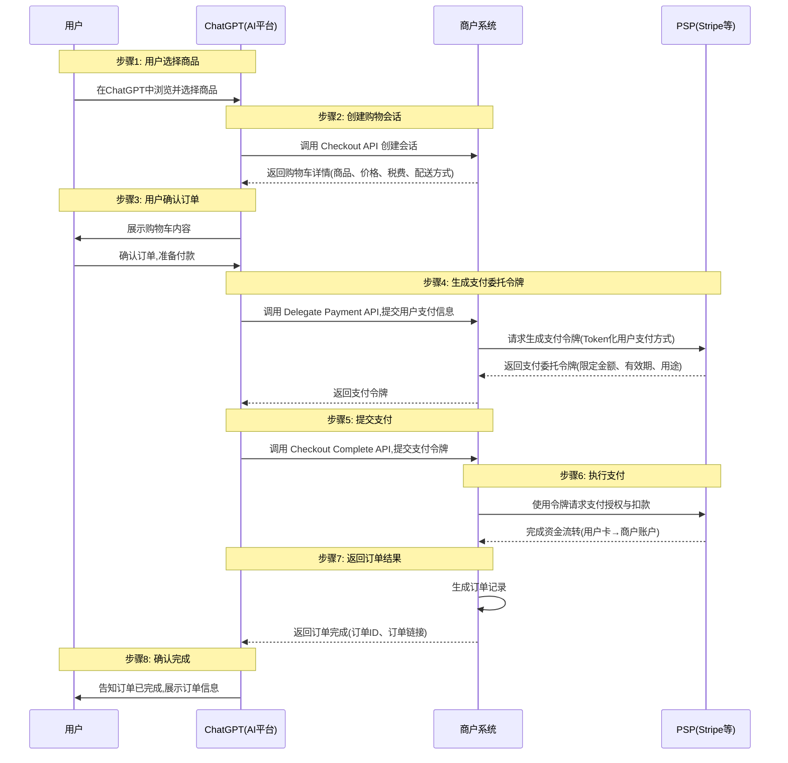

> 日本語参考訳（機械翻訳・未校閲）。規範となるのは原文です。コード例・識別子・規範キーワードは原文を保持しています。
> 原文: [blogs/cn/06-OpenAI联手Stripe发布ACP协议，用智能体商务颠覆传统电商.md](../../../blogs/cn/06-OpenAI联手Stripe发布ACP协议，用智能体商务颠覆传统电商.md) / 基準コミット: `0837cfdfaf4ddcf834f0890ddaf34fc4c824e066`

# ストライプとのコラボレーションで、従来の電動パワーャーをデスタビライズするためにスマートビジネスを使用するACP協定を公表しました。

従来の電気技師のエコロジーは、亀裂し始めます。将来のスマートボディコマースは、単純なeコマース+AIではなく、AIベースのエコロジーの構築ではありません。

## フォワード

9月16日から9月29日まで、Google、OpenAI、および3つのインテリジェントな機関の取引と支払いに関するエンタープライズローンチ契約で2週間の期間で、AP2、ATXP、ACP。

合意は、業界のホットスポットではなく、明らかに大きな評価を受けているから遠くです。 私は1つのビューで多くの機会にそれを共有します:**プロトコルはコンテキスト転送に最適なコンテナです。**「巨人は新しい合意を発行しています。つまり、技術はまだ高速に移行していることを意味します。

OpenAIが発行するACPの略で、アジェンシア共通プロトコルをフルネームで紹介します。 Google AP2の紹介を覚えておいてください。[詳しくは参考にして下さい。](04-深度解读谷歌最新发布的AP2.md)本契約から出てきたコンセプトの1つが、エージェント・コマースです。この時点で、OpenAIは本契約の名前を直接使用しました。

ブロガーは次のように述べています。**大手企業が見たスマートビジネスは、従来の電子商取引をデ安定させるために新たなエコロジーの構築を始めとする。**。

今日、OpenAIの新しいACPとAP2、ATXP、コミュニティのAPP取引協定、ならびに業界のインプリケーションや投影との比較を簡略的に提示します。

参照:
[OpenAI ACP協定](https://github.com/agentic-commerce-protocol/agentic-commerce-protocol/)
[Google AP2プロトコルの解釈](https://mp.weixin.qq.com/s/Up-DQi2qbU2ngqo401HbQw)
[ATXPプロトコル解釈](https://mp.weixin.qq.com/s/Hci06uO7gua8mqHphr8N0g)
[ANPプログラムの解釈](https://mp.weixin.qq.com/s/wFVUDs31e6CKLpu8F3LDWg)

## テキストのコア要素

完全なテキストを読んだりする時間がないなら、この記事のコアポイントは次のとおりです。

- ACPの要約:**ACPはChatGPTユーザーからチャットGPTで直接商品を買い取るための高速な合意です。**ChatGPTは、今後もエコロジーや製品に繋がる取り組みを続けていきます。
- ACP が取り組む問題は、そのような AI アプリケーションを ChatGPT に接続し、既存の e コマースのエコロジーにリンクして、AI アプリケーションがビジネスや決済システムで大きな変化をすることなく購入を完了できるようにすることです。
- Google の AP2 はインテリジェントコマースの中核となる信頼問題の解決に取り組んでおり、ATXP はインテリジェントなマイクロペイメントの問題の解決に取り組んでおり、ACP の目的はそれを迅速に実装することであることが、解決された問題からわかります。
- ACP の信頼問題は、ChatGPT と元の電子商取引エコシステムの評判に基づいて構築されています。現時点では、AP2 と ANP は ACP よりも優れた設計になっていると思います。
- ACP はアイデンティティの問題を解決しませんが、A2A と同様の帯域外アイデンティティを使用します。帯域外 ID は消費者分野では適切なソリューションではなく、エージェント間の接続コストが増加します。現時点では、did が最適なソリューションであり、DID は AP2 と完全に組み合わせることができると常に信じています。
- AP2、ATXP、ACP のリリースにより、スマート ビジネスが最前線に浮上しました。おそらく、巨人たちはAIが従来の電子商取引を破壊する機会を察知したのだろう。
- 他の AI アプリケーションもこれに続きますが、現在のインフラストラクチャは、先ほど述べたエージェントの ID によって引き起こされる接続コストの問題など、十分に完璧ではありません。また、スマート エージェントには新しい e コマース インフラストラクチャが必要であり、プロトコルはそのインフラストラクチャの中核であると考えています。
- ついに、電子商取引の生態系に亀裂が生じ、新たなインテリジェントなビジネス生態系が育成されつつあります。新しいエコロジーは間違いなく電子商取引 + AI ではなく、インテリジェント エージェントに基づいて再構築されます。

## ACPの詳細な紹介

### 背景

OpenAI は、より多くのユーザーが「会話の中で直接商品を購入」すること、つまり、AI アシスタントが推奨を行うだけでなく、ユーザーに代わって注文、支払い、取引を完了できるようになることを望んでいます。この需要に後押しされて、ChatGPT から Etsy 製品を直接購入できるインスタント チェックアウト (即時注文) 機能が開始され、その背後にあるプロトコル標準である Agentic Commerce Protocol (ACP) がオープンソース化されることが発表されました。

インスタント チェックアウトのコンセプトは、「ChatGPT は、購入したいものを見つけるだけでなく、購入アクションを完了するのにも役立ちます。」です。このプロセスでは、AI、ユーザー、販売者間の 3 者間のコラボレーションには、安全で販売者の制御を維持するプロトコル標準が必要です。 ACP はこの目的のために生まれました。これにより、販売者は AI プラットフォームとの標準化されたインターフェイスを確立できるようになり、AI が安全に注文を開始できるようになり、販売者は独自の注文、支払い、履行システムを置き換えることなく維持できるようになります。

Stripe の公式声明によると、ACP は OpenAI と共同設計されたオープンソース標準であり、加盟店が「代理商取引」の時代に突入し、元の支払い/注文システムの制御を維持しながら AI アシスタントを使用して新しい販売チャネルに直接アクセスできるように支援します。

### ACPとは何ですか?

ACP (Agentic Commerce Protocol) は、AI 主導のショッピング シナリオ向けに設計されたオープン プロトコル標準です。ショッピング セッション (チェックアウト セッション) インターフェイス、支払い伝票委任 (支払いの代理) インターフェイス、販売者と AI プラットフォーム間の Webhook メカニズムを定義します。目標は、Web ページやアプリと同じように、AI アシスタントが販売者システムとシームレスに対話してショッピング プロセスを完了できるようにすることですが、これは安全で管理され、準拠している場合に限ります。

ACP 自体は複数のサブプロトコル (RFC) で構成されており、その中心となるものは Agentic Checkout (チェックアウト セッション) と Delegate Payment (支払伝票委任) です。 2 つのプロトコルが連携して、AI プラットフォームがトランザクションを安全に開始、管理、完了できるようにします。

### ACPのコアプロセス

#### キャラクター設定

- **ユーザー **: ChatGPT インターフェースで注文し、支払う最終消費者。
- **ChatGPT** (AI プラットフォーム): 決済プロセスの開始、ショッピング カートのレンダリング、および支払いトークンの送信を担当します。
- **販売者** (販売者): たとえば、ホテルや電子商取引 Web サイトは注文、在庫、配送を担当しており、トランザクションの最終的な「システム レコーダー」です。
- **PSP** (Stripe などの決済サービスプロバイダー): 実際の支払いデータ (カード番号/ウォレット) の処理と資金決済の完了を担当します。

#### ACP インタラクションプロセス

1. **ユーザーが製品を選択**

ユーザーはChatGPTインターフェース上で商品（またはホテルの部屋など）を選択し、決済プロセスをトリガーします。

2. **ChatGPT が販売者チェックアウト API を呼び出します**

ChatGPT は販売者システムにチェックアウト セッションの作成を要求し、販売者はショッピング カートの詳細 (製品、価格、税金、配送方法など) を返します。

3. **ユーザーが注文を確認**

ユーザーはChatGPTでショッピングカートの内容を確認し、支払いの準備をします。

4. **販売者は支払委任トークン（委任支払トークン）を生成します**

ChatGPT は、販売者の Delegate Payment API を呼び出して、ユーザーの支払い情報を入力します。販売者は PSP のインターフェイスを呼び出して支払い委任トークンを生成し、ユーザーの支払い方法 (クレジット カードなど) をトークン化します。このトークンには数量、有効期間、使用方法が制限されています。 (プロセスのこの部分は再度確認する必要があります。公式文書はあまり明確ではありません)。

5. **ChatGPT 支払いの送信 (完了)**

ChatGPT が Checkout Complete API を呼び出すと、トークンがpayment_data.token として販売者システムに送信されます。

6. **販売者が PSP に電話**

販売者はトークンを取得し、Stripe (または他の PSP) を呼び出して支払いの承認と控除を要求します。

PSPで資金移動（ユーザーカード→加盟店口座）が完了します。

7. **販売者は注文完了結果を返します**

販売者は支払いが成功したことを確認し、注文を生成し、それを ChatGPT (注文 ID、注文リンク) に返します。

8. **ユーザーが確認を受け取りました**

ChatGPT は注文が完了したことをユーザーに通知します。

#### ACP フローチャート

### ACPとAP2、ATXPとANPの比較

ACP の設計からすると、インテリジェント エージェント トランザクションにおける信頼の問題を解決する、AP2 や ANP のようなソリューションはありません。これは、AI と電子商取引システムの統合を優先した「実用的な電子商取引中心」のソリューションです。 ACP の信頼は、AI アプリケーションや shopfiy などの電子商取引プラットフォームの評判を通じて解決されます。あなたは ChatGPT を信頼しており、将来販売後に問題が発生した場合は、ChatGPT または shopify が問題の解決に役立ちます。

Google の AP2 および ANP トランザクション ソリューションは、分散環境における検証可能な認証テクノロジーに基づいたインテリジェント コマースのための信頼基盤を構築することを目指しています。技術的な観点から見ると、私は AP2 や ANP のようなソリューションについてはより楽観的です。ただし、ACP は、まず ChatGPT を通じてエコロジー基盤を確立し、その後反復を続けてさらに多くの問題を解決することもできます。これも 1 つの方法です。

ATXP は、他のプロトコルとは多少異なるスマート エージェント マイクロペイメントの問題を解決したいと考えています (プロトコルの詳細をまだ見ていないので、詳しくは説明しません)。

## ACP の業界への影響

### スマートコマースが現実になりつつある

ACP のリリースと ChatGPT からの新機能の廃止の最大の意義は次のとおりです:**エージェント コマースが概念から現実のものに変化しました**。

ChatGPT で直接購入を完了でき、このエクスペリエンスがブラウザを開いて電子商取引 Web サイトにアクセスするよりもスムーズになると、従来の電子商取引のインタラクション パラダイムは課題に直面します。

ACP は現在、単一製品の購入のみをサポートしており、その機能は比較的単純ですが、これは重要な出発点です。このモデルが検証され、ユーザーが「話して買う」ことに慣れてしまえば、スマートコマースは急速に普及するかもしれない。

### 従来の電子商取引プラットフォームへの課題

より興味深い質問の 1 つは、なぜ ChatGPT が AWS を選択しなかったのかということです。

その根本的な理由は、ChatGPTに代表されるAIアプリケーションによって構築されるインテリジェントなビジネスエコシステムが、従来の電子商取引プラットフォームとビジネスモデルの点で当然ながら衝突することにあると考えています。

たとえば、ユーザーがすべて ChatGPT で買い物をした場合、AWS は入り口を失い、完全にパイプライン化され、それによって現在獲得できる価値が失われるのでしょうか?

中国の電子商取引エコシステムにも同様の問題が存在する可能性があります。電子商取引プラットフォームと新興のパーソナル アシスタント アプリケーションには、短期および中期的にビジネス モデルに矛盾があります。 AI アプリケーションを入り口としたスマート e コマースは、トラフィックの入り口の移行を通じて、従来の e コマース リンクを徐々に解体していきます。

新しいエコロジーが始まりました。今後どのように発展していくのか、注目です。
