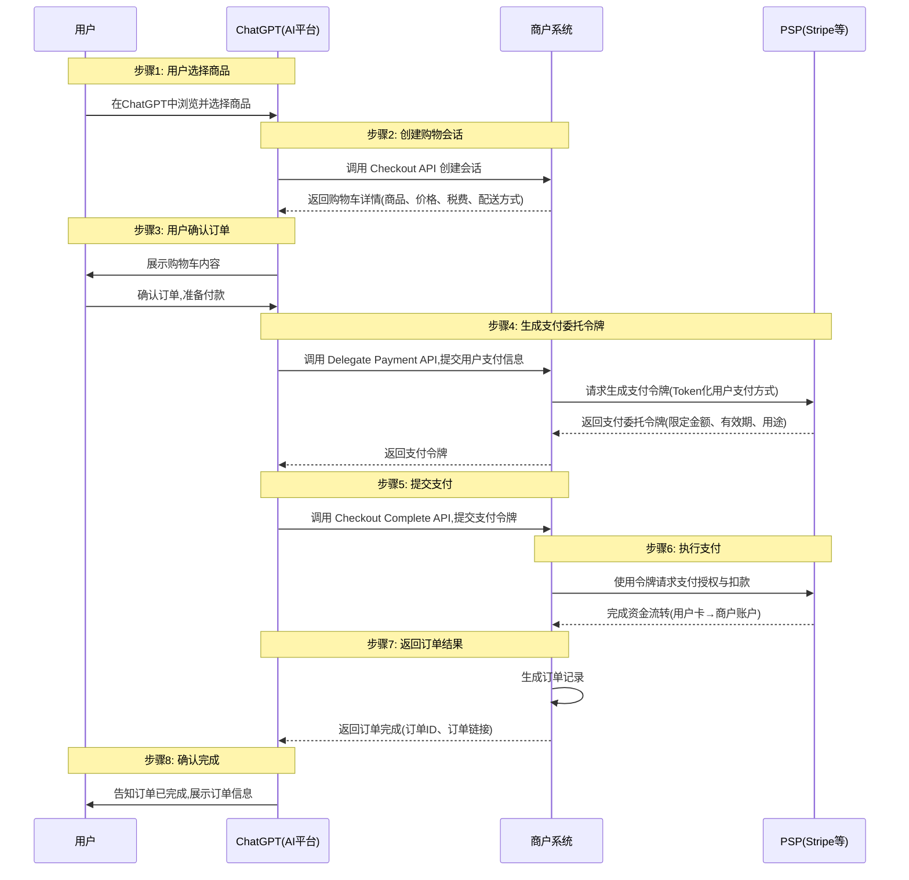

<!-- translation-review: full; source=blogs/cn/06-OpenAI联手Stripe发布ACP协议，用智能体商务颠覆传统电商.md -->
> 日本語参考訳（原文全文照合・校閲済み）。機能、日付、競争評価は執筆当時の記述です。原文のAWS表記と、決済委任の手順に関する未確認の注記を保持しています。
> 原文: [blogs/cn/06-OpenAI联手Stripe发布ACP协议，用智能体商务颠覆传统电商.md](../../../blogs/cn/06-OpenAI联手Stripe发布ACP协议，用智能体商务颠覆传统电商.md) / 基準コミット: `0837cfdfaf4ddcf834f0890ddaf34fc4c824e066`

# OpenAIとStripeがACPを公開――エージェント商取引で従来の電子商取引を変える

従来の電子商取引の生態系に、亀裂が生じ始めています。将来のエージェント商取引は、単なる電子商取引とAIの組み合わせではなく、AIを前提とする生態系の構築です。

## はじめに

9月16日から29日までのわずか2週間に、Google、OpenAI、そしてあるスタートアップが、取引や支払いに関するAP2、ATXP、ACPを相次いで公開しました。

現在の業界の話題の中心ではなくても、プロトコルの可能性は大きく過小評価されています。私は多くの場で、**「プロトコルは、コンテキストを運ぶ最良の器である」**と話しています。大企業の相次ぐ公開は、この技術が速く進んでいることを示します。

ACPは、Agentic Commerce Protocolの略です。[Google AP2の解説記事](04-深度解读谷歌最新发布的AP2.md)で紹介したAgent Commerceという概念を、OpenAIは直接プロトコル名に使いました。

**巨大企業もエージェント商取引を認識し、従来の電子商取引を変える新しい生態系を作り始めた**ことが分かります。

本稿ではACPを紹介し、AP2、ATXP、ANPの取引プロトコルと比較して、業界への影響を予測します。

関連資料：
[OpenAI ACP](https://github.com/agentic-commerce-protocol/agentic-commerce-protocol/)
[Google AP2の解説](https://mp.weixin.qq.com/s/Up-DQi2qbU2ngqo401HbQw)
[ATXPの解説](https://mp.weixin.qq.com/s/Hci06uO7gua8mqHphr8N0g)
[ANP取引方式の解説](https://mp.weixin.qq.com/s/wFVUDs31e6CKLpu8F3LDWg)

## 本稿の主な要点

時間がなければ、以下をご覧ください。

- **ACPは、ChatGPTの利用者が、その中で直接商品を購入できるよう、素早い実用化を目指したプロトコルです**。ChatGPTが、製品と生態系の先頭に立ち続けることが目的です。
- 既存の商取引の生態系にAIアプリを接続し、商店や決済の仕組みを大きく変えずに購入を実現します。
- AP2が取引の中心的な信頼の問題を、ATXPが少額決済を扱う一方、ACPは早期の実用化を重視します。
- ACPの信頼は、ChatGPTや既存の商取引の評判に依存します。この点では、AP2とANPの設計の方がよいと考えます。
- ACPは、身元の問題も解決しておらず、A2Aと同様に帯域外の身元を使います。消費者分野では接続費用を増やすため、よい方法ではありません。私たちはDIDが最適であり、AP2ともよく組み合わせられると考えています。
- AP2、ATXP、ACPは、エージェント商取引を表舞台へ押し出しました。巨大企業も、従来の商取引を変える機会を見ているのでしょう。
- ほかのAIアプリも追随するでしょうが、身元による接続費用など、基盤はまだ不十分です。新しい基盤が必要であり、その中心がプロトコルです。
- 従来の生態系に亀裂が現れ、新しい生態系が育っています。それは既存の電子商取引へのAIの追加ではなく、エージェントを基盤とする再構築です。

## ACPの詳細

### 背景

OpenAIは、AIが推薦するだけでなく、注文・支払い・取引まで代行する、「会話の中で直接買う」体験を望んでいます。この需要から、ChatGPT内でEtsyの商品を買えるInstant Checkoutを公開し、背後の標準ACPをオープンソース化しました。

その理念は、「買う物を見つけるだけでなく、購入の実行も手伝う」です。AI、利用者、商店の協力には、安全性と商店の制御権を両立する標準が必要です。ACPは、AIが安全に注文を開始できる標準インターフェースを設けながら、商店自身の注文・決済・履行システムを維持します。

Stripeの公式説明では、OpenAIと共同設計した公開標準であり、商店が既存の決済・注文システムを制御したまま、AI経由の新しい販路に進出するためのものです。

### ACPとは

AIによる買い物向けの公開標準です。購入手続きセッション（checkout session）、支払い資格情報の委任（delegate payment）、webhookなどを定義します。AIがWebやアプリと同様に商店のシステムで購入できるようにする一方、安全で、制御可能で、規則に適合することを前提とします。

複数の下位プロトコル（RFC）で構成され、中心となるのはAgentic CheckoutとDelegate Paymentです。両者が協働して、AIによる取引の開始、管理、完了を安全に実現します。

### 中心的な流れ

#### 役割

- **利用者**：ChatGPTで注文し、支払う最終消費者です。
- **ChatGPT（AIプラットフォーム）**：精算を開始し、カートを表示し、支払いトークンを提出します。
- **商店（Merchant）**：ホテルやECサイトなどです。注文、在庫、発送を管理する、取引の最終的な記録システムです。
- **PSP（Stripeなどの決済事業者）**：実際のカード番号・ウォレットなどの決済データを扱い、資金を決済します。

#### やり取りの手順

1. **商品を選ぶ**

利用者がChatGPTで商品やホテルの部屋を選ぶと、精算が始まります。

2. **商店のCheckout APIを呼ぶ**

ChatGPTがCheckout Sessionの作成を要求し、商店が商品、価格、税、配送方法などのカート情報を返します。

3. **注文を確認する**

利用者がChatGPTでカートを確認し、支払いに進みます。

4. **商店がDelegate Payment Tokenを作る**

ChatGPTが商店のDelegate Payment APIに利用者の決済情報を渡し、商店がPSPのAPIを使って、クレジットカードなどの支払い手段をトークン化します。トークンは金額、有効期限、用途を制限します。（この手順は、公式文書が明確でないため、再確認が必要です。）

5. **支払いを提出する（Complete）**

Checkout Complete APIを呼ぶ際、payment_data.tokenとしてトークンを商店に渡します。

6. **商店がPSPを呼ぶ**

商店がトークンでStripeなどに認証と引き落としを要求し、PSPが利用者のカードから商店の口座へ資金を移します。

7. **商店が結果を返す**

支払い成功を確認し、注文を作り、注文IDとリンクを返します。

8. **利用者に完了を知らせる**

ChatGPTが、注文完了を通知します。

#### フロー図

### AP2、ATXP、ANPとの比較

ACPには、AP2やANPのように、エージェント取引の信頼そのものを解決する設計は見当たりません。AIと既存の商店システムを接続する、実用的で商取引中心の方法です。信頼は、ChatGPTやShopifyなどの評判に依存します。問題があれば、それらが解決してくれると信じる仕組みです。

AP2とANPは、分散環境で検証可能な資格情報を使い、信頼の土台を作ろうとします。技術面では、その方法をより有望だと考えます。ただし、ACPが先にChatGPTの生態系を作り、改善を続ける道もあります。

ATXPは微小決済を目指し、ほかとは少し異なります。まだ詳細を見ていないため、ここでは深入りしません。

## 業界への影響

### エージェント商取引が現実に

ACPとChatGPTの新機能の最大の意味は、**Agent Commerceが、概念から現実になったこと**です。

ChatGPTで直接購入でき、ブラウザーでサイトを訪れるより円滑なら、従来のやり取りの方法は挑戦を受けます。

現時点では単品購入だけという単純な機能でも、重要な出発点です。「会話して買う」方式が検証され、利用者が慣れれば、急速に普及する可能性があります。

### 既存プラットフォームへの挑戦

興味深い問いは、なぜChatGPTがAWSを選ばなかったか、ということです。

AIアプリの作るエージェント商取引の生態系は、従来の電子商取引プラットフォームと、事業モデルで本質的に衝突すると考えます。

例えば、利用者が皆ChatGPTで買えば、AWSは入り口を失い、単なる管路となって、現在得ている価値を失うのではないでしょうか。

中国でも、商取引プラットフォームと新しい個人アシスタントは、短中期に事業モデルで競合するでしょう。入り口の移動によって、AIアプリ中心の商取引が、従来の取引の連鎖を徐々に分解します。

新しい生態系は動き出しました。その発展を見守りましょう。
