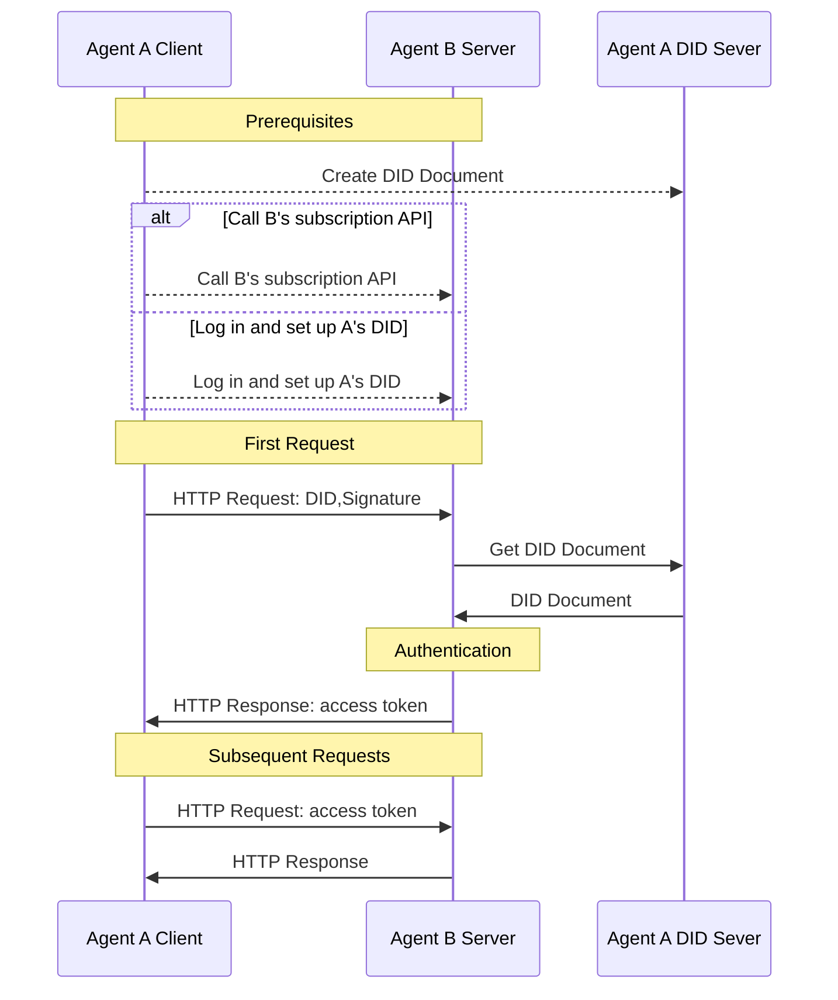

> 日本語参考訳（機械翻訳・未校閲）。規範となるのは原文です。コード例・識別子・規範キーワードは原文を保持しています。
> 原文: [blogs/cn/did-wba-基于web的去中心化身份标识符.md](../../../blogs/cn/did-wba-基于web的去中心化身份标识符.md) / 基準コミット: `0837cfdfaf4ddcf834f0890ddaf34fc4c824e066`

# do:wba-web ベースの集中識別子

## 1. 導入事例

w3C のデセントライズされた識別子 (ID) 標準下にあるドラフト法則です。[W3C のディド](https://www.w3.org/TR/did-core/)2022年にW3C推奨として発行された標準は、デジタルアイデンティティの暗黙と検証をサポートする新しいタイプの識別子です。 DIDに基づいて、ユーザーは自分のアイデンティティをマスターしたり、異なるアプリケーション間で相互運用性を向上させることができます。 DIDは、Blueskyを含む多くのアプリケーションで広く使用されています。

DIDのコアコンポーネントは、DID所有者のアイデンティティを認証するために使用されるパブリックキーなど、特定のDIDに関連する重要な情報を含むDID文書です。 DDメソッドは、DIDドキュメントを作成、保存、更新、および削除する方法を定義します。

設計しました。[ド: wba メソッド](../../chinese/03-did-wba方法规范.md)id:wba アプローチは、既存の成熟した技術と Web インフラストラクチャのフル活用を可能にします。これにより、現在のシステムの完全な再エンジニアリングなしで簡単に集中化できます。各プラットフォームは、プラットフォームを接続するために、各ユーザがそれぞれに dwba DID を作成しながら、一元化された方法で独自のアカウントシステムを管理できます。

id:wbaメソッドを使用してアイデンティティシステムは、電子メールに似た操作特性を可能にし、各プラットフォームには集中的にアカウントシステムが搭載されています。同時に接続されます。

API キーは、:wba メソッドがより安全です。OpenID Conect は、次のようにしました。wba メソッドはシンプルで中央のものではありません。それら間の詳細な比較が見つかります。[行う: wba 対 OpenID 連絡先、API キー](did:wba对比OpenID%20Connect、API%20keys.md)。

方法: wba メソッドは OpenID Conect と同じセキュリティを持っています。[ド: wba セキュリティ元の理解](did-wba安全性原理解析.md)。

## 2. DID ドキュメント

以下は、dwbaメソッドを使用する。最低のdid文書は以下のとおりです。

```json
{
    "@context": [
      "https://www.w3.org/ns/did/v1",
      "https://w3id.org/security/suites/jws-2020/v1",
      "https://w3id.org/security/suites/secp256k1-2019/v1",
      "https://w3id.org/security/suites/ed25519-2020/v1",
      "https://w3id.org/security/suites/x25519-2019/v1"
    ],
    "id": "did:wba:example.com%3A8800:user:alice",
    "verificationMethod": [
      {
        "id": "did:wba:example.com%3A8800:user:alice#WjKgJV7VRw3hmgU6--4v15c0Aewbcvat1BsRFTIqa5Q",
        "type": "EcdsaSecp256k1VerificationKey2019",
        "controller": "did:wba:example.com%3A8800:user:alice",
        "publicKeyJwk": {
          "crv": "secp256k1",
          "x": "NtngWpJUr-rlNNbs0u-Aa8e16OwSJu6UiFf0Rdo1oJ4",
          "y": "qN1jKupJlFsPFc1UkWinqljv4YE0mq_Ickwnjgasvmo",
          "kty": "EC",
          "kid": "WjKgJV7VRw3hmgU6--4v15c0Aewbcvat1BsRFTIqa5Q"
        }
      }
    ],
    "authentication": [
      "did:wba:example.com%3A8800:user:alice#WjKgJV7VRw3hmgU6--4v15c0Aewbcvat1BsRFTIqa5Q",
      {
        "id": "did:wba:example.com%3A8800:user:alice#key-1",
        "type": "Ed25519VerificationKey2020",
        "controller": "did:wba:example.com%3A8800:user:alice",
        "publicKeyMultibase": "zH3C2AVvLMv6gmMNam3uVAjZpfkcJCwDwnZn6z3wXmqPV"
      }
    ],
    "keyAgreement": [
      {
        "id": "did:wba:example.com%3A8800:user:alice#key-2",
        "type": "X25519KeyAgreementKey2019", 
        "controller": "did:wba:example.com%3A8800:user:alice",
        "publicKeyMultibase": "z9hFgmPVfmBZwRvFEyniQDBkz9LmV7gDEqytWyGZLmDXE"
      }
    ]
}
```

これらのうち、システム内の公開鍵は認証に使用されます。つまり、正しいDID文書が他の当事者によって安全に入手できると、正しい公開鍵を得ることができます。

DID 文書の作成、更新、および再編は、DID ドキュメントをサーバーまたはサードパーティ サーバーに保存するかを選択するかを選択することで、ユーザーの独自の裁量に残されます。

同時に、ユーザーは、他のユーザーが自分の DID ドキュメントを安全に取得できるようにする HTTP メソッドを提供する必要もあります。 DIDドキュメントを取得するためのHTTPアドレスはDIDから変換できます。つまり、ユーザーは DID を持っている限り、HTTP を使用して対応する DID ドキュメントを取得できます。変換方法は以下のとおりです。

```plaintext
示例：
did:wba:example.com:user:alice
 -> https://example.com/user/alice/did.json
```

## 2. クロスプラットフォームの ID 認証プロセス

Did:wba を HTTP プロトコルと組み合わせて使用すると、ID 認証、権限認証、データ交換、その他の操作を 1 つの HTTP リクエストで完了できます。追加のインタラクションは追加されません。以下は、did:wba と HTTP プロトコルの対話プロセスです。



1. 前提条件:
  - ユーザー A は DID を作成し、DID ドキュメントをエージェント A の DID サーバーに保存します。
  - エージェント B にエージェント A の DID を知らせる必要があります。これを実現するには 2 つの方法があります。次の 2 つの方法のいずれかを選択します。
    - ユーザー A がエージェント B のシステムにログインし、A の DID を設定します。
    -  または、エージェント B のサブスクリプション API を呼び出し、サブスクリプション DID を A の DID に設定します。 ** この方法により、2 つのエージェント間の接続コストを大幅に削減できます。 **

2. 認証プロセス:
  - エージェント A はクライアントとして機能し、HTTP リクエストを開始します。リクエストには、リクエスト データに加えて、DID、ノンス、タイムスタンプ、署名などの情報も含まれます。
  -  エージェント B はサーバーとしてリクエストを受信した後、リクエスト ヘッダーから DID、ノンス、タイムスタンプ、署名などの情報を抽出します。
  - エージェント B は、DID に基づいてエージェント A の DID サーバーから DID ドキュメントを読み取ります。
  - エージェント B は、DID 文書内の公開キーを使用してクライアントの署名を検証します。
  -  検証に合格した後、エージェント B はクライアントのビジネス リクエストを処理し、同時にビジネス データとトークンを返します。
  - エージェント A は後続のリクエストでトークンを運び、エージェント B はトークンを検証することでクライアントの ID 認証を完了します。

プロセス全体から、HTTP を使用することで、did:wba はインタラクションの数を増やすことなく ID 認証を完了できることがわかります。そして、2 つのエージェント (またはアプリケーション) 間の通信プロセス中に、イニシエーターが相手方のサブスクリプション インターフェイスを直接呼び出してサービスにサブスクライブすることがわかります。手動で相手のシステムにアクセスして登録する必要はありません。これにより、2 つのエージェント間の相互接続のしきい値が低くなります。

## 3. ユースケース


1. ユースケース 1: ユーザーがアシスタントを通じて他の Web サイト上のファイルにアクセスする

Alice は example.com ウェブサイトにファイルを保存し、後で知能アシスタントを通じてアクセスしたいと考えていました。そのため、Alice はスマートアシスタントの do:wba メソッドに基づいて DID を作成して、例.com に入力し、DID を独自のアカウントにリンクし、DID へのアクセスをファイルに与えました。セットアップすると、スマートアシスタントは、ID を使用して例.comにアクセスすることができます。これにより、スマートアシスタントが識別後に保存されたアリスのファイルにアクセスできるようになります。この DID は他のウェブサイトから別のドキュメントにアクセスすることもできます。

2. 例2:スマートアシスタントAPIによる他のプラットフォームサービスへの呼び出し

アリスは、インテリジェンスアシスタントを通じてサードパーティのサービス API を呼び出すことを望んでいます。まず、Alice はスマートアシスタントの do:wba メソッドに基づいて DID を作成し、この DID を使用して、API インターフェイスを使用して、例プラットフォームに関連するサービスを注文します。例サービスは DID による識別を実行し、購入者を Alice と彼女の DID として識別します。

> クライアント・ツー・サービス・アイデンティティは、現在の例にリストされていないため、このプロセスは実際には機能しています。


## 4. 郵便番号

弊社では、より詳細な情報を提供して開発・公開しております。[https://github.com/agent-network-protocol/AgentConnect/blob/master/README.md#decentralized-authentication-based-on-didwba-and-http](https://github.com/agent-network-protocol/AgentConnect/blob/master/README.md#decentralized-authentication-based-on-didwba-and-http)

## 5. リファレンス

[d:wbaメソッド仕様](https://github.com/agent-network-protocol/AgentNetworkProtocol/blob/main/chinese/03-did%3Awba%E6%96%B9%E6%B3%95%E8%A7%84%E8%8C%83.md)

[ダイコア](https://www.w3.org/TR/did-core/)

[エージェントネットワークプロトコル技術ホワイトペーパー](https://github.com/agent-network-protocol/AgentNetworkProtocol/blob/main/chinese/01-AgentNetworkProtocol%E6%8A%80%E6%9C%AF%E7%99%BD%E7%9A%AE%E4%B9%A6.md)

## コンテンツの著作権について
社会貢献活動の推進に関する基本方針 _ ANPコミュニティ
このファイルは、以下のとおりです。 [MITライセンス](../../../blogs/cn/LICENSE). . . 無料で利用して変更することができますが、この著作権表示を保ちなければなりません。
