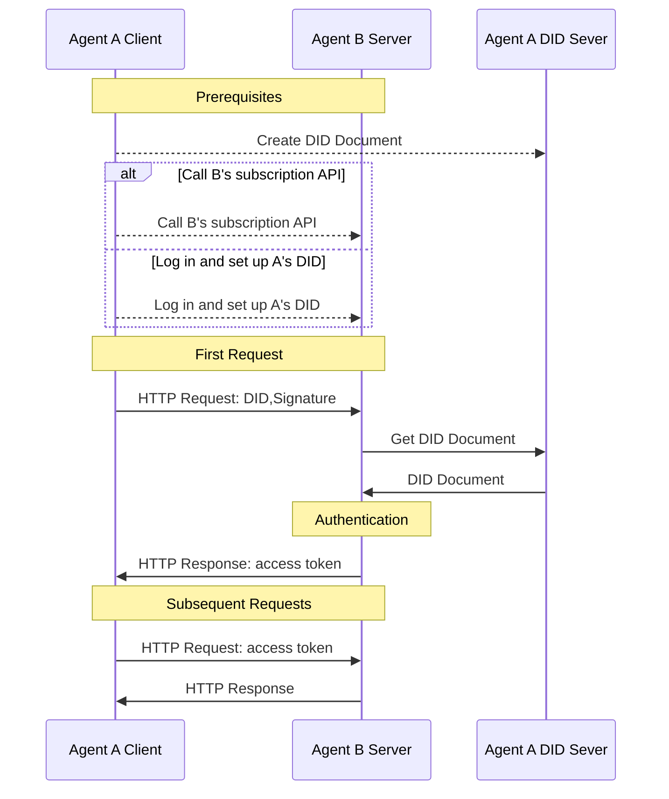

<!-- translation-review: full; source=blogs/cn/did-wba-基于web的去中心化身份标识符.md -->
> 日本語参考訳（原文全文照合・校閲済み）。草案の位置付け、認証例、技術上の主張は原文当時のままです。
> 原文: [blogs/cn/did-wba-基于web的去中心化身份标识符.md](../../../blogs/cn/did-wba-基于web的去中心化身份标识符.md) / 基準コミット: `0837cfdfaf4ddcf834f0890ddaf34fc4c824e066`

# did:wba — Webを基盤とする分散型識別子

## 1. はじめに

did:wba方式は、W3Cの分散型識別子（DID）の標準に基づく、方式の仕様の草案です。[W3C DIDs](https://www.w3.org/TR/did-core/)は、2022年にW3C勧告となった標準で、検証可能な、分散型のデジタルアイデンティティを実現する、新しい種類の識別子です。DIDによって、利用者は自分のアイデンティティを実際に管理でき、アプリケーション間の相互運用性も高められます。Blueskyを含む、多くのアプリケーションで広く採用されています。

DIDの中心となる要素は、DID文書です。特定のDIDに関する重要な情報、例えば、所有者の本人確認に使う公開鍵が含まれます。DID方式は、その文書を、作成、保存、更新、失効させる方法を定義します。

私たちは、[did:wba方式](../../chinese/03-did-wba方法规范.md)を設計しました。既存の成熟した技術とWeb基盤を十分に利用し、システム全体を作り直すことなく、分散型の本人認証を容易に実現できます。各プラットフォームは、アカウントを集中管理しながら、利用者ごとにdid:wba DIDを作成し、プラットフォーム間の相互接続を実現できます。

did:wbaのアイデンティティシステムは、電子メールに似た特徴を持てます。各プラットフォーム内では、集中管理されたアカウントシステムを実装し、同時に、プラットフォーム同士を相互接続できます。

APIキーに比べると、did:wbaはセキュリティに優れます。OpenID Connectと比べると、やり取りが単純で、分散性が高くなります。詳しくは、[did:wbaとOpenID Connect、APIキーの比較](did-wba对比openid-connect、api-keys.md)を参照してください。

did:wbaは、OpenID Connectと同等のセキュリティも備えます。[did:wbaのセキュリティ原理](did-wba安全性原理解析.md)で説明しています。

## 2. DID文書

did:wba方式の基本的なDID文書は、次のようになります。

```json
{
    "@context": [
      "https://www.w3.org/ns/did/v1",
      "https://w3id.org/security/suites/jws-2020/v1",
      "https://w3id.org/security/suites/secp256k1-2019/v1",
      "https://w3id.org/security/suites/ed25519-2020/v1",
      "https://w3id.org/security/suites/x25519-2019/v1"
    ],
    "id": "did:wba:example.com%3A8800:user:alice",
    "verificationMethod": [
      {
        "id": "did:wba:example.com%3A8800:user:alice#WjKgJV7VRw3hmgU6--4v15c0Aewbcvat1BsRFTIqa5Q",
        "type": "EcdsaSecp256k1VerificationKey2019",
        "controller": "did:wba:example.com%3A8800:user:alice",
        "publicKeyJwk": {
          "crv": "secp256k1",
          "x": "NtngWpJUr-rlNNbs0u-Aa8e16OwSJu6UiFf0Rdo1oJ4",
          "y": "qN1jKupJlFsPFc1UkWinqljv4YE0mq_Ickwnjgasvmo",
          "kty": "EC",
          "kid": "WjKgJV7VRw3hmgU6--4v15c0Aewbcvat1BsRFTIqa5Q"
        }
      }
    ],
    "authentication": [
      "did:wba:example.com%3A8800:user:alice#WjKgJV7VRw3hmgU6--4v15c0Aewbcvat1BsRFTIqa5Q",
      {
        "id": "did:wba:example.com%3A8800:user:alice#key-1",
        "type": "Ed25519VerificationKey2020",
        "controller": "did:wba:example.com%3A8800:user:alice",
        "publicKeyMultibase": "zH3C2AVvLMv6gmMNam3uVAjZpfkcJCwDwnZn6z3wXmqPV"
      }
    ],
    "keyAgreement": [
      {
        "id": "did:wba:example.com%3A8800:user:alice#key-2",
        "type": "X25519KeyAgreementKey2019", 
        "controller": "did:wba:example.com%3A8800:user:alice",
        "publicKeyMultibase": "z9hFgmPVfmBZwRvFEyniQDBkz9LmV7gDEqytWyGZLmDXE"
      }
    ]
}
```

authenticationの公開鍵は、本人確認に使います。相手が正しいDID文書を安全に取得できれば、正しい公開鍵を得られます。その公開鍵で利用者の署名を検証し、本人であることを確かめられます。

DID文書の作成、更新、失効は、利用者自身が決めます。例えば、自分のサーバーに保存しても、第三者のサーバーに保存してもかまいません。保存場所にかかわらず、利用者がDID文書を管理する権限を保つ必要があります。

また、自分のDID文書を、ほかの人が安全に取得できるHTTPの方法を提供する必要があります。取得先のHTTPアドレスは、DIDから求められます。つまり、DIDが分かれば、対応する文書をHTTPで取得できます。変換方法は、次のとおりです。

```plaintext
示例：
did:wba:example.com:user:alice
 -> https://example.com/user/alice/did.json
```

## 2. プラットフォームをまたぐ本人認証の流れ

did:wbaとHTTPを組み合わせると、余分なやり取りを増やさず、一つのHTTPリクエストで、本人認証、権限の確認、データ交換を完了できます。流れは、次のとおりです。



1. 前提条件：
   - 利用者AがDIDを作成し、エージェントAのDIDサーバーに文書を保存します。
   - エージェントBが、AのDIDを知る必要があります。次の二つの方法の、どちらかを使えます。
     - 利用者Aが、Bのシステムにログインし、AのDIDを設定する。
     - Bのサービス登録APIを呼び出し、登録するDIDをAのものにする。**この方法は、二つのエージェントが接続するコストを、大幅に減らせます。**

2. 本人認証の手順：
   - エージェントAは、クライアントとしてHTTPリクエストを送ります。リクエストのデータに加え、DID、nonce、タイムスタンプ、署名などを含めます。
   - エージェントBは、サーバーとして受信し、ヘッダーから、それらの情報を取り出します。
   - Bは、DIDを使って、AのDIDサーバーから文書を取得します。
   - Bは、その文書の公開鍵で、クライアントの署名を検証します。
   - 成功すれば、業務のリクエストを処理し、データとトークンを返します。
   - その後、Aはリクエストにトークンを付け、Bは、トークンの検証で、クライアントの本人認証を行います。

このように、HTTPを使えば、did:wbaは、やり取りの回数を増やさずに、本人認証を行えます。また、二つのエージェントやアプリケーションが通信するとき、相手のサービス登録インターフェースを直接呼び出して、サービスを登録できます。相手のシステムへの、人による登録は不要です。これにより、エージェント間の相互接続の障壁を下げます。

## 3. 利用例

1. 利用例1：知的アシスタントを通じて、別のウェブサイトのファイルにアクセスする。

Aliceは、example.comにファイルを保存しており、後で、知的アシスタントからアクセスしたいと考えます。まず、アシスタント上でdid:wbaのDIDを作成し、example.comにログインして、そのDIDを自分のアカウントと関連付け、ファイルへのアクセス権を与えます。設定後、アシスタントは、そのDIDでexample.comにログインできます。本人確認の後、example.comは、Aliceのファイルへのアクセスを許可します。同じDIDを別のサイトにも設定すれば、異なるプラットフォームのファイルにアクセスできます。

2. 利用例2：知的アシスタントを通じて、第三者のサービスAPIを呼び出す。

Aliceは、アシスタントを通じて、exampleという第三者のサービスのAPIを呼び出したいと考えます。まず、アシスタント上でdid:wbaのDIDを作り、そのDIDでAPIを呼び出し、exampleのサービスを申し込みます。exampleは、DIDによって本人認証を行い、購入者がAliceだと確認して、そのDIDを記録します。認証後、Aliceは、アシスタントを通じ、そのDIDで、exampleのAPIを呼び出して操作できます。

> この利用例では、クライアントがサーバーを認証する処理を示していませんが、そのような処理も実行できます。

## 4. コード

開発は完了しており、オープンソースで公開しています。詳細はこちらです：[https://github.com/agent-network-protocol/AgentConnect/blob/master/README.md#decentralized-authentication-based-on-didwba-and-http](https://github.com/agent-network-protocol/AgentConnect/blob/master/README.md#decentralized-authentication-based-on-didwba-and-http)。

## 5. 参考資料

[did:wba Method Specification](https://github.com/agent-network-protocol/AgentNetworkProtocol/blob/main/chinese/03-did%3Awba%E6%96%B9%E6%B3%95%E8%A7%84%E8%8C%83.md)

[DID-CORE](https://www.w3.org/TR/did-core/)

[AgentNetworkProtocol Technical White Paper](https://github.com/agent-network-protocol/AgentNetworkProtocol/blob/main/chinese/01-AgentNetworkProtocol%E6%8A%80%E6%9C%AF%E7%99%BD%E7%9A%AE%E4%B9%A6.md)

## 著作権表示
Copyright (c) 2024 ANP Community  
このファイルは[MIT License](../../../LICENSE)のもとで公開されています。自由に利用・変更できますが、この著作権表示を保持する必要があります。
