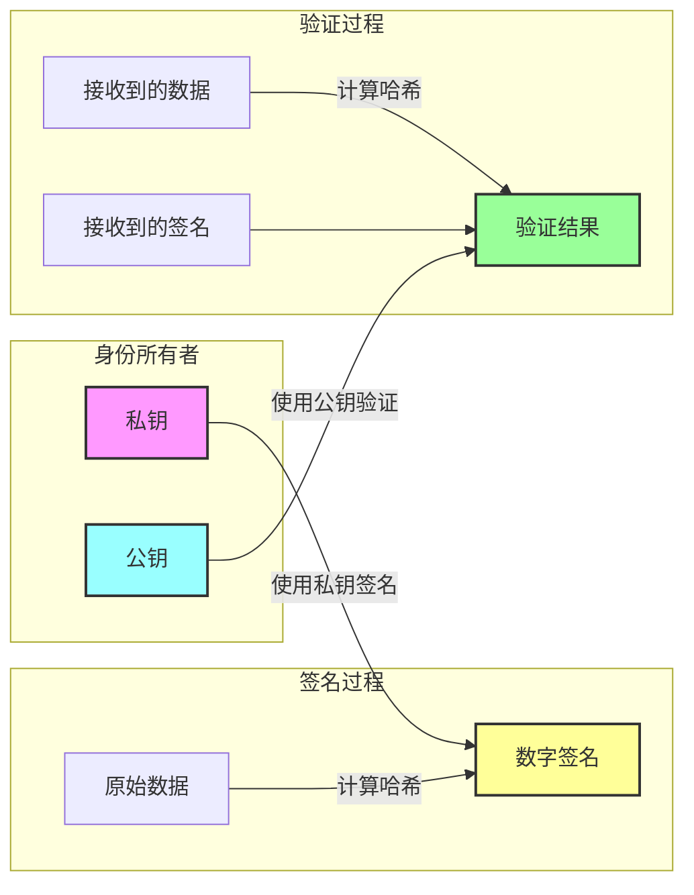

<!-- translation-review: full; source=blogs/cn/did-wba安全性原理解析.md -->
# did:wbaのセキュリティ原理

Webを基盤とする分散型識別子の方式であるdid:wbaは、セキュリティの設計を中核的な特徴の一つとしています。この記事では、did:wbaのセキュリティ原理を詳しく説明し、信頼できる安全な本人確認をどのように実現するかを分析します。

did:wbaの関連資料：
- did:wba仕様：[did:wba仕様](https://github.com/agent-network-protocol/AgentNetworkProtocol/blob/main/chinese/03-did%3Awba%E6%96%B9%E6%B3%95%E8%A7%84%E8%8C%83.md)
- did:wbaの簡単な紹介：[did:wba — Webを基盤とする分散型識別子](https://github.com/agent-network-protocol/AgentNetworkProtocol/blob/main/blogs/did%3Awba-%E5%9F%BA%E4%BA%8Eweb%E7%9A%84%E5%8E%BB%E4%B8%AD%E5%BF%83%E5%8C%96%E8%BA%AB%E4%BB%BD%E6%A0%87%E8%AF%86%E7%AC%A6.md)
- ほかの方式との比較：[did:wbaとOpenID Connect、APIキーの比較](https://github.com/agent-network-protocol/AgentNetworkProtocol/blob/main/blogs/cn/did%3Awba%E5%AF%B9%E6%AF%94OpenID%20Connect%E3%80%81API%20keys.md)

## 1. セキュリティの基盤：非対称暗号

did:wbaのセキュリティは、主に非対称暗号を基盤としています。この暗号方式では、一組の鍵を使います。

- 秘密鍵：識別情報の所有者だけが保持し、署名に使います。
- 公開鍵：公開して共有でき、署名の検証に使います。



この暗号の仕組みによって、次のことが保証されます。
1. 有効な署名を生成できるのは、秘密鍵の保持者だけです。秘密鍵は秘密に保つ必要があります。
2. 公開鍵を使えば、誰でも署名の真正性を検証できます。検証が成功すれば、その署名が秘密鍵の保持者によって生成されたことを確認できます。
3. 公開鍵から秘密鍵を導出することはできません。鍵の組は一緒に生成されますが、公開鍵から秘密鍵が明らかになることはありません。

## 2. DID Documentの安全性の確保

上の処理から、did:wbaの安全性を確保するうえで、二つの点が重要だと分かります。

1. 秘密鍵を秘密に保つこと。
2. 検証者が正しい公開鍵を取得すること。

did:wbaでは、利用者が自分の秘密鍵を管理し、公開鍵はDID Documentに格納されます。DID Documentは利用者のDIDサーバーに保存され、DIDから生成したURLを使って、誰でもHTTPS経由でアクセスできます。

根本的には、正しいDID Documentを取得できれば、相手の識別情報を検証できます。did:wbaでは、ドメインの名前解決にDNS-over-HTTPSを使い、HTTPSでDID Documentにアクセスし、安全な暗号アルゴリズムと厳格な証明書検証を採用することを推奨しています。これらを実施すれば、利用者が正しいDID Documentを取得し、相手の識別情報を検証できることを保証できます。

## 3. 本人確認処理のセキュリティ

did:wbaの本人確認処理には、複数のセキュリティ機構が組み込まれています。

### 3.1 リクエストの署名機構

各認証リクエストには、次の内容が含まれます。
```
Authorization: DID <did> Nonce <nonce> Timestamp <timestamp> VerificationMethod <key-id> Signature <signature>
```

構成要素は次のとおりです。
- Nonce：リプレイ攻撃を防ぐための乱数。
- Timestamp：リクエストの時刻の妥当性を確保します。
- Signature：重要な情報に署名します。

### 3.2 セキュリティ対策

1. **リプレイ攻撃の防止**：
   - リクエストごとに一意のnonceを生成する。
   - nonceを一度しか使えない方針にする。
   - サーバー側で使用済みnonceのブラックリストを管理する。

2. **タイムスタンプの検証**：
   - リクエストの有効期間を制限する。
   - 過去のリクエストの再送を防ぐ。
   - サーバー側でタイムスタンプが妥当か確認する。

3. **ドメインの検証**：
   - 署名対象のデータにサーバーのドメインを含める。
   - 別のサービスで署名が再利用されることを防ぐ。

4. **署名の検証**：
   - 署名の完全性を検証する。
   - 使用する鍵に権限があることを確認する。

## 4. 追加のセキュリティ上の考慮事項

### 4.1 秘密鍵の漏えい

秘密鍵が漏えいした場合、利用者は速やかに新しい鍵の組を生成し、DID Documentを更新する必要があります。DID Documentは利用者のDIDサーバーに保存されているため、すぐに更新できます。

### 4.2 定期的な鍵のローテーション

安全性を維持するため、秘密鍵は定期的にローテーションする必要があります。

## 結論

did:wbaの安全性は現代の暗号技術を基盤とし、非対称暗号、DID Documentの安全な保存と検証の処理、定期的な秘密鍵のローテーションを使って、信頼できる安全な本人確認を実現します。

その根本原理は、非対称暗号の強固な安全性にあります。基盤のレベルでは、新しい仕組みを導入するのではなく、DNS、公開鍵基盤、HTTPSプロトコルなど、既存の成熟したシステムに依存します。

## 著作権表示
Copyright (c) 2024 ANP Community  
このファイルは[MIT License](../../../LICENSE)のもとで公開されています。自由に利用・変更できますが、この著作権表示を保持する必要があります。
