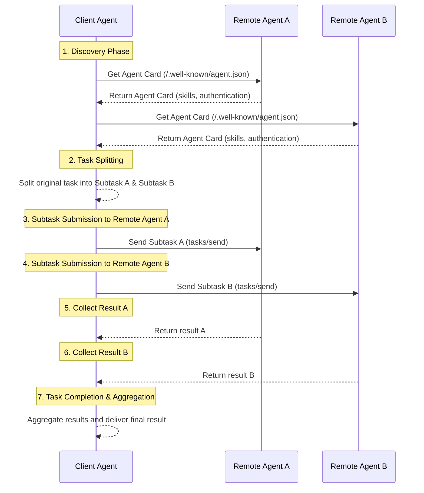

> 日本語参考訳（機械翻訳・未校閲）。規範となるのは原文です。コード例・識別子・規範キーワードは原文を保持しています。
> 原文: [blogs/cn/深入对比MCP、A2A、ANP的交互模式.md](../../../blogs/cn/深入对比MCP、A2A、ANP的交互模式.md) / 基準コミット: `0837cfdfaf4ddcf834f0890ddaf34fc4c824e066`

# MCP、A2A、ANPの相互作用の詳細な比較:情報がどのように整理されるかの違い

今回は、MCP、A2A、ANPシリーズの3つ目の記事です。
- [A2A、ANP、MCP。](多角度全面对比Google最新的A2A、ANP、MCP.md)
- [Google A2AとANP:合意の元を見つける](深入对比谷歌A2A与ANP：找到协议的原点.md)

この記事では、各合意の対話モードの違いの詳細な比較を提供し、ツールやスマートボディがその情報を整理する方法を決定します。これにより、それが処理された方法と相互作用の特徴が決定されます。

**まずは結論に来る。**：

- **MCP(リモートコール)**:serverは、この情報をモデルに送信するツールとリソースの完全なリストを直接リリースし、特定のツールを呼び出したり、RPCを介して特定のリソースにアクセスしたりします。

- **A2A(ショートイン)**: Smarts は、概要で自分の能力を表示し、クライアントインテリジェンスは複雑なタスクをサブミッションに分割し、結果の最終統合のための適切な専門知識を持つインテリジェントなボディに割り当てます。

- **ANP(データクローリング)**スマートスは、独自の情報とインターフェイスをURLにリンクしたデータネットワークに整理します。, ウェブ爬虫類などのクライアントインテリジェンス, ドキュメントエントリの説明から始まります, 需要に関する情報を取得し、ローカルで意思決定を行う, そして、最終的に検出されたインタフェースを介して動作.

**3つのコアの違い。**：

- **A2A 対 MCP**A2Aは実現の細部をカバーし、クライアントはそれをする方法ではなく、単にミッションと期待する結果を送信して、何をするかだけに関係しています。

- **ANP対MCP**MCP は、すべてのツール/リソースを一度返し、ANP は階層的なリンクと説明のみを提供し、インテリジェントなボディがニーズに基づいて情報を探索およびアクセスできるようにします。

- **ANP対A2A**どちらもインテリジェントな身体の相互作用に取り組むが、A2Aは複雑なタスク分解とコラボレーションに焦点を当てており、ANPは情報やローカル意思決定の柔軟なアクセスでプライバシーの開示リスクを削減するという点に重点を置いています。

ANAPは、現代のWeb技術に組み込まれており、APPプロトコルをサポートするスマートボディは、一般的にWebAgentと呼ばれています。

## MCP インタラクティブなアプローチ

MCP は、インタラクティブモデルの古典的なクライアントサーバ (C/S) 構造を使用します。初期リクエストでは、ツールやリソースなどのサポートを含む相互のコンピテンシーが交渉されます。

サーバは、一般的に、ツール/リストとリソース/リストの2つのコアインターフェイスをサポートしています。これにより、クライアントがすべてのツールやリソースに関する情報にアクセスすることができます。これには、メタデータ、すなわち、その機能およびそれらへのアクセス方法、ならびにリソースに関する詳細な情報についてモデルを通知するために、ツールとリソースの説明が含まれます。

モデルは、異なるツールを使用して、さまざまなリソースを読み込む、ニーズに合わせて調整されます。

ツールを例にすると、次の対話セッションが開かれました。

このインタラクティブモードでは、サーバーはパッシブパーティーとして、クライアントのモデルを決定するためのツールとリソースを提供します。

## A2A インタラクティブなアプローチ

A2Aは、柔軟なP2Pインタラクティブなアプローチです。このモードでは、インテリジェントボディ(クライアントエージェント)は、複数のインテリジェントボディ(移動エージェント)と直接連携して、小さなタスクに大きなタスクを分割し、他のスマートと連携して行うことができ、多くの専門家のアシスタントと協力して作業することができます。

対話的なプロセスは通常、次のようになります。
1.  **創業・選定**クライアントエージェントは、まず、現在のタスクに合ったリモートエージェントを見つけ、見つけ、見つける必要があります。これは、各エージェントの能力とサービスのリスト、スキルプロファイルのような複数のエージェントカードを問い合わせることができます。クライアントエージェントは、ミッション「s要件に応じて、最も適切なリモートエージェントの1つ以上を選択します。

2.  **ジョブスプリット(オプション)**: 複雑なタスクでは、クライアントエージェントは複数のサブタスクにそれらを分割することができます。

3.  **タスクの割り当てとコラボレーション**クライアントエージェントは、A2Aプロトコルの手段によって選択したリモートエージェントに接続し、対応する(サブ)ジョブリクエストを送信します。例えば、サブタスクAをリモートエージェントA、サブタスクBからリモートエージェントBに送信します。

4.  **多輪相互作用と結果の収集**: 各リモートエージェントは、そのタスクを独立して実行します。 そのため、複数のラウンドで聞き取りできるクライアントとやり取りし、進行に関するフィードバックを提供し、質問を明確にしたり、中間結果を返したりすることができます。 クライアントエージェントは、異なるリモートエージェントからフィードバックや結果を受け取ります。

5.  **結果の集計と完了**: サブタスクが完了すると、クライアントエージェントはリモートエージェントから結果を収集し、タスク全体の完全なソリューションで終わるように統合します。

通信プロセス全体には、ミッションコンテキストとステータストラッキングが含まれているため、特定の(サブ)タスクの周りの対話が順番に行われるようにします。

このモデルでは、Clarent Agent と Remote Agent のミッションは入力に基づいて行なわれ、タスクや結果の明確な説明によって達成されるコラボレーションが行われます。

## ANP インタラクティブなアプローチ

AFP(エージェントネットワーク制作)は、インテリジェントな身体間のコミュニケーションの問題解決の目標とP2Pインタラクティブなアプローチです。

- A2Aは、インテリジェントがタスクを分割し、実行のために他のスマートに割り当てる「タスクのサブコントラクト」モデルを使用します。
- AMP は、インテリジェントが他のスマートから情報を得るだけのデータ クライマー モードを使用して、独自の決定をローカルにし、API を通じて実行のために呼び出します。

ANPのコア機能は、リンクされたデータ技術を使用して、インテリジェントなボディのすべての機能、インターフェイス、情報をナビゲート可能なデータネットワークに整理することです。 これは、MCPが直接すべてのツールやリソースリストに返す方法とは異なります。

### ANP インタラクティブ・プロセス

AMP インタラクティブなプロセスは、Web ブラウリングの Web ページのようなものです。

1. **エントランスにビジュアルをつけました。**: スマートスイブは、まず別のスマートボディの「スマート説明文書」のURLを受け取ります(ウェブサイトのホームページのように)

2. **機能の検出**: スマートボディは、説明文書から各々のスキル、インターフェイス、利用可能なリソースを理解し、より詳細なドキュメントのURLリンク

3. **選択アクセス**: スマートボディは、現在のミッションニーズに応じて、関連するURLのみにアクセスし、必要な情報(それらすべてよりもむしろ)を取得します。

4. **再帰ナビゲーション **: 各ドキュメントには新しい URL リンクが含まれる場合があり、エージェントは必要に応じてナビゲートおよびプルを続行できます。

5. **ローカル意思決定**: 十分な情報を収集した後、エージェントは独自のモデルで論理的な判断と意思決定を行います

6. **インターフェース呼び出し**: 最後に、見つかった API インターフェースを通じて特定の操作を実行します

このアプローチの利点は、エージェントが本当に必要な情報のみを取得し、データ送信を節約し、意思決定の制御を自らの手で維持できることです。

## 情報の整理方法の違い

上で説明した対話方法の違いは、基本的に、各プロトコルがエージェントによって外部に開示される情報を編成する方法にあります。

- **MCP (すべてパブリック) **: すべてのツールとリソースのリストは RPC 呼び出しを通じて一度に公開され、クライアント エージェントは必要なツールを直接選択して呼び出すことができます。

- **A2A (能力カード) **: 特定の実装の詳細は開示せずに、エージェント カードを通じてエージェントのスキルと能力の概要を表示します。クライアントはタスクを送信して結果を待つだけで済みます。

- **ANP (Linked Network) **: Linked Data テクノロジーを使用してエージェントの情報をメッシュ構造に整理すると、クライアント エージェントは Web クローラーのようにオンデマンドで特定の情報を選択的に取得できます。

