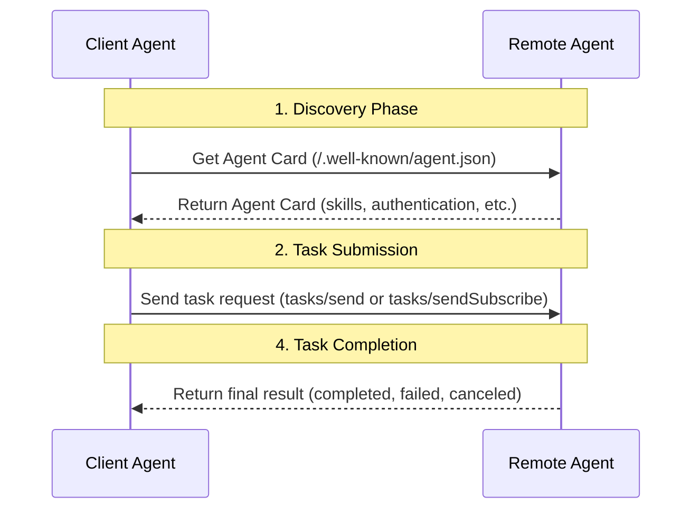
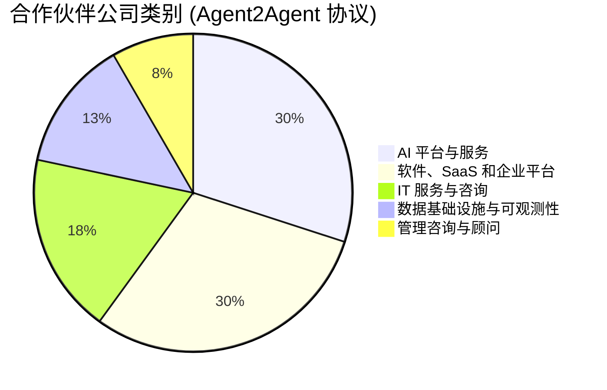

> 日本語参考訳（機械翻訳・未校閲）。規範となるのは原文です。コード例・識別子・規範キーワードは原文を保持しています。
> 原文: [blogs/cn/深入对比谷歌A2A与ANP：找到协议的原点.md](../../../blogs/cn/深入对比谷歌A2A与ANP：找到协议的原点.md) / 基準コミット: `0837cfdfaf4ddcf834f0890ddaf34fc4c824e066`

# Google A2AとANP:合意の元を見つける

A2AのGoogle社との合意後、ANPコミュニティに興味がある多くの友人が、私たちを非常に少し影響を与えたメッセージを送信し、再び彼らに感謝して、私たちに助言を提供しました。

ANPでA2Aの最大効果は、Googleの「Follow: ANP」と右に、AMPは長期的に見ているので、インテリジェントな通信が重要である理由を説明しなければならないと思います。

勉強して記事を書くのに半日費やした:[A2A、ANP、MCP。](多角度全面对比Google最新的A2A、ANP、MCP.md)。

A2Aを勉強して別の日に取り、AMPと深さを比較するためには、A2Aの起源を見つけるべきだと思うし、A2AとAPPの違いが深みのあるものを見る。

要約:
- MCPの原点は:**モデルとツール、リソース**
- A2Aの元のポイントは:**社内の知能機関との複雑なコラボレーション**
- ANPの原点は以下です。**インターネット上でインテリジェントな身体と接続し、連携**

## 技術的な相違の比較

A2AとANPは、スマートボディコミュニケーションとコラボレーションを重視する一方で、A2AとANPの重要な技術的違いがあります。

### スマート・リテールと情報組織

プロトコル設計では、インテリジェントなボディが情報を別のものに露出する方法の質問は重要な問題です。

インテリジェントな説明の面では、A2Aはエージェントカードと呼ばれるJSON形式のドキュメントを使用して、機能、スキル、識別方法などを記述しています。 Agent Cardのコアはスキル(スキル)であり、マップパス計画を行うことで、例えば、どのようなインテリジェンスができるかを表現するためにあります。

AMPはJSONでも、JSON-LD(リンクデータ)とschema.orgがスマートボディ情報(基本情報、認証、外部製品/サービス、インタラクティブインターネット)を記述するだけでなく、その2つの知能体の一貫性を改善し、インテリジェントな身体の公共情報をデータネットワークにリンクできるようにするために設計された、スマートな体の説明はエントリポイントです。


例えば、ANP を使用してホテルのインテリジェンスは、ホテルの部屋、施設、サービス、インタラクティブなインターフェイスなど(写真を含む)を記述し、他のインテリジェントな人が登り理解できるようにするデータネットワークにリンクすることができます。

A2AとANPの相互作用の非常に異なるレベルにもつながります。
- A2Aは、エージェントカードのスキルを使用して、インテリジェントなボディ(スキル)、その他のスマートを記述し、スキルを取得するために使用し、タスクが自然言語で記述され、ミッションに必要な関連情報を運ぶJSON-RPCを通じてタスク要求を送信する。



- AMPは、インテリジェントなボディが外部に情報を提供する製品、サービス、インタラクティブなインターフェイスに関する情報を、インテリジェンス説明文書(エージェント・説明)、Webベースの爬虫類のような別の知性、および必要な情報を得るためにURLを介してクロール接続するものです。 このプロセスは、自然言語インターフェイスを使用してスマートと相互作用したり、スマートと構造的に対話することができます。


コアの違いは次のとおりです。
- **A2Aは、その技術を一般に開示するインテリジェントな人の能力であり、別の知能体が処理の割り当てを送って完了した後の結果を返す。**
- **AMPは、知能情報の公開(インタラクティブ・インターフェースを含む)を他のインテリジェントな人へ、必要に応じて自然言語や構造化されたインターフェイスを介して情報を取り扱うことで情報を処理し、情報を処理する**

### スマートディスカバリー

A2AプログラムとANPは、基本的にはインテリジェントなボディの発見と同じで、ドメインネーム.well-knownディレクトリにメタデータファイルを追加したところ、A2Aのファイル名は angent.json であり、ANPのファイル名はアンエント記述です。

また、プライベートレジスタでのスマート登録の有効登録や、必須言語のコラボレーションもサポートしています。

A2A は、ANP がスマートプロファイルが in.well-known/agent-descriptions に保存される URL である間、A2A は Agent カードの内容を直接 in.well-known/agent.json に直接配置するという違いです。

A2A はドメイン名、エージェントカード(確認済み)で、ANP は多くのインテリジェントな体を持つことができるドメイン名です。

### 組織図

A2AとANPは同一証明で異なります。

A2A エージェントは、A2A プロトコルで ID 情報を交換しません。代わりに、認証マテリアル (トークンなど) を帯域外で取得し、HTTP ヘッダー経由で渡します。

いわゆるアウトオブバンドとは、A2A 以外のプロトコルを通じて認証資料を取得することを指します。 A2A は、ID 認証に関して OpenAPI の ID 認証仕様に従い、HTTP 基本認証、API キー、OAuth 2.0 などの複数の認証方法をサポートします。詳細は、各エージェントがエージェント カードで宣言します。


ANP は、W3C DID テクノロジーに基づいて分散型 ID 認証を構築し、ID 検証情報を含む ID 情報をプロトコルで直接伝送します。エージェントは、すぐに ID 検証資料を取得する必要がなく、独自の ID を使用して他のすべてのエージェントと対話できます。

ただし、一部のシナリオでは、特にエンタープライズ レベルのアプリケーションでは、認証マテリアルへの帯域外アクセスが必要になります。 ANP は、将来的には帯域外の本人確認資料の取得をサポートする予定であり、拡張性を考慮して設計されています。


**コアの違い: **
- A2A は、米国の主流のエンタープライズ アプリケーション エコシステムのセキュリティ コンプライアンス要件と最大限の互換性を持ち、既存のエンタープライズ ID 認証システムを再利用し、プロトコル自体が軽量で柔軟で安全であることを保証するために、本人確認マテリアルへのアウトオブバンド アクセスを使用します。中心となるのはエンタープライズ レベルのアプリケーションのアイデンティティ問題を解決することであり、インターネット上のインテリジェントな相互接続のアイデンティティ問題は解決しません。

- ANP は、エージェントがインターネット上で ID 認証を実行する方法の問題に対する将来のソリューションです。中心となるのは、インターネット上の任意の 2 つのエージェントが相互に通信できるようにすることであり、これには、より優れた相互運用性を備えた ID 認証ソリューションが必要です。

### コアコンセプト

A2A と ANP は、プロトコルの中核概念において大きく異なります。

**A2A** の中核概念には、スキル、タスク、アーティファクト、メッセージ、およびパートが含まれます。

同時に、タスクはさまざまな状態 (送信済み、作業中、入力必須、完了、キャンセル、失敗、不明など) を定義します。

タスクでは、送信、取得、キャンセルなどのいくつかの操作と、いくつかの通知関連の操作も定義します。

**ANP ** のコアコンセプトには、説明情報とインターフェイス (Interface) が含まれます。

説明情報は主に JSON-LD 形式のドキュメントと、JSON-LD ドキュメント内の URL を通じてリンクされているその他のリソース (画像、オーディオ、ビデオなどのマルチメディア ファイルを含む) です。

インターフェースは自然言語インターフェースと構造化インターフェースに分かれます。構造化インターフェイスは、OpenAPI、JSON-RPC などのほとんどの既存の仕様をサポートします。

**コアの違い: **
- A2A は、タスクのステータス、操作などを含む、プロトコル レベルで詳細なタスク コラボレーションの概念を定義し、エージェント間の複雑なタスク コラボレーションの問題の解決に役立ちます。欠点は、2 つのエージェント間の結合が高度になることです。

- ANP は、エージェント間の対話を簡素化し、エージェント間の結合を軽減し、クロスプラットフォームのエージェント コラボレーション シナリオにおいて大きな利点をもたらします。欠点は、ネイティブ プロトコルが複雑なタスクのコラボレーションをサポートしていないため、それを実装するには独自のインターフェイスを定義する必要があることです。

## A2AとANPの起源

プロトコルの設計を真に理解するには、プロトコルの起源を見つける必要があります。

AMPのオリジナルな場所は、いつも通りです。**インターネット上でインテリジェントな身体と接続し、連携**オリジナルのMCPの位置は、常に**モデルとツール、リソース**- より良い知能を構築します。

上記の技術分析を通じて、A2A の起源は、**企業内のインテリジェント エージェント間の複雑なコラボレーション** であることが確認できます。

契約の公式ウェブサイトにはこれについて明確に記載されていませんが、Google のプレスリリースには次のような記載がありました。

```
AI 智能体为人们带来了独特的机会，能够通过自主处理许多日常重复性或复杂任务，帮助提升工作效率。如今，企业越来越多地构建并部署自主智能体，以帮助在整个工作场景中实现规模化、自动化并优化各类流程——从订购新笔记本电脑，到辅助客户服务代表，再到协助供应链规划。（https://developers.googleblog.com/en/a2a-a-new-era-of-agent-interoperability/）
```

これは、A2A エコ企業の分布からも大まかにわかります。そのほとんどは、AI プラットフォームとサービス、ソフトウェア、SaaS、エンタープライズ プラットフォームです。




技術的な観点から見ると、A2A の現在の実装はインテリジェント インターネットのニーズには適していません。

例として、A2A を使用してホテルの担当者と一緒に部屋を予約するパーソナル アシスタントを考えてみましょう。 A2A の現在の実装によれば、パーソナル アシスタントはユーザーのリクエスト (価格、部屋の種類、時間など) 情報を自然言語で記述するタスクを送信する必要があり、ホテル エージェントは処理後にタスクの実行情報を返します。途中で、複数のタスクの相互作用、タスクのステータスの移行などが発生する場合があります。

これは2つの問題があります。個人アシスタントが実行のために別のインテリジェンスボディにタスクを送信しているため、ユーザーのプライバシーが侵害される可能性があることです。もう一方は、高インターロックされていることです。

ANPのロジックは、ホテルのインテリジェンスに関する情報をローカルでクロールし、インターフェイスを呼び出すことができる前にやり取りする必要があることです。 これは自然の違いです。 もちろん、インターネット上のアイデンティティ接続の問題があります。

しかし、今後A2Aをアップグレードし、プロトコルを介してスマートボディを持つインターネットシーンに廃止されることはありません。

## 将来のスマートボディプロトコルのいくつかの予言

短期におけるモデル接続ツールやリソースのモデル化が非常に確立されているため、MCP はデファクト規格になっているという事実は、今回で2番目の MCP を見ることは困難です。

中長期的には、一般的な傾向があると思います。**ツールのスマートネス、スマートなボディツーリング**. この傾向が起こると、スマートボディプロトコルはMCP空間を絞ります。

AGIが達成されると、AIのヘルパーではなく、契約の人間設計は制約を受けます。これは、合意をデザインし、それ自身の上で合意に達することを意味します。

しかし、現在のスマートボディプロトコルは、インテリジェントな身体のキーパズルとして非常に重要であり、コンピュータ使用、ブラウンダー使用、またはAIブラウザよりも効率的であるABA-to-インターネットインターフェイスとしては非常に重要です。

わからない。**ANPの最も重要な部分は、将来のスマートインターネット、インターネット(接続、電力)のユニークなアイデア、およびDID +セマンティックネットワークの技術的なルートのコミュニティのビジョンです。 これはAMPの動く背後にあるコア駆動力です。**。

## イノベーション

A2Aが出てから、特に1年間ANPをやっていたので、見出し「組み立て・変更・サブバーシブ」を見てみるのは大変でした。

イノベーションではなく、メディアから見つけたものまで、私たちは「0～1」の革新を必要としていると言います。

最後に、オープンソースコミュニティのコントリビューターと開発者が40人を超える開発者達に支えられています。

また、RTE開発者コミュニティ、OSC Open Source Community、創設者パーク、Visibility Trend、Huo Hong Suk、AIGLink、スマートAIなど(正当に不完全)、また、コミュニティへのサーバーリソースを提供する多くの組織を含む、パブリックサイン、コミュニティに感謝しています。

