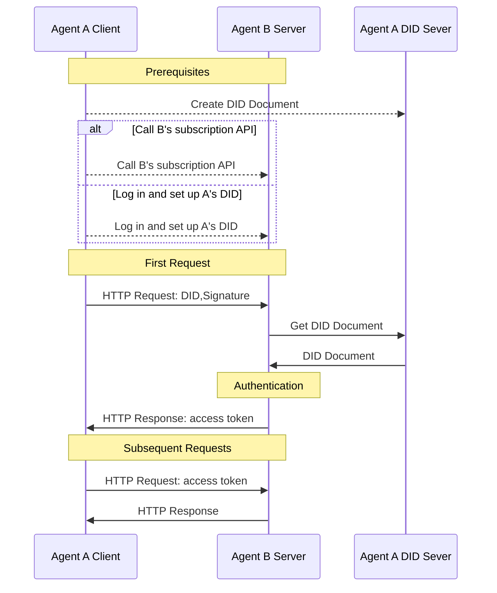

> 日本語参考訳（機械翻訳・未校閲）。規範となるのは原文です。コード例・識別子・規範キーワードは原文を保持しています。
> 原文: [blogs/did-wba-a-web-based-decentralized-identifier.md](../../blogs/did-wba-a-web-based-decentralized-identifier.md) / 基準コミット: `0837cfdfaf4ddcf834f0890ddaf34fc4c824e066`

# id:wba - Webベースの分散型識別子

## 1. 導入事例

w3C分散型識別子(DID)規格に基づくドラフト方式の指定です。 とりあえず [W3C のディド](https://www.w3.org/TR/did-core/) 規格は、2022年にW3C推奨として公開され、検証可能な分散型デジタルアイデンティティを可能にする新しいタイプの識別子です。 DID に基づいて、異なるアプリケーション間の相互運用性を改善しながら、ユーザーは自分のアイデンティティを本当に制御することができます。 ダイドは、Blueskyを含む多くのアプリケーションで広く採用されています。

DIDのコアコンポーネントは、DID所有者のアイデンティティを検証するために使用される公開鍵など、特定のDIDに関連する重要な情報を含むDID文書です。 DID メソッドは、DID ドキュメントの作成、保存、更新、および変更方法を定義します。

設計しました [行なった:wbaメソッド](../03-did:wba%20Method%20Design%20Specification.md). . . 既存の成熟技術やWebインフラを十分に活用し、分散型のアイデンティティ認証を容易に実装できるwbaメソッドは、既存のシステムの完全な再構築を必要としません。 プラットフォームは、各ユーザがプラットフォーム間で相互接続を達成するために、doed:wba DIDs を作成しながら、集中的にアカウントシステムを管理できます。

プラットフォームが各プラットフォームがプラットフォーム間で相互接続を可能にしながら、一元化された方法で独自のアカウントシステムを実装するメールと同様に、d:wbaメソッドを使用してアイデンティティシステムがビジネス特性を達成することができます。

API キーと比較して、do:wba メソッドは優れたセキュリティを提供します。OpenID Connect と比較して、d:wba メソッドはよりシンプルなインタラクションと分散性を備えています。 詳細は、下記をご覧ください。 [id:wba と OpenID Connect と API キー](Comparison%20of%20did:wba%20with%20OpenID%20Connect%20and%20API%20keys.md).

d:wbaメソッドは、説明通りにOpenID Connectと同等のセキュリティも提供しています。 [行なわれた:wbaの保証原則の分析](did-wba-security-principles.md).

## 2. DID ドキュメント

基本的な DID ドキュメントは、doed:wba メソッドを使用して、次のようにします。

```json
{
    "@context": [
      "https://www.w3.org/ns/did/v1",
      "https://w3id.org/security/suites/jws-2020/v1",
      "https://w3id.org/security/suites/secp256k1-2019/v1",
      "https://w3id.org/security/suites/ed25519-2020/v1",
      "https://w3id.org/security/suites/x25519-2019/v1"
    ],
    "id": "did:wba:example.com%3A8800:user:alice",
    "verificationMethod": [
      {
        "id": "did:wba:example.com%3A8800:user:alice#WjKgJV7VRw3hmgU6--4v15c0Aewbcvat1BsRFTIqa5Q",
        "type": "EcdsaSecp256k1VerificationKey2019",
        "controller": "did:wba:example.com%3A8800:user:alice",
        "publicKeyJwk": {
          "crv": "secp256k1",
          "x": "NtngWpJUr-rlNNbs0u-Aa8e16OwSJu6UiFf0Rdo1oJ4",
          "y": "qN1jKupJlFsPFc1UkWinqljv4YE0mq_Ickwnjgasvmo",
          "kty": "EC",
          "kid": "WjKgJV7VRw3hmgU6--4v15c0Aewbcvat1BsRFTIqa5Q"
        }
      }
    ],
    "authentication": [
      "did:wba:example.com%3A8800:user:alice#WjKgJV7VRw3hmgU6--4v15c0Aewbcvat1BsRFTIqa5Q",
      {
        "id": "did:wba:example.com%3A8800:user:alice#key-1",
        "type": "Ed25519VerificationKey2020",
        "controller": "did:wba:example.com%3A8800:user:alice",
        "publicKeyMultibase": "zH3C2AVvLMv6gmMNam3uVAjZpfkcJCwDwnZn6z3wXmqPV"
      }
    ],
    "keyAgreement": [
      {
        "id": "did:wba:example.com%3A8800:user:alice#key-2",
        "type": "X25519KeyAgreementKey2019", 
        "controller": "did:wba:example.com%3A8800:user:alice",
        "publicKeyMultibase": "z9hFgmPVfmBZwRvFEyniQDBkz9LmV7gDEqytWyGZLmDXE"
      }
    ]
}
```

認証セクションの公開鍵は、本人確認のために使用されます。 つまり、相手が正しいDID文書を安全に入手できる限り、正しい公開鍵を得ることができます。 パブリックキーを使用して、ユーザーの署名を検証し、ユーザーの本人確認を行うことができます。

DID文書の作成、更新、および再編は、利用者自身が決定します。 例えば、ユーザーは自分のサーバーやサードパーティのサーバーにDID文書を保存することができます。 保存場所に関係なく、ユーザーはDID文書の制御を維持する必要があります。

また、ユーザーは他のユーザがDID文書を安全に取得するためにHTTPメソッドを提供する必要があります。 DID ドキュメントの取得の HTTP アドレスは、DID から取得できます。 つまり、ユーザが DID を持っていると、対応する DID ドキュメントは HTTP 経由で取得できます。 変換方法は、次のようになります。

```plaintext
Example:
did:wba:example.com:user:alice
 -> https://example.com/user/alice/did.json
```

## 3. クロスプラットフォームのアイデンティティ認証プロセス

id:wba は HTTP プロトコルと連携して、同一の HTTP リクエストで ID 認証、許可認証、データ交換を 1 つの HTTP リクエストに追加することなく完了させることができます。 以下は、HTTPプロトコルと組み合わせたdo:wbaの相互作用フローです。



1. 前提条件:
  - ユーザ A は、DID を作成して、A の DID サーバーで DID ドキュメントを保存します。
  - エージェントBは、AのDIDを知る必要があります。これは、2つの方法で達成することができます:
    - ユーザ A は、A のシステムにログを入力し、A の DID を設定します。
    - または、Agent Bのサブスクリプション API を呼び出して、サブスクリプション DID を A's DID に設定します。 **これにより、2つのエージェント間の接続コストを大幅に削減できます。**

2. アイデンティティ認証プロセス:
  - クライアントとして、リクエストデータに加えて、DID、nonce、timestamp、シグネチャなどの情報を含んだHTTPリクエストを開始します。
  - エージェントBは、サーバーとして、リクエストを受信し、リクエストヘッダーからDID、nonce、タイムスタンプ、シグネチャなどの情報を抽出します。
  - Agent B は、DID を使用して Agent A の DID サーバーから DID ドキュメントを取得します。
  - Agent B は、DID ドキュメントから公開鍵を使用してクライアントの署名を検証します。
  - 認証パスの後、Agent B はクライアントのビジネスリクエストを処理します。また、ビジネスデータとトークンの両方を返します。
  - Agent A は、その後のリクエストでトークンを含んだり、Agent B はトークンを確認することでクライアント認証を完了します。


プロセス全体から、HTTP を使用して、id:wba はインタラクション数を増やすことなく ID 認証を完了できるか確認できます。 また、各々のサブスクリプションインターフェースを直接呼び出して、相互通信中にサービスを購読できるようにする2つのエージェント(またはアプリケーション)も有効になります。また、各システムでマニュアル登録を必要としません。 エージェント間の相互接続を抑制するバリアを軽減します。

## 4. ケースの使用

1. ケース1:インテリジェントアシスタントを通じて他のウェブサイトでファイルにアクセスするユーザー

Alice は、例えば.com にファイルを保存しており、その後、インテリジェントなアシスタントを通じてアクセスしたいと考えている。 これを行うには、アリスは最初にインテリジェントアシスタントのdo:wbaメソッドに基づいてDIDを作成し、例えば.comにログインし、このDIDをアカウントに関連付けて、DID権限を付与してファイルにアクセスします。 セットアップが完了したら、インテリジェントアシスタントはこのDIDを使用して、例.comにログインし、ID認証後、Aliceの保存したファイルにアクセスできるインテリジェントなアシスタントが使用できます。 このDIDは、異なるプラットフォーム上のファイルにアクセスするためのインテリジェントアシスタントを可能にするために、他のウェブサイトで設定することもできます。

2. ユースケース2:インテリジェントアシスタントによるサードパーティプラットフォームサービスAPIを呼び出すユーザー

アリスは、インテリジェントアシスタントを通じて「例」と名付けられたサードパーティサービスAPIを呼び出したい。 まず、Alice はインテリジェントアシスタントの do:wba メソッドに基づいて DID を作成し、この DID を使用して API インターフェイスを呼び出して、例のプラットフォーム上で関連サービスを購読します。 本サービスは、IDを介して本人認証を完了し、購入者がAliceであることを確認し、DIDを記録します。 認証が完了すると、Aliceはインテリジェントアシスタントを通じてこのDIDを操作用のサービスAPIを呼び出すことができます。

> クライアント・ツー・サーバー認証は、現在のユースケースでは説明されていませんが、このプロセスは確かに機能します。

## 5. 郵便番号

開発完了、オープンソース化 詳しくは、下記をご覧ください。 [https://github.com/agent-network-protocol/AgentConnect/blob/master/README.md#decentralized-authentication-based-on-didwba-and-http](https://github.com/agent-network-protocol/AgentConnect/blob/master/README.md#decentralized-authentication-based-on-didwba-and-http)

## 6. リファレンス

[d:wbaメソッド仕様](https://github.com/agent-network-protocol/AgentNetworkProtocol/blob/main/english/03-did-wba-method-specification.md)

[ダイコア](https://www.w3.org/TR/did-core/)

[エージェントネットワークプロトコル技術ホワイトペーパー](https://github.com/agent-network-protocol/AgentNetworkProtocol/blob/main/english/01-AgentNetworkProtocol-technical-white-paper.md)

## コンテンツの著作権について
社会貢献活動の推進に関する基本方針 _ ANPコミュニティ
このファイルは、以下のとおりです。 [MITライセンス](../../blogs/LICENSE). . . 無料で利用して変更することができますが、この著作権表示を保ちなければなりません。
