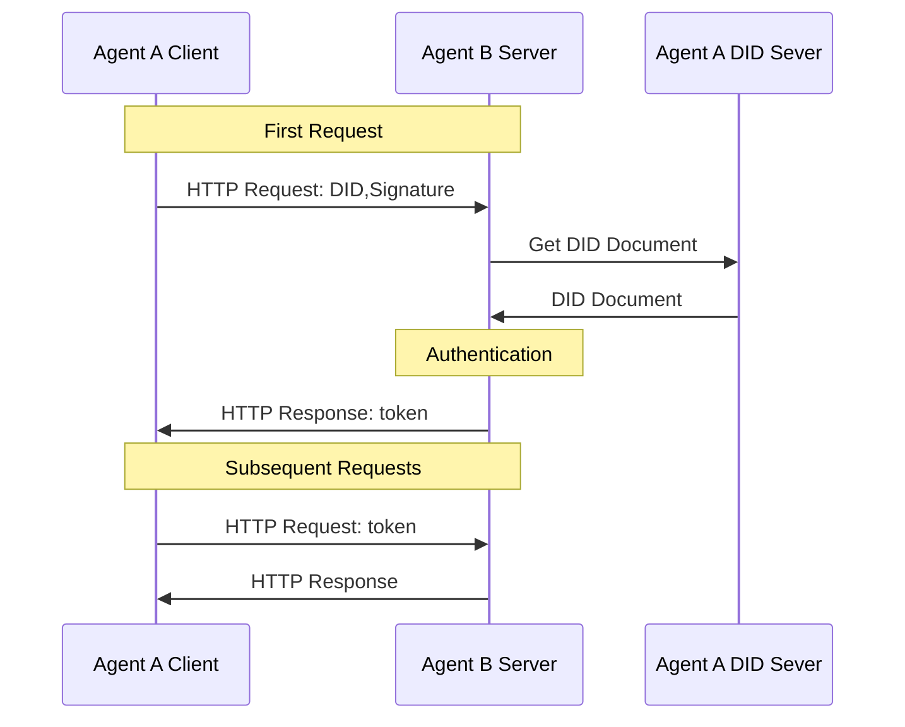

<!-- translation-review: partial; scope=protocol-identifier paragraphs at source lines 8,279,280; remainder=machine-unreviewed -->
> 日本語参考訳（機械翻訳・未校閲）。規範となるのは原文です。コード例・識別子・規範キーワードは原文を保持しています。
> 原文: [chinese/01-AgentNetworkProtocol技术白皮书.md](../../chinese/01-AgentNetworkProtocol技术白皮书.md) / 基準コミット: `0837cfdfaf4ddcf834f0890ddaf34fc4c824e066`

# 技術の白いペーパー:

- 書類番号:ANP-01
- 状態:情報白書
- バージョン: 1.2
- 原文言語: 中文 / このページは日本語参考訳

> 本白書は概念的なアーキテクチャとビジョンを紹介します。ANP 1.2 の規範要件は各プロトコル本文に従います。共通認証は [ANP-02](02-ANP-基于DID的身份认证协议.md)、WBA メソッドの規則は ANP-03 が定義し、ネイティブな `did:web` も同じ認証フローを使用します。ANP-06 メタプロトコルは引き続き草案であり、メッセージング P6 の安定版も MLS の登録・公開条件による制約を受けます。

## インフォメーション

ビッグモデルと自律的な意思決定AIが発展するにつれて、エージェントは急速にアプリを移動した後にインターネットの最新の主題になっています。 しかし、既存のインターネットインフラストラクチャは、データ分離、フレンドリーなインターフェイス、そしてスマートボディサイズの相互接続とコラボレーションの必要性をサポートできないインテリジェントなコラボレーションの高コストで、人間の相互作用設計に連動しています。 インターネットは、従来のソフトウェア、ユニバーサルスマート相互接続、およびインテリジェントな接続に基づいて、4つのコアトレンドを示す、高度の変化に直面しています。

この傾向に対応するため、Agent Network Protocol(ANP)は、スマートボディインターネット用の通信プロトコルの新しい世代を提案します。 ANPは、既存のインターネットプロトコルのAIプロトタイプ設計、互換性および再利用に従い、モジュール式の組み換え可能な構造を使用して、既存のインフラストラクチャに基づいて迅速な展開の非常に単純でスケーラブルな原則に従います。

アプリケーションレベルでは、AMP はスマート 説明プロトコル (ADP) と Smart Discovery Agreement を通じて AI に適しているプライマリ データ ネットワークを構築しました。これにより、インテリジェントな機能が構造化され、その機能のオープンや接続が可能になりました。セキュリティとプライバシー デザインに関して、ANP は、人権認証とスマート 認可の区別を導入し、マルチ DID プライバシー保護戦略をサポートし、最小限の情報開示およびエンドツーエンド暗号化通信を促進し、ネットワーク内のユーザーとインテリジェンスの自動管理とセキュリティを保護します。

ANP は将来を見据えて、デジタル アイランドを打破し、クローズド プラットフォームのエコシステムからオープン プロトコルを中核とする協調ネットワークへのインターネットの回帰を促進することに取り組んでいます。 「接続は力である」という設計哲学を堅持し、高品質で摩擦の少ないインテリジェントな接続とコラボレーションを促進することで、集合知の巨大な可能性を解き放ちます。 ANP は一連の通信標準であるだけでなく、インテリジェント インターネット時代におけるオープン性、公平性、革新的な活力を再構築するための重要なインフラストラクチャでもあります。私たちは、世界中の開発者、研究者、組織が ANP エコシステムの構築に参加し、エージェントによって推進される新しいインターネットの未来を創造することを心から歓迎します。

## 1. はじめに

### 1.1 背景と課題

大規模なモデルと自律的な意思決定 AI の開発により、エージェントはモバイル アプリに次ぐインターネットの新たな主体になりつつあります。インテリジェント エージェントは既存のソフトウェアに取って代わり、インターネットの重要な部分になることが期待されています。しかし、インターネットの現在の技術基盤と接続パラダイムは、主に次の点でインテリジェント エージェントのニーズを満たすことができません。

- **データサイロによりエージェントの意思決定の質が制限される **: エージェントは、質の高い意思決定を行うために幅広い情報を統合する必要があります。しかし、現在のインターネット データは、接続されていないプラットフォームに点在し、「データ アイランド」を形成しています。これにより、エージェントは完全なコンテキスト情報を取得できなくなり、分析、推論、意思決定の能力が大幅に制限されます。

- **人間とコンピュータのインターフェースがエージェント対話の効率を妨げる **: 既存のネットワーク サービスのほとんどは、グラフィカル ユーザー インターフェース (GUI) を介して人間向けに設計されています。エージェントはこれらのサービスを使用するために人間の操作をシミュレートする必要がありますが、これは複雑で非効率的でエラーが発生しやすいプロセスです。インテリジェントエージェントが直接的かつ効率的な自動対話を実現するために、ネイティブで機械可読なインターフェースプロトコルを提供することが緊急に必要とされています。

- ** 標準プロトコルの欠如によりエージェントのコラボレーションが妨げられます **: エージェント間の統一された通信言語とコラボレーション仕様が不足しています。自然言語はコミュニケーション手段を提供しますが、大規模で信頼性の高い自動化されたインテリジェンス コラボレーションをサポートするには十分ではありません。標準化されたプロトコルの確立は、ネットワーク化されたインテリジェンスを実現し、集合的インテリジェンスを発揮するための鍵となります。

### 1.2 インテリジェントインターネットにおける 4 つの主要トレンド

上記の分析に基づいて、私たちはインターネットがインテリジェンスを核として新たな大きな変化を経験していると考えています。この変化は、次の 4 つの主要なトレンドに反映されています。

#### 1.2.1 インテリジェント エージェントは従来のソフトウェアを完全に置き換えます

将来的には、インテリジェント エージェントが既存のソフトウェア アプリケーションを徐々に置き換え、インターネットの重要なインフラストラクチャになるでしょう。個人レベルでは、AI アシスタントが既存のアプリのほとんどを置き換え、ユーザーのインターネットへの主要な入り口となるでしょう。従来の APP と比較して、パーソナル AI アシスタントは、情報統合、意思決定支援、シーン インタラクション エクスペリエンスにおいて桁違いの改善を達成できます。企業レベルでは、企業はインテリジェント エージェントを導入して、インターネット上のユーザーに直接接続して対話し、正確かつ効率的なサービスを提供します。同時に、パーソナル アシスタントとエンタープライズ インテリジェンス間のポイントツーポイントの脱プラットフォーム接続モデルに代表される、新しい接続パラダイムが形になりつつあります。

#### 1.2.2 インテリジェントエージェント間のユニバーサル相互接続を実現

インテリジェント インターネットの 2 番目の中心的なトレンドは、あらゆるインテリジェント エージェント間の自由な接続を実現することであり、これにより現在のインターネットのデータ アイランド パターンが完全に打破され、情報の自由な流れが実現されます。相互接続されたエージェントの包括的なネットワークにより、AI はドメインやプラットフォーム全体で完全なコンテキスト情報を完全に取得できるようになり、個人や企業がより包括的で正確な意思決定を行えるようになります。同時に、このオープン接続モデルにより、エージェントはネットワーク全体のすべてのツール機能を呼び出すことができるため、エージェント間のコラボレーションの深さと複雑さが大幅に拡張されます。したがって、エージェント間の対話は、将来のインターネットで最も主流の接続方法になるでしょう。

#### 1.2.3 エージェントのプロトコルベースのネイティブ接続モード

現在、AI とインターネットの間の相互作用は、主にブラウザーやソフトウェア インターフェイスなどの人間中心設計 (コンピューターの使用/ブラウザーの使用) を介して行われています。ただし、これらの手法は一時的な過渡的な解決策にすぎず、AI 自体の可能性を完全に引き出すことはできません。 AI は本質的に、ヒューマン インターフェイスや Web ページの HTML よりも、基礎となる構造化データやセマンティック情報を直接処理することに優れています。そのため、将来的にはエージェント同士がAI専用の通信プロトコル（プロトコル）で接続されるようになるのではないかと考えています。このプロトコルは HTTP と同じくらい広く使用され、業界標準になるでしょう。このプロトコルに基づいて、AI 専用に設計され、インテリジェント エージェントがアクセスして操作しやすい新しいデータ ネットワークが誕生します。

#### 1.2.4 エージェントは自律的に組織化および共同作業できる

インテリジェント インターネットの 4 番目の中心的なトレンドは、インテリジェント エージェントが自律的に組織化および共同作業できる機能です。標準プロトコルのサポートにより、エージェントは自然言語を使用して柔軟な自動ネゴシエーションを実行し、互いのニーズを迅速に明確にして協力関係を動的に形成し、複雑なタスクを共同で完了できます。このコラボレーション モデルは、固定構造のインターフェイスを必要とせず、ネットワークの運用効率とタスク応答能力を大幅に向上させ、手動介入と通信コストを大幅に削減します。その結果、柔軟性が高く効率的かつ低コストのエージェントネットワークが徐々に形成されていくことになります。

上記の傾向を考慮すると、インテリジェント インターネットの発展をサポートする新しい通信プロトコルが緊急に必要です。エージェント ネットワーク プロトコル (ANP) は、このような背景の下で提案されました。その目的は、インテリジェント エージェントにオープンで統一された接続メカニズムを提供し、相互接続、ネイティブ インターフェイス、効率的なコラボレーションという 3 つの主要な問題を解決し、それによって AI エージェントの可能性を最大限に解放することです。

## 2. 核となる設計原則

Agent Network Protocol (ANP) は当初からインテリジェント インターネットのニーズに焦点を当てており、オープンで柔軟、実装可能なインテリジェント エージェント通信標準の構築に努めています。その設計は次の基本原則に従っています。

### 2.1 AI ネイティブ設計

ANP は、人間とコンピューターの対話 (HTML や GUI インターフェイスなど) のために設計されたプロトコルではありませんが、AI エージェント間の直接通信のためにネイティブに設計されています。構造化データ、意味表現、自然言語の組み合わせを重視しており、インテリジェント エージェントが人間の操作をシミュレートすることなく理解、発見、共同作業できるようにします。

目標: インテリジェント エージェントが最も効率的かつ自然な方法でインターネットの世界にアクセスできるようにし、AI の意思決定とアクションの可能性を解き放ちます。

### 2.2 互換性と再利用

ANP は、OpenAPI、JSON-RPC、オーディオおよびビデオ プロトコル (WebRTC など) など、広く使用されているインターネット プロトコル標準を尊重し、互換性があります。ANP は、車輪を再発明することなく、軽量のメタプロトコルと記述標準を使用して、これらの既存のプロトコルを、エージェントが理解してネゴシエートできるセマンティック フレームワークにカプセル化します。

目標: イノベーションを確実にしながら、学習コストと移行のしきい値を最小限に抑え、既存のエコシステムからインテリジェントなインターネットへの迅速なアクセスを促進します。

### 2.3 構成可能性

ANP はモジュール設計を採用しており、Agent Identity (DID)、Agent description (ADP)、Agent Discovery などのコア コンポーネントを個別に使用したり、自由に組み合わせて使用したりできます。開発者は、実際のニーズに応じて、特定のプロトコル コンポーネントを使用するか、完全な統合を行うかを柔軟に選択できます。

目標: さまざまな複雑さと段階のアプリケーション シナリオをサポートし、利用可能な最小ユニットから大規模システムまで必要に応じて適応します。

### 2.4 シンプルさと拡張性

ANP はミニマリズム (Keep It Simple) の原則に従い、設計の初期段階でプロトコル自体をシンプルかつ直観的に保ち、理解と実装の敷居を下げるよう努めています。同時に、エージェント エコシステムの将来の進化における新しい機能の自然な重ね合わせをサポートするために、十分な拡張インターフェイスと柔軟なスキーマ メカニズムが保持されます。

目標: 多様なアプリケーションのニーズに合わせて成長の余地を残しつつ、コア プロトコルを小さく安定した状態に保ちます。

### 2.5 既存のインフラストラクチャに基づく実用的な導入可能性

ANP は、設計時に実際の導入の実現可能性を十分に考慮し、複雑または普及が難しい新しいテクノロジーや独自のコンポーネントに依存せず、既存のインターネット インフラストラクチャ (DNS、HTTPS、Web サーバー、DID システムなど) に基づいて実行することを試みます。どの開発者や企業でも、ANP をサポートするエージェント サービスを迅速に構築できます。

目標: 初期展開のしきい値を下げ、現実世界でのプロトコルの迅速な試験運用、適用、推進を促進します。

### 2.6 最小信頼の原則

ネットワークの参加者 (エージェント、ノードなど) は、デフォルトでは完全に信頼されるべきではありません。すべての対話は認証および承認され、特定のタスクを完了するために必要な最小限の権限のみが付与される必要があります。そのためには、潜在的なセキュリティ リスクや悪用を軽減するために、強力な認証、アクセス制御、データ検証メカニズムをプロトコル設計に組み込む必要があります。

目標: 信頼できない環境でも安全に動作できるエージェントのネットワークを構築します。

## 3. プロトコルコア設計

### 3.1 プロトコル階層化設計

以下の図に示すように、3 つの層で構成されるプロトコル アーキテクチャを設計しました。

  

ANP プロトコル アーキテクチャは下から上に 3 つの層に分割されており、それぞれが異なるコア機能を想定しています。

1. アイデンティティと安全な通信層

この層は、エージェント間の ID 認証と暗号化通信の基本標準を定義し、クロスプラットフォームの ID 相互認識とエンドツーエンドの暗号化通信の問題を解決します。

ANP は、W3C DID 標準に基づいて、軽量でスケーラブルな分散型 ID 認証メカニズム (did:wba メソッドなど) を設計し、中央組織の介入なしに、任意の 2 つのエージェントが安全に互いの ID を検証し、プライベートで信頼性の高い暗号化通信チャネルを確立できるようにしました。

2. メタプロトコル層

この層は、エージェントが自然言語ネゴシエーションに基づいて通信プロトコルの動的な合意と適応を実行する方法を定義します。

自然言語で要件、機能、コラボレーションの意図を交換することで、エージェントは双方の現在のシナリオに適した通信の詳細 (リクエスト形式、インターフェイス呼び出し方法、セッション管理戦略など) を柔軟にネゴシエートすることができ、適応性の高いプロトコル共同デバッグとランタイム最適化を実現します。

3. アプリケーションプロトコル層

この層には、エージェントの説明とエージェントの検出という 2 つのコア モジュールがあります。エージェントは、構造化記述ドキュメント (ADP エージェント記述プロトコルなど) を通じて独自の機能とインターフェイスを公開し、ディスカバリ プロトコルに基づいてサービス エントランスを能動的または受動的に公開します。

### 3.2 ID と暗号化通信層

インテリジェントなすべての接続を実現するためには、まず第一の優先事項は、インテリジェント間でアイデンティティ認証の問題に対処することです。 現在、ほとんどのインターネットアプリケーションでは、集中型識別技術を使用し、異なるテクノロジーがシステムアカウントを認証するのは困難です。[^2]しかし、OAuth 2.0はシステムアイデンティティ認証のために設計されていないため、そのプロセスは比較的複雑で、集中化に制限があります。高速で、tectonicおよび分散認証技術が緊急に必要です。

ブロックチェーンに基づくDRC識別プログラム。可能なソリューションを提供しながら、大規模なアプリケーションでチェーンを直面する拡張チャレンジのためにはまだ最適ではありません。

上記対応では、W3CのDEC-IDを導入しました。[^3]DIDは、従来の中央アイデンティティ管理システムに依存する新しいタイプの識別子規格です。これにより、ユーザーは独自のアイデンティティを習得し、集中システムに依存することなく互いに検証することができます。コアDIDコードは、特定のコンピューティングインフラストラクチャを使用するのに必要な範囲を制限しません。これにより、既存の成熟した技術と開発されたWebインフラストラクチャを最大限に活用して、DIDを構築することができます。また、すべての種類の同一デバイスは、DIDを集中管理できるため、相互に統合可能なシステムが必要となるように、DIDを組み込むことができます。

  

DIDのコアコンポーネントは、特定のDIDに関連する重要な情報を含むDIDドキュメントです。これは、DID所有者のアイデンティティを検証し、DIDに関連する操作、特権およびアクセス制御の管理をサポートするために使われます。

  

認証プロセスでは、DID ドキュメントは、ユーザーの ID と対応するパブリックキー(プライベート キーはユーザ自身の custody) を検証するために使用されるメソッドを含んでいます。クライアントは、最初の HTTP リクエストで HTTP ヘッドに DID と署名を運ぶことができます。インタラクションの数を増やすことなく、サービスプロバイダは、DID ファイル内の公開鍵を持つクライアントの ID をすぐに認証することができます。初期検証後、サービスはトークンに戻り、顧客のフォローアップトークンでトークンを返すことができます。また、認証情報のみが、クライアントの認証や認証を行う必要があり、クライアントは、認証情報は、クライアントの認証プロセスのみです。

DID メソッドは、DID と DID ファイルの作成、解釈、更新および無効化、ならびにそれらを認証し、承認する方法を定義します。既存の DID メソッドでは、DID を使用して DID ドキュメントを作成できます。`did:web` 方法論[^5] 成熟したWeb技術に基づいて、システムは、DIDとDIDファイルの作成、更新、無効化するための集中化されたテクノロジ(クラウドコンピューティングなど)を使用することを許可されています。 HTTPプロトコルを介して異なるシステム間で相互接続することは、プラットフォームが一元化された方法で独自のアカウントシステムを達成し、プラットフォーム間で相互接続が可能である、インターネット電子サービスに類似している効果があります。

基本情報 `did:web` 方法として、クロスプラットフォームの識別プロセスやインテリジェントなボディ説明サービスなど、スマートボディコミュニケーション規範の場面に加わりました。新しいDIDアプローチを提案しました。`did:wba`(Webベースのエージェント)。`did:wba` 継承される方法。 `did:web` この利点は、インテリジェントな身体との間の識別メカニズムをさらに最適化し、スマートボディネットワークのその適用性を高めることです。

また、通常、ユーザーは認証だけでなくエンドツーエンド暗号化通信にも使用されるDIDの1つ以上のパブリック/プライベートキーペアを作成します。 DIDプライベート/publicキーペアに基づいて、楕円曲線のディフィールマン一時的鍵交換プロトコル(Elliptic Curve Diffie-Hellman Ephemeral、ECDHE)を使用します。[^6]エンドツーエンドの暗号化された通信プログラムは、DID2間の安全な通信を実現し、ミドルノードが通信のコンテンツを復号化できないように設計されました。エンドツーエンドの暗号化は、将来の運用コストを下げるインテリジェントなボディなどの情報源を反転させるための使用が可能であり、3方向のプラットフォームでエントリーポートを外部サービスポートとしてレンタルすることができ、3方向のプラットフォームでは、インテリジェンスに関するメッセージを送信することができますが、コンテンツの解読はできません。

### 3.3 メタ・アグリーメント・レベル

Meta-Protocolは、通信プロトコルの操作、解像度、グループ化およびインタラクティブなルールを定義する合意です。 本質的に、特定のデータ転送に直接対処し、コミュニケーションのための柔軟で普遍的なスケーラブルなフレームワークを提供するだけでなく、コミュニケーション協定を交渉するためのプロトコルです。

現時点では、インテリジェントな身体とコミュニケーションの2つの主要な方法があります。

1. **ヒューマンエンジニアは通信プロトコルを設計します**インテリジェントなボディのための通信プロトコルの設計、プロトコルコードの開発、デバッグ、テスト、およびデプロイ。しかしながら、このアプローチは、高開発コスト、低合意更新、新しいシナリオに適応する困難に直面しています。

2. **インテリジェンスは、自然言語で直接通信します**: 自然言語におけるインテリジェントな身体と、大国語モデル(LLM)を用いた自然言語データの内部処理のコミュニケーション。しかしながら、高データ処理コストと低加工精度を実現しています。

上記に対処するため、メタアグリーメントとAIコード生成プログラムが使用できます。メタアグリーメントやAIコード生成技術を使用することにより、インテリジェントな身体間のコミュニケーションを大幅に改善し、通信の柔軟性と個別化を維持しながら通信コストを削減できます。[^7]。

メタアグリーメントを用いた通信の基本的なプロセスは以下の通りです。

1. **メタプロトコルリクエスト**: エージェント A は、まずエージェント B にメタプロトコルリクエストを送信します。リクエスト元のサブジェクトは、自然言語を使用してニーズ、入力、期待される出力を記述し、候補の通信プロトコルを提案します。候補となる通信プロトコルには、一般にトランスポート層プロトコル、データ形式、データ処理方法などが含まれます。

2. **プロトコルネゴシエーション**: メタプロトコルリクエストを受信した後、エージェント B は AI を使用してリクエスト内の自然言語記述を処理し、独自の機能を組み合わせて、A のリクエストと候補プロトコルを受け入れるかどうかを決定します。 B の能力が A の要求を満たすことができない場合、それは直接拒否されます。 B が A の候補者合意を受け入れない場合、独自の候補者合意を提案し、次の交渉ラウンドに入ることができます。交渉プロセスは、双方が合意に達するか、交渉が失敗するまで継続されます。

3. ** コードの生成と展開 **: 両当事者が合意に達した後、交渉された合意に従ってそれぞれがプロトコル処理コードを生成し、展開します。

4. **共同デバッグとテスト**: コードがデプロイされた後、両者は共同デバッグ テスト データをネゴシエートし、AI によって生成されたプロトコルとプロトコル処理コードの共同デバッグとテストを実施します。

5. **正式なコミュニケーション**: 共同デバッグが完了した後、契約は正式に開始されます。その後、エージェント A とエージェント B は、最終的にネゴシエートされたプロトコルを使用して通信を開始し、AI が生成したコードを使用してデータを処理します。

6. **要件変更処理**: 要件が変更された場合は、両当事者が再び合意に達するまで上記のプロセスを繰り返します。

  

ただし、メタプロトコルのネゴシエーションプロセスには時間がかかり、AI コード生成機能に依存します。通信ごとにメタプロトコルネゴシエーションが実行されると、膨大なコストが消費され、インタラクティブなエクスペリエンスが低下します。エージェント間に同一または類似の通信プロセスが多数存在することを考慮すると、エージェントはメタプロトコル ネゴシエーションの結果を保存できます。将来同様のニーズが発生した場合、前回の交渉結果をそのまま正式なコミュニケーションの合意書として、または交渉の候補合意書として使用できます。同時に、エージェントは、他のエージェントがクエリして使用できるようにネゴシエーション結果を共有することもできます。

経済レベルで交渉結果を積極的にアップロードし、エージェント間のコンセンサス合意を選択するようにエージェントを動機付ける方法は、メタプロトコル層でまだ深く研究する必要がある問題です。

### 3.4 アプリケーションプロトコル層

アプリケーション プロトコル層には、エージェント記述とエージェント検出という 2 つのコア モジュールがあります。

#### 3.4.1 エージェント記述プロトコル (ADP)

エージェント記述プロトコル (ADP) は、各エージェントに標準化された自己記述方法を提供します。 ADP は、JSON-LD (JSON ベースのリンクされたデータ形式) に基づいて説明ドキュメントを作成し、schema.org によって提供される共通語彙拡張機能を使用し、それを ANP カスタム語彙と組み合わせて、エージェントの統一メタデータ形式を定義します。 Agent description (AD) 文書は、オンライン世界におけるエージェントの名刺または紹介に相当します。他のエージェントはこのドキュメントを読んで、このドキュメントと対話する方法を理解できます。

エージェントの説明文書には通常、次の重要な情報が含まれています。

- ** 基本情報 **: エージェント名、一意の識別子、所属主体 (個人、組織、またはその他のエージェント) およびその他の識別メタデータ。
- **機能の説明**: エージェントが提供する機能、製品、またはサービスのリスト、および対応する説明。たとえば、チャットアシスタントであるか、データ分析サービスであるか、ロボット実行機能があるかなどです。
- **インターフェイスとプロトコル **: 呼び出し可能な API エンドポイント、サポートされている通信プロトコルのバージョンまたは仕様など、エージェントと対話するためのメソッド。他のエージェントは、リクエストやメッセージを送信する方法を知っています。
- **セキュリティと認可 **: エージェントの認証方法と許可要件。たとえば、身元を確認するためにどのような DID 識別子と公開キーが使用されるかなどです。 ADP 仕様では、クロスプラットフォームの ID 認証要件を満たすための統合セキュリティ メカニズムとして Did:wba メソッドを使用することを推奨しています。
- ** 連絡先情報 **: 自動対話以外での手動介入やデバッグを容易にするための、オプションのテクニカル サポートまたは連絡チャネル (サービス エンドポイント URL、メンテナの連絡先電子メールなど)。

上記の情報は JSON-LD ドキュメントの形式で構造化され、提示されるため、豊富な意味論的意味を保持しながらエージェントの説明をマシンで解析できます。 JSON-LD のコンテキストを通じて、AD ドキュメント内の語彙をパブリック オントロジー定義にリンクして、異なるシステム間でセマンティックな一貫性を実現できます。たとえば、ADP では、「Agent」（エージェント）、「Service」（サービス）、「Interface」（インターフェース）などのコアワードが定義されており、仕様に従うすべてのエージェントでその意味が統一されています。これは、エージェントが相互に理解する能力の基礎を提供します。

ADP は分散型 ID をドキュメントを記述するセキュリティ アーキテクチャに統合していることは言及する価値があります。各エージェントの説明は、エージェントの ID を識別するために使用される独自の検証方法と公開鍵情報を備えた DID にバインドできます。他のエージェントがこの説明を読んで通信するとき、DID 署名を検証して相手の ID が信頼できることを確認し、オープン ネットワークで安全な接続を確立できます。この設計により、エージェント間の相互信頼が確保され、さらなる協力の基盤が築かれます。

最後に、エージェント説明ドキュメントは、Web サイトのホームページと同様に、エージェント ネットワーク内のエージェントのエントリ ポイントです。他のエージェントは、エージェントの説明文書を読んで、それと対話する方法を学びます。

#### 3.4.2 エージェント検出プロトコル

エージェントの説明では、エージェントが互いの存在を検出して接続を確立するためのメカニズムも必要です。 Agent Discovery Protocol は、この目的のために設計された標準プロトコルです。エージェント検出プロトコルは、エージェントまたは検索サービスが他のエージェントへの入り口を簡単に見つけられるように、ネットワーク内でエージェント説明ドキュメントを公開および取得する方法を指定します。基本的に、エージェント検出プロトコルはエージェントの「検索エンジン プロトコル」として機能し、エージェントのインターネット内のノードが表示され、到達可能であることを保証します。

エージェント検出プロトコルは、次の 2 つの補完的な検出方法を提供します。

1. **Active Discovery (Active Discovery) **: Web 上の一般的な .well-known パス規則に基づいて、既知のドメイン名を使用して、そのドメイン名で公開されているすべてのエージェントの説明のリストをクエリできます。具体的には、統合ディレクトリ エントリはインターネット ドメイン名 (デフォルトのパスは /.well-known/agent-descriptions) で予約されており、この URL にアクセスすると、ドメイン名の下にあるすべてのエージェント AD ドキュメントの URL を含む JSON-LD リストが返されます。マニフェスト ドキュメント タイプは CollectionPage です。これには、各エージェント説明ドキュメントのリンク アドレスがリストされており、多数のエージェントをサポートするためにページで表示できます。アクティブな検出メカニズムの助けを借りて、エージェントは相手のドメイン名を知るだけで、その下のエージェント ディレクトリを取得できるため、エージェント ネットワーク全体を段階的に横断することができます。

2. **パッシブディスカバリー (パッシブディスカバリー) **: Web ページを収集する検索エンジンと同様に、エージェントは独自の情報を専門の検索サービスエージェントにアクティブに送信できます。具体的な方法は、検索サービスが登録 API インターフェイス (エージェントの説明に明記されている) を提供し、他のエージェントがこのインターフェイスを呼び出して独自の AD ドキュメント URL を登録用に送信することです。検索サービスは登録リクエストを受信すると、定期的に URL をクロールして最新のエージェントの説明を取得し、データベースにインデックスを付けます。エージェントまたはユーザーが関連サービスにクエリを実行すると、検索サービスは登録されたエージェント情報を返すことができます。パッシブディスカバリを通じて、新しいエージェントは自分の存在を通知し、インデックスサービスに自分自身を含めることができるため、より多くのノードで見つけられるようになります。

2 つのメカニズムは相互に補完し合います。アクティブ ディスカバリは、分散ドメイン名ディレクトリを使用してエージェント リストを公開することに重点を置いているのに対し、パッシブ ディスカバリでは、集中型の検索エージェントを導入してインデックスを集約します。すべての検出情報も、ADP 仕様と一致する JSON-LD 形式で表現されます。どちらの方法で取得されたとしても、発見された結果は最終的に各エージェントの説明文書を示します。

ANP は、エージェント検出プロトコルの助けを借りて、エージェント ネットワークのオープン性を確保します。つまり、新しく追加されたエージェントが、不明瞭な情報の島になることはありません。プロトコルに従っており、説明文書を公開または登録している限り、ネットワーク内で取得できます。これは、大規模なインテリジェント エージェント エコシステムの形成に対する基本的なサポートを提供します。

スマートディスカバリプロトコルは、タブリングとリンクの結果の標準的な方法にも、大量の情報を管理するための効率的な手段を提供する価値があります。ドメインに多くある場合、.well-known/agent-descriptions ドキュメントは、次のフィールドの次のページへのリンクをページごとに読み込むことができます。検索サービスは、結果を返すときに同様のページ分割メカニズムを使うこともできます。これらの詳細は、検出プロセスのスケーラビリティと堅牢性を保証します。

スマートボディの説明と検出プロトコルのコラボレーションにより、APPはアプリケーションレベルでクローズドループを実現しました。インテリジェンスはADPを使用して、スマートボディディスカバリープロトコルを使用して、それ自体を露出し、他の人を見つけるのに役立ちます。このメカニズムは、インテリジェントな身体のためのインターネット上で「互いに知っている方法」の問題に対処し、上記のようにスマートボディ接続の必要性を満たしています。AMPは、安全なアイデンティティレイヤーと柔軟なメタ合意層と組み合わせて、インテリジェント間のオープンで効率的な信頼性のある接続のためのソリューションを提供しています。

### 3.5 A.A. 生データネットワーク

ヒューマンアクセスにはインターネットインフラが利用できます。Webページは、主にヒトの閲覧と操作を提供するためのページやフォーム、画像などの視覚的なインターフェイスで情報を表示するハイパーリンク(HTML + HTTP)によってリンクされています。ただし、この人間に集中したアプローチは、AIS の効率的なアクセスと処理に合わないものとします。既存のインターネットを使用するためには、AIは人間の行動をシミュレートする必要があります(クリック、ブラウズ、分解するウェブページ)、そして、これは非常にインテリジェントな身体能力を制限します。

この問題に対処するため、Agent Network Protocol(ANP)はAIベースの設計のデータネットワーク構造を提案します。 Smart Description Protocol(ADP)とスマートディスカバリープロトコルにより、各スマートボディはサービスインターフェイス、コンピテンシー情報、データリソースを構造化および標準化された方法で公開し、オープンな検出メカニズムを通じてスマートボディネットワーク全体に自動的に公開することができます。

このフレームワークでは、すべてのインテリジェントなボディと、持ち運ぶデータリソース(テキスト、API、オーディオビジュアル、画像など)が、機械にやさしいオープンネットワークを形成します。

- 各ノードは、リケープ可能で、検出可能で、コール可能なスマートボディまたはデータユニットです。
- 各リンクは、人間だけを読んでできる、意味のある構造化されたプロトコル接続ではなく、ハイパーテキストです。
- スマートは、他のインテリジェントが提供するリソースやサービスの迅速な検索、理解、活用のための均一な基準に基づいていることができます。

このAIベースのデータネットワークは、Webベースのクロールやインターフェイスシミュレーションから知能ボディを解放し、インターネットの広範な分散機能と知識への直接的かつ効率的で一括アクセスを提供し、AIが学習する可能性を大幅に排除し、理由とコラボレーションを提供します。

より、より個々の知能として、サービスインテリジェンスと検索インテリジェンスは、AIの野心であり、構造化されたデータにリンクされているこのネットワークを通じてアクセスされ、成長し、最終的にはグローバルでダイナミックな進化するインテリジェントインターネットを形成します。

## 4. セキュリティとプライバシー

スマートインターネットでは、セキュリティとプライバシー保護は基本的かつ妥協しない要件です。**特定セキュリティ、運用認証の差別化、プライバシー保護、微粒子管理**スマートがオープンネットワーク環境で信頼性のある通信とデータセキュリティ共有を実現するために、コアな仕組みとしてサポート。

セクションでは、IDと認可管理、プライバシー保護メカニズムおよび通信プロセスのセキュリティに関するANPのセキュリティとプライバシー設計を体系的に対処します。

### 4.1 人間とインテリジェントな認可の区別

機密操作の人的制御を達成するために、APPは動作認証を分離します。 [ANP-02 v1.2 の仕様](02-ANP-基于DID的身份认证协议.md)，`did:wba` DID ドキュメントは、それが使用できる状態だけ `authentication` ; 特定の定義はしません `humanAuthorization` 関係の検証

- **リスクの低い操作**(例えば、オープン情報や閲覧データを検索することで) ローカル認定戦略で許可されると、スマートボディが自動的に開始することができます。
- **高リスク操作**(例えば、資金の譲渡、重要なデータ提出、プライバシー情報の開示等)は、継続できる前に、明確な人権の許諾を必要とする場合があります。

人間の力学は、DIDレベルに表現される必要があります。

- [ANP-07](07-ANP-智能体描述协议规范.md) では、インターフェースの `humanAuthorization: true` が、その呼び出しに人間の認可を要することを宣言します。
- 草案 [ANP-06](06-ANP-智能体通信元协议规范.md) の `requiresHumanAuthorization: true` は交渉上の制約にすぎず、人間による認可がすでに完了したことを意味しません。

リクエストに人間による承認が必要な場合、ユーザー エージェントは、ポリシーで許可されている `authentication` キーを使用してリクエストに署名し、開始する前に、まず該当する承認ポリシーに従って確認プロセスを完了する必要があります。サーバーは、リクエストが合意された上位層の認可ポリシーを満たしているかどうかを検証します。 `authentication` 検証方法を使用して生成されたリクエスト署名は、それ自体では操作が人間によって許可されたことを証明するものではありません。

この職務の分離により、身元証明と操作の承認が分離され、上位レベルのポリシーで機密性の高い操作に対して人間による承認要件を課すことが可能になります。 ANP-02 は、人間による承認がどのように取得または証明されるかを定義していません。これらの詳細は、適用されるビジネス契約および認可ポリシーによって定義されます。

### 4.2 秘密鍵の管理と権限の分離

エージェント開発者は、以下を含むがこれらに限定されない、高リスク操作に使用される `authentication` キーの厳密な権限分離とセキュリティ管理を実装する必要があります。

- **リスクベース管理**: 本方針が使用できる操作 `authentication` 重要な項目は、関連するリスクに応じて分類され、適切な制御措置が取られます。
- **ローカル暗号化ストレージ**: 秘密鍵は、安全に暗号化されたローカルデバイス (TEE、HSM など) または保護された鍵管理システムに保管する必要があります。
- **追加確認**: 戦略要件を適用する際には、 `authentication` 追加の確認(指紋、顔認識、ワンタイムパスワードまたはセキュリティハードウェアの承認など)が取得され、キーは高リスク操作を実行する前に行われます。
- **操作ログ記録**: その後の監査と追跡を容易にするために、機密署名操作ごとに完全な操作ログを記録する必要があります。

上記の仕組みにより、鍵の漏洩、盗難、悪用のリスクを最大限に防ぐことができます。

### 4.3 マルチ DID ポリシーときめ細かいプライバシー保護

プライバシー保護と匿名性を強化するために、ANP はユーザーとエージェントが **マルチ DID 管理戦略 ** を採用することを推奨します。具体的な方法としては次のようなものがあります。

- **メイン DID とサブ DID の分離**: メイン DID は長期的な社会関係 (友人、企業パートナーなど) を維持するために使用され、独立したサブ DID はさまざまなアプリケーション シナリオ (e コマース ショッピング、テイクアウトの注文、オンライン サービスなど) に合わせて生成されます。
- **最小権限の原則**: 各サブ DID には、特定のタスクを完了するために必要な最小限の権限と役割のみが与えられます。
- **定期的なローテーションと有効期限**: サブ DID はライフサイクルを設定し、クロスシナリオ追跡や ID 関連の攻撃を防ぐために、使用後に定期的に破棄して再適用する必要があります。

マルチ DID システムを通じて、ID と動作の分離を効果的に実現し、大規模なデータ分析によるユーザーのプライバシー漏洩のリスクを軽減しながら、全体的な ID セキュリティを向上させることができます。

### 4.4 最小限の情報開示と通信プライバシー

エージェント間のコミュニケーションプロセス中、ANP は、**最小限の開示原則** に従うことを強調します。

- エージェントはリクエストを完了すると、無関係なデータ漏洩を避けるために必要な情報フィールドのみを送信します。
- 機密フィールドはエンドツーエンド暗号化を使用して送信する必要があります。たとえ通信リンクが傍受されても、データ内容が漏洩することはありません。
- 中間者攻撃や通信の偽造を防ぐために、すべての通信セッションは対応する認証情報とバインドされる必要があります。

さらに、ANP は、プライベート データの保護とアクセス制御を強化するために、アプリケーション層での匿名通信テクノロジ (検証可能な暗号化、資格情報の選択的開示など) のさらなる使用を奨励します。

## 5. 今後の展望: 接続によるオープン ネットワークの再発明

インターネットの発展は、「接続は力である」という中心概念を深く裏付けました。真にオープンで相互接続されたネットワークでは、ノード間の自由な対話によりイノベーションの可能性を最大化し、巨大な価値を生み出すことができます。しかし、現在のインターネット エコシステムは少数の大規模プラットフォームによってますます支配されており、大量のデータとサービスが閉鎖的な「デジタル アイランド」に閉じ込められており、接続の力が少数のテクノロジー巨人の手に高度に集中しています。

スマートのためのインターネット時代の到来は、このバランスの取れないパターンを再構築する歴史的な機会を提供します。私たちの目標は、侵襲的な閉鎖、断片化、およびオープンとフリー接続元のソースへの戻りの現在の状態からインターネットを促進することです。将来のインテリジェントでは、各インテリジェンスは情報消費財とサービスプロバイダの役割の両方を再生します。

重要なシフトは、プラットフォームの集中型クローズドエコシステムから合意されたオープンワンへの移行です。後者では、価値獲得は、クローズドプラットフォーム上で制御するよりも、オープンな合意に従うことで、参加者のユニークな能力とネットワークへの貢献にますますます。このようなシフトは、成功への鍵が「ロック」されていないユーザーではなく、オープン契約の歴史で推進されるような最高のスマートボディサービスを提供することで、より急激なアプリケーションレベルのイノベーションと競争を刺激します(例えば、TCP/IP、SMTP)。

インテリジェントインターネットの構築は、広範なコラボレーションと共同作業の努力を必要とする素晴らしい取り組みです。オープンソースは重要な力の一つになるようにしています。基本的なオープンソース通信プロトコルとして、ANPの成功は、開発者のコミュニティの採用、実現、継続的な貢献に依存します。スマートテクノロジーに興味のあるすべての研究者、開発者、企業、組織を招待し、オープンインターネットの未来を、ANPの開発、テストおよびアプリケーションに参加し、インテリジェントな機関にとってより効果的な将来の成長を共に構築するために協力します。

## リファレンス

[^1]: ビル・ゲイツ、AI はコンピューターの使い方を完全に変えようとしています。 [https://www.gatesnotes.com/AI-agents](https://www.gatesnotes.com/AI-agents)

[^2]: OAuth 2.0 認証フレームワーク、 [https://tools.ietf.org/html/rfc6749](https://tools.ietf.org/html/rfc6749)

[^3]: 分散型識別子 (DID) v1.0: コア アーキテクチャ、データ モデル、および表現[https://www.w3.org/TR/did-core/](https://www.w3.org/TR/did-core/)

[^4]: 分散型識別子のユースケースと要件 [https://www.w3.org/TR/did-use-cases/](https://www.w3.org/TR/did-use-cases/)

[^5]: Did:web メソッド仕様、 [https://w3c-ccg.github.io/did-method-web/](https://w3c-ccg.github.io/did-method-web/)

[^6]: トランスポート層セキュリティ (TLS) プロトコル バージョン 1.3、[https://www.rfc-editor.org/rfc/rfc8446.html](https://www.rfc-editor.org/rfc/rfc8446.html)

[^7]: 大規模な言語モデルのネットワークのためのスケーラブルな通信プロトコル、 [https://arxiv.org/pdf/2410.11905](https://arxiv.org/pdf/2410.11905)

## 公益社団法人 一般社団法人 日本版著作権協会
社会貢献活動の推進に関する基本方針 _ ANPコミュニティ
この文書は以下に基づいています [Apache ライセンス 2.0](../../LICENSE) 投稿されたものは自由に使用および変更できますが、この著作権に関する声明は保持する必要があります。
