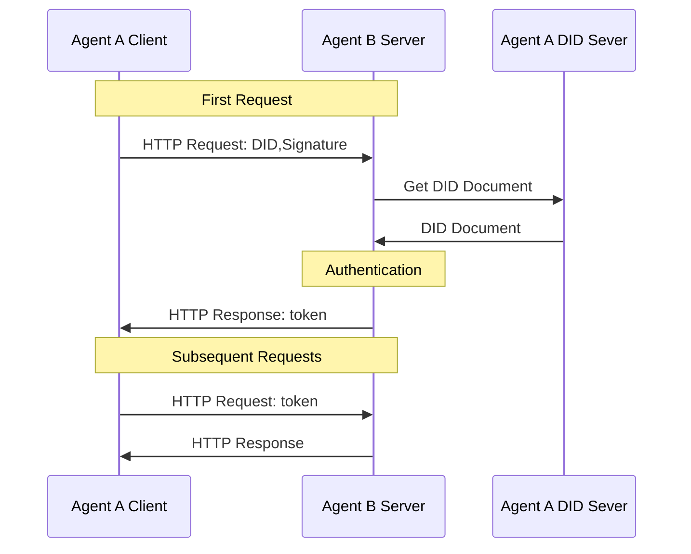

<!-- translation-review: full; scope: entire original source; paragraph-by-paragraph agent review; source code unchanged -->
> 日本語参考訳（原文全文をエージェントが照合）。規範となるのは原文です。コード例・識別子は保持しています。
> 原文: [chinese/01-AgentNetworkProtocol技术白皮书.md](../../chinese/01-AgentNetworkProtocol技术白皮书.md) / 基準コミット: `0837cfdfaf4ddcf834f0890ddaf34fc4c824e066`

# Agent Network Protocol技術白書

- 文書番号：ANP-01
- 状態：参考情報としての白書
- バージョン：1.2
- 原文言語：中国語

> 本白書は概念的な構成とビジョンを紹介します。ANP 1.2の規範要件は各プロトコル本文を正とします。汎用認証は[ANP-02](02-ANP-基于DID的身份认证协议.md)、WBAメソッド規則はANP-03が定義し、ネイティブ`did:web`も同じ認証フローを使います。ANP-06メタプロトコルは草案であり、メッセージP6の安定版にもMLS登録のリリース条件が残ります。

## 要旨

大規模モデルと自律的な意思決定AIの発展に伴い、エージェント（Agent）は、モバイルアプリに続くインターネットの新たな主体へと急速に成長しています。しかし、既存のインターネット基盤は主に人間同士や人間とシステムのやり取りを想定して設計されており、データの孤立、使いにくいインターフェース、エージェント間の高い協働コストといった問題から、大規模な相互接続と協働の需要を支えることが困難です。インターネットは大きな変革を迎えており、エージェントによる従来ソフトウェアの置換、広範な相互接続、ネイティブなプロトコルに基づく接続、自律的な組織化と協働という4つの中心的な傾向を示しています。

この傾向に応えるため、Agent Network Protocol（ANP）は、エージェントのインターネットに向けた新世代の通信プロトコルを提案します。ANPはAIネイティブ設計を貫き、既存のインターネットプロトコルとの互換性と再利用、組合せ可能なモジュール構成、簡潔さと拡張性、既存基盤を使った迅速な配備を重視します。アイデンティティ・暗号化通信層、メタプロトコル交渉層、アプリケーションプロトコル層という3層の体系によって、エージェントの認証、動的交渉、能力発見における相互運用の問題を体系的に解決します。

アプリケーション層では、エージェント記述プロトコル（ADP）とエージェント発見プロトコルを通じて、AIが使いやすいネイティブなデータネットワークを構築し、エージェントが構造化された方法で能力を公開し、相互接続できるようにします。安全性とプライバシーの設計では、人間による認可とエージェントによる認可を区別する仕組み、複数DIDによるプライバシー保護、最小限の情報開示、エンドツーエンド暗号化通信を導入し、オープンなネットワーク環境における利用者とエージェントの自律性とデータの安全性を確保します。

ANPは将来に向けて、デジタルの孤島を解消し、インターネットを閉じたプラットフォームのエコシステムから、オープンなプロトコルを中心とする協働ネットワークへ戻すことを目指します。「接続こそ力」という設計思想の下、質が高く摩擦の少ないエージェント間の接続と協働を促し、集合知の大きな可能性を解放します。ANPは通信標準の集合にとどまらず、エージェントのインターネット時代における開放性、公正さ、革新の活力を再構築する重要な基盤でもあります。世界の開発者、研究者、組織に、ANPのエコシステムの構築に参加し、エージェントが駆動する新しいインターネットの未来を共に作ることを呼びかけます。

## 1. はじめに

### 1.1 背景と問題

大規模モデルと自律的な意思決定AIの発展に伴い、エージェントはモバイルアプリに続くインターネットの新たな主体となりつつあります。エージェントは既存ソフトウェアを置き換え、インターネットの重要な構成要素になると期待されています。しかし、現在の技術基盤と接続のあり方は、主に次の点でエージェントのニーズを満たせません。

- **データの孤立がエージェントの意思決定の質を制限する**：質の高い判断には広範な情報の統合が必要です。しかし現在のインターネットでは、互いにつながらないプラットフォームにデータが分散し、「データの孤島」ができています。そのため、エージェントは完全な文脈情報を得られず、分析・推論・意思決定の能力が大きく制限されます。

- **人間向けのインターフェースがエージェントの対話効率を妨げる**：既存のネットワークサービスの多くは、人間向けのグラフィカルユーザーインターフェース（GUI）として設計されています。エージェントが利用するには人間の操作を模倣する必要があり、処理が複雑で非効率なうえ、誤りも生じやすくなります。直接的で効率的な自動対話を実現するため、エージェント向けのネイティブで機械可読なインターフェースプロトコルの提供が急務です。

- **標準プロトコルの不在がエージェントの協働を妨げる**：エージェント間には、統一された通信言語と協働規則がありません。自然言語も一つの意思疎通の手段にはなりますが、それだけでは大規模で信頼性の高い自動的な協働を支えられません。標準化されたプロトコルの確立は、エージェントのネットワーク化と集合知の発揮の鍵となります。

### 1.2 エージェントのインターネットの4つの傾向

以上から、インターネットはエージェントを中心とする新たな変革を迎えていると考えます。その4つの傾向は次のとおりです。

#### 1.2.1 エージェントが従来のソフトウェアを全面的に置き換える

将来、エージェントは既存のソフトウェアアプリケーションを徐々に置き換え、インターネットの重要な基盤となるでしょう。個人のレベルでは、AIアシスタントが既存アプリの大半を置き換え、利用者がインターネットに入る主要な入口となります。従来のアプリに比べ、情報統合、意思決定支援、状況に応じた対話の体験を桁違いに改善できます。企業のレベルでは、エージェントを配備し、インターネット上で利用者と直接つながってやり取りすることで、的確で効率的なサービスを提供します。同時に、個人アシスタントと企業エージェントとのP2Pでプラットフォームを介さない接続に代表される、新しい接続のあり方が生まれています。

#### 1.2.2 エージェント同士が広く相互接続する

第2の中心的な傾向は、任意のエージェント間で自由な接続を実現することです。これによって現在のデータの孤島を根本から解消し、情報の自由な流通を可能にします。全面的に相互接続されたエージェントネットワークにより、AIは分野やプラットフォームをまたぐ完全な文脈情報を十分に取得でき、個人や企業による、より包括的で正確な意思決定を支援します。また、このオープンな接続方式では、ネットワーク全体のあらゆるツールの能力を呼び出せるため、協働の深さと複雑さが大きく広がります。こうしてエージェント間のやり取りが、将来のインターネットで最も主流の接続方式となります。

#### 1.2.3 プロトコルに基づくネイティブな接続

現在はブラウザーやソフトウェア画面など、人間向けのComputer Use／Browser Useが主ですが、過渡的な方法でありAIの潜在力を十分に発揮できません。AIは人間向け画面やHTMLより、基盤の構造化データと意味情報の直接処理を得意とします。将来はAI用に設計した通信プロトコルがHTTPのように普及し、業界標準になると考えます。それを基礎に、エージェントがアクセス・操作しやすい新しいAI向けデータネットワークも生まれます。

#### 1.2.4 自律的に組織化し協働する

第4の傾向は自律的な組織化と協働です。標準プロトコルの支援で自然言語による柔軟な自動交渉を行い、互いの要望を迅速に明確化し、動的に協働関係を作って複雑なタスクを完了します。固定の構造化インターフェースを必要としない方式は、運用効率と応答性を上げ、人間の介入・連絡のコストを大幅に下げます。柔軟で効率的、低コストのネットワークが徐々に形成されます。

これらを支える新しい通信プロトコルが急務です。ANPはオープンで統一された接続機構により、相互接続、ネイティブインターフェース、効率的な協働という3つの課題を解き、AIエージェントの可能性を解放するために提案されました。

## 2. 中心となる設計原則

ANPは当初からエージェントのインターネットの要望を中心に、オープンで柔軟、実装可能な通信標準を目指し、次の原則に従います。

### 2.1 AIネイティブ設計（AI-Native Design）

ANPは、HTMLやGUIのように人間とシステムとのやり取りのために設計したプロトコルではなく、AIエージェント同士の直接通信のために設計されています。構造化データ、意味表現、自然言語の組合せを重視し、人間の操作を模倣することなく、エージェントが理解・発見・協働できるようにします。

目標：最も効率的で自然なインターネットへの接続によって、AIの意思決定と行動の可能性を解放すること。

### 2.2 互換性と再利用（Compatibility and Reuse）

ANPは、OpenAPI、JSON-RPC、音声・映像プロトコル（WebRTCなど）といった、広く使われている既存のインターネット標準を尊重し、互換性を保ちます。車輪の再発明をせず、軽量なメタプロトコルと記述標準を通じて、既存のプロトコルを、エージェントが理解し、交渉して利用できる意味的な枠組みへ包み込みます。

目標：革新を確保しながら学習・移行の負担を最小化し、既存エコシステムの迅速な参加を促すこと。

### 2.3 組合せ可能性（Composability）

ANPはモジュール構成を採用し、エージェントのアイデンティティ（DID）、記述（ADP）、発見といった中核要素を、単独でも自由に組み合わせても使えるようにします。開発者は実際のニーズに応じ、一つのプロトコル要素だけを使うことも、全体を統合することも柔軟に選べます。

目標：多様な複雑さ・段階の用途に対し、最小限の利用単位から大規模システムまで必要に応じて適応すること。

### 2.4 簡潔さと拡張性（Simplicity and Extensibility）

ANPは簡潔さを保つ原則（Keep It Simple）に従い、設計の初期からプロトコル自体を簡潔で直感的なものにし、理解と実装の敷居を下げることを目指します。同時に、十分な拡張インターフェースと柔軟なSchemaの仕組みを残し、将来のエージェントのエコシステムの発展に伴う新機能を、自然に追加できるようにします。

目標：中核を小さく安定させ、多様な用途に応じて成長する余地を残すこと。

### 2.5 既存基盤による実用的な配備（Pragmatic Deployability）

実際の配備可能性を重視し、DNS、HTTPS、Webサーバー、DIDシステムなど既存基盤で動作させます。複雑で普及しにくい新技術や専有部品へ依存せず、開発者や企業が対応サービスを迅速に構築できるようにします。

目標：初期配備の敷居を下げ、実環境での試行・利用・普及を速めること。

### 2.6 最小信頼の原則（Principle of Least Trust）

ネットワーク内のどの参加者（エージェント、ノードなど）も、既定で完全に信頼すべきではありません。すべてのやり取りを検証・認可し、特定のタスクを完了するために必要な最小限の権限だけを与えるべきです。このため、プロトコルの設計には強力な認証、アクセス制御、データ検証の仕組みを含め、潜在的な安全上のリスクと不正利用を減らす必要があります。

目標：信頼できない環境でも安全に動作できるエージェントネットワークを作ること。

## 3. プロトコルの中心的な設計

### 3.1 プロトコルの階層

次の3層構成を設計しました。

  

下から上へ次の3層に分かれ、それぞれ異なる中心的な役割を担います。

1. アイデンティティと暗号化通信の層（Identity and Secure Communication Layer）

エージェント間の認証と暗号化通信の基本標準を定め、プラットフォーム間の身元の相互認識とエンドツーエンド暗号化を扱います。

W3C DID標準による軽量で拡張可能な分散型認証（did:wbaなど）で、中央機関を介さずに任意の2体が相互の身元を安全に検証し、私的で信頼できる暗号化経路を確立します。

2. メタプロトコル層（Meta-Protocol Layer）

自然言語による交渉で通信プロトコルを動的に合意・適応させる方法を定義します。

要望、能力、協働の意図を交換し、リクエスト形式、インターフェースの呼出し、セッション管理など、現在の双方の状況に合う詳細を柔軟に交渉し、適応的な接続調整と実行時の最適化を実現します。

3. アプリケーションプロトコル層（Application Protocol Layer）

中心要素は記述と発見です。ADPなどの構造化文書で機能とインターフェースを公開し、発見プロトコルでサービスの入口を能動的・受動的に公開します。

### 3.2 アイデンティティと暗号化通信の層

すべてのエージェントの相互接続を実現するには、まずエージェント間の認証の問題を解く必要があります。現在のインターネットアプリケーションの多くは集中型のアイデンティティ技術を使っており、技術的な実装の違いから、システム間でアカウントを相互に認証することが困難です。OAuth2.0はこの問題をある程度緩和していますが[^2]、システム間認証のために設計されたものではないため、手順が比較的複雑で、分散化にも限界があります。そこで、簡便でプラットフォームをまたいで使える分散型認証技術が急務となっています。

ブロックチェーン型の分散認証も候補ですが、大規模利用での拡張性の課題から、現時点で最適な解決策にはなっていません。

これらの問題に対し、W3Cの分散型識別子（Decentralized Identifier、DID）標準[^3]を導入します。DIDは、従来の集中型アイデンティティ管理システムへの依存を解消するための、新しい識別子の標準です。ユーザーは集中型システムに依存せず、自分のアイデンティティを管理し、相互認証できます。DIDの中核仕様は、分散型識別子の構築に特定の計算基盤を使うことを要求しないため、既存の成熟した技術と整ったWeb基盤を十分に活用できます。また、さまざまな識別子システムにDID対応を追加することで、集中型・連合型・分散型の識別子システムをつなぐ相互運用の橋を架けられます。つまり、既存の集中型識別子システムも、全面的に再構築せず、その基盤上にDIDを作るだけでシステム間の相互運用を実現でき、技術的な実装の難しさを大幅に下げられます。

  

DIDの中核はDID文書です。特定のDIDに関する情報を含み、所有者の身元検証と、関連操作・権限・アクセス制御の管理を支えます。

  

DID文書には、ユーザーの認証に使うメソッドと対応する公開鍵が含まれ、秘密鍵はユーザー自身が保管します。クライアントは最初のHTTPリクエストのヘッダーにDIDと署名を載せることができます。サーバーはやり取りの回数を増やすことなく、DID文書の公開鍵でクライアントの身元を迅速に検証できます。初回の検証が成功した後、サーバーはtokenを返すことができ、クライアントは後続の要求にそのtokenを載せます。サーバーは毎回クライアントの身元を検証する代わりに、tokenだけを検証すればよくなります。この流れの中心は、検証者が信頼できる公開鍵を使ってユーザーの署名情報を検証し、1回の要求で認証、権限の確認、データ交換などを完了できることにあり、簡潔で効率的です。

DIDメソッドはDIDと文書の作成・解決・更新・無効化、認証・認可を定義します。`did:web`[^5]は成熟したWeb技術を使い、クラウドなどの集中型技術で管理でき、システム間はHTTPで相互運用します。インターネットのメールと同じく、各サービスが自分のアカウント基盤を集中管理しながら相互接続できます。

`did:web`を基に、エージェント間通信向けのプラットフォーム間認証と記述サービスなどを加え、新しいDIDメソッド`did:wba`（Web-Based Agent）を提案しました。`did:wba`は`did:web`の利点を受け継ぎつつ、エージェント間認証を最適化し、適用しやすくします。

また、通常、ユーザーはDIDに対して一つ以上の公開鍵・秘密鍵のペアを作成します。これらは認証に加え、エンドツーエンド暗号化通信にも使えます。DIDの鍵ペアを基に、一時的な楕円曲線Diffie-Hellman鍵交換（Elliptic Curve Diffie-Hellman Ephemeral、ECDHE）[^6]を用いた方式を設計し、二つのDID間の安全な通信と、中間ノードが通信内容を復号できないことを実現します。エンドツーエンド暗号化はエージェントのリバースプロキシにも使えます。例えば、将来、エージェントが運用コストを下げるために、第三者プラットフォームのポートを外部サービス用のポートとして借り、メッセージを転送させながら、そのプラットフォームには内容を復号させない、という利用が考えられます。

### 3.3 メタプロトコル層

メタプロトコルは、通信プロトコルの動作・解析・組合せ・対話規則を定義します。プロトコルを交渉するためのプロトコルであり、個別の転送を直接処理せず、柔軟で汎用的、拡張可能な通信の枠組みを提供します。

現在の通信方式は主に2つです。

1. **人間の技術者が通信プロトコルを設計する**：一般的な業界標準などが該当します。技術者がエージェント向けの通信プロトコルを設計し、処理コードを開発して、デバッグ、テスト、配備を行います。しかし、この方式には開発コストが高い、プロトコルの更新・改良が遅い、新しい場面に適応しにくい、といった問題が生じがちです。

2. **エージェントが自然言語を直接使って通信する**：エージェント同士が自然言語で通信し、内部の大規模言語モデル（LLM）でそのデータを処理します。ただし、この方式にも、データ処理コストが高い、処理精度が低いといった問題があります。

メタプロトコルとAIコード生成を使えば、柔軟性と個別性を保ちながら通信効率を高め、コストを下げられます[^7]。

基本手順は次のとおりです。

1. **メタプロトコル要求**：まずエージェントAがBへメタプロトコル要求を送ります。要求のbodyには、自然言語で自分のニーズ、入力、期待する出力を記述し、候補となる通信プロトコルを提案します。候補プロトコルには通常、トランスポート層のプロトコル、データ形式、データ処理方式などを含めます。

2. **プロトコル交渉**：Bは要求を受信すると、AIで自然言語の記述を処理し、自分の能力も考慮して、Aの要求と候補プロトコルを受け入れるかを判断します。自分の能力では要求を満たせない場合は、そのまま拒否します。候補プロトコルに同意しない場合は、自分の候補を提案し、次の交渉へ進むことができます。双方が合意するか、交渉が失敗するまで、この過程を続けます。

3. **コード生成・配備**：合意したプロトコルに基づき、双方が処理コードを生成・配備します。

4. **結合調整とテスト**：コードの配備が完了した後、双方で結合調整用のテストデータを交渉し、プロトコルとAI生成の処理コードについて、結合調整とテストを行います。

5. **正式通信**：調整後、正式に稼働させ、最終合意プロトコルで通信し、AI生成コードでデータを処理します。

6. **要望変更**：変更があれば同じ手順を繰り返し、再び合意します。

  

ただし、メタプロトコルの交渉には時間がかかり、AIのコード生成能力にも依存します。通信のたびに交渉すれば、非常に大きなコストと、使い勝手の悪さにつながります。エージェント間には同じ、または似た通信の過程が多いため、交渉結果を保存しておくことができます。後で類似のニーズが生じたら、過去の結果を正式なプロトコルとして直接使って通信するか、交渉の候補プロトコルとして使えます。また、結果を共有し、他のエージェントが検索・利用できるようにすることもできます。

エージェントが交渉結果を自発的にアップロードするよう経済面で動機付ける方法や、エージェント間で合意の得られたプロトコルを選ぶ方法は、メタプロトコル層で今後も研究を深める必要がある課題です。

### 3.4 アプリケーションプロトコル層

中心要素はエージェントの記述と発見です。

#### 3.4.1 エージェント記述プロトコル（Agent Description Protocol、ADP）

エージェント記述プロトコル（Agent Description Protocol、ADP）は、各エージェントに標準化された自己記述の方法を提供します。記述文書をJSON-LD（JSONに基づくリンクトデータ形式）で作成し、schema.orgが提供する共通語彙の拡張とANP独自の語彙を組み合わせ、統一されたメタデータ形式を定義します。エージェント記述（AD）文書は、ネットワーク上の名刺や紹介文に相当します。他のエージェントはこれを読んで、相手とのやり取りの方法を理解できます。

通常、次の情報を含みます。

- **基本情報**：名前、固有識別子、所属主体（個人・組織・他のエージェント）など。
- **能力**：機能、商品、サービスの一覧と説明。会話アシスタント、分析サービス、ロボットの実行能力など。
- **インターフェースとプロトコル**：そのエージェントとのやり取りの方法。呼出し可能なAPIエンドポイント、対応する通信プロトコルのバージョンや仕様を含み、他のエージェントはこれに従って要求やメッセージの送り方を把握します。
- **安全性と認可**：認証方式と権限要件。例えば身元検証用のDIDと公開鍵。ADPはプラットフォーム間認証の共通機構にdid:wbaを推奨します。
- **連絡先**：任意の技術支援や連絡経路（サービスURL、保守者のメールなど）。人間の介入・調整を助けます。

これらの情報をJSON-LD文書として構造化することで、エージェント記述は機械で解析できると同時に、豊かな意味を保持できます。JSON-LDのコンテキストを通じて、AD文書の語彙を公開オントロジーの定義へ結び付け、異なるシステム間で意味を一致させます。例えばADPが定義するAgent（エージェント）、Service（サービス）、Interface（インターフェース）などの中核語彙は、仕様に従うすべてのエージェントにとって共通の意味を持ちます。これが互いの能力を理解する基礎となります。

ADPは、分散型アイデンティティを記述文書のセキュリティ構成にも組み込みます。各エージェント記述をDIDへ結び付け、認証に使う検証メソッドと公開鍵情報を持たせることができます。他のエージェントは、記述を読んで通信する際、DID署名を検証して相手の身元を信頼できることを確認し、オープンなネットワークで安全な接続を確立できます。この設計はエージェント間の相互信頼を確保し、その後の協働の基礎となります。

記述文書はWebのホームページのような入口であり、これを読んでやり取りの方法を理解します。

#### 3.4.2 エージェント発見プロトコル

エージェントの記述に加え、互いの存在を発見し、接続を確立する仕組みも必要です。エージェント発見プロトコル（Agent Discovery Protocol）は、そのための標準プロトコルです。記述文書をネットワークで公開・検索する方法を定め、どのエージェントや検索サービスも、他のエージェントの入口を容易に見つけられるようにします。本質的にはエージェント向けの「検索エンジンプロトコル」として、エージェントのインターネット上のノードの可視性と到達性を確保します。

2つの補完的な方式があります。

1. **能動的発見（Active Discovery）**：Webで一般的な.well-knownパスの慣行に基づき、既知のドメインに公開されたすべてのエージェント記述の一覧を取得できます。具体的には、ドメイン内に統一したディレクトリの入口（既定のパスは/.well-known/agent-descriptions）を設けます。このURLにアクセスすると、そのドメイン内のすべてのAD文書URLを含むJSON-LDの一覧が返ります。文書の型はCollectionPageで、各エージェント記述へのリンクを列挙し、大量のエージェントにも対応できるようページ分割できます。この方式では、相手のドメインさえ分かれば、その下のエージェントディレクトリを取得でき、段階的にエージェントネットワーク全体をたどれます。

2. **受動的発見（Passive Discovery）**：検索エンジンがWebページを収集するのと同様に、エージェントは検索サービス専用のエージェントへ自分の情報を能動的に提出できます。具体的には、検索サービスが自分のエージェント記述で登録APIを公開し、他のエージェントがそのAPIへAD文書のURLを送って登録します。検索サービスは登録要求を受け取ると、そのURLを定期的に取得して最新の記述を収集し、データベースへ索引登録します。エージェントや利用者が関連サービスを検索したときには、登録されたエージェントの情報を返せます。新しいエージェントはこの方式で自分の存在を知らせ、索引サービスに収録されることで、より多くのノードから発見されるようになります。

二つの仕組みは互いを補完します。能動的発見は、分散したドメインのディレクトリを利用してエージェント一覧を公開することに重点を置き、受動的発見は、集中型の検索エージェントを導入して索引を集約します。すべての発見情報も、ADP仕様と同じJSON-LD形式で表します。どちらの経路で取得しても、発見結果が最終的に指す先は各エージェントの記述文書です。

新しい参加者も、仕様に沿って文書を公開・登録すれば検索され、孤島になりません。これは大規模なエコシステムの基盤です。

発見プロトコルは、大量のエージェント情報を効率的に管理するため、結果のページ分割とリンクの標準的な方法も定めます。あるドメイン内のエージェント数が多い場合、.well-known/agent-descriptions文書のnextフィールドで後続ページへリンクし、ページごとに読み込めます。検索サービスも、検索結果を返す際に同様のページ分割を使えます。こうした詳細が、発見処理の拡張性と堅牢性を確保します。

エージェント記述と発見の両プロトコルを組み合わせることで、ANPはアプリケーション層に一つの循環を作ります。ADPで自分を記述し、発見プロトコルで自分を公開するとともに他者を発見します。この仕組みが、エージェントのインターネットにおける「どう互いを知るか」という難題を解き、前述の相互接続のニーズを満たします。安全なアイデンティティ層と柔軟なメタプロトコル層を組み合わせ、エージェント間のオープンで効率的、信頼できる接続のための包括的な解決策を提供します。

### 3.5 AIネイティブなデータネットワーク

既存のインターネット基盤は、人間のアクセスを想定して設計されています。Webページはハイパーリンク（HTML＋HTTP）で接続され、ページ、フォーム、画像などの視覚的なインターフェースで情報を提示し、主に人間による閲覧と操作に使われます。しかし、この人間中心の接続方式は、AIエージェントによる効率的なアクセスと処理には適していません。既存のインターネットを使うには、クリック、閲覧、Webページの解析など人間の行動を模倣する必要があり、これがエージェントの能力の発揮を大きく制限します。

この問題を解くため、Agent Network Protocol（ANP）は、AIネイティブな設計のデータネットワーク構造を提案します。ADPと発見プロトコルにより、各エージェントがサービスインターフェース、能力情報、データリソースを構造化・標準化した方法で公開し、オープンな発見の仕組みを通じて、エージェントネットワーク全体から自動的に見つけられるようにします。

エージェントと、それが提供するテキスト・API・音声・映像・画像などのリソースが、機械に適したオープンなネットワークを構成します。

- 各ノードは記述・発見・呼出しができるエージェントかデータ単位です。
- 各リンクは、単に人間が読むためのハイパーテキストではなく、意味が明確で構造が統一されたプロトコル接続です。
- 共通標準に従い、他者のリソース・サービスを迅速に検索・理解・呼出しできます。

このネットワークでは画面模倣やWebクロールに依存せず、広く分散した能力と知識へ直接・効率的・一括でアクセスし、自律学習・推論・協働の可能性を解放します。

個人・サービス・検索のエージェントがANPで参加するにつれ、エージェントをノード、構造化データを接続とする網が成長し、世界を覆って動的に進化するインターネットになります。

## 4. 安全性とプライバシー

安全性とプライバシーは妥協できない基礎要件です。ANPは当初から**安全な身元認証、操作認可の区別、プライバシー保護、細かな権限制御**を中心機構とし、オープンな環境で信頼できる通信と安全なデータ共有を支えます。

以下で身元と認可の管理、プライバシー保護、通信の安全性を説明します。

### 4.1 人間とエージェントの認可の区別

慎重な扱いを要する操作を人間が制御できるようにするため、ANPは認証と操作認可を分離します。[ANP-02 v1.2](02-ANP-基于DID的身份认证协议.md)によれば、`did:wba` DID Documentは`authentication`に利用できる検証メソッドを宣言するだけで、専用の`humanAuthorization`検証関係は定義しません。

- **低リスク操作**：公開情報の照会や閲覧などは、ローカル認可ポリシーが許せば自動実行できます。
- **高リスク操作**：送金、重要データの提出、プライバシーに関わる情報の開示などは、明示的な人間の認可を得てからでなければ続行できないよう要求できます。

人間の認可要件はDIDより上の層で表します。

- [ANP-07](07-ANP-智能体描述协议规范.md)の`humanAuthorization: true`は、そのインターフェースの呼出しに人間の認可が必要と宣言します。
- 草案[ANP-06](06-ANP-智能体通信元协议规范.md)の`requiresHumanAuthorization: true`は交渉上の制約にすぎず、認可完了を意味しません。

要求に人間の認可が必要な場合、ユーザーのエージェントは、適用される認可ポリシーに従って確認手順を先に完了し、そのポリシーで許可された`authentication`鍵を使って署名してから、要求を開始するべきです。サーバーが検証するのは、要求が合意済みの上位の認可ポリシーを満たすかどうかです。`authentication`検証メソッドで生成した要求署名自体は、その操作が人間の認可を得たことの証明にはなりません。

この責務の分離によって、身元証明と操作認可を独立させ、慎重な扱いを要する操作について、上位のポリシーが人間の認可を要求できるようにします。ANP-02は、人間の認可を取得したり証明したりする方法を定義しません。これらの詳細は、適用される業務プロトコルと認可ポリシーが定義します。

### 4.2 秘密鍵管理と権限分離

エージェントの開発者は、高リスク操作に使う`authentication`鍵に対して、厳格な権限分離と安全な管理を行う必要があります。対策には次を含みますが、これらに限定されません。

- **リスクに応じた管理**：許可する操作に従って`authentication`鍵を分類し、リスクに応じた制御を行います。
- **ローカルでの暗号化保存**：秘密鍵は、TEEやHSMなど安全に暗号化されたローカル機器、または保護された鍵管理システムに保存するべきです。
- **追加確認**：ポリシーが要求すれば、`authentication`鍵による高リスク操作前に、指紋・顔認証・ワンタイムパスワード・安全な機器での承認などを取得します。
- **操作ログの記録**：慎重な扱いを要する署名操作は毎回、完全な操作ログを記録し、後から監査・追跡できるようにする必要があります。

これらにより、鍵の漏えい、盗用、乱用のリスクを最大限に抑えます。

### 4.3 複数DIDと細かなプライバシー保護

プライバシー保護と匿名性を高めるため、ANPは利用者とエージェントに**複数DIDの管理戦略**を推奨します。具体的には次の方法があります。

- **主DIDと子DIDの分離**：主DIDは友人・企業パートナーなどの長期関係に使い、買物・出前・オンラインサービスなど用途ごとに独立した子DIDを作ります。
- **最小権限**：各子DIDには特定のタスクに必要な最小の権限と役割だけを与えます。
- **定期的なローテーションと無効化**：子DIDにはライフサイクルを設け、使用後は定期的に廃棄して新たに取得するべきです。これにより、用途をまたぐ追跡や身元を関連付ける攻撃を防ぎます。

身元と行動を分離し、大規模分析でのプライバシー露出を減らし、全体の身元の安全性を高めます。

### 4.4 開示最小化と通信のプライバシー

エージェント間通信では、**最小情報開示の原則（Minimal Disclosure Principle）**を重視します。

- 要求を完了するために必要な情報フィールドだけを送信し、無関係な漏えいを防ぎます。
- 機密フィールドはエンドツーエンド暗号化し、経路を傍受されても内容が漏れないようにします。
- すべての通信セッションを対応する認証情報へ結び付け、中間者攻撃と通信の偽装を防ぐべきです。

さらに、検証可能な暗号化や選択的開示クレデンシャルなど、アプリケーション層の匿名通信技術を推奨し、私的データの保護とアクセス制御を強化します。

## 5. 将来展望：接続によるオープンなネットワークの再構築

インターネットの発展の歴史は、「接続こそ力（Connection is Power）」という中心的な理念を明確に示しています。真にオープンで相互接続されたネットワークでは、ノード間の自由なやり取りが、革新の可能性を最大限に引き出し、大きな価値を生みます。しかし現在のインターネットのエコシステムは、少数の巨大プラットフォームによる支配が強まり、大量のデータやサービスが閉じた「デジタルの孤島」に囲い込まれ、接続を支配する力が少数のテクノロジー大手へ高度に集中しています。

エージェントのインターネット時代の到来は、この不均衡を再構築する歴史的な機会です。私たちは、広く見られる閉鎖的で断片化した現状から、オープンで自由な接続というインターネットの原点への回帰を目指します。将来のエージェントネットワークでは、各エージェントが情報の消費者とサービス提供者の両方の役割を担います。さらに、どのノードも、ネットワーク上の他のどのノードについても、障害なく発見・接続・対話できるようになるべきです。この全面的な相互接続のビジョンは、情報の流通と協働の敷居を大幅に下げ、接続を支配する力を一人ひとりの利用者とエージェントへ取り戻します。

これは、プラットフォーム中心の閉じたエコシステムから、プロトコル中心のオープンなエコシステムへの重要な転換を意味します。後者では、価値を得るうえで、閉じた特定のプラットフォームを支配することより、参加者がオープンなプロトコルに従ってネットワークにもたらす独自の能力と貢献が重視されます。この転換は、アプリケーション層での革新と競争をさらに活発にします。成功の鍵は利用者を「囲い込む」ことではなく、優れたエージェントのサービスを提供することになるためです。これは、TCP/IPやSMTPなどのオープンなプロトコルが、歴史的に促してきた革新の形に似ています。

エージェントネットワークの構築は、広い協力と共同の努力を必要とする壮大な事業であり、オープンソースが重要な力となります。ANPは基盤となるオープンソースの通信プロトコルであり、その成功は開発者コミュニティーによる採用、実装、継続的な貢献にかかっています。エージェント技術とオープンなインターネットの未来に関心を持つ研究者、開発者、企業、組織の皆さんを、ANPの開発、テスト、利用促進への参加に招き、エージェントが効率的に協働する未来を共に築きたいと考えています。

## 参考文献

[^1]: Bill Gates「AIはコンピューターの使い方を全面的に変える」[https://www.gatesnotes.com/AI-agents](https://www.gatesnotes.com/AI-agents)

[^2]: OAuth 2.0認可フレームワーク [https://tools.ietf.org/html/rfc6749](https://tools.ietf.org/html/rfc6749)

[^3]: 分散型識別子（DIDs）v1.0：中核アーキテクチャ、データモデル、表現 [https://www.w3.org/TR/did-core/](https://www.w3.org/TR/did-core/)

[^4]: 分散型識別子のユースケースと要件 [https://www.w3.org/TR/did-use-cases/](https://www.w3.org/TR/did-use-cases/)

[^5]: did:webメソッド仕様 [https://w3c-ccg.github.io/did-method-web/](https://w3c-ccg.github.io/did-method-web/)

[^6]: Transport Layer Security（TLS）プロトコル1.3 [https://www.rfc-editor.org/rfc/rfc8446.html](https://www.rfc-editor.org/rfc/rfc8446.html)

[^7]: 大規模言語モデルのネットワーク向けの拡張可能な通信プロトコル [https://arxiv.org/pdf/2410.11905](https://arxiv.org/pdf/2410.11905)

## 著作権表示
Copyright (c) 2024 ANP Community
本書は[Apache License 2.0](../../LICENSE)で公開されています。自由に利用・変更できますが、この著作権表示を保持する必要があります。
