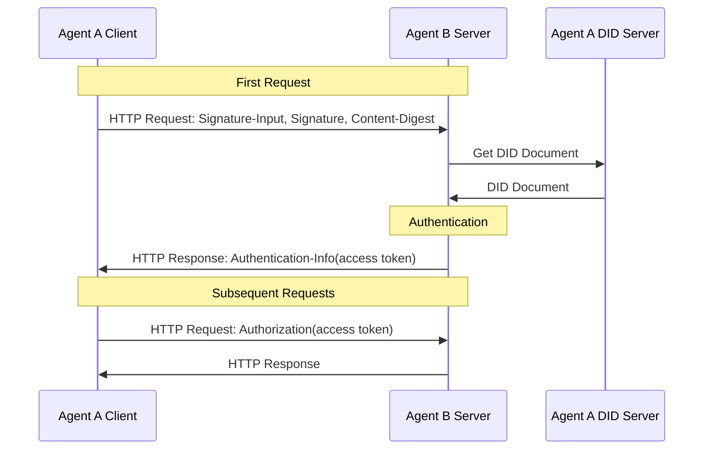
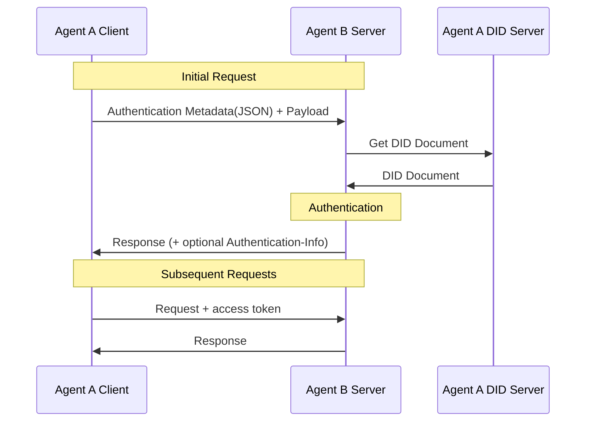

<!-- translation-review: partial; scope=selected normative paragraphs at source lines 488; remainder=machine-unreviewed -->
> 日本語参考訳（機械翻訳・未校閲）。規範となるのは原文です。コード例・識別子・規範キーワードは原文を保持しています。
> 原文: [chinese/02-ANP-基于DID的身份认证协议.md](../../chinese/02-ANP-基于DID的身份认证协议.md) / 基準コミット: `0837cfdfaf4ddcf834f0890ddaf34fc4c824e066`

# AMP ベースの DID ベースの認証プロトコル

- 書類番号:ANP-02
- ステータス:公開
- バージョン: 1.2
- 言語:中国語
- イギリスのミラー:[ANP DID認証プロトコル](../02-anp-did-authentication-protocol-specification.md)

<a id="scope"></a>
## 1. スコープ

この定義は、HTTP 署名、JSON 認証情報ロード、サービスエンドの検証、チャレンジ、エラー処理、オプションのアクセストークンを含むクロスプラットフォーム認証用の DID に基づいています。

認証プロセスは特定の DID メソッドに依存します。`did:wba` オリジナル。 `did:web` DID メソッドは、識別材料が取得および検証される方法を指定します。署名、要約、認証キーの使用が続きます。

この命令は、共通のHTTP APIに使用され、ANPメッセージ契約、WNSまたはデバイスマニフェストの実装を必要としません。 運用権、マニュアル承認、メッセージ原発証拠およびE2EEオブジェクトは、プロファイルによって適用または定義されていると定義されており、アイデンティティに基づいてのみ成功したビジネス特権を持つことを想定することはできません。

このテキスト MUST、MUST NOT、SHOULD、SHOULD NOT とりあえず MAY (c) BCP 14 に準拠している規範的な要件を表現する。

<a id="identity-input"></a>
## 2. DID方法論とアイデンティティ

| DID方法 | アイデンティティ材料の認証のためのバシス | 認証のリクエスト |
|---|---|---|
| `did:wba` | AMP-03 DID フォーマット、ドキュメント、キー、解像度、アップデート、無効化および継続規則;付録 A を参照してください。 | 第三章 4 |
| `did:web` | 元の作業:Web分析ルールと付録B認証要件 | 第三章 4 |

ドキュメントの認証、アイデンティティ結合、ライフサイクルルールは DID メソッドによって定義されます。この命令では、認証キーの認可、メソッドの検証後のシグネチャとサマリーのリクエスト、証明書またはステータスメカニズムを自己定義することなく、メソッド固有の認証を確認できます。

アルゴリズムとキーは、選択した方法と適用方法の規則に従って決定されます。他の DID メソッドの適切な方向は、付録 D で示されています。WebVH のアクセス説明は、付録 C で行われます。 DD Core のみが特定の達成がサポートされていないことを示していません。

<a id="common-model"></a>
<a id="http-binding"></a>
## 3. 認証のためのHTTPリクエスト

クライアントが異なるプラットフォームのサービス終了へのリクエストを開始すると、クライアントはサービスエンドの認証のためにTLSと組み合わせてドメイン名を使用することができます。これにより、クライアントDIDファイルでの検証方法に応じてクライアントのアイデンティティが確認されます。

クライアントは、最初のHTTPリクエスト時に使用 [RFC 9421の特長](https://www.rfc-editor.org/rfc/rfc9421) 定義された `Signature-Input` とりあえず `Signature` 頭署名; メッセージを運ぶ場合は、使用 [RFC 9530の特長](https://www.rfc-editor.org/rfc/rfc9530) 定義された `Content-Digest` ヘッドタッチメッセージの完全性。最初の検証後、サービスプロバイダはアクセストークンを返し、クライアントフォローアップリクエストでアクセストークンが含まれているため、クライアントのアイデンティティを毎回確認する必要はありませんが、単にトークンにアクセスしてください。



### 3.1 最初のリクエスト

クライアントは、サービスプロバイダへの最初のHTTPリクエストを開始する際、次の方法に従って識別する必要があります。

#### 3.1.1 リクエストのヘッド形式

クライアントは必須です。MUST) . [RFC 9421の特長](https://www.rfc-editor.org/rfc/rfc9421) 定義された `Signature-Input` とりあえず `Signature` 認証メッセージを送信するヘッダーフィールド。リクエストにメッセージが含まれている場合は、クライアントも必要です()MUST送信する [RFC 9530の特長](https://www.rfc-editor.org/rfc/rfc9530) 定義された `Content-Digest` ヘッダーフィールド。

最低の署名のカバレッジは次です:

- `@method`
- `@target-uri`
- `content-digest`(リクエストにメッセージが含まれている場合)

カバーには、次の追加コンポーネントが推奨されます。

- `@authority`
- `content-type`
- `content-length`

`Signature-Input` 以下に、この中の重要なパラメータが必須です。

- `keyid`: 必須(必須)MUST)は、DID ドキュメントのバリデーションメソッドを指す完全な DID URL です。例:  
  `did:web:identity.example:alice#key-1`
- `created`: 必須(必須)MUST) は署名作成時間を示します
- `expires`: 肩(肩)SHOULD) 署名が期限切れの時刻を示します
- `nonce`: はい (MAY) 持ち運び; サービスレベルのチャレンジが与えられる場合 `nonce`クライアントは必須です(MUSTこれを利用する `nonce`
- `alg`: 非必須フィールド。この規範は意味しません `alg` 変数、certifierは使用することができます `keyid` アルゴリズムを決定する認証方法として指すべきDIDの種類

認証キーの選択は、該当するDIDメソッドとローカル認可ポリシーに従います。選択した認証方法は、DID文書の対象となります `authentication` 関係の承認。

クライアントリクエスト例:

```plaintext
POST /orders HTTP/1.1
Host: api.example.com
Content-Type: application/json
Content-Digest: sha-256=:BASE64_SHA256_DIGEST:
Signature-Input: sig1=("@method" "@target-uri" "@authority" "content-digest");created=1733402096;expires=1733402156;nonce="abc123";keyid="did:web:identity.example:alice#key-1"
Signature: sig1=:BASE64_SIGNATURE:
```

メソッド固有のシグネチャ作成要件は、セクション2で説明するように、対応するDIDメソッドによって定義されます。

#### 3.1.2 署名生成プロセス

1. HTTP リクエストにメッセージが含まれている場合、クライアントは最初にプレスします。 [RFC 9530の特長](https://www.rfc-editor.org/rfc/rfc9530) メッセージの送信 `Content-Digest` 値。

2. 該当するDID方法論とローカル認証戦略に基づいて、シグネチャの認証方法を選択します。
   - 選択した認証方法が使用される場合 `Multikey` Ed25519 キーは、Ed25519 アルゴリズムを使用して署名する必要があります。
   - その他のアルゴリズムは、対応する認証方式で定義されます。

3. コンテンツ `Signature-Input`少なくとも上書き `@method` とりあえず `@target-uri`;メッセージが存在する場合、それはまた上書きされなければならない `content-digest`。

4. プレス [RFC 9421の特長](https://www.rfc-editor.org/rfc/rfc9421) 定義されたルールは、署名ベース文字列(署名ケース)を生成します。

5. クライアントの秘密鍵で署名し、署名されたバイトを取得し、それらを書き込み `Signature` ヘッダーフィールド。

6. ウィル `Signature-Input`、`Signature` と(該当する場合)`Content-Digest` 一緒にサービスに送る。

### 3.2 サービスエンドの検証

#### 3.2.1 認定要求の頭

クライアントリクエストの受領後、サービスプロバイダは以下の検証を実行します。

1. **認証リクエストのフォーマット**: 検査 `Signature-Input` とりあえず `Signature` 既存の;要求にメッセージが含まれている場合チェック `Content-Digest` 存在。

2. **メッセージの完全性を検証**: リクエストにメッセージが含まれている場合、 [RFC 9530の特長](https://www.rfc-editor.org/rfc/rfc9530) 認証 `Content-Digest` 実際のソースと一致していますか?

3. **リッピング `keyid` とパースのID**: から `Signature-Input` & チェック `keyid`、対応する DID および認証方法を取得します。

4. **DID 文書の読み込みと検証**: メソッドで定義されたアイデンティティのステータスと、新しい認証に対する制限は、対応する方法論によって調整されます。特定の応答については、セクション3.2.4.3を参照してください。

5. **DID 結合関係を検証**：
   - 認証 `keyid` (b) 指示された検証の方法の存在;
   - DID ドキュメントによる認証方法の認証 `authentication` (a) 関係の承認;
   - メソッド固有の ID 結合認証は、セクション 2 および対応するメソッドで説明されているように、対応する DID 方法論によって調整されます。

6. **署名のカバレッジを検証**_: に基づく `Signature-Input` 署名ベースを再構築し、署名がカバーする HTTP コンポーネントは実際のリクエストと一致していることを確認します。

7. **バリデーションタイムウィンドウ**: 検査 `created` / `expires` 合理的な時間枠内であっても、推奨時刻のウィンドウは1分～5分です。達成した人物が構成します。

8. **再入金保護を検証**：
   - 直接会社、サービス応答のため `(keyid, nonce)` または短期再生アカウントを作成する。
   - チャレンジポリシーの場合、 `nonce` サービスエンドチャレンジから、 `nonce` 必要 (必須)MUST) 1回ずつ。

9. **特定許可証の確認**: 認証が成功した場合、独立した検証リクエストのDIDはサービスエンドリソースへのアクセス権を持っています。許可がない場合は、返します `403 Forbidden`。

10. **認証結果**: 署名認証が成功した場合は、認証を要求します。そうしないと、返します `401 Unauthorized`チャレンジ情報で。

方法論固有の認証要件は、セクション2で説明するように、対応するDID方法論によって定義されます。

#### 3.2.2 署名プロセスの検証

1. から `Signature-Input` 署名ラベルを解析するセンター、コンポーネントを上書きする`created`、`expires`、`nonce`、`keyid` パラメーターのように、 `Signature` . 対応するシグネチャ値が描画されます。

2. プレス [RFC 9421の特長](https://www.rfc-editor.org/rfc/rfc9421) 実際のHTTP署名ベースに基づくルール、リクエスト再確立。

3. 基本情報 `keyid` DID ドキュメントから対応する認証方法と公開鍵を取得します。

4. 認証方法の種類に応じて、認証アルゴリズムを選択します。
   - あり。 `Multikey` Ed25519 の検証方法は、Ed25519 の 64 バイト署名形式で検証されています。
   - その他のアルゴリズムは、対応する認証方式で定義されます。

5. 署名が対応するプライベートキーによって生成されるように取得した公開鍵を使用してシグネチャを検証します。

6. リクエストにメッセージが含まれている場合は、 `Content-Digest` 認証結果は、全認定結論書に組み込まれています。

<a id="access-tokens"></a>
#### 3.2.3 正常にアクセスを返す_トークン

サービスエンド認証が成功すると、アクセストークンは応答で返すことができます。アクセストークンはJWT(JSON Web Token)にあることを推奨します。クライアントフォローアップリクエストにはアクセストークンが含まれており、サービスはクライアントのDIDを毎回確認する必要はありませんが、アクセストークンのみです。次の生成プロセスは参照目的のために必要ではなく、必要に応じて独自の方法で定義および実行する人がいます。

世代別参照のJWT方法 [RFC7519の特長](https://www.rfc-editor.org/rfc/rfc7519)。

1. **アクセストークンを生成**

サービスエンド採用の前提 **JWT(JSON Web Token) のWebトークン** アクセストークンのフォーマットとして、JWT は以下項目を指しています。

- **ヘッダー**: 署名アルゴリズムを指定する
- **ペイロード**: 店舗ユーザー関連情報
- **サイン**: はい。 `header` とりあえず `payload` 完全性を確保するためにサイン

ペイロードには、次のフィールド(必要に応じて追加される他のフィールド)を含めることができます。

```json
{
  "sub": "did:web:identity.example:alice",
  "iat": "2024-12-05T12:34:56Z",
  "exp": "2024-12-06T12:34:56Z",
  "scope": "orders.read orders.write"
}
```

2. **アクセストークンの返送**

サービスエンド 必須 (MUST) パス `Authentication-Info` 応答ヘッダーは、応答ではなくアクセストークンを返します `Authorization` ヘッドバック。

事例:

```plaintext
Authentication-Info: access_token="eyJhbGciOi...", token_type="Bearer", expires_in=3600, scope="orders.read orders.write"
```

3. **sunder-construedトークンの推奨**

トークン漏れ後の直接再利用のリスクを低減するため、より推奨される使用 **送信者禁忌** アクセストークンは、クライアントが保持するトークンキーをバインドします。

このバージョンでは、この拡張機能の保持を規制していますが、送信者禁忌トークンの特定の要件を定義するはまだ完了していません。 達成者は将来の拡張のための次の機能を予約することができます:

- クライアントのパブリックキーに、トークンにバインドされたステートメントを追加します。(例:g. `cnf` または同等の分野;
- クライアントがフォローアップリクエストでトークンの境界証拠を提供し続けるように要求する。
- パス。 `token_type` フィールドはトークンポリシーと区別します。

標準の決定的なプロファイルが調和する前に、互換性目的のために使用される場合があります `Bearer` デフォルトとして `token_type`。

4. **クライアントはアクセストークンを送信します**

クライアントは通常フォローアップリクエストで渡します `Authorization` アクセストークン:

```plaintext
Authorization: Bearer <access_token>
```

サービスが返された場合 `token_type` ありません。 `Bearer`クライアントは必須です(MUST) トークンを対応する拡張子コードに従って送信します。

5. **サービス検証アクセストークン**

お客様からのご要望をお受けいただ `Authorization` 認証用ヘッドティックアクセストークン(シグネチャの確認、有効期限の期限、ペイロード中のフィールド認証など)。 [RFC7519の特長](https://www.rfc-editor.org/rfc/rfc7519)。

<a id="challenge-errors"></a>
#### 3.2.4 みずし

##### 3.2.4.1 401 応答

署名のサービスのエンド認証が失敗した場合、`Content-Digest` 認証が失敗した時に、署名が期限切れ、リスクを再割り当てるか、またはサービスがクライアントにチャレンジ情報を再署名する必要があります。 `401 Unauthorized` 応答。

サービスプロバイダが、クライアントがサービス・ダウンサイドを使用する必要がある場合 `nonce` クライアントリクエストが要求されると、最初に返すことができます。 `401`. これは、必要に応じて使用するかどうかを選べることができる人を達成するインタラクティブなものを追加します。

エラーメッセージが渡されました。 `WWW-Authenticate` ヘッダーのリターン、サービスは利用できます `Accept-Signature` 次のリクエストでカバーされるコンポーネントの指示。

```plaintext
WWW-Authenticate: DIDWba realm="api.example.com", error="invalid_signature", error_description="Signature verification failed.", nonce="xyz987"
Accept-Signature: sig1=("@method" "@target-uri" "@authority" "content-digest");created;expires;nonce;keyid
Cache-Control: no-store
```

次のフィールドが含まれています。

- **リアルム**: 保護されたリソースが属する領域を示すオプションフィールド
- **エラー**: フィールド、エラータイプ、次の文字列値を含む必要があります。
  - `invalid_request`: フォーマットエラーのリクエスト、必要なフィールドを欠落させるか、サポートされていないパラメータを含む
  - `invalid_nonce`: ノnce 使用、無効またはサービスレベルのチャレンジに一致しない
  - `invalid_timestamp`範囲のタイムスタンプ
  - `invalid_did`: DID 形式のエラーや、DID に基づく対応する DID 文書の検出はできない
  - `invalid_signature`_その他組織
  - `invalid_verification_method`: ベース不可 `keyid` 対応する公開鍵を見つけました
  - `invalid_content_digest`：`Content-Digest` メッセージの分離
  - `invalid_access_token`一時的なフォルダを閉じることができません: %s
  - `forbidden_did`: DID はサービスエンドリソースへのアクセスができません
- **エラー_説明:**: 任意項目、間違いの記述
- **ノンス**: オプションフィールド、サービスによって生成されるランダムな文字列。 実行された場合、クライアントはこれを使用する必要があります `nonce` 署名と再発リクエストの再現

クライアントが `401` 応答を受信した後、その応答に `nonce` が含まれる場合、サーバーの `nonce` を使用して署名を再生成し、リクエストを再開始する必要があります。応答に `nonce` が含まれていない場合、クライアントはローカルの `nonce` を再生成して再試行できます。

無限ループを防ぐために、クライアントとサーバーはそれぞれの実装で再試行の数を制限する必要があることに注意してください。

##### 3.2.4.2 403 応答

サーバー認証は成功したが、DID にサーバー リソースへのアクセス許可がない場合、`403 Forbidden` 応答が返されることがあります。

##### 3.2.4.3 メソッド固有の応答

ID ステータスに関連するエラーとその後の処理は、該当する DID メソッドによって定義されます。対応するメソッド バインディングを参照してください。一般的な認証エラーでは、セクション 3.2.4.1、3.2.4.2 のルールが使用されます。

<a id="json-carriage"></a>
## 4. JSON認証情報ベアラー

前の章では、DID と HTTP に基づく認証プロセスを定義しました。認証情報は他のトランスポートによって搬送される場合があり、そのコンポーネントのマッピングは対応するアプリケーション層プロトコルによって決定されます。このセクションでは、セクション 3 の認証情報を JSON メタデータとして運ぶ方法のみを定義し、署名される新しいフィールドのセットを再定義するものではありません。

このセクションは、リクエストのメタデータとビジネス ペイロードをアプリケーション層で分離できるシナリオに適用されます。次に例を示します。

- HTTP ボディのカプセル化
- WebSocket の最初のパッケージ
- メッセージバスエンベロープ
- カスタム RPC リクエスト ラッピング レイヤー

「認証メタデータ」と「ビジネス ペイロード」の境界を分離できない純粋な JSON のみの送信の場合、このセクションは直接適用されず、後続のバージョンでは特殊なトランスポート プロファイルを定義できます。

他のデータ形式に基づくプロトコルでも、この認証メカニズムを使用できます。

全体的なプロセスは次のとおりです。



### 4.1 最初のリクエスト

現在のクライアントが初めてサーバーへのリクエストを開始するとき、次の方法に従って ID 認証を実行する必要があります。

#### 4.1.1 認証情報データ形式

認証情報を HTTP ヘッダーに配置できない場合は、セクション 3 の認証フィールドを、`auth` フィールドなどの別の JSON メタデータ オブジェクトに配置できます。

推奨される形式は次のとおりです。

```json
{
  "auth": {
    "contentDigest": "sha-256=:BASE64_SHA256_DIGEST:",
    "signatureInput": "sig1=(\"@method\" \"@target-uri\" \"@authority\" \"content-digest\");created=1733402096;expires=1733402156;nonce=\"abc123\";keyid=\"did:web:identity.example:alice#key-1\"",
    "signature": "sig1=:BASE64_SIGNATURE:"
  },
  "payload": {
    "orderId": "12345",
    "action": "create"
  }
}
```

フィールドの説明:

- **auth.contentダイジェスト**: HTTP のヘッダに相当する `Content-Digest`. 運用ペイロードがある場合、この作業はバインドに使用されます。 `payload`
- **auth.signatureInput(オース・サイン)**: HTTP のヘッダに相当する `Signature-Input`
- **auth.signature(オース・サイン)**: HTTP のヘッダに相当する `Signature`
- **ペイロード**: 業務データベース

JSON のロード・モードでは、`contentDigest` 結合は... **ペイロードの部品**、含まないで下さい `auth` カプセル化オブジェクト全体。`auth` 運用ペイロードの要約に参加しない外部認証メタデータです。

場合 `payload` 元のバイトのシーケンスではなく JSON オブジェクトであり、 エクセアはローカルにシリアライズルールを固定する必要があります。 使用のために推奨 [RFC8785の特長](https://www.rfc-editor.org/rfc/rfc8785) JCS(JSON CANNONIALIZATION SCHEME) の発表 `payload` 計算前の安定したシーケンス `contentDigest`。

識別情報は、別々のリクエストまたはビジネスリクエストデータとともに送信される場合があります。

#### 4.1.2 署名プロセス

署名生成プロセスは、 3.1.2 のシグネチャ生成プロセスと似ています。

1. `Content-Digest`、`Signature-Input` とりあえず `Signature` HTTP ヘッダーを経由して送信するのではなく、JSON メタデータオブジェクト(例: g) 経由で送信されることはありません。 `auth`(c) 送信;
2. `contentDigest` デフォルトはバインドです `payload` カプセル化オブジェクト全体ではなくバイト。
3. 一番下の行が HTTP の場合、`@method` とりあえず `@target-uri` つまり、変更されていないままです。一番下のプロトコルが HTTP でなければ、対象となるアプリケーション層の合意により、対象メッセージの同等のコンポーネントを明示的に定義する必要があります。

### 4.2 サービスエンド認証

#### 4.2.1 識別要求

認証プロセスは、要求の頭の3.5.1と同じではありません。`contentDigest`、`signatureInput`、`signature` フィールドは、要求されたデータから必要です `auth` オブジェクト抽出。

一方、サービスは確認しています `contentDigest` 制限されるべき `payload` いくつかのレビューはまとめられ、検証されています。

検証後、一番下の転送が HTTP の場合、サービスエンドは 3.2.3 と同じ方法でアクセストークンを返します。つまり、 `Authentication-Info` ヘッドバックを応答します。

一番下の転送が応答ヘッドをサポートしていない場合、この命令はアクセストークンの代替リターンとして標準化されず、上位レベルの合意自体によって定義されます。

#### 4.2.2 みずし

エラー処理は、 3.2.4 エラー処理と同じです。

一番下の伝送が HTTP の場合、`WWW-Authenticate` とりあえず `Accept-Signature` ヘッドは、定性チャレンジ情報源を残します。アプリケーションレイヤーは、JSONレスポンスのエラーフィールドをミラーリングすることもできます。

JSON 形式のレスポンスを 401 を返します。

```json
{
  "code": 401,
  "error": "invalid_nonce",
  "error_description": "Nonce has already been used. Please provide a new nonce.",
  "nonce": "1234567890"
}
```

JSON 形式の 403 応答を返します。

```json
{
  "code": 403,
  "error": "forbidden_did",
  "error_description": "did not have permission to access the resource."
}
```

## 5. 特定および申請の承認

重要なリクエストを少なくするために、ユーザーのインテリジェンスはホテルの知性へのアクセスを自動的に承認し、ホテルに関する情報を読むことができます。この時点で、人間確認は必要ありません。そして、ユーザーインテリジェンスは独自の代理で要求を開始できます。

重要な要求については、予約ホテルの客室など、ホテルのインテリジェンスは、この時点で手動の人間の確認を必要とする場合があります。しかし、その意味は「人間識別が必要」というトップレベルの承認戦略であり、独立したDID文書分野ではありません。 `authentication` 認証方法の宣言、この認証規範で定義されていない `humanAuthorization` フィールド。

スマートボディは、文書やインターフェイスの認可の種類をインテリジェントな説明文書で定義でき、すべての通常の承認はデフォルトでは十分です。リクエストが人手手認証を必要とする場合は、ドキュメントで明確に定義する必要があります。例えば:

- `authorizationLevel: normal`
- `authorizationLevel: user-presence-required`

リクエストのヒューマンマニュアル承認が必要な場合は、ユーザインテリジェンスは、対応する確認プロセスをローカル(例えば、認証、バイオメトリック、セキュリティハードウェアの承認など)で完了し、戦略によって許可されるものを使用する前に完了する必要があります。 `authentication` 鍵は署名され、要求が開始されます。

サービスレベルの検証は、要求が合意された高レベル認証戦略を満たしているかどうかです。DID文書から「署名者は人間自身によって行わなければならない」と推測するのではなく、

スマート開発者は、ローカルセキュリティ確認プロセスを通じてのみ、アクセスを高レベルの操作のために秘密鍵を安全に保持し、隔離する必要があります。

## 6. 個人情報保護

プライバシー保護は、不正なソフトウェアがユーザーの「s DID」を通してユーザー行動を記録し追跡できる、機密性の高いネットワークで非常に重要です。

これに関して、DID プロバイダーがマルチ DID 戦略を採用できることを提案します。つまり、1 人のユーザーに対して複数の DID を生成し、各 DID に異なる役割と権限があり、異なるキー ペアを使用してプライバシー保護ときめ細かい権限制御を実現します。

たとえば、マスター DID がユーザーに対して生成されます。この DID は通常は変更されず、社会的関係を維持するなどのシナリオで使用されます。その後、ユーザーに対して一連のサブ DID が生成され、ショッピング、テイクアウトの注文、チケットの予約、その他のシナリオに使用できます。これらのサブ DID はメイン DID に従属し、期限切れの DID を定期的に非アクティブ化し、新しい DID を適用してプライバシーとセキュリティ保護を向上させることができます。

ネーム サービス (WNS/ハンドルなど) は、人間が判読できる安定した名前を提供します。名前バインディングと DID ライフサイクルは、それぞれ対応する仕様によって処理されます。

<a id="security-privacy"></a>
## 7. 安全上の考慮事項

実装者は、実装する際に次のセキュリティ問題を考慮する必要があります。

1. **鍵管理**

   - DID に対応する秘密鍵 ** ** は適切に保管し、漏洩してはなりません。さらに、** は、** で定期的な秘密鍵更新メカニズムを確立する必要があります。
   - ユーザー ** は、** 複数の DID を生成する必要があります。各 DID には異なる役割と権限があり、異なるキー ペアを使用して、きめ細かい権限制御を実現します。

2. **攻撃対策**

   - 業務内容**必要です。**保護を再制定します。直接企業のために、ターゲット `(keyid, nonce)`、`(keyid, jti)` 短期再生キャッシュを作成する。 ホールエンジプログラム、サービス終了 `nonce` **必要です。**一度に1つ。
   - 業務内容**必要です。**審査依頼書にて `created` / `expires` 時間ウィンドウは、時間が戻って転がりないようにします。 通常、Cache を再生するためのサービスツーサービスのキャッシュの長さ**なるほど。**署名が期限切れになる時間よりも大きいです。
   - 生成する `nonce` できるかどうかはわかりません。**必要です。**オペレーティングシステムが提供する安全なランダムな番号ジェネレータを使用して、近代的なコードセキュリティ規範と基準を満たします。 `secrets` モジュールは、安全なランダムな番号を生成します。
   - メッセージを要求する際のサービス**必要です。**認証 `Content-Digest`ボディが改ざんされるのを防ぐ。
   - 認証の成功は、認可が成功したという意味ではありません。サービスエンド**必要です。**認証審査は、本人から別途処理されます。

3. **安全を守る**

   - DID ドキュメントにアクセスする際に、サービスプロバイダ**なるほど。**DNS-over-HTTPS(DoH)プロトコルを使用して、安全性を高めます。
   - プロトコルの転送**必要です。**HTTPS およびクライアントの使用**必要です。**相手のCA証明書が信頼できるかどうか厳密に判断します。
   - クライアントは、TLS サービス用のIDチェックを行っています。**必要です。**プレス `subjectAltName` メディス `dNSName` 一致は、共通の名前に依存しない。
   - DID プロセスは良いものではありません。**なるほど。**政府は、不信の無条件再オリエンテーションを防ぐための活動も行っています。

4. **トークンはクリアです。**

   - クライアントとサービス終了**必要です。**(a) セキュアアクセストークン、および**必要です。**合理的な時間を設定。
   - **なるほど。**優先度は、sensor-construedアクセストークンに与えられます。 この規範は拡張容量を予約しましたが、特定のケースとしてまだ完全に定義されていません。
   - IPアドレス、ユーザーエージェントなどは、サポートするリスク信号としてのみ使用できます。**いったん。**アクセストークンの結合機構としてのみ。
   - アクセストークン **なるほど。**HTTPS接続のみで、 `Authentication-Info` 応答ヘッドオフ。

<a id="wba-binding"></a>
## 付録A. 行なった:wbaメソッドの結合

WBA IDと認証の要求方法は、バインディングです。 [ANP-03の特長](../../chinese/03-did-wba方法规范.md#wba-auth-binding)定義。このメソッドの検証とキーの選択を最初に承認し、この命令の第3章と4節の共通認証プロセスを使用します。また、方法論に対する特定の応答はANP-03によって定義されます。

<a id="web-binding"></a>
## 付録B. 行なった:web メソッドの結合

ネイティブ `did:web` 認証にHTTP/JSONを使用、変換する必要はありません `did:wba`. 身元文書のプレス [行なった:web方法論的規範](https://w3c-ccg.github.io/did-method-web/)下記の規則に従って解析・検証を行います。

たとえば:`keyid` あり あり `did:web:identity.example:alice#auth` , サービス解析が行なった: web `did:web:identity.example:alice` , チェック `#auth` 元のWebメソッドに従って、IDが確認されます。

### B.1 分析と認証ルール

ネイティブが受け取れるとき `did:web` , 必須 (必須)MUST) . `did:web` メソッドは、解像度の実装を規制し、以下をチェックするだけを完了します。

1. プレス `did:web` ルールは、DID文書を解決します。
2. DID ドキュメントのチェック `id` リクエストに関連しているか `did:web` (a) 完全な一貫性;
3. DIIDコアルールに従って、関連する認証方法の存在を確認し、正しい配信応答です。

受賞作品**ない (ない)MUST NOT）**他の DID メソッドは、出生時に独自の識別子の結合、文書認証、ライフサイクルルールを一意に作成します。 `did:web` 成功のための前提条件をテストして下さい。

元の場合、 `did:web` DID 文書は、達成可能な独自の標準の証拠(データ情報プログラムなど)を保有しています。MAY)この証拠書およびローカル戦略に従って認証を実行します。他の方法の文書認定要件は、元のものには適用されません `did:web`。

### B.2 プラットフォームの断層的なアイデンティティとの互換性

ネイティブ `did:web` この命令の章3と4で定義されるこのクロスプラットフォーム識別プロセスは、互換性があります。

クライアントが利用する場合 `did:web` 横断面識別に参加する場合:

1. `keyid` それでも必要 ()MUST)完全なDID URLです。
2. サーバーは引き続き DID Document を解決しなければなりません（MUST）。
3. サービスの終了は、まだ必要 ()MUST) 検証 `keyid` (b) 指示された検証の方法の存在;
4. サービスの終了は、まだ必要 ()MUST)認証方法はDID文書にあることを確認し `authentication` (a) 関係;
5. 次のHTTPメッセージ 署名/ `Content-Digest` 検証ロジックは、第3章と4節で共通認証プロセスを追記します。

`did:web` 本人の拘束力のある方は、通訳と認定規則の独自の方法により決定されます。

<a id="webvh-design"></a>
## 付属のC. WebVHアクセス指示(情報)

`did:webvh` 文書が検証された後、証明書の鍵素材を提供でき、そのメソッドに従ってステータスが確認され、一般的な要求認証プロセスが使用できる。特定のバージョン、履歴/ステータスの確認と適応はまだ決定されていないため、この命令は直接有効にできるWebVH結合を定義しない。

<a id="method-template"></a>
## 付録D. その他のDIDメソッド(infomatic)

W3C DID Core と一致している他のメソッドは、それぞれが解読や認証ルールでキー識別と認証資料を提供します。適応の記述は、メソッドバージョン、認証方法の種類、署名アルゴリズム、サポート範囲を指定し、この命令の一般的な要求認証プロセスを使用します。

<a id="references"></a>
## リファレンス

- [DID コア v1.0](https://www.w3.org/TR/2022/REC-did-core-20220719/)
- [RFC 2119:規範的な要件の重要な言葉](https://www.rfc-editor.org/rfc/rfc2119)
- [RFC 8174: 仮鍵のケース](https://www.rfc-editor.org/rfc/rfc8174)
- [RFC 9421:HTTPメッセージ署名](https://www.rfc-editor.org/rfc/rfc9421)
- [RFC 9530:消化器分野](https://www.rfc-editor.org/rfc/rfc9530)
- [RFC 8785:JSON のキャニシリゼーションの化学](https://www.rfc-editor.org/rfc/rfc8785)
- [RFC 7519:JSON Web トークン](https://www.rfc-editor.org/rfc/rfc7519)
- [ANP-03: ド:wba方法論的仕様](03-did-wba方法规范.md)
- [行なった:web方法論的規範](https://w3c-ccg.github.io/did-method-web/)

## 公益社団法人 一般社団法人 日本版著作権協会

2024年 ANP オープンソースコミュニティ
この文書は以下に基づいています [Apache ライセンス 2.0](../../LICENSE) 投稿されたものは自由に使用および変更できますが、この著作権に関する声明は保持する必要があります。
