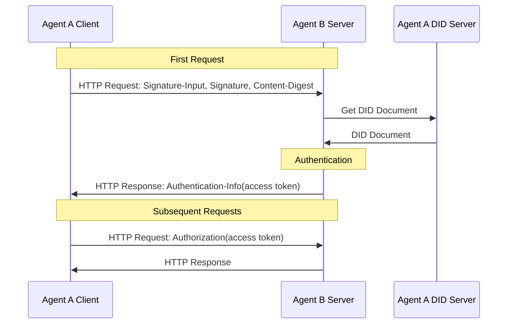
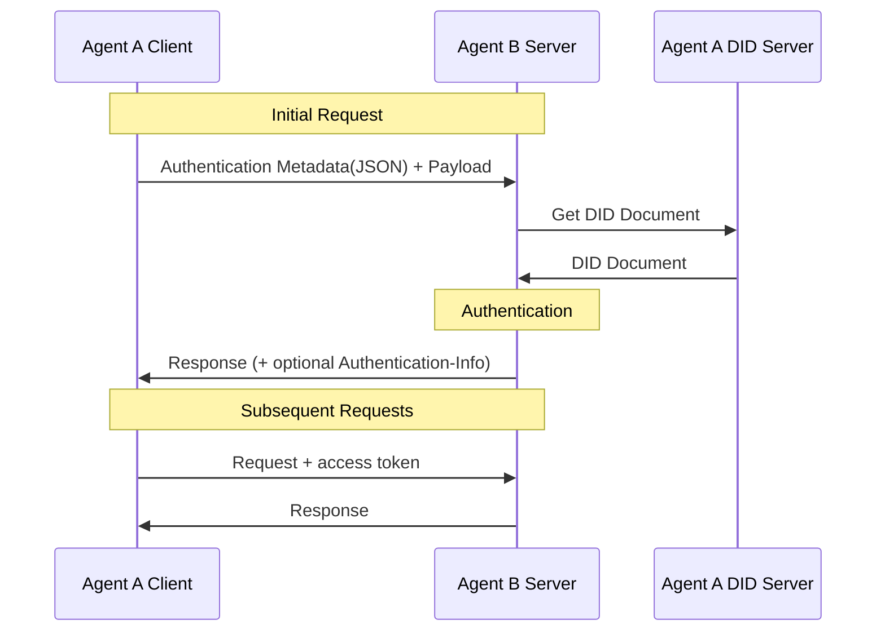

<!-- translation-review: full; source=chinese/02-ANP-基于DID的身份认证协议.md; basis=entire original read and manually compared paragraph by paragraph -->
> 日本語参考訳（機械翻訳を基に原文全文を照合済み）。規範となるのは原文です。コード例・識別子・規範キーワードは原文を保持しています。
> 原文: [chinese/02-ANP-基于DID的身份认证协议.md](../../chinese/02-ANP-基于DID的身份认证协议.md) / 基準コミット: `0837cfdfaf4ddcf834f0890ddaf34fc4c824e066`

# ANP DID ベース認証プロトコル

- 文書番号：ANP-02
- 状態：公開済み
- バージョン：1.2
- 原文の言語：中国語
- 英語版：[ANP DID Authentication Protocol](../02-anp-did-authentication-protocol-specification.md)

<a id="scope"></a>
## 1. 範囲

本仕様は、DID に基づくプラットフォーム間の認証を定義します。HTTP リクエスト署名、JSON による認証情報の格納、サーバー側の検証、チャレンジとエラー処理、任意の Access Token を含みます。

認証フローは特定の DID メソッドから独立しています。`did:wba` とネイティブな `did:web` は、それぞれのメソッド規則で DID Document を解決・検証した後、本仕様の共通の要求認証フローを使います。DID メソッドはアイデンティティ資料の取得・検証方法を定め、要求署名、ダイジェスト、認証鍵の用途は本仕様に従います。

本仕様は通常の HTTP API に適用でき、ANP メッセージプロトコル、WNS、デバイス Manifest の実装を要求しません。業務上の権限、人間による認可、メッセージの origin proof、E2EE オブジェクトの証明は、各アプリケーションや Profile が定義します。認証の成功だけで業務権限があると推定してはなりません。

本書の MUST、MUST NOT、SHOULD、SHOULD NOT、MAY は、BCP 14 に従う規範要件を表します。

<a id="identity-input"></a>
## 2. DID メソッドとアイデンティティ資料

| DID メソッド | アイデンティティ資料を検証する根拠 | 要求認証 |
|---|---|---|
| `did:wba` | ANP-03 の DID 形式、文書、鍵、解決、更新、無効化、連続性の規則。付録 A を参照 | 第 3、4 章 |
| `did:web` | ネイティブな did:web の解決規則と付録 B のアイデンティティ検証要件 | 第 3、4 章 |

文書の真正性、アイデンティティの結合、ライフサイクルの規則は、各 DID メソッドが定義します。本仕様は、メソッドの検証に成功した後で、認証鍵の用途に対する認可、要求署名、ダイジェストを確認します。メソッド固有の証明や状態機構を独自に定義しません。

アルゴリズムと鍵の表現は、選択した検証メソッドと適用されるメソッド規則で決まります。他の DID メソッドへの適応方針は付録 D、WebVH の導入説明は付録 C を参照してください。DID Core に準拠するだけでは、ある実装がそのメソッドに対応済みとはいえません。

<a id="common-model"></a>
<a id="http-binding"></a>
## 3. HTTP リクエスト認証

クライアントが異なるプラットフォームのサーバーへ要求する際、クライアントはドメイン名と TLS でサーバーを認証でき、サーバーはクライアントの DID 文書内の検証メソッドでクライアントを認証します。

クライアントは最初の HTTP 要求に、[RFC 9421](https://www.rfc-editor.org/rfc/rfc9421) の `Signature-Input` と `Signature` ヘッダーで署名します。本文がある場合は、[RFC 9530](https://www.rfc-editor.org/rfc/rfc9530) の `Content-Digest` で本文の完全性を結び付けます。初回検証に成功すると、サーバーは access token を返すことができます。以後の要求に token を付ければ、サーバーはクライアントの認証を毎回繰り返さず、access token を検証するだけで済みます。



### 3.1 初回要求

クライアントが初めてサーバーに HTTP 要求を送る際は、次の方法で認証します。

#### 3.1.1 要求ヘッダーの形式

クライアントは [RFC 9421](https://www.rfc-editor.org/rfc/rfc9421) の `Signature-Input` と `Signature` ヘッダーフィールドで認証情報を送信しなければなりません（MUST）。要求に本文がある場合は、[RFC 9530](https://www.rfc-editor.org/rfc/rfc9530) の `Content-Digest` ヘッダーフィールドも送信しなければなりません（MUST）。

署名に最低限含めるコンポーネントは次のとおりです。

- `@method`
- `@target-uri`
- `content-digest`：要求に本文がある場合。

追加で署名に含めることを推奨するコンポーネントは次のとおりです。

- `@authority`
- `content-type`
- `content-length`

`Signature-Input` の主要パラメーターの要件は次のとおりです。

- `keyid`：DID 文書の検証メソッドを指す、完全な DID URL でなければなりません（MUST）。例：  
  `did:web:identity.example:alice#key-1`
- `created`：必須（MUST）。署名の作成時刻です。
- `expires`：指定することが望まれます（SHOULD）。署名の有効期限です。
- `nonce`：含めてもかまいません（MAY）。サーバーのチャレンジで `nonce` が指定された場合、クライアントはその `nonce` を使用しなければなりません（MUST）。
- `alg`：必須ではありません。本仕様は `alg` パラメーターを強制せず、検証者は `keyid` が指す DID 検証メソッドの型からアルゴリズムを判断できます。

認証鍵の選択は、適用する DID メソッドとローカルの認可ポリシーに従います。選択する検証メソッドは、主体の DID Document の `authentication` 関係で認可されている必要があります。

クライアント要求の例：

```plaintext
POST /orders HTTP/1.1
Host: api.example.com
Content-Type: application/json
Content-Digest: sha-256=:BASE64_SHA256_DIGEST:
Signature-Input: sig1=("@method" "@target-uri" "@authority" "content-digest");created=1733402096;expires=1733402156;nonce="abc123";keyid="did:web:identity.example:alice#key-1"
Signature: sig1=:BASE64_SIGNATURE:
```

メソッド固有の署名生成要件は、それぞれの DID メソッド仕様が定義します。第 2 節を参照してください。

#### 3.1.2 署名の生成手順

1. HTTP 要求に本文がある場合、まず [RFC 9530](https://www.rfc-editor.org/rfc/rfc9530) に従って本文の `Content-Digest` を計算します。

2. 適用する DID メソッドとローカルの認可ポリシーに従って、署名に使う検証メソッドを選びます。
   - 選択した検証メソッドが `Multikey` 表現の Ed25519 鍵を使う場合は、Ed25519 で署名するべきです。
   - 他のアルゴリズムは、該当する検証メソッドの型が定義します。

3. `Signature-Input` を作成し、少なくとも `@method` と `@target-uri` を対象に含めます。本文がある場合は `content-digest` も必ず含めます。

4. [RFC 9421](https://www.rfc-editor.org/rfc/rfc9421) の規則で、署名ベース文字列（signature base）を生成します。

5. クライアントの秘密鍵で signature base に署名し、得られた署名バイト列を `Signature` ヘッダーに格納します。

6. `Signature-Input`、`Signature`、および該当する場合の `Content-Digest` を、サーバーへ送ります。

### 3.2 サーバー側の検証

#### 3.2.1 要求ヘッダーの検証

要求を受け取ったサーバーは、次の検証を行います。

1. **要求形式の検証**：`Signature-Input` と `Signature` の存在を確認し、本文があれば `Content-Digest` も確認します。

2. **本文の完全性の検証**：本文がある場合は、[RFC 9530](https://www.rfc-editor.org/rfc/rfc9530) に従って `Content-Digest` と実際の本文の一致を検証します。

3. **`keyid` の抽出と DID の解決**：`Signature-Input` から `keyid` を抽出し、DID と検証メソッドを得ます。

4. **DID 文書の取得と検証**：適用する DID メソッドに従って DID Document を解決・検証します。メソッドが定義するアイデンティティの状態と、新しい認証への制限は、そのメソッド仕様が扱います。メソッド固有の応答は第 3.2.4.3 節を参照してください。

5. **DID の結合関係の検証**：
   - `keyid` が指す検証メソッドの存在を検証します。
   - その検証メソッドが、DID 文書の `authentication` 関係で認可されていることを検証します。
   - メソッド固有のアイデンティティ結合の検証は、該当メソッド仕様に従います。第 2 節と各メソッドのバインディングを参照してください。

6. **署名対象範囲の検証**：`Signature-Input` から signature base を再構築し、署名対象の HTTP コンポーネントと実際の要求の一致を検証します。

7. **時刻範囲の検証**：`created` / `expires` が妥当な時刻範囲内か確認します。推奨範囲は 1 分から 5 分で、実装者が設定します。

8. **リプレイ防止の検証**：
   - 直接接続の proof profile では、サーバーは `(keyid, nonce)` または同等のキーで短期間の replay cache を設けるべきです。
   - challenge profile で、`nonce` がサーバーのチャレンジに由来する場合、その `nonce` は一度限りの使用にしなければなりません（MUST）。

9. **DID の権限の検証**：認証成功後、要求中の DID にリソースへのアクセス権限があるか、独立に検証します。権限がなければ `403 Forbidden` を返します。

10. **検証結果**：署名検証に成功すれば要求は認証され、失敗すればチャレンジ情報を付けて `401 Unauthorized` を返します。

メソッド固有のアイデンティティ検証要件は、各 DID メソッド仕様が定義します。第 2 節を参照してください。

#### 3.2.2 署名の検証手順

1. `Signature-Input` から署名ラベル、対象コンポーネント、`created`、`expires`、`nonce`、`keyid` などを解析し、`Signature` から対応する署名値を抽出します。

2. [RFC 9421](https://www.rfc-editor.org/rfc/rfc9421) に従い、実際の HTTP 要求から signature base を再構築します。

3. `keyid` に基づいて、DID 文書から検証メソッドと公開鍵を得ます。

4. 検証メソッドの型に応じて、検証アルゴリズムを選びます。
   - `Multikey` 表現の Ed25519 検証メソッドでは、Ed25519 の 64 バイト署名形式で検証します。
   - その他は、該当する検証メソッドの型の定義に従います。

5. 取得した公開鍵で署名を検証し、対応する秘密鍵によって生成されたことを確認します。

6. 本文がある場合は、`Content-Digest` の検証結果も、認証全体の判断に含めるべきです。

<a id="access-tokens"></a>
#### 3.2.3 認証成功時の access_token の返却

検証に成功したサーバーは、応答に access token を含められます。形式は JWT（JSON Web Token）を推奨します。以後の要求に token があれば、サーバーはクライアントの DID 認証を毎回行わず、access token だけを検証できます。以下の生成手順は規範上の必須要件ではなく、参考です。実装者は必要に応じて定義・実装できます。

JWT の生成方法は [RFC7519](https://www.rfc-editor.org/rfc/rfc7519) を参照してください。

1. **Access Token の生成**

サーバーが **JWT（JSON Web Token）** を使う場合、通常は次のフィールドがあります。

- **header**：署名アルゴリズムを指定します。
- **payload**：利用者の関連情報を格納します。
- **signature**：`header` と `payload` に署名し、完全性を確保します。

payload には、例えば次のフィールドを含められます。必要に応じて追加できます。

```json
{
  "sub": "did:web:identity.example:alice",
  "iat": "2024-12-05T12:34:56Z",
  "exp": "2024-12-06T12:34:56Z",
  "scope": "orders.read orders.write"
}
```

2. **Access Token の返却**

サーバーは access token を、応答の `Authorization` ヘッダーではなく、`Authentication-Info` 応答ヘッダーで返さなければなりません（MUST）。

例：

```plaintext
Authentication-Info: access_token="eyJhbGciOi...", token_type="Bearer", expires_in=3600, scope="orders.read orders.write"
```

3. **sender-constrained token の推奨**

token の漏えい後にそのまま再利用されるリスクを減らすため、クライアントが保持する鍵に結び付いた **sender-constrained** access token を、より強く推奨します。

本版は拡張の余地を残しますが、sender-constrained token の具体的な profile を完全には定義しません。実装者は、将来の拡張のため次の能力を用意できます。

- token に、クライアント公開鍵へ結び付ける claim を含める。例えば `cnf` または同等のフィールドです。
- 後続の要求にも、token と結び付いた proof を継続して要求する。
- `token_type` で token profile を区別する。

sender-constrained profile が統一されるまでは、互換性のため、既定の `token_type` に `Bearer` を使うことができます。

4. **クライアントによる Access Token の送信**

クライアントは、通常、後続の要求の `Authorization` ヘッダーで Access Token を送ります。

```plaintext
Authorization: Bearer <access_token>
```

サーバーが返す `token_type` が `Bearer` 以外なら、クライアントは該当する拡張仕様に従って token を送信しなければなりません（MUST）。

5. **サーバーによる Access Token の検証**

サーバーは要求の `Authorization` ヘッダーから Access Token を取り出し、署名、有効期限、payload のフィールドなどを検証します。[RFC7519](https://www.rfc-editor.org/rfc/rfc7519) を参照してください。

<a id="challenge-errors"></a>
#### 3.2.4 エラー処理

##### 3.2.4.1 401 応答

署名検証や `Content-Digest` 検証の失敗、署名の期限切れ、リプレイのリスク、またはチャレンジ情報に従う再署名を要求する場合、サーバーは `401 Unauthorized` を返せます。

サーバーが発行した `nonce` による署名を要求する場合は、クライアントの最初の要求に `401` とチャレンジ情報を返せます。やり取りが1回増えるため、利用するかは実装者が判断できます。

エラー情報は `WWW-Authenticate` ヘッダーで返します。サーバーは `Accept-Signature` で、次の要求の署名に含めてほしいコンポーネントを示すこともできます。

```plaintext
WWW-Authenticate: DIDWba realm="api.example.com", error="invalid_signature", error_description="Signature verification failed.", nonce="xyz987"
Accept-Signature: sig1=("@method" "@target-uri" "@authority" "content-digest");created;expires;nonce;keyid
Cache-Control: no-store
```

次のフィールドを含みます。

- **realm**：任意。保護対象リソースの所属ドメインです。
- **error**：必須。エラーの種類を、次の文字列で示します。
  - `invalid_request`：要求形式の誤り、必須フィールドの欠落、未対応パラメーターの指定。
  - `invalid_nonce`：使用済み、無効、またはサーバーのチャレンジと一致しない Nonce。
  - `invalid_timestamp`：許容範囲外のタイムスタンプ。
  - `invalid_did`：DID 形式の誤り、または対応する DID 文書を取得できない。
  - `invalid_signature`：署名検証の失敗。
  - `invalid_verification_method`：`keyid` から対応する公開鍵を見つけられない。
  - `invalid_content_digest`：`Content-Digest` と本文の不一致。
  - `invalid_access_token`：access token 検証の失敗。
  - `forbidden_did`：DID にリソースへのアクセス権限がない。
- **error_description**：任意。エラーの説明です。
- **nonce**：任意。サーバーが生成するランダム文字列です。指定されていれば、クライアントはその `nonce` で署名を生成し直し、要求を再送する必要があります。

`401` 応答に `nonce` があれば、クライアントはサーバーの `nonce` で再署名して再送します。応答に `nonce` がなければ、ローカルで `nonce` を生成し直して再試行できます。

無限ループを防ぐため、クライアントとサーバーは、それぞれ再試行回数を制限する必要があります。

##### 3.2.4.2 403 応答

認証は成功したものの、DID にリソースへのアクセス権限がない場合、サーバーは `403 Forbidden` を返せます。

##### 3.2.4.3 メソッド固有の応答

アイデンティティ状態に関するエラーとその後の処理は、適用する DID メソッドが定義します。各メソッドのバインディングを参照してください。共通の認証エラーには、第 3.2.4.1、3.2.4.2 節を適用します。

<a id="json-carriage"></a>
## 4. JSON による認証情報の格納

前章は、DID と HTTP による認証フローを定義しました。他のトランスポートで認証情報を運ぶこともでき、そのコンポーネントの対応付けは各アプリケーション層プロトコルが決めます。本節は、第 3 節の認証情報を JSON メタデータとして格納する方法だけを定義し、新たな署名対象フィールドの集合を定義し直すものではありません。

要求メタデータと業務 payload をアプリケーション層で分離できる、次のような場面に適用します。

- HTTP body によるカプセル化
- WebSocket の最初のパケット
- メッセージバスの envelope
- 独自 RPC の要求ラッパー

認証メタデータと業務 payload の境界を分離できない、純粋な JSON-only トランスポートには直接適用しません。将来の版で、専用の transport profile を定義する可能性があります。

他のデータ形式のプロトコルも、この認証方式を使えます。

全体の流れは次のとおりです。



### 4.1 初回要求

初めてサーバーに要求を送るクライアントは、次の方法で認証します。

#### 4.1.1 認証情報のデータ形式

認証情報を HTTP ヘッダーに置けない場合は、第 3 節のフィールドを、例えば `auth` という独立した JSON メタデータオブジェクトに格納できます。

推奨形式：

```json
{
  "auth": {
    "contentDigest": "sha-256=:BASE64_SHA256_DIGEST:",
    "signatureInput": "sig1=(\"@method\" \"@target-uri\" \"@authority\" \"content-digest\");created=1733402096;expires=1733402156;nonce=\"abc123\";keyid=\"did:web:identity.example:alice#key-1\"",
    "signature": "sig1=:BASE64_SIGNATURE:"
  },
  "payload": {
    "orderId": "12345",
    "action": "create"
  }
}
```

フィールドの説明：

- **auth.contentDigest**：HTTP の `Content-Digest` に対応します。業務 payload がある場合は `payload` を結び付けます。
- **auth.signatureInput**：HTTP の `Signature-Input` に対応します。
- **auth.signature**：HTTP の `Signature` に対応します。
- **payload**：業務データ本体です。

JSON 格納方式では、`contentDigest` が結び付けるのは **payload 部分**であり、`auth` を含むラッパー全体ではありません。`auth` は外側の認証メタデータで、業務 payload のダイジェストには含めません。

`payload` が元のバイト列ではなく JSON オブジェクトである場合、実装者はシリアライズ規則をローカルで固定するべきです。[RFC8785](https://www.rfc-editor.org/rfc/rfc8785) の JCS（JSON Canonicalization Scheme）で `payload` を安定してシリアライズした後に `contentDigest` を計算することを推奨します。

認証情報は、独立した要求として送ることも、業務要求データと一緒に送ることもできます。

#### 4.1.2 署名の生成手順

基本は第 3.1.2 節と同じですが、次の点が異なります。

1. `Content-Digest`、`Signature-Input`、`Signature` は HTTP ヘッダーではなく、`auth` などの JSON メタデータオブジェクトで送ります。
2. `contentDigest` は、既定ではラッパー全体ではなく、`payload` のバイト表現に結び付けます。
3. 下位プロトコルが HTTP であれば、`@method` と `@target-uri` の意味は変わりません。HTTP 以外なら、対象メッセージでの等価なコンポーネントをアプリケーション層プロトコルが明示するべきです。

### 4.2 サーバー側の検証

#### 4.2.1 認証要求の検証

基本は第 3.2.1 節と同じですが、`contentDigest`、`signatureInput`、`signature` を、要求データ中の `auth` オブジェクトから抽出します。

サーバーが `contentDigest` を検証する際は、`payload` 部分だけを対象にするべきです。

下位トランスポートが HTTP の場合、検証成功後の access token は、第 3.2.3 節と同じく `Authentication-Info` 応答ヘッダーで返します。

下位トランスポートが応答ヘッダーに対応しない場合、本仕様は代替の返却方法を標準化せず、上位プロトコルが定義します。

#### 4.2.2 エラー処理

基本は第 3.2.4 節と同じです。

下位トランスポートが HTTP なら、`WWW-Authenticate` と `Accept-Signature` ヘッダーが引き続き正式なチャレンジ情報源です。呼び出し側で扱いやすいよう、アプリケーション層がこれらのエラーフィールドを JSON 応答本文にも複写できます。

JSON による 401 応答の例：

```json
{
  "code": 401,
  "error": "invalid_nonce",
  "error_description": "Nonce has already been used. Please provide a new nonce.",
  "nonce": "1234567890"
}
```

JSON による 403 応答の例：

```json
{
  "code": 403,
  "error": "forbidden_did",
  "error_description": "did not have permission to access the resource."
}
```

## 5. 認証とアプリケーションの認可

ホテルのエージェントから情報を読むような重要度の低い要求は、利用者のエージェントが自動で許可し、人間の手動確認なしに代理で実行できます。

ホテルの部屋の予約など、重要な要求では人間の確認を要する場合があります。ただし、人間の確認が必要かどうかは上位の認可ポリシーの意味であり、DID Document の独立したフィールドではありません。DID Document は `authentication` で認証用の検証メソッドを宣言します。本認証仕様は `humanAuthorization` フィールドを定義しません。

エージェントは、自身の記述文書で文書やインターフェースの認可種別を定義できます。既定では通常の認可で足りるものとし、人間の手動認可が必要な要求は、例えば次のように明示するべきです。

- `authorizationLevel: normal`
- `authorizationLevel: user-presence-required`

人間の手動認可が必要なら、利用者のエージェントは、クリック確認、生体認証、安全なハードウェアによる承認などのローカルな確認手順を先に完了し、そのポリシーが認める `authentication` 鍵で署名して要求を送るべきです。

サーバーが検証するのは、合意された高度な認可ポリシーを要求が満たすかどうかです。DID 文書だけから、人間本人が必ず署名したと推定するのではありません。

開発者は、高度な操作に使う秘密鍵を安全に保持し、権限を分離する必要があります。例えば、ローカルの安全な確認手順を通過した後にだけ、その鍵を使用可能にします。

## 6. プライバシー保護

分散型ネットワークではプライバシー保護が非常に重要です。例えば、不正なソフトウェアが利用者の DID で行動を記録・追跡し、プライバシーを漏えいさせる可能性があります。

対策として、DID の提供者が利用者に複数の DID を生成し、それぞれに異なる役割、権限、鍵ペアを割り当てる方式を推奨します。これにより、プライバシー保護と細かな権限制御を実現します。

例えば、通常変更せず社会的な関係を維持する主 DID を生成し、それに従属する一連の子 DID を、買い物、出前、チケット予約などに個別に使います。期限の過ぎた DID を定期的に無効化して新しい DID を取得すれば、プライバシー保護を高められます。

WNS/Handle などの名前サービスは、安定した人間可読な名前を提供できます。名前の結合と DID のライフサイクルは、それぞれの仕様が扱います。

<a id="security-privacy"></a>
## 7. セキュリティ上の考慮事項

実装者は、次の点を考慮する必要があります。

1. **鍵管理**

   - DID の秘密鍵は**必ず**安全に保管し、漏えいさせてはなりません。また、秘密鍵を定期的に更新する仕組みを設ける**べき**です。
   - 利用者は、役割、権限、鍵ペアが異なる複数の DID を生成し、細かな権限制御を実現する**べき**です。

2. **攻撃への対策**

   - サーバーはリプレイ防止を**必ず**実装します。直接接続の proof profile では、`(keyid, nonce)`、`(keyid, jti)`、同等のキーで短期 replay cache を設けるべきです。challenge profile でサーバーが発行する `nonce` は、**必ず**1回限りの使用とします。
   - サーバーは、`created` / `expires` の時刻範囲を**必ず**確認し、時刻の巻き戻し攻撃を防ぎます。通常、replay cache の保持時間は、署名の有効期間より長くする**べき**です。
   - `nonce` の生成には、OS の安全な乱数生成器を**必ず**使い、現代の暗号学の安全規則と標準に従います。例えば Python の `secrets` のようなモジュールを使えます。
   - 要求に本文があれば、サーバーは `Content-Digest` を**必ず**検証し、本文の改ざんを防ぎます。
   - 認証の成功と認可の成功は別です。サーバーは、認可判断と認証を**必ず**分けて扱います。

3. **転送の安全性**

   - DID 文書を取得するサーバーは、安全性向上のため DNS-over-HTTPS（DoH）を使う**べき**です。
   - 転送には HTTPS を**必ず**使い、クライアントは相手の CA 証明書の信頼性を**必ず**厳密に確認します。
   - TLS のサービス識別の確認では、`subjectAltName` の `dNSName` で**必ず**照合し、Common Name に依存するべきではありません。
   - DID 解決時は、信頼できないクロスオリジンのリダイレクトに無条件に従わないようにする**べき**です。

4. **トークンの安全性**

   - クライアントとサーバーは Access Token を**必ず**安全に保管し、妥当な有効期限を**必ず**設定します。
   - sender-constrained access token を優先する**べき**です。本仕様は拡張の余地を残しますが、具体的な profile は完全には定義していません。
   - IP アドレスや User-Agent は補助的なリスク情報にすぎず、Access Token を結び付ける唯一の仕組みにする**べきではありません**。
   - access token は HTTPS 上だけで返し、`Authentication-Info` 応答ヘッダーで送信する**べき**です。

<a id="wba-binding"></a>
## 付録 A. did:wba メソッドのバインディング

WBA のアイデンティティ資料と要求認証のメソッド上の制約は、[ANP-03](../../chinese/03-did-wba方法规范.md#wba-auth-binding) が定義します。実装は、まずメソッドの検証と鍵選択を完了し、その後に本仕様の第 3、4 章の共通認証フローを使用します。メソッド固有の応答も ANP-03 が定義します。

<a id="web-binding"></a>
## 付録 B. did:web メソッドのバインディング

ネイティブな `did:web` は、`did:wba` に変換することなく、本仕様の HTTP/JSON 要求認証を使います。アイデンティティ文書は [did:web メソッド仕様](https://w3c-ccg.github.io/did-method-web/) に従って解決し、次の規則で検証します。

例えば、`keyid` が `did:web:identity.example:alice#auth` の場合、サーバーは did:web の規則で `did:web:identity.example:alice` の文書を解決し、`#auth` が認証用に認可されていることを確認した後、第 3、4 章に従って要求を検証します。アイデンティティ資料は、ネイティブな Web メソッドに従って検証します。

### B.1 解決と検証の規則

ネイティブな `did:web` を受け取った実装は、`did:web` メソッド仕様に従って解決し（MUST）、少なくとも次を確認しなければなりません。

1. `did:web` の規則で DID Document を解決する。
2. DID Document の `id` が、要求された `did:web` と完全に一致するか確認する。
3. DID Core の規則で、該当する検証メソッドが存在し、正しい verification relationship に含まれているか確認する。

他の DID メソッド固有の識別子結合、文書証明、ライフサイクル規則を、ネイティブな `did:web` の検証成功の前提にしてはなりません（**MUST NOT**）。

ネイティブな `did:web` DID Document 自身に Data Integrity proof などの標準 proof がある場合、実装は、その proof が宣言する profile とローカルポリシーに従って検証してもかまいません（MAY）。他のメソッドの文書証明要件は、ネイティブな `did:web` に適用しません。

### B.2 プラットフォーム間認証との互換性

ネイティブな `did:web` は、第 3、4 章のプラットフォーム間認証フローを利用できます。

クライアントが `did:web` で認証に参加する場合：

1. `keyid` は、引き続き完全な DID URL でなければなりません（MUST）。
2. サーバーは、引き続き DID Document を解決しなければなりません（MUST）。
3. サーバーは、引き続き `keyid` が指す検証メソッドの存在を検証しなければなりません（MUST）。
4. サーバーは、その検証メソッドが DID Document の `authentication` 関係に含まれることを、引き続き検証しなければなりません（MUST）。
5. その後の HTTP Message Signatures / `Content-Digest` の検証は、第 3、4 章の共通フローに従います。

`did:web` のアイデンティティ結合の意味は、そのメソッド自身の解決・検証規則が決めます。

<a id="webvh-design"></a>
## 付録 C. WebVH の導入説明（参考情報）

`did:webvh` は、メソッド仕様に従って文書の履歴と状態を検証した後、認証鍵資料を提供し、共通の要求認証フローを再利用できます。具体的なバージョン、履歴・状態の検証、適応実装はまだ確定しておらず、本仕様は、すぐに有効化できる WebVH バインディングを定義しません。

<a id="method-template"></a>
## 付録 D. その他の DID メソッド（参考情報）

W3C DID Core に準拠する他のメソッドも、それぞれの解決・検証規則で、アイデンティティと認証鍵の資料を提供できます。適応の説明では、メソッドのバージョン、検証メソッドの型、署名アルゴリズム、対応範囲を明示してから、本仕様の共通認証フローを使うべきです。

<a id="references"></a>
## 参考文献

- [DID Core v1.0](https://www.w3.org/TR/2022/REC-did-core-20220719/)
- [RFC 2119：規範要件のキーワード](https://www.rfc-editor.org/rfc/rfc2119)
- [RFC 8174：規範キーワードの大文字・小文字](https://www.rfc-editor.org/rfc/rfc8174)
- [RFC 9421：HTTP Message Signatures](https://www.rfc-editor.org/rfc/rfc9421)
- [RFC 9530：Digest Fields](https://www.rfc-editor.org/rfc/rfc9530)
- [RFC 8785：JSON Canonicalization Scheme](https://www.rfc-editor.org/rfc/rfc8785)
- [RFC 7519：JSON Web Token](https://www.rfc-editor.org/rfc/rfc7519)
- [ANP-03：did:wba メソッド仕様](03-did-wba方法规范.md)
- [did:web メソッド仕様](https://w3c-ccg.github.io/did-method-web/)

## 著作権表示

Copyright (c) 2024 ANP 开源社区
本ファイルは [Apache License 2.0](../../LICENSE) の下で公開されています。自由に使用・変更できますが、この著作権表示を保持する必要があります。
