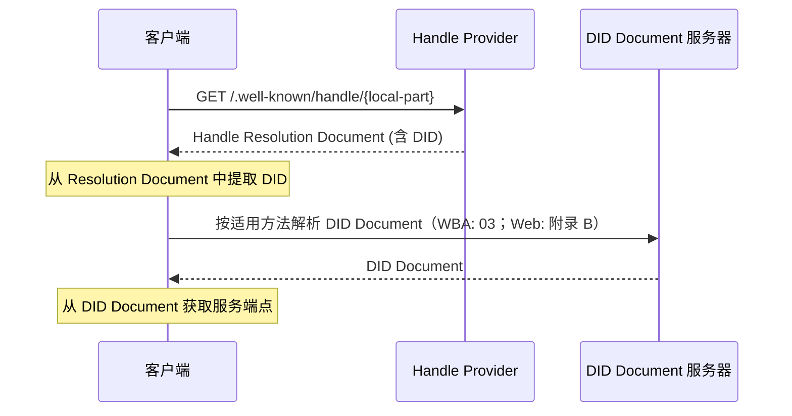
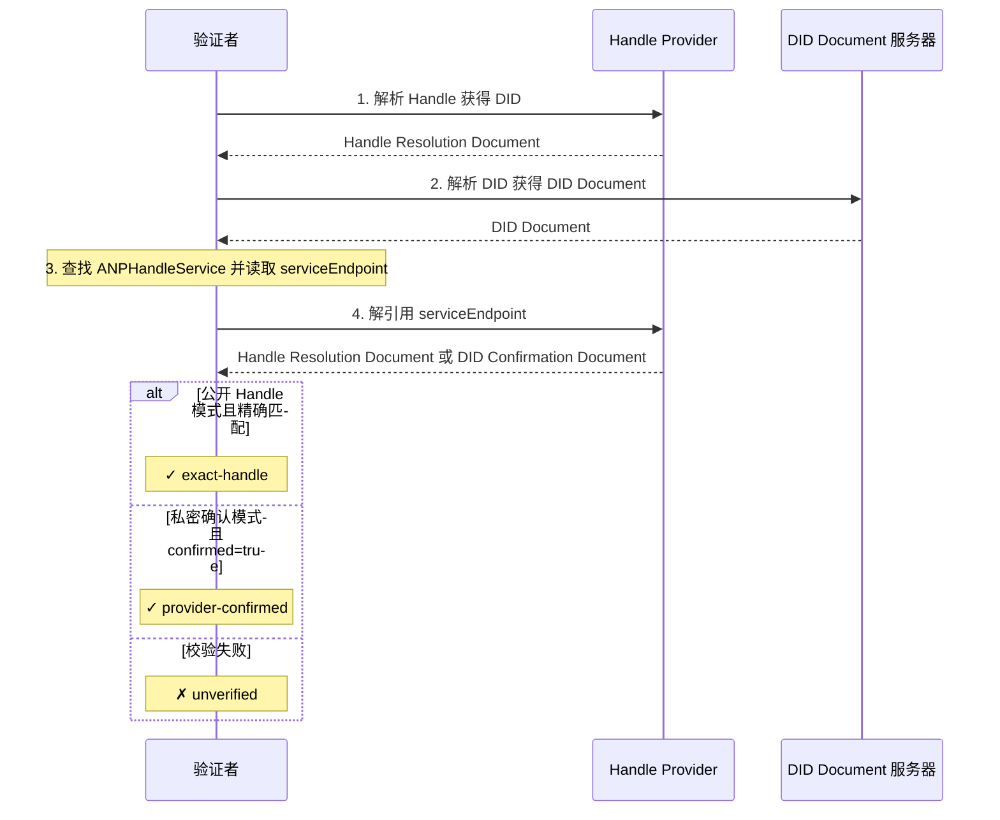

<!-- translation-review: partial; scope=selected normative paragraphs at source lines 446,692; remainder=machine-unreviewed -->
> 日本語参考訳（機械翻訳・未校閲）。規範となるのは原文です。コード例・識別子・規範キーワードは原文を保持しています。
> 原文: [chinese/04-ANP-基于DID-WBA的命名空间规范.md](../../chinese/04-ANP-基于DID-WBA的命名空间规范.md) / 基準コミット: `0837cfdfaf4ddcf834f0890ddaf34fc4c824e066`

# ANP - DIDに基づく名前付き空間規制:WBA

- 書類番号:ANP-04
- タイトル: ANP - DIDに基づく名前空間規制:WBA
- ステータス:公開
- バージョン: 1.2
- 言語:中国語
- アプリケーションのスコープ: この命令は、読み取り可能なハンドル名、WNS解像度に適用され、AMP の wba の名前マップが使われます。

> ANP 1.2 リリース: 汎用ID IDはAMP-02で定義されています。DIDメソッドと命名規則は、独自の規範によって保持されます。 [ANP-DID:WBA の名前スペース指定](../04-anp-did-wba-name-space-specification.md)。

略称:WNS(WBA Name Space)

このリビジョンは、元のWBA名マップ、エンドポイントのバリデーション、バインディング管理、キャッシュおよびマイグレーションルールを保持します。 `did:web` 続行[アドラ・コンペのプログラムB.4](../../chinese/附录B：与原生did-web-的兼容.md#legacy-web-handle)、WBAへの移行やWBAへの互換性のアップグレードを必要としません。 `exact-handle`. WBA は、以下の一貫性とセクション 6 の精度/プライベートエンドポイントプロセスを Web Compatibility モードに拡張しません。 一般的なリクエスト認証が抽出されました [アクア・アミューズメント・アミューズメント・アミューズメント・アミューズメント・アミューズメント・アミューズメント・アミューズメント・アミューズメント・アミューズメント・アミューズメント・アミューズメント・アミューズメント・アミューズメント・アミューズメント・アミューズメント・アミューズメント・アミューズメント・アミューズメント・アミューズメント・アミューズメント・アミューズメント・アミューズメント・アレイ・アワーズメント・アミューズメント・アミューズメント・アミューズメント・アミューズメント・アミューズメント・アベイ](02-ANP-基于DID的身份认证协议.md)。

## インフォメーション

マニュアルでは、WNS(WBA Name Space)を、d:wbaに基づいて読みやすい命名空間を定義しています。 WNSはハンドル(例:g)を紹介します。 `alice.example.com`として `did:wba` DID の読みやすいエイリアス、標準化された解像度を使用して、DID にハンドルをマップし、プレス [d:wba方法論的仕様](03-did-wba方法规范.md) 翌年はプロジェクトがスタートします。

ハンドルは、DID識別子が人間に不適している問題を解決しました --`did:wba:example.com:user:alice:e1_<fingerprint>` この識別子は、マシンに優しいが、覚えやすく通信が困難です。特に最新のdo:wba規則では、公開鍵の指紋上のパスタイプのDIDデフォルトで、キーまたはポリシーの変更が結ばれるときに回転させることができます。したがって、WNSはメールアドレスやソーシャルプラットフォームのユーザー名だけでなく、「安定した人間可読可能な名前」の役割にも役立ちます。ハンドルは安定状態を維持できます。一方、ボトムレベルのDo:wbaはキーベースのキーを変更して回転することができます。

この安定した名前を安全にするために、TWA の安定性基準として使用するため、Norms は、処理する要件を課し、割り当てられた 1 つに永続的に同じ被験者に所属し、取消後に譲渡または再使用することはできません。そして、すべてのコンプライアンス・ハンドル・プロバイダがこの合意に入り、実施しなければなりません。 ' s s の安定性とハンドル? DID マッピング自体は 03 コードで定義された ID 移行コード証明書を置き換えません。

ハンドル関連関数のこの命令は、元のdo:webメソッドと互換性があり、プログラム参照のappendix Aと互換性があります。

## 1. 背景とモチベーション

### 1.1 課題の記述

`did:wba` 方法論は、インテリジェントな身体(以下を参照)に集中した識別子機能を提供します。 [d:wba方法論的仕様](03-did-wba方法规范.md)) しかし、その識別子の形式は人間には優しいわけではありません。

- **覚えない。**：`did:wba:example.com:user:alice:e1_<fingerprint>` メソッドの接頭辞、ドメイン名、パス、および境界指紋に関する構造化された情報を含め、長期にわたる
- **スプレッドが難しいです。**: ソーシャルシーンでDID識別子をシェアするのは面倒で、間違いも
- **入る堅い**: マニュアルID識別子による貧しい経験
- **回転可能**: デフォルトパスプログラムでパスIDの場合、キーまたはプロジェクトがバインドされるとDID自体は変更する可能性があります。

これらの問題は、次のシナリオで特に顕著です。
- ソーシャルチャネルを通じてユーザーのスマートボディ識別子の共有
- 受信者を即座にメッセージに入力
- ビジネスカード、文書、口頭会話でスマートボディアイデンティティをシッティング
- 安定した外部参照を維持しながら、下位のDID回転を可能に

### 1.2 デザイン目的

WNSの設計目的は下記のものを含んでいます:

1. **人間の読みやすい**: 短く、覚えやすく、簡単にエイリアスを入力できるようにする `alice.example.com`
2. **ドメイン名は、関連する**: ドメイン名とTLS証明書を持つ任意のエンティティティティティティティティティは、特定の集中プラットフォームに依存することなくハンドルサービスをホストできます
3. **決定の決断の決断**: DIDマップへのハンドルは、明確にリンクされ、解像度のプロセス標準化
4. **Steady リファレンス**: パーマスタの非転送可能、非処理された安定した名前層としてハンドルをとり、下パスのタイプが行なったことを許可します:wbaは境界キーの変更によって回ります
5. **ビンド・ツー・ダイレクト**: ハンドルとDID間の双方向認証をサポートし、一方的な操作を防止
6. **プロトコル統合**: 既存の ANP バラックスとのシームレスな統合 (03/07/08/09 コード)
7. **最小限のデザイン**: ハンドルの登録、管理など、業務プロセスなしで、ネーミングとデコンスメントのコア機構のみを定義する

### 1.3 合意に基づく合意の既に合意された関係

- **03-did:wba法定規範**: WNS ハンドルは、DID ドキュメントの買収を完了するために、最終的に 03 コードで解決する既読のエイリアスです。 デフォルトのパススキームを使用して DID パスの場合、WNS は指紋規則を赤くせず、03 を直接使用しません。 下部 DID が回転したときに安定したメインパス、`successorDid`、`alsoKnownAs` 移動する `proof` 03. によって定義される。
- **07-Intelligent 説明プロトコル**: ハンドルは、DD文書サービスを通じてエージェント文書のドキュメントに解決し、到着します
- **08 - スマートディスカバリープロトコル**: ハンドルプロバイダは、知能探索への補完的なエントリとして
- **09-end に 終了 インスタント メッセージプロトコル**: ハンドルは、受信者による表示と入力に使用できます。メッセージパスはDIDに基づいています

## 2. 用語定義

| 用語集 | 定義 |
|------|------|
| **ハンドル** | フォーマットの人読みやすいショート識別子 `local-part.domain`, 例えば `alice.example.com` |
| **ハンドルプロバイダ** | ホストはドメインネームパーティをパースするハンドルを DID マッピングに維持します。 |
| **ローカルパート** | ハンドルのユーザー識別セクション、例えば。 `alice.example.com` メディス `alice` |
| **ドメイン** | ドメインネームコンポーネントの扱い `alice.example.com` メディス `example.com` |
| **DID の結合** | DIDのワンオンワンマッピング関係へのハンドル |
| **ハンドルの決断** | DID としてハンドルをパースするプロセス |
| **didの回転** | パスタイプは:wba の場合、キーの変更を治したり結合することによって完全な DID を作成するプロセスと 03 の調整による主題の継続を確立しました |
| **結合の生成** | WNS は、DID の切り替え、ステータスの変更、ロールバック攻撃をテストするためのバインディング状態単一マウス増分時間を処理します。:wba DID をしたインタージェネラルフィールドではありません |
| **ハンドル墓石** | ハンドルの保持記録、ハンドルの再配分を防ぐために取消の後で永久に維持される |
| **ウィズン** | WBA 名前 スペース、この定義のための名前付き空間システム |
| **ハンドルの決断文書** | 担当者から返されたJPON文書をパースするハンドル、DIDへのハンドルのマップ情報 |
| **DID 確認エンドポイント** | 特定のハンドルをDID文書で開示することなく、Projecterの責任であることを確認するために、handleProviderに基づく確認エンドポイント |

## 3. ハンドルのフォーマット 指定

### 3.1ハンドルの同時性:

ハンドルは、DNSスタイルの構文を使用しており、 `local-part.domain`。

**ABNFの定義:**

```abnf
handle     = local-part "." domain
local-part = (ALPHA / DIGIT) *61(ALPHA / DIGIT / "-") (ALPHA / DIGIT)
domain     = ; 合法的完全限定域名 (FQDN)，参见 RFC 1035
```

**シンタックス:**

- ローカルパートは、ASCIIの小文字のみを使用できます。 `a-z`数字 `0-9` ヒフン `-`
- ローカルパートは必須です(MUST) 文字または数字で開始し、終了します
- ローカル部分は許可されていません()MUST NOT)連続ハイフェンが現れます `--`
- 1〜63文字のローカル部分の長さ
- ドメインが必須 (MUST) TLS/SSL の証明書によって保護される法的 FQDN
- ハンドルのドメインはポート番号を運ぶことができません
- 処理される全ての入力は必須です(処理の前に)MUST) より低い場合に計算される

**事例:**

```text
alice.example.com          ✓ 有效
bob-smith.example.com      ✓ 有效
agent-42.example.com       ✓ 有效
a.example.com              ✓ 有效（单字符 local-part）
-alice.example.com         ✗ 无效（以连字符开头）
alice-.example.com         ✗ 无效（以连字符结尾）
al--ice.example.com        ✗ 无效（连续连字符）
Alice.Example.com          → 归一化为 alice.example.com
```

### 3.2 URI は

指圧でハンドルをはっきりとマークするために、使用することが可能です。 `wba://` プレフィックス:

```text
wba://alice.example.com
```

`wba://` プレフィックスは、シーンの普及と認識のためにのみ使用され、ハンドル自体に相当する皮脂質です。

- クライアントはできます(MAY) ベルトを受け入れて下さい `wba://` (a) プレフィックス入力;
- クライアントが接頭辞を承諾した場合、復号化の前に必要である()MUST削除 `wba://` (a) 接頭辞は、標準プロセスによって解決されます。
- 達成しない()MUST NOT♪ 帰りは右に `wba://` 接頭辞のサポートは、相互運用性のための前提条件です。

> 注意:`wba://` 未登録のIANA公式URIスキームとして登録されていません。以下のWeb URLは、インストーラーで使用できます。
> ```テキスト
> https://{domain}/.well-known/handle/{local-part}
> ```

### 3.3 保持者原則

ハンドルプロバイダは()SHOULD)指定されたローカルパートの登録を防止するために予約された単語のリストを維持します。プロトコルは、次の原則を定義し、これは HandleProvider によって決定されます。

**(a) プロトコルの保持**: AMP キーワードと対立する語彙、例えば. `did`、`agent`、`well-known`、`service` 待たせます。

**(b) システム保持**: 共通システムの機能と対立する用語集 `admin`、`root`、`system`、`api` 待たせます。

**c) 攻撃保護の保持**: 魚や混同攻撃に使用できる単語など `support`、`security`、`official` 待たせます。

ハンドルプロバイダは()SHOULD) 宿泊予約の一覧は公開しています。

## 4. ハンドルの解析プロトコル

### 4.1 解像度のプロセス

ハンドルは、次のプロセスに従います。

```text
Handle → Handle Resolution Endpoint → DID → DID Document → service
```



### 4.2ハンドルの決断エンドポイント

ハンドルのResolumentエンドポイントは、 HandleProvider が提供する標準化された HTTP ピアです。

- **URL**: `https://{domain}/.well-known/handle/{local-part}`
- **方法論**: `GET`
- **コンテンツタイプ対応**: `application/json`

のは、 `{domain}` ハンドルの名前はドメインの一部です。`{local-part}` ユーザ識別セクションです。

**例: リクエスト**

```http
GET /.well-known/handle/alice HTTP/1.1
Host: example.com
Accept: application/json
```

### 4.3ハンドルの決断文書

ハンドルのResolumentエンドポイントで返されたJPON文書の形式は次のとおりです。

```json
{
  "handle": "alice.example.com",
  "did": "did:wba:example.com:user:alice:e1_<fingerprint>",
  "status": "active",
  "binding_generation": "8",
  "updated": "2025-01-01T00:00:00Z",
  "versionId": "42",
  "ttl": 300,
  "profile": {
    "type": "DIDSubjectProfile",
    "subject_did": "did:wba:example.com:user:alice:e1_<fingerprint>",
    "subject_type": "person",
    "handle": "alice.example.com",
    "display_name": "Alice",
    "description": "Researcher and AI agent user",
    "avatar_uri": "https://example.com/avatars/alice.png",
    "profile_uri": "https://example.com/alice/",
    "discoverability": "listed",
    "updated": "2025-01-01T00:00:00Z",
    "versionId": "profile-7",
    "ttl": 300
  }
}
```

**フィールドの状態:**

| フィールド | 必須/任意 | 注釈 |
|------|----------|------|
| `handle` | 必要です。 | 完全なハンドル識別子 |
| `did` | 必要です。 | 現在、バインドしたハンドル: wba DID |
| `status` | 必要です。 | ハンドルの現在のステータス。値についてはセクション4.7を参照してください。 |
| `binding_generation` | 必要です。 | 文字列の決定; 変更が行われるたびに、バインディングやステータスを厳密に増分する必要があります |
| `updated` | 任意 | 最終更新時間、ISO 8601のフォーマット |
| `versionId` | 任意 | キャッシュとデトックスのマップバージョン識別 |
| `ttl` | 任意 | キャッシュ秒数を予測 |
| `profile` | 任意 | ハンドルは、UIディスプレイ、連絡先プレビュー、検索結果およびIM受信者のためのパブリックディスプレイの対象となるDIDをバインドします。 彼らは識別、承認、情報ルート、サービス発見、E2EE結合または安全なファイル相談に使用することはできません。 |

### 4.3.1 DID 確認エンドポイント

ハンドルプロジェクターは(DIDホルダーがDD文書の特定のハンドルを開示したくない場合)MAY本サイトは、DID Contact Endpoint でもご利用いただけます。

**推奨URL:**

```text
https://{domain}/.well-known/handle/by-did?did={urlencoded-did}
```

- **方法論**：`GET`
- **コンテンツタイプ対応**：`application/json`

**応答例:**

```json
{
  "did": "did:wba:example.com:user:alice:e1_<fingerprint>",
  "confirmed": true,
  "status": "active",
  "updated": "2025-01-01T00:00:00Z",
  "ttl": 300
}
```

**フィールドの状態:**

| フィールド | 必須/任意 | 注釈 |
|------|----------|------|
| `did` | 必要です。 | 確認済みID |
| `confirmed` | 必要です。 | 必要です。 `true`DID は、DID が実際に処理の HandleProvider のタスクであることを意味する |
| `status` | 任意 | 現在の HandleProvider の DID の解析状態 |
| `updated` | 任意 | 最終更新時間、ISO 8601のフォーマット |
| `ttl` | 任意 | キャッシュ秒数を予測 |

DID の機密エンドポイントを使用するときは、応答文書は () 必要があります。SHOULD) 直接特定のに戻らない `handle`, DID文書の取扱いの間接的な公開開示を回避する。

### 4.3.2 プロファイルオブジェクト

ハンドルの解決文書MAY) 含んでいます `profile` オブジェクト。

`profile` 現時点での解析対象のDIDの対象を指す。 **DID の主題のプロフィール**. JSONフィールド名はまだあります `profile`, オブジェクトの内部 `type` 肩 (SHOULD) は `DIDSubjectProfile`。

`profile` 一般的なDIDの主題情報ではなく()MUST NOT) は、エージェントのみが利用できるように解釈されます。 取得できる DID の対象 (MAY人、エージェント、グループ、組織、サービス、アプリケーション、その他のIDの対象です。

`profile` 必要はない。MUST NOTハンドルの正規性セマティクスをDIDに変更します。 認証分析は、外部層に残されます。 `handle` とりあえず `did` フィールド。 メッセージのルート、認証、意思決定の承認、エンドツーエンド暗号化セッションの結合とサービスディスカバリーはまだ作成する必要があります()MUST) DID、DID文書を分析することにより、`ANPMessageService` AMPプロファイルの優先順位のルール。

**提案されたプロフィールの目的:**

```json
{
  "type": "DIDSubjectProfile",
  "subject_did": "did:wba:example.com:user:alice:e1_<fingerprint>",
  "subject_type": "person",
  "handle": "alice.example.com",
  "display_name": "Alice",
  "description": "Researcher and AI agent user",
  "avatar_uri": "https://example.com/avatars/alice.png",
  "profile_uri": "https://example.com/alice/",
  "discoverability": "listed",
  "labels": {
    "locale": "en-US"
  },
  "updated": "2025-01-01T00:00:00Z",
  "versionId": "profile-7",
  "ttl": 300,
  "proof": {
    "type": "DataIntegrityProof",
    "cryptosuite": "eddsa-jcs-2022",
    "created": "2025-01-01T00:00:00Z",
    "proofPurpose": "assertionMethod",
    "verificationMethod": "did:wba:example.com:user:alice:e1_<fingerprint>#key-1",
    "proofValue": "z..."
  }
}
```

**フィールドの状態:**

| フィールド | 必須/任意 | 注釈 |
|------|----------|------|
| `type` | おすすめ商品 | 読むべき `DIDSubjectProfile`、他のプロファイルのようなオブジェクト間で区別するため |
| `subject_did` | 必要です。 | プロフィールが説明するDIDボディ |
| `subject_type` | おすすめ商品 | 対象タイプ、推奨値 `person`、`agent`、`group`、`organization`、`service`、`application`、`unknown` |
| `handle` | 任意 | ハンドルに対応します。現在、外側の層と等しい必要があります `handle` フィールド |
| `display_name` | おすすめ商品 | UI の名称を表示 |
| `description` | 任意 | プロフィール; 人はバイオ、エージェント、説明、グループです |
| `avatar_uri` | 任意 | ヘッド、アイコン、またはヘッドのグループ URI |
| `profile_uri` | 任意 | より完全な情報ページや情報文書ポータル |
| `discoverability` | 任意 | 発見できるヒント、推奨値 `private`、`listed`、`public` |
| `labels` | 任意 | ディスプレイ、分類または検索補助のための安全でない拡張ラベル |
| `updated` | 任意 | 更新時間 |
| `versionId` | 任意 | プロフィール版数 |
| `ttl` | 任意 | プロフィール 推奨キャッシュ秒 |
| `proof` | 任意 | 削除 `proof` オブジェクトレベルのアサーション(後プロファイルオブジェクト) |

場合 `subject_type` クライアントの欠損や認識ができないこと()MUST) . `unknown` プロセス。クライアントとサービスが終了しない()MUST NOT) に基づく `subject_type` プライベートの対象タイプは、推奨リストの直接拡張子をお勧めしません。優先的に配置する必要があります `labels`。

`display_name` 識別名、ルート名、または認証名ではなく表示名です。MAY繰り返しても構いません(MAY変更する。`display_name` ない (ない)MUST NOT)メッセージ署名、認定審査、E2EEセッションの結合またはサービスエンドポイントの選択に参加する。新しいプロトコル出力は(または)SHOULD) . `display_name`;servicesはレガシー入力フィールドを受け入れます `name` 古い対応のため、標準出力はしない()SHOULD NOT) . `name`。

**一貫性のルール:**

場合 `profile` 存在し、 `profile.subject_did` 必要 (必須)MUST)はハンドルのResolument文書を等しいです `did` フィールド。 もし `profile.handle` 存在、必要 (必須)MUST)は外の層を等しい `handle` フィールド。 顧客は受け取りました `profile.subject_did` または `profile.handle` 矛盾する結果の場合、必須(MUST) イグノー `profile` オブジェクト、および缶()MAY) この分析の結果が疑わしいとマークします。

場合 `avatar_uri` または `profile_uri` 存在、すべき(SHOULD) HTTPSを絶対URIとして使用して下さい。顧客はできません(MUST NOT♪ ちょうどバイ `profile_uri` DID 結合、サービスエンドポイントまたは認可容量の前提。クライアントはリモートプロファイルとヘッダーコンテンツを通常の外部コンテンツとして扱い、ローカルコマンドではありません。

`labels` セキュリティの監視対象ではなく、表示、分類、検索補助にのみ使用してください。`labels` ない (ない)MUST NOT)は承認、ルート、保証段階の判断、グループのメンバーの同一証明かE2EEの能力の決定に使用されます。

**キャッシュの構文:**

アウター `ttl` 特に、ハンドルのResolute文書のキャッシュを制限します。 `handle` → `did` 地図を。`profile.ttl` 圧縮プロセスキャッシュ。 もし `profile.ttl` クライアントが、ミス(Missing)できるMAY) 外の層を使用して下さい `ttl` ファイルのキャッシュの天井として。クライアントはそうでない(ローカル戦略が明示的に許可されている場合)SHOULD NOT♪ ぜひお立ち寄りください `profile` 再通報文書の処理よりも長いキャッシュ。外部に `did` 変更が行われる場合、クライアントは()MUST) 無効な古い DID の関連付けの問題ファイル。

アウター `binding_generation` セキュリティー、シングルアングルバインディングの鍵です。`updated` とりあえず `versionId` キャッシュ、デバッグ、および調整のための追加バージョンの情報です。`profile.updated` とりあえず `profile.versionId` プロファイルのバージョンです。バインディングとプロファイルバージョンが利用可能です(ファイルを使用する場合は)MAY)独立した変更; 認証者ではない(MUST NOT) . `updated` または `versionId` 代替品 `binding_generation` - それは裏面のセマンティックです。

**証拠の構文:**

最初のフェーズでは、`profile.proof` 任意フィールドです。もしない場合 `proof`クライアントは必須です(MUSTこのプロファイルは、 HandleProvider が提供する UI メタデータとして検討します。 (この例では、)MAY) 結果、接触カードおよびIMの受取人が確認する表示、検索のために()MUST NOT利用は、識別、承認、情報ルート、サービスエンドポイント選択、E2EEバインディングまたはセキュリティ戦略の選択です。

場合 `profile.proof` 存在します。, クレームはオブジェクトのレベルによって処理されることをお勧めします. 保護された人を削除します。 `proof` あとで。 `profile` オブジェクト。認証のルールは次のとおりです。

1. `profile.subject_did` 外層と同じでなければなりません。 `did`；
2. `proof.verificationMethod` 所属するDIDは等しくなければならない `profile.subject_did`；
3. `proof.verificationMethod` 必要はあります `profile.subject_did` DID 文書のなか `assertionMethod` (a) 認可;
4. 検証後にクライアントに校正可能(MAYプロジェクトの公開表示は DID のメインステートメントと見なされます。
5. 証拠が確認されたとしても、`profile` 未就業(未就業)MUST NOTこの記事のテキストは、www.un.org/scm/sc/sc/sc/sc/sc/sc/sc/sc/sc/sc/sc/sc/sc/sc/sc/sc/sc/sc/sc/sc/sc/sc/sc/sc/sc/sc/sc/sc/sc/sc/sc/sc/sc/sc/sc/sc/sc/sc/sc/sc/sc/sc/sc/sc/sc/sc/sc/sc/sc/sc/sc/sc/sc/sc/sc/sc/sc/sc/sc/sc/sc/sc/sc/sc/sc/sc/sc/sc/sc/sc/sc/sc/sc/sc/sc/sc/sc/sc/sc/sc/sc/sc/sc/sc/sc/sc/sc/sc/sc/sc/sc/sc/sc/sc/sc/sc/sc/sc/sc/sc/sc/sc/sc/sc/sc/sc/sc/sc/sc/sc/sc/sc/sc/sc/sc/sc/sc/sc/sc/sc/sc/sc/sc/sc/sc/sc/sc/sc/sc/sc/sc/sc/sc/sc/sc/sc/sc/sc/sc/sc/sc/sc/sc/sc/sc/sc/sc/sc/sc/sc/sc/sc/sc/sc/sc/sc/sc/sc/sc/sc/sc/sc/sc/sc/sc/sc/sc/sc/sc/sc/sc/sc/sc/sc/sc/sc/sc/sc/sc/sc/sc/sc/sc/sc/sc/sc/sc/sc/sc/sc/sc/sc/sc/sc/sc/sc/sc/sc/sc/sc/sc/sc/sc/sc/sc/sc/sc/sc/sc/sc/sc/sc/sc/sc/sc/sc/sc/sc/sc/sc/sc/sc/sc/sc/sc/sc/sc/sc/sc/sc/sc/sc/sc/sc/sc/sc/sc/sc/sc/sc/sc/sc/sc/sc/sc/sc/sc/sc/sc

**グループプロフィールの投射:**

グループベースは、まだ使用 `group_profile` グループIDにハンドルポイントがある場合、WNS `profile` はい (MAY) 迅速なプレゼンテーションのための投影グループ表示分野:

| グループベースフィールド | ウィズン `profile` フィールド |
|---|---|
| `group_did` | `profile.subject_did` |
| `group_profile.display_name` | `profile.display_name` |
| `group_profile.description` | `profile.description` |
| `group_profile.avatar_uri` | `profile.avatar_uri` |
| `group_profile.discoverability` | `profile.discoverability` |
| `group_profile.labels` | `profile.labels` |

WNS の場合 `profile` グループベースで `group_profile` グループホストで返されるコンプリット、グループ管理、グループ権限、グループメッセージの構文、およびグループメンバーのステータス `group_profile`、`group_policy` とりあえず `group_state_version` はい。 WNS `profile` ハンドルが解読した後に素早くプレゼンテーションをします。

**クライアントの行動:**

クライアントはできます(MAY) ハンドルのパースの後ですぐにショー `profile.display_name`、`profile.avatar_uri` とりあえず `profile.subject_type`いつか `profile` 不足していると、クライアントはハンドルや省略IDを表示することで、通常作業を続けなければなりません。混乱を防ぐため、クライアントは(または)SHOULD) 特に高リスク操作の前に、ディスプレイの横にあるハンドルまたはDIDのための見やすいポータルを保ちます。

### 4.4 DIDマップ規則へのハンドル

ハンドルは、ハンドヘルパーによって維持されたDIDとユニークな対応を持っています。 地図は以下の規則に従います:

1. **ホスト名一貫性**: ハンドルドメイン部分は必須です(MUST) DID のホスト名と同じ; DID のインポートにポート番号が含まれている場合、比較は必須である (MUST) 無視ポート、ホスト名だけを比較します
2. **限界だけ**: ハンドルは必須です(MUST) 1つのIDだけタイ
3. **ローカルパーツユニーク**: ローカルパーツは必須(同じドメイン)MUST) ユニーク
4. **定義を繰り返さない: wba は指紋を結合します**: デフォルトのパススキームのパスタイプにハンドルポイントが渡された場合:wba, DID パスの最後の境界線の指図セグメントの生成、検証およびプロファイルのセマティクスは 03 規範で定義され、WNS はルールを再定義または上書きしません
5. **定休日:不定休**: 処理 一度割り当てられた、ハンドル提供者は()しなければなりませんMUST) タイトルレコードを永久に保つため; ない (MUST NOT) 他の被験者への譲渡または再配布
6. **シングルツーシステム**: 初期割当 `binding_generation` 必要 (必須)MUST)は正の整数文字列です。(現在の DID またはハンドルの状態が変更されている場合)MUST) 厳密に増分, ない ( )MUST NOT) 背部か背部

**地図の例:**

```text
Handle:  alice.example.com
DID:     did:wba:example.com:user:alice:e1_<fingerprint>
```

```text
Handle:  alice.example.com
DID:     did:wba:example.com%3A8800:user:alice:e1_<fingerprint>
```

例えば、ハンドルのドメイン `example.com`; 符号化された港を含んでいるが第2 DID `%3A8800`, しかし、そのホスト名はまだ `example.com`そのため、マップは有効です。 ハンドルはポート番号を運ぶことはありません。 ポートは DID Documentの解像度位置にのみ影響し、ハンドルのテキストフォームには影響を与えません。

<a id="method-resolution"></a>
### 4.5 件: wba 標準解像度

取得後、DIDを取得する必要があります(MUST) . [d:wba方法論的仕様](03-did-wba方法规范.md) DID ドキュメントをパースします。 ネイティブ `did:web` プレス [ANP-02 付録 B](../../chinese/02-ANP-基于DID的身份认证协议.md#web-binding)元のWebメソッドは、解読と認証の互換性のあるルールのプロセスです。 ハンドルバインディングは、既存のスキームを付随するB.4で使用し続けています。

誰がそれを達成してもよい。MUST NOT) DID文書の周り、サービスエンドポイント、キーバインディング、またはハンドルから直接他のDID関連の情報を公開します。

### 4.6 ハンドルの独特な制約

- ハンドルは必須です(MUST) 1つのIDだけタイ
- 同じドメイン内のローカル部分は必須です(MUST) ユニーク
- ハンドル、割り当てられたら、MUST) 出金後、永久的な職業()MUST)墓石
- ハンドルは許可されていませんMUST NOT) 転送、または()MUST NOT通常の登録プロセスによる再配布
- 異なるドメインは、同じローカル部分を持つことができます

たとえば: `alice.example.com` とりあえず `alice.other.com` 異なるDIDを指す2つの異なるハンドル。

### 4.7 ハンドルの状態

ハンドルは3つの状態を持っています:

| ステータス | 注釈 |
|------|------|
| `active` | ノーマル、ハンドルは分解できます。 |
| `suspended` | 中断され、時間のために分解されない。 回復可能。 |
| `revoked` | 回収、回復不能;プロバイダは永久に墓石を保持し、再配布されていない |

### 4.8 エラー応答

ハンドルの決断のエンドポイントはべきです(SHOULD次の標準の HTTP ステータスコードを返します。

| ステータスコード | 意味する | 注釈 |
|--------|------|------|
| `200 OK` | 成功を追求する | 返品手続き 再承認書類 |
| `404 Not Found` | ハンドルは存在しません | ローカル部分が登録されていないか、またはサービスがハンドルの存在を開示することを望んでいない |
| `410 Gone` | ハンドル 永久に取り消される | 一度存在していたが、再発されたハンドル |
| `301 Moved Permanently` | ハンドルは再配置されました | `Location` ヘッダーを新規に |
| `308 Permanent Redirect` | ハンドルは再配置されました | とりあえず `301` 同様に、要求されたセマティクスでより精密なが |
| `429 Too Many Requests` | あまり頻繁にお聞きしました。 | フローがトリガーされると、キャリー可能 `Retry-After` |

バックタイム `301` または `308` _その他組織

1. `Location` (b) 移行のヒントとしてのみ;
2. クライアントは必須です。MUSTセクション6で定義された新しいアドレスで2方向の結合を再有効化します。
3. クライアントは、HTTP リダイレクトだけを根拠に、新しい Handle→DID の結合関係を受け入れてはなりません（MUST NOT）。

**エラー応答の例:**

```json
{
  "error": "handle_not_found",
  "message": "The handle 'bob.example.com' does not exist"
}
```

## 5. プロフィールURL

### 5.1 プロフィールの記入項目

ハンドルプロファイラMAY) 各ハンドルのプロファイルアクセスポイントを提供します。次のURL形式を推奨します。

- サブドメイン名:`https://{local-part}.{domain}/`
- パス方法:`https://{domain}/{local-part}/`

このセクションのURLをプロファイルし、 4.3.2 で定義 `profile` オブジェクトは異なる。 ハンドルのResolument文書が含まれている場合 `profile.profile_uri`♪ できる♪MAY) そのようなプロファイル URL にポイントしますが、URL は外部表示やビジネスエントリのみです。

### 5.2Profile フォーマット

Profile は運用文書であり、この命令は、コンテンツの形式を修飾することなく、プロファイルへのアクセス URL だけを定義します。プロファイルの特定のコンテンツとプレゼンテーションは、ハンドルユーザーと HandleProvider によって定義されます。

プロフィールURLは、表示またはビジネスのポータルであり、ハンドルDID結合やサービスディスカバリーの権限的なソースではありません。MUST NOT) DID、サービスエンドポイント、またはプロファイルURLに基づいてのみ容量を有効にします。セキュリティに敏感なアイデンティティの結合、情報ルートおよびサービスの発見はまだ行われなければなりません(MUSTハンドルの標準的なリンクは? DID か。 DID 文書が使用されます。

## 6. 逆認証(双方向結合)

WNS は、悪意のあるハンドル生成が別の DID の任意のハンドルイメージをマッピングすることを防ぐため、2 方向結合認証機構を定義します。

### 6.1 HandleProviderステートメント(陽性)

HandleProvider は、Resolute Endpoint を通して、DID へのハンドルの地図を述べます。これは標準解像度プロセス(セクション4)の一部です。

### 6.2 DID文書宣言(逆)

DD文書のDIDホルダー `service` アクセサリー `ANPHandleService` 型は、使用するハンドルバインディングサービスエンドポイントを宣言します。`ANPHandleService.serviceEndpoint` プロバイダードメインを示す代わりに、それはexeggerable HTTPSピアです。 このエンドポイントは、2つの互換性モードをサポートしています:

1. **ハンドルモードを開く**：`serviceEndpoint` ハンドルの標準的なResoluteエンドポイントを使用して直接;
2. **専用確認モード**：`serviceEndpoint` DID会議エンドポイントへのポイントは、ID が ID 文書に公開されるのではなく、ハンドル・プロジェにとっては確かにケースであることを確認します。

**ハンドルモデルのオープン例:**

```json
{
  "id": "did:wba:example.com:user:alice:e1_<fingerprint>#handle",
  "type": "ANPHandleService",
  "serviceEndpoint": "https://example.com/.well-known/handle/alice"
}
```

**専用確認モードの例:**

```json
{
  "id": "did:wba:example.com:user:alice:e1_<fingerprint>#handle",
  "type": "ANPHandleService",
  "serviceEndpoint": "https://example.com/.well-known/handle/by-did?did=did%3Awba%3Aexample.com%3Auser%3Aalice%3Ae1_%3Cfingerprint%3E"
}
```

**フィールドの状態:**

- `id`: サービスの識別子のみ、推奨 `#handle` 投稿フィックス
- `type`_その他組織 `ANPHandleService`
- `serviceEndpoint`: 必須(必須)MUST)は、 HandleProvider の非明白な HTTPS の絶対 URI です。 ハンドルモードを開くには (SHOULD)直接標準的なハンドルのResoluteエンドポイントを使用します。プライベートな確認モードの下で、あなたは(MAYユーザは、グループのメンバーです。

`ANPHandleService` ハンドルバインディングサービス用のDIDホルダーで逆のステートメントを表現するために使用されるテキストのバージョン。

- 開いたハンドル モードでは、DID のホールダーは明らかに特定のハンドルの無軌道エンドポイントを宣言し、「正確さのための DID への入力ハンドル」の強い確認をすることができます;
- 秘密の確認モードでは、DID保持者は、ハンドルプロバイダとDIDを承諾してエンドポイントを確認できる状態のみです。認証者はプロバイダーの関係を確認することができますが、特定のハンドルは本に基づいて逆に正確に確認されているとは仮定できません。

以降は互換性で導入できます。 `providerDid`、`handleCommitment` プロバイダーのアイデンティティまたはプライバシー保護のための強力なメカニズム。

<a id="binding-verification"></a>
### 6.3 検証プロセス

以下のセキュリティの機密シナリオについては、認証役員は必須です(MUST) 2方向結合の証明を実行して下さい:

- 認証情報
- 意思決定のための権限の委任
- 組織図
- ステータスの変更、書き込み操作、減衰またはリソース作成をトリガーする自動車コール

UIディスプレイ、検索プレビュー、ディレクトリブラウズのみに使用されるシーンでは、認証機能が使用可能です(MAY対面結合認証の実装に遅れが生じます。しかしながら、セキュリティの機密操作が利用できたら、それは()MUST) 検証を完了します。



**検証手順:**

1. 標準的なハンドルによってハンドルを繰り返して下さい エンドポイントを、ハンドルのResolumentを得、そして抽出して下さい `did`；
2. #03 を規範でパースする `did`、DID文書を得て下さい;
3. DDドキュメント `service` センターファインド `ANPHandleService` (a) エントリーの種類
4. 認証 `serviceEndpoint` かえん `https` 絶対 URI と、そのホスト名は、ハンドルに入ったドメインと同じです。
5. えー。 `serviceEndpoint` リリース `GET` 返されたJSON文書の要求と解決
6. 場合 `serviceEndpoint` ハンドルの標準的なResoluteエンドポイントを入力し、文書に戻る `did` ステップ1で `did` 同じ、文書の裏返し `handle` 入力ハンドルと十分に一貫して、特定のハンドルの厳密な対面結合を完了するために考慮されます;
7. ドキュメントへの返送が含まれていない場合 `handle`, しかし、含まれています `confirmed = true`ドキュメントを返し、 `did` ステップ1で `did` 一貫して、DIDは確かにProjecterの分析に対する責任を処理していることが述べています。この結果は、プロバイダの関係が確認されたことだけを意味します。
8. それ以外の場合(必須)MUST) は、認証の失敗や不十分な強度であると考えられます。

「特異ハンドル」の特定を必要とするセキュリティ感度のあるシーンでは、認証役員は必須です(MUST)ステップ6で定義された結果の正確な双方向結合; ステップ7のプロバイダは、結果がそのようなシナリオだけで満足するのに十分ではないことを確認します。

### 6.3.1 ANPhandleサービスルール(v2)

認証者は、次の規則に従って2方向のバインディングチェックを実行して使用しなければなりません。 `ANPHandleService.serviceEndpoint`：

1. ハンドルを入ることで、そのドメインとローカル部分を抽出し、ハンドルの隔離エンドポイントの基準を構築します。`https://{domain}/.well-known/handle/{local-part}`；
2. 解決のエンドポイントによるハンドルをパースし、ハンドルの決断文書を得、それから抽出します `did`；
3. #03 を規範でパースする `did` 対応するDID文書;
4. DDドキュメント `service` センターファインド `type = "ANPHandleService"` エントリー
5. エントリーの確認 `serviceEndpoint` あり あり `https` 絶対URI、そのホスト名は必須です(MUST(c) ハンドルドメインとのステップ1の一貫性;
6. えー。 `serviceEndpoint` リリース `GET` JSON ドキュメントへのリクエストと返送
7. 場合 `serviceEndpoint` 標準の組み立てられたステップ1の解決エンドポイントの完全な一致は文書で帰ります `did` ステップ2 `did` 同じ、文書の裏返し `handle` ハンドルとDIDは、正確な双方向のバインディング検証を完了していると考えられています。
8. ドキュメントへの返送が含まれていない場合 `handle`, しかし、含まれています `confirmed = true`ドキュメントを返し、 `did` ステップ2 `did` 同じ、つまり DID は実際に DID が `ANPHandleService` 現在のハンドルプロジェクターは、解像度を担当しています。この結果は、プロバイダの関係が確認され、DIDで特定のハンドルによって正確に拘束されていると見なされないことを示すだけです。
9. ご利用いただけない場合 `ANPHandleService`、`serviceEndpoint` なし `https`、ホスト名 矛盾する、`serviceEndpoint` 不公平な失敗、文書で返された `did` (a) 強迫的または7/8ステップ検証が失敗した場合、バインディングは検証されてはならない。
10. 認証役員は、メッセージを送信する前に、識別のための「特定のハンドル」セキュリティの機密性のあるシーン、承認決定書の作成とアドレスの確認を確認しなければなりません(また、パラを参照してください。MUST) ステップ7の「正確な双方向結合」定義の結果;ステップ8認識のみ、このような要件を満たすには十分ではありません。

**注意:**

- DIDホルダーがハンドルを開示する意思がある場合、DIは良い考えではありません。`ANPHandleService.serviceEndpoint` 反応(反射)SHOULD)ハンドルの標準的なResoluteエンドポイントへの直接アクセス;
- DID ホルダーが DD ドキュメントでハンドルをパブリックにしたくないときは、DID 文書を使用することができません。`ANPHandleService.serviceEndpoint` はい (MAY) DIDの機密エンドポイントへのポイント、そのエンドポイントは、 `did` とりあえず `confirmed = true`；
- 残りの互換性を保ちながら、その後のバージョンが導入できます `providerDid`、`handleCommitment` またはその他のより強いプライバシー保護の結合メカニズム。

### 6.3.2 検証結果のセマティクス

異なるレベルの検証の結果を混合することを避けるため、それを達成する人()SHOULD)少なくとも3つの結果の区別:

| 結果発表 | 注釈 |
|------|------|
| `exact-handle` | ハンドルとDIDを入力して、正確な双方向のバインディング認証を完了 |
| `provider-confirmed` | HandleProvider との DID の解決の関係は確認されましたが、特定のハンドルは確認されません |
| `unverified` | 十分に信頼されていない結果のみを検証または取得できない |

`provider-confirmed` (a) DD-first、ディレクトリのブラウズまたはプライベートプロバイダの識別。`exact-handle` 本サイトは、ハンドルバインディングの非常に特定の、高い保証された場所です。

## 7. ANPプロトコルバークとの統合

### 7.1 DID文書(03コード)を使って

DDドキュメント `service` アクセサリー `ANPHandleService` 逆認証(セクション6)をサポートするタイプ。

```json
{
  "service": [
    {
      "id": "did:wba:example.com:user:alice:e1_<fingerprint>#ad",
      "type": "AgentDescription",
      "serviceEndpoint": "https://example.com/agents/alice/ad.json"
    },
    {
      "id": "did:wba:example.com:user:alice:e1_<fingerprint>#handle",
      "type": "ANPHandleService",
      "serviceEndpoint": "https://example.com/.well-known/handle/alice"
    }
  ]
}
```

ド:wba、WNS は WNS による指紋のフォーマットか繰り返し定義を定義しません `e1_` / `k1_` 規則; これらのセマティクスは、単に 03 規範の責任です。.

最後の例では、オープンハンドルモードを示します。DDホルダーがDID文書に公開されたくない場合は、 `ANPHandleService.serviceEndpoint` または、それはできます()MAYテキストを次のものに置き換えます。

```json
{
  "id": "did:wba:example.com:user:alice:e1_<fingerprint>#handle",
  "type": "ANPHandleService",
  "serviceEndpoint": "https://example.com/.well-known/handle/by-did?did=did%3Awba%3Aexample.com%3Auser%3Aalice%3Ae1_%3Cfingerprint%3E"
}
```

このモードでは、認証者はプロバイダの関係を確認でき、正確な双方向の結合認証を完了したように特定のハンドルを考慮することはできません。

### 7.2 スマート・コントロール・プロトコル(07規則)

エージェントの説明MAY)は任意を含んでいます `handle` フィールド:

```json
{
  "protocolType": "ANP",
  "protocolVersion": "1.0.0",
  "type": "AgentDescription",
  "did": "did:wba:example.com:user:alice:e1_<fingerprint>",
  "handle": "alice.example.com",
  "name": "Alice's Agent",
  "description": "..."
}
```

`handle` フィールドは、他のインテリジェントな組織から人読の識別子へのアクセスを容易にするオプションです。 それらの権威ある結合関係は、WNS解像度とDID文書に基づいて依然としてあります。

### 7.3 スマートディスカバリー(08コード)との合意

あり。 `.well-known/agent-descriptions` グループを返すと、各エントリはできます()MAY)は任意を含んでいます `handle` フィールド:

```json
{
  "@type": "ad:AgentDescription",
  "name": "Alice's Agent",
  "@id": "https://example.com/agents/alice/ad.json",
  "handle": "alice.example.com"
}
```

ほか、 HandleProvider's `/.well-known/handle/` パスは、インテリジェンス発見のための追加のポータルとして使用できます。

### 7.4 即時メッセージ(09コード)との合意

ハンドルは、インスタントメッセージシーンで受信者のプレゼンテーションと入力に使用できます。

- ユーザはハンドル(もしあれば)を入ることができます `alice.example.com`) メッセージの受信者を指定する
- DID へのハンドルをパースした後のクライアントパス
- ハンドル表示にDIDをメッセージインターフェースに置き換え、読みやすさを高めることができます。
- ハンドルのResolument文書が有効なものを含んでいる場合 `profile`インターフェイスを表示できます `profile.display_name`、`profile.avatar_uri` とりあえず `profile.subject_type`、接触の下検分および受取人の確認のため

メッセージのルートと送信はまだDID、ハンドル、WNSに基づいています `profile` ヒューマン・エンジニアのインターフェイスのレベルだけ表示し、入るために。

## 8. ハンドルプロバイダの要求

### 8.1 サービス要件の分析

ハンドルプロバイダは必須です(MUST) 次の条件を満たします:

- 必要 (必須)MUST) HTTPS による解決サービスを提供します
- 必要 (必須)MUST) . `/.well-known/handle/{local-part}` ピーラー
- はい (MAY) . `/.well-known/handle/by-did` DID 確認エンドポイント
- HTTP キャッシュヘッダーに対応することが望まれます（SHOULD）。少なくとも `Cache-Control` と `ETag` に対応し、`Last-Modified` への対応は任意です。
- 肩 (SHOULD) 不正防止のための速度制限の実装
- バックタイム `429 Too Many Requests` で、SHOULD) 運送 `Retry-After`
- (ハンドルが移動中、下段のDID回転窓の場合)SHOULD)キャッシュTTLを閉じる

<a id="binding-management"></a>
### 8.2 ハンドル管理

- ハンドル配分およびライフ サイクル管理のための HandleProvider
- ハンドル登録プロセス、認証方法、長さ戦略などは、ハンドラのプロテナーで定義されます。
- ハンドルプロバイダは必須です(MUST) ハンドルの下の同じドメインを保って下さい
- ハンドルプロバイダは必須です(MUST) 永続的非譲渡対象識別子として割り当てられたハンドルを考慮して、(()MUST NOT) 別の被写体に転送する
- ハンドルUndo、プロバイダは必要です(MUST)永久墓石を保持し、通常の登録、修復または管理プロセスを一切保持する(MUST NOT) 同一の名前のハンドルを任意の対象に割り当てる
- ハンドルプロバイダは必須です(MUST) 片道で持続し、増加 `binding_generation`、認証者が古い結合バックプレイを拒否するので

### 8.3 ハンドル提供者マイグレーション

ユーザーは、ハンドルを1つのハンドラから別のものに動かす必要があります。移行中に:

- このバージョンのプロバイダの移動は、操作やインフラストラクチャがハンドルとそのドメイン全体に変更することなく移動されることを意味します。異なるドメインに移動すると、この規範で定義されている自動アイデンティティの継続性がない差異ハンドルが作成されます
- プロバイダーの移行は必須です(MUST)同じハンドルを同じハンドルの主題と、(ないで保って下さいMUST NOT) ハンドルを移すか、または主題を取り替えるのに使用される
- 新規プロバイダが必要 (MUST) 受諾された最高への成功 `binding_generation`; 結合の歴史および永久的な墓石の義務; 変位の次の状態はあるべきであるMUST) 文字列が多ければ、()MUST NOT)移行によるリセットまたはロールバック
- 古いハンドルプロテクターMAY) 戻る `301 Moved Permanently` または `308 Permanent Redirect`, しかし `Location` 再通算エンドポイントへのポイントは必須です(MUST)エントリーハンドルドメインのバリデーションルールを埋め込む
- 移転中(移転中)SHOULD) また、古いおよび新しい HandleProvider の解像度機能を維持します
- DID ホルダーは、DID ドキュメントを更新する必要があります `ANPHandleService`同じハンドルドメインの下のパブリック、検証、ハンドルのResolumentエンドポイントまたはDIDコンフォーメーションエンドポイントに指すようにします。
- クライアントは(新しいアドレスが結果に解析された後)MUST再エンフォース双方向結合認証、再方向性に基づいて新しい結合関係を受け入れるしないこと
- 将来的には、現在の相互運用性パターンを変更することなくより強力なプロバイダのアイデンティティを必要とする場合、その後のバージョンで導入できます。 `providerDid` メカニズム

### 8.4 最下の DID の回転

デフォルトパスソリューションを使用してパスタイプの場合、:wba は、バインディングキーの変更やバインディングプロセスとして実行されました。 `e1_` / `k1_` 切り替えると、下位のDIDが回転します。このシナリオでWNSの要件は次のとおりです。

- ハンドルはできます。MAY)安定した人間に読みやすい名前を提供するため
- ハンドルプロバイダは必須です(MUST)新しいIDにハンドルマップを更新し、新しくDID文書が利用可能になったら厳しく追加され、独立した回復または認証戦略が完了しました `binding_generation`
- `binding_generation` ハンドルマップの状態のみを示します。許可されていません(MUST NOT) DID の生成または DID 移行パスワード証明書として解釈される
- DID 置換は必須 (MUST) 同じハンドルの対象が更新されていないことを示します(MUST NOT) ハンドルボディを移すか、または取り替えるのに使用されて
- 処理のプロジェやクライアントが同じ進行中の対象として、古いと新しいIDを処理する必要がある場合は、()MUST) 03で古いIDから実行し、メインパスと各直接の安定化を確認します `successorDid`, そして、最終的には、証拠のための有効なアクティブなDIDに達します. 効果的な古い結合プログラムまたは再興の事前承認; 認定された同じソース HTTPSの完全なチェーン解像度は、これらの2つの証拠が欠落している場合に報告することができます `provider_asserted`, しかし、ハンドルマップ, 同じ接頭辞やバインディングの拡張子自体だけ `unverified`
- 回転ウィンドウでは、handleProviderは()SHOULD) キャッシュTTLを削減し、古いマップでクライアント時間を短縮
- クライアントは許可されていません()MUST NOTハンドルを想定して、常に同じDIDを結合します。現在の解像度は、ハンドル権限の現在のDIDです
- セキュリティの機密操作については、クライアントは(新しいDIDを取得するためにハンドルを使用して)必要がありますMUST再制定双方向結合認証
- 上位レベルが特定のハンドルの確認を必要とする場合、クライアントは()MUST) 取得する要求 `exact-handle` 結果は、ただ受諾するだけではありません。 `provider-confirmed`
- 旧DIDを無効にします。`successorDid` チェーンと新しいID `alsoKnownAs` 03規則で定義されたルール。 WNSは、名前と現在のDIDのマップを安定させるためののみ責任があります

## 9. セキュリティの考慮事項

### 9.1ドメイン名のセキュリティ

WNS のセキュリティモデルは、do:wba メソッドと TLS/SSL 証明書システムに依存しています。 ハンドルのドメイン名コンポーネントは必須です(MUST)は有効なTLSの証明書によって保護されます。handelProviderにドメイン名およびTLS構成と同じ保証があります。

### 9.2 釣りと混乱の攻撃

WNSは、釣りや混乱のリスクを削減します。

- ローカルパートは、Unicodeの均質攻撃を回避する、ASCII の小文字、数字、ハイフンに制限します。
- ハンドルプロバイダは()SHOULD)保持リストを維持します(セクション3を参照してください。)
- クライアントは()SHOULD) ハンドルの表示中のドメイン名セクションを強調して、ユーザーがソースを特定するのを助けます

### 9.3 ハンドルのビート

ハンドルプロバイダは()SHOULD(b) 悪意のある存在を防止するために対策を講じる。以下を含むがこれに限定されない:

- 予約リストの維持
- 参加登録・監査の仕組みの実装
- 紛争解決プロセスの規定

特定の戦略は、 HandleProvider によって定義されます。

### 9.4 プライバシーに関する考慮事項

- ハンドル 再通したエンドポイントは、ハンドルの存在(例:200/404/410)を明らかにし、ハンドルプロバイダはすべきである(例えば、200/404/410を介して)SHOULD) 攻撃回数を減らすための速度制限の実装
- ハンドルプロバイダはそうしない()SHOULD NOT地図網の機密情報を逆転させる
- HandleProvider が返された場合 `profile`, すべき (SHOULD) 公衆に利用できるように意図されていない限り、機密性個人、グループまたは組織情報を返すことを避けて下さい
- ハンドルプロバイダは()SHOULD) エラー応答構造を調和させ、不要なステータス情報を多すぎる異なるフィールドで開示することを避けよう
- DID ホルダーは (DD ドキュメントで公開されていない場合)MAY) DIDリソースエンドポイントモードを使用して、認識レベルで情報のみを返す
- シーンのみ表示目的のため、クライアントは()MAY不要なクロスサイト解像度のリクエストを減らすために、双方向結合の実装に遅れます

### 9.5 偽造品の変調

WNS の中心の反偽の修正メカニズムは対面結合の証明です(セクション 6):

1. HandleProviderは標準的な決断のエンドポイントによってハンドルDIを宣言しています;
2. DID の文書に渡される DID のホールダー `ANPHandleService` 同じ HandleProvider ドメインにある非引用の HTTPS エンドポイントの宣言を逆転させます。
3. 認証者は、エンドポイントを非参照し、返された結果に従って区別します。 `exact-handle` とりあえず `provider-confirmed`；
4. 特定されるべき特定のハンドルの高保証人シナリオのために、認証役員は必要です(MUST) リクエスト `exact-handle`できません。 `provider-confirmed` 置換;
5. サブシーケントバージョンのさらなる導入が可能 `providerDid`、`handleCommitment` ネームサービスのプロバイダの認証とプライバシー保護のための大容量を提供するメカニズム。

デフォルトパスソリューションを使用してパスモデルの場合、DID自体は03(例えばg)で定義された境界線の指紋セグメントを運ぶこともできます。 `e1_...` または `k1_...`)、WNS によって再定義されていない do:wba メソッド層の結合機構です。

WNS は、repeatProvider によるアルゴリズムとエンコーディングの「public キーフィンガープリント拡張」を定義し、do:wba デフォルトパススキームで繰り返し定義や相関的な競合を回避しません。

## 10. 事例紹介

### 10.1 社会コミュニケーション

User Alice はソーシャルメディアで共有できます `wba://alice.example.com`, 他のユーザは以下を参照してください。

1. 認証情報 `wba://` プレフィックス。プレフィックスをハンドルに削除 `alice.example.com`
2. ハンドルをパースする DID
3. アリスのスマートボディの説明とサービスエンドポイントをDIDドキュメントから入手
4. アリスのスマートボディとインタラクティブな関係を創造

### 10.2 スマート・インターボディコミュニケーション

スマートAはハンドルでなければならない `bob.example.com` スマートBコミュニケーション:

1. パーシングハンドル `bob.example.com` DID の取得
2. 03 規格による DID 文書のパーシング
3. DD文書からFetch AgentDescriptionピア
4. エージェントの防衛文書をフェッチし、SmartBの機能とインターフェイスを理解します
5. インターフェイス定義に従う一貫性のコミュニケーション

### 10.3 インスタントメッセージ

ユーザは、インスタントメッセージアプリケーションハンドルで受信者を入力 `carol.example.com`：

1. クライアントのパースハンドルはDIDを得ます
2. パースのドキュメントに有効なものがある場合 `profile`、クライアントは表示できます `profile.display_name` とりあえず `profile.avatar_uri` アドレスによる確認のため
3. DID ドキュメントでメッセージエンドポイントを取得する
4. '09-defined インスタントメッセージプロトコルを使用してメッセージを送信する
5. 受信者のプレゼンテーション名とハンドルをDIDではなく、メッセージインターフェイスで表示

### 10.4 ステアディハンドルとDIDの回転

ユーザーAliceは、ハンドルの長期外付けの使用を持っています `alice.example.com`.一定期間の後、下段のパスタイプは:wba からしました。

```text
did:wba:example.com:user:alice:e1_<old-fingerprint>
```

による回転:

```text
did:wba:example.com:user:alice:e1_<new-fingerprint>
```

このプロセスで:

1. アリスのハンドル。 `alice.example.com` いつもと同じ
2. 古い DID 文書プレス 03 `deactivated = true`、`successorDid = <new DID>` 全体を生成する。 `proof`
3. 新しいID文書 `alsoKnownAs` 古いIDを引用し、状態を続けます `ANPHandleService`
4. HandleProvider はハンドルマップを新しい DID に更新し、 `binding_generation` 古い値から厳密に増分
5. パーサーは、03によるDIDマイグレーションの関係を検証し、WNS双方向のバインディング検証を再実行し、同じハンドルを介してAliceの現在のDIDを見つけ続けます
6. アリスがハンドル自体を呼び出すと、新しい主題に同じ名前を渡す代わりに、パーマネジャーは永久に墓石を保持します

## 11. 規範的要件のまとめ

このコードのすべての規範のまとめはこちら MUST/SHOULD/MAY 要件(条件の定義に従う) [RFC 2119の特長](https://www.rfc-editor.org/rfc/rfc2119)）：

### MUST(必須)

1. ハンドルのローカル部分は文字や数字で始まり、終了しなければなりません
2. ハンドルのローカル部分はシリアルハイフンを持っていません
3. ハンドルのドメインは有効なFQDN証明書によって保護されなければなりません
4. すべてのハンドルの入力は、小文字にサブディファイドされなければなりません
5. クライアントが受け入れる場合 `wba://` プレフィックス入力、プレフィックスは解像度の前に削除する必要があります
6. ハンドルのドメイン部分は、DID のホスト名と一致しなければなりません。 DID がポートを含んだ場合は、比較するときにポートを無視する必要があります
7. 一つのハンドルは1つのDIDだけを結合しなければなりません。
8. ローカル部分内の同じドメインは、唯一のものでなければなりません
9. DID を要求した後、 03 標準に従って DID 文書を解決しなければなりません
10. サービスのエンドポイント、キーバインディング、またはハンドルから直接他の DID 情報を公開することにより、DID 文書を迂回しないでください。
11. HandleProviderはHTTPSを通して解決サービスを提供しなければなりません
12. ハンドルプロバイダは達成しなければなりません `/.well-known/handle/{local-part}` ピーラー
13. 識別、承認の意思決定、インスタントメッセージ受信者の解像度およびその他のセキュリティ機密シーンでは、認証者は双方向の結合認証を実行しなければなりません
14. `ANPHandleService.serviceEndpoint` は、 HandleProvider ドメインで HTTPS 用の絶対 URI でなければなりません。 確認するときに、ハンドルの入力でホスト名と一致しなければなりません
15. 認証役員は、対面のバインディングチェックを解除しなければなりません `ANPHandleService.serviceEndpoint`
16. 特定のハンドルが検証された結合と見なされる場合、認証役員は取得しなければなりません `exact-handle` 結果発表
17. `provider-confirmed` 結果は特定のハンドルおよびDIDとして確認された精密な対面の結合の証明考慮できません
18. クライアントがフォローする時 `301` / `308` 再通エンドポイントに移ると、対面結合認証が再検討されず、再帰にのみ基づく新しい結合を認めない
19. 下部の DID 回転後のセキュリティ機密操作では、クライアントは双方向のバインディング認証を強制しなければなりません。
20. プロファイルURLは、ハンドルID結合またはサービス検出のための権限のあるソースではない
21. 場合 `profile` 存在し、 `profile.subject_did` 外層と同じでなければなりません。 `did` フィールド
22. 場合 `profile.handle` 既存の層は外層と等しいでなければなりません `handle` フィールド
23. クライアントは許可できません `profile` ルート、認証、認可、E2EEバインディング、サービスエンドポイント選択またはセキュリティ相談のためのフィールド
24. 場合 `subject_type` ミスや不明な場合は、クライアントはプレスする必要があります `unknown` プロセス
25. 場合 `profile.proof` クライアントは、provider-supplid UIメタデータとしてプロファイルを考慮する必要はない
26. アウターレイヤーとして `did` クライアントは、変更時に DID に関連付けられている古いファイルキャッシュを無効にする必要があります。
27. ハンドルのResolument文書は小数の文字列を含まなければなりません `binding_generation`
28. ハンドルは、自分のDIDを使うか、ステータスを変更できるプロセスにいた人です。`binding_generation` 厳密に増分され、再活性化または再利用されていない必要があります
29. ハンドルは、分配が同じ主題と永続的に残る必要がある一度の譲渡または再配布されないかもしれません
30. ハンドルは、定期的な登録または再開プロセスを通じて再発されずに、呼び出し後の永久墓石を保持しなければなりません
31. ハンドルのDIDのトランスバンドは、同じ被写体文書が最新であり、アイデンティティ転送に使用することができないことを示す必要があります
32. HandleProvider 移行は同じハンドルの対象のままで、同一の転送に使用されない必要があります。
33. NewProviderは、バインディング、バインディング履歴、および墓石の義務を継承し、リセットまたはロールバックしない `binding_generation`
34. プロバイダーの移行は、完全なハンドルとドメインを維持しなければなりません。異なるドメインへの移行には自動アイデンティティの継続性はありません
35. `binding_generation` CID のインタージェネラルまたは DID マイグレーション パスワード証明書として解釈することはできません。
36. 回転前後のDIDは、パスワードで検証された同じ連続的主題であると考えられている場合、安定化の主なパスが03であることを確認する必要があります。`successorDid` と全体 `proof`
37. 同じかDIDの接尾辞を2 DIDと同じハンドルだけではないです同じ連続的な主題です

### SHOULD(ステンレス)

1. HandleProvider は、単語リストを維持し、公開的に保つ必要があります。
2. 処理 Resolumentエンドポイントは HTTP キャッシュヘッダをサポートする必要があります。
3. ハンドルのResolumentエンドポイントは速度制限を適用する必要があります
4. ハンドルのマイグレーションOldProviderは301か308のリダイレクトヒントを戻すべきです
5. クライアントがハンドルを表示するときにドメイン名セクションを強調する必要があります
6. HandleProvider は、Resolutory Endpoint の機密情報を返すべきではありません
7. HandleProvider は、マイグレーションまたは下 DID の回転ウィンドウで TTL をキャッシュする必要があり
8. HandleProvider は返されます `429 Too Many Requests` ♪ 持ち運びになれば♪ `Retry-After`
9. HandleProviderは、エラー応答構造を調和させ、不要な状態のサイドリークを減らすように試みるべきです。
10. 特定のハンドルを開示する意思のあるDIDホルダーは、ハンドルの標準的なResoluteエンドポイントを自分のものとして使用する必要があります `ANPHandleService.serviceEndpoint`
11. DID Resource Endpoint を使用する場合、レスポンス文書は特定のものに戻りません。 `handle`
12. 達成する者は、その人の間で区別する必要があります `exact-handle`、`provider-confirmed` とりあえず `unverified` 3つの結果
13. DID ホルダーは、Projecter の移行を処理した後に ID ドキュメントを更新する必要があります。 `ANPHandleService`
14. ハンドル・プローマーは、下段のDID回転が完了し、強力な検証後に新しいマップを解放したときに古いマップのキャッシュ時間を短縮する必要があります
15. `profile.type` のために `DIDSubjectProfile`
16. 新しいプロトコル出力を使用する必要があります `profile.display_name`, ない遺産 `name`
17. `avatar_uri` とりあえず `profile_uri` 既存の時に HTTPS の絶対 URI を使う
18. クライアントは UI に `profile.display_name` ハンドルやDIDをサイドで保存できる入口
19. HandleProvider のリターン `profile` 公開されているかどうかを意図しないと、機密情報を返すことを避けるべきです。 ]

### MAY(はい)

1. クライアントはテープを受け入れます `wba://` プレフィックス入力
2. HandleProviderはプロフィールのポータルによってハンドルを提供できます
3. エージェントの防衛は、 `handle` フィールド
4. 収集中のエントリが含まれているスマート `handle` フィールド
5. UI表示、検索プレビュー、ディレクトリブラウズのみに使用されるシーンでは、認証者は双方向のバインディング認証の実行を遅延させることができます。
6. ハンドルプロファイラ `/.well-known/handle/by-did` DID 確認エンドポイント
7. DID ホルダーは、DID のコンフォーメーションエンドポイントをツールとして使用して、ハンドル用に特別に公開されたくない場合に利用可能なファイルを作成できます。 `ANPHandleService.serviceEndpoint`
8. ハンドルは安定した人間に読みやすい名前を提供するために、下道DIDの回転で変更されないままにすることができます
9. ハンドルの解決文書 `profile` オブジェクト
10. ハンドルの決断が完了したら顧客はすぐに表示できます `profile.display_name`、`profile.avatar_uri` とりあえず `profile.subject_type`
11. サービスレベルの許容範囲のlgacy入力フィールド `name` 古いものに対応するためには標準出力を使用する必要があります `display_name`
12. `profile.proof` プロファイルに含まれる証拠を主張するオブジェクトとして

## 付録A:ネイティブ`did:web` 互換性のスキーム

参照文書[付録B:ネイティブ・ディド・ウェブ・mdとの互換性](附录B：与原生did-web-的兼容.md)

## リファレンス

- [W3C DIDの中心の指定](https://www.w3.org/TR/did-core/)
- [RFC 2119 - 要件レベルを示すRFCで使用するための重要な単語](https://www.rfc-editor.org/rfc/rfc2119)
- [RFC 1035 - ドメイン名 - 実装と仕様](https://www.rfc-editor.org/rfc/rfc1035)
- [RFC 6585 - 追加 HTTP ステータス コード](https://www.rfc-editor.org/rfc/rfc6585)
- [RFC 8615 - ウェル・クンウンのURI](https://www.rfc-editor.org/rfc/rfc8615)
- [RFC 9110 - HTTP のセマンティクス](https://www.rfc-editor.org/rfc/rfc9110)
- [ANPの技術の白いペーパー](01-AgentNetworkProtocol技术白皮书.md)
- [DID: WBA の方法設計仕様](03-did-wba方法规范.md)
- [スマート 説明プロトコル](07-ANP-智能体描述协议规范.md)
- [スマートディスカバリープロトコル](08-ANP-智能体发现协议规范.md)
- [エンドツーエンドのインスタントメッセージプロトコル](09-ANP-端到端即时消息协议规范.md)

## 公益社団法人 一般社団法人 日本版著作権協会

社会貢献活動の推進に関する基本方針 _ ANPコミュニティ
この文書は以下に基づいています [Apache ライセンス 2.0](../../LICENSE) 投稿されたものは自由に使用および変更できますが、この著作権に関する声明は保持する必要があります。
