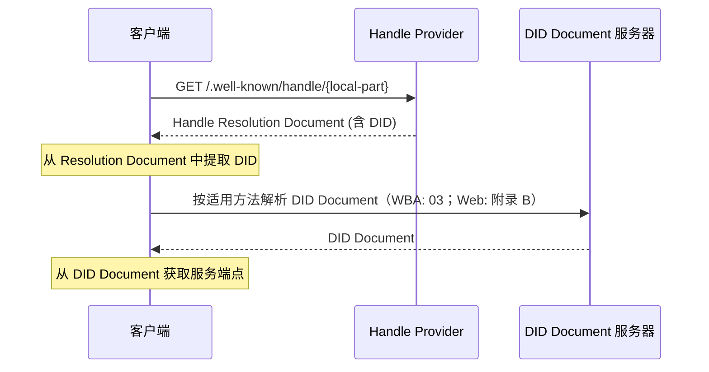
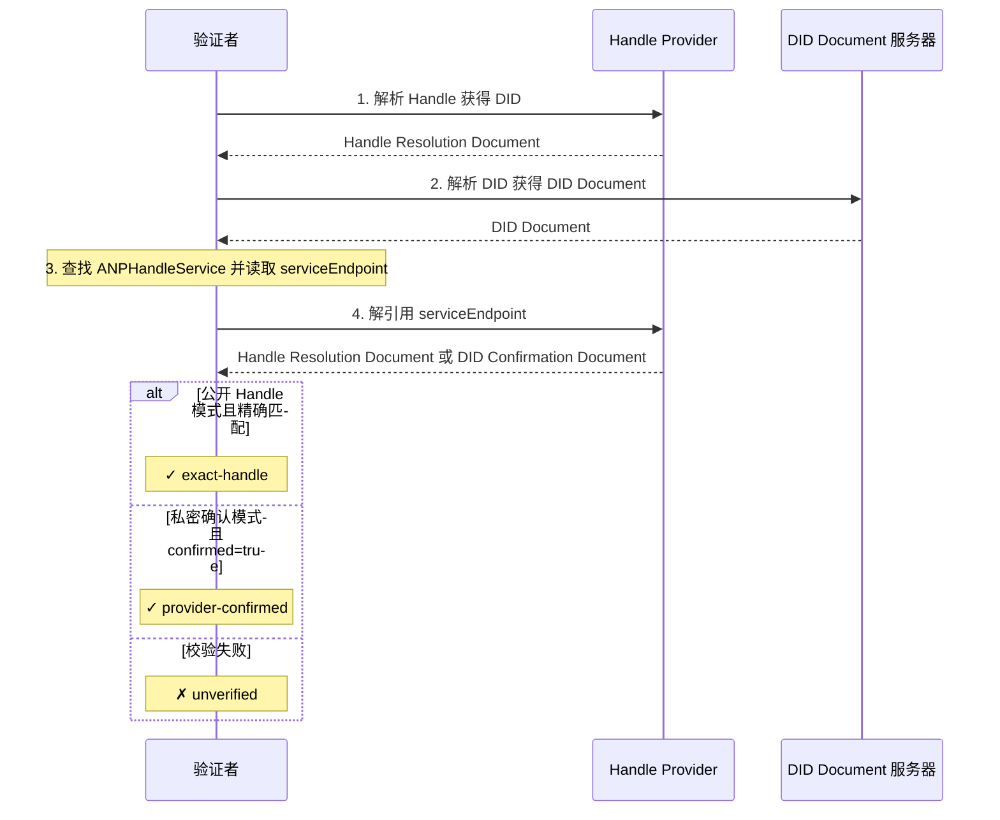

<!-- translation-review: machine-fully-reviewed; scope=source lines 1-939; inventory=japanese/reviews/core-chinese-review.json; full prose compared against source -->
> 日本語参考訳（機械翻訳を原文と全文照合し、意味・用語を校閲済み）。規範となるのは原文です。コード例・識別子・規範キーワードは原文を保持しています。
> 原文: [chinese/04-ANP-基于DID-WBA的命名空间规范.md](../../chinese/04-ANP-基于DID-WBA的命名空间规范.md) / 基準コミット: `0837cfdfaf4ddcf834f0890ddaf34fc4c824e066`

# ANP-DID:WBA 名前空間の仕様

- 文書ID: ANP-04
- タイトル: ANP-DID:WBA 名前空間仕様
- ステータス: リリース済み
- バージョン: 1.2
- 原文の言語：中国語（本ファイルは日本語訳）。
- 適用範囲：本仕様は、ANPでの人間に読みやすいHandleの命名、WNS解決、did:wbaの名前対応付けに適用する。

> ANP 1.2公開時の注記：共通のDID本人認証はANP-02が定義し、DIDメソッドと命名規則はそれぞれを所管する仕様が定義する。英語の対応文書は [ANP-DID:WBA名前空間仕様](../04-anp-did-wba-name-space-specification.md) である。

略称：WNS（WBAネームスペース）

この改訂では既存のWBAの名前対応付け、エンドポイント検証、結合管理、キャッシュ、移行の規則を維持します。ネイティブの`did:web`は[付録B.4の既存のドメイン宣言互換モデル](../../chinese/附录B：与原生did-web-的兼容.md#legacy-web-handle)を維持し、WBAへの移行や結果のWBAの`exact-handle`への格上げは行いません。WBAのホスト名一致要件と以下の第6章の正確なHandle・非公開HandleのエンドポイントフローはWeb互換モードに適用しません。共通リクエスト認証は[ANP-02](02-ANP-基于DID的身份认证协议.md)に移されました。

## 要約

この仕様はdid:wbaに基づく人間に読みやすい名前空間、WNS（WBA Name Space）を定義します。WNSは`did:wba` DIDの読みやすい別名としてHandle（`alice.example.com`など）を導入します。標準化された解決フローでHandleをDIDに対応付け、そのDIDから[did:wbaメソッド仕様](03-did-wba方法规范.md)に従ってDID Documentとサービス機能を解決します。

ハンドルは、DID 識別子が人間にとって使いにくいという問題を解決します。 `did:wba:example.com:user:alice:e1_<fingerprint>` などの識別子はマシンに適していますが、覚えたり共有したりするのが困難です。特に、最新の Did:wba 仕様では、パスタイプ DID はデフォルトでバインドされた公開キーのフィンガープリントを保持し、バインディング キーまたはバインディング プロファイルが変更されるとパスタイプ DID 自体がローテーションされる可能性があります。したがって、WNS は、電子メール アドレスやソーシャル プラットフォームのユーザー名と同様のエクスペリエンスを提供するだけでなく、人間が判読できる安定した名前付けレイヤーとしても機能します。つまり、ハンドルは安定した状態を維持できる一方、基礎となる Did:wba はバインディング キーの変更に応じて回転する可能性があります。

クロスドメイン プロトコルでその安定した名前を安定した参照として安全に使用できるようにするために、この仕様では、すべての準拠するハンドル プロバイダーに対して、次のプロトコル コミットメントを作成および強制することを要求しています。ハンドルは、一度割り当てられると永久に同じサブジェクトに属し、譲渡不可で、失効後に再利用することはできません。ハンドルの安定性とハンドルから DID へのマッピングは、仕様 03 で定義された暗号化 DID 移行証明に代わるものではありません。

本仕様のHandle関連機能はネイティブのdid:webメソッドとも互換にできる。互換方式は付録Aを参照されたい。

## 1. 背景と動機

### 1.1 問題の説明

`did:wba`メソッドはエージェントの分散型の本人性を提供します（[did:wbaメソッド仕様](03-did-wba方法规范.md)を参照）が、その識別子形式は人間には扱いにくいものです。

- **覚えにくい**: `did:wba:example.com:user:alice:e1_<fingerprint>` メソッドのプレフィックス、ドメイン、パス、バインディング フィンガープリントが含まれるため、識別子は比較的長くなります。
- **共有が難しい**: ソーシャル コンテキストで DID 識別子を共有するのは不便で、エラーが発生しやすくなります。
- **入力が難しい**: DID 識別子を手動で入力するユーザー エクスペリエンスは劣悪です。
- **ローテーションの可能性**: 既定のパスプロファイルを使うパス型DIDでは、結合鍵や結合プロファイルが変わるとDID自体が変わる場合があります。

これらの問題は、次のシナリオで特に顕著になります。
- ソーシャル チャネルを介したエージェント ID の共有
- インスタントメッセージングでの受信者の入力
- 名刺、文書、または口頭でのコミュニケーションにおけるエージェントの身元への言及
- 基礎となる DID のローテーションを許可しながら、安定した公開参照を維持します

### 1.2 設計目標

WNS の設計目標には次が含まれます。

1. **人間に読みやすい**: `alice.example.com`のような短く覚えやすく入力しやすい別名を提供します。
2. **ドメイン非依存**: ドメイン名と TLS 証明書を持つエンティティは、特定の集中プラットフォームに依存せずにハンドル サービスをホストできます。
3. **確定的解決**: ハンドルから DID へのマッピングは明示的であり、解決プロセスは標準化されています。
4. **安定した参照**: Handleは恒久的で譲渡・再利用できない安定した命名層です。下位のパス型did:wbaは結合鍵の変更に応じてローテーションできます。
5. **双方向バインディング**: ハンドルと DID は双方向検証をサポートし、一方的な改ざんを防ぎます。
6. **プロトコル統合**: 既存の ANP プロトコル スタックとのシームレスな統合 (仕様 03/07/08/09)。
7. **最小限の設計**: ハンドル登録、管理、またはその他のビジネス プロセスを指定せずに、コアの名前付けおよび解決メカニズムのみを定義します。

### 1.3 既存プロトコルとの関係

- **03-did:wbaメソッド仕様**: WNSのHandleはdid:wba DIDの読みやすい別名です。Handle解決では最終的に仕様03に従ってDID Documentを取得します。既定のパスプロファイルを使うパス型DIDについて、WNSは結合フィンガープリントの生成規則を再定義せず、仕様03を直接再利用します。下位DIDのローテーションに伴う安定主体パス、`successorDid`、`alsoKnownAs`、移行`proof`も仕様03が定義します。
- **07-エージェント記述プロトコル**：Handleを解決した後、DID文書のserviceからAgent Description文書に到達する。
- **08-エージェント検出プロトコル**: ハンドル プロバイダーは、エージェント検出の補助エントリ ポイントとして機能できます。
- **09-エンドツーエンド インスタント メッセージング プロトコル**: ハンドルは受信者の表示と入力に使用できますが、メッセージ ルーティングは DID ベースのままです。

## 2. 用語

| 用語 | 定義 |
|------|------------|
| **Handle** | `local-part.domain`形式の、人間に読みやすい短い識別子。例: `alice.example.com` |
| ** ハンドル プロバイダー** | ハンドル解決サービスをホストし、ハンドルから DID へのマッピングを維持するドメイン パーティ |
| **Local Part** | Handleのユーザー識別子部分。`alice.example.com`内の`alice`など |
| **Domain** | Handleのドメイン部分。`alice.example.com`内の`example.com`など |
| ** DID バインディング** | ハンドルから DID への 1 対 1 のマッピング関係 |
| **ハンドル解決** | ハンドルを DID に解決するプロセス |
| ** DID ローテーション** | パスタイプ Did:wba の場合、バインディングキーまたはバインディングプロファイルが変更され、サブジェクトの連続性が仕様 03 に従って確立されるために完全な DID が変更されるプロセス |
| **結合世代** | DIDの再結合、状態変更、巻き戻し攻撃の検出に使う、WNS Handle結合状態の単調増加する世代。did:wba DIDの世代フィールドではありません |
| **Handle Tombstone** | 失効後も同じHandleの再割り当てを防ぐために恒久的に保持する予約 |
| **WNS** | WBA 名前空間、この仕様によって定義される名前空間システム |
| **ハンドル解決ドキュメント** | ハンドル解決エンドポイントによって返される、ハンドルから DID へのマッピング情報を含む JSON ドキュメント|
| ** DID 確認エンドポイント** | ハンドル プロバイダーのドメインの下にある確認エンドポイント。DID ドキュメント内の特定のハンドルを公開せずに、DID がそのプロバイダーによって実際に解決されていることを確認するために使用されます。 |

## 3. ハンドル形式仕様

### 3.1 ハンドル構文

ハンドルは、`local-part.domain` 形式の DNS スタイルの構文を使用します。

**ABNF 定義:**

```abnf
handle     = local-part "." domain
local-part = (ALPHA / DIGIT) *61(ALPHA / DIGIT / "-") (ALPHA / DIGIT)
domain     = ; 合法的完全限定域名 (FQDN)，参见 RFC 1035
```

**構文規則:**

- local-partに使えるのは、ASCII小文字 `a-z`、数字 `0-9`、ハイフン `-` だけである。
- ローカル部は英字または数字で始まり、英字または数字で終わらなければなりません（MUST）。
- ローカル部に連続ハイフン`--`を含めてはいけません（MUST NOT）。
- local-partの長さは1～63文字とする。
- ドメインはTLS/SSL証明書で保護された有効なFQDNでなければなりません（MUST）。
- Handleのdomainにポート番号を含めない。
- 処理前に全入力を小文字に正規化しなければなりません（MUST）。

**例:**

```text
alice.example.com          ✓ 有效
bob-smith.example.com      ✓ 有效
agent-42.example.com       ✓ 有效
a.example.com              ✓ 有效（单字符 local-part）
-alice.example.com         ✗ 无效（以连字符开头）
alice-.example.com         ✗ 无效（以连字符结尾）
al--ice.example.com        ✗ 无效（连续连字符）
Alice.Example.com          → 归一化为 alice.example.com
```

### 3.2 URI 表現

共有時にHandleだと明示するため、`wba://` プレフィックスを使える。

```text
wba://alice.example.com
```

`wba://` プレフィックスは、共有および認識シナリオにのみ使用され、意味的にはハンドル自体と同等です。

- クライアントは`wba://`付き入力を受け付けてもかまいません（MAY）。
- このプレフィックスを受け付ける場合、解決前に`wba://`を取り除き、標準の解決フローに従わなければなりません（MUST）。
- 実装は`wba://`プレフィックスへの対応を相互運用性の前提条件にしてはいけません（MUST NOT）。

> 注: `wba://` は正式な URI スキームとして IANA に登録されていません。実装者は、代わりに次の Web URL を使用することもできます。
> ```text
> https://{domain}/.well-known/handle/{local-part}
> ```

### 3.3 予約語の原則

Handleプロバイダーは特定のローカル部が登録されないよう、予約語リストを管理するべきです（SHOULD）。このプロトコルは次の予約語の分類を定義します。具体的リストは各プロバイダーが決定します。

**a) プロトコル予約語**: `did`、`agent`、`well-known`、`service`など、ANPのキーワードと衝突する語。

**b) システム予約語**: `admin`、`root`、`system`、`api`など、一般的なシステム機能と衝突する語。

**c) 防御のための予約語**: `support`、`security`、`official`など、フィッシングや取り違えを狙う攻撃に使われうる語。

Handleプロバイダーは予約語リストを公開するべきです（SHOULD）。

## 4. ハンドル解決プロトコル

### 4.1 解決フロー

ハンドルの解決は以下のフローに従います。

```text
Handle → Handle Resolution Endpoint → DID → DID Document → service
```



### 4.2 ハンドル解決エンドポイント

ハンドル解決エンドポイントは、ハンドル プロバイダーによって提供される標準化された HTTP エンドポイントです。

- **URL**: `https://{domain}/.well-known/handle/{local-part}`
- **方法**: `GET`
- **応答内容の種類**: `application/json`

ここで、`{domain}` はハンドルのドメイン部分、`{local-part}` はユーザー識別子部分です。

**リクエスト例:**

```http
GET /.well-known/handle/alice HTTP/1.1
Host: example.com
Accept: application/json
```

### 4.3 ハンドル解決文書

ハンドル解決エンドポイントによって返される JSON ドキュメントの形式は次のとおりです。

```json
{
  "handle": "alice.example.com",
  "did": "did:wba:example.com:user:alice:e1_<fingerprint>",
  "status": "active",
  "binding_generation": "8",
  "updated": "2025-01-01T00:00:00Z",
  "versionId": "42",
  "ttl": 300,
  "profile": {
    "type": "DIDSubjectProfile",
    "subject_did": "did:wba:example.com:user:alice:e1_<fingerprint>",
    "subject_type": "person",
    "handle": "alice.example.com",
    "display_name": "Alice",
    "description": "Researcher and AI agent user",
    "avatar_uri": "https://example.com/avatars/alice.png",
    "profile_uri": "https://example.com/alice/",
    "discoverability": "listed",
    "updated": "2025-01-01T00:00:00Z",
    "versionId": "profile-7",
    "ttl": 300
  }
}
```

**フィールドの説明:**

| フィールド | 必須/オプション | 説明 |
|-------|-------------------|-------------|
| `handle` | 必須 | 完全なハンドル識別子 |
| `did` | 必須 | 現在ハンドルにバインドされているdid:wba DID |
| `status` | 必須 | 現在のハンドルのステータス。セクション 4.7 を参照 |
| `binding_generation` | 必須 | 10進文字列。Handleの束縛または状態が変わるたびに、厳密に増加しなければならない |
| `updated` | オプション | ISO 8601 形式の最終更新時刻 |
| `versionId` | オプション | キャッシュとトラブルシューティングに使用されるマッピング バージョン識別子 |
| `ttl` | オプション | 推奨されるキャッシュ有効期間 (秒単位) |
| `profile` | 任意 | 現在そのHandleに束縛されたDID主体の公開表示情報。画面表示、連絡先プレビュー、検索結果、IM宛先確認用であり、本人認証、認可、メッセージルーティング、サービス発見、E2EE束縛、Security Profileのネゴシエーションに使ってはならない |

### 4.3.1 DID 確認エンドポイント

DID保有者がDID Documentで特定のHandleを公開したくない場合、HandleプロバイダーはDID確認エンドポイントを提供してもかまいません（MAY）。

**推奨URL:**

```text
https://{domain}/.well-known/handle/by-did?did={urlencoded-did}
```

- **方法**: `GET`
- **応答内容の種類**: `application/json`

**応答例:**

```json
{
  "did": "did:wba:example.com:user:alice:e1_<fingerprint>",
  "confirmed": true,
  "status": "active",
  "updated": "2025-01-01T00:00:00Z",
  "ttl": 300
}
```

**フィールドの説明:**

| フィールド | 必須/オプション | 説明 |
|-------|-------------------|-------------|
| `did` | 必須 | 確認対象のDID |
| `confirmed` | 必須 | `true` でなければならず、そのDIDの解決を実際にそのHandle Providerが担当することを表す |
| `status` | オプション | ハンドル プロバイダーでのこの DID の現在の解決ステータス |
| `updated` | オプション | ISO 8601 形式の最終更新時刻 |
| `ttl` | オプション | 推奨されるキャッシュ有効期間 (秒単位) |

DID Confirmation Endpointを使う場合、DID文書を介した間接的なHandleの公開を避けるため、応答文書には具体的な `handle` を直接返さないことが望ましい（SHOULD）。

### 4.3.2 Profileオブジェクト

Handle解決文書には`profile`オブジェクトを含めてもかまいません（MAY）。

`profile`は、解決したHandleに現在結び付くDID主体の公開表示用メタデータです。この仕様では**DID主体プロファイル**と呼びます。JSONのフィールド名は`profile`のままで、オブジェクトの`type`は`DIDSubjectProfile`にするべきです（SHOULD）。

`profile`は汎用のDID主体のメタデータです。エージェント専用と解釈してはいけません（MUST NOT）。解決されたDID主体は、人、エージェント、グループ、組織、サービス、アプリケーション、その他の主体の型であってもかまいません（MAY）。

`profile`の有無によって、正本となるHandleとDIDの結合の意味論を変えてはいけません（MUST NOT）。正本の解決結果は引き続きトップレベルの`handle`と`did`です。ルーティング、認証、認可、E2EEセッションの結合、サービス発見には、解決したDID、DID Document、`ANPMessageService`、対応するANPプロファイルを引き続き使わなければなりません（MUST）。

**推奨プロファイルオブジェクト:**

```json
{
  "type": "DIDSubjectProfile",
  "subject_did": "did:wba:example.com:user:alice:e1_<fingerprint>",
  "subject_type": "person",
  "handle": "alice.example.com",
  "display_name": "Alice",
  "description": "Researcher and AI agent user",
  "avatar_uri": "https://example.com/avatars/alice.png",
  "profile_uri": "https://example.com/alice/",
  "discoverability": "listed",
  "labels": {
    "locale": "en-US"
  },
  "updated": "2025-01-01T00:00:00Z",
  "versionId": "profile-7",
  "ttl": 300,
  "proof": {
    "type": "DataIntegrityProof",
    "cryptosuite": "eddsa-jcs-2022",
    "created": "2025-01-01T00:00:00Z",
    "proofPurpose": "assertionMethod",
    "verificationMethod": "did:wba:example.com:user:alice:e1_<fingerprint>#key-1",
    "proofValue": "z..."
  }
}
```

**フィールドの説明:**

| フィールド | 必須/オプション | 説明 |
|-------|-------------------|-------------|
| `type` | 推奨 | `DIDSubjectProfile` とし、他のprofileに類するオブジェクトと区別することが望ましい |
| `subject_did` | 必須 | このプロファイルが記述するDID主体 |
| `subject_type` | 推奨 | DID主体の型。推奨値は`person`、`agent`、`group`、`organization`、`service`、`application`、`unknown` |
| `handle` | 任意 | 対応するHandle。存在する場合、外側の `handle` フィールドと等しくなければならない |
| `display_name` | おすすめ | UIで使用する表示名 |
| `description` | オプション | 人間が読める説明 (人物の略歴、エージェントの説明、グループの紹介など) |
| `avatar_uri` | オプション | アバター、アイコン、またはグループ画像の URI |
| `profile_uri` | オプション | より充実したパブリック プロファイル ページまたはプロファイル ドキュメント URI |
| `discoverability` | オプション | 発見可能性のヒント。推奨値は次のとおりです。 `private`, `listed`、そして `public` |
| `labels` | オプション | 表示、分類、検索支援のための非セキュリティ拡張ラベル |
| `updated` | オプション | プロフィール更新時間 |
| `versionId` | オプション | プロファイルのバージョン識別子 |
| `ttl` | オプション | 推奨されるプロファイル キャッシュの有効期間 (秒単位) |
| `proof` | 任意 | `proof`を除いたプロファイルオブジェクトに対する、オブジェクト単位の主張の証明 |

`subject_type` が欠けているかクライアントが認識できない場合、`unknown` として扱わなければならない（MUST）。クライアントもサーバーも、`subject_type` だけを根拠に認可を判断してはならない（MUST NOT）。独自の主体型は、推奨列挙値を直接拡張するより、`labels` に入れることを優先する。

`display_name` は表示名であり、本人識別、ルーティング、認可に使う名前ではない。重複してもよく（MAY）、変更してもよい（MAY）。`display_name` をメッセージ署名、認可判断、E2EEセッション束縛、サービスエンドポイント選択に使ってはならない（MUST NOT）。新しいプロトコルの出力では `display_name` を使うことが望ましい（SHOULD）。サーバーは旧実装との互換性のため入力の `name` を受け入れられるが、標準の出力で `name` を使うことは望ましくない（SHOULD NOT）。

**一貫性ルール:**

`profile`がある場合、`profile.subject_did`はHandle解決文書のトップレベルの`did`と等しくなければなりません（MUST）。`profile.handle`がある場合、トップレベルの`handle`と等しくなければなりません（MUST）。`profile.subject_did`または`profile.handle`の不一致を受け取ったクライアントは`profile`を無視しなければならず（MUST）、解決結果に疑わしいと印を付けてもかまいません（MAY）。

`avatar_uri`または`profile_uri`がある場合、絶対HTTPS URIにするべきです（SHOULD）。クライアントは`profile_uri`からDIDの結合、サービスエンドポイント、認可機能を推定してはいけません（MUST NOT）。リモートのプロファイルやアバターを通常の外部コンテンツとして扱うべきであり、ローカルへの指示として実行してはいけません。

`labels` は、セキュリティの意味を持たない表示、分類、検索支援だけに用いる。`labels` を認可、ルーティング、セキュリティ水準の判断、グループメンバーの識別、E2EE機能の判断に使ってはならない（MUST NOT）。

**キャッシュ セマンティクス:**

トップレベルの`ttl`はHandle解決文書、特に`handle` → `did`の対応付けのキャッシュを制約します。`profile.ttl`はプロファイルのキャッシュを制約します。`profile.ttl`がない場合、クライアントはトップレベルの`ttl`をプロファイルキャッシュの最長保持時間に使ってもかまいません（MAY）。ローカルポリシーが明示的に許さない限り、`profile`をHandle解決文書より長くキャッシュするべきではありません（SHOULD NOT）。トップレベルの`did`が変わったら、旧DIDに関連するプロファイルキャッシュを無効化しなければなりません（MUST）。

トップレベルの`binding_generation`はセキュリティ上重要な単調増加する結合世代です。`updated`と`versionId`はキャッシュ、診断、突き合わせ用の補助的な版情報です。`profile.updated`と`profile.versionId`はプロファイルの版を表します。Handle結合とプロファイルの版は独立に変わってもかまいません（MAY）。検証者は`updated`または`versionId`で`binding_generation`の巻き戻し防止の意味論を置き換えてはいけません（MUST NOT）。

**証明セマンティクス:**

初期導入段階では`profile.proof`は任意です。`proof`がない場合、クライアントはプロバイダー提供のUIメタデータとして扱わなければなりません（MUST）。表示、検索結果、連絡先カード、IMの宛先確認には使ってもかまいません（MAY）が、認証、認可、ルーティング、サービスエンドポイント選択、E2EE結合、セキュリティポリシー決定には使ってはいけません（MUST NOT）。

`profile.proof` が存在する場合、オブジェクト単位の表明として扱うことを推奨する。保護対象は、`proof` を除いた `profile` オブジェクト全体である。検証規則は次のとおり。

1. `profile.subject_did` は、外側の `did` と等しくなければならない。
2. `proof.verificationMethod` が属するDIDは、`profile.subject_did` と等しくなければならない。
3. `proof.verificationMethod` は、`profile.subject_did` のDID文書の `assertionMethod` で認可されていることが望ましい。
4. 証明検証が成功した場合、クライアントはDID主体が主張する公開表示用メタデータとして扱ってもかまいません（MAY）。
5. 証明検証が成功しても、`profile`でルーティング、認可、サービス発見、E2EE結合の規則を置き換えてはいけません（MUST NOT）。

**グループプロファイルの投影:**

Group Baseでは`group_profile`が引き続きグループ状態の表示情報の正本です。HandleがGroup DIDを指す場合、WNSの`profile`はすばやく表示するためにグループの表示フィールドを転記してもかまいません（MAY）。

| グループベースフィールド | WNS `profile` フィールド |
|------------------|---------------------|
| `group_did` | `profile.subject_did` |
| `group_profile.display_name` | `profile.display_name` |
| `group_profile.description` | `profile.description` |
| `group_profile.avatar_uri` | `profile.avatar_uri` |
| `group_profile.discoverability` | `profile.discoverability` |
| `group_profile.labels` | `profile.labels` |

WNSの`profile`とGroup Baseの`group_profile`が矛盾する場合、グループ管理、権限、メッセージングの意味論、現在状態はGroup Hostの`group_profile`、`group_policy`、`group_state_version`によって決定します。WNSの`profile`はHandle解決後にすばやく表示するための投影にすぎません。

**クライアントの動作:**

クライアントは、Handle解決後すぐに `profile.display_name`、`profile.avatar_uri`、`profile.subject_type` を表示してもよい（MAY）。`profile` がない場合も、Handleや短縮したDIDを表示するなどして正常に動作し続ける必要がある。混同を防ぐため、特に高リスクの操作前は、表示名の横にHandleまたはDIDを確認できる入口を残すことが望ましい（SHOULD）。

### 4.4 ハンドルから DID へのマッピング ルール

ハンドルと DID は、ハンドル プロバイダーによって維持される 1 対 1 の対応関係を持ちます。マッピングは次の規則に従います。

1. **ホスト名の一致**: Handleのドメイン部分はDID内のホスト名と一致しなければなりません（MUST）。DIDのauthorityにポートがある場合、ポートを無視してホスト名だけを比較しなければなりません（MUST）。
2. **一意な結合**: 1つのHandleは正確に1つのDIDに結び付かなければなりません（MUST）。
3. **ローカル部の一意性**: ローカル部は同一ドメイン内で一意でなければなりません（MUST）。
4. **did:wba バインディング フィンガープリントの再定義なし**: ハンドルがデフォルトのパス プロファイルを使用してパス タイプ Did:wba を指す場合、DID パス内の最終バインディング フィンガープリント セグメントの生成、検証、およびプロファイル セマンティクスは仕様 03 によって完全に定義されます。WNS はこれらのルールを再定義したり上書きしたりしません。
5. **恒久予約**: Handleを一度割り当てたら、プロバイダーはその所有記録を恒久的に保持しなければならず（MUST）、別の主体へ譲渡・再割り当てしてはいけません（MUST NOT）。
6. **単調増加する世代**: 初回割り当て時の`binding_generation`は正の10進文字列でなければなりません（MUST）。現在のDIDやHandleの状態が変わるたびに厳密に増加しなければならず（MUST）、巻き戻しや過去の世代の再利用をしてはいけません（MUST NOT）。

**マッピング例:**

```text
Handle:  alice.example.com
DID:     did:wba:example.com:user:alice:e1_<fingerprint>
```

```text
Handle:  alice.example.com
DID:     did:wba:example.com%3A8800:user:alice:e1_<fingerprint>
```

上の例では、Handleのdomainは `example.com` である。2番目のDIDは、符号化されたポート `%3A8800` を含むが、ホスト名は依然として `example.com` であり、対応付けは有効である。Handle自体はポート番号を含まない。ポートはDID文書の解決先だけに影響し、Handleの文字列表現には影響しない。

<a id="method-resolution"></a>
### 4.5 did:wbaの標準解決

DIDを取得した後、実装は[did:wbaメソッド仕様](03-did-wba方法规范.md)に従ってDID Documentを解決しなければなりません（MUST）。ネイティブの`did:web`は[ANP-02付録B](../../chinese/02-ANP-基于DID的身份认证协议.md#web-binding)が参照する既存のWebメソッドの解決・認証互換規則を使います。Handleの結合は既存の付録B.4モデルを維持します。

実装者はDID Documentを迂回し、Handleからサービスエンドポイント、結合鍵、その他のDID関連情報を直接推定してはいけません（MUST NOT）。エージェントの機能とサービスについて正本となる情報源はDID Documentです。

### 4.6 Handleの一意性制約

- Handleは正確に1つのDIDに結び付かなければなりません（MUST）。
- ローカル部は同一ドメイン内で一意でなければなりません（MUST）。
- 一度割り当てたHandleは永久に予約したままにしなければならず（MUST）、失効したHandleにはtombstoneを保持しなければなりません（MUST）。
- Handleを譲渡してはならず（MUST NOT）、通常の登録フローで再割り当てしてもならない（MUST NOT）。
- 異なるdomainでは、同じlocal-partを使える（分散型モデル）。

たとえば、`alice.example.com` と `alice.other.com` は、異なる DID を指す 2 つの異なるハンドルです。

### 4.7 ハンドルステータス

ハンドルには次の 3 つの状態があります。

| ステータス | 説明 |
|--------|-------------|
| `active` | 通常の状態。ハンドルは解決できます |
| `suspended` | 一時的には解決できないが回復可能 |
| `revoked` | 失効済みで復旧不能。Providerはtombstoneを恒久的に保持し、再割り当てしてはならない |

### 4.8 エラー応答

Handle解決エンドポイントは次の標準HTTPステータスコードを返すべきです（SHOULD）。

| ステータスコード | 意味 | 説明 |
|-------------|---------|-------------|
| `200 OK` | 解決成功 | ハンドル解決ドキュメントを返します |
| `404 Not Found` | ハンドルが存在しません | ローカル部分が登録されていないか、ハンドルが存在するかどうかをサーバーが開示したくない |
| `410 Gone` | ハンドルが完全に取り消されました | ハンドルは以前に存在していましたが、取り消されました |
| `301 Moved Permanently` | ハンドルが移行されました | の `Location` ヘッダーは新しい解決エンドポイントを指します |
| `308 Permanent Redirect` | ハンドルが移行されました | に似ている `301`ただし、リクエストのセマンティクスをより明示的に保持します。 |
| `429 Too Many Requests` | リクエスト率が高すぎます | レート制限がトリガーされた場合に返されます。含まれる可能性があります `Retry-After` |

`301` または `308` が返された場合:

1. `Location` は移行のヒントにすぎません。
2. クライアントは新アドレスで第6章の双方向結合検証をやり直さなければなりません（MUST）。
3. HTTPリダイレクトだけに基づいて新しいHandle → DIDの結合を受け入れてはいけません（MUST NOT）。

**エラー応答例:**

```json
{
  "error": "handle_not_found",
  "message": "The handle 'bob.example.com' does not exist"
}
```

## 5. プロフィールURL

### 5.1 プロファイルエントリポイント

Handleプロバイダーは各Handleにプロファイルの入口を提供してもかまいません（MAY）。次のURL形式を推奨します。

- サブドメインのスタイル: `https://{local-part}.{domain}/`
- パスのスタイル: `https://{domain}/{local-part}/`

このプロファイルURLは§4.3.2の`profile`オブジェクトとは異なります。Handle解決文書に`profile.profile_uri`がある場合、このURLを指してもかまいません（MAY）が、それは外部の表示用または業務用の入口にとどまります。

### 5.2 プロファイルフォーマット

プロフィールはビジネスレベルの文書です。この仕様はプロファイル URL エントリ ポイントのみを定義し、コンテンツ形式を制約しません。プロファイルの特定のコンテンツとプレゼンテーションは、ハンドル ユーザーとハンドル プロバイダーによって定義されます。

プロファイルURLは表示用・業務用の入口であり、Handle → DIDの結合やサービス発見の正本となる情報源ではありません。実装者はプロファイルURLだけでDID、サービスエンドポイント、認可機能を推定してはいけません（MUST NOT）。セキュリティに関わる本人性の結合、メッセージルーティング、サービス発見には、引き続きHandle → DID → DID Documentの標準チェーンに従わなければなりません（MUST）。

## 6.  リバース検証 (双方向バインディング)

悪意のあるハンドル プロバイダーが任意のハンドルを他人の DID にマッピングすることを防ぐために、WNS は双方向バインディング検証メカニズムを定義します。

### 6.1 Handleプロバイダーの宣言（順方向）

ハンドル プロバイダーは、解決エンドポイントを通じてハンドルから DID へのマッピングを宣言します。これは標準解決フローの一部です (セクション 4)。

### 6.2 DID Documentの宣言（逆方向）

DID 所有者は、タイプ `ANPHandleService` のエントリを DID ドキュメントの `service` セクションに追加して、使用するハンドル バインディング サービス エンドポイントを宣言します。 `ANPHandleService.serviceEndpoint` は、単にプロバイダー ドメインを表すだけではなくなりました。代わりに、これは逆参照可能な HTTPS エンドポイントです。このエンドポイントは、次の 2 つの互換モードをサポートします。

1. **公開Handleモード**: `serviceEndpoint`にそのHandleの標準解決エンドポイントを直接使います。
2. **非公開確認モード**: `serviceEndpoint`はDID確認エンドポイントを指し、DID Documentで特定のHandleを公開せずに、そのDIDがHandleプロバイダーで実際に解決されることを確認します。

**パブリックハンドルモードの例:**

```json
{
  "id": "did:wba:example.com:user:alice:e1_<fingerprint>#handle",
  "type": "ANPHandleService",
  "serviceEndpoint": "https://example.com/.well-known/handle/alice"
}
```

**プライベート確認モードの例:**

```json
{
  "id": "did:wba:example.com:user:alice:e1_<fingerprint>#handle",
  "type": "ANPHandleService",
  "serviceEndpoint": "https://example.com/.well-known/handle/by-did?did=did%3Awba%3Aexample.com%3Auser%3Aalice%3Ae1_%3Cfingerprint%3E"
}
```

**フィールドの説明:**

- `id`: サービスの一意識別子。`#handle`サフィックスを推奨します。
- `type`：`ANPHandleService` でなければならない。
- `serviceEndpoint`: Handleプロバイダーのドメイン配下の、参照先を取得可能な絶対HTTPS URIでなければなりません（MUST）。公開Handleモードでは標準Handle解決エンドポイントを直接使うべきです（SHOULD）。非公開確認モードではDID確認エンドポイントを使ってもかまいません（MAY）。

`ANPHandleService` は、DID 所有者のハンドル バインディング サービスの逆宣言を表現するために使用されます。

- パブリック ハンドル モードでは、DID 保有者は特定のハンドルの解決エンドポイントを明示的に宣言し、検証者は入力ハンドルが DID と正確に一致するかどうかについて強力なチェックを実行できます。
- プライベート確認モードでは、DID 所有者は、承認されたハンドル プロバイダーと DID 確認エンドポイントのみを宣言します。検証者はプロバイダー関係を確認できますが、それだけでは特定のハンドルが正確に逆確認されたかどうかを推測することはできません。

将来のバージョンでは、互換性を維持しながら、より強力なネーム サービス プロバイダー ID や、`providerDid` や `handleCommitment` などのプライバシー保護メカニズムが導入される可能性があります。

<a id="binding-verification"></a>
### 6.3 検証フロー

次のセキュリティに関わる場面では、検証者は双方向結合検証を実施しなければなりません（MUST）。

- 本人認証
- 認可判断
- インスタントメッセージの受信者解決
- 状態変更、書き込み、課金、リソース作成を引き起こす自動呼び出し

UI表示、検索プレビュー、ディレクトリ閲覧だけの場合、双方向結合検証を後回しにしてもかまいません（MAY）。ただしセキュリティに関わる操作に進む前に、検証を完了しなければなりません（MUST）。



**検証手順:**

1. 入力Handleを標準Handle解決エンドポイントで解決し、Handle解決文書を取得して`did`を抽出します。
2. 仕様03に従ってその`did`を解決し、DID Documentを取得します。
3. DID Documentの`service`節で型が`ANPHandleService`のエントリーを探します。
4. `serviceEndpoint`が絶対`https` URIであり、ホスト名が入力Handleのドメインと一致することを検証します。
5. `serviceEndpoint`に`GET`リクエストを送り、返されたJSON文書を解析します。
6. `serviceEndpoint`が入力Handleの標準解決エンドポイントと等しく、返却文書の`did`が手順1の`did`と同一であり、返却文書の`handle`が入力Handleと完全一致する場合、その特定のHandleに対する正確な双方向結合検証が完了します。
7. 返却文書に`handle`がなく、`confirmed = true`があり、返却文書の`did`が手順1の`did`と同一の場合、そのDIDがHandleプロバイダーで実際に解決されることを示します。この結果が確認するのはプロバイダーとの関係だけです。
8. それ以外は全て、検証失敗または検証強度不足として扱わなければなりません（MUST）。

特定のHandleの確認が必要なセキュリティに関わる場面では、手順6の正確な双方向結合検証結果を得なければなりません（MUST）。手順7のプロバイダー確認だけでは十分ではありません。

### 6.3.1 ANPHandleServiceの使用規則（v2）

双方向結合検証では、次の規則に従って`ANPHandleService.serviceEndpoint`を使うべきです。

1. 入力Handleからドメインとローカル部分を抽出し、そのHandleの標準解決エンドポイント`https://{domain}/.well-known/handle/{local-part}`を構築します。
2. その解決エンドポイントでHandleを解決し、Handle解決文書を取得して`did`を抽出します。
3. 仕様03に従ってその`did`のDID Documentを解決します。
4. DID Documentの`service`節で`type = "ANPHandleService"`のエントリーを探します。
5. エントリーの`serviceEndpoint`が絶対`https` URIであることを確認します。そのホスト名は手順1で抽出したHandleのドメインと一致しなければなりません（MUST）。
6. `serviceEndpoint`に`GET`リクエストを送り、返却されたJSON文書を取得します。
7. `serviceEndpoint`が手順1の標準解決エンドポイントと完全に同じで、返却文書の`did`が手順2の`did`と同一であり、返却文書の`handle`が入力Handleと完全一致する場合、そのHandleとDIDは正確な双方向結合検証を完了したと扱います。
8. 返却文書に`handle`がなく、`confirmed = true`があり、返却文書の`did`が手順2の`did`と同一の場合、そのDIDの解決を、その`ANPHandleService`が属するHandleプロバイダーが実際に担当していることを示します。この結果が確認するのはプロバイダーとの関係だけであり、これだけで特定のHandleとそのDIDの正確な双方向結合検証が完了したと扱ってはなりません。
9. `ANPHandleService`が存在しない、`serviceEndpoint`が`https`でない、ホスト名が一致しない、`serviceEndpoint`の参照先取得に失敗する、返却文書の`did`が一致しない、または手順7／8の検証に失敗した場合、その結合を検証済みと扱ってはなりません。
10. 本人認証、認可判断、送信前の受信者確認など、特定のHandle確認が必要なセキュリティに関わる場面では、手順7の正確な双方向結合検証結果を得なければなりません（MUST）。手順8のプロバイダー確認だけでは、この要件を満たしません。

**メモ:**

- DID保有者がHandleを公開してよい場合、`ANPHandleService.serviceEndpoint`にそのHandleの標準解決エンドポイントを直接使うべきです（SHOULD）。
- DID保有者がDID DocumentでHandleを公開したくない場合、`ANPHandleService.serviceEndpoint`は`did`と`confirmed = true`を返すDID確認エンドポイントを指してもかまいません（MAY）。
- 将来のバージョンでは、互換性を維持しながら`providerDid`、`handleCommitment`、その他のより強力なプライバシー保護のための結合機構を導入できます。

### 6.3.2 検証結果のセマンティクス

検証強度の異なる結果を混同しないよう、実装者は少なくとも次の3結果を区別するべきです（SHOULD）。

| 結果 | 説明 |
|--------|-------------|
| `exact-handle` | 入力ハンドルと DID は正確な双方向バインディング検証を完了しました |
| `provider-confirmed` | DID とハンドルプロバイダー間の解決関係は確認されていますが、特定のハンドルは確認されていません |
| `unverified` | 検証に失敗した、または信頼強度が不十分な結果しか得られなかった |

`provider-confirmed` は、DID ファースト、ディレクトリ参照、またはプライバシーに配慮したハンドル プロバイダー確認シナリオに適しています。 `exact-handle` のみが、特定のハンドルの確認を必要とする高保証シナリオを満たします。

## 7. ANP プロトコル スタックとの統合

### 7.1 DID ドキュメントとの統合 (仕様 03)

DID Documentの`service`に、逆方向の検証（第6節）をサポートするための`ANPHandleService`型を追加します。

```json
{
  "service": [
    {
      "id": "did:wba:example.com:user:alice:e1_<fingerprint>#ad",
      "type": "AgentDescription",
      "serviceEndpoint": "https://example.com/agents/alice/ad.json"
    },
    {
      "id": "did:wba:example.com:user:alice:e1_<fingerprint>#handle",
      "type": "ANPHandleService",
      "serviceEndpoint": "https://example.com/.well-known/handle/alice"
    }
  ]
}
```

デフォルトパス方式を採用するdid:wbaについて、WNSは結合フィンガープリントの形式を定義せず、`e1_`／`k1_`の規則もWNSで重複して定義しません。これらの意味は全て仕様03が規定します。

上の例は公開Handleモードです。DID保有者がDID Documentで特定のHandleを公開したくない場合、`ANPHandleService.serviceEndpoint`にDID確認エンドポイントを代わりに使ってもかまいません（MAY）。例えば次のとおりです。

```json
{
  "id": "did:wba:example.com:user:alice:e1_<fingerprint>#handle",
  "type": "ANPHandleService",
  "serviceEndpoint": "https://example.com/.well-known/handle/by-did?did=did%3Awba%3Aexample.com%3Auser%3Aalice%3Ae1_%3Cfingerprint%3E"
}
```

このモードでは、検証者はプロバイダー関係のみを確認でき、それだけに基づいて特定のハンドルを正確な双方向バインディング検証が完了したものとして扱うことはできません。

### 7.2 エージェント記述プロトコル (仕様 07) との統合

エージェント記述文書に任意の`handle`フィールドを含めてもかまいません（MAY）。

```json
{
  "protocolType": "ANP",
  "protocolVersion": "1.0.0",
  "type": "AgentDescription",
  "did": "did:wba:example.com:user:alice:e1_<fingerprint>",
  "handle": "alice.example.com",
  "name": "Alice's Agent",
  "description": "..."
}
```

`handle`フィールドは任意で、他のエージェントが人間に読みやすい識別子を取得しやすくするためのものです。権威ある結合関係は、引き続きWNSの解決結果とDID Documentを基準とします。

### 7.3 エージェント検出プロトコルとの統合 (仕様 08)

`.well-known/agent-descriptions`が返すコレクションの各エントリーに、任意の`handle`フィールドを含めてもかまいません（MAY）。

```json
{
  "@type": "ad:AgentDescription",
  "name": "Alice's Agent",
  "@id": "https://example.com/agents/alice/ad.json",
  "handle": "alice.example.com"
}
```

さらに、ハンドル プロバイダーの `/.well-known/handle/` パスは、エージェント検出の補助エントリ ポイントとして機能する場合があります。

### 7.4 インスタント メッセージング プロトコルとの統合 (仕様 09)

ハンドルは、インスタント メッセージングのシナリオで受信者の表示と入力に使用できます。

- ユーザーは`alice.example.com`などのHandleを入力して宛先を指定できます。
-  クライアントはハンドルを DID に解決し、メッセージ ルーティングを実行します。
- メッセージング UI では、読みやすさを向上させるために、DID の代わりにハンドルが表示される場合があります。
- Handle解決文書に有効な`profile`が含まれる場合、メッセージングUIは連絡先プレビューや宛先確認のため`profile.display_name`、`profile.avatar_uri`、`profile.subject_type`を表示できます。

メッセージのルーティングとトランスポートは引き続き DID ベースです。ハンドルと WNS `profile` は、人間とコンピューターの対話層での表示と入力にのみ使用されます。

## 8. Handleプロバイダーの要件

### 8.1 解決サービスの要件

Handleプロバイダーは次の要件を満たさなければなりません（MUST）。

- 解決サービスをHTTPSで提供しなければなりません（MUST）。
- `/.well-known/handle/{local-part}`エンドポイントを実装しなければなりません（MUST）。
- DID確認エンドポイント`/.well-known/handle/by-did`を実装してもかまいません（MAY）。
- HTTPキャッシュヘッダー（少なくとも`Cache-Control`と`ETag`、`Last-Modified`は任意）をサポートするべきです（SHOULD）。
- 乱用防止のためレート制限を実装するべきです（SHOULD）。
- `429 Too Many Requests`を返す場合、`Retry-After`を含めるべきです（SHOULD）。
- Handleの移行期間や下位DIDのローテーション期間には、キャッシュTTLを短縮するべきです（SHOULD）。

<a id="binding-management"></a>
### 8.2 ハンドル管理

- ハンドル プロバイダーは、ハンドルの割り当てとライフサイクル管理を担当します。
- ハンドル登録フロー、本人確認方法、長さポリシー、および同様の運用ルールは、各ハンドル プロバイダーによって定義されます。
- Handleプロバイダーは同一ドメイン内のHandleの一意性を保証しなければなりません（MUST）。
- 割り当て済みHandleを恒久的で譲渡不能な主体識別子として扱わなければならず（MUST）、別の主体に譲渡してはいけません（MUST NOT）。
- Handleの失効後、プロバイダーは恒久tombstoneを保持しなければならず（MUST）、通常の登録、回復、管理のいかなるフローでも、同名のHandleをいずれの主体にも割り当ててはなりません（MUST NOT）。
- Handleプロバイダーは、検証者が過去の結合のリプレイを拒否できるよう、`binding_generation`を永続化し、単調増加させなければなりません（MUST）。

### 8.3 ハンドルプロバイダーの移行

ユーザーは、あるハンドル プロバイダーから別のハンドル プロバイダーにハンドルを移行する必要がある場合があります。移行中:

-  このバージョンでは、プロバイダーの移行とは、完全なハンドルとそのドメインを変更せずに、操作またはインフラストラクチャを移動することを意味します。別のドメインに移動すると、別のハンドルが作成され、この仕様では自動的に ID が継続されません。
- プロバイダー移行では同じ完全なHandleと同じ主体を保持しなければならず（**MUST**）、Handleの譲渡や主体の置き換えに使ってはいけません（**MUST NOT**）。
- 新プロバイダーは、受理済みの最高の`binding_generation`、結合履歴、恒久tombstoneの義務を引き継がなければなりません（**MUST**）。移行後の次状態には厳密に大きい世代を使わなければならず（**MUST**）、移行を理由にリセット・巻き戻しをしてはいけません（**MUST NOT**）。
- 旧プロバイダーは`301 Moved Permanently`または`308 Permanent Redirect`を返してもかまいません（MAY）が、`Location`で示す解決エンドポイントも入力Handleのドメインに対する検証規則を満たさなければなりません（**MUST**）。
- 移行期間中は、新旧プロバイダーの両方が解決機能を維持するべきです（SHOULD）。
- DID保有者は、同じHandleドメイン配下の検証可能な公開Handle解決エンドポイントまたはDID確認エンドポイントを引き続き指すよう、DID Documentの`ANPHandleService`を更新する必要があります。
- クライアントは新しいアドレスで解決結果を取得した後、双方向結合検証を再実行しなければなりません（MUST）。リダイレクトだけを根拠に新しい結合関係を受け入れてはなりません。
- 将来、現在の相互運用モデルを変えずにプロバイダーの本人性をより強く表現する必要が生じた場合、後続バージョンで`providerDid`機構を導入できます。

### 8.4 基礎となる DID ローテーション

デフォルトのパス プロファイルを使用するパス タイプ Did:wba の場合、バインディング キーが変更されるか、バインディング プロファイルが `e1_` と `k1_` の間で切り替わると、基になる DID がローテーションします。このシナリオでは、WNS には次の要件があります。

- 人間に読みやすい安定した名前を提供するため、Handleは変わらなくてもかまいません（MAY）。
- 新DID Documentが利用可能になり、プロバイダー独自の回復または本人性検証ポリシーを満たしたら、Handleの対応付けを新DIDへ更新し、`binding_generation`を厳密に増加させなければなりません（MUST）。
- `binding_generation`はHandleの対応付けの状態だけを表します。DIDの世代やDID移行の暗号学的証明と解釈してはいけません（MUST NOT）。
- DIDの再結合は同じHandle主体の資格情報更新でなければならず（MUST）、Handleの譲渡や主体の置き換えに使ってはいけません（MUST NOT）。
- 新旧DIDを同じ継続する主体と扱う必要がある場合、プロバイダーまたはクライアントは旧DIDから仕様03に従って、安定主体パスと各直接の`successorDid`を検証し、証明が有効な有効状態のDIDに到達しなければなりません（MUST）。有効な旧結合鍵の証明または事前認可された回復証明は暗号学的継続性を提供します。いずれもない場合、認証済みの同一オリジンHTTPSによる完全チェーン解決は`provider_asserted`を報告できますが、Handleの対応付け、プレフィックスの一致、結合世代だけでは`unverified`にしかなりません。
- ローテーション期間中、クライアントが古い対応付けを使う期間を短くするため、キャッシュTTLを短縮するべきです（SHOULD）。
- クライアントはHandleが常に同じDIDに結び付くと仮定してはいけません（MUST NOT）。現在の解決結果が、そのHandleの現在のDIDの正本です。
- セキュリティに関わる操作では、Handleで新DIDを得た後に双方向結合検証をやり直さなければなりません（MUST）。
- 上位の操作で特定のHandleの確認が必要な場合、クライアントは`exact-handle`の結果を要求しなければなりません（MUST）。`provider-confirmed`だけを受け入れてはなりません。
- 旧DIDの無効化、その`successorDid`チェーン、新DIDの`alsoKnownAs`の規則は仕様03が定義します。WNSは安定した名前と現在のDIDの対応付けだけを担当します。

## 9. セキュリティに関する考慮事項

### 9.1 ドメインのセキュリティ

WNSのセキュリティモデルはdid:wbaと同様にTLS/SSL証明書基盤に依存します。Handleのドメイン部分は有効なTLS証明書で保護しなければなりません（MUST）。Handleプロバイダーの安全性はそのドメインとTLS設定の安全性に相当します。

### 9.2 フィッシングおよび混乱攻撃

WNS は、次のメカニズムを通じてフィッシングと混乱のリスクを軽減します。

- ローカル部分は、ASCII の小文字、数字、およびハイフンに制限されており、Unicode 同形異義語攻撃を回避します。
- Handleプロバイダーは予約語リストを管理するべきです（SHOULD、§3.3参照）。
- クライアントはHandle表示時にドメイン部分を視覚的に強調し、ユーザーによる発行元の識別を助けるべきです（SHOULD）。

### 9.3 Handleの悪意ある先取り登録

Handleプロバイダーは悪意ある先取り登録を防ぐ措置を講じるべきです（SHOULD）。次はその例で、これらに限りません。

- 予約語リストの維持
- 登録審査メカニズムの実装
- 紛争解決プロセスの提供

特定のポリシーは、各ハンドル プロバイダーによって定義されます。

### 9.4 プライバシーに関する考慮事項

- Handle解決エンドポイントはHandleの存在を明らかにします（例：200／404／410の違い）。Handleプロバイダーは列挙攻撃を緩和するため、レート制限を実施するべきです（SHOULD）。
- Handleプロバイダーは解決エンドポイントで、対応付け以外の機密情報を返すべきではありません（SHOULD NOT）。
- `profile`を返す場合、意図的に公開されていない機密の個人・グループ・組織情報を含めるべきではありません（SHOULD）。
- 過剰な差異で不要な状態を漏らさないよう、エラー応答構造を統一するよう努めるべきです（SHOULD）。
- DID保有者がDID Documentで特定のHandleを公開したくない場合、DID確認エンドポイントモードでプロバイダー単位の確認情報だけを返してもかまいません（MAY）。
- 表示のみの場合、不要なクロスサイト解決リクエストを減らすため、クライアントは双方向結合検証を後回しにしてもかまいません（MAY）。

### 9.5 改ざん防止

WNS の中核となる改ざん防止メカニズムは、双方向のバインディング検証です (セクション 6)。

1. ハンドル プロバイダーは、標準の解決エンドポイントを介して順方向にハンドル → DID を宣言します。
2. DID保有者はDID Document内の`ANPHandleService`で、同じHandleプロバイダードメイン配下の参照先を取得可能なHTTPSエンドポイントを逆方向に宣言します。
3. 検証者はそのエンドポイントの参照先を取得し、返却結果に基づいて`exact-handle`と`provider-confirmed`を区別します。
4. 特定のHandleを確認する必要がある高保証の場面では、検証者は`exact-handle`を要求しなければならず（MUST）、`provider-confirmed`で代用してはなりません。
5. 将来の版では`providerDid`や`handleCommitment`などを導入し、名前サービスのプロバイダー本人性検証とプライバシー保護を強化する可能性があります。

デフォルトのパス プロファイルを使用するパス タイプ Did:wba の場合、DID 自体が仕様 03 で定義されたバインディング フィンガープリント セグメント (`e1_...` や `k1_...` など) を伝送する場合もあります。これは Did:wba メソッド層に属し、WNS によって再定義されません。

WNS は、冗長な定義や、did:wba のデフォルト パス プロファイルとのセマンティックの競合を避けるために、別個の「アルゴリズムとエンコーディングがハンドル プロバイダーによって選択される公開キー フィンガープリント拡張機能」を定義しなくなりました。

## 10. ユースケース

### 10.1 ソーシャル共有

ユーザーのアリスはソーシャルメディアで`wba://alice.example.com`を共有できます。他のユーザーはこれを閲覧すると、次のことができます。

1. `wba://`プレフィックスを認識して除去し、Handleの`alice.example.com`を得ます。
2. ハンドルを解決して DID を取得します。
3.  DID ドキュメントを通じて、Alice のエージェントの説明とサービス エンドポイントを取得します。
4. Alice のエージェントとの対話を確立します。

### 10.2 エージェント間の通信

エージェント A は、ハンドルが `bob.example.com` であるエージェント B と通信する必要があります。

1. Handleの`bob.example.com`を解決し、DIDを得ます。
2. 仕様 03 に従って DID ドキュメントを解決します。
3. DID DocumentのserviceからAgentDescriptionエンドポイントを取得します。
4. エージェント B の機能とインターフェイスを理解するために、エージェント説明文書を取得します。
5. インターフェース定義に従って通信を開始します。

### 10.3 インスタント メッセージング

ユーザーはインスタント メッセージング アプリケーションで受信者のハンドル `carol.example.com` を入力します。

1. クライアントはハンドルを解決して DID を取得します。
2. 解決文書に有効な`profile`がある場合、宛先確認のため`profile.display_name`と`profile.avatar_uri`を表示できます。
3. クライアントは、DID ドキュメントを通じてメッセージング サービス エンドポイントを取得します。
4. クライアントは、仕様 09 で定義されているインスタント メッセージング プロトコルを使用してメッセージを送信します。
5.  メッセージング インターフェイスには、DID だけではなく、受信者の表示名とハンドルが表示されます。

### 10.4 安定したHandleとDIDのローテーション

アリスはハンドル `alice.example.com` を長期にわたって公に使用しています。しばらくすると、バインディング キーのローテーションにより、基になるパス タイプ Did:wba が次からローテーションされます。

```text
did:wba:example.com:user:alice:e1_<old-fingerprint>
```

次へとローテーションします。

```text
did:wba:example.com:user:alice:e1_<new-fingerprint>
```

このプロセス中:

1. アリスのハンドル `alice.example.com` は変わらないままです。
2. 旧DID Documentに`deactivated = true`と`successorDid = <new DID>`を設定し、仕様03に従ってDocument全体の`proof`を生成します。
3. 新DID Documentは`alsoKnownAs`で旧DIDを参照でき、引き続き`ANPHandleService`を宣言します。
4. Handleプロバイダーは対応付けを新DIDへ更新し、`binding_generation`を前の値より厳密に増加させます。
5.  仕様 03 に従って DID 移行関係を検証し、WNS 双方向バインディング検証を再実行した後、リゾルバーは引き続き同じハンドルを通じてアリスの現在の DID を検索します。
6. Alice がハンドル自体を取り消した場合、プロバイダーは同じハンドルを新しいサブジェクトに割り当てるのではなく、そのトゥームストーンを永久に保持します。

## 11. 規範要件の一覧

以下にこの仕様の全MUST / SHOULD / MAY要件をまとめます（用語は[RFC 2119](https://www.rfc-editor.org/rfc/rfc2119)による定義）。

### MUST（必須）

1. Handleのローカル部分は、英字または数字で始まり、英字または数字で終わらなければなりません。
2. Handleのローカル部分に連続するハイフンを含めてはなりません。
3. Handleのドメインは、TLS/SSL証明書で保護された有効なFQDNでなければなりません。
4. 全てのHandle入力を小文字に正規化しなければなりません。
5. クライアントが`wba://`プレフィックス付きの入力を受け入れる場合、解決前にそのプレフィックスを除去しなければなりません。
6. Handleのドメイン部分はDIDのホスト名と一致しなければなりません。DIDにポートが含まれる場合、比較時にポートを無視しなければなりません。
7. 1つのHandleは1つのDIDだけに結合しなければなりません。
8. 同一ドメイン内でローカル部分が一意でなければなりません。
9. DIDを取得した後、仕様03に従ってDID Documentを解決しなければなりません。
10. DID Documentを迂回して、Handleからサービスエンドポイント、結合鍵、その他のDID情報を直接推測してはなりません。
11. HandleプロバイダーはHTTPSで解決サービスを提供しなければなりません。
12. Handleプロバイダーは`/.well-known/handle/{local-part}`エンドポイントを実装しなければなりません。
13. 本人認証、認可判断、インスタントメッセージ受信者の解決、その他のセキュリティに関わる場面では、検証者は双方向結合検証を実行しなければなりません。
14. `ANPHandleService.serviceEndpoint`はHandleプロバイダーのドメイン配下にあるHTTPS絶対URIでなければなりません。検証時、そのホスト名は入力Handleのドメインと一致しなければなりません。
15. 双方向結合検証の実行時、検証者は`ANPHandleService.serviceEndpoint`の参照先を取得しなければなりません。
16. 特定のHandleを検証済みの結合と扱うには、検証者は`exact-handle`の結果を取得しなければなりません。
17. `provider-confirmed`の結果だけで、特定のHandleとDIDの正確な双方向結合検証が完了したと扱ってはなりません。
18. クライアントは`301`／`308`に従って新しい解決エンドポイントに移った後、双方向結合検証を再実行しなければなりません。リダイレクトだけを根拠に新しい結合関係を受け入れてはなりません。
19. 下位DIDのローテーション後にセキュリティに関わる操作を行う場合、クライアントは双方向結合検証を再実行しなければなりません。
20. Profile URLをHandle→DID結合やサービス発見の権威ある情報源として使ってはなりません。
21. `profile`が存在する場合、`profile.subject_did`は外側の`did`フィールドと等しくなければなりません。
22. `profile.handle`が存在する場合、外側の`handle`フィールドと等しくなければなりません。
23. クライアントは`profile`フィールドをルーティング、本人認証、認可、E2EE結合、サービスエンドポイント選択、セキュリティProfileの交渉に使ってはなりません。
24. `subject_type`が欠落しているか未知の場合、クライアントは`unknown`として扱わなければなりません。
25. `profile.proof`がない場合、クライアントはprofileをプロバイダーが提供するUIメタデータとして扱わなければなりません。
26. 外側の`did`が変化した場合、クライアントは旧DIDに関連するprofileキャッシュを無効化しなければなりません。
27. Handle解決文書は10進数文字列の`binding_generation`を含まなければなりません。
28. Handleの現在のDIDまたは状態が変わる場合、`binding_generation`を厳密に増加させなければならず、巻き戻しや再利用をしてはなりません。
29. Handleは一度割り当てたら同じ主体のために永久に保持しなければならず、譲渡や再割り当てをしてはなりません。
30. Handleの失効後は恒久tombstoneを保持しなければならず、通常の登録や回復のフローで再有効化してはなりません。
31. HandleのDIDの再結合は同じ主体の資格情報更新を表さなければならず、本人性の譲渡に使ってはなりません。
32. Handleプロバイダーの移行では同じHandle主体を保持しなければならず、本人性の譲渡に使ってはなりません。
33. 新プロバイダーは結合世代の最大値、結合履歴、tombstoneの義務を引き継がなければならず、`binding_generation`のリセットや巻き戻しをしてはなりません。
34. プロバイダーの移行では完全なHandleとそのドメインを変更してはなりません。異なるドメインへの移行に自動的な本人性の継続はありません。
35. `binding_generation`をDIDの世代やDID移行の暗号学的証明と解釈してはなりません。
36. ローテーション前後のDIDを暗号学的に検証された同じ継続する主体と扱う場合、仕様03に従って安定主体パス、`successorDid`、Document全体の`proof`を検証しなければなりません。
37. Handleの一致やDIDプレフィックスの一致だけを根拠に、2つのDIDが同じ継続する主体に属すると判断してはなりません。

### SHOULD（推奨）

1. Handleプロバイダーは予約語リストを管理し、公開するべきです。
2. Handle解決エンドポイントはHTTPキャッシュヘッダーに対応するべきです。
3. Handle解決エンドポイントはレート制限を実施するべきです。
4. Handleの移行時、旧プロバイダーは301または308のリダイレクト通知を返すべきです。
5. クライアントはHandleの表示時にドメイン名部分を強調するべきです。
6. Handleプロバイダーは解決エンドポイントで機密情報を返すべきではありません。
7. Handleプロバイダーは移行期間や下位DIDのローテーション期間にキャッシュTTLを短縮するべきです。
8. Handleプロバイダーは`429 Too Many Requests`を返す場合、`Retry-After`を含めるべきです。
9. Handleプロバイダーはエラー応答構造をできるだけ統一し、不要な状態の漏えいを減らすべきです。
10. DID保有者が特定のHandleを公開してよい場合、そのHandleの標準解決エンドポイントを`ANPHandleService.serviceEndpoint`として直接使うべきです。
11. DID確認エンドポイントを使う場合、応答文書は特定の`handle`を直接返すべきではありません。
12. 実装者は`exact-handle`、`provider-confirmed`、`unverified`の3つの結果を区別するべきです。
13. DID保有者はHandleプロバイダーの移行後、DID Documentの`ANPHandleService`を更新するべきです。
14. 下位のパス型DIDがローテーションする際、Handleプロバイダーは旧対応付けのキャッシュ時間を短縮し、強力な回復検証を完了してから新しい対応付けを公開するべきです。
15. `profile.type`は`DIDSubjectProfile`とするべきです。
16. 新しいプロトコル出力では、旧来の`name`ではなく`profile.display_name`を使うべきです。
17. `avatar_uri`と`profile_uri`が存在する場合、HTTPS絶対URIを使うべきです。
18. 混同防止のためのUIでは、クライアントは`profile.display_name`の隣にHandleまたはDIDを確認できる入口を残すべきです。
19. Handleプロバイダーが`profile`を返す場合、意図的に公開する表示資料である場合を除き、機密情報を返さないようにするべきです。

### MAY（任意）

1. クライアントは`wba://`プレフィックス付きの入力を受け入れてもかまいません。
2. HandleプロバイダーはHandleのProfileへの入口を提供してもかまいません。
3. Agent Description文書は`handle`フィールドを含んでもかまいません。
4. エージェント発見コレクションのエントリーは`handle`フィールドを含んでもかまいません。
5. UI表示、検索プレビュー、ディレクトリ閲覧だけの場面では、検証者は双方向結合検証を後回しにしてもかまいません。
6. HandleプロバイダーはDID確認エンドポイント`/.well-known/handle/by-did`を実装してもかまいません。
7. DID保有者が特定のHandleを公開したくない場合、DID確認エンドポイントを`ANPHandleService.serviceEndpoint`として使ってもかまいません。
8. 人間に読みやすい安定した名前を提供するため、下位のパス型DIDのローテーション時もHandleを変更しなくてもかまいません。
9. Handle解決文書は`profile`オブジェクトを含んでもかまいません。
10. クライアントはHandle解決の完了直後に`profile.display_name`、`profile.avatar_uri`、`profile.subject_type`を表示してもかまいません。
11. 旧実装との互換性のため、サーバーは旧来の入力フィールド`name`を受け入れてもかまいません。ただし、標準出力には`display_name`を使うべきです。
12. `profile.proof`をオブジェクトレベルの表明のproofとしてprofileに含めてもかまいません。

## 付録A：ネイティブ`did:web`との互換方式

参照文書：[付録B：ネイティブdid:webとの互換性](附录B：与原生did-web-的兼容.md)

## リファレンス

- [W3C DID Core仕様](https://www.w3.org/TR/did-core/)
- [RFC 2119 - 要件レベルを示すRFCで使用するための重要な単語](https://www.rfc-editor.org/rfc/rfc2119)
- [RFC 1035 - ドメイン名 - 実装と仕様](https://www.rfc-editor.org/rfc/rfc1035)
- [RFC 6585 - 追加 HTTP ステータス コード](https://www.rfc-editor.org/rfc/rfc6585)
- [RFC 8615 - Well-Known URI](https://www.rfc-editor.org/rfc/rfc8615)
- [RFC 9110 - HTTP のセマンティクス](https://www.rfc-editor.org/rfc/rfc9110)
- [ANP技術白書](01-AgentNetworkProtocol技术白皮书.md)
- [DID: WBA の方法設計仕様](03-did-wba方法规范.md)
- [エージェント記述プロトコル仕様](07-ANP-智能体描述协议规范.md)
- [エージェント発見プロトコル仕様](08-ANP-智能体发现协议规范.md)
- [エンドツーエンド・インスタントメッセージプロトコル仕様](09-ANP-端到端即时消息协议规范.md)

## 著作権表示

Copyright (c) 2024 ANP Community  
本書は[Apache License 2.0](../../LICENSE)に基づいて公開されています。自由に使用・変更できますが、この著作権表示を保持しなければなりません。
