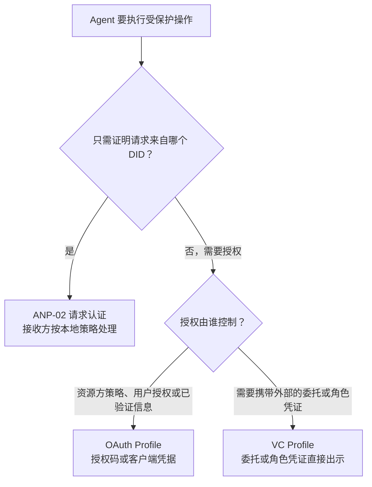
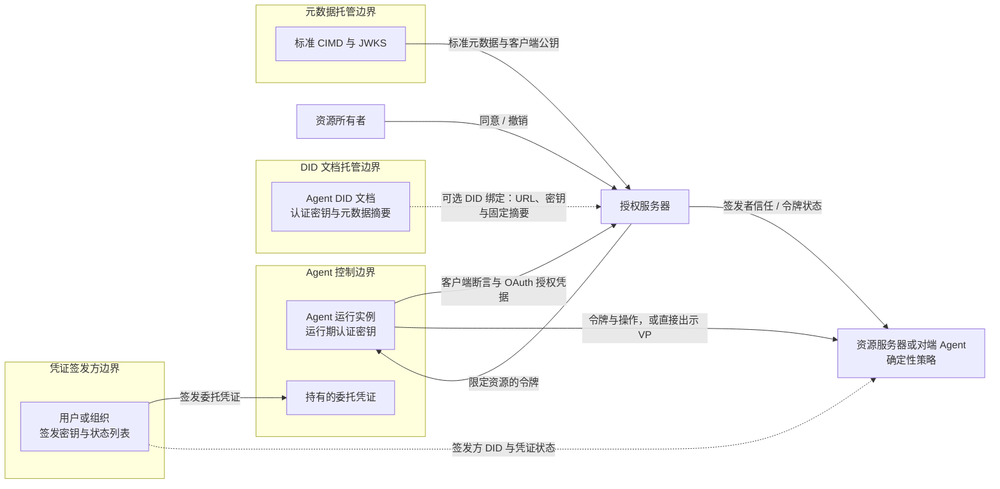
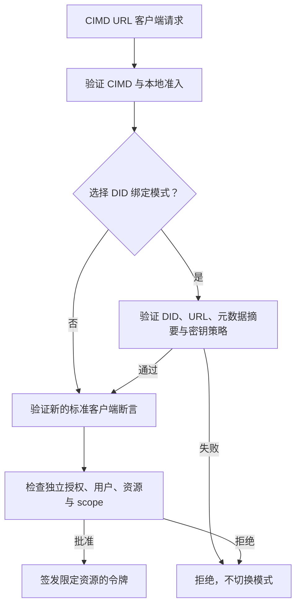
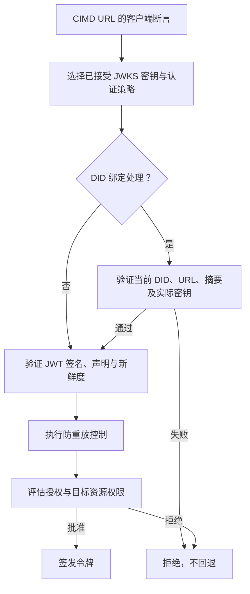
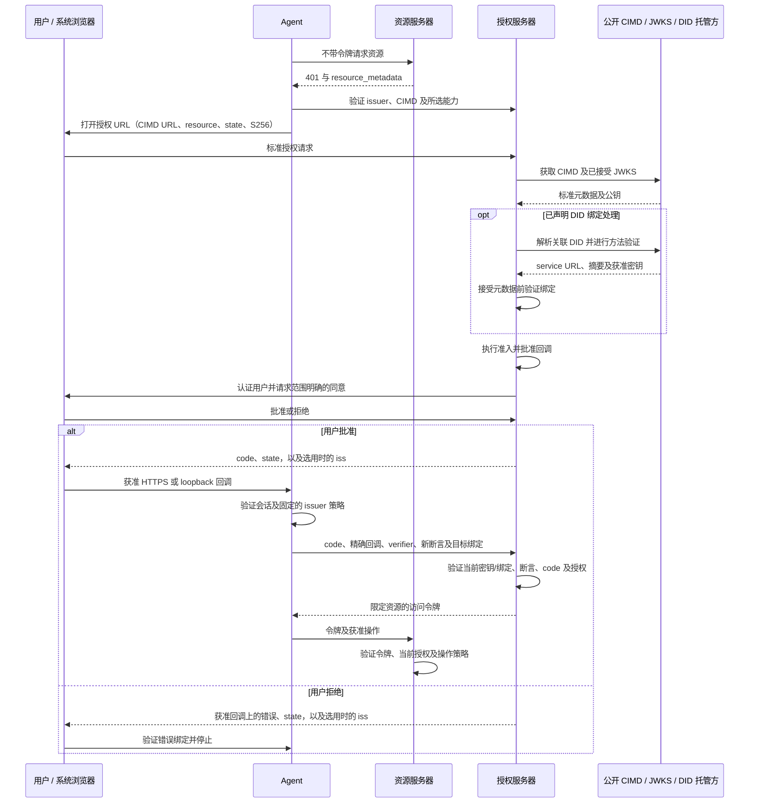
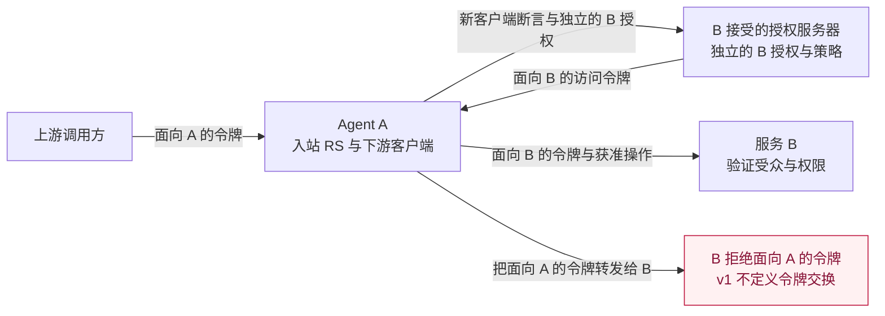
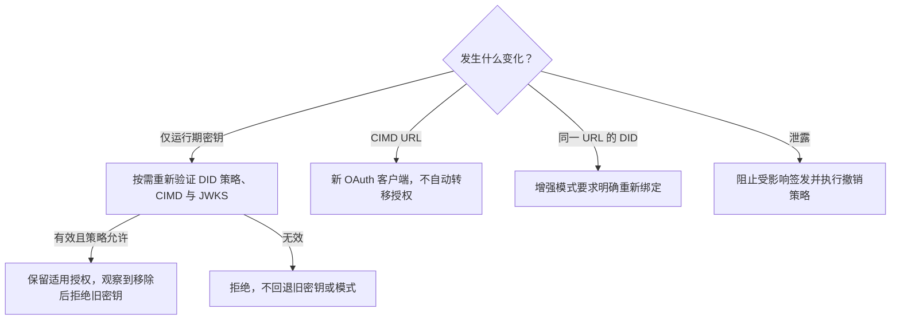

<!-- translation-review: machine-fully-reviewed; scope=source lines 1-893; inventory=japanese/reviews/core-chinese-review.json; full prose compared against source -->
> 日本語参考訳（機械翻訳を原文と全文照合し、意味・用語を校閲済み）。規範となるのは原文です。コード例・識別子・規範キーワードは原文を保持しています。
> 原文: [chinese/05-ANP-基于DID的授权协议.md](../../chinese/05-ANP-基于DID的授权协议.md) / 基準コミット: `0837cfdfaf4ddcf834f0890ddaf34fc4c824e066`

# ANP DIDベースの認可プロトコル

- 文書ID: ANP-05
- ステータス: ドラフト/未リリース
- バージョン: 0.7
- 仕様セット: ANP vNext; ANP 1.2 リリースの一部ではありません
- ドラフトプロファイル識別子: OAuth プロファイル `anp.authorization.oauth2.cimd.v1-draft1`; VCプロフィール `anp.authorization.vc.v1-draft2`
- 原文の言語：中国語（本ファイルは日本語訳）
- 英語の対応文書：[ANP DIDベースの認可プロトコル](../05-anp-did-authorization-protocol-specification.md)

<a id="scope"></a>
## 1. 範囲、認可の問題、ロードマップ

ANP-05は、DIDベースのエージェント認可を2つの補完的な仕組みで定義します。**OAuthプロファイル**ではリソース側が信頼する認可サーバーがアクセストークンを発行し、**VCプロファイル**では権限を持つユーザーや組織がW3C Verifiable Credential（VC）を発行し、エージェントが保持・提示します。DIDはANP層で主体を識別します。OAuth経路の通常のASはURLクライアント識別子と独自のリソース所有者識別情報を使い、明示的に検証したDID結合だけが、そのASで関連DIDを確立します。VC経路では発行者と認可対象のエージェントをDIDで識別します。**初回リリース（v1）の範囲はDIDとOAuthのクライアント識別および基本的な委任アクセスのプロファイルと、直接提示する単一段階のVC委任・組織ロール資格情報です。完全なエージェント委任システムではありません。**本書は未公開のv0.7ドラフトです。本書の「v1」は初回リリースの範囲を指し、v1が公開済みであることや、後のロードマップの機能が全て実装済みであることを意味しません。

OAuth プロファイルでは、エージェントはその DID を標準の OAuth クライアント ID メタデータ ドキュメント (CIMD) HTTPS URL に関連付け、公開された認証キーを使用してその URL クライアントを認証します。リソース所有者がアクセスを承認し、認可サーバー (AS) が制限付きトークンを発行し、リソース サーバー (RS) がそれを強制します。このパスには、VC、VP、OIDC ログイン ブリッジ、またはブロックチェーンは必要ありません。 VC プロファイルでは、権限を持つプリンシパルがエージェントに資格情報を発行します。エージェントは、ホルダーにバインドされた検証可能なプレゼンテーション (VP) を通じてそれを提示します。検証者は、発行者、所有者、資格情報ステータス、権限、制約、およびローカル信頼ポリシーを個別に検証し、要求された操作を実行または拒否します。

OAuthプロファイルの基準は、RFC 6749・RFC 9700などの**OAuth 2.0と公開済み拡張仕様**、およびURLクライアント識別子とメタデータ発見用に版を明示固定したCIMD draft-02です。CIMDは作業中の依存仕様であり、公開済みRFCではありません。OAuth 2.1 draft-16とJWTクライアント認証更新draft-11は参考となる設計資料で、公開済みRFCとしての依存仕様ではありません。VCプロファイルの規範的基準はW3C VC Data Model 2.0、VC Data Integrity 1.0とそのEdDSA暗号スイート、Bitstring Status List 1.0です。大文字のMUST、MUST NOT、SHOULD、SHOULD NOT、MAYはBCP 14の意味で使います。以下の制約は本プロファイルの規則であり、参照仕様の改訂ではありません。

**ANP-05 v1は独立した2つの認可経路を定義します。リソース側のアクセス認可のためのDIDで裏付けたOAuthと、持ち運べる委任・組織ロール資格情報のための、保有者に結び付いたVC提示です。v1はVC/VPからOAuthアクセストークンへの変換を定義しません。独立した資格・属性の資格情報プロファイルもこの版では定義しません。**

文書構造: セクション 1 では、認可の問題とロードマップについて説明します。セクション 2 では、ANP-02 との関係と、OAuth または VC をいつ使用するかについて説明します。セクション 3 ～ 10 では OAuth プロファイルを定義します。セクション 11 では VC プロファイルを定義します。セクション 12 ～ 14 は、共通のエラー処理、セキュリティ、および適合要件です。

<a id="authorization-problem"></a>
### 1.1 エージェントの認可で実際に解く問題（参考）

中心となる問題は、単に「どのAgentがこの鍵を持つか」ではなく、**「誰が、どのリソースに対するどの操作を、どのAgentに認可し、どのような制限を設け、認可をどのように終了するか」**です。この方向性は次の5つの要件を中心とします。

| 要件 | 解決すべき問題 | v1 境界 |
| --- | --- | --- |
| 人からエージェントへの委任 | 認可するユーザー、対象エージェント、リソース、許可する操作、期間、取り消しを記録します。自然言語のタスク指示それ自体はリソースへの権限付与ではありません。 | OAuth: ユーザー同意または有効な既存認可を伴う認可コード。ユーザーとクライアントの主体、スコープ、失効時刻、取り消しを区別します。VC: ユーザーや組織が単一段階の委任資格情報（第11章）を持ち運び可能な権限証明として発行します。検証者は独立して署名を確認できますが、受け入れるには最新の状態確認も必要で、権限は依然として検証者が独立に判断します。 |
| エージェントにその代理を行う権限を与える組織 | 企業が、事前に知られていない採用プラットフォーム、サプライヤー、またはピアエージェントと会社を代表して取引する人事エージェントまたは購買エージェントとしてエージェントを任命します。取引相手は、この代理人が実際に会社を代表していること、代理人ができること、およびその制限を確認する必要があります。 | VC: 組織は、リソースアドレスではなくビジネスアクションごとに機能と制約をリストした役割資格情報 (セクション 11.2) を発行します。取引相手は、発行者がその組織であることを確認し、アクションを自身の業務にマッピングし、受け入れるかどうかを決定します。取引相手を越えた累積予算や、第三者の個人データに対する自動的な権限はありません。 |
| 1つのエージェントが複数サービスでユーザーを支援する | 各サービスは独自のリソース、アカウント識別情報、ポリシーを管理します。1つのサービスでの許可や同意がどこでも通用するわけではありません。 | OAuth: 同じエージェントDIDで、各リソースと受け入れるASごとにフローを繰り返し、独立した権限付与と対象を限定したトークンを維持します。VC: 複数サービスのリソースを1つの資格情報に列挙できますが、各検証者は自分のエントリーだけを使い、発行者の権限を独立に確認します。単一の全域同意やAS間のアカウント同等性はありません。 |
| 多段階の再委任 | 権限を拡大せずユーザー・実行主体の帰属を失わずに、AからB、BからCへ委任します。取り消しと共有制限を伝播する必要があります。 | 未定義。VCプロファイルは、検証者が独立に認める主体からエージェントへ直接発行された資格情報だけを受け入れます。発行権限を発行者自身が持つ委任資格情報、ロール資格情報、アクセストークンから導くことはできません。他者の委任を持つエージェントが再発行した資格情報は拒否します。トークン、資格情報、秘密鍵の転送による暗黙の委任はありません。 |
| 高リスクアクションに対する操作ごとの承認 | 個人の承認を正確な受取人、金額/通貨、データ開示または削除対象、有効期限、およびワンタイム操作識別子にバインドします。 | 一般的なトランザクション承認資格情報がありません。委任資格情報は、事前に付与された範囲を表すものであり、操作ごとの承認でもありません。個別の承認が必要なサービスは、独自の明示的な操作承認を確認するか、アクションをブロックする必要があります。ログイン、広範な範囲、DID 署名、または DPoP だけでは承認とはなりません。 |

基本的な同意記録もVC委任資格情報も、エージェントへ限定的アクセスを既に委任します。そのため、v1には人による委任が全くないという説明は不正確です。VC委任資格情報は持ち運べる権限証明ですが、単一段階の委任に限ります。v1は委任チェーンや標準化された取引承認を**まだ定義していません**。ユーザーの指示は実行の方針にはなりますが、ユーザーやエージェントが持たない権利を作り出すことはできません。

<a id="technical-choices"></a>
### 1.2 技術的な選択と実装コスト (参考)

**認可のライフサイクルにOAuthを再利用します。**RFC 6749は既にリソース所有者、クライアント、AS、RSを分離し、同意・権限付与、アクセストークン、更新のフローを提供します。RFC 7523 §2.2はクライアントアサーションの搬送を、RFC 7636・RFC 8707・RFC 7009・RFC 7662はコード保護、対象制限、取り消し、状態確認を提供します。これによりANPは新たな権限付与・トークンのエコシステムを作らず、再利用できるエージェントの本人性と、不足するエージェント固有の委任意味論に注力できます。OAuthだけで全てを解決するわけではなく、タスク全体の予算、権限の縮小、特定の業務操作へのユーザー承認をそれ自体で定義するものではありません。

**DIDは主体を識別し、権限は付与しません。**同じメソッド検証済みDIDと選択した認証鍵の関係を、通常のANP認証、通信、OAuthクライアント公開鍵の公開に利用できます。標準CIMDモードでASが認証するのはURLクライアントであり、追加のDID結合検証を実行した検証者だけが、関連DIDを認証済みと主張できます。ネイティブdid:webの信頼基盤は引き続きDNS・HTTPS・ホスティングです。本Profileの採用だけで、フィンガープリントに結び付いた本人性や、自身のDID Documentのホストに対する耐性が得られるわけではありません。パス型did:wba e1_は結合鍵のフィンガープリントと検証可能な文書証明を追加します。これらの性質はいずれも正しいメソッド検証と鍵の保管が前提であり、どちらのメソッドもソフトウェアの完全性やユーザーの同意を証明しません。ここでの価値は共通の本人性・ライフサイクルモデルであり、持ち運び可能な識別子をDIDだけが提供できるという主張ではありません。

**CIMDを再利用して既存のOAuthエコシステムにつなぎます。**主な利点は、CIMDと選択した標準OAuth機能に対応するASなら、クライアント識別子、メタデータ発見、権限付与、トークンフローにANP固有の変更を加えずにクライアントを処理できる点です。OAuthの`client_id`はCIMDのHTTPS URLのままです。DID DocumentはANPの本人性との関連付けを提供し、メタデータ公開者が選択した認証鍵を標準JWKSとして公開します。DIDへの適応処理は全ASのDIDリゾルバーではなくエージェントSDKやメタデータ公開者に置かれます。互換性はASの受け入れポリシー、対応認証アルゴリズム、選択フローに依存し、全OAuthサーバーがCIMDに対応することや標準CIMDサーバーがDIDを検証済みであることを意味しません。第4章は通常のCIMD処理と、任意で明示交渉するDID結合検証を区別します。将来は明示的なAS対応と移行規則の下でDID自体を`client_id`に使う拡張を検討できます（第16章）。秘密鍵はエージェントまたは明示的に認可された署名者が保持します。

**リソース側の外部に由来する権限を伝達するためにVCを使用します。** 多くのエージェント承認の根拠はリソース側にはありません。企業がエージェントを購買担当者として任命したり、ユーザーがエージェントに複数の販売者に示すことができる権限を与えたり、機関がエージェントがどの組織に属しているか、またはエージェントがどのような資格を持っているかを証明したりします。 OAuth 同意レコードは各 AS 内に存在します。別のサービスに転送したり、AS を持たないピアによって検証したりすることはできません。 W3C VC 2.0 では、承認者が独自の DID でステートメントに署名できます。エージェントはそれを保持し、その発行者を信頼する検証者にそれを提示します。検証には、発行者と所有者の DID を解決し、ステータス リストを確認するだけが必要で、検証者と発行者を事前に統合する必要はありません。 ANP はすでに、did:wba 文書証明とメッセージング バインディングにデータ整合性 eddsa-jcs-2022 を使用しています。 VC プロファイルは、別の署名スタックを追加するのではなく、その証明メカニズムを再利用します。 VC にもコストがかかります。失効はステータス リストに依存し、キャッシュの待ち時間が発生します。各検証者は、どの発行者をどのクレームに対して信頼するかについて独自のポリシーを維持する必要があります。資格情報が提示されると、その内容が検証者に表示されます。

**VCとOAuthは別の役割を持ち、相互の代替ではありません。**v1では独立した認可経路です。リソース側が認可を管理し、OAuthの権限付与とアクセストークンで表す場合にOAuthを使います。v1のVCプロファイルは独立検証用の外部委任・組織ロール資格情報を運びます。資格や属性の資格情報は、別途合意した規則の下で検証者が明示的に要求した補足証拠にしか使えません。OAuthの認可判断にもロール、資格、組織の本人性、その他の検証済み情報を使えます。外部発行資格情報をOAuth認可判断の入力にする方法は将来の拡張で定義し得ますが、v1はVCとアクセストークンの交換を定義しません。使い分けは§2.2で説明します。後の段階で提案する標準は評価対象であり、現在の適合要件ではありません。

<a id="v1-scope"></a>
### 1.3 v1 が提供するもの

v1の成果物は**DIDと関連付けられたOAuthクライアントの本人性と、実用的で監査可能な基本的ユーザー委任**です。標準CIMD URLクライアント識別子、DIDからCIMDの発見と公開鍵公開、任意の完全性検査付きDID結合、有効な環境でASごとの事前登録を要しないポリシー管理の初回接続受け入れ、RFC 7523クライアント認証、条件を満たすconfidentialクライアント環境のclient credentials、ホスト型HTTPS・ローカルループバッククライアントのS256 PKCE付き認可コード、対象限定トークン、任意の更新、ライフサイクルの適用を含みます。OAuthプロファイルでユーザー委任対応を主張する導入環境は認可コード経路を実装しなければならず（MUST）、client credentialsだけの実装はOAuthユーザー委任対応を主張してはいけません（MUST NOT）。VCプロファイルだけで委任を受け入れる検証者には、この要件は適用しません。

ユーザー委任の権限付与では、ASは発行者・テナントの文脈における認証済みリソース所有者識別子、URLクライアント識別子、検証した場合に限る関連エージェントDID、対象リソース、許可スコープ、承認元・時刻、適用する期間・取り消しポリシー、安定した内部grant参照を保持しなければなりません（MUST）。既存の同意や管理者の権限付与を承認に使えるのは文書化したポリシーの下だけです。これはOAuth認可記録の要件であり、持ち運び可能なシステム横断の権限証明はVCプロファイルが定義します。新たな権限には別の承認判断が必要です。ユーザーの資格情報とエージェントの認証鍵は分離したままにします。

VCプロファイルは任意機能です。委任・組織ロール資格情報、保有者に結び付いた提示、発行者と保有者の検証、資格情報状態の確認、権限・制約評価、RSや相手エージェントへの直接提示を提供します。VCプロファイル対応を主張する実装は、第11章の自分の役割に適用される要件を満たさなければなりません（MUST）。VC非対応でもOAuthプロファイルには完全適合できます。有効な委任資格情報は検証者の認可判断を置き換えません。

**セキュリティ基準:** 本プロファイルのフローではimplicit grant、resource-owner password credentials grant、URIクエリー文字列中のアクセストークン、PKCE plainを使ってはいけません（MUST NOT）。認可コードにはS256 PKCE、狭く定義されたループバックポート例外に従う承認済みリダイレクト先の照合、発行者・セッションの検証が必要です。将来のロードマップ機能をv1対応として宣伝してはいけません（MUST NOT）。

<a id="roadmap"></a>
### 1.4 段階的なソリューションと受け入れロードマップ (参考)

これらは機能を段階的に進める順序であり、提供日の約束ではありません。後の段階はv1の本人性・権限付与の境界を変えず、独立した拡張として公開できます。

| 段階 | 解決策の方向性 | 能力を主張する前の証拠 |
| --- | --- | --- |
| v1: アイデンティティと基本的な委任 | セクション 1.3 のスコープを実装します。同じ DID が複数のサービスで個別の承認を取得します。ユーザー/エージェントの帰属と明示的な取り消しを保持します。権限がリソース側の外部から発生する場合は、直接提示を通じて単一レベルの VC 委任またはロール資格情報を使用します。 | CIMD の最初の連絡先とオプションの DID バインド検証。宣言されたホストおよびループバック ユーザー フロー。 2 つのリソースの分離。メタデータの改ざん。キーの回転。取り消し;陽性および陰性の VC 直接提示のケース。セクション 14 に基づく相互運用可能なクライアント/AS の証拠。 |
| 次: 精密な権限と高リスク操作の承認 | 構造化したリソース・操作・制約要求のためRFC 9396 RARを評価します。エージェント、リソース、正規化した正確な操作ダイジェスト、重要パラメーター、有効期限、一意識別子に結び付け、別途検証する1操作限りの承認（専用VC型や別の資格情報など）を定義します。実行時に確認と消費を不可分に行います。 | パラメーター差し替え、リプレイ、二重実行、有効期限切れ、承認取り消しで安全に失敗すること。新たなログイン、署名付きトランスポート要求、広範な委任資格情報を取引承認の代用にしないこと。 |
| その後: 制御された再委任 | VC委任チェーン（親を参照して権限を絞る子資格情報）とRFC 8693 Token Exchangeの実行主体の帰属を評価します。許可する委任深度、親の実効権限を超えない子権限、audience・期限の縮小、grant系列全体の取り消し、監査を定義します。AS間交換には明示的な信頼とアカウント・権限の対応付けが必要です。v1はVCとOAuthのトークン交換も多段階の再委任も定義しません。 | A→B→Cの委任、権限拡大の試みや誤った実行主体の拒否、起点の取り消しによる新しい子grantの停止、発行済みトークン無効化の遅延の文書化。実行主体履歴の主張だけを認可と扱わないこと。 |
| 並行: 長時間・非対話実行とプライバシー | リモート・ヘッドレス承認のRFC 8628、追加のバックチャネルフロー、検証されたDID移行、共有予算・カウンターの強制を評価します。VCの選択的開示暗号スイート、人間のウォレット向けOpenID4VP/OpenID4VCIバインディングを評価します。購買や人事など共通業務向けの相互運用可能な操作語彙を、各分野のプロトコルの定義・統治の下で評価します。v1ループバックの対象はエージェント自身の端末上のブラウザーであり、全てのヘッドレス環境ではありません。 | ユーザーと端末・取引の結合、フィッシング・ポーリング制御、ユーザーgrant失効後にクライアント単独へフォールバックしないこと。子操作の同時実行でも共有制限が正しいこと。選択的開示で未提示の権限エントリーが漏れないこと。 |

認可者、対象Agent、リソース・操作、制約、適用される親の認可、承認の証拠、失効状態を統一的に記述する計画です。具体的なワイヤスキーマと適用規則は後続の拡張で策定します。署名付きの予算宣言はグローバルカウンターの実装と同じではなく、トークン交換自体は失効の伝播や権限の縮小の実現を意味しません。

このドラフトの公開はSDK、AS、製品の対応を保証しません。0.7版は従来のDIDをclient IDにするOAuth設計を実験的な`anp.authorization.oauth2.cimd.v1-draft1`に置き換え、独立のVCプロファイルは`anp.authorization.vc.v1-draft2`のままです。旧識別子`anp.authorization.oauth2.did.v1-draft4`は本版の別名ではありません。0.6版はVCとOAuthのトークン交換を削除し、0.5版はVCプロファイルを追加しました。実装は正確な版を一致させ、移行前に影響するメタデータと保留中の取引を再検証しなければなりません（MUST）。クライアント識別子の変更は新しいOAuthクライアントであり、既存grantやコードのプロファイル文字列の更新ではありません。

<a id="anp-boundary"></a>
## 2. ANPとの関係とメカニズムの選択

現行の[ANP-02の識別情報規則](../../chinese/02-ANP-基于DID的身份认证协议.md#identity-input)、[ANP-03のWBAバインディング](../../chinese/03-did-wba方法规范.md#wba-auth-binding)、[ANP-02のネイティブWebバインディング](../../chinese/02-ANP-基于DID的身份认证协议.md#web-binding)を使用します。Git履歴のリリース前スナップショットは、このドラフトの規範的基準ではありません。

ANP-02はHTTP/JSONリクエスト認証を定義します。ANP-05が再利用するのはDID検証と認証鍵の認可モデルであり、HTTP署名シリアライズ、チャレンジ、任意トークンのレスポンスヘッダーは**再利用しません**。OAuthトークンエンドポイントは`client_assertion`と標準OAuth JSONトークン応答を使います。本プロファイルを満たすため追加のANP-02 HTTP署名を要求してはいけません（MUST NOT）。HTTP Message Signaturesを別個のOAuth認証方式として必要とする環境は、別の明示的バインディングを必要とします。

ANP-02の認証キャッシュトークンが自動的にANP-05のOAuth認可トークンになるわけではありません。実装は受け入れ規則を分離しなければなりません（MUST）。Messaging、WNS、Device Manifest、E2EE、人間の立ち会い確認UIは本プロファイルの依存要件ではありません。VC直接提示は、各プロトコルの規則を変えず、ANP-02認証済みHTTPインターフェースや認証済みメッセージングセッションで搬送できます。DIDの`authentication`関係が認可するのは認証用の鍵であり、アプリケーションのリソースアクセスを許可するものではありません。

### 2.1 ANP-02、OAuth、または VC の選択 (参考)

| 必要なもの | 選択する仕組み | 資格情報の意味 |
| --- | --- | --- |
| 直接API要求や通信相手の認証。受信者は既存のローカルポリシーを適用 | ANP-02 | 任意トークンは当該APIのポリシーの下で受信者の認証済み文脈を再利用します。標準化されたユーザー委任grantを確立するものではありません。 |
| ユーザーに代わって制限付きアクセスを取得するか、AS 管理のクライアント許可、リソース オーディエンス、同意、有効期限、取り消しを使用します | ANP-05 OAuth プロファイル | AS は、特定の許可とリソースに対して OAuth アクセス トークンを発行します。 |
| 外部からの委任や組織の任命を提示し、検証者が直接検証・受け入れ判断をする。要求された場合は別途合意した資格の証拠も伴う | ANP-05 VCプロファイル | 発行者が署名した主張。検証者は独自のポリシーで受け入れを判断し、資格情報自体はアクセストークンではありません。 |

サービスは明確に分けた経路や宣言済みポリシーで複数の仕組みを提供できます。JWT、署名付きJSON、「トークン」という語があるだけで相互に交換可能になるわけではありません。ANP-05は先にANP-02トークンを要求せず、ANP-02クライアントも通常の認証済みメッセージ全てでASを採用する必要はありません。RSは生のVCやVPをBearerアクセス資格情報として受け入れてはいけません（MUST NOT）。

<a id="mechanism-selection"></a>
### 2.2 OAuthとVCの役割分担（参考）

両者が答える問いは異なります。**OAuthは「リソース側は今、このクライアントにこのリソースでこの操作を許すか」に答えます。**リソース側が信頼するASはローカルポリシー、ユーザー認可、ロール、資格、組織の本人性、その他の検証済み情報を評価し、対象を限定したアクセストークンを発行します。**VCは「どの発行者がこのエージェントについてどのような検証可能な主張をしたか」に答えます。**エージェントは外部発行者の主張を複数の第三者に運び、各検証者が発行者を信頼して操作を許可するか判断します。ロールや資格はOAuthの判断にも使えますが、VCの動機は持ち運び可能で独立に検証できる外部の主張が必要なことです。

| 観点 | OAuthアクセストークン | VC委任資格情報または組織ロール資格情報 |
| --- | --- | --- |
| 発行者 | リソース側によって信頼された AS | 権限のソース: ユーザー、組織、または認定機関 |
| 認可判断 | ASがトークン発行前に判断し、RSが適用する | 資格情報が直接提示された際に各検証者が判断する |
| 範囲 | 1リソース。本プロファイルは各トークンを単一の`resource`に結び付けます | 資格情報に列挙した範囲。複数サービスにまたがり得ますが、各検証者は自分のエントリーだけを使います |
| 検証の依存先 | 信頼するASの署名鍵またはイントロスペクション | 発行者DID、保有者DID、状態リスト。発行者と検証者の事前統合は不要 |
| 有効期間と取り消し | 短期トークン。ASは発行と更新を一元的に止められますが、発行済みトークンは失効するかRSが取り消しを知るまで使用可能な場合があります | 通常は長期。状態リストで取り消し、リスト公開とキャッシュに応じた遅延があります |
| 必要な対話 | ユーザー委任の場合、ASでログインして同意する。クライアントとAS間の往復がある | 発行時に認可者が一度確認する。提示時にはAgentと検証者がチャレンジと保有者結合VPを交換し、DID、状態、ローカルポリシーを確認する |
| プライバシー | 通常クライアントからトークン内容は見えず、ASは全grantを把握します | 提示した資格情報は検証者に見えます。発行者は提示に参加しませんが、状態リスト取得で検証者のネットワークアドレスがリストのホストに分かります |

**OAuth が適合する場合:**

-  リソースは、独自のユーザー アカウントを持つサービスによってホストされています。たとえば、エージェントはドキュメント サービス内のユーザーのファイルを読み取るか、ユーザーのカレンダーに書き込みます。ユーザーはそのサービスにサインインして同意し、完全な許可レコードが保持されます。
-  エージェントは、クライアント資格情報を使用して、サービスによって構成されたアクセス許可を使用して、独自の名前でサービスを呼び出します (マシン間)。
-  リソース側には、集中管理された取り消し、有効期限の短いトークン、リソースごとの分離、または増分認可が必要です。
-  リソース側はすでに OAuth を実行しており、RS が変更せずにトークンを検証することを望んでいます。

**VC が適合する場合:**

-  権限はリソース側の外部から生じています。たとえば、企業は、購買担当者が、企業が設定した制限と期間内で、企業の名前でサプライヤーに注文することを許可します。サプライヤーは、企業の従業員がサプライヤーのシステムにサインインして同意したことを確認するのではなく、「この会社が本当にこのエージェントを承認した」ことを確認する必要があります。
- 組織がエージェントを業務上の役割に任命します。例えば会社の人事エージェントが採用サイトへ求人を出し、会社に代わって候補者のエージェントと面接を調整したり、購買エージェントが新しい供給者に見積もりや発注を行います。取引相手は事前にそのエージェントを知らないことが多く、会社は全取引相手のアドレスを事前列挙できません。ロール資格情報は業務操作ごとに「このエージェントは当社のために何をどの限度まで行えるか」を表します（§11.9）。
-  相互に統合されていない複数のサービスに同じ権限を示す必要があります。たとえば、ユーザーが 1 つの委任資格情報を発行すると、エージェントは複数のホテルを比較して予約できるようになります。各ホテルは個別に検証し、ユーザーはそれぞれのホテルにサインインする必要はありません。
-  カウンターパーティは、OAuth AS が存在するかどうかに関係なく、ピアツーピア コラボレーションを含む VC 対応インターフェイスを公開します。そのフローでは、ピアはエージェントがどのユーザーまたは組織を代表しているのか、またエージェントが何を実行できるのかを確認する必要があります。
- 組織のメンバーシップ、業界の資格、本人確認結果、または検証者によって明示的に要求されたエージェントとオペレーターの証拠を使用して認可資格情報を補足します。このバージョンでは、委任および組織ロールの承認資格情報のみが定義されています。補足属性タイプ、サブジェクトバインディング、発行者信頼および受け入れルールには個別の合意が必要であり、証拠はセクション 11.3 に基づいて認可資格情報とともに提示されます。このバージョンでは、完全なスタンドアロン資格や属性プレゼンテーション バインディングは定義されておらず、属性資格情報自体はアクセスを許可しません。

**初版の範囲。**OAuthとVCは独立した認可の入口です。VCインターフェースを提供する検証者は、提示と要求された操作を直接確認します。OAuthだけを受け入れるインターフェースでは、引き続きサポートするOAuthフローで認可を取得する必要があり、VCの直接提示で迂回できません。VCとOAuthの組み合わせは、第16節の将来の拡張方向に限られます。



### 2.3 信頼境界 (参考)



アーキテクチャとOAuth/VCの役割分担は変わりません。実線のメタデータ経路は通常のCIMD ASで動き、点線のDID経路はDID結合検証時だけ有効です。図はDID Documentのホスティングを別の境界として描いています。did:wba e1_ではエージェントが管理する結合鍵の証明がDocumentの完全性を担うため、ホストにできるのはサービス拒否や古いDocumentのリプレイだけです。ネイティブdid:webでは侵害されたホストが鍵とダイジェストを置き換えられます（§4.2）。発行者とリソース所有者は同一人物の場合もありますが、発行鍵は常に発行者が管理し、エージェントには渡しません。

<a id="roles"></a>
## 3. 役割と識別子

セクション 3 ～ 10 では OAuth プロファイルを定義します。セクション 11 では、独立した VC の直接プレゼンテーション フローを定義します。 VC を採用する場合、その所有者または検証者が OAuth クライアントまたは AS の役割を引き受ける必要はありません。 AS は通常のビジネス コンポーネントとして VC ベリファイアを実装できますが、このバージョンでは AS に特別な VC からトークンへの役割を割り当てません。

| 用語 | 意味 |
| --- | --- |
| クライアント/エージェント ランタイム | アクセス トークンを要求および使用するソフトウェア展開。その ID はリソース所有者とは異なります。 |
| エージェント DID | DID ドキュメントを通じて OAuth クライアントに関連付けられた ANP ID。これは OAuth ワイヤ識別子ではなく、必ずしもユーザーの DID である必要もありません。 |
| `client_id` | OAuth クライアント識別子として使用される正確な HTTPS CIMD URL。 |
| リソース所有者 | アクセスを承認する資格のあるユーザーまたは組織。 |
| 認可サーバー (AS) | URL クライアントを認証し、付与とポリシーを検証し、トークンを発行します。 DID バインド処理が有効な場合にのみ、エージェント DID が検証されます。 |
| リソースサーバー（RS） | リソースのアクセス制御を適用する対象Agent、API、またはゲートウェイ。 |

要求の`client_id`、CIMDの`client_id`、クライアントアサーションの`iss`と`sub`は、全て同じ正確なCIMD URLでなければなりません（MUST）。クライアントアサーションの`sub`はクライアントを識別します。アクセストークンの`sub`は認可の主体を識別し、通常はユーザー委任アクセスではリソース所有者、クライアント単独アクセスではASが決める主体です。認証成功だけを理由に、アサーションの`sub`をユーザー委任トークンへコピーしてはいけません（MUST NOT）。

クライアントアサーションの`aud`は固定した認証ポリシーで受け入れるASを識別し、アクセストークンのaudienceは対象RSを識別します。同じエージェントDIDとCIMD URLを複数のASで使えますが、受け入れ、grant、ユーザーアカウント、トークンの範囲は各ASに限られます。クライアントがDIDを持つだけでトークンがどこでも通用するわけではありません。

クライアント記録、grant、トークンキャッシュの範囲は(issuer, tenant-or-trust-domain, client_id)で区切り、リソース所有者、grant、対象リソース、処理モードを別々に保持しなければなりません（MUST）。RFC 9068のJWTアクセストークンでは必須の`client_id`クレームはURLを持ち、関連DIDを持ちません。RFC 7662のイントロスペクションは標準の意味を維持し、`client_id`を返す場合はURLです。クライアント本人性にポリシーが依存するRSは、信頼するトークン・イントロスペクション文脈または同等の信頼済み状態からそれを得なければならず（MUST）、必要な本人性が得られなければ呼び出し元のフィールドを信頼せず、その判断を拒否しなければなりません（MUST）。通常のCIMD ASにトークンへのDIDクレーム追加を要求しません。

ANP対応ASは検証に成功したDID結合を、プロファイルの版と検証状態とともに別に記録します。RSへの伝達には明示的に信頼するチャネルや合意済みトークン拡張が必要で、ここで新たなトークンクレームは必須にしません。RSは未検証の`anp_did`、`kid`ラベル、URLの現在の内容だけから検証済みDIDを推定してはいけません（MUST NOT）。ASが結合を検証していない場合、DID認証を要するリソースは、別途合意したバインディングで実際の要求・トークンに結び付けた独立証明を必要とし、それがなければ操作を拒否しなければなりません（MUST）。この版はその証明交換を定義しません。

共有CIMD URLは複数のエージェントインスタンスが使っても1つのOAuthクライアントを表します。エージェントごとに独立のクライアント本人性が必要な環境は、別の安定したURLと認証鍵を公開するべきです（SHOULD）。ユーザー間で共有するURLは発行者ごとのリソース所有者識別子を置き換えません。これは本人性の関連付けであり、自動的なアカウント統合、ソフトウェア証明、権限ではありません。

<a id="enrollment"></a>
## 4. クライアントの登録とバインド

### 4.1 クライアント識別子としての CIMD URL

この版はCIMD draft-02のHTTPS Client Identifier URLを使います。パスがなければならず（MUST）、userinfo、フラグメント、単一ドット・二重ドットのパス構成要素を含めてはいけません（MUST NOT）。本プロファイルの公開者はクエリーを省略しなければなりません（MUST）。通常のフォーム・JSONデコードを1回行った後、識別子は文字列の完全一致で比較します。ポート、大文字小文字、パス、別名を正規化して同等にしてはいけません。OAuthの`client_id`でCIMD URLをDIDやDID URLに置き換えてはいけません（MUST NOT）。

2 つの処理モードがあり、トランザクションの開始前に選択されます。

| モード | 検証責任 |
| --- | --- |
| `cimd` | 標準の CIMD メタデータ検出、URL クライアント認証、および OAuth 認可。 AS は、DID を解決したり、ANP 拡張を理解したり、DID 固定ダイジェストをチェックしたりする必要はありません。 |
| `did_bound` | 同じ標準 URL クライアントおよび OAuth メッセージに加え、セクション 4.2 および 6.2 の DID/URL/メタデータ/実際の認証キーのチェック。 AS はセクション 5 に基づいてこの拡張機能を明示的にアドバタイズします。 |

`did_bound`に明示的に割り当てた要件は、その拡張を実装し有効にした場合だけ適用します。通常のCIMD ASが標準フローを処理する前提条件にしてはいけません（MUST NOT）。以下の共通OAuth安全要件は参加実装と機能選択への要件です。CIMD対応だけでここで使う全ての任意OAuth拡張への対応が宣言されるわけではありません。未対応機能を要する接続は、ANP固有の代替プロトコルを要求せず、認可前に失敗します。

クライアントは認可前に受け入れる発行者、URLの`client_id`、選択モード、認証ポリシーを固定しなければなりません（MUST）。DID結合の本人性が必要な場合、正確な拡張機能の欠落や検証失敗では操作を中止しなければならず（MUST）、`cimd`モードで自動再試行してはいけません（MUST NOT）。明示設定した`cimd`接続は有効ですが、ASが検証したDID認証と報告してはいけません（MUST NOT）。DIDをclient IDにする将来の作業は別途交渉する拡張です（第16章）。

<a id="anpcimd"></a>
<a id="anp-oauth-keys"></a>
<a id="anp-metadata-sha256"></a>
### 4.2 自己公開 OAuth クライアント メタデータ

ANPの公開者は、本Profileで唯一の`ANPCIMD`型serviceを通じてAgent DIDをCIMDに関連付けます。その`id`は当該DIDに空でないフラグメントを加えたものでなければならず（MUST）、`serviceEndpoint`はCIMD HTTPS URLに厳密に一致しなければなりません（MUST）。ANPの発見処理はservice IDの重複や複数の一致するserviceを拒否します。`ANPCIMD`はANPが定義する実験的DID service型であり、W3Cが定義した型ではありません。JSON-LD環境には明示的で固定された拡張contextが必要で、DID Core contextはこれらの拡張語彙を定義しません。旧`ANPOAuthClientMetadata` serviceは本新Profileの選択に使いません。

公開者はメソッドに従って検証したDID情報と、明示的なOAuthアプリケーション設定を組み合わせなければなりません（MUST）。以下の対応付けは公開時の規範です。標準ASにDID解決を要求するものではありません。

| 出力 | ソースとルール |
| --- | --- |
| `client_id` | DIDに関連付けられた正確なCIMD URL。 |
| `jwks`または`jwks_uri` | DIDの認可済み`authentication`メソッドから選んだ公開署名鍵。秘密鍵情報は決して公開しません。`jwks_uri`は未変換のDID Documentではなく標準JWK Setを提供しなければなりません（MUST）。この2つのメタデータフィールドのうち正確に1つを使います |
| `client_name`, `client_uri`, `logo_uri` | 明示的なアプリケーション表示構成。自己主張された名前は、検証された組織のアイデンティティではありません。 |
| `redirect_uris` | 実際のアプリケーションのコールバック構成。 DID ドメインのみからコールバックを推測しないでください。 |
| `grant_types`, `response_types`, `scope` | 実装/要求された OAuth 機能とアプリケーション構成。これらの値は権限の付与ではありません。 |
| `token_endpoint_auth_method` | 本プロファイルの認証済みクライアント経路では`private_key_jwt`。`none`のpublicクライアント接続はDIDで裏付けたクライアント認証対応の主張の範囲外 |
| `token_endpoint_auth_signing_alg` | 指定した場合、選択したキーと互換性のあるサポートされる非対称アルゴリズム。実際の使用には AS サポートも必要です。 |

CIMD文書はCIMD draft-02と適用可能なRFC 7591のメタデータ意味論に従わなければなりません（MUST）。正確なURLを`client_id`として、空でない`client_name`とともに含めなければなりません（MUST）。認可コード用の公開には`response_types=["code"]`と設定済み`redirect_uris`を含めます。未認証のHTTPS GETでHTTP 200とJSONを返して取得できなければならず（MUST）、公開者は`application/json`を使うべきです（SHOULD）。取得側はリダイレクトを自動追跡したり、エラー応答をメタデータとして受理したりしてはいけません（MUST NOT）。共有シークレット、秘密鍵、Bearer資格情報を公開してはいけません。外部JWKSの取得を含む全取得に第13章を適用します。

`anp_profile`と`anp_application_type`は必須のCIMDメンバーではありません。`cimd`モードには標準だけの文書で十分です。任意の実験的メンバー`anp_did`は逆方向の発見に使う、フラグメントなどを含まないエージェントDIDの候補を表し、DID結合検証が成功するまで権威を持ちません。逆方向発見が不要、または信頼済みの帯域外結合でDIDが分かる場合、公開者は省略してもかまいません（MAY）。通常のASは解釈する必要がありません。取引のクライアント本人性やセキュリティモードを黙って変更せず、受け入れるメタデータとの互換性を確立する必要があります。

`did_bound`の公開・検証では、`ANPCIMD`サービスにさらに次を含めなければなりません（MUST）。

- `anp_oauth_keys`: このDIDの`authentication`関係の異なる検証メソッドIDを含む空でない配列。関連するURLクライアント用にその鍵を明示的に認可します。各参照はDID Coreの相対参照処理後に、このDIDと空でないフラグメントに解決される必要があります。`keyAgreement`や、`verificationMethod`に列挙されただけの任意の鍵を認可しません。
- `anp_metadata_sha256`: CIMD 表現全体の 64 文字の小文字 16 進数 SHA-256 ダイジェスト。 HTTP 転送/コンテンツのデコード後に、空白と最後の改行を含む UTF-8 応答バイトをハッシュします。 JSON を再シリアル化したり、HTTP ヘッダーを含めたりしないでください。 BOM、無効な UTF-8、重複した JSON メンバーを拒否します。シリアル化後にダイジェストを計算し、DID メソッドの認証されたドキュメント更新手順を通じて公開します。

拡張ASは、コールバックや認可判断にメタデータを使う前に、信頼する設定または任意の`anp_did`発見ヒントからDID候補を得て、DIDとサービスを検証し、URLの完全一致と逆方向DIDがある場合の一致を要求し、固定ダイジェストを検証しなければなりません（MUST）。必要な結合の欠落・形式不正・不一致では安全側に閉じて失敗します。呼び出し元の上書き値やメタデータホストだけが提供するダイジェストは代用になりません。矛盾する逆方向DIDで既存の受理済み結合を上書きしてはいけません（MUST NOT）。取得した候補の名前やコールバックは検査前には信頼できません。拡張取得実装は5 KiBまでの文書に対応し、有限の最大サイズ、タイムアウト、同時実行数上限を設定しなければなりません（MUST）。

ダイジェストは埋め込まれた`jwks`の値を保護しますが、`jwks_uri`について保護するのはURL文字列だけで、別途取得するJWKSのバイト列は保護しません。いずれの場合も、**このクライアント認証で実際に使う鍵**はサービスの`anp_oauth_keys`の1つで、検証済みDIDの`authentication`関係で現在認可されていなければなりません（MUST）。`kid`だけでなく検証済み公開鍵情報やRFC 7638 JWKサムプリントを比較し、曖昧な鍵選択は拒否します。JWKSの別の箇所で一致する鍵を1つ見つけるだけでは不十分です。この版が保護するのはCIMDのバイト列と実際に許可された認証鍵で、外部JWKS文書全体のダイジェストは定義しません。

通常の CIMD AS は、受け入れられた HTTPS メタデータとクライアント認証ポリシーを信頼します。パブリッシャーのローカル DID チェックは、AS が同じ状態を取得したこと、または DID を検証したことを証明しません。拡張モードでは、DID 承認ダイジェストにより、メタデータ ホストが独立した変更ではなく配信に制限されます。 Did:wba e1_ の場合、バインディングはメソッド有効文書証明によってカバーされます。 Did:web の場合、DID ドキュメント ホストの制御は引き続きそのキーとダイジェストを置き換えることができます。どちらのモードでも、選択された DID メソッドと鮮度ポリシーを超えるロールバック耐性は得られません。その後のメタデータの更新では、表面的なものであっても、その保護が使用されている固定ダイジェストを再計算する必要があります。

### 4.3 ASごとの事前登録を要しない初回接続の受け入れ

CIMD ASは未知のClient Identifier URLを受け入れてもかまいません（MAY）し、承認済み・事前登録済みクライアントだけに制限できます。CIMDは無条件の受け入れを要求しません。初回接続を有効にするASに対して、ANPは手動登録や登録API呼び出しを必須にしません。接続の受け入れはリソースアクセスの付与ではありません。

初回接続のフローは次のとおりです。

1. 許可されたネットワーク処理の前に、URL構文、選択フロー、受け入れる発行者、ローカルの停止・受け入れポリシーを確認します。キャッシュミスで以前の拒否を消してはいけません（MUST NOT）。
2. CIMDメタデータと公開鍵の供給元を取得・検証します。`did_bound`では候補DIDも解決し、コールバックや設定の使用前に§4.2を実行します。`cimd`ではASはANPリゾルバーへの依存なしに標準CIMDに従います。
3.  AS アドミッション ポリシーをクライアント、展開、メタデータの発信元、認証アルゴリズム、コールバック、および要求された許可/リソースに適用します。自己公開された値はそのポリシーをオーバーライドしません。
4. 取引候補を発行者、URLの`client_id`、選択モード、受け入れたメタデータ・コールバック、リソース、認証ポリシーに結び付けます。拡張取引では検証済みDID、サービス、メタデータダイジェストも固定します。発見結果やキャッシュエントリーは秘密鍵保有の証明ではありません。
5. `/token`で、受け入れたクライアント鍵を使って新しい第6節のクライアントアサーションを検証し、認可資格情報、該当するリソース所有者、対象、権限を独立に検証してからトークンを発行します。拡張検証は現在の鍵認可と結合の鮮度を再確認します。結合やセキュリティ関連メタデータが変わった場合、未完了トランザクションの値を置き換えるのではなく、そのトランザクションを無効化します。

認可コードフローでは、クライアントの発見とコールバックの承認を`/authorize`で行い、クライアント鍵の保有証明をcodeの交換時に検証します。フロントチャネルのDID署名を新たに追加してはならず、メタデータを読んだだけで鍵保有を証明済みと主張してもなりません。codeは、その正確なクライアント、issuer、実際のコールバック、S256 PKCE、リソース、受理済みトランザクション状態に結合されます。クライアントクレデンシャルフローでは初回トークン要求で受け入れと証明を完了できますが、既存のASポリシー・認可が独立してアクセスを許可する必要があります。更新で新しい認可を作ることはできません。

事前登録したCIMD URLもURLクライアントのままです。受理したメタデータ供給元と結合ポリシーを維持しなければならず（MUST）、新たな発見データで固定済み登録を黙って置き換えてはいけません。実装はポリシーに基づく受け入れと無条件受け入れを区別し、初回接続が無効である場合は正確に報告しなければなりません（MUST）。

**初回接続の受け入れの概要（参考）。**



### 4.4 クライアント境界

鍵を保有することやPKCEの使用だけで、実装環境がconfidentialクライアントの鍵保管要件を満たすとは証明できません。このプロファイルは配布アプリの全コピーに埋め込む秘密鍵ではなく、選択したエージェント別の認証鍵を使います。ASが受け入れるクライアント種別と認証モデルは実装環境に合う必要があり、CIMD対応だけで全てのネイティブ環境のインスタンス別鍵構成に対応するわけではありません。client credentialsは条件を満たすconfidential環境だけに限られます。通常のpublicクライアントの`none`フローをDIDで裏付けたクライアント認証として主張したり、必須結合検証の失敗後の代替に使ったりしてはいけません。

ホスト型コールバックと明示的にサポートするネイティブループバックコールバックは§7.2.1に従います。公開者は署名鍵を保有せず、ローカルエージェントの公開CIMD/JWKSを配信できます。同じ端末のブラウザーがないリモート・ヘッドレスクライアントには、無制限のコールバック例外ではなく、後続のデバイス・バックチャネル認可拡張が必要です。

<a id="discovery"></a>
## 5. ASの発見と機能宣言

動的に発見するHTTPリソースでは、利用可能ならRFC 9728の保護リソースメタデータとRFC 8414のASメタデータを使い、リソースとASの関連付け、および正確な発行者を検証します。`401`チャレンジで`resource_metadata`を示せます。既存・閉鎖型の環境では、信頼する帯域外設定で同じ関連付けを確立してもかまいません（MAY）。任意のDIDサービスやエージェント記述文書は、リソース用に別のASを選ぶ権限の根拠にはなりません。

クライアント記録、取引、トークンキャッシュは、AS発行者とテナント・信頼ドメインごとに分離し続けなければなりません（MUST）。発行者を変えるにはリソースとの関係を新たに検証する必要があり、旧ASのコード、更新トークン、アサーションを新ASに送ってはいけません。新たに受け入れるASには、そのaudienceに結び付けた新しいアサーションが必要です。

`cimd`モードではASメタデータの`client_id_metadata_document_supported=true`または明示的な信頼済み導入設定でCIMD対応を確認します。`private_key_jwt`、双方が受け入れる署名アルゴリズム、選択したgrantフローの対応を確認します。認可コードではS256 PKCEと受け入れたコールバック・発行者検証戦略を要求します。RFC 8707、RFC 9207、ループバックリダイレクト、DPoPなどは対応または明示設定がある場合だけ選びます。ポリシーが必要とする機能が未対応ならフローを中止し、安全要件を弱めてよいことにはなりません。通常のCIMD ASは`anp_did_oauth`などANP機能を宣言する必要はありません。

`did_bound`処理を提供するASは、実験的なRFC 8414拡張`anp_cimd_binding`を次のように宣言しなければなりません（MUST）。これは同じURLクライアントと標準OAuthフローに結合検証を追加するもので、新しいgrantやトークンエンドポイント認証方式を定義しません。

| フィールド | ルール |
| --- | --- |
| `profile` | `anp.authorization.oauth2.cimd.v1-draft1`と厳密に一致する。 |
| `did_methods_supported` | セクション 6.2 に基づいて実際に検証されたメソッドの空でない配列。 |
| `client_enrollment_methods_supported` | 有効にした`self_published`および／または`pre_registered`のCIMD URLモードを含む空でない配列 |
| `redirect_uri_modes_supported` | 認可コードを有効にする場合、`https`と`loopback`のうち対応して有効にしたモード。CIMD自体はいずれのモードへの対応も意味しません |

この正確な機能の宣言は、宣言した認可・トークンエンドポイントで受け入れる全CIMDクライアント取引に`did_bound`を適用するというASの約束です。DIDヒントや信頼済み結合の欠落、無効なダイジェスト、未認可の鍵、未対応DIDメソッドでは、安全側に閉じて失敗しなければなりません（MUST）。要求から通常処理へ切り替えて回避することはできません。この初期拡張に要求ごとのモード選択子はありません。通常のCIMD処理を提供するASは拡張を省略し、両ポリシーを提供する環境には別々で曖昧さのない発行者・エンドポイント設定が必要です。DID結合の本人性を要するクライアントは、発見可能な結合情報または確立済みの信頼する結合を提供し、認可前にその適用設定を選ばなければなりません（MUST）。機能発見は、別の文脈で得たトークンがそのモードで発行されたとRSに対して個別トークンごとに証明するものではありません。

次の拡張 AS の例では、標準の CIMD 機能も公開しています。エンドポイントは例示的なものです。標準 AS は `anp_cimd_binding` を完全に省略できます。

```json
{
  "issuer": "https://auth.example",
  "authorization_endpoint": "https://auth.example/authorize",
  "token_endpoint": "https://auth.example/token",
  "client_id_metadata_document_supported": true,
  "token_endpoint_auth_methods_supported": ["private_key_jwt"],
  "token_endpoint_auth_signing_alg_values_supported": ["RS256", "Ed25519", "EdDSA"],
  "grant_types_supported": ["client_credentials", "authorization_code", "refresh_token"],
  "response_types_supported": ["code"],
  "code_challenge_methods_supported": ["S256"],
  "authorization_response_iss_parameter_supported": true,
  "anp_cimd_binding": {
    "profile": "anp.authorization.oauth2.cimd.v1-draft1",
    "did_methods_supported": ["did:web", "did:wba"],
    "client_enrollment_methods_supported": ["self_published", "pre_registered"],
    "redirect_uri_modes_supported": ["https", "loopback"]
  }
}
```

[ANP-07エージェント記述](07-ANP-智能体描述协议规范.md)は、この認可要件を記述するインターフェースへリンクしてもかまいません（MAY）。リンクは説明であり、信頼する発行者、選択済みクライアント本人性、機能検査を上書きしません。

<a id="client-assertion"></a>
## 6. DID に関連付けられた JWT クライアント認証

### 6.1 トランスポートおよび JWT フィールド

クライアントは受け入れたトークンエンドポイントへ、`application/x-www-form-urlencoded`によるHTTPS POSTを送ります。`grant_type`、`client_id`、`client_assertion_type`、`client_assertion`を各1つだけ含め、選択したgrantのパラメーターを加えます。アサーション型は`urn:ietf:params:oauth:client-assertion-type:jwt-bearer`です。セキュリティに関わるパラメーターの重複は拒否しなければなりません（MUST）。クライアントアサーションはコンパクトな署名付きJWT/JWS形式を使い、JWE、分離ペイロード、アクセストークン、複数の同時認証方式は使いません。URL、通常のタスクデータ、ログに含めてはいけません（MUST NOT）。

| ヘッダー | ルール |
| --- | --- |
| `alg` | 選択した公開鍵と互換性のある、相互に承認された非対称 JOSE 署名アルゴリズム。 |
| `kid` | 受け入れたCIMD/JWKS内の一意に決まる鍵識別子。不透明なラベルとしてDID URLを使ってもかまいません（MAY）が、通常のASはそれをDIDとして解析・解決する必要はありません |
| `typ` | ターゲット AS でサポートされている標準クライアント認証タイプのポリシーを使用します。 `JWT`、省略、または明示的にサポートされている `client-authentication+jwt` 合意に従って使用することができます。 ANP 固有のタイプは必要ありません。タイプ ラベルがコンテキストと署名のチェックに置き換わることはありません。 |

| クレーム | ルール |
| --- | --- |
| `iss` | URLの`client_id`と厳密に一致する。クライアント自身がアサーションに署名する。 |
| `sub` | URLの`client_id`と厳密に一致し、Agent DIDやリソース所有者ではない。 |
| `aud` | 事前に確立した認証ポリシーで受け入れるASの、正確に1つのaudience。検証済み発行者、またはASがRFC 7523/OIDCの慣習を使う場合の検証済みトークンエンドポイントURLです。信頼できないエラーから選んだり、自動認証フォールバックで変えたりしてはいけません（MUST NOT） |
| `iat` | 整数 NumericDate 署名時刻。 |
| `exp` | 整数のNumericDate。本Profileが生成するアサーションは`0 < exp - iat <= 300`を満たす。 |
| `jti` | 少なくとも128ビットの暗号学的ランダム性を含む、新たに生成した空でない識別子。要求、鍵、再試行をまたいで再利用しない。 |

JWTクライアント認証更新draft-11の発行者だけをaudienceとする規則と明示型は、双方が対応する場合に利用できます。既存CIMDサーバーに自動適用するものではありません。第9章の例は発行者をaudienceにします。クライアントは資格情報送信前にASの受理するaudience・型のポリシーを固定しなければならず（MUST）、不一致ではその取引は失敗します。追加クレームはクライアント本人性、ユーザー同意、権限、grantを上書きしません。

拡張検証実装は表の全クレームを要求し、JSONメンバー重複、不正エンコード、未知のcritical JWSパラメーター、未対応アルゴリズム、役割を混同したJWTを拒否しなければなりません（MUST）。時刻値が整数であること、`0 < exp - iat <= 300`、`iat <= now + skew`、`now < exp + skew`、時計ずれ許容が60秒以下であることを強制しなければなりません（MUST）。`nbf`がある場合、整数であり、`nbf <= exp`と`nbf <= now + skew`を満たさなければなりません（MUST）。通常のASは対応する標準準拠検証ポリシーを使います。導入環境はCIMD対応からANPの追加制約を推定せず、必要な保証を満たすことを確認しなければなりません（MUST）。

### 6.2 DIDの解決と鍵の認可

`cimd` モードでは、AS は受け入れられた CIMD/JWKS から認証キーを取得します。 ANP 発行者は発行前に DID と選択されたキーを検証しますが、これによって通常の AS の結果が検証済みの DID 認証に変わるわけではありません。

`did_bound`では、検証者は§4.2のDIDとURLの関係、メタデータダイジェスト、選択鍵の認可を検証しなければなりません（MUST）。DID候補は信頼済み状態か任意のCIMD発見ヒントから得て、JWTヘッダーだけから得てはいけません。Documentの`id`は想定する裸のDIDと等しくなければなりません（MUST）。そのDIDは受け入れた結合と同じ主体を識別し、`ANPCIMD`エンドポイントは`client_id`と完全一致する必要があります。対応するメソッドバインディングを少なくとも1つ実装・宣言する必要があります。

- `did:web`: ネイティブのメソッド解決、HTTPS検証、Documentの`id`の完全一致確認、ANP-02のWeb識別情報規則を適用します。ネイティブWeb DIDにWBAフィンガープリントやDocument証明を要求しません。
- `did:wba`: ANP-03のe1_パスプロファイルまたはベアドメインバインディングを適用します。完全性・証明、該当する場合のフィンガープリント、有効状態、認証鍵を確認します。有効なJWTはメソッド検証を代替しません。k1_拡張はこのバインディングの範囲外であり、暗黙に有効化してはいけません。

`did:webvh` や BID などの他のメソッドでは、拡張サポートが宣伝される前に、ピン留めされたメソッド仕様、状態ルール、サポートされているキー表現、および検証証拠を含む文書化されたアダプターが必要です。通常の CIMD 操作では、AS がこれらのアダプターを実装する必要はありません。

実際の検証鍵は、`service.anp_oauth_keys`と現在のDIDの`authentication`関係の両方で認可されていなければなりません（MUST）。参照を正確に解決した後なら埋め込み・参照形式のメソッドを使えますが、DIDをまたぐメソッドは初期バインディングの範囲外です。`verificationMethod`、`assertionMethod`、`keyAgreement`に現れるだけでは不十分です。ラベルの一致だけでなく、実際の公開鍵またはRFC 7638サムプリントを、アサーション検証に使う鍵と照合します。クライアント提供のJWSの`jwk`、`jku`、`x5u`、`x5c`で受け入れた鍵供給元を置き換えてはいけません（MUST NOT）。メソッド・暗号スイートに必要なJSON-LDコンテキストは固定または許可リスト化する必要があります。

DID・URLの宣言と一致する公開鍵はいずれも複製可能な公開設定です。検証に成功した新しいアサーションだけが、秘密鍵の保有証明を提供します。設定の確認自体は、秘密鍵の保有、ユーザーの同意、アクセス権を証明しません。

### 6.3 アルゴリズムとシリアル化

公開鍵の機能、有効なクライアントアルゴリズム、対象ASが宣言・設定するポリシーの共通部分を選びます。RFC 7523は適合実装にRS256の実装を必須としますが、全エージェントにRSAの使用を要求せず、CIMD ASのEd25519対応も意味しません。拡張ANP実装はRFC 7523の基準に加えてEd25519に対応しなければなりません（MUST）。それでも通常モードに拡張アルゴリズムがあると仮定せず、実際に使うアルゴリズムを交渉します。

Ed25519 の場合、サポートされている場合は、RFC 9864 の完全に指定された `Ed25519` 識別子が優先されます。以前の `EdDSA` 識別子は、Ed25519 キーに制限される明示的に有効な互換性の選択肢です。署名付きヘッダーを書き換えたり、Ed448 を Ed25519 として再解釈したりしないでください。 ES256 またはその他のアルゴリズムには、明示的なキー形式とポリシーのサポートが必要です。この認証されたパスの `none`、共有シークレット `HS*` メソッド、サポートされていない曲線、およびキー/アルゴリズムの不一致を拒否します。

JWK エクスポートは、ある暗号アルゴリズムを別の暗号アルゴリズムに変換するのではなく、表現を変換します。公開キーのタイプと長さを検証します。 RSA キーは少なくとも 2048 ビットである必要があります。 Ed25519 マルチキー変換では、OKP JWK を構築する前に、マルチベース、マルチコーデック、および 32 バイトの公開キーを検証する必要があります。プライベート JWK パラメーターをエクスポートしないでください。 JWT 署名は、ANP-02 HTTP 署名ベースや JCS 再シリアル化ペイロードではなく、JWS 署名入力をカバーします。

### 6.4 検証とリプレイ防止

選択モード、受け入れたメタデータ・鍵供給元、正確なURLの`iss`/`sub`、audience、アルゴリズム・型のポリシー、時間制限に従って新しいアサーションを検証します。拡張処理では現在のDIDの認可とメタデータの鮮度も確認します。本人性や結合検証が無効なら安全側に閉じて失敗しなければならず（MUST）、別の鍵供給元やモードへフォールバックしてはいけません。

拡張ASは暗号・クレーム検証が成功した後、grant処理前に、`(AS issuer, client_id, jti)`を`exp + allowed skew`まで不可分に予約しなければなりません（MUST）。鍵、レプリカ、同時要求をまたぐ再利用は失敗させ、無効署名でリプレイストアを汚染してはいけません。ストア障害時も安全側に閉じて失敗します。その後grant処理がエラーになってもアサーションは再利用可能になりません。再試行には新しいアサーションを使い、grant自体の一度限りの使用規則に従います。通常モードはASの対応するリプレイ防止機構を使い、導入環境に必要な保証を満たす必要があります。

最後に、AS は、許可、該当する場合はリソース所有者、リソース、アクセス許可、およびポリシーを独立して検証します。クライアント認証だけではトークンを発行するには不十分です。アサーションは OAuth フォーム本文またはビジネス トランザクションに署名しません。 HTTPS はトランスポートを保護し、OAuth フローは独自のパラメータを検証してバインドします。

**クライアント アサーションの検証とリプレイ処理 (参考情報)。**



<a id="authorization-flows"></a>
## 7. 認可フロー

実装は以下のフローを少なくとも1つサポートし、対応するフローだけを宣言しなければなりません（MUST）。この版の各grant・トークンは1つの対象リソースに制限します。RFC 8707に対応し選択する場合、クライアントはフラグメントのない絶対HTTPS `resource` URIを正確に1つ送り、ASは対象を検証します。拡張バインディングでは認可、コード交換、client credentials、更新の要求で`resource`を明示しなければなりません（MUST）。通常のCIMD接続は、クライアント・grant・トークンが目的のリソースに一意に結び付くなら、1リソースに限った環境を含め、ASの既存の明示設定済み対象結合機構を使ってもかまいません（MAY）。RFC 8707がないことは無制限トークンの発行を許しません。認可前に仕組みを選択・固定し、RFC 8707が必要な接続で利用できなければ失敗しなければなりません（MUST）。スコープ名はAS・RSが定義する意味を維持し、DIDはスコープではありません。

**1トークン1対象は分離の規則であり、1エージェント1サービスという制限ではありません。**同じDIDとCIMD URLで、カレンダーと文書サービスに別々のgrant・トークンを保持できます。発行者、テナント、リソース所有者、URLの`client_id`、リソース、スコープ、処理モード、該当する場合は送信者鍵でキャッシュを区別し、DIDだけでトークンを選んではいけません。各ASは独立にユーザーアカウントを認証してアクセスを承認します。複数サービスにまたがるタスクが1つでもトークンを集約しません。異なるASでユーザー名やDIDが同じでもアカウントは統合されません。複数のリソース指標やAS横断grantには別の拡張が必要です。

### 7.1 Client credentials

`grant_type=client_credentials`は、自らの名義で動く、またはASが認める事前のリソース所有者認可の取り決めに従うconfidentialクライアントだけに使います。エージェントDIDやCIMD公開だけで任意ユーザーの権限を得るために使ってはいけません（MUST NOT）。

ASは第6章の検証を行い、このURLクライアントに選択リソース・スコープのアクセスを許す現在のポリシーまたはgrantを確認し、許可されたアクセスだけを発行しなければなりません（MUST）。本プロファイルではclient credentialsに更新トークンを発行せず、次のトークン取得時に再認証します。

### 7.2 PKCEを使うユーザー委任の認可コード

クライアントはASの認可エンドポイントで、`response_type=code`、CIMD URLの`client_id`、承認済み`redirect_uri`、選択リソース結合、要求する`scope`、新しくセッションに結び付けた`state`、PKCEの`code_challenge_method=S256`を使います。ASは対応する方法でリソース所有者を認証し、同意を取得するか既存の有効な認可を適用します。任意のDID結合検証を含むURLクライアント認証は、ユーザー認証や同意の代わりではありません。

認可前にクライアントは、検証済み発行者、リソース、URLクライアント識別子、処理モード、認証ポリシー、承認済みリダイレクトURI、`state`、PKCE verifierを1つの取引記録に保存しなければなりません（MUST）。コード送信やエラー受理前に、成功・エラーのコールバックをその記録に結び付けなければなりません（MUST）。RFC 9207に対応するか要求する場合、正確に1つの`iss`を保存済み発行者と照合し、欠落・重複・不一致なら中止します。非対応の通常ASでは、発行者ごとの別リダイレクトURIなど、明示設定したRFC 9700のmix-up防御を代わりに使えます。その戦略を事前に固定しなければならず（MUST）、発行者検査の失敗後にフォールバックしてはいけません（MUST NOT）。拡張の認可コード処理はRFC 9207に対応しなければなりません（MUST）。どのコールバックフィールドも、未検証のASやトークンエンドポイントを選んではいけません。

コード発行前に、受理したCIMDメタデータや事前登録からリダイレクトURIを承認しなければなりません（MUST）。拡張処理ではコールバックを信頼する前にDID固定ダイジェストも検証します。§7.2.1の唯一のループバックポート例外を含む照合規則を使い、ワイルドカード照合は認めません。トークンエンドポイントに`grant_type=authorization_code`、同じURLの`client_id`、`code`、同じ実際の`redirect_uri`、`code_verifier`、第6章の新しいアサーションを送ります。選択したリソース結合機構で元の対象を保ちます。ASは一度限りのコードをクライアント、リダイレクト、PKCE、対象、grantの結合とともに検証し、不可分に消費しなければなりません（MUST）。出力認可のリソース所有者をクライアント単独の本人性に置き換えてはいけません（MUST NOT）。

### 7.2.1 ホスト型およびローカルのリダイレクト バインディング

クライアントは開始前にコールバックモードの対応を確認しなければなりません（MUST）。CIMD対応だけでASがループバックコールバックやネイティブ環境のインスタンス別認証鍵を受け入れるとは限りません。拡張ASは第5章に従って有効モードを宣言し、実装は対応するモードだけを主張・試験します。通常ASに`anp_application_type`拡張は不要で、受理するアプリ設定と標準メタデータが許可する環境を決めます。

ホスト型コールバックにはフラグメント・userinfoのない絶対HTTPS URIと承認済みリダイレクトURIへの完全一致を要求します。ネイティブループバックに明示対応する場合、スキーム`http`、リテラルホスト`127.0.0.1`または`[::1]`、正確で空でないパスを持つ承認済みメタデータエントリーを要求します。クエリー、フラグメント、userinfo、`localhost`名、別表記の数値IP、ワイルドカードは初期バインディングの範囲外です。メタデータはポートを省略するか具体的な有効ポートを1つ含められますが、URIテンプレートではありません。RFC 8252 §7.3のとおり、認可要求との比較ではポートだけを無視します。要求するリダイレクトは1～65535の明示ポートを含めなければなりません（MUST）。IPv4とIPv6のエントリーは別の承認値で、他の全構成要素はパスのデコードや別値への正規化なしで完全一致させます。

ASはポートを含む実際の完全なリダイレクトURIをコードに結び付けなければなりません（MUST）。コード交換時にも正確に同じ値を送らなければなりません（MUST）。ポート例外はメタデータと認可要求の照合だけに適用します。一時的な要求ポートはメタデータのスナップショットを変えません。S256 PKCE、`state`、選択した発行者検証戦略、新しいクライアントアサーションは引き続き必須です。

ローカル クライアントは、外部システム ブラウザを起動する前にループバック専用リスナーを開き、選択されたループバック インターフェイスのみをバインドし、完了またはタイムアウト時にそれを閉じます。埋め込みログイン Web ビュー、`0.0.0.0` リスナー、または LAN コールバックは代替品ではありません。この HTTP 例外は、AS がコールバックまたはプライベート メタデータ エンドポイントを取得することを許可することはありません。ブラウザは独自のデバイスに戻りますが、AS からメタデータ/DID へのトラフィックは引き続きセクション 13 の対象となります。同じデバイス上にブラウザがないリモート エージェントは、このバインディングの外側にあります。

### 7.2.2 初回接続でのユーザー委任シーケンス（参考）



### 7.3 リフレッシュ

ASは認可コードフローに更新トークンを発行してもかまいません（MAY）。更新要求は元のURLクライアントと処理モードに対応する新しい第6節のアサーションを伴い、リソース所有者、認可、元の単一の対象を保持しなければなりません（MUST）。scopeを拡大してはなりません（MUST NOT）。拡張処理では変更のない`resource`を明示しなければなりません。通常処理では事前に選んだASの仕組みで対象を保持し、パラメーターの省略によって対象範囲を拡大してはなりません。

ASは期限・取り消しを強制し、再利用検出を伴う更新トークンのローテーション、または対応する送信者制約付き更新機構を実装しなければなりません（MUST）。DIDとの関連付けだけで更新トークンの送信者は制約されません。無効化したクライアント結合やgrantでは更新を防がなければなりません（MUST）。既存の有効grantで毎回のAPI呼び出しごとにユーザー確認を求める必要はありませんが、新しい権限には新たな認可判断が必要です。

<a id="tokens"></a>
## 8. アクセストークンとリソース側での強制

### 8.1 トークンの検証と所有証明

トークンエンドポイントは`access_token`、`token_type`、`expires_in`、実際のgrantを示す`scope`、`Cache-Control: no-store`、`Pragma: no-cache`を含む標準OAuth JSON応答を返さなければなりません（MUST）。エラー時にトークンも返してはいけません（MUST NOT）。トークンの有効期間はポリシーが定める有限の期間でなければなりません（MUST）。アサーションの300秒上限はアクセストークンの有効期間ではありません。

トークンは不透明形式でもJWTでもかまいません（MAY）。RSは信頼するAS、有効性、該当する場合の取り消し・状態、対象リソースのaudience、スコープ、ローカル業務ポリシーを検証しなければなりません（MUST）。不透明トークンにはRFC 7662イントロスペクションなど信頼する検証経路が必要です。本プロファイルのANP-05 ASが発行するJWTアクセストークンは、必須クレームとトークン型の分離を含めRFC 9068に従わなければなりません（MUST）。その署名者はASであり、エージェントがDID鍵を持っても信頼するアクセストークン発行者になるわけではありません。

クライアントアサーションをアクセストークン、ID Token、更新トークン、認可資格情報として扱ってはなりません（MUST NOT）。`Bearer`アクセスはRFC 6750に従います。ASとRSの両方が対応する場合、DPoPの利用を推奨しますが、この初期Profileでは任意です。利用する場合はRFC 9449に従い、`token_type=DPoP`、`Authorization: DPoP`、proof検証、RSでの`ath`、JWTの鍵結合での`cnf.jkt`を含めます。DPoPはクライアント認証の代わりではなく、その鍵が長期DID鍵である必要もありません。ポリシーがDPoPを要求する場合、黙ってBearerに格下げしてはなりません（MUST NOT）。

既存のトークン・ポリシー実装で十分なら、RSはAS発行トークンの受け入れだけのためにDIDを解決する必要はありません。OAuthのクライアント本人性はCIMD URLのままで、検証済みDID本人性の主張には第3章の信頼できる証拠が必要です。交渉したDPoPなどの拡張への対応は必要であり、既知のDIDが無制限アクセスを持つと仮定せず、権限を強制しなければなりません（MUST）。認証、認可、TLS、メッセージE2EEは別々の保証です。

### 8.2 入ってくる要求と外向きの要求の認可

RSと下流クライアントを兼ねるエージェントは、2つの認可を分離しなければなりません（MUST）。エージェントA向けトークンをサービスBのリソース資格情報として転送してはいけません（MUST NOT）。AはBが受け入れるASとgrant規則で、B向けの別トークンを取得します。自分のクライアント単独権限を不足するユーザー委任権限の代わりに使ってはいけません（MUST NOT）。A向けユーザートークンを持つだけではBトークンの発行権限になりません。

この版はトークン交換や多段階委任フローを定義しません。必要な独立の認可がないクライアントは、対応する認可フローで取得するか、その操作を拒否しなければなりません（MUST）。

**インバウンドとダウンストリームのリソース認可を分離します (参考)。**



### 8.3 増分認可と実行

RSは有効なトークンがない場合`401`、付与済み権限が不足する場合`403`と該当する`insufficient_scope`チャレンジを使います。動的HTTP発見では`resource_metadata`と操作の最小スコープを含めるべきです（SHOULD）。クライアントはチャレンジが選択したRSと認可されたASの関係に属することを確認し、独立に承認されるスコープ追加を要求しなければなりません（MUST）。チャレンジを許可と扱ったり、黙って特権クライアント資格情報に切り替えたりしてはいけません（MUST NOT）。範囲拡大は引き続きリソース所有者の同意とローカルポリシーに従い、再試行回数には上限を設けなければなりません（MUST）。

認可は既知のDIDやタスク識別子だけでなく、実際のリソース・操作と呼び出し元のタスクアクセスをカバーしなければなりません（MUST）。RSは各操作前に、該当認可が導入環境の期限・取り消しポリシーでまだ有効か確認しなければなりません（MUST）。発見、キャッシュ済みクライアント結合、以前の成功操作は新しいgrantではありません。状態キャッシュを使えるのは文書化した有効期間内だけです。最新オンライン状態を必要とするポリシーでは、それを取得できなければ安全側に閉じて失敗しなければなりません（MUST）。認可待ちは該当操作を止めます。セッションID、開いたストリーム、過去の成功呼び出し自体は将来の権限を与えません。資格情報は通常のプロンプト、タスク本文、成果物に含めず、専用の認証・認可チャネル内に保持しなければなりません（MUST）。

<a id="examples"></a>
## 9. 通信上の例（参考）

これらは模式的なメッセージであり、実行可能な暗号テストデータではありません。`SIGNED_CLIENT_ASSERTION`と`OPAQUE_ACCESS_TOKEN`はプレースホルダーで、固定NumericDateは実用の資格情報ではありません。例はRFC 8707、発行者をaudienceとする方針、`typ=JWT`とEd25519を受け入れるサーバーを選びます。互換性のある標準CIMD ASまたは第5章の拡張ASで動作できますが、DID結合を検証するのは後者だけです。発行前にクライアントの受け入れ、秘密鍵保有の証明、有効な独立grantが必要です。

デコードされた JWS ヘッダーとペイロード: `kid` は JWKS ラベルとして使用される DID URL ですが、`iss` と `sub` は CIMD URL です。

```json
{
  "typ": "JWT",
  "alg": "Ed25519",
  "kid": "did:wba:agents.example:agent-a:e1_RfdmtK_McXAgc6fbIC55GcOjXyXGPWixGhrDaiLsv28#auth-1"
}
```

```json
{
  "iss": "https://agents.example/agent-a/oauth/client.json",
  "sub": "https://agents.example/agent-a/oauth/client.json",
  "aud": "https://auth.example",
  "iat": 1790467200,
  "exp": 1790467500,
  "jti": "wTHzTd4fT8uRPLbI4_QY0g"
}
```

クライアントクレデンシャル要求です。フォーム本文は1行にまとめています。

```http
POST /token HTTP/1.1
Host: auth.example
Content-Type: application/x-www-form-urlencoded

grant_type=client_credentials&client_id=https%3A%2F%2Fagents.example%2Fagent-a%2Foauth%2Fclient.json&client_assertion_type=urn%3Aietf%3Aparams%3Aoauth%3Aclient-assertion-type%3Ajwt-bearer&client_assertion=SIGNED_CLIENT_ASSERTION&resource=https%3A%2F%2Fdocs.example%2Fapi&scope=documents.read
```

```http
HTTP/1.1 200 OK
Content-Type: application/json
Cache-Control: no-store
Pragma: no-cache
```

```json
{
  "access_token": "OPAQUE_ACCESS_TOKEN",
  "token_type": "Bearer",
  "expires_in": 600,
  "scope": "documents.read"
}
```

```http
GET /api/documents HTTP/1.1
Host: docs.example
Authorization: Bearer OPAQUE_ACCESS_TOKEN
```

ASのサーバー側記録は不透明トークンを`https://docs.example/api`と承認したURLクライアント・grantに結び付けます。不透明トークンにも対象audienceがあります。認可コード交換では§7.2に従い、同じアサーション搬送方式で`grant_type=authorization_code`、`code`、`redirect_uri`、`code_verifier`を送ります。

### 9.1 リソースの検出

保護されたリソースのチャレンジと関連する RFC 9728 JSON ドキュメント:

```http
HTTP/1.1 401 Unauthorized
WWW-Authenticate: Bearer resource_metadata="https://docs.example/.well-known/oauth-protected-resource/api", scope="documents.read"
Cache-Control: no-store
```

```json
{
  "resource": "https://docs.example/api",
  "authorization_servers": [
    "https://auth.example"
  ],
  "scopes_supported": [
    "documents.read"
  ],
  "bearer_methods_supported": [
    "header"
  ]
}
```

クライアントは、`https://auth.example` を検出する前に、リソースの関連付けを検証します。メタデータは `documents.read` を付与しません。

### 9.2 DIDの関連付けと標準CIMDの公開

以下のdid:wba e1_の例はEd25519 Multikeyを使います（multicodec 0xed、unsigned-varintのバイトed 01に続く32バイトの公開鍵）。DIDの最終セグメントはその鍵のRFC 7638サムプリントです。模式例では同じ鍵を認証とDocument証明に認可していますが、本番クライアントは§10.1の鍵分離を使うべきです（SHOULD）。インラインコンテキストは実験的サービス語を本仕様内のIRIとして定義し、導入環境は完全なコンテキストとメソッド・暗号スイートの依存仕様を固定します。`zDOCUMENT_PROOF_PLACEHOLDER`は検証可能な署名ではありません。公開者と拡張検証実装はWBAフィンガープリントとDocument証明を検証する必要があります。通常のCIMD ASはこのDID Documentを取得しません。

サービス ダイジェストは、最後の LF 改行を含む、以下の正確な UTF-8 CIMD ブロックをハッシュします。埋め込み JWKS はそのダイジェストでカバーされます。変更されたシリアル化には、再計算されたダイジェストが必要です。秘密鍵は含まれません。

```json
{
  "@context": [
    "https://www.w3.org/ns/did/v1",
    "https://w3id.org/security/data-integrity/v2",
    "https://w3id.org/security/multikey/v1",
    {
      "ANPCIMD": "https://github.com/agent-network-protocol/AgentNetworkProtocol/blob/main/05-anp-did-authorization-protocol-specification.md#anpcimd",
      "anp_oauth_keys": {
        "@id": "https://github.com/agent-network-protocol/AgentNetworkProtocol/blob/main/05-anp-did-authorization-protocol-specification.md#anp-oauth-keys",
        "@type": "@id",
        "@container": "@set"
      },
      "anp_metadata_sha256": "https://github.com/agent-network-protocol/AgentNetworkProtocol/blob/main/05-anp-did-authorization-protocol-specification.md#anp-metadata-sha256"
    }
  ],
  "id": "did:wba:agents.example:agent-a:e1_RfdmtK_McXAgc6fbIC55GcOjXyXGPWixGhrDaiLsv28",
  "verificationMethod": [
    {
      "id": "did:wba:agents.example:agent-a:e1_RfdmtK_McXAgc6fbIC55GcOjXyXGPWixGhrDaiLsv28#auth-1",
      "type": "Multikey",
      "controller": "did:wba:agents.example:agent-a:e1_RfdmtK_McXAgc6fbIC55GcOjXyXGPWixGhrDaiLsv28",
      "publicKeyMultibase": "z6Mkk8HzVpDddKLmZ6Bzpxe3xyCGEqFuCTRTFkXZktTuDoqD"
    }
  ],
  "authentication": [
    "did:wba:agents.example:agent-a:e1_RfdmtK_McXAgc6fbIC55GcOjXyXGPWixGhrDaiLsv28#auth-1"
  ],
  "service": [
    {
      "id": "did:wba:agents.example:agent-a:e1_RfdmtK_McXAgc6fbIC55GcOjXyXGPWixGhrDaiLsv28#oauth-client",
      "type": "ANPCIMD",
      "serviceEndpoint": "https://agents.example/agent-a/oauth/client.json",
      "anp_metadata_sha256": "3d03045553c170ab505cc6b3211c903b4b1b23823d8f46881f312a6242b83ff5",
      "anp_oauth_keys": [
        "did:wba:agents.example:agent-a:e1_RfdmtK_McXAgc6fbIC55GcOjXyXGPWixGhrDaiLsv28#auth-1"
      ]
    }
  ],
  "assertionMethod": [
    "did:wba:agents.example:agent-a:e1_RfdmtK_McXAgc6fbIC55GcOjXyXGPWixGhrDaiLsv28#auth-1"
  ],
  "proof": {
    "type": "DataIntegrityProof",
    "cryptosuite": "eddsa-jcs-2022",
    "created": "2026-09-27T00:00:00Z",
    "verificationMethod": "did:wba:agents.example:agent-a:e1_RfdmtK_McXAgc6fbIC55GcOjXyXGPWixGhrDaiLsv28#auth-1",
    "proofPurpose": "assertionMethod",
    "proofValue": "zDOCUMENT_PROOF_PLACEHOLDER"
  }
}
```

HTTPSエンドポイント`https://agents.example/agent-a/oauth/client.json`はHTTP 200、`Content-Type: application/json`、以下の本文を返します。このURLがOAuthの`client_id`です。任意の`anp_did`は逆方向の発見だけに用います。標準フィールドだけを使う環境では省略できますが、その場合は適用される固定ダイジェストを再計算し、拡張検証が必要な場合は信頼できる結合を別途提供しなければなりません。

```json
{
  "client_id": "https://agents.example/agent-a/oauth/client.json",
  "client_name": "Example Agent A",
  "token_endpoint_auth_method": "private_key_jwt",
  "token_endpoint_auth_signing_alg": "Ed25519",
  "grant_types": [
    "client_credentials",
    "authorization_code",
    "refresh_token"
  ],
  "response_types": [
    "code"
  ],
  "redirect_uris": [
    "https://agents.example/agent-a/callback"
  ],
  "scope": "documents.read",
  "jwks": {
    "keys": [
      {
        "kty": "OKP",
        "crv": "Ed25519",
        "x": "VEpJi1nTD8okbTyhNIyr-NlO4dH7if8D8FOccCQyxQQ",
        "kid": "did:wba:agents.example:agent-a:e1_RfdmtK_McXAgc6fbIC55GcOjXyXGPWixGhrDaiLsv28#auth-1",
        "use": "sig",
        "alg": "Ed25519"
      }
    ]
  },
  "anp_did": "did:wba:agents.example:agent-a:e1_RfdmtK_McXAgc6fbIC55GcOjXyXGPWixGhrDaiLsv28"
}
```

JWK の `x` は、マルチキーからの検証済みの 32 バイト Ed25519 公開キーの Base64url エンコードです。デプロイメントでは、セクション 4.2 の実際のキーのチェックに従って、別の JWKS を公開し、代わりに `jwks_uri` を使用できます。両方のフィールドを CIMD に配置したり、`jwks_uri` が未変換の DID ドキュメントをポイントしたりすることはできません。

未知のクライアントが、初回接続を受け入れるASにCIMD URLを提示します。ASは標準クライアントメタデータと鍵を取得します。拡張ASだけがさらに`anp_did`を解決し、DIDからURLへの逆リンクとダイジェストを検証し、実際の署名鍵を`anp_oauth_keys`と`authentication`に照合します。公開や発見の成功は権限を付与しません。自己公開クライアントをASが受け入れる場合、登録API呼び出しは不要です。

### 9.3 ユーザーとエージェントの帰属

このデコード済みRFC 9068アクセストークンのペイロードはASが署名し、Agentは署名しません。ヘッダーには`typ=at+jwt`とASの署名鍵を用います。issuerの範囲内のリソース所有者は`user-248`で、`client_id`はCIMD URLを識別します。Bearerトークンは提示者の秘密鍵保有を追加で証明しません。activeなintrospectionが`client_id`を返す場合、その値もURLです。非activeの応答はクライアント識別情報を開示しません。関連DIDの証拠が必要な場合は第3節に従い、この標準フィールドをDIDに置き換えて証拠を捏造してはなりません。

```json
{
  "iss": "https://auth.example",
  "sub": "user-248",
  "aud": "https://docs.example/api",
  "client_id": "https://agents.example/agent-a/oauth/client.json",
  "iat": 1790467200,
  "exp": 1790467800,
  "jti": "example-access-token-01",
  "scope": "documents.read"
}
```

### 9.4 ローカル エージェント コールバックの例

別のローカルエージェント`did:wba:agents.example:local-a:e1_w9B2uvMlMDEA9CP-FObx92_Y1J8fM3kxEx2ArrEkDiE`はDIDを`https://agents.example/local-a/oauth/client.json`に関連付け、独自の公開JWKS、`authorization_code`（任意で`refresh_token`）、`private_key_jwt`、承認済みループバックコールバックを公開します。先にASが実装環境とループバックモードを受け入れることを確認します。通常CIMDに必須の`anp_application_type`フィールドは追加しません。拡張公開では独自のメタデータダイジェストと許可DID鍵も固定します。以下の一致例は完全なクライアント設定やユーザー承認を置き換えません。

| 項目 | 値 |
| --- | --- |
| 承認されたメタデータのリダイレクト | http://127.0.0.1/callback |
| 実際の認可リクエストのリダイレクト | http://127.0.0.1:49152/callback |
| 交換時に厳密に同じ値を再送しなければならないコールバック | http://127.0.0.1:49152/callback |
| 引換時のみ異なるポート | http://127.0.0.1:49153/callback — 拒否 |
| 異なるパスまたはローカルホストのスペル | http://localhost:49152/callback — 拒否 |

エージェントは、システム ブラウザを呼び出す前にリスナーを開きます。セッションと発行者の検証後、`iss` と `sub` がローカル CIMD URL である新しいアサーションを使用してコードを引き換えます。この例では RFC 8707 を選択します。プレースホルダーはライブ認証情報ではありません。

```http
POST /token HTTP/1.1
Host: auth.example
Content-Type: application/x-www-form-urlencoded

grant_type=authorization_code&client_id=https%3A%2F%2Fagents.example%2Flocal-a%2Foauth%2Fclient.json&code=ONE_TIME_LOCAL_CODE&redirect_uri=http%3A%2F%2F127.0.0.1%3A49152%2Fcallback&code_verifier=LOCAL_PKCE_VERIFIER&client_assertion_type=urn%3Aietf%3Aparams%3Aoauth%3Aclient-assertion-type%3Ajwt-bearer&client_assertion=FRESH_LOCAL_CLIENT_ASSERTION&resource=https%3A%2F%2Fdocs.example%2Fapi
```

<a id="lifecycle"></a>
## 10. 鍵、本人性、grantのライフサイクル

### 10.1 定期的なランタイムキーのローテーションと ID の移行

e1_環境ではDocument管理用のフィンガープリント結合鍵を保護し、日常的アサーションには別の認可済み認証鍵を使うべきです（SHOULD）。公開者はその実行時鍵をJWKSへ出力し、拡張検証者はメソッドに従って検証したDID Documentと`anp_oauth_keys`で認可を確認します。これはANP-03 §3.1.1が許す結合鍵以外の認証鍵を使うもので、他の要求プロファイルの既定を変更したりローカル承認を免除したりしません。メソッド必須のルート鍵を毎回のトークン要求でランタイムに渡す必要はありません。

DIDとCIMD URLを変えずに実行時鍵をローテーションしても新しいOAuthクライアントにはなりません。DIDの認可、選択OAuth鍵一覧、JWKSを整合的に更新し、CIMDのバイト列が変わるたびにメタデータダイジェストを再計算します。拡張検証が有効な組み合わせを取得するよう公開を調整し、不整合な中間状態では安全側に閉じて失敗します。ASは現在のポリシーで承認済み記録・grantを保持できますが、鍵追加は権限拡大ではありません。関連検証者が鍵削除を確認したら、その鍵のアサーションは拒否されます。外部JWKSの更新ではURIだけを保護するダイジェストは変わりませんが、拡張検証は実際の鍵が現在DIDで認可されているか依然として確認する必要があります。

通常のCIMDサーバーは対応するHTTPメタデータ・JWKSキャッシュと鍵更新ポリシーに従います。DIDを解決しないASでは、DID Documentだけから鍵を削除しても失効には不十分です。公開者は受理済みJWKSからも鍵を除去し、迅速な封じ込めが必要ならASが提供するクライアント・grant制御を使わなければなりません（MUST）。新しいダイジェストの公開だけで標準ASに再取得を強制できません。

`did_bound`ではDID解決、CIMD、認証鍵の情報の古さを300秒以内に制限しなければなりません（MUST）。より厳しいメソッド・ローカル制限が優先します。ASは新しいアサーションの受理前に古くなった情報を再検証しなければなりません（MUST）。再検証失敗で古い鍵を無期限利用したり通常CIMDに戻ったりしてはいけません。見つからない`kid`により上限のある更新を1回行えます。ローカルで把握した無効化、鍵削除、侵害は関連キャッシュを直ちに無効化します。現在状態で鍵が未認可なら、`iat`が削除前でもその鍵のアサーションは失敗します。遠隔変更の検出には上限付きの遅延があり、瞬時の全域失効は主張しません。

拡張メタデータは現在のDIDサービスURLとダイジェストを使って再検証しなければなりません（MUST）。リダイレクト、grant、認証、結合、選択鍵のセキュリティ上重要な変更には、新しい受け入れ・ポリシー判断と保留フローの確認が必要です。メタデータ更新で同意範囲を自動拡大してはいけません（MUST NOT）。無効応答は受理済みメタデータにならず、失敗を記録する抑制用キャッシュは本人性の肯定的な証拠ではありません。

ID の変更には別の影響があります。

| 変更 | 必要な扱い |
| --- | --- |
| 同じ DID と CIMD URL。承認されたランタイムキーのローテーション | 現在のキーとメタデータを再検証します。 AS の既存のポリシーに基づいてのみ許可を保持します。 |
| DIDは同じでCIMD URLが変更 | 新しいOAuthの`client_id`です。既存のクライアント記録、コード、更新トークン、grantを自動移行してはいけません（MUST NOT）。別途定義したAS移行手順が明示的に許さない限り、新たにクライアント・受け入れ・認可を確立します |
| CIMD URLは同じで関連DIDが変更（WBA後継を含む） | 通常ASはDID変更を検知しない場合があります。拡張ASは旧DID結合を無効化し、明示的な再結合・受け入れ判断を要求しなければなりません（MUST）。Handle、`stableSubjectId`、未検証の`successorDid`から黙ってgrantを継承しません。メソッドの継続性の検証だけではgrant移行の認可になりません |
| メタデータ/JWKS ホスト、キー、またはバインディングの侵害 | 影響を受けるクライアント/バインディングを無効にし、発行/更新を防止し、デプロイメントの許可/トークン取り消しプロセスを適用します。封じ込めの範囲は、影響を受ける ID と付与に限定されます。 |

このドラフトでは、自動 DID または URL 許可移行プロトコルは定義されていません。バインディングを変更するには、発行者スコープのトークン キャッシュ、保留中のタスク、およびダウンストリームの許可を確認する必要があります。タスクは、承認を失ってもその識別子を保持する可能性があります。 ANP-03 の HTTP 409 後継ヒントは、OAuth トークン エンドポイント エラー形式ではありません。古い DID-as-client-ID プロファイルとこの URL-client プロファイルは別個のクライアントであり、プロファイル識別子を変更するだけでは許可を共有できません。

DIDやJWKS鍵の取り消し自体ではAS発行アクセストークンは失効しません。導入環境は、発行済みトークン無効化の遅延と§8.3のRS操作ごとの確認を含むgrant・トークンの期限・取り消しを文書化しなければなりません（MUST）。RFC 7009の取り消しとRFC 7662のイントロスペクションを使ってもかまいません（MAY）が、認証ポリシーはトークンエンドポイントとは別に設定します。grantの取り消し後はそのgrantでの新規発行と更新を防がなければなりません（MUST）。1サービスのアクセス撤回は通常その発行者・リソースのgrantを失効させるもので、エージェントDIDや無関係なサービスのgrantまで無効化する必要はありません。

**ランタイム キーのローテーション、ID の変更、侵害の処理 (参考情報)。**



<a id="vc-authorization"></a>
## 11. VCベースの認可（訳注: 原文でも見出しのみで、本文がありません）

## 12. エラー

OAuthプロファイルではOAuthエラーを使います。トークンエンドポイントからANP-02の`DIDWba`チャレンジ、ANPの`did_superseded`ペイロード、独自に考案したDID grant種別を返してはいけません。

| 状態 | エラー/動作 |
| --- | --- |
| 必須フィールドの欠落、セキュリティパラメータの重複、複数の認証方法 | `invalid_request` |
| クライアントの検出/許可/バインディングが失敗します。不正なアサーション、DID/キー/クレーム/アルゴリズム/時間バインディング、またはリプレイ | `invalid_client` トークンエンドポイントで。ファーストコンタクトアドミッションが有効な場合、不明な URL クライアントだけでは失敗しません。必須の DID バインディングは引き続き検証する必要があります |
| 認証されたクライアントは選択された許可の使用を許可されていません | `unauthorized_client` |
| 無効、期限切れ、使用、取り消し、または正しくバインドされていない認証コード/リフレッシュ トークン | `invalid_grant` |
| 不明な付与タイプ | `unsupported_grant_type` |
| 要求されたスコープが無効または許可できない | `invalid_scope` |
| 受け入れられないターゲット リソース | `invalid_target` RFC 8707に基づく |
| ユーザーが認可エンドポイントで認可を拒否する | `access_denied` 認可エンドポイントルールの下で |
| 一時的なメタデータ・JWKS・リゾルバー・リプレイストアの障害 | 安全側に閉じて失敗します。トークンを含まないHTTP 503は許容されます。認証成功を主張したり、成功のOAuth応答を作り出したりしません |

本文でアサーションを運ぶ認証のトークンエラーは通常HTTP 400とRFC 6749 §5.2のJSON形式を使い、該当するOAuth HTTP認証固有の状態・ヘッダー規則も適用します。一般的な`invalid_client`の説明ではアカウントの存在、発行者の信頼有無、非公開ポリシーを明かすべきではありません（SHOULD）。RSの失敗は本表ではなく選択したBearer/DPoP仕様に従います。VC直接提示のエラー形式は搬送インターフェースが定義します。VP、保有者、状態、発行権限、制約のいずれかの検証失敗では操作を拒否しなければならず（MUST）、失敗段階をエラーで明かすべきでもありません。この版はそのための新OAuthエラーを定義しません。無効な認可要求を未承認URIへリダイレクトしてはいけません。

<a id="security"></a>
## 13. セキュリティとプライバシーの要件

自己公開クライアントの受け入れには取得数・同時実行数・候補記録数の上限を設け、失敗試行をレート制限し、未認証の大量要求で恒久的な記録を割り当てないようにしなければなりません（MUST）。キャッシュミスで停止・取り消しポリシーを消してはいけません（MUST NOT）。既知の名前・ロゴや公開メタデータの権限記述をお墨付きと解釈してはいけません。

CIMD、JWKS、DID解決はSSRFの信頼境界です。実装は許可スキーム・宛先を制限し、管理された環境で明示許可した場合以外はループバック、リンクローカル、プライベートネットワーク、クラウドメタデータ、同等のIPv6宛先を遮断し、CIMDリダイレクトを自動追跡せず、他の取得プロトコルでリダイレクトを許す場合も各ホップと解決先を同じポリシーで検証し、時間・サイズ・リダイレクト・再帰の上限を強制しなければなりません（MUST）。CIMDとその中のURLにはCIMD draft-02 §8.6が一般的な管理環境の例外より優先し、本番ASは特殊用途IP宛先を取得してはいけません（MUST NOT）。許される緩和はAS自体がループバックで動き、解決先も同じループバックインターフェースになる開発・試験用途だけです。DNS rebindingで宛先確認を迂回してはいけません（MUST NOT）。リゾルバーやメタデータ障害でHTTPSや本人性検証を弱めてはいけません（MUST NOT）。

ASは選択発行者、クライアント記録、リソース、認可取引を結び付け、mix-up防御とCSRF保護を強制しなければなりません（MUST）。アサーションクレーム、自然言語の指示、未検証のエージェント記述、DIDサービスエンドポイントにこの結合を上書きさせてはいけません（MUST NOT）。全ての権限を決定的なサーバー側ポリシーで評価しなければならず（MUST）、LLMが要求者の見かけ上の意図から推定するものではありません。

DIDメソッドが許す場合、長期のDID制御鍵と制限付きの実行時認証鍵を分離するべきです（SHOULD）。暗黙の委任として人の鍵やトークンを別エージェントにコピーしてはいけません。許可済み認証鍵が侵害されると既存ASポリシーの範囲でクライアントになりすませます。DID署名はソフトウェアの完全性、人の立ち会い、意図を証明せず、DPoPも特定の業務要求本文への同意を証明しません。

リソースポリシーが操作ごとの別承認を必要とする場合、RSは実行前に実際の操作への承認と該当する一度限りの使用・期限条件を確認するか、操作を拒否しなければなりません（MUST）。一般的なユーザー同意、タスク指示、クライアント認証、DPoPで代用してはいけません（MUST NOT）。これは安全側に閉じるポリシー境界であり、v1が新しい承認資格情報を定義するものではありません。

複数サービスで安定したDIDやCIMD URLを使うと利用を関連付けられる危険が高まります。識別子利用を開示し、トークンクレームとログを最小化し、生VC、非公開ユーザーデータ、アサーション、トークンを公開記述や運用ログに入れないようにするべきです（SHOULD）。

VC検証にもDID・メタデータ解決と同じSSRF制御を使います。発行者DID、状態リストURL、許可リスト外のコンテキストは全て信頼できない入力です。VC/VPをBearerアクセス資格情報として扱ったり、URL、プロンプト、タスク本文、成果物に含めたりしてはいけません（MUST NOT）。人や組織の発行鍵をエージェントへコピーしてはいけません（MUST NOT）。資格情報の保有は発行能力を与えません。発行者の信頼ポリシーは資格情報種別とリソースごとに範囲を定めなければなりません（MUST）。組織が自分の職員向け委任を発行できると信頼しても、他組織や他リソースの委任まで信頼することにはなりません。資格情報内の自然言語記述は権限の根拠ではありません。

この版ではVC/VPの検証成功だけでOAuthアクセストークンを作成・含意・発行・認可してはいけません（MUST NOT）。本プロファイルではVC/VPをOAuthトークンエンドポイントに送ってはいけません（MUST NOT）。

<a id="conformance"></a>
## 14. 適合性およびリリースの証拠

OAuth クライアントの準拠には、DID から CIMD へのパブリケーション/検出、標準 URL 識別子と JWKS、セクション 6 アサーション、信頼できる AS/機能の選択、宣言された許可フローとトークン処理が必要です。通常の AS の相互運用には、CIMD と選択された標準 OAuth 機能が必要です。 ANP リゾルバー、ダイジェスト チェック、プライベート機能は必要ありません。 `did_bound` AS 準拠の主張には、宣伝された拡張機能、現在のメソッド/URL/ダイジェスト/実際のキーの検証、限定された鮮度、リプレイ保護、ライフサイクル チェックの施行もさらに必要です。アドミッション ポリシーとサポートされていない機能は正確に宣言する必要があります。 CIMD はオープン登録を必要としません。 RS 準拠には、選択されたトークンの検証と実際のリソース ポリシーの適用が必要です。達成されたモードを明示的に報告します。通常の相互運用性は、AS で検証された DID アイデンティティの証拠ではありません。

VC Profileへの対応を宣言する場合、保有者は第11.3節の保有者結合VPの署名と第11.6節のProfile検査を実装する必要があります。検証者は第11.6節の直接提示、第11.4節の完全な検証順序、保有者結合、発行権限の確認、状態確認、権限の共通部分の計算、制約の適用を実装する必要があります。sessionを使う場合は、第11.6節の結合された本人性、操作ごとの認可、有限の有効期間の規則も検証する必要があります。OAuthへの適合とVC直接提示への適合は独立しています。発行者の適合要件は資格情報形式、証明、状態リストの公開が正しいことだけであり、本版は発行インターフェースや発行プロトコルを認証しません。

公開または一般提供の前に、該当する正常フローと全ての関連拒否経路を検証するべきです。未実装の任意機能は非対応として記録し、合格と報告してはなりません。詳細なシナリオ一覧、安定した証拠識別子、番号の保守に関する説明は、[ANP-05実装検証ガイド](../docs/chinese/anp-05-validation-guide.md)と[英語の対応文書](../docs/anp-05-validation-guide.md)を参照してください。

ドラフトや実験的試作は、1つの完全実装と明示的な拒否テストの証拠でレビューできますが、実験的と明記しなければなりません（MUST）。OAuthプロファイルの安定して相互運用可能なv1リリースを主張するには、独立開発した2つのクライアント・AS実装と実装間試験、該当RS試験、ANP拡張なしの標準CIMD相互運用、初回接続と制限付き受け入れ、メタデータ・JWKS更新、宣言したコールバックモード、鍵・URLライフサイクル、宣言フローの複数リソース分離、明示的セキュリティレビューが必要です。DID結合の主張にはさらにメタデータ改ざん、コピー鍵・実際の鍵の差し替え、結合・ダイジェスト強制、メソッドのライフサイクル、ダウングレード拒否の証拠が必要です。VC対応の主張では、独立実装した保有者と検証者間で直接提示、正確なプロファイル一致、資格情報取り消しを試験する必要もあります。独立性とは同じサーバーの2インスタンスでなく、プロトコルの独立したコード経路であり、共有部品は文書化します。このゲートはドラフトの公開やレビューを妨げません。

各ターゲット AS でのオプションのメタデータ、署名アルゴリズム、アサーション オーディエンス/タイプ、コールバック モード、およびリソース/発行者バインディング メカニズムについて、記録された互換性の決定が必要です。高リスク承認のテストでは、拒否または展開の明示的なビジネス承認ポリシーを検証します。 v1 が定義していない一般的な承認形式を認証するものではありません。仕様テキスト、図のチェック、ドキュメントのテストだけでは、ランタイムまたは安定リリースの適合性は満たされません。

<a id="references"></a>
## 15. 参考資料

対応する機能を使用する場合の規範的参照:

- [W3C DID コア v1.0](https://www.w3.org/TR/2022/REC-did-core-20220719/); ANP-02 および ANP-03 のバインディングはセクション 2 にリンクされています。
- [RFC 2119](https://www.rfc-editor.org/rfc/rfc2119.html) そして [RFC 8174](https://www.rfc-editor.org/rfc/rfc8174.html): BCP 14 要件言語。
- [RFC 6749](https://www.rfc-editor.org/rfc/rfc6749.html) そして [RFC 9700](https://www.rfc-editor.org/rfc/rfc9700.html): OAuth フレームワークとセキュリティ ベースライン。
- [RFC 7523](https://www.rfc-editor.org/rfc/rfc7523.html): JWT クライアント認証;このプロファイルは、JWT authorization-grant ブランチではなく、client-authentication ブランチを使用します。
- [RFC 7515](https://www.rfc-editor.org/rfc/rfc7515.html), [RFC 7517](https://www.rfc-editor.org/rfc/rfc7517.html), [RFC 7518](https://www.rfc-editor.org/rfc/rfc7518.html), [RFC 7519](https://www.rfc-editor.org/rfc/rfc7519.html)、そして [RFC 8725](https://www.rfc-editor.org/rfc/rfc8725.html): JWS、キー、アルゴリズム、JWT、および JWT セキュリティ。
- [RFC 8037](https://www.rfc-editor.org/rfc/rfc8037.html) そして [RFC 9864](https://www.rfc-editor.org/rfc/rfc9864.html): Edwards キーと完全に指定された JOSE アルゴリズム。
- [RFC 8414](https://www.rfc-editor.org/rfc/rfc8414.html), [RFC 9728](https://www.rfc-editor.org/rfc/rfc9728.html)、そして [RFC 9207](https://www.rfc-editor.org/rfc/rfc9207.html): AS/リソースのメタデータと認可応答発行者のバインディング。
- [OAuth クライアント ID メタデータ ドキュメント ドラフト-02](https://datatracker.ietf.org/doc/html/draft-ietf-oauth-client-id-metadata-document-02): HTTPS URL クライアント識別子とメタデータ検出のための実験的な CIMD 依存関係を固定しました。公開された RFC ではありません。
- [OpenID Connect コア 1.0、セクション 9](https://openid.net/specs/openid-connect-core-1_0.html#ClientAuthentication)：標準 `private_key_jwt` クライアント認証方法と発行者/サブジェクトのセマンティクス。このプロファイルでは、OIDC ログインや ID トークンは必要ありません。
- [RFC 7638](https://www.rfc-editor.org/rfc/rfc7638.html): 鍵表現に依存せず比較するための公開鍵サムプリント。
- [RFC 7591、セクション 2](https://www.rfc-editor.org/rfc/rfc7591.html#section-2): OAuth クライアントのメタデータ名とセマンティクスを再利用しました。 CIMD 検出ではその登録交換は必要ありません。
- [RFC 7636](https://www.rfc-editor.org/rfc/rfc7636.html) そして [RFC 8707](https://www.rfc-editor.org/rfc/rfc8707.html): PKCE とターゲット リソースの制限。
- [RFC 6750](https://www.rfc-editor.org/rfc/rfc6750.html), [RFC 9068](https://www.rfc-editor.org/rfc/rfc9068.html)、そして [RFC 9449](https://www.rfc-editor.org/rfc/rfc9449.html): ベアラー、JWT アクセス トークン、およびオプションの DPoP。
- [RFC 7009](https://www.rfc-editor.org/rfc/rfc7009.html) そして [RFC 7662](https://www.rfc-editor.org/rfc/rfc7662.html): オプションの取り消しとイントロスペクション。

- [RFC 8252、セクション 7.3](https://www.rfc-editor.org/rfc/rfc8252.html#section-7.3): ネイティブ ループバック リダイレクト。このプロファイルは、セクション 7.2.1 で指定されているように、有効な URI フォームを制限します。
- [RFC 6234](https://www.rfc-editor.org/rfc/rfc6234.html): 正確なバイトのメタデータ ダイジェストの場合は SHA-256。 DID サービス フィールドは、このプロファイルによって定義されます。
- [制御された識別子 v1.0: マルチキー](https://www.w3.org/TR/cid/#multikey): マルチコーデック/マルチベースの公開キー表現をサポートしました。

VC Profileの規範的参照です。当該Profileへの対応を宣言する場合に適用します。

- [W3C 検証可能な資格情報データ モデル v2.0](https://www.w3.org/TR/vc-data-model-2.0/): 資格情報とプレゼンテーションのデータ モデル。
- [W3C 検証可能な認証情報データの整合性 1.0](https://www.w3.org/TR/vc-data-integrity/) そして [データの整合性 EdDSA 暗号スイート v1.0](https://www.w3.org/TR/vc-di-eddsa/): `DataIntegrityProof`, `domain`/`challenge`、そして `eddsa-jcs-2022`.
- [W3C ビット文字列ステータス リスト v1.0](https://www.w3.org/TR/vc-bitstring-status-list/): 資格情報の取り消しと一時停止のステータス。

参考情報:

- [RFC 8693](https://www.rfc-editor.org/rfc/rfc8693.html): 将来の VC-OAuth 構成拡張の基礎となる可能性。 v1 では実装されていません。

- [OAuth 2.1 ドラフト-16](https://datatracker.ietf.org/doc/html/draft-ietf-oauth-v2-1-16): 公開された RFC ではなく、進行中の作業です。

- [JWTクライアント認証更新draft-11](https://datatracker.ietf.org/doc/html/draft-ietf-oauth-rfc7523bis-11): 発行者だけをaudienceとする規則と明示型の相互運用指針。作業中の仕様です。
- [RFC 9396](https://www.rfc-editor.org/rfc/rfc9396.html) そして [RFC 8628](https://www.rfc-editor.org/rfc/rfc8628.html): 構造化認可とデバイス認可のためのロードマップ評価入力。 v1 では拡張要件が実装されていません。再委任に RFC 8693 を使用することも、同様に評価の方向性の 1 つにすぎません。
- [W3C JOSE および COSE を使用した検証可能な資格情報の保護](https://www.w3.org/TR/vc-jose-cose/), [検証可能なプレゼンテーション用の OpenID 1.0](https://openid.net/specs/openid-4-verifiable-presentations-1_0.html)、そして [検証可能な資格情報発行のための OpenID 1.0](https://openid.net/specs/openid-4-verifiable-credential-issuance-1_0.html): ロードマップで評価され、このバージョンでは必須ではない、その他の認証情報保護メカニズムと人間のウォレットのプレゼンテーション/発行バインディング。

<a id="future-extensions"></a>
## 16. 将来の拡張機能 (参考)

将来の拡張機能では、DID 認識 AS または個別に指定されたアダプターを使用して、DID 自体を OAuth `client_id` として使用することが検討される可能性があります。明示的な識別子のネゴシエーション、DID 解決とメタデータ ルール、標準の JWT 発行者/サブジェクトの処理、セキュリティ分析、移行境界が必要になります。この方向では、AS で DID ID をネイティブにすることができますが、標準の CIMD サーバーを超えるサポートが必要です。これは、このリビジョンの URL クライアントまたは DID バインディングが失敗した後のフォールバックではなく、URL クライアントの許可を自動的に継承することはできません。

現在のリビジョンでは、変更されていない CIMD/OAuth インターフェイスを意図的に使用しているため、ANP エージェントは、公開された URL と JWKS を通じて既存の互換性のある認可サーバーに接続できます。将来の直接 DID 作業では、この相互運用可能なパスを維持し、個別にネゴシエートし続ける必要があります。

### 16.1 VCとOAuthの組み合わせ

将来の拡張では、外部発行VCをOAuth ASの認可入力として評価し、独立したポリシー判断の後にリソース限定アクセストークンを発行することを検討できます。そのバインディングには発行者の信頼、権限の縮小、操作とスコープの対応、制約維持、audience、有効期間、VC取り消しからトークン取り消しまでの遅延伝播、保有者・クライアントの帰属を定義する必要があります。これらはv1の機能ではありません。

## 著作権表示

著作権 (c) 2026 ANP オープンソース コミュニティ
このファイルは[Apache License 2.0](../../LICENSE)の下で公開されています。自由に使用・変更できますが、この著作権表示を保持する必要があります。
