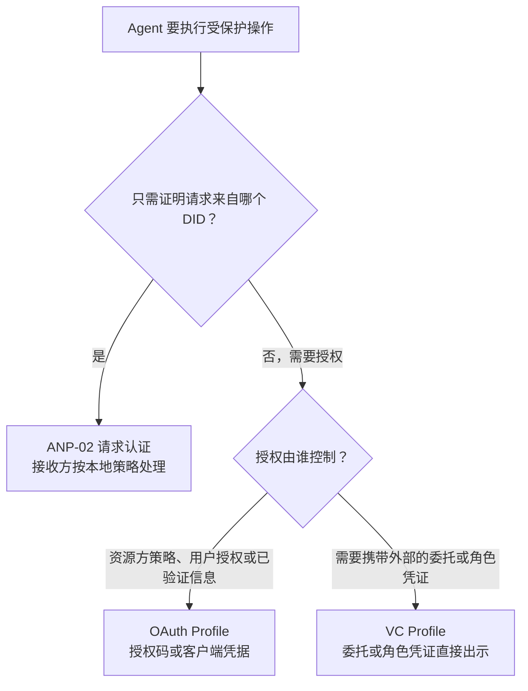
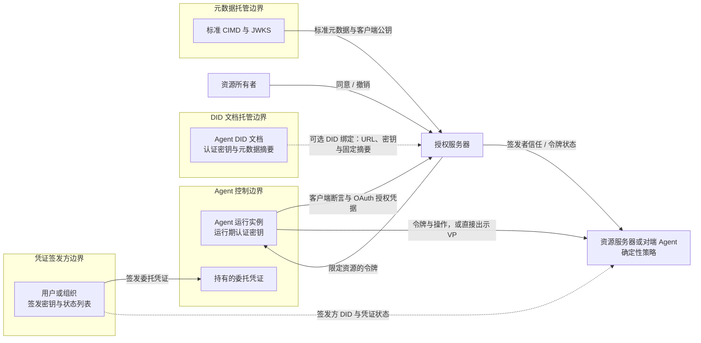
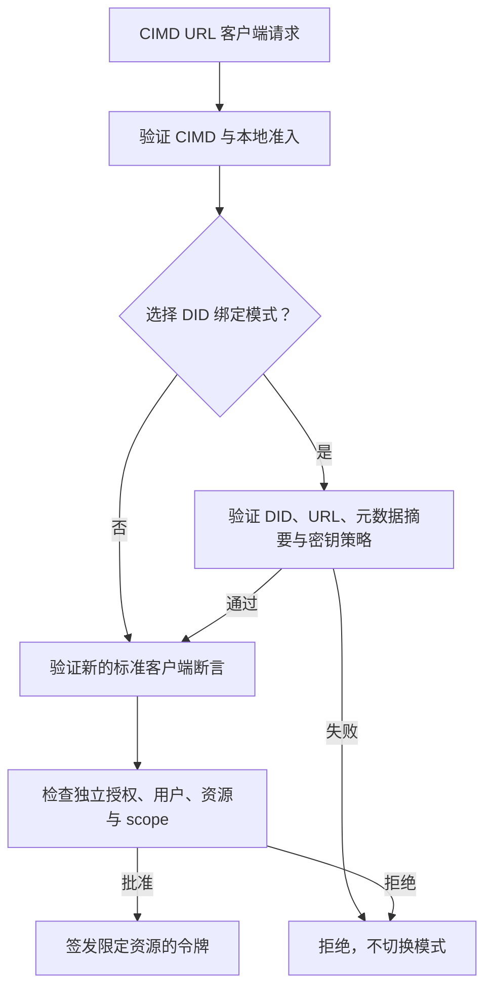
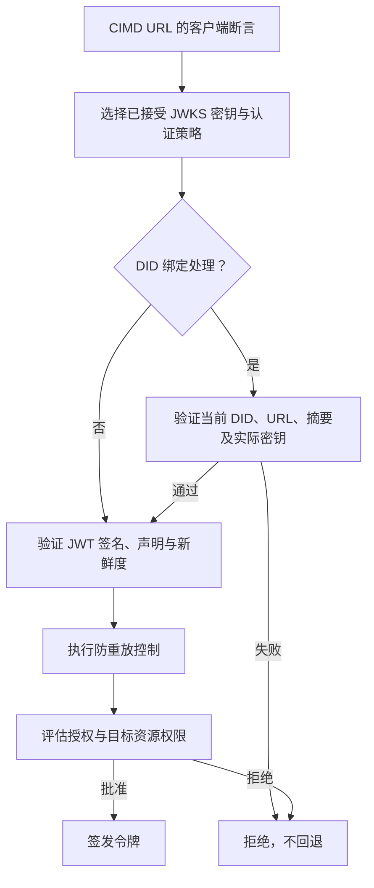
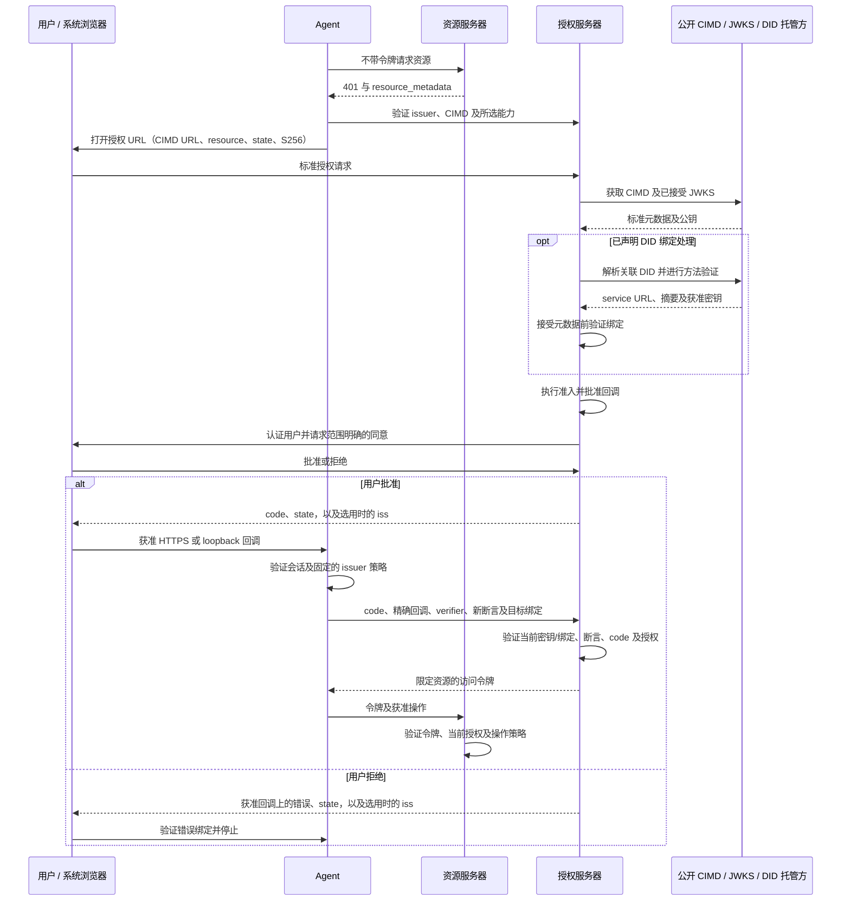
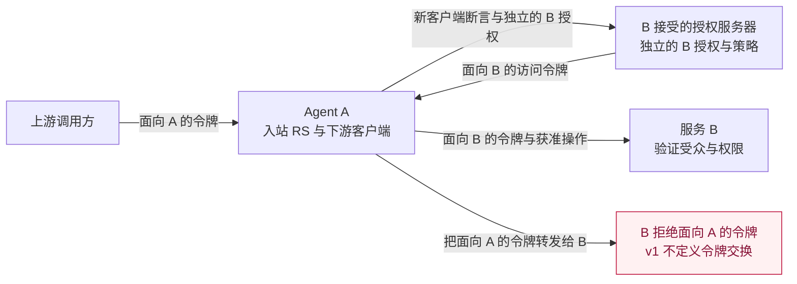
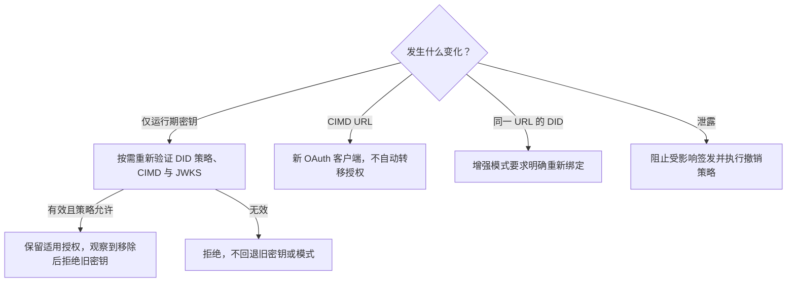

<!-- translation-review: partial; scope=selected normative paragraphs at source lines 55,61,216,247,287,357,770,804,834; remainder=machine-unreviewed -->
> 日本語参考訳（機械翻訳・未校閲）。規範となるのは原文です。コード例・識別子・規範キーワードは原文を保持しています。
> 原文: [chinese/05-ANP-基于DID的授权协议.md](../../chinese/05-ANP-基于DID的授权协议.md) / 基準コミット: `0837cfdfaf4ddcf834f0890ddaf34fc4c824e066`

# ANP ベースの DID ベースの認可契約

- 文書番号: ANP-05
- ステータス: ドラフト/未公開
- バージョン: 0.7
- ノーム: ANP vNext; AMP 1.2 ではない
- ドラフトプロファイル識別: Outlook `anp.authorization.oauth2.cimd.v1-draft1`;VCプロフィール `anp.authorization.vc.v1-draft2`
- 言語:中国語
- イギリスのミラー:[ANP DID ベースの認可プロトコル](../05-anp-did-authorization-protocol-specification.md)

<a id="scope"></a>
## 1. スコープ、マンデート、ロードマップ

ANP-05 定義は、インテリジェントなボディの DID ' s の mandate 方向に基づいており、2 つの補完的なメカニズムで構成されています。**OAuth プロフィール**, アクセストークンは、リソースプロバイダによって信頼される認定サーバーによって発行されます。**VCプロファイル**, W3C認証証明書 (VC) は、権限がベースであるユーザーまたは組織によって発行されます。エージェントは保持し、表示します。 DID は、AMP レイヤーの対象を識別します。 OAuth パスでは、通常の AS は URL クライアントの識別と独自のリソース所有者のアイデンティティを使用します。 ID 結合が明確に検証された後のみ、AS は DID との接続を識別することができます。 VC パスは、発行者と認定エージェントを識別するために DID を使用します。**最初のバージョン(v1)は、DID-OAuthクライアントのアイデンティティとベース委託アクセス製品であり、単一のレベルのVC委託証明書と組織的役割バウチャーを直接提示し、完全なスマート信頼システムではありません。** 現在の文書は、まだリリースされていないv0.7の草案です。 この論文は、V1が公開されているか、ロードマップ内のフォローアップ容量が達成されたという意味ではない最初のバージョンの範囲を指します。

Outlook では、Agent は標準 OAuth クライアント識別メタデータファイル (Clitadata ドキュメンテーション、CIMD) の HTTPS URL に DID をリンクし、発行された認証キーで URL クライアント ID を与えます。リソースの所有者は、サーバー (AS) を承認して制限されたトークン、リソース サーバー (RS) がアクセス制御を実行します。このパスには、VC、VP、OIDC がブリッジまたはブロックチェーン上でログオンする必要もありません。VC プロファイルでは、対象は、エージェントが証明書や認証機関を認証するかどうかを通知する権限を認証するかどうかを要求される権利者に許可するか、認証された証明書を認証する権利を認証する権利を認証する権利を認証する権利を認証します。

Outlookのベースラインは **Outlook 2.0 と公開された拡張**RFC 6749、RFC 9700 および CIMDドラフト-02定義 URL クライアント識別子とメタデータが見つかった明確に固定された使用が含まれています。 CIMD はまだ開発中にあり、RFC を公表していません。 OAuth 2.1-16 および JWT クライアント認証更新草案-11 は、情報設計の参考としてのみ使用され、RFC 信頼性を公開していません。 VCプロファイル 's の規範ベースラインは W3C VC データモデル 2.0、VC データファイル作成と EdDSA パスワードパッケージ、Bitstream ステータス 1.0 です。 MUST(必須)MUST NOT(いいえ)SHOULD(ステンレス)SHOULD NOT(いいえ、ない)MAY(may) BCP 14 定義を使用します。以下の締付ルールは、このプロファイルによって必要であり、規範の引用の変更ではありません。

**ANP-05 v1 では、2 つの独立した認証パスが定義されています。DID クライアント ID に基づく OAuth リソース アクセス認証と、ホルダー バインディング VC に基づくポータブル委任および組織ロール資格情報の提示です。 v1 では、VC/VP から OAuth アクセス トークンへの変換が定義されていません。このリリースでは、個別の資格または属性の資格情報プロファイルは定義されていません。 **

文書構造: セクション 1 では、解決すべき認可の問題とロードマップについて説明します。セクション 2 では、ANP-02 との関係、OAuth をいつ使用するか、VC を使用するかについて説明します。セクション 3 ～ 10 では OAuth プロファイルを定義します。セクション 11 では VC プロファイルを定義します。セクション 12 ～ 14 は、両方に共通するエラー処理、セキュリティ、一貫性の要件です。

<a id="authorization-problem"></a>
### 1.1 インテリジェントエージェント認証によって解決される実際の問題 (参考情報)

核心は単に「どの Agent がこのキーを保持しているか」というだけではなく、** 「誰がどの Agent にどのリソースに対するどの操作を認可し、どのような制限を課し、認可をどのように終了するか」** です。この方向性は次の 5 つのニーズに焦点を当てています。

| 要件 | 解決する必要がある問題 | v1 境界 |
| --- | --- | --- |
| ユーザーがエージェントに権限を委任します | 承認者、委任されたエージェント、リソース、業務、期限、引き出しを記録します。自然言語タスク自体はリソースの承認ではありません。 | OAuth: 認証コードプロセスはユーザーの同意を取得するか、既存の有効な認証を使用します。ユーザーとクライアントの主体を区別し、範囲、期限、取り消しを実装します。 VC: ユーザーまたは組織は、携帯用委任状として単一レベルの委任資格情報 (セクション 11) を発行します。署名は検証者によって個別にチェックできますが、承認の受諾にはリアルタイムのステータス チェックが必要です。検証者は依然として独立して権限を決定します。 |
| 組織は、エージェントが組織を代表して行動することを承認します。 | 企業は、エージェントを人事エージェントまたは調達エージェントとして任命し、企業に代わって未知の採用プラットフォーム、サプライヤー、またはピアエージェントに接続します。相手方は、このエージェントが本当に会社を代表しているのか、何ができるのか、上限は何なのかを確認する必要があります。 | VC: 組織は、リソース アドレスではなくビジネス アクションごとに機能と制約をリストした役割資格情報 (セクション 11.2) を発行します。相手は、発行者が組織であることを確認し、アクションを自分の操作にマッピングした後、受け入れるかどうかを決定します。取引相手間の累計予算は定義されておらず、第三者の個人データへのアクセスが自動的に許可されることもありません。 |
| 同じエージェントがユーザーに代わって複数のサービスにアクセスします。 | 各サービスはリソース、アカウント ID、ポリシーを個別に管理し、1 か所の権限と同意を他のサービスに適用することはできません。 | OAuth: 同じエージェント DID が各リソースとその認識された AS の認可プロセスをそれぞれ実行し、独立した認可とターゲット制限付きトークンを節約します。 VC: 委任証明書には複数のサービスのリソースをリストできます。各検証者は自身に関連するエントリのみを使用し、発行者がリソースに対する権利を持っていることを独立して確認します。ネットワーク全体の同意や AS 間のアカウントの同等性は定義されません。 |
| 複数レベルの委任 | A が B を委任し、B が C を委任する場合、権限は拡張できません。ユーザー/出演者の帰属は保持され、配布と共有の制限は取り消されなければなりません。 | プロセスが定義されていません。 VC プロファイルは、検証者が独自に認識した承認されたサブジェクトによってエージェントに直接発行された証明書のみを受け入れます。発行資格は、発行者自体が保持する委任証明書、役割証明書、またはアクセス トークンからは推定できないため、他者から権限を与えられたエージェントによって発行された証明書は拒否されます。転送トークン、資格情報、または秘密キーを暗黙的な委任として扱ってはなりません。 |
| リスクの高い操作を 1 つずつ承認 | 決定された受取人、金額/通貨、開示または削除の対象、有効期間、一意の操作 ID に個人の承認をバインドします。 | 一般的な承認によるトランザクションの認証情報が定義されていません。委託証明書は、あらかじめ定められた権限の範囲を表すものであり、取引ごとに承認するものではありません。サービスが独立した承認を必要とする場合、サービス自体の明示的な操作承認メカニズムを検証する必要があります。検証しない場合、操作はブロックされます。ログイン、幅広いスコープ、DID 署名、または DPoP 自体は承認ではありません。 |

基本同意レコードと VC 委任資格情報の両方がエージェントに限定的なアクセス権を委任しているため、v1 に「個人→エージェント」権限がまったくないとは言えません。 VC 委任証明書はポータブルな委任状を提供しますが、単一レベルの委任のみをカバーします。 v1 でまだ定義されていないのは、** 委任チェーンと標準化されたトランザクションごとの承認 ** です。ユーザーの指示によって実行をガイドできますが、ユーザーまたはエージェントが元々持っていないリソース権限を作成することはできません。

<a id="technical-choices"></a>
### 1.2 テクノロジーの選択と実装コスト (参考)

**OAuth を再利用して認証ライフサイクルを管理します。 ** RFC 6749 では、リソース所有者、クライアント、AS、および RS が区別され、同意/承認、アクセス トークン、および更新プロセスが提供されます。 RFC 7523 セクション 2.2 では、クライアント アサーションの送信について規定しています。 RFC 7636、RFC 8707、RFC 7009、および RFC 7662 は、それぞれ認可コード保護、ターゲット リソース制限、失効、ステータス チェックを提供します。したがって、ANP は、別の認可/トークン エコシステムを再確立することなく、再利用可能なエージェント ID と不足しているエージェント委任セマンティクスを一元的に定義します。 OAuth がすべての答えではありません。タスクの合計予算、権限の減衰、特定のビジネス アクションに対するユーザーの承認は、OAuth では自動的に取得されません。

**DID はサブジェクトを識別しますが、アクセス許可は付与されません。 ** 同じ方法で検証された DID と選択された認証キーの関係は、通常の ANP 認証、通信、OAuth クライアントの公開キーの公開に使用できます。標準 CIMD モードでは、AS は URL クライアントを認証します。追加の DID バインディング チェックを実行する検証者のみが、関連付けられた DID を認証したと主張できます。ネイティブの Did:web は依然として信頼の基盤として DNS/HTTPS/ホスティングに依存しており、このプロファイルを採用しているからといって、指紋にバインドされた ID を取得したり、独自の DID ドキュメント ホストの保証に抵抗したりすることはありません。パスの種類は次のとおりです:wba e1_ バインディング キーのフィンガープリントと検証可能な文書証明を追加します。これらのプロパティは、適切なメソッド検証とキー管理を前提としています。どちらの方法もソフトウェアの完全性やユーザーの同意を証明するものではありません。ここでの価値は共通の ID/ライフサイクル モデルであり、DID だけがポータブル ID を提供できるという主張ではありません。

**既存の OAuth エコロジーにアクセスするために、CIMD を再使用します。** 主な利点は、CIMDと選択した標準のOAuth機能をサポートする認可されたサーバーがクライアントの識別、メタデータ検出、承認またはトークンプロセスのAMP固有の変更をすることなくこのクライアントを処理することができることです。 `client_id` CIMD HTTPS URL 用の AMP の ID 接続をまだ提供していません。 DID ドキュメントは、選択した認証キーを標準 JWKS にエクスポートするパブリッシャーと DID ドキュメントです。 DID フィットし、エージェント SDK またはメタデータパブリッシャーで ID のリゾルバーを展開するたびに、それぞれ AS が要求されることなく、DID のレゾルバを検証します。 互換性は、AS アクセス戦略、サポート認証アルゴリズム、および選択したプロセスによって異なります。 これは、各 OAuth サーバーが CIMD をサポートしているか、標準的な CIMD サーバーが検証されていないかを表しません。セクション 4 は、 CIMD の拡張ツールと DCIMD を区別することができます。 `client_id`秘密鍵はエージェントまたは明示的に承認した者への署名に残されます。

** VC を使用して、リソースパーティの外部から認可ベースを運びます。 ** 多くのエージェントの認可の根拠は、リソース当事者の手にありません。会社がエージェントを購買担当者として任命するか、ユーザーがエージェントに複数の販売者に引き渡すことができる委任状を与えるか、組織がエージェントがどの組織に属し、どのような資格を持っているかを証明します。 OAuth 同意レコードは各 AS 内に保存され、別のサービスに持ち込んだり、AS のないピアで検証したりすることはできません。 W3C VC 2.0 では、承認された当事者が独自の DID を使用してステートメントに署名できます。DID はエージェントによって保持され、発行者を信頼する検証者に提示されます。検証者は発行者と所有者の DID を解析し、ステータス リストをクエリするだけでよく、検証者は事前に発行者に接続する必要はありません。 ANP は、did:wba 文書認証とメッセージ バインディングに Data Integrity の eddsa-jcs-2022 を使用しました。 VC プロファイルは、追加の署名スタックを導入することなく、同じ認証メカニズムを再利用します。 VC にはコストもかかります。依存関係状態リストを取り消すと、キャッシュの遅延が発生します。検証者は、「どの発行者がどのタイプのクレームを行うことが信頼されるか」という独自のポリシーを維持する必要があります。資格情報が提示されると、その内容が検証者に表示されます。

**VC と OAuth は個別に機能し、相互に置き換えることはありません。 ** v1 では、2 つは独立した認証パスです。 OAuth は、OAuth 認可レコードとアクセス トークン管理を通じてリソース パーティによる認可に使用されます。このバージョンの VC プロファイルは、リソース パーティの外部から委任または組織の役割の資格情報を伝達するために使用され、他のパーティによって独立して検証されます。資格または属性の資格情報は、別途合意されたルールに従って検証者が明示的に要求する追加の証明としてのみ使用できます。 OAuth 認可の決定は、役割、資格、組織の ID、またはその他の認証された情報に基づいて行うこともできます。後続の拡張では、外部資格情報が OAuth 認可決定への入力となる方法を定義できます。 v1 では、トークン更新にアクセスするための VC が定義されていません。どちらを選択するかについては、セクション 2.2 を参照してください。後続の段階で言及される基準は評価の方向性であり、このバージョンの一貫性要件ではありません。

<a id="v1-scope"></a>
### 1.3 v1 提供されるもの

v1 の提供目標は、**DID に関連付けられた OAuth クライアントのアイデンティティと、実用可能で監査可能な基本的なユーザー委任**です。これには、標準 CIMD URL クライアント識別子、DID から CIMD の発見と公開鍵の公開、任意の完全性検証付き DID 結合、有効化された場合に AS ごとの事前登録を必要とせずポリシーによって制御される初回受け入れ、RFC 7523 のクライアント認証、適格な機密クライアントの配備向けのクライアントクレデンシャル、ホスト型 HTTPS およびネイティブ loopback クライアント向けの S256 PKCE 認可コード、対象を限定したトークン、任意の更新とライフサイクルの実施が含まれます。OAuth Profile でユーザー委任への対応を宣言する配備は、認可コードの経路を実装しなければなりません（MUST）。クライアントクレデンシャルだけを実装する配備は、OAuth のユーザー委任能力があると主張してはなりません（MUST NOT）。VC Profile を通じてのみ委任を受け入れる検証者には、この要件は適用されません。

ユーザー委任承認では、AS は、発行者/テナント コンテキスト内の認証されたリソース所有者 ID、URL クライアント ID、検証に合格した場合にのみ記録される関連エージェント DID、ターゲット リソース、承認された範囲、承認元と時刻、適用される期間/取り消しポリシー、および安定した内部承認レコード ID を記録する必要があります (MUST)。既存の同意または管理者の承認は、文書化されたポリシーによって承認されている場合にのみ、承認源として使用できます。これは OAuth 認証レコードの要件です。システム間で移植可能な委任は、VC プロファイルによって定義されます。新しい権限には新しい承認の決定が必要です。ユーザー認証情報はエージェント認証キーとは別のままです。

VC プロファイルは、2 種類の ANP 委任資格情報と組織役割資格情報、ホルダー バインディングの提示、発行者と所有者の検証、資格情報のステータス チェック、権限と制約の評価、リソース サーバーまたはピア エージェントへの直接提示を提供するオプションの機能です。 VC プロファイルのサポートを宣言する実装 (MUST) は、その役割に適用されるセクション 11 の要件を満たさなければなりません。 VC をサポートしない実装でも、OAuth プロファイルに完全に準拠している可能性があります。有効な委任資格情報は、検証者の承認決定を置き換えるものではありません。

**セキュリティの基準：**この Profile は、Implicit Grant、リソース所有者パスワードクレデンシャルによる認可、URI クエリ内のアクセストークン、PKCE plain を使用してはなりません（MUST NOT）。認可コードには S256 PKCE、許可されたコールバックとの一致確認（例外は後述で明示的に限定する loopback ポートのみ）、および issuer とセッションの検証が必要です。ロードマップ上の将来の能力を、v1 ですでに対応済みの能力として宣言してはなりません（MUST NOT）。

<a id="roadmap"></a>
### 1.4 段階的計画と受け入れルート（参考）

以下は順次に依存する能力段階であり、納期の約束ではありません。後続のフェーズは、v1 の ID/認可部門を変更せずに、独立して拡張およびリリースできます。

| ステージ | プログラムの方向性 | 機能を主張する前の検証証拠 |
| --- | --- | --- |
| v1: アイデンティティと基本委任 | セクション 1.3 の範囲を実装します。同じ DID が複数のサービスから独立した承認を取得し、ユーザー/エージェントの属性と明確な取り消しメカニズムを保持します。認可ベースがリソース パーティの外部から得られる場合、単一レベルの VC 委任資格情報またはロール資格情報が直接提示によって使用されます。 | CIMD の最初のコンタクトとオプションの DID バインディング検証。宣言されたホスティングおよびループバック ユーザー フロー。 2 つのリソースの分離。メタデータの改ざん。キーの回転。取り消し; VC によって直接提示された肯定的な例と否定的な例。セクション 14 クライアント/AS 相互運用性の証拠。 |
| 次の段階: きめ細かい権限とリスクの高い承認 | RFC 9396 RAR を評価して、構造化されたリソース/アクション/制限を表現します。単一の承認を個別に定義します。これには、専用の VC タイプまたはその他の資格情報、結合エージェント、リソース、正規化された正確なアクションの概要、主要なパラメーター、期限、および一意の識別子があり、実行側でアトミックに検査および消費されます。 | パラメータの置換、リプレイ、繰り返し実行、有効期限切れ、取り消しはすべて安全に失敗します。再ログイン、転送リクエストの署名、または広範な委任資格情報は、ケースバイケースの承認の代わりにはなりません。 |
| 次の段階: 制御された委任 | VC 委任チェーン (子の資格情報が親の資格情報を参照し、権限を絞り込む) と RFC 8693 トークン交換の実行者の属性を評価します。許可される委任の深さを定義し、子の承認が親の承認の有効な権限を超えないこと、対象者/期間の絞り込み、承認ファミリーの取り消し、および監査を定義します。 AS 間の交換では、信頼とアカウント/権限のマッピングを明確に確立する必要があります。 v1 では、VC から OAuth へのトークン更新やマルチレベル委任は定義されていません。 | A→B→C 委任。権限が拡張されるか、実行者が一致しない場合は拒否します。ルート権限が取り消された後、新しいサブ権限をブロックします。署名されたトークンの有効期限の遅延を記録します。認可は、執行者の過去の主張のみに基づいて行うことはできません。 |
| コンパニオンの進化: 長期的 vs. インタラクションレス強制、プライバシー | リモート/ヘッドレス認証に対する RFC 8628 サポートを評価し、追加のバックエンド認証フロー、認証済み DID 移行、および共有予算/カウントの強制を検討します。暗号スイートの VC 選択的開示と、人間のウォレットの OpenID4VP/OpenID4VCI バインディングを評価します。対応するドメイン プロトコルによって定義および管理される、調達や人事などの一般的なビジネス機能の相互運用可能なアクション語彙を評価します。 v1 ループバックは、ブラウザがエージェントと同じデバイス上にある状況をカバーしますが、すべてのインターフェイスレス環境をカバーするわけではありません。 | デバイス/トランザクションへのユーザーのバインド、フィッシング対策およびポーリング制御。ユーザー認証の有効期限が切れた場合、クライアント自身の権限を変更することはできません。複数のサブタスクが並行している場合でも、共有制限は引き続き正しく実行されます。選択的開示は、提示されていない許可エントリを明らかにしません。 |

承認者、ターゲットエージェント、リソース/アクション、制限、適用される親の承認、承認の証拠、および失効ステータスを統一して記述することが計画されています。具体的な回線契約スキーマと実行ルールは、その後の拡張で策定される予定です。署名宣言の予算は、グローバルカウンターの実施と同等ではありません。トークン交換自体は、失効の伝播または権限の減衰を実装したことと同等ではありません。

本書の出版はSDK、AS、製品のサポートを表さない。改定は実験的である `anp.authorization.oauth2.cimd.v1-draft1` 以前のDIDを現在の状態に置き換える_id OAuthの設計;独立したVCのプロフィールはとして維持しました `anp.authorization.vc.v1-draft2`申し訳ございません。 `anp.authorization.oauth2.did.v1-draft4` 識別子は、この修正のエイリアスではありません。0.6 変更は、VCの赤字を OAuth に削除します。0.5 修正は新しいVCプロファイルを追加します。MUST) 正確にリビジョンと再検証を一致させ、移動する前に影響を受けるメタデータと未確定トランザクションを再検証します。クライアント識別の変更は、プロファイル文字列を更新することによって新しい OAuth クライアントが再解釈できないことを意味します。

<a id="anp-boundary"></a>
## 2. ANPとメカニズムの選択との関係

電流を消費して下さい [ANP-02 アイデンティティ材料規則](../../chinese/02-ANP-基于DID的身份认证协议.md#identity-input)、[ANP-03 WBA の結合](../../chinese/03-did-wba方法规范.md#wba-auth-binding)とりあえず [ANP-02 ネイティブWebバインディング](../../chinese/02-ANP-基于DID的身份认证协议.md#web-binding). Git履歴の事前公開スナップショットは、このドラフトの規範的なベースラインではありません。

ANP-02 は、認証のリクエストとして HTTP/JSON を定義します。ANP-05 は、DID を返し、キー認可モデルを検証・認証します。**未使用**HTTP 署名シーケンス、チャレンジまたはオプションのトークン応答ヘッダー。 OAuth トークンエンドポイントが使用されます `client_assertion` 標準的なOutlook JSONトークン応答, ない (MUST NOT)この製品は、ANP-02 HTTP 署名を追加することで満足させる必要があります。HTTP Message Signatures のデプロイは、別の OAuth 認証モードとして定義され、明確にバインドする必要があります。

AMP-02認証キャッシュトークンは、AMP-05 OAuth認可トークンを自動的に生成し、満たさなければならない()MUSTこのRefileは、メッセージ、WNS、デバイスマニフェスト、E2EE、またはヒューマン・プレゼンスの確認インターフェイスに依存しません。 VCは、これらのプロトコルのルールを変更することなく、AMP-02または認証されたメッセージセッションのロードによって認証できるHTTPインターフェースを直接提示します。 `authentication` 関係は、キーを識別し、リソースへのアクセスを許可しません。

### 2.1 ANP-02、OutlookまたはVC(infomatic)を選択する方法

| 条件: | 参加申し込み | 証拠の感覚で、 |
| --- | --- | --- |
| 既存のローカルポリシーを実行した受信者と、直接APIリクエストまたはエンドへの通信を認証 | アクア・アミューズメント・アミューズメント・アミューズメント・アミューズメント・アミューズメント・アミューズメント・アミューズメント・アミューズメント・アミューズメント・アミューズメント・アミューズメント・アミューズメント・アミューズメント・アミューズメント・アミューズメント・アミューズメント・アミューズメント・アミューズメント・アミューズメント・アミューズメント・アミューズメント・アミューズメント・アレイ・アワーズメント・アミューズメント・アミューズメント・アミューズメント・アミューズメント・アミューズメント・アベイ | オプショントークンは、標準化されたユーザー・コミッションを作成せずに、このAPIポリシーに基づく認証されたコンテキストを再適用するために使用されます。 |
| ユーザーの代わりにアクセス制限、またはAS管理クライアントの承認、リソースオーディエンス、同意、期間および出金の使用へのアクセス | ANP-05 OAuth プロフィール | 特定の権限とリソースの OAuth アクセスバッジを発行します。 |
| 組織によるリソースまたは予約以外の資格証明書は、認証機関への直接検証および認定パーティーの要求に応じて採用し、同意される場合があります | ANP-05 VC プロファイル | 発行者から署名された宣言; 認定当事者の決定は、独自の戦略に従って採用します, 訪問者ではなく、セごとの証明書. |

サービスは、明確に分離されたルートまたは宣言されたポリシーの下で複数のメカニズムを同時に提供できます。 JWT、署名付き JSON を使用したり、オブジェクトを「トークン」と呼んだりしても、オブジェクトは交換可能になりません。 ANP-05 では、最初に ANP-02 トークンを取得する必要はありません。通常の認証メッセージは AS の使用を強制しません。 RS は元の VC または VP をベアラー アクセス資格情報として受け入れてはなりません (MUST NOT)。

<a id="mechanism-selection"></a>
### 2.2 OAuth と VC の役割分担 (参考)

どちらも異なる質問に答えます。 **OAuth は、「リソース パーティは現在、このクライアントがこのリソースに対してこの操作を実行することを許可していますか?」と答えます。 **: リソース パーティによって信頼された AS は、ターゲットの制限付きアクセス トークンを発行する前に、ローカル ポリシー、ユーザー承認、役割、資格、組織 ID、またはその他の検証済み情報に基づいて決定を行います。 **VC は「どの発行者がこのエージェントに対してどのような検証可能な声明を出しましたか?」と回答します。 **: エージェントは外部発行者からのステートメントをさまざまな第三者に伝えることができ、各検証者は発行者を信頼するかどうか、および操作を許可するかどうかを独自に決定します。資格と役割を OAuth の決定に入力することもできます。移植可能で独立して検証可能な外部クレームの必要性が、VC を使用する鍵となります。

| ディメンション | OAuth アクセス トークン | VC 委任認証情報または組織ロール認証情報 |
| --- | --- | --- |
| 発行者 | リソースパーティによって信頼されている AS | 認可根拠のソース: ユーザー、組織、または認定機関 |
| 認可決定 | AS はトークン発行前に行われ、RS が実行 | 各検証者は資格情報の直接提示時に決定を行う |
| 適用範囲 | 単一のリソース;ベンプロファイル `resource` | 証明書は、複数のサービスに拡張できる範囲でリストされています。各認証機関は、その関連項目のみを使用しています |
| 検証は | 署名キーまたは信頼できる AS のイントロスペクション | 発行者 DID、所有者 DID、ステータス リストに依存します。検証者は事前に発行者に接続する必要はありません |
| 有効性と失効 | 短期トークン。 AS は発行を停止して一元的に更新できますが、発行されたトークンは有効期限が切れる前、または RS が失効を知る前に引き続き使用される可能性があります | 有効期限は通常より長くなります。状態リストによる取り消し、遅延は状態リストの公開とキャッシュに依存します |
| 必要な対話 | ユーザーが委任するときにログインし、AS に同意します。クライアントと AS 間の往復 | 発行時に認可当事者によって 1 回確認されます。提示されると、エージェントはチャレンジとホルダー バインディング VP を検証者と交換し、DID、ステータス、およびローカル ポリシー | をチェックします
| プライバシー | トークンの内容は通常、クライアントに対して不透明です。 AS は各承認を制御します | 提示された資格情報の内容は検証者に表示されます。発行者はプレゼンテーションに参加しませんが、ステータス リストのクエリにより検証者のネットワーク アドレスが管理者 | に公開されます。

**OAuth の使用に適しています: **

-  リソースはサービスによってホストされており、サービスには独自のユーザー アカウント システムがあります。たとえば、エージェントはドキュメント サービス内のユーザーのファイルを読み取り、ユーザーのカレンダーに書き込みます。ユーザーはサービスにログインして同意し、サービスには完全な認証レコードが保持されます。
-  エージェントは独自の名前でサービスを呼び出し (マシン間)、権限はサーバーによって構成され、クライアントの資格情報が使用されます。
- リソース当事者は、失効、短期トークン、リソースごとの分離、または増分認可を一元管理する必要があります。
-  リソース側にはすでに OAuth インフラストラクチャがあり、RS がトークンを変更せずに検証するだけであることを望んでいます。

**VC の使用に適しています: **

-  認可ベースはリソースパーティの外部から来ます。たとえば、企業が購買担当者に企業の名前でサプライヤーに発注する権限を与えた場合、金額と期間は企業が決定します。サプライヤーが確認する必要があるのは、企業の従業員がサプライヤー システムにログインして同意するのではなく、「企業が実際にこのエージェントを承認している」ということです。
- 組織は、特定の機能的役割を担うエージェントを任命します。たとえば、企業の人事エージェントは企業に代わって求人プラットフォームに求人を掲載し、候補者のエージェントとの面接を手配します。また、調達エージェントは企業に代わって新しいサプライヤーに問い合わせて発注します。相手方は事前にエージェントを知らないことが多く、当社は相手方のすべての住所を事前にリストすることはできません。役割証明書には、ビジネスアクションに応じて「このエージェントが会社を代表して何を行うか、およびその上限」が説明されています。セクション 11.9 を参照してください。
- 相互に接続されていない複数のサービスに同じ権限を与える必要があります。たとえば、ユーザーは委託証明書を発行して、エージェントが複数のホテルの価格を比較して予約できるようにします。各ホテルが独自に検証するため、ユーザーはいちいちログインして同意する必要はありません。
- 相手は、エージェント間のポイントツーポイントコラボレーションを含む、VC をサポートするインターフェースを提供します。 OAuth AS の有無によってプレゼンテーション プロセスは変わりません。このとき、ピアは「このエージェントがどのユーザーや組織を代表し、何を許可されているのか」を確認する必要があります。
- 検証者は、認可証明書に加えて、組織のメンバーシップ、業界の資格、実名検証結果、またはエージェントのオペレーターなどの属性証明書が添付されることを明示的に要求します。このバージョンでは、委任証明書と組織役割証明書の 2 つの承認タイプのみが定義されています。追加の属性証明書の種類、サブジェクト バインディング、発行者の信頼性、および採用ルールは個別に合意し、セクション 11.3 に従って認可証明書とともに提示する必要があります。このバージョンでは、資格または属性資格情報の独立したプレゼンテーションの完全なバインディングは定義されておらず、それ自体ではアクセス権が付与されません。

**初版境目。 ** OAuth と VC は独立した認証ポータルです。 VC インターフェイスを提供する認証システムは、プレゼンテーションと要求された操作を直接チェックします。 OAuth のみを受け入れるインターフェイスでも、サポートする OAuth プロセスを介した承認が必要であり、VC による直接プレゼンテーションによってバイパスすることはできません。 VC と OAuth の組み合わせは、セクション 16 のその後の拡張方向にすぎません。



### 2.3 信頼境界（参考）



アーキテクチャと OAuth/VC の役割分担は変わりません。ソリッド メタデータ パスは通常の CIMD AS 用です。破線の DID パスは、DID バインディングを検証する場合にのみ有効になります。この図には、DID ドキュメント ホスティング ユニットが境界としてリストされています。 Did:wba e1_ の場合、文書の整合性はエージェントによって制御されるバインディング キー証明から得られ、管理者はサービスを拒否するか、古い文書を再生することしかできません。ネイティブの Did:web の場合、キーとダイジェストが侵害された場合、管理者はキーとダイジェストを置き換えることができます (セクション 4.2 を参照)。発行者とリソース所有者は同一人物であっても構いませんが、発行キーは常に発行者によって管理され、エージェントには与えられません。

<a id="roles"></a>
## 3. キャラクターとロゴ

セクション 3–10 では OAuth プロファイルを定義します。セクション 11 の VC プロファイルは、独立した直接プレゼンテーション プロセスを定義しており、その所有者と検証者は、VC を採用することによって OAuth クライアントまたは AS の責任を負いません。 AS は共通のビジネス コンポーネントとして VC ベリファイアを実装できますが、このバージョンでは VC トークン交換という特別な役割が与えられません。

| 用語 | 意味 |
| --- | --- |
| クライアント/エージェント実行インスタンス | アクセス トークンを適用して使用するソフトウェア デプロイメント。その ID はリソース所有者とは区別されます。 |
| エージェント DID | DID ドキュメントを通じて OAuth クライアントに関連付けられた ANP ID。これは OAuth ワイヤ プロトコル識別子ではなく、必ずしも人間のユーザーの DID である必要もありません。 |
| `client_id` | OAuth クライアントとして HTTPS CIMD URL を正確に指定します。 |
| リソース所有者 | リソースへのアクセスを許可する権限を持つユーザーまたは組織。 |
| 認可サーバー (AS) | URL クライアントを認証し、認可資格情報とポリシーを検証し、トークンを発行します。 DID バインディング処理が有効な場合にのみ、エージェント DID を検証します。 |
| リソース サーバー (RS) | リソース アクセス制御を実行するターゲット エージェント、API、またはゲートウェイ。 |

リクエスト `client_id`、CIMDの `client_id` クライアントのアサーション。 `iss`、`sub` 必要 (必須)MUST)は、まさに同じCIMD URLです。クライアントはアサートします `sub` クライアントを識別します。トークンにアクセス `sub` 認可が指示される対象を識別します。通常、リソース所有者は、ユーザーによって承諾された訪問時に特定されます。クライアントがアクセス権を持っている場合ASで決定されます。MUST NOT) 認証の成功のためにクライアントが主張されている。 `sub` ユーザーのコミッションに直接コピーします。

クライアントによってアサートされた `aud` は、固定認証ポリシーに従って受け入れられた AS を識別します。アクセス トークンの対象者はターゲット RS を識別します。同じエージェント DID と CIMD URL を複数の AS で使用できますが、アドミッション、認可、ユーザー アカウント、およびトークンは引き続き各 AS によって管理されます。クライアントが DID を持っているからといって、トークンが自動的にすべてのサービスに共通になるわけではありません。

クライアントレコード、認可、トークンキャッシュは必須です(MUSTプレス(発行者、テナントまたは信託ドメイン、_id) 別の所有権、許可、ターゲットリソースおよび処理モードを分離し維持します。 `client_id` 関連するIDを入力することができない宣言。RFC 7662のイントロスペクションは標準的な構文を維持します: 戻り `client_id` 、値は URL です。 戦略はクライアントの ID RS に依存します()MUST) 信頼できるトークン/イントロスペクションのコンテキストまたは等価からアイデンティティを取得する。 必要に応じて、(MUST)決定を拒否し、呼び出し元が指定したフィールドに信頼できません。このファイルは、トークンにDIDステートメントを追加するために通常のCIMD ASを必要としません。

ANP 対応 AS は、正常に認証された DID バインディング、プロファイル リビジョン、および認証ステータスを個別に記録します。結果を RS に送信するには、双方が合意した明確な信頼できるチャネルまたはトークン拡張が必要です。このバージョンでは、新しいトークンの宣言は必須ではありません。 RS は、未検証の `anp_did`、`kid` タグまたは URL の現在の内容から、DID が検証済みであると推論してはなりません (MUST NOT)。 AS がバインディングを検証せず、リソースが DID 認証を必要とする場合、別途合意されたバインディングに従って、実際のリクエスト/トークンとの関連付けの独立した証明が必要です。そうでない場合、操作は拒否されなければなりません (MUST)。この改訂版では、この証明の交換は定義されていません。

複数のエージェント インスタンスが CIMD URL を共有している場合でも、URL は OAuth クライアントを表します。エージェントごとに独立したクライアント ID を必要とする展開では、(SHOULD) 異なる安定した URL と認証キーを公開する必要があります。複数のユーザー間で URL を共有しても、各発行者の範囲内でリソース所有者の ID が置き換えられるわけではありません。これは ID の関連付けであり、アカウントの自動結合、ソフトウェア認証、または権限の付与ではありません。

<a id="enrollment"></a>
## 4. クライアントの登録とバインド

### 4.1 クライアント識別子としての CIMD URL

このリビジョンは、CIMDドラフト-02で定義されるHTTPSクライアントURLとして定義されます。 URLは必須です(MUST) パスが含ま (() ないMUST NOT) userinfo、snippet、またはSingle/double のポイントパスのマスを含む。 このProfile のパブリッシャーは必須である(MUST) クエリセクションを省略します。 時刻でデコードされた通常のフォーム/ JSONは文字列によって正確に比較され、異なる識別はポート、ケース、パスまたはエイリアスを介して等しいとはみなされない場合があります。 `client_id` フィールドなし (MUST NOT) CIMD URLをDIDまたはDID URLに置き換えます。

トランザクションを開始する前に、次の 2 つの処理モードのいずれかを選択します。

| モード | 検証責任 |
| --- | --- |
| `cimd` | 標準的なCIMDメタデータ検出、URLクライアント認証およびOutlookの認可。 DIDを解析する必要はありませんので、ANP拡張を理解したり、DIDで固定された要約を確認したりできます。 |
| `did_bound` | 同じ標準の URL クライアントと OAuth メッセージを使用して、追加の DD/URL/metadata/actual 認証キーチェックを実行します。セクション 5 でこの拡張を明らかにします。 |

`did_bound` に明示的に起因する要件は、この拡張機能が実装され有効になっている場合にのみ適用され、通常の CIMD AS 処理標準手順の前提条件として (MUST NOT) は使用されません。以下の一般的な OAuth セキュリティ要件は、参加する実装と機能の選択を制御します。 CIMD のサポート自体は、この記事で説明するすべてのオプションの OAuth 拡張機能のサポートを宣言するものではありません。まだサポートされていない機能を必要とする接続は、ANP 固有の代替プロトコルを必要とするのではなく、認証前に失敗する必要があります。

クライアントは必須です。MUST) 承認の前に受け入れられる固定 `client_id`, 選択したモードと認証戦略. DD の結合が必要である場合, 正確なマッチングの有効化やそれらをチェックする失敗の欠如があります。, しなければなりません ()MUST) 操作の終了、ない()MUST NOTオートトグルに `cimd` 再試行モード。 明確な構成 `cimd` 接続が有効ですが、()MUST NOT) ASがDID認証を完成させたことを宣言します。クライアントとして未来のDID_id 研究は、別々の相談(セクション16)の拡大です。

<a id="anpcimd"></a>
<a id="anp-oauth-keys"></a>
<a id="anp-metadata-sha256"></a>
### 4.2 自己公開 OAuth クライアント メタデータ

ANP の公開者は、この Profile で唯一の `ANPCIMD` 型 service を通じて、Agent DID を CIMD に関連付けます。その `id` は、この DID に空でないフラグメントを付けたものでなければなりません（MUST）。`serviceEndpoint` は、CIMD の HTTPS URL と厳密に一致しなければなりません（MUST）。ANP の発見処理は、重複する service ID や、複数の一致する service を拒否します。`ANPCIMD` は ANP が定義する実験的な DID service 型であり、W3C が定義した型ではありません。JSON-LD の配備には、明示的で固定された拡張 context が必要です。DID Core context は、これらの拡張語彙を定義していません。旧 `ANPOAuthClientMetadata` service は、この新しい Profile の選択には使用しません。

発行者は、メソッド検証済みの DID マテリアルと明示的な OAuth アプリケーション構成を組み合わせる必要があります (MUST)。次のマッピングは公開プロセスの標準要件であり、DID 解決に標準 AS は必要ありません。

| 出力 | ソースとルール |
| --- | --- |
| `client_id` | DID に関連付けられている正確な CIMD URL。 |
| `jwks` または `jwks_uri` | DID から承認 `authentication` メソッドは、秘密鍵素材からエクスポートできない、公開署名キーを選択します。`jwks_uri` 必要 (必須)MUST)標準のJWK Setを提供しており、直接変換されていないDID文書を返すことができません。メタデータフィールドの両方が1つでのみ使用できる必要があります。 |
| `client_name`、`client_uri`、`logo_uri` | 明確なアプリケーションは構成を表示します。クライアントの自在の名前は検証済み組織ではありません。 |
| `redirect_uris` | 実際のコールバック構成を適用します。DIDドメイン名だけでなく、 |
| `grant_types`、`response_types`、`scope` | OAuth 機能とアプリケーション構成の達成/要求; これらの値は承認されません。 |
| `token_endpoint_auth_method` | クライアントパスを認証するためにこのファイルを使用します `private_key_jwt`. . . `none` パブリッククライアント接続は、DIDベースのクライアント認証機能には所属しません。 |
| `token_endpoint_auth_signing_alg` | 規定は、選択したキーの非対称アルゴリズムでサポートされ、互換性がなければなりません。実際の使用はASサポートが必要です。 |

CIMD文書は必須です。MUST)CIMDドラフト-02と適用可能なRFC 7591メタデータの構文をフォローします。 (必須)MUST) URLを正確に `client_id`空でないものを含んでいる `client_name`. 認証コードリリースが含まれている `response_types=["code"]` 構成される `redirect_uris`. 文書は必須である。MUST)認証なしでHTTPS GETを介して取得することができます。 HTTP 200とJSONを返します。 出版社は()SHOULD) . `application/json`. 取得者は認められません(MUST NOT) 自動的に再方向性に従うか、またはメタデータとしてエラー応答を受け入れる。 共有は、セキュリティキーを共有したり、ベアラーを使用して、公開することはできません。 各取得は、外部JWKSアクセスを含むセクション13の対象となります。

`anp_profile` と `anp_application_type` は必須の CIMD メンバーではありません。 `cimd` モードでの使用には、標準フィールドのみを含む CIMD ドキュメントで十分です。オプションの実験用 `anp_did` メンバーは、リバース ディスカバリのために候補となるネイキッド エージェント DID を特定します。 DID バインディング チェックに合格するまでは信頼できません。逆検出が必要ない場合、または信頼できる帯域外バインディングによって DID がすでに提供されている場合、発行者はこのフィールドを省略してもよい (MAY)。通常の AS はそれを理解する必要はありません。 AS によって受け入れられるメタデータとの互換性を検証する必要があり、トランザクションのクライアント ID やセキュリティ モードをサイレントに変更することはできません。

`did_bound` のリリースと検証では、`ANPCIMD` サービス (MUST) にも以下が含まれている必要があります。

- `anp_oauth_keys`: ダイドから `authentication` 関係、非重複認証方法 ID 非空洞配列は、関連するURLクライアントによって使用されるようにこれらのキーを明示的に許可します。各参照は、相対的なDIコアリファレンス処理後DIDおよび非空中セグメントとして解析されなければなりません。このフィールドは承認されていません `keyAgreement` 鍵は、承認されるだけでなく `verificationMethod` . 鍵のキー
- `anp_metadata_sha256`: 64ビットの小文字 SHA-256 要約をオーバーライドします。 HTTP 転送/コンテンツデコード後の UTF-8 応答バイトの概要、空白と終端線ブレイクを含む。 HTTP ヘッダを含んでいない再シーケンス JSON は行いません。 BOM、無効な UTF-8 を注入し、JSON メンバーを繰り返す。 集計計算がシリアライズされた後、DID メソッドで認証されるドキュメント更新プロセスが公開されます。

メタデータを使用して回転または承認の決定を行う前に、AS を強化する()MUST信頼できる構成か任意から `anp_did` 呼び出し元が DID のリストを提供し、DID とサービスを検証し、URL や適用可能なリバース DID のチェックを正確に確認して、固定された抽象を検証します。 必須のバインディングが欠落し、エラーまたは不一致が拒否されます。 発信者が提供する上書き値、あるいはメタデータホストのみがこのバリデーションを置き換えることはできません。 競合逆 DID は許可されていません()MUST NOTこれらのチェックが完了するまでの名前またはコールバックは、信頼できるものではありません。MUST) 5までの文書を支え、限られたサイズ、タイムアウトおよび同時帽子を置く。

埋め込まれる概要のオーバーレイ `jwks` 値が、 `jwks_uri` URL 文字列のみが、独自に取得する JWKS バイトを保護しません。両方のフォームでは、URL 文字列を使用して JWKS バイトを保存できます。**実際にこのクライアント認証に用いられるキー**全て(両方)MUST) サービス `anp_oauth_keys`, とまだ検証済み DID です。 `authentication` 関係の承認。実質の公共のキー材料かRFC 7638 JWKの指紋を、ちょうど比較比較する比較して下さい `kid`, および、あいまいなキー選択は拒否されます。JWKS で見つかったマッチングキーのみが、他の場所では十分ではありません。このリビジョンは、CIMD バイトを実際に認証鍵で保護し、外部 JWKS 文書全体の概要を定義しません。

通常のCIMD ASは、HTTPSメタデータとクライアント認証ポリシーを受け入れることを信頼しています。 出版社は、ASが同じステータスを取得したり、DIDを検証することなく、DIDチェックをローカルに完了します。 強化されたモードでは、DDDによって承認される要約は、メタデータのカストディアンを送信者に制限し、コンテンツを独立して変更することはできません。_, binds は、メソッドの有効なドキュメントで覆われています。do:web では、制御 DID 文書ホストはキーと抽象を置き換えることができます。Nether モードは、選択した DID 方法と鮮度ポリシーよりも多くのデータを再ロールすることができます。サマリー固定保護を使用する場合、その後のメタデータ更新は、コンテンツの表示のみを含む場合でも、修正された要約を再計算する必要があります。

### 4.3 ASA事前登録なしの初期アクセス

CIMD AS は、これまで未知だったクライアント識別子 URL を受け入れてもかまいません（MAY）。また、承認済みまたは事前登録済みのクライアントに受け入れを限定することもできます。CIMD は、誰でも受け入れることを強制しません。CIMD の初回接触を有効にした AS に対して、ANP は手動登録や登録インターフェース呼び出しを追加の必須要件にしません。受け入れによって、リソースへのアクセス権限が付与されるわけではありません。

初回の露出プロセスは以下のとおりです。

1. 許可される前に、URLの構文、選択したプロセス、受諾された発行者およびローカル・ディスエイブルメント/アクセス戦略をチェックしてください。MUST NOT#Stander のライセンスの使用禁止は削除されます。
2. フォルダを削除できません: %s: このようなフォルダーはありません`did_bound` モード 追加 変更可能な DID をパースし、セクションを実行します。 4.2 バックアップまたは設定を使用する前に.`cimd` モードは、標準CIMDに従っており、ANPソルバーに依存しません。
3. クライアント、デプロイメントパターン、メタデータソース、認証アルゴリズム、コールバックおよび承認/リソースの要求されたタイプのための AS アクセス ポリシーを実装します。この戦略は、自己配布フィールドでカバーすることはできません。
4. あなた自身の問題にカンディダクチュアをキューイング, あなたのU.R.L. `client_id`, 選択したモード, メタデータ/レファレンスを受け入れました, リソースと認証ポリシー. 強化されたサービスは、検証済みDIDを固定します, サービスおよびメタデータの要約. 発見/キャッシュエントリは、秘密鍵の所持の証拠ではありません.
5. あり。 `/token` 承認されたクライアントキーを使用して、認可が独立して検証される新しいセクション6のクライアントの主張を検証するために使用します。該当するリソース所有者、目的および特権が発行されます。現在のキーの承認とバインディングの鮮度に関する認証チェックを強化しました。不完全なトランザクションは、値の置き換えではなく、バインディングやセキュリティの有効期限に関連するメタデータの変更時に失敗します。

承認プロセスでは、クライアントは、返還承認が行われたことを確認しました `/authorize`クライアントキーは、コードへの変換のために有効である証明書を保持しています。フロントエンドのDIDシグネチャは、メタデータを読み込むだけで、キーの証明を提示したり宣言したりすることはできません。コードは、その正確なクライアント、アサー、実際のコールバック、S256 PKCE、リソースおよび受け入れられたサービスステータスにバインドします。クライアントベースのドキュメントプロセスは、初期トークンリクエストでアクセスと認証を完了することができますが、既存のASポリシー/認可が必要であり、独立してアクセスを許可します。

事前登録したCIMD URLはURLクライアントのままです。MUST) 受諾されたメタデータソースとバインディング戦略を保持します。新しく発見されたデータは、固定登録情報の代替として静かに使用することはできません。MUST条件外受容から戦術的な制御へのアクセスを分散し、初回の暴露閉鎖に関する正確な報告。

**初回露出(情報)の概要。**



### 4.4 クライアントエンドの境界

デプロイメントが機密保持要件を満たしていることを証明するだけでなく、キーを保持するか、PKCE を使用します。このファイルは、選択した Agent 認証キーを使用しており、分散アプリケーションのすべてのコピーに埋め込まれていません。 AS は、認証モデルで展開される顧客のタイプを受け入れます。CIMD のサポートは、各元のアプリケーションをサポートする例ごとのキープログラムを表しません。クライアントのドキュメントは、資格のある機密デプロイに限定されています。 `none` プロセスは、DID ベースのクライアント認証を宣言したり、強制的なバインディングチェックが失敗した後にバックトラックを宣言することはできません。

明示的にサポートされたネイティブループバックへのホスティングは、セクション7.1.1の対象です。 発行者は、署名されたプライベートキーを保持することなく、ローカルエージェントに公開CIMD / JWKSを提供することができます。 デバイスブラウザを持つリモート/インターフェイスクライアントが使用できず、フォローアップデバイス/バックエンド拡張が必要です。これは無制限のリターン例外では置き換えられません。

<a id="discovery"></a>
## 5. 発見と能力宣言

動的にHTTPリソースを発見するために、RFC 9728保護されたリソースメタデータとRFC 8414 ASメタデータを使用し、リソース/ASリンクおよび精度のアスサを検証します。`401` 課題をマークすることができます。 `resource_metadata`. 既存またはクローズド展開が可能()MAY) 信頼できるベルト構成によって同じ関係を作成します。任意の DID サービスまたはエージェントの防衛は、リソースのために別の AS を選択する権利を持っていません。

クライアントの記録、トランザクション、トークンキャッシュは、AS の issuer とテナント／信頼ドメインごとに分離して保持しなければなりません（MUST）。issuer が変わった場合はリソースとの関係を再検証する必要があり、旧 AS の code、更新トークン、アサーションを新しい AS に送ってはなりません。新たに受け入れた AS には、その audience に結び付けた新しいアサーションが必要です。

`cimd` で、 `client_id_metadata_document_supported=true` または、CIMDのサポートをクリアで明確にクリアな展開設定で確認します。 `private_key_jwt`, 両当事者と承認された認可プロセスによって受け入れられるシグネチャアルゴリズム. 認証コードは、S256 PKCE および受諾されたリコール/発行者検証戦略を必要とします. RFC 8707 などの追加の基準, RFC 9207, Loopback または DDP はサポートまたは明確に構成されている場合のみ選択されます. ポリシーには、これらの機能の1つは、他のサポートなしで終了されなければならないことが必要です, これはセキュリティ要件を削減しません. `anp_did_oauth` または他のAMPの機能。

提供: `did_bound` プロセス AS は必須 (MUST) 次の実験RFC 8414の延長を宣言します `anp_cimd_binding`. 新しい認証されたタイプやトークンエンドポイント認証方法を定義することなく、同じURLクライアントと標準のOAuthプロセスにバインディング認証を追加します。

| フィールド | ルール |
| --- | --- |
| `profile` | 正確な等しい `anp.authorization.oauth2.cimd.v1-draft1`。 |
| `did_methods_supported` | 実際にセクション6.2で検証されたメソッドは空の配列ではありません。 |
| `client_enrollment_methods_supported` | 非空配列、リストが有効 `self_published` と/または `pre_registered` CIMD URLモード。 |
| `redirect_uri_modes_supported` | 許可コードを有効にすると、サポート/有効化の一覧を `https` とりあえず `loopback` サブセット;CIMDはモードを暗黙的にサポートしません。 |

この精度を宣言すると、約束として意味: 承認されたトークンエンドポイントと宣言したすべてのCIMDクライアントを強化する `did_bound`. DIDのヒントや信頼できる結合、要約無効、キーの権限のない、またはDIDメソッドがサポートされていない場合は、(または)キーはDIDシステムに添付する必要があります。MUST) 拒否; リクエストは、通常の処理からオプトアウトおよび変更することはできません。 この初期拡張は、リクエストによるリクエスト要求モードオプションを提供していません。 定期的なCIMD処理が拡張子を省略するので、また、2つの戦略の展開のための別の非差別化のアスプル/エンドポイント構成を提供します。 クライアントは、IDをバインドするためにDIDを要求する必要があります()MUST) 境界または信頼できる結合が確立された見つけられることができる材料のリストを提供し、承認の前にモデルを強制する構成を選択します。 機能自体は他のコンテキストからRSトークンによる認証のためにこのモードを使用できないことを見つけます。

以下は、標準のCIMD機能を提供するように強化しました。エンドポイントは、基準ASのみを指示します。 `anp_cimd_binding`：

```json
{
  "issuer": "https://auth.example",
  "authorization_endpoint": "https://auth.example/authorize",
  "token_endpoint": "https://auth.example/token",
  "client_id_metadata_document_supported": true,
  "token_endpoint_auth_methods_supported": ["private_key_jwt"],
  "token_endpoint_auth_signing_alg_values_supported": ["RS256", "Ed25519", "EdDSA"],
  "grant_types_supported": ["client_credentials", "authorization_code", "refresh_token"],
  "response_types_supported": ["code"],
  "code_challenge_methods_supported": ["S256"],
  "authorization_response_iss_parameter_supported": true,
  "anp_cimd_binding": {
    "profile": "anp.authorization.oauth2.cimd.v1-draft1",
    "did_methods_supported": ["did:web", "did:wba"],
    "client_enrollment_methods_supported": ["self_published", "pre_registered"],
    "redirect_uri_modes_supported": ["https", "loopback"]
  }
}
```

[ANP-07 スマート 説明](07-ANP-智能体描述协议规范.md)はい (MAY) この許可要件を記述するインターフェイスへのリンク。リンクは説明のためだけであり、信頼できるassuer、選択したクライアントのアイデンティティまたは能力チェックをカバーしていません。

<a id="client-assertion"></a>
## 6. JWTクライアントがDID関連の認定を受ける

### 6.1 転送とJWTフィールド

クライアントは、HTTPS POSTを承認されたトークンエンドポイントに送信し、使用 `application/x-www-form-urlencoded`，`grant_type`、`client_id`、`client_assertion_type`、`client_assertion` 各発生は、選択した認証のパラメータで行われます。 指定されたタイプは `urn:ietf:params:oauth:client-assertion-type:jwt-bearer`. セキュリティ関連のパラメータは繰り返される必要があります()MUST) 拒否します。クライアントは、JWEの使用なしで、JWT/JWS がシーケンスされたコンパクトなシグニチャを、分離負荷、トークンへのアクセス、または複数の認証方法の同時使用することに主張しています。MUST NOT) URL、通常のタスクデータ、ログに置く。

| ヘッダーフィールド | ルール |
| --- | --- |
| `alg` | 両者から受け入れられ、選択した公共鍵と互換性のある非対称JSE署名アルゴリズム。 |
| `kid` | CIMD/JWKS の未読キー識別子を受け入れます。MAY) DID URLは非透明ラベルとして使用していますが、通常のASではDIDとして解釈または引用する必要はありません。 |
| `typ` | 対象となるASがサポートする標準クライアント認証タイプポリシーを使用します。同意した時点で、使用することができます。 `JWT`、省略されたタイプか明示的に支えられる `client-authentication+jwt`;AMP 固有のタイプは必要ありません。 ラベルはコンテキストと署名チェックを置き換えることができません。 |

| 新着情報 | ルール |
| --- | --- |
| `iss` | 正確な等しいURL `client_id`;クライアントは、独自の主張をサインします。 |
| `sub` | 正確な等しいURL `client_id`エージェント DID やリソースオーナーではなく、 |
| `aud` | 事前確立された認証戦略は、AS:認定アスザーの承認を受けた単一のオーディエンスを正確に特定し、または承認されたエンドポイントのURLを使用して、ASで対応するRFC 7523 / OIDC練習を使用する。MUST NOT) 信頼できるエラーからオーディエンスを選択し、自動認証でユーザーを解放しない。 |
| `iat` | 署名時刻を示す整数。 |
| `exp` | 整数NummericDate; このプロフィール生成されたクレーム満足度 `0 < exp - iat <= 300`。 |
| `jti` | 新規、非空の識別子が少なくとも128ビットパスワードのランダムネスを生成し、リクエスト、キーまたは再テスト間で再帰しません。 |

更新されたドラフト-11のJWTクライアント認証は、ユーザールールと可視タイプとしてのみ行われます。これは、双方の関係者がサポートし、既存のCIMサーバーに自動的に課されない場合に使用できます。セクション9の例では、ソサッサーオーディエンスを選択します。クライアントは()MUST) クライアントのアイデンティティ、ユーザー同意、許可または承認は、追加ステートメントでカバーされていません。

強化された認証パーティーは必須です(MUST各ステートメントがテーブルに存在し、JSON 会員、マレーションコード、未知のキー JWS パラメータ、非サポートされているアルゴリズム、および JWT のロール混乱を繰り返すことを拒否することが必要です。MUST)整数時間値チェックを実行します。`0 < exp - iat <= 300`、`iat <= now + skew`、`now < exp + skew`時計の偏差を60秒以上許します。 `nbf` ♪ と、それは必要です♪MUST)は整数であり、会います `nbf <= exp` とりあえず `nbf <= now + skew`通常の AS は、そのサポートと標準に準拠した検証戦略を使用しています。展開は必須です(MUST) 戦略が要求された保証を満たし、CIMDが追加のAMP制限を満たすようにサポートから差し迫ることができないことを確認します。

### 6.2 DID 解析とキーの認可

`cimd` モードは、認証キーを受け取ったCIMD/JWKSから受け取るようにします。AMPパブリッシャーは投稿前に独自のDIDと選択したキーを検証しますが、これは自動的に検証されたDID認証結果として正常にすることはありません。

`did_bound` モードでは、検証者は第 4.2 節の DID と URL の関係、メタデータのダイジェスト、選択された鍵の用途に対する認可を検証しなければなりません（MUST）。候補 DID は信頼された状態、または任意の CIMD 発見ヒントから得るものであり、JWT ヘッダーだけで決めることはできません。文書の `id` は、期待する裸の DID と厳密に一致しなければなりません（MUST）。その DID は、受け入れ済みの結合における同一の主体を識別する必要があり、`ANPCIMD` のエンドポイントは `client_id` と厳密に一致する必要があります。少なくとも一つの対応メソッドの結合を実装し、宣言します。

- `did:web`: 元のメソッドの解像度、HTTPS の検証、ドキュメントを実行 `id` AMP-02 Web ID 規格は、元の Web DID には適用されません。
- `did:wba`: AMP-03 e1の実装_ 完全性/認証、適用可能な指紋、アクティブ状態および認証キーチェックを含むファイルまたはnudityドメイン名結合へのパス。有効なJWTは認証の代替ではありません。 k1_ 延長はこれに縛られず、秘密で有効化できない。

含まれるもの `did:webvh`BIDなどの他のメソッドは、標準方法、ステータスルール、キーの指標がサポートされていると認定証明書の証明を宣言する前に、ドキュメントアダプターが必要です。 通常のCIMD操作では、これらのアダプタを達成するためにASを必要としません。

実際の署名キーは必須です(MUST♪ と、同時にやってます♪ `service.anp_oauth_keys` 現在のDIDを使って `authentication` 関係の承認。 正確な数値化後に埋め込まれた方法や引用されたメソッドを割り当てます。 クロスDIDメソッドは、この初期結合ではありません。 のみ表示されます `verificationMethod`、`assertionMethod` または `keyAgreement` 十分ではありません。実際のパブリックキーやRFC 7638指紋を実際に使用して、単にタグだけでなく、クレームを検証します。クライアントはJWSを使用しています `jwk`、`jku`、`x5u` または `x5c` 提供されているキーは許可されていません()MUST NOT) 受諾されたキーソースを置換します。メソッド/パッケージは、JSON-LD コンテキストを固定するか、許可されているリストに含める必要があります。

DID/URL 宣言と一致した公開鍵は、複製可能なパブリック構成です。 新しく検証されたクレームは、秘密鍵保持証明書を提供します。 設定チェックは、秘密鍵、ユーザー同意、アクセス権の所有権を証明しません。

### 6.3アルゴリズムとシーケンシング

公開されたキー機能、クライアント対応のアルゴリズムと、宣言/構成戦略として目的の交差点を移動します。RFC 7523は、その達成のためにサポートしなければならないアルゴリズムとしてRS256をリストします。これは、RSAを使用するために各エージェントを必要としませんし、Ed25519をサポートするCIMD ASを表す必要はありません。強化されたANPは、RFC 7523以外のベースラインを達成する必要があります()MUST) 対応する Ed25519; クライアントはまだ実際のアルゴリズムを交渉する必要があります。これは通常のモデルで強化されたアルゴリズムを持つと仮定できません。

Ed25519 のサポート時に RFC 9864 のフル指定を優先 `Ed25519` 識別。 古い `EdDSA` 識別子は、明示的に有効化し、Ed25519 キーに限定される必要がある互換性のあるオプションです。それは、Ed25519として書き換えまたは再公開することはできません。ES256などの他のアルゴリズムは、明確なキー式と戦略サポートが必要です。このクライアント認証パスは拒否されます `none`共有キー `HS*` 方法、非サポート曲線とアルゴリズムとキー間の不一致。

JWKエクスポート変換は、別のパスワードアルゴリズムを別のものに変えることではなく、フォームで表現されます。 パブリックキータイプと長さが検証されなければなりません。 RSAキーは2048ビット以上です。 Ed25519 Multikeyは、OKP JWKを構築する前に、マルチベース、マルチコード、32バイトの公開鍵を検証する必要があります。 JWS署名入力上のJWTシグネチャはAMP-02 HTTPシグネチャリング文字列またはJCS経由でのリセラーロードではありません。

### 6.4 検証と再エンジニアリング

選択したモード、メタデータ/キーのソースを受け付け、正確なURL `iss`/`sub`追加チェックを処理するための現在のDID認証とメタデータ鮮度の増加。 アイデンティティまたはバインディングチェックは無効でなければなりません(新しい決定を検証できない場合)。MUST) 再注入し、別のキーの源かモードに戻ってきません。

AS を増強する(必須)MUST) 承認された処理の前に巧妙なパスワード/宣言の検証の後で占有する原子 `(AS issuer, client_id, jti)`、保存する `exp + allowed skew`. クロスキー、サーバーコピーまたは再使用のリクエストが失敗したまま送信されるように要求する。無効な署名はリプレイレコードをコンパテントすることはできません。リストレージは利用できない場合は拒否されます。不連続エラーはクレームを復元しません。新しいアサーションを再試行し、承認を承認するワンタイムルールに準拠します。通常のモデルはASサポートされたリロケーションコントロールを使用しており、デプロイの要件を満たしている必要があります。

最後に、トークン、該当するリソース所有者、リソース、権利および戦略を発行する権限を独立して検証します。クライアント認証はそれ自体に十分ではありません。 OAuthフォームまたはビジネストランザクションのメインテキストに署名しないと主張されます。 HTTPS は送信を保護し、OAuth プロセスは独自のパラメーターを検証し、バインドします。

**クライアントは認証と重量の防止(情報)を主張します。**



<a id="authorization-flows"></a>
## 7. 権限プロセスの委任

要件の適合(a)MUST) 下記のいずれかのプロセスをサポートし、サポートしている状態のみをサポートします。このリビジョンは、各認可/任命が1つのターゲットリソースだけを結合することを可能にします。RFC 8707の使用をサポートおよび選択する際に、クライアントはセグメントなしで絶対HTTPSを送ります `resource` URIは、ターゲットを検証します。強化されたバインディングでは、認証、コードの変更、クライアントのドキュメントの変更、リクエストの更新(以下参照)が必要です。MUST#ShowfulProvision の使い方 `resource`. 通常のCIMD接続は可能です(MAYクライアント、認可、トークンが予想されるリソースに不当にバインドされているまま、ASの既存の構成されたターゲット結合機構を使用して、単一のリソースへの展開を制限するなど、ASの既存の構成されたバリデーションを使用します。MUST)失敗。スコープ名は、AS/RS定義の構文をまだ順守します。DIDはスコープではありません。

**各トークンは、エージェントが1つのサービスにアクセスするのを制限しない、検疫規則を1つの目的のためにのみ設計する必要があります。** エージェントは、同じDIDとCIMD URLを使用して、カレンダーおよび文書サービスのライセンスとトークンを保持することができます。 Assuer、テナント、リソース所有者、URLによるキャッシュ `client_id`、リソース、スコープ、プロセスモードおよび適用可能な送信主の分離; DID だけがトークンを選択できるわけではありません。各 AS は、ユーザーアカウントを独立して認証し、アクセスを許可します。集計されたタスクはポリマーではなく、ユーザー名や DID がアカウントをマージしません。複数のソースインジケータまたはクロス-AS 認可は、それぞれ拡張する必要があります。

### 7.1 クライアントの証拠

`grant_type=client_credentials` クライアントが、当社に承認した氏名または設立されたリソースオーナーの許可を承諾した場合には、機密クライアントのみに適用されます。(No)MUST NOTエージェント DID または CIMD のみが公開され、ユーザーの許可を得る。

必須(AS)MUST)セクション6の検証を実行し、現在のポリシー/認証がURLクライアントがリソースとスコープにアクセスし、権限のみを発行するかどうかを確認します。この文書は、クライアントのs IDプロセスのためのリフレッシュトークンを発行しません。クライアントは別のトークンを得るために別の認証を必要とします。

### 7.2 ユーザー権限取得コードとPKCE

クライアントは、AS 認可エンドポイントを使用して、 `response_type=code`結果として `client_id` CIMD URL、承認済み `redirect_uri`, 選択したリソース, リクエスト `scope`、新世代および結合セッション `state`と PKCE. `code_challenge_method=S256`. リソース所有者をアプリケーションに対する同意または有効な許可を支持し、取得する方法で認証する。 URLクライアント認証(オプションのDIDバインディングを含む)は、ユーザを認証しないし、ユーザーの同意を得る代わりにも行います。

承認の前に、クライアントは()MUST) 認証されたアスザー、リソース、URLクライアントの識別、処理モード、認証戦略、URIを返す権限を保ちましょう。`state` . 成功とエラーコールバックは、(コードの送信やエラーの受け入れのために)MUST)記録に結びます。サポートかRFC 9207、だけ `iss` レコードと正確に比較します。欠落、繰り返し、またはすべての終了に一致しません。通常ASは、各ソッサーの異なるURIを使用して、明確に設定されたRFC 9700アンチ・ディオーダー対策で置き換えることができます。クライアントは(%)でなければなりませんMUST) 戦略をプレフィックスする(しない)MUST NOT) アスザーチェックが失敗した後にバックスライディング。 強化された認証コードは(MUST) RFC 9207 をサポート。 未認証 AS またはトークンエンドポイントで返りフィールドを選択することはできません。

コードを発行する前に、必要 ()MUST) 受け入れられたCIMメタデータまたは事前登録承認に基づいて、リタッチURI;信頼のリターンの前にDID内の固定要約処理を強化します。セクション 7.2.1マッチルールと唯一のループバックポート例外を適用し、ワイルドカードは許可されていません。 `grant_type=authorization_code`同じURL `client_id`、`code`同じ実物 `redirect_uri`、`code_verifier` そして、新しいセクション6の肯定。選択したリソースを結合するためのメカニズムは、元の目的を保持します。 ASは()MUST)コードはクライアント、バックアップ、PKCE、ターゲットおよび認可、原子消費を結合すると同時に確認されます。MUST NOTリソースの所有者は、クライアントの's自身のアイデンティティに置き換えられます。

### 7.2.1 ホストと社内のバックツーバック

クライアントは必須です。MUST)開始前にコールバックモードがサポートされていることを確認します。 サポートCIMDはループバックまたは元のアプリケーション・バイ・ケース認証キーを受け入れるものではありません。 セクション5で示されたモードで有効になっている状態として強化AS;宣言のみを達成し、独自のサポートモードをテストします。 通常ASは必要ありません `anp_application_type` 拡張機能; 導入承認されたアプリケーション構成と標準メタデータ決定が承認されました。

ホスティングコールバックリクエストには、snifeやuserinfoの絶対HTTPS URIが含まれていないし、許可されている正確なコールバックにマッチしません。 明示的に元のループバックをサポートしている場合は、メタデータエントリを使用するように要求されます `http`フォントホスト `127.0.0.1` または `[::1]`、および精密な非空路。照会、クリップ、userinfo、`localhost` 名前、他の数値IP書き込みとワイルドカードは初期のループバック結合範囲ではありません。メタデータはポートを省略したり、有効なポートを指定したりできますが、URIテンプレートではありません。RFC 8252のセクション7.3によると、このエントリとの比較のためのリクエストは、ポートを比較するときにのみ無視されます。実際のリクエストは返されなければなりません()MUST) 可視形は、1〜65535の間のポートが含まれています。 IPv4はIPv6からの異なる承認エントリです。 重量の残りの部分は正確に一致し、デコードまたはパスで他の値に標準化することはできません。

必須(AS)MUST) ポートのフルタイムのバックハンドが含まれています。 URI はコードにバインドします。MUST) は、正確な値を繰り返します。ポート例外は、認証のリクエストでメタデータと一致する場合にのみ適用されます。一時的なリクエストポートはメタデータのスナップショットを変更しません。 S256 PKCE,`state`厳格な検証戦略と新規クライアントのクレームの選択は必須です。

ローカルクライアントは、選択したループバックインターフェイスを結合するだけで、システムブラウザを開き、完了またはタイムアウト後に閉じるだけです。 組み込みログインWebview、`0.0.0.0` このHTTPは、コールバックやプライベートメタデータエンドポイントを取得するように承認しません。ブラウザは独自のデバイスを返しますが、ASとメタデータ/DDの間のトラフィックはセクション13に依然として適用されます。ブラウザは同じデバイス上のエッジを持っていません。

### 7.2.2 ユーザが最初にコンタクトを取得したシーケンス(infomatic)



### 7.3 リフレッシュ

できる限り。MAY) 認定されたプロセスのリフレッシュトークンを発行します。 爽やかなリクエストは()MUST) 元の URL クライアントと処理モデルに関して、新しいセクション 6 で、リソースの所有者、承認および元の単一目的が保持されていることを主張します。 いいえ (MUST NOT) スコープを拡大します。強化された処理は、一貫した可視性の供給を必要とします `resource`. 一般処理は、前選択されたAS機構によりターゲットを保持し、パラメータを省略することで、ターゲットを広くすることはできません。

必須(AS)MUST) 満了とリボカレーションのルールを実行し、再使用テストまたはサポートされている送信者がバインドする新しいメカニズムでリフレッシュトークンを回転させます。 DID接続自体は、爽やかなトークンの送信者に結合しません。 無効なクライアントはバインドまたは承認しなければなりません()MUST)更新を停止します。現在の有効な承認は、すべてのAPI呼び出しのユーザー確認を必要としませんが、新しい許可は決定する必要があります。

<a id="tokens"></a>
## 8. トークンとリソースの実行にアクセスする

### 8.1. トークンの有効化と保有

トークンエンドポイントは必須です(MUST)標準のOutlook JSON応答を返します, 含めて `access_token`、`token_type`、`expires_in` 実際の委任された権限が制限されていることを示します `scope`持ち運び `Cache-Control: no-store`、`Pragma: no-cache`. 間違った応答は不可能です(MUST NOT) トークンを同時に返します。トークンは()MUST) 戦略によって定義される限られた有効期間があります。300秒のアサートされた制限はトークンへのアクセスの期間ではありません。

トークンは ()MAY)は、透明なトークンまたはJWTです。 RSは必須です(MUST) 信頼できる AS、妥当性、適用された revocation/state、ターゲット資源の聴衆、規模およびローカルビジネス戦略を確認します。Untransparent トークンは RFC 7662 のイントロスペクションのような信頼できる認証パスを必要とします;このプロフィールによって発行されるアクセスバッジとして ANP-05 は()MUST) RFC 9068 をフォローします。, トークンの種類から必須宣言の分離を含みます. AS でこのトークンに署名; エージェントの DID キーは、自動的にエージェントに信頼できるアクセストークン発行者を作ることはありません。.

ない (ない)MUST NOT) トークン、IDトークン、爽やかで、または承認するアクセスの証拠としてクライアントの主張を使用します。`Bearer` アクセスはRFC 6750に従います。ASとRSの両方のサポートが、それでもこの初期プロファイルではオプションであるときにDDPopの使用をお勧めします。RFC 9449で使用してください。 `token_type=DPoP`、`Authorization: DPoP`、証拠の証明、RS `ath` そしてJWTのキータイの下 `cnf.jkt`DPoP はクライアント認証を交換せず、長い DID キーを持つ必要もありません。 ポリシーでは DPoP がなければいけません(MUST NOT) 無声にベアーに分解される。

トークン/戦略が十分である場合、RSはASの問題を受け入れる唯一の目的のためにDIDを解読する必要はありません。 OAuthクライアントのアイデンティティはCIMD URLのままです。 DIDの識別が検証されたと主張する際にセクション3に記載されている信頼できる証拠が必要です。 RSはまだDPoPなどの協議で使用される拡張をサポートする必要があります() ()MUST本人、認証、TLS、E2EEはそれぞれ異なる。

### 8.2 エントリーと終了の承認

エージェントは(RSおよび下流クライアントとして)必要MUST) 承認を2回分離します。A に発行されたトークンは許可されていません(()MUST NOT) サービスBとしてのリソースは直接Bに転送されます。 Aは、Bによって受け入れられるASと承認規則に従ってBの異なるトークンを取得しなければなりません。 クライアントの独自の許可が許されていません()MUST NOT) 欠落しているユーザー権限を置き換えます。A のユーザートークンを保持するだけは B を発行する権限を表すものではありません。

このバージョンではトークン交換やマルチレベルの転送処理プロセスを定義しません。MUST) 権限の委任または操作によって影響を受けることを拒絶する支持されたプロセスによる承認を得て下さい。

**ステーションやダウンストリームリソースへのアクセスは、別途(infomatic) が許可されます。**



### 8.3 権限および実装の宣言

有効なトークンを欠落させるときRSの使用 `401`;許可が不十分な場合の使用 `403` 対応可能 `insufficient_scope` チャレンジ。動的HTTPディスカバリー、RSはすべきである()SHOULD)副産物 `resource_metadata` . クライアントは必要です(MUST) 認定の課題は、承認されたASと選択したRS関係であり、その後、独立した認可の増加を求める; いいえ(MUST NOTチャレンジ自体は、承認であると考えられているか、またはそれは高権限クライアントへのサイレントスイッチです。追加のスコープのアプリケーションは、リソース所有者とローカル戦略の同意に応じて残します。リトライする必要があります()MUST線が入ります。

認可が必要 (MUST) 実際のリソース/アクションと呼び出し者のタスクアクセス権をカバーします。, だけでなく、馴染みの DID やジョブ識別子. RS は (各操作のために) 必要があります。MUSTアプリケーションの権限は、デプロイ期間/リボベーション戦略に引き続き有効です。キャッシュクライアントのバインディングや以前の成功した操作も新しいものです。キャッシュステートの結果は、明確に文書化されたレコードが展開されるアクティブな領域でのみ使用できます。MUST) 拒否します。承認は、完了していない場合は影響を受ける操作を防止しません。セッションIDや確立されたストリーム、または前の成功コールを無視すると、フォローアップ権限が付与されます。MUST)は専用の認証/認証チャネルで保持され、通常のヒント、タスクテキスト、または製品を入力することができません。

<a id="examples"></a>
## 9. ライン契約例(情報)

以下は、情報を記述し、強制的なパスワードテストベクトルではありません。`SIGNED_CLIENT_ASSERTION` とりあえず `OPAQUE_ACCESS_TOKEN` この例はRFC 8707の選定と、ソサの聴衆、受入に基づいています。 `typ=JWT` Ed25519 のサーバー。 これは、互換性のある標準 CIMD AS またはセクション 5 に接続してAS を強化することができます。後者は DID 結合を検証します。 トークンは、アクセス、キー保持証明書および有効な独立した許可によって発行される前にチェックする必要があります。

解読されたJWSヘッダーおよびペイロード:`kid` JWKSタグがDID URLを使用したように、 `iss`、`sub` CIMD URL はどちらも同じです。

```json
{
  "typ": "JWT",
  "alg": "Ed25519",
  "kid": "did:wba:agents.example:agent-a:e1_RfdmtK_McXAgc6fbIC55GcOjXyXGPWixGhrDaiLsv28#auth-1"
}
```

```json
{
  "iss": "https://agents.example/agent-a/oauth/client.json",
  "sub": "https://agents.example/agent-a/oauth/client.json",
  "aud": "https://auth.example",
  "iat": 1790467200,
  "exp": 1790467500,
  "jti": "wTHzTd4fT8uRPLbI4_QY0g"
}
```

クライアントのリクエストは、メインフォームがラインに配置されます。

```http
POST /token HTTP/1.1
Host: auth.example
Content-Type: application/x-www-form-urlencoded

grant_type=client_credentials&client_id=https%3A%2F%2Fagents.example%2Fagent-a%2Foauth%2Fclient.json&client_assertion_type=urn%3Aietf%3Aparams%3Aoauth%3Aclient-assertion-type%3Ajwt-bearer&client_assertion=SIGNED_CLIENT_ASSERTION&resource=https%3A%2F%2Fdocs.example%2Fapi&scope=documents.read
```

```http
HTTP/1.1 200 OK
Content-Type: application/json
Cache-Control: no-store
Pragma: no-cache
```

```json
{
  "access_token": "OPAQUE_ACCESS_TOKEN",
  "token_type": "Bearer",
  "expires_in": 600,
  "scope": "documents.read"
}
```

```http
GET /api/documents HTTP/1.1
Host: docs.example
Authorization: Bearer OPAQUE_ACCESS_TOKEN
```

AS サーバーログは、この非透明トークンを紐付けました `https://docs.example/api` 認可コードは7.2セクションで転送され、その認証 `grant_type=authorization_code`、`code`、`redirect_uri` とりあえず `code_verifier`。

### 9.1リソースディスカバリー

保護されたリソースの課題と対応するRFC 9728 JSON文書:

```http
HTTP/1.1 401 Unauthorized
WWW-Authenticate: Bearer resource_metadata="https://docs.example/.well-known/oauth-protected-resource/api", scope="documents.read"
Cache-Control: no-store
```

```json
{
  "resource": "https://docs.example/api",
  "authorization_servers": [
    "https://auth.example"
  ],
  "scopes_supported": [
    "documents.read"
  ],
  "bearer_methods_supported": [
    "header"
  ]
}
```

クライアントは、取得前にリソース接続を検証します `https://auth.example`.メタデータが付与されない `documents.read` 許可。

### 9.2 DIDリンクと標準CIMDの出版物

以下は wba e1 です。_ 例: Ed25519 Multikey (multicodec 0xed、符号なしvarintバイト ed 01 を使用し、32 バイトの公開鍵)。 DID 最後の段落は、キーの RFC 7638 指紋です。 イラストでは、認証と文書認証のために同じキーが許可されます。 生産クライアントは ()SHOULD)は、セクション10.1キーで区切られます。インラインコンテキストでは、この命令で実験的なサービス条件を定義します。デプロイメントは固定され完了し、メソッド/パッケージに依存しています。`zDOCUMENT_PROOF_PLACEHOLDER` 有効な署名ではありません。発行者および強化された認証者は、WBA指紋と文書の証拠を検証しなければなりません。通常CIMD ASはこのDID文書にアクセスしません。

サービス概要は、エンドLFブレイクを含むCIMブロックの正確なUTF-8バイトをカバーします。 埋め込まれたJWKSもオーバーライドされます。 任意のシーケンス変更には再計算が必要です。 例には秘密鍵が含まれていません。

```json
{
  "@context": [
    "https://www.w3.org/ns/did/v1",
    "https://w3id.org/security/data-integrity/v2",
    "https://w3id.org/security/multikey/v1",
    {
      "ANPCIMD": "https://github.com/agent-network-protocol/AgentNetworkProtocol/blob/main/05-anp-did-authorization-protocol-specification.md#anpcimd",
      "anp_oauth_keys": {
        "@id": "https://github.com/agent-network-protocol/AgentNetworkProtocol/blob/main/05-anp-did-authorization-protocol-specification.md#anp-oauth-keys",
        "@type": "@id",
        "@container": "@set"
      },
      "anp_metadata_sha256": "https://github.com/agent-network-protocol/AgentNetworkProtocol/blob/main/05-anp-did-authorization-protocol-specification.md#anp-metadata-sha256"
    }
  ],
  "id": "did:wba:agents.example:agent-a:e1_RfdmtK_McXAgc6fbIC55GcOjXyXGPWixGhrDaiLsv28",
  "verificationMethod": [
    {
      "id": "did:wba:agents.example:agent-a:e1_RfdmtK_McXAgc6fbIC55GcOjXyXGPWixGhrDaiLsv28#auth-1",
      "type": "Multikey",
      "controller": "did:wba:agents.example:agent-a:e1_RfdmtK_McXAgc6fbIC55GcOjXyXGPWixGhrDaiLsv28",
      "publicKeyMultibase": "z6Mkk8HzVpDddKLmZ6Bzpxe3xyCGEqFuCTRTFkXZktTuDoqD"
    }
  ],
  "authentication": [
    "did:wba:agents.example:agent-a:e1_RfdmtK_McXAgc6fbIC55GcOjXyXGPWixGhrDaiLsv28#auth-1"
  ],
  "service": [
    {
      "id": "did:wba:agents.example:agent-a:e1_RfdmtK_McXAgc6fbIC55GcOjXyXGPWixGhrDaiLsv28#oauth-client",
      "type": "ANPCIMD",
      "serviceEndpoint": "https://agents.example/agent-a/oauth/client.json",
      "anp_metadata_sha256": "3d03045553c170ab505cc6b3211c903b4b1b23823d8f46881f312a6242b83ff5",
      "anp_oauth_keys": [
        "did:wba:agents.example:agent-a:e1_RfdmtK_McXAgc6fbIC55GcOjXyXGPWixGhrDaiLsv28#auth-1"
      ]
    }
  ],
  "assertionMethod": [
    "did:wba:agents.example:agent-a:e1_RfdmtK_McXAgc6fbIC55GcOjXyXGPWixGhrDaiLsv28#auth-1"
  ],
  "proof": {
    "type": "DataIntegrityProof",
    "cryptosuite": "eddsa-jcs-2022",
    "created": "2026-09-27T00:00:00Z",
    "verificationMethod": "did:wba:agents.example:agent-a:e1_RfdmtK_McXAgc6fbIC55GcOjXyXGPWixGhrDaiLsv28#auth-1",
    "proofPurpose": "assertionMethod",
    "proofValue": "zDOCUMENT_PROOF_PLACEHOLDER"
  }
}
```

HTTPS のピアー `https://agents.example/agent-a/oauth/client.json` HTTP 200 を返す、`Content-Type: application/json` URL は OAuth です。 `client_id`. オプション `anp_did` 逆検出のみ;標準フィールドの配置は、単独で省略することができます。その時点で、アプリケーション固定要約が再計算されなければならないと、強化された検証要求時に提供される信頼できる結合を省略できます。

```json
{
  "client_id": "https://agents.example/agent-a/oauth/client.json",
  "client_name": "Example Agent A",
  "token_endpoint_auth_method": "private_key_jwt",
  "token_endpoint_auth_signing_alg": "Ed25519",
  "grant_types": [
    "client_credentials",
    "authorization_code",
    "refresh_token"
  ],
  "response_types": [
    "code"
  ],
  "redirect_uris": [
    "https://agents.example/agent-a/callback"
  ],
  "scope": "documents.read",
  "jwks": {
    "keys": [
      {
        "kty": "OKP",
        "crv": "Ed25519",
        "x": "VEpJi1nTD8okbTyhNIyr-NlO4dH7if8D8FOccCQyxQQ",
        "kid": "did:wba:agents.example:agent-a:e1_RfdmtK_McXAgc6fbIC55GcOjXyXGPWixGhrDaiLsv28#auth-1",
        "use": "sig",
        "alg": "Ed25519"
      }
    ]
  },
  "anp_did": "did:wba:agents.example:agent-a:e1_RfdmtK_McXAgc6fbIC55GcOjXyXGPWixGhrDaiLsv28"
}
```

ジェイ・ワイクの `x` マルチキーから32バイトのベース64urlコードです。JWKS用に別々に展開をし再使用できます `jwks_uri`、セクションの 4.2 物理的なキーの点検; CIMD の分野か `jwks_uri` 変更されていない DID 文書のポイント。

以前不明なクライアントは、CIMD URLを最初に連絡先を可能にするASに送信します。 ASは標準的なクライアントのメタデータと公開鍵を取得します。追加の解像度としてのみ強化します `anp_did`DIDのバックポイントと要約をURLに確認し、同時に実際の署名キーが受信されているかどうかを確認します。 `anp_oauth_keys` とりあえず `authentication` 権限の委任。リリースや成功した発見は許可を与えます。クライアントからそれを承諾したときに登録インターフェイスを呼び出す必要はありません。

### 9.3 ユーザーとエージェントの属性

解読されたRFC 9068のアクセストークンの負荷は、エージェントではなくASによって署名されます。 そのヘッドを使用してください `typ=at+jwt` そして、サインキー。 リソース所有者は、 `user-248`，`client_id` CIMD URL をマークします。ベアラートークンは、ファイルが存在する人が秘密鍵を保持する追加の証拠を追加しません。戻ったらアクティビティのアクティビティ `client_id`、その値は URL です。クライアントのアイデンティティの非開示に対しては有効ではありません。DID 証拠が要求される場合、セクション 3 は DID を標準フィールドに置き換えることによって偽造されないようにします。

```json
{
  "iss": "https://auth.example",
  "sub": "user-248",
  "aud": "https://docs.example/api",
  "client_id": "https://agents.example/agent-a/oauth/client.json",
  "iat": 1790467200,
  "exp": 1790467800,
  "jti": "example-access-token-01",
  "scope": "documents.read"
}
```

### 9.4 ローカルエージェントの反応例

別のローカルエージェント `did:wba:agents.example:local-a:e1_w9B2uvMlMDEA9CP-FObx92_Y1J8fM3kxEx2ArrEkDiE` DID をリンク `https://agents.example/local-a/oauth/client.json`自分の公益社団法人JWKSを出版し、`authorization_code`(オプション) `refresh_token`）、`private_key_jwt` & 承認されたループバック。この展開とLoopbackモードの受け入れとして確認します。通常CIMDは必須選択に追加しません `anp_application_type` フィールド。強化されたリリースは、独自のメタデータサマリーとDIDキーを修正します。次のマッチは、フルクライアントの設定やユーザー承認を置き換えません。

| アイテム | バリュー |
| --- | --- |
| メタデータで変更されたエコー | http://127.0.0.1/callback |
| 再コールのための権限要求の実際の委任 | http://127.0.0.1:49152/callback |
| 交換時に転倒を繰り返す必要があります | http://127.0.0.1:49152/callback |
| 交換ポートのみ変更 | http://127.0.0.1:49153/callback - 取り除かれる。 |
| パスまたはローカルホストの書き込みを変更する | http://localhost:49152/callback - 取り除かれる。 |

エージェントは、システムブラウザを起動する前にリスニングを開きます。セッションとAssuerによる検証の後、新しいアサーションをコードに変換します。 `iss`、`sub` この例は、ローカルCIMD URLに使用されます。RFC 8707は有効なドキュメントではありません:

```http
POST /token HTTP/1.1
Host: auth.example
Content-Type: application/x-www-form-urlencoded

grant_type=authorization_code&client_id=https%3A%2F%2Fagents.example%2Flocal-a%2Foauth%2Fclient.json&code=ONE_TIME_LOCAL_CODE&redirect_uri=http%3A%2F%2F127.0.0.1%3A49152%2Fcallback&code_verifier=LOCAL_PKCE_VERIFIER&client_assertion_type=urn%3Aietf%3Aparams%3Aoauth%3Aclient-assertion-type%3Ajwt-bearer&client_assertion=FRESH_LOCAL_CLIENT_ASSERTION&resource=https%3A%2F%2Fdocs.example%2Fapi
```

<a id="lifecycle"></a>
## 10. キー、アイデンティティおよびマンデートのライフ サイクル

### 10.1 毎日実行キーの回転とアイデンティティの移行

イーピー1_ デプロイメントは()SHOULD) ドキュメント制御に用いられる指紋キーを保護し、独立した認証キーを使用して日々のアサーションを生成します。発行者は実行中の鍵を JWKS にエクスポートし、認証者のメソッド効率の高い DID 文書と認証者によるドキュメントを強化します。 `anp_oauth_keys` 認証チェックを行います。これは、非起動認証キーを可能にするAMP-03規則を使用し、プロファイルまたは他のリクエストに対してAMP-03のデフォルトポリシーを変更したり、ローカル承認を除外したりしません。この方法は、キーを保持しているかどうかを、各トークンの実行例を明らかにするように要求する必要があります。

DID と CIMD URL は変更されていないまま、実行中のキーのみを回転させ、新しい OAuth クライアントを作成しません。DID の認可、選択した OAuth キーリスト、JWKS は一貫して更新する必要があります。CIMD バイト再計算されたメタデータ要約が再計算されるべきです。調整されたリリースでは、有効な組み合わせを観察できるようになり、一貫性のある中間ステータスが拒否されます。現在、現在の戦略で示されているように、承認済みのレコード/許可を維持できます。追加のキーは、認証が、認証鍵が無効化されていないか確認することができます。

通常のCIMDサーバーは、サポートされているHTTPメタデータ/ JWKSキャッシュとキーリフレッシュポリシーに従います。 DIDを解決しないため、DID文書から鍵を削除しても、それをやり直すのに十分ではありません。 出版社は()MUST) また、受諾されたJWKSからキーを削除し、適時に衝撃を制御する必要があるときにASサポートクライアント/認可制御を使用します。 新しい抽象を発表することは何も取消するために標準を強制しません。

`did_bound` モード: DIDの解像度、CIMDおよび認証キーの鮮度は必須です()MUST)は300秒に制限されます。メソッドまたは局所的には、優先度が高くなります。 ASは必須です(新しいクレームを受け入れる前に)MUST) 期限切れの材料を無効化します。再認証失敗は、古いキーの不明確な保持や通常のCIMDへのリトリートで結果してはならない。 `kid` . ローカルで知られた無効化、削除、またはキーの漏れは、影響を受けるキャッシュを直ちに無効にします。現在のステータスは、キーがアサートされている場合でも承認されていないことを示します `iat` 除去時間よりも長い場合、拒否する必要があります。 リモートの変更は境界線テストによって遅延され、このプロファイルはすぐにオフラインであることが主張しません。

メタデータの強化(メタデータ強化)MUST) 現在のDIDサービスURLと要約で無効化します。 タイプ、認証、結合または選択されたキー関連のセキュリティ変更を復元、新しいアクセス/ポリシー決定と未完了のプロセスチェックが必要です。MUST NOT) 自動的にユーザーの同意を拡張します。無効な応答はメタデータとして受け入れられません。拒絶/制限キャッシュは正のアイデンティティ証拠ではありません。

異なるアイデンティティの変更は別々に取り扱われます。

| 変更点 | 何をすべきか。 |
| --- | --- |
| DIDとCIMD URLは変更されず、実行時にキーを回転させる | 現在のキーとメタデータを無効化します。既存の AS ポリシーに従ってのみ許可を保持します。 |
| 変更されていないID、CIMD URLが変更されました | 新規オウトを生成 `client_id`. クライアントレコード、コード、リフレッシュトークン、および認可は許可されていません()MUST NOT)自動的に。 明示的に許可される移行プロセスとして定義されていない限り、新しいクライアント/アクセスおよび認可を作成します。 |
| CIMD URLは変更されず、DIDの関連付けが変更されます(WBAサブアクセサを含む) | DIDの変更を観察できない可能性があるため、通常はそのままにしてください。AS が増加します(MUST) 古い DID 結合無効をレンダリングし、明確な再構成/アクセスの決定を必要として下さい;ハンドルを渡しません、`stableSubjectId` または未確認。 `successorDid` 認証への成功を静かにします。認証方法の継続性は、助成金の移転を承認しません。 |
| メタデータ/JWKSのcustodian、キーまたは境界漏出 | 影響を受けるクライアント/ベルトを無効化し、発行や更新を防ぎ、展開許可/プラハの取消プロセスを実行します。影響を受けたアイデンティティと権限への処分を制限します。 |

このドラフトは、DIDまたはURL用の自動承認されたマイグレーションプロトコルを定義しません。バインディングの変更では、トークンキャッシュ、未完成タスク、および下流の認証を発行者内で確認する必要があります。タスクはマークされていますが、紛失することができます。AAP-03 HTTP 409ヒントは、OAuthトークンエンドポイントの有効な形式ではありません。古い DIDはキーです_id のプロファイルはこの URL クライアントに対応しており、異なるバージョンの Profile ID と共有できません。

DID または JWKS の鍵を失効させても、それ自体で AS がすでに発行したアクセストークンが失効するわけではありません。配備は、署名済みトークンが無効になるまでの遅延と、第 8.3 節に定める RS による操作ごとの検査を含め、認可とトークンの有効期間・失効時の挙動を明確に記録しなければなりません（MUST）。RFC 7009 の失効と RFC 7662 の introspection を使用してもかまいません（MAY）が、それぞれの認証ポリシーを別個に設定する必要があり、トークンエンドポイントのポリシーから推定してはなりません。ある認可を取り消した場合は、その認可に基づく新しいトークンの発行と更新を阻止しなければなりません（MUST）。あるサービスへのアクセスを撤回する場合、通常はその issuer／リソースへの認可だけを取り消し、Agent DID や無関係なサービスへの認可を無効化する必要はありません。

**(c) 業務用キーの回転、身元変更、漏れ処理(情報処理)**



<a id="vc-authorization"></a>
## 11. VC ベースの認可

## 12. エラー処理

Outlook を使用して Outlook プロファイルエラー; トークンの終了時に ANP-02 を返さない `DIDWba` チャレンジ、ANP `did_superseded` ロードまたはフィクション DID 認可タイプ。

| 条件: | エラー/行動 |
| --- | --- |
| 必須フィールドの欠如、セキュリティパラメータの繰り返し、複数の認証方法 | `invalid_request` |
| クライアントの見つけた/アクセスされた/バウンドは、アサート、DID/key/declaration/calculation/time-boundエラーや再プレイ失敗しました | イヤーマーク・エンド・バック `invalid_client`; 最初のアクセスが有効になっている場合、URLクライアントの不明は、セ1回当たりの失敗の理由ではありませんが、選択したDID結合はまだ検証されなければなりません |
| 認定されたクライアントは、選択した種類の承認を使用する権限はありません | `unauthorized_client` |
| 無効、期限切れ、使用済み、再発または境界 | `invalid_grant` |
| 未知の承認タイプ | `unsupported_grant_type` |
| スコープ無効または非有効 | `invalid_scope` |
| ターゲットリソースは、非アクセプティブ | RFC 8707の特長 `invalid_target` |
| 承認されたエンドポイントでユーザー拒否権限 | 認定エンドポイントルールに戻る `access_denied` |
| メタデータ/JWKS/リプレーサーまたは再ストアは、時間内に利用できません。 | リリースの拒否、トークンフリーのHTTP 503なし。認証が成功しない、またはOAuthの成功した応答を強制終了させる可能性があります。 |

本文のアサーションで認証する場合、トークンエラーには通常 HTTP 400 と RFC 6749 第 5.2 節の JSON 形式を用います。該当する OAuth HTTP 認証専用のステータスコードとヘッダーの規則も引き続き有効です。汎用の `invalid_client` の説明では、アカウントの存在、issuer が信頼されているかどうか、非公開のポリシーを明らかにしないことが望まれます（SHOULD）。RS のエラーは、選択した Bearer／DPoP の仕様に従い、このトークンエンドポイントのエラー表を使用しません。VC の直接提示のエラー形式は、搬送インターフェースが定義します。VP、保持者、資格情報の状態、issuer の権限、制約のいずれかの検査に失敗した場合は、操作を拒否しなければなりません（MUST）。この場合も、具体的にどの検証段階で失敗したかをエラーで明らかにするべきではありません。本版では、これらの失敗に新しい OAuth エラーを追加しません。無効な認可要求を、未承認の URI にリダイレクトしてはなりません。

<a id="security"></a>
## 13. セキュリティとプライバシーの要件

アクセスは、利用可能(可能であれば早めに)MUST)アクセス/同時および候補の記録の数を制限し、不必要な要求のための限界の流れは、そして未確定な洪水の耐久配分を避けます。MUST NOT) 無効化または再発戦略を消去します。 よくある名前/ロゴおよびメタデータ自己状態のパーミッションは、承認を構成するものではありません。

CIMD、JWKS、DID は全ての SSRF 境界線です。MUST制限された許容プロトコルとターゲット; 制御された展開で明示的に許可されていない限り、リターンリング、チェーンロケール、プライベートネットワーク、クラウドメタデータおよび対応するIPv6ターゲットを防止しました。CIMDの自動リダイレクトなし。再方向性を可能にするその他の買収契約は、各ジャンプと分解アドレスの同じ戦略で検証されなければなりません。時間、サイズ、再方向とバックスケーリング深さの数は限られています。CIMDのために、その設定されたURLは、一般的な設定が無効にはなりません。MUST NOT) 特別な目的 IP ターゲットへのアクセス。許可されたリラクゼーションは、そのドラフトの開発/テストです。つまり、ループバック内で実行し、同じループバックインターフェースとしてアドレスを解決します。DNS はリセットしません()MUST NOT) ターゲットをスキップします。ソルバーやメタデータがチェックできません()MUST NOT) HTTPS または認証要件を下げます。

必須(AS)MUST) 選択した発行者、クライアントレコード、リソースおよび権限の委任を結び、混乱防止とCSRF保護を実行します。 いいえ(MUST NOTこれらのバインディングを宣言、自然言語の指示、統一されたエージェント防衛またはDIDサービスのエンドポイントを主張することによって上書きすることができます。すべての権限は必須です(MUST)は、定義されたサービスエンド戦略によって判断され、クレームの意図から推測することはできません。

DID メソッドが許すとクライアントは(DID メソッドが許可される場合)SHOULD) 制限された実行期間の認証鍵から長期DID制御キーを分離します。 人的キーまたはトークンは別のエージェントにコピーされ、かつ、カバレッジト信託と見なされることはできません。 認証キーがリリースされると、攻撃者は既存のAS戦略内でクライアントを偽装することができます。 DID署名はソフトウェアの完全性、人間の存在または操作上の意図を証明しません。 DPoPはまた、ユーザーが特定のビジネスリクエストの身体に同意したことを認識できません。

RSは(リソース戦略として独立した個人承認が必要)MUST) 実際の運用および実行前に適用される一回/期間条件の承認を検証します。そうしないで(拒否)MUST NOT一般のユーザー同意、タスクコマンド、クライアント認証、またはDPoPと置換します。これにより、境界線を拒絶し、v1の追加承認がない場合、セキュリティの定義が必要です。

展開は()SHOULD) 識別が使用している方法、トークンステートメントとログを最小化し、公開説明やログに元のVC、プライベートユーザーデータ、アサーションまたはトークンを埋め込むことを避けます。

VC認証とDID/メタデータ処理は、同一のSSRF制御を使用します。発行者ID、ステータスリストURL、許可されたリストの外部への入力は信頼できません。VCまたはVPは許可されていません()MUST NOT人や組織が発行する鍵は使用できません。MUST NOT) エージェントへのコピー、エージェントは証明書を保持しません。MUST証明書のテキストの自然言語の説明は、弁護士の権利を構成するものではありません。

このバージョンでは、VC または VP の検証が許可されていない(それ自体)MUST NOT) OAuth へのアクセスをトークンに作成、ヒント、問題、または承認します。 このプロファイルでは、(ない)MUST NOT) VC または VP を OAuth トークンエンドポイントに送信します。

<a id="conformance"></a>
## 14. 証拠の一貫性と開示

OAuth クライアントの一貫性は、DID のリリース/ディスカバリを CIMD、標準 URL 識別子およびセクション 6 アサーション、信頼できる AS/容量選択、宣言された承認プロセスとトークン処理を必要とします。通常の AS 相互運用性要件は、AMP ソルバーなし、概要チェックまたは専用のコンピテンシーステートメントなしで、CIMD および OAuth 機能の選択した基準をサポートしています。 `did_bound` RS 一貫性は、選択したトークンが検証され、実際のリソース戦略が実装されていることを必要とします。レポートモードを指定する必要があります。一般的な相互運用は DID アイデンティティの AS 検証された証拠ではありません。

所有者は、VP署名とセクション11.6のプロファイル検査を結合することにより、VCプロファイル宣言を満たさなければなりません。認証当事者は、セクション11.6で直接プレゼンテーションを達成しなければならず、セクション11.4での認定の完全な順序、保持者の結合、発行者の権利の確認、ステータスチェック、サーダーおよび執行のための権限;セッションの使用は、セクション11.6バインドアイデンティティ、サブパブリケーションおよび限られた期間ルールが、他の各々の状態から分離されていることを確認する必要があります。 OVCコンステンシーリストと正規の証明書のみが、正式に一致しているかどうかは、この証明書と正当性を要求します。

正プロセスおよび関連するすべての拒絶経路のアプリケーションは、リリースまたは公開アクセス前に検証する必要があります。非現実的なオプションはサポートされず、承認されたものとして報告することはできません。[AMP-05 検証ガイド](../docs/chinese/anp-05-validation-guide.md)とりあえず[英国鏡](../docs/anp-05-validation-guide.md)。

草案や実験的なプロトタイプは、一組の完全な実装と、明確な拒否経路の証拠によって審査を受けることができますが、実験状態であることを表示しなければなりません（MUST）。OAuth Profile の安定した相互運用可能な v1 リリースを宣言する場合は、独立に開発された二組のクライアント／AS 実装と、それらの交差実装テスト、適用される RS テスト、ANP 拡張を使わない標準 CIMD との相互運用、初回接触と受け入れ制限の挙動、メタデータ／JWKS の更新、宣言したコールバック方式、鍵と URL のライフサイクル、宣言したフローにおける複数リソースの分離、および明確なセキュリティ審査が必要です。DID 結合能力については、メタデータ改ざん、公開鍵の複製と実際の鍵の差し替え、結合とダイジェストの強制検証、メソッドのライフサイクル、ダウングレード拒否に関する証拠も必要です。VC Profile を宣言する場合は、独立に実装された保持者と検証者間の交差テストも必要であり、直接提示、Profile バージョンの一致、資格情報の失効を対象とします。独立性とは、プロトコルのコード経路が独立に実装されていることを指し、同じサーバーで二つのインスタンスを動かすことではありません。共有コンポーネントは記録する必要があります。この基準は、草案の公開や審査を妨げるものではありません。

ASターゲットの各ためには、オプションのメタデータ、シグネチャアルゴリズム、聴衆/タイプ、コールバックモードおよびリソース/issuerバインディングメカニズムを宣言して互換性決定を記録する必要があります。高リスク承認テストは、定義されていない汎用承認フォーマットv1認証なしで、明確なビジネス承認戦略を検証またはデプロイします。標準テキスト、グラフィック検査、文書のテストのみが実行時間や安定したリリース一貫性をサポートしていません。

<a id="references"></a>
## 15. リファレンス

仮参照、カウンターパートが使用されるとき:

- [W3C DIDコアv1.0](https://www.w3.org/TR/2022/REC-did-core-20220719/);AMP-02、セクション2のANP-03結合。
- [RFC 2119の特長](https://www.rfc-editor.org/rfc/rfc2119.html) とりあえず [RFC 8174の特長](https://www.rfc-editor.org/rfc/rfc8174.html)BCP 14 条件の使用を要求します。
- [RFC 6749の特長](https://www.rfc-editor.org/rfc/rfc6749.html) とりあえず [RFC 9700の特長](https://www.rfc-editor.org/rfc/rfc9700.html): OAuthフレームワークとセキュリティベースライン。
- [RFC 7523の特長](https://www.rfc-editor.org/rfc/rfc7523.html): JWT クライアント認証; このプロファイルは、JWT 認定証明書ブランチではなく、クライアント認証ブランチを使用します。
- [RFC 7515の特長](https://www.rfc-editor.org/rfc/rfc7515.html)、[RFC 7517の特長](https://www.rfc-editor.org/rfc/rfc7517.html)、[RFC 7518の特長](https://www.rfc-editor.org/rfc/rfc7518.html)、[RFC 7519の特長](https://www.rfc-editor.org/rfc/rfc7519.html) とりあえず [RFC 8725の特長](https://www.rfc-editor.org/rfc/rfc8725.html)JWS、キー、アルゴリズム、JWT、JWTは安全です。
- [RFC 8037の特長](https://www.rfc-editor.org/rfc/rfc8037.html) とりあえず [RFC 9864の特長](https://www.rfc-editor.org/rfc/rfc9864.html): エドワーズキーとJSEの完全指定アルゴリズム。
- [RFC 8414の特長](https://www.rfc-editor.org/rfc/rfc8414.html)、[RFC 9728の特長](https://www.rfc-editor.org/rfc/rfc9728.html) とりあえず [RFC 9207の特長](https://www.rfc-editor.org/rfc/rfc9207.html): AS/RESMata およびAssuer に固定される応答を管理しました。
- [OAuthクライアントIDメタデータ文書作成02](https://datatracker.ietf.org/doc/html/draft-ietf-oauth-client-id-metadata-document-02): 実験的CIMD依存性を修正し、HTTPS URLクライアントの識別とメタデータ検出を定義する; RFCを公開しない。
- [OpenIDの原子炉の中心1.0セクション9](https://openid.net/specs/openid-connect-core-1_0.html#ClientAuthentication): スタンダード `private_key_jwt` クライアント認証方法とsuser/のサブスキャナ。このプロファイルは、OIDCログインやIDトークンを必要としません。
- [RFC 7638の特長](https://www.rfc-editor.org/rfc/rfc7638.html): 表現に依存しない形で公開鍵の比較のための指紋。
- [RFC 7591 セクション 2](https://www.rfc-editor.org/rfc/rfc7591.html#section-2): OAuth クライアントメタデータの名称とセマティクスを再利用します。CIMD は、対話的に登録する必要はありません。
- [RFC 7636の特長](https://www.rfc-editor.org/rfc/rfc7636.html) とりあえず [RFC 8707の特長](https://www.rfc-editor.org/rfc/rfc8707.html): PKCE およびターゲット資源の制約。
- [RFC 6750の](https://www.rfc-editor.org/rfc/rfc6750.html)、[RFC 9068の特長](https://www.rfc-editor.org/rfc/rfc9068.html) とりあえず [RFC 9449の特長](https://www.rfc-editor.org/rfc/rfc9449.html): ベアラー、JWTアクセストークン、オプションのDPoP。
- [RFC 7009の特長](https://www.rfc-editor.org/rfc/rfc7009.html) とりあえず [RFC 7662の特長](https://www.rfc-editor.org/rfc/rfc7662.html): 検査の他で任意設定。

- [セクション 7.3](https://www.rfc-editor.org/rfc/rfc8252.html#section-7.3): 元のループバックは、このプロファイルはセクション 7.2.1 に従って有効にするためのURI形式を制限します。
- [RFC 6234の特長](https://www.rfc-editor.org/rfc/rfc6234.html): SHA-256 はメタデータバイトの抽象化のために、このプロファイルで定義された DID サービスフィールドです。
- [制御された識別子v1.0:Multikey](https://www.w3.org/TR/cid/#multikey): 複数コード/マルチベース用の公開鍵式をサポート。

VCプロファイルの正規参照は、プロファイルを宣言する際に適用される:

- [W3C 検証可能な認証データモデル v2.0](https://www.w3.org/TR/vc-data-model-2.0/): データの証明書とプレゼンテーション
- [W3C 検証可能な認証データ整合性 1.0](https://www.w3.org/TR/vc-data-integrity/) とりあえず [データ整合性 EdDSA Cryptosuites v1.0](https://www.w3.org/TR/vc-di-eddsa/)：`DataIntegrityProof`、`domain`/`challenge` とりあえず `eddsa-jcs-2022`。
- [W3C ビット文字列ステータスリスト v1.0](https://www.w3.org/TR/vc-bitstring-status-list/): 証明書の取消および懸濁液。

情報引用:

- [RFC 8693の特長](https://www.rfc-editor.org/rfc/rfc8693.html): VC-OAuth 設定拡張を追随するために使用できる評価の基礎は、v1 はこの結合を達成しません。

- [OAuth 2.1 ドラフト-16](https://datatracker.ietf.org/doc/html/draft-ietf-oauth-v2-1-16): 開発中はまだRFCを公表していない。

- [JWTクライアント認証更新](https://datatracker.ietf.org/doc/html/draft-ietf-oauth-rfc7523bis-11): 独自で明確に定義されたタイプの互換性ガイダンス。開発中。
- [RFC 9396の特長](https://www.rfc-editor.org/rfc/rfc9396.html)、[RFC 8628の特長](https://www.rfc-editor.org/rfc/rfc8628.html)道路地図の構造化および機器の承認は、V1 ' s が拡張要件を達成しないに基づいて評価されます。RFC 8693 ' s の委託へのアプローチも評価方向です。
- [JOSEとCOSEを用いた検証可能な認証をW3Cで確保](https://www.w3.org/TR/vc-jose-cose/)、[検証可能なプレゼンテーションのためのOpenID 1.0](https://openid.net/specs/openid-4-verifiable-presentations-1_0.html) とりあえず [検証可能な認証発行 1.0 の OpenID](https://openid.net/specs/openid-4-verifiable-credential-issuance-1_0.html)ヒューマンウォレットの提示と発行に関するその他の保護および結合、このエディションでは必要ではないロードマップで評価。

<a id="future-extensions"></a>
## 16. 今後の展開(情報)

未来の拡大は、OAuth として DID 自体を探求します `client_id`この方向は、IDをAS-ボーンアイデンティティにしますが、標準のCIMDサーバーからのサポートが必要です。 URLクライアントまたはDIDバインディングは、リトリートとして機能し、URLクライアントの権限を自動的に継承することができません。

このリビジョンは、CIMD/OAuth インターフェイスを変更せずに維持し、AMP Agent が公開された URL から既存の互換の認可サーバーに接続できるようにするものです。将来の直接 DID ベースの研究では、この相互運用可能なパスを保持し、別途相談する必要があります。

### 16.1 VC-OAuth グループ

将来の拡張は、OAuth ASによる認可された決定として外部に発行されたVCのエントリーを調べることができ、独立した戦略的評価後に限られたリソースでアクセスバッジを発行することができます。 この添付ファイルは、発行者「信託、権限低下、スコープへの適合行動、結合予約、トークンオーディエンス、トークンの持続期間、VCの失望の遅延、所有者/クライアントアトリビューション; これらの機能はV1ではありません。

## 公益社団法人 一般社団法人 日本版著作権協会

オープンソースコミュニティのオープンソースコミュニティ
この文書は以下に基づいています [Apache ライセンス 2.0](../../LICENSE) 投稿されたものは自由に使用および変更できますが、この著作権に関する声明は保持する必要があります。
