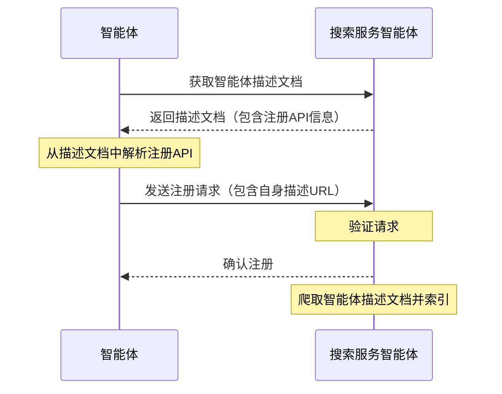

<!-- translation-review: full; source=chinese/08-ANP-智能体发现协议规范.md; basis=entire original read and manually compared paragraph by paragraph -->
> 日本語参考訳（機械翻訳を基に原文全文を照合済み）。規範となるのは原文です。コード例・識別子・規範キーワードは原文を保持しています。
> 原文: [chinese/08-ANP-智能体发现协议规范.md](../../chinese/08-ANP-智能体发现协议规范.md) / 基準コミット: `0837cfdfaf4ddcf834f0890ddaf34fc4c824e066`

# ANP エージェント発見プロトコル仕様

- 文書番号：ANP-08
- 題名：ANP エージェント発見プロトコル仕様
- 状態：公開済み
- バージョン：1.2
- 原文の言語：中国語
- 適用範囲：本仕様は、ANP におけるエージェントとエージェント記述文書の能動的発見・受動的発見に適用します。

## 概要

本仕様は、エージェントを発見するための標準化されたプロトコルである Agent Discovery Service Protocol（ADSP）を定義します。JSON-LD 形式を基盤とし、能動的発見と受動的発見の2つの仕組みにより、ネットワーク上のエージェントを、他のエージェントや検索エンジンが効率よく発見し、アクセスできるようにします。

プロトコルの中核は次のとおりです。

1. 基本データ形式に JSON-LD を使い、リンクトデータとセマンティック Web の機能に対応します。
2. 能動的発見の仕組みを定義し、.well-known URI のパスをエージェント発見の入り口として使います。
3. 受動的発見の仕組みにより、エージェントが自身の記述を検索サービスに提出できるようにします。
4. 大量のエージェント情報を管理しやすいよう、エージェント記述のページ分割とリンクに対応します。

本仕様は、ネットワーク上でエージェントを発見しやすくし、エージェントネットワークの生態系を構築する基盤を提供します。

## はじめに

エージェントの増加に伴い、それらを効率よく発見し、アクセスすることが重要な課題になります。Agent Discovery Service Protocol（ADSP）は、標準化された方法で他のエージェントや検索エンジンから発見できるようにし、この課題を解決します。

本仕様は、能動的発見と受動的発見を定義します。能動的発見では、検索エンジンや他のエージェントが、既知のドメイン名から、そのドメインの公開エージェントをすべて発見できます。受動的発見では、エージェントが自身の記述を検索サービスに登録できます。この2つは相互に補完し、発見可能性を高めます。

## 全体像

エージェント発見文書には、エージェント記述プロトコルと同じく、[JSON-LD](https://www.w3.org/TR/json-ld11/)（JavaScript Object Notation for Linked Data）を使います。これにより、使いやすさを保ちながら、豊かな意味表現とリンク関係を実現します。

エージェント記述文書は、エージェントの詳細情報を表します。[ANP エージェント記述プロトコル仕様](07-ANP-智能体描述协议规范.md)を参照してください。一方、エージェント発見文書は集合ページとして、そのドメインの公開エージェント記述文書の URL をすべて含み、検索エンジンや他のエージェントによる索引作成とアクセスを容易にします。

## プロトコルの詳細

### 能動的発見

能動的発見では、検索エンジンやエージェントは、ドメイン名だけが分かれば、そのドメインの公開エージェント記述文書をすべて発見できます。その入り口には、Web 標準の `.well-known` URI パスを使います。

#### .well-known URI

[RFC 8615](https://tools.ietf.org/html/rfc8615) によると、`.well-known` URI は、サービスやリソースを発見する標準的な方法です。エージェント発見用として、次のパスを定義します。

```
https://{domain}/.well-known/agent-descriptions
```

このパスは、そのドメインの公開エージェント記述文書の URL をすべて含む JSON-LD 文書を返すべきです。

#### 発見文書の形式

能動的発見文書は JSON-LD 形式で、`CollectionPage` 型を使い、次の主要プロパティを含みます。

- `@context`：この文書で使う JSON-LD コンテキスト。
- `@type`：文書型。値は "CollectionPage"。
- `url`：現在のページの URL。
- `items`：エージェント記述項目の配列。
- `next`：任意。ページ分割時に使う、次のページの URL。

各エージェント記述項目には、次の内容を含めます。

- `@type`：型。値は "ad:AgentDescription"。
- `name`：エージェント名。
- `@id`：エージェント記述文書の URL。リソースの一意な識別子です。

例：

```json
{
  "@context": {
    "@vocab": "https://schema.org/",
    "did": "https://w3id.org/did#",
    "ad": "https://agent-network-protocol.com/ad#"
  },
  "@type": "CollectionPage",
  "url": "https://agent-network-protocol.com/.well-known/agent-descriptions",
  "items": [
    {
      "@type": "ad:AgentDescription",
      "name": "Smart Assistant",
      "@id": "https://agent-network-protocol.com/agents/smartassistant/ad.json"
    },
    {
      "@type": "ad:AgentDescription",
      "name": "Customer Support Agent",
      "@id": "https://agent-network-protocol.com/agents/customersupport/ad.json"
    }
  ],
  "next": "https://agent-network-protocol.com/.well-known/agent-descriptions?page=2"
}
```

#### ページ分割

ドメイン内に大量のエージェントがある場合は、ページ分割を使うべきです。`next` プロパティで次ページの URL を示します。クライアントは、`next` プロパティがなくなるまで、すべてのページを再帰的に取得するべきです。

### 受動的発見

受動的発見では、エージェントが自身のエージェント記述 URL を、通常は検索サービスを担う別のエージェントに能動的に提出し、情報のクロールと索引作成を可能にします。

#### 登録 API

受動的発見では、通常、検索サービスのエージェントが提供する登録 API を使います。この API は検索サービス自身が定義し、そのエージェント記述文書に明示するべきです。エージェントは API を呼び出して、自身の記述 URL を検索サービスへ登録できます。

#### 登録の流れ

1. 検索サービスのエージェント記述文書を取得します。
2. 記述文書から、登録 API のエンドポイントと必要なパラメーターを見つけます。
3. 自身のエージェント記述 URL と、その他の必要な情報を含む登録要求を作ります。
4. 検索サービスへ登録要求を送ります。
5. 検索サービスは要求を検証し、そのエージェントの索引を作ります。



### セキュリティ上の考慮事項

エージェント発見の安全性のため、次の対策を推奨します。

1. **内容の検証**：検索サービスは、エージェント記述文書の有効性と完全性を検証するべきです。
2. **DID 認証**：[ANP-02](02-ANP-基于DID的身份认证协议.md) による共通認証を行い、`did:wba`、ネイティブな `did:web` など、実際に対応するメソッドの規則でアイデンティティ資料を検証します。
3. **レート制限**：適切なレート制限により、悪意のある要求や DoS 攻撃を防ぎます。
4. **アクセス制御**：公開エージェントと非公開エージェントを区別し、発見文書には公開エージェントだけを含めます。

## 他のプロトコルとの関係

エージェント発見プロトコルは、次のプロトコルと密接に関係します。

1. **エージェント記述プロトコル**：発見プロトコルは、記述文書の索引とアクセス方法を提供します。
2. **ANP-02 と DID メソッド仕様**：ANP-02 は共通のリクエスト認証を定義し、ANP-03 などのメソッド仕様はアイデンティティ資料の検証規則を提供します。
3. **メタプロトコル**：発見結果を使って、エージェント間の通信プロトコルを交渉できます。

## 著作権表示

Copyright (c) 2024 ANP Community  
本ファイルは [Apache License 2.0](../../LICENSE) の下で公開されています。自由に使用・変更できますが、この著作権表示を保持する必要があります。
