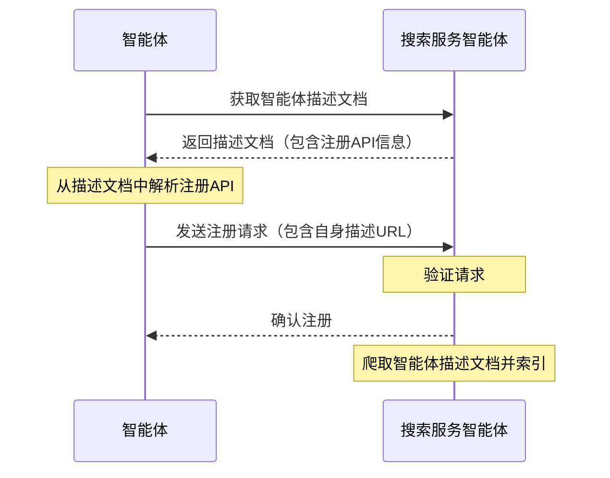

<!-- translation-review: partial; scope=protocol-identifier paragraphs at source lines 140; remainder=machine-unreviewed -->
> 日本語参考訳（機械翻訳・未校閲）。規範となるのは原文です。コード例・識別子・規範キーワードは原文を保持しています。
> 原文: [chinese/08-ANP-智能体发现协议规范.md](../../chinese/08-ANP-智能体发现协议规范.md) / 基準コミット: `0837cfdfaf4ddcf834f0890ddaf34fc4c824e066`

# ANP-エージェント検出プロトコル仕様

- 文書番号: ANP-08
- タイトル: ANP-Agent Discovery Protocol 仕様
- ステータス: 公開済み
- バージョン: 1.2
- 原文言語: 中文 / このページは日本語参考訳
- 適用範囲: この仕様は、ANP 内のエージェントおよびエージェント説明文書のアクティブおよびパッシブ検出に適用されます。

## 概要

この仕様は、エージェントを検出するための標準化されたプロトコルである Agent Discovery Service Protocol (ADSP) を定義します。このプロトコルは JSON-LD 形式に基づいており、アクティブ検出とパッシブ検出という 2 つの検出メカニズムを提供し、ネットワーク内の他のエージェントまたは検索エンジンがエージェントを効果的に検出してアクセスできるようにすることを目的としています。

契約の主な内容は次のとおりです。
1. 基本データ形式としてJSON-LDを使用し、リンクされたデータとセマンティックWeb機能をサポートします
2.  は、エージェント検出エントリ ポイントとして .well-known URI パスを使用して、アクティブな検出メカニズムを定義します
3. エージェントが独自の説明を検索サービスに送信できるようにする受動的検出メカニズムを提供します
4.  エージェント説明のページングとリンクをサポートし、大量のエージェント情報の管理を容易にします

この仕様は、ネットワーク内のエージェントの発見可能性を向上させ、エージェント ネットワーク エコシステムを構築するための基本的なサポートを提供することを目的としています。

## はじめに

エージェントの数が増加し続けるにつれて、これらのエージェントを効果的に発見してアクセスする方法が重要な問題となっています。 Agent Discovery Service Protocol (ADSP) は、この問題を解決し、標準化された方法で他のエージェントまたは検索エンジンによってエージェントを検出できるようにすることを目的としています。

この仕様では、アクティブ検出とパッシブ検出という 2 つのエージェント検出メカニズムを定義します。アクティブ ディスカバリーを使用すると、検索エンジンまたは他のエージェントが、既知のドメイン名を通じてドメイン名の下にあるすべてのパブリック エージェントを検出できるようになります。パッシブディスカバリにより、エージェントは自身の説明を検索サービスにアクティブに登録できます。これら 2 つのメカニズムは相互に補完し、共同してエージェントの発見可能性を向上させます。

## 概要

利用する[JSON-LD(ジョンズ)](https://www.w3.org/TR/json-ld11/)(リンクしたデータのためのJavaScript オブジェクト表記)インテリジェントなボディは、スマートボディ説明プロトコルと一致して文書の形式を見つけます。JSON-LD を使用することで、使いやすく、豊富な意味合いやリンクを実現できます。

スマート・ディスクの記述文書は、スマート・ボディ、参照文書の詳細な情報式です [ANP - スマートボディ説明プロトコル](07-ANP-智能体描述协议规范.md). スマートスは、ドキュメントがドメイン名の下にすべてのオープンインテリジェント文書のURLを含むセットページであることがわかります。これにより、検索エンジンや他の知能機関へのインデックス作成とアクセスが可能になります。

## 契約の詳細はこちら

### 確かにそうではありません。

アクティブディスカバリーは、すべてのオープンインテリジェントな説明文書を検索エンジンやインテリジェンスで表示する唯一のドメイン名が知られている場合にのみ発見されることを意味します。 Web標準`.well-known` URIパスは、知能発見のエントリーポイントです。

#### .well-known URI(よく知られた)

基本情報[RFC 8615の特長](https://tools.ietf.org/html/rfc8615)，`.well-known` URIは、サービスやリソースを見つけるための標準化された方法を提供します。インテリジェンスの検索では、次のパスを定義します。

```
https://{domain}/.well-known/agent-descriptions
```

このパスは、このドメイン名の下のすべてのオープンスマート説明文書のURLを含むJSON-LDドキュメントを返す必要があります。

#### ドキュメントフォーマットが見つかった

ドキュメントがJSON-LD形式にあること、使用しているものを発見する`CollectionPage`下記のコア属性を含むタイプ:

- `@context`: ドキュメントの JSON-LD コンテキストを定義する
- `@type`: ドキュメントタイプ、値「CollectionPage」
- `url`: 現在のページのURL
- `items`: 説明項目のスマートの配列
- `next`:(オプション)次のページ、ページ集計シーンのURL

各スマート・デクリエーション・プロジェクトは以下で構成されています。
- `@type`: 型, 値 "ad:AgentDescription"
- `name`スマートネーム
- `@id`: ドキュメントのURLをスマートに記述する(リソース識別子のみ)

事例:

```json
{
  "@context": {
    "@vocab": "https://schema.org/",
    "did": "https://w3id.org/did#",
    "ad": "https://agent-network-protocol.com/ad#"
  },
  "@type": "CollectionPage",
  "url": "https://agent-network-protocol.com/.well-known/agent-descriptions",
  "items": [
    {
      "@type": "ad:AgentDescription",
      "name": "Smart Assistant",
      "@id": "https://agent-network-protocol.com/agents/smartassistant/ad.json"
    },
    {
      "@type": "ad:AgentDescription",
      "name": "Customer Support Agent",
      "@id": "https://agent-network-protocol.com/agents/customersupport/ad.json"
    }
  ],
  "next": "https://agent-network-protocol.com/.well-known/agent-descriptions?page=2"
}
```

#### ページのブレイク機構

ドメイン名の下の多くのインテリジェントな身体がある場合にページブレイクを使用する必要があります。`next`プロパティは、次のページでURLを指すように実現されます。 クライアントは、すべてのページを下降して、誰にもなるまで取得する必要があります`next`プロパティは、現在まで。

### パッシブ・ディスカバリー

パッシブ検出は、独自の知性説明のためのスマートボディのアクティブな紹介です。(通常検索サービス)、それをインデックス化し、自分の情報を登ることを可能にします。

#### 登録API

パッシブ検出は通常、検索サービスインテリジェンスを使用して API の登録が必要です。これらの API は、検索サービスインテリジェンスによって自動定義され、スマートボディ説明文書で指定する必要があります。Smarts は、これらの API を呼び出すことで、独自の説明を登録できます。

#### 参加登録

1. スマートなサービス情報を検索するための説明文書
2. 説明文書からAPIの登録のためのエンドポイントとパラメータ要件を検索する
3. 独自のスマートボディ説明URLなどの必要な情報を含む登録リクエストを構成
4. お申込みをリクエストする登録をリクエストする
5. サービスの検索は、リクエストを検証し、スマートボディをインデックス化します



### セキュリティの考慮事項

知能調査の安全性を確保するために、次の対策を提案します。

1. **コンテンツ認証**: 調査サービスは、スマート文書の妥当性と完全性を検証する必要があります
2. **DID認証**: 利用方法 [アクア・アミューズメント・アミューズメント・アミューズメント・アミューズメント・アミューズメント・アミューズメント・アミューズメント・アミューズメント・アミューズメント・アミューズメント・アミューズメント・アミューズメント・アミューズメント・アミューズメント・アミューズメント・アミューズメント・アミューズメント・アミューズメント・アミューズメント・アミューズメント・アミューズメント・アミューズメント・アレイ・アワーズメント・アミューズメント・アミューズメント・アミューズメント・アミューズメント・アミューズメント・アベイ](02-ANP-基于DID的身份认证协议.md) 総合識別とバイ `did:wba`ネイティブ `did:web` 身元認証のための物理的に支持された方法
3. **過渡制限機構**: 悪意のある要求やDoS攻撃を防ぐための適切な動作制限の実装
4. **パーミッション制御**: 人工知能からオープンした、オープンインテリジェンスを含む文書のみを探し出す

## その他の合意関係

Smarts は、以下のプロトコルを密接に関連したと見なしました。

1. **スマート 説明プロトコル**: ディスカバリープロトコルは、説明文書のインデックス作成とアクセスメカニズムを提供します
2. **ANP-02 と DID メソッド仕様**：ANP-02 は共通のリクエスト認証を定義し、ANP-03 などのメソッド仕様はアイデンティティ資料の検証規則を提供します。
3. **メタプロトコル**: 契約は、スマートボディコミュニケーションの発見に基づいて交渉することができます

## 公益社団法人 一般社団法人 日本版著作権協会
社会貢献活動の推進に関する基本方針 _ ANPコミュニティ
この文書は以下に基づいています [Apache ライセンス 2.0](../../LICENSE) 投稿されたものは自由に使用および変更できますが、この著作権に関する声明は保持する必要があります。
