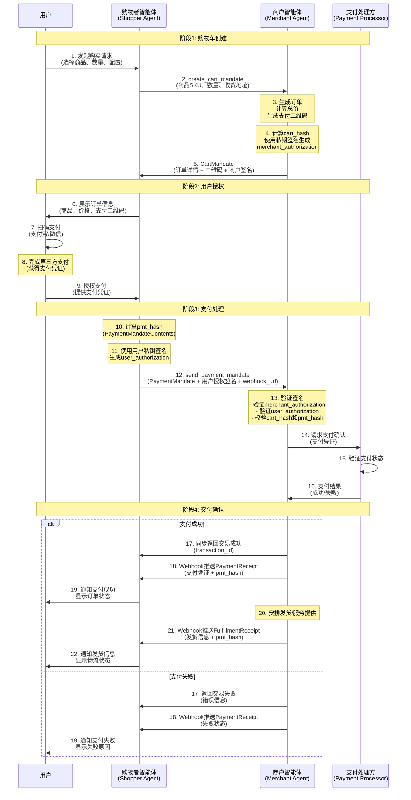

> 日本語参考訳（機械翻訳・未校閲）。規範となるのは原文です。コード例・識別子・規範キーワードは原文を保持しています。
> 原文: [chinese/application/10-ANP-智能体支付协议规范.md](../../../chinese/application/10-ANP-智能体支付协议规范.md) / 基準コミット: `0837cfdfaf4ddcf834f0890ddaf34fc4c824e066`

# AMP - スマートボディの支払い契約に関するドラフト規制

> 状態ノート:この論文は、AP2の支払いマッチング式をANPで記述しています。これはまだ草案であり、正式に発行された安定化支払基準ではありません。次のバージョンでは、AMPコアセットの規範に依存するこの文書の改訂版を示します。英語の原稿には、修正の異なる歴史があり、また規範的なコンテンツと同期されていない。

> 版画の修正: 以前に英語タイトルと初めに示したドラフトが、メタデータは誤って書かれている `Released`; は、現在、原案として均一です。この時間は、決済プロセスの変更やバウチャーやドキュメントバージョンの変更なく、競合ラベルを正し、コア/メッセージ1.2文書とは別々にします。

- 文書番号: ANP-10
- タイトル: ANP - スマートボディ決済プロトコル(ATP)
- ステータス: ドラフト/未公開
- バージョン: 0.1
- 原文言語: 中文 / このページは日本語参考訳
- アプリケーションの範囲: この命令は、AMP アプリケーション内のインテリジェンス ボディ間の支払いと取引の相互作用に適用されます。

## インフォメーション

このドラフトは、インテリジェントな身体間の支払いと取引相互作用のためのANPアプリケーションレイヤーでエージェント決済プロトコル(AP2)の適切な作業スキームについて説明します。提案された決済プロセスとバウチャーフォーマットがここに記録されます。文書の存在は、安定した相互運用性に達したことを意味していない、規範の遵守を達成しているか、または生成する準備が整っています。

**AP2 オリジナル合意書**グーグルが2025年9月に発行したオープン契約は、AIエージェントがユーザーの代わりに支払いを防止できるようにする目的で行われます。 [https://ap2-protocol.org/](https://ap2-protocol.org/)

**この規範のポジショニング**: このドキュメントは、AMPフレームワークのAP2プロトコルの修正版と拡張バージョンで、集中化されたスマートボディWebシーンに最適化し、適応します。

合意のコア要素には、以下が含まれます。
1. 決済シーンにおける4つのコアの役割を定義しました:買い物客の「知性、ビジネスインテリジェンス、バウチャープロバイダー、ペイプロセッサー
2. 鍵の証明書の種類は、カートマンデテ、支払いマンデテ、レシートの配送
3. 取引の完全性とセキュリティを確保するために、認定署名のためのJWT / JWS規格の使用
4. 2D(貴重品の支払い、マイクロクレジット決済)を含む複数の支払い方法のサポート
5. ANP による ID 識別機構の深さ統合

この手順は、スマートボディネットワークの標準化された決済インタラクションプログラムを提供し、商品取引やサービス調達などのさまざまな取引シナリオをサポートするものです。

## 1. 総合案内

### 1.1 背景

スマートネットワークが発展するにつれて、インテリジェントはさまざまな商用取引と支払い操作をユーザーに代わって実行する必要があります。 従来の決済システムは、主にインテリジェント間のペイグラウンドのための主要なサポートなしに、人間の相互作用のために設計されています。

### 1.2 設計原則

- **セキュリティー**: 取引内容の完全性および非信頼性を確保するために、パスワードベースの署名(JWS/JWT)の使用
- **個人情報保護**: 選択的な開示をサポートし、不必要な開示を最小限に
- **標準化**_: 既存の標準(JWT、支払要求API等)に基づく
- **エクステンション**: 複数の決済方法や契約の今後の拡大のサポート
- **ユーザーアンケート**: 決済操作は、資産の制御を確実にするために明確なユーザー認証が必要です

### 1.3 Google AP2と主要な適応との関係

この規則は、Google AP2契約(公式サイト)に基づいています。 [https://ap2-protocol.org/](https://ap2-protocol.org/)),并针对ANP去中心化智能体网络场景进行了重要改造:

#### 1.3.2 AP2の現在の問題

AP2協定の支持において、以下の事項を特定しました。

- AP2は初期段階にあり、タイムスタンプ検証機構などのプロトコル設計はまだ完了していません。
- 実行するコードは完全ではありません。コードとプロトコルの間に矛盾があります。
- 認証証明書はAP2の心臓部にありますが、署名鍵に対応する公開鍵はAP2に応答しなかった問題です。
- 元のAP2契約は決済プロセスにのみ対処し、取引のフルプロセスをカバーしなかった(例えば、支払いの確認、パフォーマンスの確認)

#### 1.3.3 ANP/AP2の主要適応

次のキーの変更はAP2 's 現在の問題になされました:

**1. . ANP の 's インタラクティブなプロセスで AP2 をサポート**

複数のメッセージは、AP2バウチャーの配布のために設計されました。これは3段階のトランザクションプロセスを完了します。購入注文書の作成は証明書の支払いを承認しました。

**2. . 支持中国'sの支払インフラ**

バルラーやwi-fiなどの中国の主要な支払い方法をサポート。優先順位は、プラットフォーム間で支払う最も便利な方法である2D支払いをサポートすることです。

**3. . DIDに基づく公開鍵配布**

A2Aは、インテリジェントな身体のアイデンティティ相互運用性の問題を解決しないし、AP2 の公開鍵を簡単に配布できます。また、AMP は MCP の A2A が MCP に基づいて AP2 をサポートしているよりも低コストで AP2 をサポートする理由です。

**4. . AP2の完成を思い浮かべるつもりはない。**

- タイムスタンプチェック機構
- 支払い受取人(支払証明書):支払いのステータスの確認、支払いプロバイダーの取引情報を含む
- 充填受入受付(性能証明書):物流情報を含む注文、配送状況またはサービス提供完了の確認

これらの文書は、前の支払いのハジ値が含まれています。_可能な紛争に対する補助的なサポートを提供するハッシュ、完全レトロアクティブチェーン。


#### 1.3.4 予約のコア特性

- トランザクションが偽造的ではないことを確認するためにパスワードを使用する
- ??? ユーザー固有の許可をサポート
- ・ビジネスコミュニティによるショッピングカートの内容(機械オートレーション)の署名
- 監査可能な文書チェーン
- • 個人情報保護の原則と最小限の開示

#### 1.3.5 将来の方向

- [ ] M2に「人」が存在しないシーンをサポートするIntentMandateを導入。
- [ ] より細かい粒径のプライバシーを要求するSD-JWT(SelicityディスクロージャーJWT)をサポート
- [ ] W3C VC規格に準拠し、認証の完全相互運用性を向上
- [ ] 延長支払方法:中央銀行デジタル通貨(CBDC)等。

### 1.4 合意の配置

AP2は、ANPのアプリケーションレイヤープロトコルです。
- **アイデンティティレベル**: smartbodyの識別は、wba
- **スマート 説明**: スマートプロファイル文書でAP2サポートを宣言

## 2. コアコンセプト

### 2.1 ロールの定義

AP2 は 4 つのコア ロールを定義します。

#### 2.1.1 ショッピングスマート(ShopperAgent、SA)
- 買い手/消費者を代わって
- ユーザとのやり取り、注文情報の表示、支払い承認の取得を責任をもって対応
- 購入依頼書・決済代行の送付

#### 2.1.2 ビジネスインテリジェンス(メカニカルエージェント、MA)
- 売り手/サービスプロバイダの代りに
- ショッピングカートの情報を生成し、注文を作成し、配送レシートを発行する責任
- 決済承認および取引処理の受領

#### 2.1.3 校正者(CredentialsProvider、CP)
- ユーザ識別を提供して下さい
- ユーザ識別と認定署名の生成に責任を負います
- 決済操作が明示的にユーザーに許可されていることを確認してください

#### 2.1.4 支払プロセッサ(ペイメント・プロセッサ、PP)
- 実際の支払い処理
- 配送チャネル(宝物、マイクロクレジット決済、銀行カード等)の責任
- 決済結果の返送

**注意。**: 最小限の実現(M1)では、買い物客の「sスマート」はCPとPPの機能を統合することができます。

### 2.2 コアバウチャー

#### 2.2.1 カートマンデテ(車両認証)
- 業務インテリジェンスで生成
- 注文、商品に関する情報、合計金額、支払いの商品の詳細を含める
- 注文情報の完全な整合性を確保するために、ビジネスインテリジェンスによって署名
- 監督:MA??SA

#### 2.2.2 支払管理(支払い承認)
- ショッピングスマートで生成
- 特定の注文のための支払いのユーザ認証を含める
- ユーザーのプライベートキーで署名して、認証の認証性を確保
- ハッシュ(カート)、フロントエンドカートあり_ハッシュ)は、橋のチェーンを形成します
- 方向: SA ? MA

#### 2.2.3 支払受領(支払い証明書)
- 業務インテリジェンスで生成
- 支払い状況の確認(成功/失敗)
- 決済プロバイダを含む取引情報
- 橋(pmt) と前払いマンデート_ハッシュ
- 方向: MA?? SA(Webhuookによる)

#### 2.2.4 充填レシート(性能証明書)
- 業務インテリジェンスで生成
- 注文完了の確認、配送状況またはサービス提供
- 物流情報(電話・納期など)を同梱
- 橋(pmt) と前払いマンデート_ハッシュ
- 取引記録および紛争解決のために使用される
- 方向: MA?? SA(Webhuookによる)

### 2.3 トランザクションプロセス

ANP/AP2 合意は、ショッピングカートの作成の 4 つの主要な段階を含む完全なスマート ボディ決済トランザクション プロセスを定義します。, ユーザー 権限, 支払い処理と配信の確認.

#### 2.3.1 取引のフルフローチャート



#### 2.3.2 プロセスの説明

**ステージ1:ショッピングカーの制作** (ステップ1-5)
- ショッピング担当者の「知性」で商品を選定し注文する
- ショッピングスマートは、ビジネススマートスターにショッピング車のためのリクエストを送信
- ビジネスインテリジェンスは、CartMandeteを生成し、2Dの注文の詳細と支払いコードが含まれています。
- 営業は、自分のプライベートキー(商人)を使用して、買い物カートのコンテンツに署名します_認証)

**フェーズ2: ユーザー認証** (ステップ6-9)
- ショッピングスマートでは、ユーザーの注文情報と支払い2Dコードが表示されます
- ユーザーは、第三者の決済プラットフォーム(宝物/証書の支払い)による決済を完了します。
- ユーザーが支払いバウチャーを受け取り、取引をショッピングの人へ承認します。

**フェーズ3:決済処理** (ステップ10-16)
- ショッピングスマートは、カートを含むPaymentMandateを生成します。_ハッシュはハッシュチェーンを形成します。
- サインインPaymentMandateContents ユーザの秘密鍵で pmt を生成する_ハッシュ
- 送信する日付を提供して下さい_ウェビブ・ホオック_フォローアップバウチャーのURL
- ビジネススマートボディは、すべての署名とハッシュ値を確認します
- 決済状況を、決済業者が確認する

**フェーズ4:配達確認** (ステップ17-22)
- 支払いが成功した後、ビジネスは同期を返します_id の
- 業務は、Webhookのステップバイステップで決済を受け取ります。
- 物品やサービスの配送手配
- 商人がWebhukを通じてFulfillmentReceiptを送った。
- 利用者は、取引および物流情報の完全な取得

#### 2.3.3 鍵のセキュリティメカニズム

| セキュリティメカニズム | 実装のモダリティ | 役割・役割 |
|---------|---------|------|
| **データ完全性** | カートを見る_ハッシュ = SHA-256(JCS(内容))) | ショッピングカーが改ざんされていないことを確認してください。 |
| **業務認証** | 商売品_(署名): RS256/ES256K | 注文が正当な事業によって生成される証拠 |
| **ユーザー認証** | ユーザ名_認可(午後tを含む)_ハッシュ | ユーザーがトランザクションをクリア権限で付与した証拠 |
| **ハッシュチェーントレース。** | カートマンデート→支払いマンデート→受付 | 遡及的に検証できる取引のための文書の完全なチェーンを形成する |
| **ここから出会ってみよう。** | jti (JWT ID) 独自の識別子 | 許可文書の再利用を防止 |
| **制限時間** | フィアット/エクスプフィールド制御期間 | クーポンを制限するタイムウィンドウ(推奨15分) |
| **アイデンティティの結合** | cnfの分野はホールダーDIDを結合しました | ドキュメントが特定のインテリジェンスボディによってのみ使用されることを確認してください |

## 3. スマートボディはプロトコルの統合について説明しています

### 3.1 AD文書におけるAP2支援宣言

AP2プロトコルをサポートするスマートボディは、スマートボディの説明文書に記述する必要があります。

```json
{
  "protocolType": "ANP",
  "protocolVersion": "1.0.0",
  "type": "AgentDescription",
  "name": "Grand Hotel Assistant",
  "did": "did:wba:grand-hotel.com:service:hotel-assistant",
  "interfaces": [
    {
      "type": "StructuredInterface",
      "protocol": "AP2/ANP",
      "version": "0.0.1",
      "url": "https://grand-hotel.com/api/ap2.json",
      "description": "基于ANP协议的AP2协议实现,用于智能体之间的支付和交易"
    }
  ]
}
```

### 3.2 AAP2インターフェイスの説明

`ap2.json`ファイルが、スマートボディでサポートされているロールとエンドポイントについて説明します。

```json
{
  "ap2/anp": "0.0.1",
  "roles": {
    "merchant": {
      "description": "商户智能体 - 生成购物车、创建二维码订单、推送支付凭证和履约凭证",
      "endpoints": {
        "create_cart_mandate": "/ap2/merchant/create_cart_mandate",
        "send_payment_mandate": "/ap2/merchant/send_payment_mandate"
      }
    },
    "shopper": {
      "description": "购物者智能体(Shopper Agent) - 处理用户交互、接收凭证推送",
      "endpoints": {
        "receive_payment_receipt": "/ap2/shopper/receive_payment_receipt",
        "receive_fulfillment_receipt": "/ap2/shopper/receive_fulfillment_receipt"
      }
    }
  }
}
```


```json
AP2Role = "merchant" | "shopper" | "credentials-provider" | "payment-processor"
```

### 3.3 内リンクの説明

または、AD文書の直接詳細にインターフェイス情報を説明することもできます。


```json
    {
      "type": "StructuredInterface",
      "type": "StructuredInterface",
      "protocol": "AP2/ANP",
      "version": "0.0.1",
      "description": "An implementation of the AP2 protocol based on the ANP protocol, used for payment and transactions between agents."
    },
    "content":{
        "roles": [
            "shopper": {
            "description": "shopper Agent - handles user interaction, PIN validation, QR code display",
            "endpoints": {
                "receive_delivery_receipt": "/ap2/shopper/receive_delivery_receipt"
            }
            },
            "merchant": {
            "description": "Merchant Agent - generates cart, creates QR orders, issues delivery receipts",
            "endpoints": {
                "create_cart_mandate": "/ap2/merchant/create_cart_mandate",
                "send_payment_mandate": "/ap2/merchant/send_payment_mandate",
            }
            }
        ]
    }
```

## 4. ドキュメント定義


### 4.1 CartMandete(車両認証)

**オリエンテーション**:MA→TA

**データ構造**：

```json
{
  "contents": {
    "id": "cart_shoes_123",
    "user_signature_required": false,
    "timestamp": "2025-01-17T09:00:00Z",
    "payment_request": {
      "method_data": [
        {
          "supported_methods": "QR_CODE",
          "data": {
            "channel": "ALIPAY",
            "qr_url": "https://pay.example.com/qrcode/abc123",
            "out_trade_no": "order_20250117_123456",
            "expires_at": "2025-01-17T09:15:00Z"
          }
        },
        {
          "supported_methods": "QR_CODE",
          "data": {
            "channel": "WECHAT",
            "qr_url": "https://pay.example.com/qrcode/abc123",
            "out_trade_no": "order_20250117_123456",
            "expires_at": "2025-01-17T09:15:00Z"
          }
        }
      ],
      "details": {
        "id": "order_shoes_123",
        "displayItems": [
          {
            "id": "sku-id-123",
            "label": "Nike Air Max 90",
            "quantity": 1,
            "options": {
              "color": "red",
              "size": "42"
            },
            "amount": {
              "currency": "CNY",
              "value": 120.0
            },
            "pending": null,
            "remark": "请尽快发货"
          }
        ],
        "shipping_address": {
          "recipient_name": "张三",
          "phone": "13800138000",
          "region": "北京市",
          "city": "北京市",
          "address_line": "朝阳区某某街道123号",
          "postal_code": "100000"
        },
        "shipping_options": null,
        "modifiers": null,
        "total": {
          "label": "Total",
          "amount": {
            "currency": "CNY",
            "value": 120.0
          },
          "pending": null
        }
      },
      "options": {
        "requestPayerName": false,
        "requestPayerEmail": false,
        "requestPayerPhone": false,
        "requestShipping": true,
        "shippingType": null
      }
    }
  },
  "merchant_authorization": "eyJhbGciOiJSUzI1NiIsInR5cCI6IkpXVCJ9..."
}
```

**フィールドの説明**：

- `contents`: カートコンテンツオブジェクト、ショッピングカートの完全な情報
  - `id`: ショッピングカートのシングル識別子
  - `user_signature_required`: ユーザ署名が必要かどうか(通常は false)
  - `timestamp`ISO-8601 のフォーマットのタイムスタンプ
  - `payment_request`: 方法を含む支払要求の細部、_データ、詳細、オプション
- `merchant_authorization`: JWS 形式の認証業務の署名(詳細は、下記セクションを参照してください)

**重要なポイント**：

- `merchant_authorization` 全部です。 `contents` JWS(RS256、ES256K)の署名
- `cart_hash = b64url(sha256(JCS(contents)))`,カート_ハッシュはJWTペイロードに含まれています

### 4.2 事業許可(メカニト協会)

#### 4.2.1 全般

`merchant_authorization` フィールドは、ビジネスツーショップのカーコンテンツ((()`CartContents`) .**短期デジタル署名許可**クルマは、その内容の真正性と完全性を確保するために設計されています。

このフィールドは古いバージョンを置き換えます `merchant_signature`JOSE/JWTの規格に合致する基準を使用する **JSON Web Signature(JWS) のWeb署名** (c) コンテナ形式。

#### 4.2.2 データ型

- **仕様**: base64urlエンコーディング用のタイトなJWS文字列()`header.payload.signature`)
- **アルゴリズム**: `RS256` または `ES256K`
- **フィールド**: `CartMandate.merchant_authorization`

#### 4.2.3 ヘッダー形式

```json
{
  "alg": "RS256",
  "kid": "MA-key-001",
  "typ": "JWT"
}
```

または:

```json
{
  "alg": "ES256K",
  "kid": "MA-es256k-key-001",
  "typ": "JWT"
}
```

#### 4.2.4ペイロード形式

**基材の実現(必須項目)**:

```json
{
  "iss": "did:wba:a.com:MA",
  "sub": "did:wba:a.com:MA",
  "aud": "did:wba:a.com:SA",
  "iat": 1730000000,
  "exp": 1730000900,
  "jti": "uuid",
  "cart_hash": "<b64url>"
}
```

**任意延長分野**(現在の基礎は、将来の拡張のために予約されていません):

```json
{
  "cnf": {"kid": "did:wba:a.com:SA#keys-1"},
  "sd_hash": "<b64url>",
  "extensions": ["anp.ap2.qr.v1"]
}
```

**フィールドの説明**:
- `iss`発行者(ビジネスインテリジェンスDID)
- `sub`: 演題(同種)
- `aud`: オーディエンス(取引インテリジェンスまたは決済プロセッサ)
- `iat`: 発行時間(秒)
- `exp`: 有効期限(15分推奨、900秒)
- `jti`: グローバルな識別子のみ(攻撃を回復させる)
- `cart_hash`: カートにハッシュMandeate.contents (次のセクションを参照)
- `cnf`: (任意) ホルダーの結合情報
- `sd_hash`: (任意)SD-JWT/VCのハッシュ ポインター
- `extensions`: (オプション) プロトコル拡張

#### 4.2.5 カート_ハッシュ計算ルール

```text
cart_hash = Base64URL(SHA-256(JCS(CartMandate.contents)))
```

- 利用条件 [RFC 8785 JSON キヤノン化化学(JCS)](https://datatracker.ietf.org/doc/rfc8785/) えー。 `CartMandate.contents` 正規化
- 標準化されたUTF-8のバイト実行 `SHA-256` ハッシュ。
- 結果の符号化Base64URL ('='fillの爆発)

#### 4.2.6 署名生成プロセス(ビジネスMA)

1. 計算する `cart_hash`: 右。 `CartMandate.contents` JCS正規化後、SHA-256ハッシュ
2. JWTペイロード(必須項目)を構成します。 `iss/sub/aud/iat/exp/jti/cart_hash`)
3. 建設JWTヘッダ()`alg=RS256` または `alg=ES256K`, `kid=<商户公钥标识>`, `typ=JWT`)
4. ヘッダーとペイロードのサインをビジネス秘密鍵で、コンパクトなJWS()を生成`header.payload.signature`)
5. 生成されるJWSは、 `merchant_authorization` 投稿ナビゲーション `CartMandate` オブジェクト

#### 4.2.7 署名プロセス(買物エンドSA)

1. えー。 `CartMandate.contents` 再計算 `cart_hash'`
2. パーシング `merchant_authorization`:
   - リッピングヘッダークイック `kid`
   - 公開鍵をMAのDID文書や登録フォームから入手
   - JWS 署名(RS256、ES256K、マッチングヘッダ)を認証
3. 宣言を検証します。
   - `iss/aud/iat/exp/jti` 規範に沿って、すべてです。
   - 今回は、 `[iat, exp]` 社内外
   - `jti` 繰り返し使用されていない
4. データ結合を検証して下さい:
   - `payload.cart_hash == cart_hash'`、または拒否
5. 同一証明延長:
   - 何かある場合。 `sd_hash`SD-JWT/VC パスへの、
   - 何かある場合。 `cnf`、それの後でホールダーの検証に使用することができます

#### 4.2.9 チェックリスト

| アイテムを検証する | リクエスト |
|--------|------|
| 署名アルゴリズム | RS256 または ES256K (ヘッダ.alg と一直線に) |
| タイムウィンド | `iat ≤ now ≤ exp`有効15分 |
| 再制定の保護。 | `jti` オールラウンド |
| 発行者と聴衆 | `iss=MA`,`aud=SA`(またはMPP) |
| データ一貫性 | `payload.cart_hash == computed_cart_hash` |
| DID パーシング | パス。 `kid` ?? DID ドキュメントは公開鍵を解析 |
| 対応する延長 | 支持の決断 `cnf`、`sd_hash` フィールド |

### 4.3 支払管理(支払い承認)

**オリエンテーション**: SA → MA

**メッセージ構成**:

```json
{
  "payment_mandate_contents": {
    "payment_mandate_id": "pm_12345",
    "payment_details_id": "order_shoes_123",
    "payment_details_total": {
      "label": "Total",
      "amount": {
        "currency": "CNY",
        "value": 120.0
      },
      "pending": null,
      "refund_period": 30
    },
    "payment_response": {
      "request_id": "order_shoes_123",
      "method_name": "QR_CODE",
      "details": {
        "channel": "ALIPAY",
        "out_trade_no": "order_20250117_123456"
      },
      "shipping_address": null,
      "shipping_option": null,
      "payer_name": null,
      "payer_email": null,
      "payer_phone": null
    },
    "merchant_agent": "MerchantAgent",
    "timestamp": "2025-01-17T09:05:00Z",
    "cart_hash": "cart_hash"
  },
  "user_authorization": "eyJhbGciOiJFUzI1NksiLCJraWQiOiJkaWQ6ZXhhbXBsZ..."
}
```

**フィールドの説明**：

- `payment_mandate_contents`支払MandateContentsオブジェクト
  - `payment_mandate_id`: 分配許可の固有識別子
  - `payment_details_id`: カートに相当する商品代金_リクエスト.details.id
  - `payment_details_total`支払総額および返金期間
  - `payment_response`: 決済対応の詳細は(方法、チャンネルなど)
  - `merchant_agent`: 商用エージェントマーク
  - `timestamp`ISO-8601 のフォーマットのタイムスタンプ
  - `cart_hash`: **取扱車両:フロントラインカート**(橋チェーンキー)
- `user_authorization`: JWS 形式のユーザ認証署名(詳細は、次のセクションを参照してください)

### 4.4 ユーザー認証(ユーザー権限)

ユーザ名_認可は、支払いコンテンツのユーザー/ショップ承認署名で、機械で使用されます_認可のJWS形式と同じです。

**ヘッダー形式**：

```json
{
  "alg": "RS256",
  "kid": "Shopper-key-001",
  "typ": "JWT"
}
```

または:

```json
{
  "alg": "ES256K",
  "kid": "Shopper-es256k-key-001",
  "typ": "JWT"
}
```

**ペイロード形式**：

```json
{
  "iss": "did:wba:a.com:TA", // 签发者（购物者智能体 DID）
  "sub": "did:wba:a.com:TA", // 主体（可与 iss 相同）
  "aud": "did:wba:a.com:MA", // 受众（商户智能体）
  "iat": 1730000000, // 签发时间（秒）
  "exp": 1730000900, // 过期时间（建议 180天）
  "jti": "uuid", // 全局唯一标识符（防重放攻击）
  "pmt_hash": "<b64url>" // 对 PaymentMandateContents 的哈希
}
```

**日报社(22)_ハッシュ計算ルール**:
```text
pmt_hash = Base64URL(SHA-256(JCS(PaymentMandate.payment_mandate_contents)))
```

**ハッシュチェーンメンテナンス**:

PaymentMandateContentsは、カートのフロントラインを格納します。 `cart_hash` ハッシュチェーンを形成するフィールド:

```
CartMandate(cart_hash) → PaymentMandate(cart_hash, pmt_hash)
```

### 4.5 支払受領(支払いバウチャー)

**オリエンテーション**: MA ?? SA(Webhuookによる)

**データ構造**:

```json
{
  "contents": {
    "credential_type": "PaymentReceipt",
    "version": 1,
    "id": "receipt_uuid_123",
    "timestamp": "2025-01-17T09:10:00Z",
    "payment_mandate_id": "pm_12345",
    "provider": "ALIPAY",
    "status": "SUCCEEDED",
    "transaction_id": "alipay_txn_789",
    "out_trade_no": "order_20250117_123456",
    "paid_at": "2025-01-17T09:08:30Z",
    "amount": {
      "currency": "CNY",
      "value": 120.0
    },
    "pmt_hash": "<b64url>"
  },
  "merchant_authorization": "eyJhbGciOiJSUzI1NiIsInR5cCI6IkpXVCJ9..."
}
```

**フィールドの説明**:
- `credential_type`: 固定値「支払いレシート」
- `version`: 証明書のバージョン番号、現在 1
- `id`: 証明書の識別子のみ(UUID)
- `timestamp`: 証明書発行時間(ISO-8601)
- `payment_mandate_id`: 支払者ID
- `provider`: 有料プロバイダー(ALIPAY) | ウィケット
- `status`: 支払状況(SUCCEEED) | ファイエル | ペンディング | タイムアウト
- `transaction_id`: 決済代行会社IDの取引
- `out_trade_no`: 外部トランザクション番号
- `paid_at`: 支払完了時間(ISO-8601)
- `amount`支払額
- `pmt_hash`: 取扱店のフロントライン決済の橋値
- `merchant_authorization`: JWS 形式の公認ビジネス署名

**商売品_認可ペイロード**:

```json
{
  "iss": "did:wba:a.com:MA",
  "sub": "did:wba:a.com:MA",
  "aud": "did:wba:a.com:SA",
  "iat": 1730000000,
  "exp": 1730000900,
  "jti": "receipt_uuid_123",
  "credential_type": "PaymentReceipt",
  "cred_hash": "<b64url(sha256(JCS(contents)))>"
}
```

**ハッシュ拡張子。**:

```
CartMandate(cart_hash) → PaymentMandate(cart_hash, pmt_hash) → PaymentReceipt(pmt_hash, cred_hash)
```

### 4.6 充填レシート(性能証明書)

**オリエンテーション**: MA ?? SA(Webhuookによる)

**データ構造**:

```json
{
  "contents": {
    "credential_type": "FulfillmentReceipt",
    "version": 1,
    "id": "fulfillment_uuid_456",
    "timestamp": "2025-01-18T10:00:00Z",
    "order_id": "order_shoes_123",
    "items": [
      {
        "id": "sku-id-123",
        "quantity": 1
      }
    ],
    "fulfilled_at": "2025-01-18T09:45:00Z",
    "shipping": {
      "carrier": "顺丰速运",
      "tracking_number": "SF1234567890",
      "delivered_eta": "2025-01-20T18:00:00Z"
    },
    "pmt_hash": "<b64url>",
    "metadata": {
      "warehouse": "Beijing-001",
      "notes": "已发货,请注意查收"
    }
  },
  "merchant_authorization": "eyJhbGciOiJSUzI1NiIsInR5cCI6IkpXVCJ9..."
}
```

**フィールドの説明**:
- `credential_type`: 固定値「フルフィルメントレシート」
- `version`: 証明書のバージョン番号、現在 1
- `id`: 証明書の識別子のみ(UUID)
- `timestamp`: 証明書発行時間(ISO-8601)
- `order_id`: 注文ID
- `items`: 適合商品一覧
- `fulfilled_at`: 性能の完了時間(ISO-8601)
- `shipping`: 物流情報(オプション)
  - `carrier`: 物流会社
  - `tracking_number`: ケーブル配送ユニット
  - `delivered_eta`: 納期の予想
- `pmt_hash`: 取扱店のフロントライン決済の橋値
- `metadata`: 業務固有のコンプライアンスデータ(オプション)
- `merchant_authorization`: JWS 形式の公認ビジネス署名

**商売品_認可ペイロード**:

```json
{
  "iss": "did:wba:a.com:MA",
  "sub": "did:wba:a.com:MA",
  "aud": "did:wba:a.com:SA",
  "iat": 1730000000,
  "exp": 1730000900,
  "jti": "fulfillment_uuid_456",
  "credential_type": "FulfillmentReceipt",
  "cred_hash": "<b64url(sha256(JCS(contents)))>"
}
```

**完全なハッシュチェーン。**:

お支払い領収書およびフルフィルメントレシートは含まれています `pmt_hash` ブランチの橋鎖を形作る分野(同じ支払管理に):

```
CartMandate(cart_hash)
    ↓
PaymentMandate(cart_hash, pmt_hash)
    ↓
    ├─→ PaymentReceipt(pmt_hash, cred_hash)
    └─→ FulfillmentReceipt(pmt_hash, cred_hash)
```

## 5. メッセージ定義

### 5.1 作成_カートを見る_マンデート

**オリエンテーション**: ショッパー(SA) → 商店 (MA)

**API パス**: `POST /ap2/merchant/create_cart_mandate`

**リクエストメッセージの構成**:

```json
{
  "messageId": "cart-request-001",
  "from": "did:wba:a.com:shopper",
  "to": "did:wba:a.com:merchant",
  "data": {
    "cart_mandate_id": "cart-mandate-id-123",
    "items": [
      {
        "id": "sku-id-123",
        "sku": "Nike-Air-Max-90",
        "quantity": 1,
        "options": {"color": "red", "size": "42"},
        "remark": "请尽快发货"
      }
    ],
    "shipping_address": {
      "recipient_name": "张三",
      "phone": "13800138000",
      "region": "北京市",
      "city": "北京市",
      "address_line": "朝阳区某某街道123号",
      "postal_code": "100000"
    },
    "remark": "请尽快发货"
  }
}
```

**返信メッセージ構成**(返却カートマンデート):

```json
{
  "messageId": "cart-response-001",
  "from": "did:wba:a.com:merchant",
  "to": "did:wba:a.com:shopper",
  "data": {
    "contents": {
      "id": "cart-mandate-id-123",
      "user_signature_required": false,
      "payment_request": {
        "method_data": [
          {
            "supported_methods": "QR_CODE",
            "data": {
              "channel": "ALIPAY",
              "qr_url": "https://pay.example.com/qrcode/abc123",
              "out_trade_no": "order_20250117_123456",
              "expires_at": "2025-01-17T09:15:00Z"
            }
          }
        ],
        "details": {
          "id": "order_shoes_123",
          "displayItems": [
            {
              "id": "sku-id-123",
              "sku": "Nike-Air-Max-90",
              "label": "Nike Air Max 90",
              "quantity": 1,
              "options": {"color": "red", "size": "42"},
              "amount": {"currency": "CNY", "value": 120.0},
              "pending": null
            }
          ],
          "total": {
            "label": "Total",
            "amount": {"currency": "CNY", "value": 120.0},
            "pending": null
          }
        }
      }
    },
    "merchant_authorization": "eyJhbGciOiJSUzI1NiIsInR5cCI6IkpXVCJ9...",
    "timestamp": "2025-01-17T09:00:01Z"
  }
}
```

### 5.2 送信_お支払い_マンデート

**オリエンテーション**: ショッパー(SA) → 商店 (MA)

**API パス**: `POST /ap2/merchant/send_payment_mandate`

**リクエストメッセージの構成**:

```json
{
  "messageId": "payment-mandate-001",
  "from": "did:wba:a.com:shopper",
  "to": "did:wba:a.com:merchant",
  "mandate_webhook_url": "https://shopper.example.com/ap2/webhook",
  "data": {
    "payment_mandate_contents": {
      "payment_mandate_id": "pm_12345",
      "payment_details_id": "order_shoes_123",
      "payment_details_total": {
        "label": "Total",
        "amount": {"currency": "CNY", "value": 120.0},
        "pending": null,
        "refund_period": 30
      },
      "payment_response": {
        "request_id": "order_shoes_123",
        "method_name": "QR_CODE",
        "details": {
          "channel": "ALIPAY",
          "out_trade_no": "order_20250117_123456"
        },
        "shipping_address": null,
        "shipping_option": null,
        "payer_name": null,
        "payer_email": null,
        "payer_phone": null
      },
      "merchant_agent": "MerchantAgent",
      "timestamp": "2025-01-17T09:05:00Z",
      "cart_hash": "<b64url>"
    },
    "user_authorization": "eyJhbGciOiJFUzI1NksiLCJraWQiOiJkaWQ6ZXhhbXBsZ..."
  }
}
```

**返信メッセージ構成**:

```json
{
  "messageId": "payment-response-001",
  "from": "did:wba:a.com:merchant",
  "to": "did:wba:a.com:shopper",
  "data": {
    "status": "success",
    "payment_mandate_id": "pm_12345",
    "transaction_id": "txn_67890",
    "message": "支付处理成功"
  }
}
```

## 6. メッセージフローオーダー

AP2 トランザクションプロセスは、以下の手順で構成されます。

### 6.1 メッセージフローの同期

1. **SAリクエスト** ツイート `create_cart_mandate`
   - SA は商品情報および配分の住所とショッピング車の要求を、送ります
   - リクエスト例: セクション 5.1

2. **MA 応答** → SA: `CartMandate`
   - MAは署名されたショッピングカーの承認を、2Dコードの支払いを含む戻ります
   - 組織図 `merchant_authorization` 会員規約
   - 同期したHTTPでの返送

3. **送信するSA** ツイート `send_payment_mandate`
   - 決済完了後、SAが決済承認を送信します
   - 組織図 `user_authorization` 署名と署名 `cart_hash`(オーダーカート前)
   - **重要事項**: 含水量 `mandate_webhook_url` フォローアップ券の受け取り
   - リクエストセクション5.2の例

4. **MA 応答** SA: 支払処理結果
   - MA Sync リターン `transaction_id` ステータスの処理
   - 対応例:セクション5.2

### 6.2 Webhouk配信

5. **MAプッシュ** → SA: `PaymentReceipt` (Webhuk による)
   - MAは支払いを確認し、その後に方法によって送信された `mandate_webhook_url`
   - 決済プロバイダーに取引情報を含める `pmt_hash`(前方には)
   - 証明書の形式は、セクション4.5です。

6. **MAプッシュ** → SA: `FulfillmentReceipt` (WebHOK を経由して、オプション)
   - MA、注文完了後、性能の証明書をドロップします。 `mandate_webhook_url`
   - 物流情報を含む `pmt_hash`(前方には)
   - 証明書の形式はセクション4.6にあります。

### 6.3 フルハッシュチェーン

```
CartMandate(cart_hash)
    ↓ (同步)
PaymentMandate(cart_hash, pmt_hash)
    ↓ (异步Webhook)
    ├─→ PaymentReceipt(pmt_hash, cred_hash)
    └─→ FulfillmentReceipt(pmt_hash, cred_hash)
```

### 6.4 Webbookエンドポイントの要件

ショッピング スマートボディ(SA)は、次のWebhookエンドポイントを実行しなければなりません。
- `POST {mandate_webhook_url}` - 支払い受取人およびフルフィルメント受取人を取る。
- 納期は確認しなければなりません。 `merchant_authorization` 会員規約
- 終了は、受信の成功、または適切なエラーコードに対してHTTP 200を返す必要があります

## 7. セキュリティの考慮事項

### 7.1 署名認証

鍵文書は署名され、検証する必要があります。
- 業務用スマート署名済みカートマンデート、支払い受付、フルフィルメントプライベートキーで受信
- ユーザは、支払いを署名します。プライベートキーで管理
- 受取人は、DID文書の公開鍵で署名を認証しなければなりません
- Webhok は証明書を検証する必要があります。_認可の署名

### 7.2 時間スタンプと有効期限

- すべてのバウチャーにはタイムスタンプが含まれている必要があります。
- カートマンデートは2Dの有効期限(終了)を含まなければならない_で)
- JWTトークンは、合理的な有効期限(推奨15分)を設定する必要があります

### 7.3 攻撃保護の再発

- 利用条件`jti`(JWT ID) それぞれの認可が世界で唯一のものであることを確認
- 受信者は、使用したままにしておく必要があります`jti`リスト、攻撃の再発を防ぐ

### 7.4 HTTPS の伝達

- すべての API エンドポイントは HTTPS プロトコルを使用する必要があります。
- 通信中の機密情報の暗号化された送信を確保する

### 7.5 ユーザー認証

- お支払いは、利用者が明示的に許可されるものとします。
- ユーザーの秘密鍵は、安全に保存され、ユーザーデバイスを離れる必要はない
- ハードウェアセキュリティモジュールやキーストレージの安全なアンクレーブをサポート

### 7.6 Webhookは安全です。

- Webhookエンドポイントは HTTPS プロトコルを使用する必要があります。
- メッセージを配信することを確認する必要があります。_認可の署名
- 繰り返し転送によるトラブルを防ぐため、等しい治療が達成される
- 提案された再試行のメカニズム:転送が失敗(インデックスの退去)なら、ビジネスは再テストするべきです
- ショッピングインテリジェンスは、メッセージを押し、再発攻撃を防ぐ jti を検証する必要があります。
- Webhook 署名認証のための白リスト機構を提案

## 8. 延長メカニズム

### 8.1 支払商品延長

AP2 パッセージ対応`supported_methods`フィールドは新しい支払い方法を拡大します。
- `QR_CODE`: 支払する2D
- `CARD`: 銀行カード決済
- `CRYPTO`: 暗号化された通貨決済
- 注文支払い方法

### 8.2 プロトコル拡張フィールド

JWTペイロードサポート`extensions`フィールドはプロトコルの拡張子を宣言します。
```json
{
  "extensions": [
    "anp.ap2.qr.v1",
    "anp.human_presence.v1",
    "anp.ap2.subscription.v1"
  ]
}
```

## 9. 推奨事項の実装

### 9.1 最小実現(M1)

最小限の実現には、以下が含まれます。
- 2D決済対応(保存・マイクロクレジット)
- カートマンデトと支払いマンデットの証明書
- 決済受取券の実化(Webhukによる)
- 基本的シグネチャ生成と認証
- 身分証明書:WBAの同一証明
- Webhookエンドポイント達成(決済券の受取)

### 9.2 完全な実現

完全な実現には、次のものも含まれる必要があります。
- 複数の決済方法のサポート
- 充填受精受精(性能証明書の配送)
- 役割分岐(SA、MA、CP、PP)
- 返金と紛争管理メカニズム
- Webhook 再テストと Zenex.
- 完全なハッシュチェーン認証

### 9.3 ライブラリとツールの推奨事項

- JWT処理: PyJWT(Python)、jsonwebtoken(JavaScript)
- JSON正規化:jcs(多言語)
- DID 解析: ユニバーサル・リサーチ
- パスワード操作: 暗号化(Python)、Web Cripto API (JavaScript)

## 10. 事例紹介

### 10.1 電動ショッピング場

1. ショッピングスマート(SA)で商品を閲覧する
2. 利用者は商品を選び、注文を提出します
3. SA は、ビジネススマート (MA) に Create を送信_カートを見る_マンデートリクエスト
4. MAは、CalgetMandateを、2Dとメカネットの支払いを含む_認可の署名
5. ユーザの注文情報と2DコードをSAに表示
6. 利用者スキャンは、第三者の支払い(宝物/札入れの支払い)を完了します。
7. SA世代決済管理(カート含む)_ハッシュとwebhuk_url) 送信してMAに送る
8. MA Sync 転送に戻る_id の
9. MAはWebhook anisostepによってPaymentReceipt (pmtを含んで)を送信します_ハッシュ
10. MAは、配信を手配し、Webhukを通じてフルフィルメントレシートを押します。
11. 利用者は、決済および物流状況通知を完全受領

### 10.2 サービス予約シーン(ホテル予約)

1. ショッピングスマート(SA)でホテルを検索する
2. ユーザ選択ホテルと客室タイプ
3. 弊社では、ホテルのビジネススマート(MA)にご予約依頼をお送りしております。_カートを見る_マンデート
4. MAは、合計コストと2Dコードの支払いを含むCartMandateを予約するリターン
5. ユーザーは予約情報を確認し、支払いをスキャン
6. SA 送金決済管理(カート含む)_ハッシュとwebhuk_URl) へ MA
7. MA Sync 予約確認_id の
8. 決済をWebhookで確認するために、MAが送金した支払い受付をしました。
9. お客様がご利用になる際は、サービス券として「フルフィルメントレシート」をご購入いただくために、Webhukを利用することができます。

## 11. リファレンス

- [RFC 7519の特長] JSON Web トークン (JWT)
- [RFC 7515の特長] JSON Web Signature(JWS) のWeb署名
- [RFC 8785の特長] JSON キヤノン化スキーム(JCS)
- [W3C 決済リクエスト API](https://www.w3.org/TR/payment-request/)
- [ANPの技術の白いペーパー](../../01-agentnetworkprotocol-technical-white-paper.md)
- [AnP スマート 説明プロトコル](../../07-anp-agent-description-protocol-specification.md)
- [did:wba方法論規則](../../03-did-wba-method-design-specification.md)

## 公益社団法人 一般社団法人 日本版著作権協会

社会貢献活動の推進に関する基本方針 _ ANPコミュニティ
この文書の基礎 [Apache ライセンス 2.0](../../../LICENSE) 公開、あなたは自由にこの著作権宣言を使用および変更することができます。
