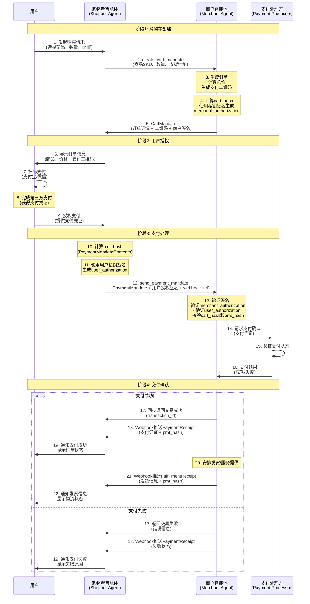

<!-- translation-review: full; scope: entire original source; paragraph-by-paragraph agent review; source code unchanged -->
> 日本語参考訳（原文全文をエージェントが照合）。草案の原文を保持しています。冒頭のクレデンシャル3種と後段の4種、MA→TAとMA→SA、例の180日と本文の15分、重複フィールドなどの原文不整合は、翻訳で修正していません。コード内の表示文・コメントの日本語はコード例補足を参照してください。
> 原文: [chinese/application/10-ANP-智能体支付协议规范.md](../../../chinese/application/10-ANP-智能体支付协议规范.md) / 基準コミット: `0837cfdfaf4ddcf834f0890ddaf34fc4c824e066`

# ANPエージェント決済プロトコル仕様（草案）

> 状態：本書はANPへのAP2決済アダプター案を記述する草案であり、正式リリース済みの安定した決済標準ではありません。版番号は本書の改訂を表し、ANPのコア仕様セットとは独立しています。英中草案は改訂履歴が異なり、規範内容の同期は未完了です。

> 編集上の訂正：英語版はタイトルと冒頭で草案と明示していたのに、メタデータを誤って`Released`としていました。草案へ統一したのは矛盾するラベルの訂正だけであり、決済フロー、クレデンシャル、文書の版は変更せず、コア／メッセージ1.2文書の統合とも別に扱います。

- 文書番号：ANP-10
- タイトル：ANPエージェント決済プロトコル仕様
- 状態：草案／未リリース
- バージョン：0.1
- 原文言語：中国語
- 適用範囲：ANPアプリケーション層での、エージェント間の決済と取引。

## 要旨

本草案はAgent Payment Protocol（AP2）のANPアプリケーション層への適応案を記述します。提案する決済フローとクレデンシャル形式の記録であり、文書が存在することは、安定した相互運用、実装の仕様適合、本番利用への準備完了を意味しません。

**元のAP2**：Googleが2025年9月に公開した、AIが安全にユーザーを代理して決済するためのオープンプロトコルです。公式サイト：[https://ap2-protocol.org/](https://ap2-protocol.org/)

**本仕様の位置付け**：AP2をANPの枠組みで改変・拡張し、分散したエージェントネットワーク向けに最適化・適応させたものです。

中心となる内容は次のとおりです。
1. 購入者エージェント、販売店エージェント、クレデンシャル提供者、決済処理者という4つの役割。
2. カート認可（CartMandate）、決済認可（PaymentMandate）、引渡しreceiptという3種の重要なクレデンシャル。
3. JWT/JWSによる認可署名で、取引の完全性と安全性を確保。
4. AlipayやWeChat PayのQRコード決済など、複数の支払方式。
5. ANPのDID認証との密接な統合。

商品取引やサービス購入などに使う、標準化されたエージェント間決済の仕組みを目指します。

## 1. 概要

### 1.1 背景

ネットワークの発展に伴い、エージェントはユーザーに代わって商取引や決済を行う必要があります。従来の決済は主に人間と機械のやり取り向けであり、エージェント間決済へのネイティブな対応がありません。AP2はその不足を埋める専用の解決策です。

### 1.2 設計原則

- **安全性**：JWS/JWTの暗号学的署名で、内容の完全性と否認防止を確保。
- **プライバシー**：選択的開示と不要な情報漏えいの最小化。
- **標準化**：JWT、Payment Request APIなど既存標準に基づく。
- **拡張性**：多様な支払方式と将来のプロトコル拡張。
- **ユーザーの主権**：支払には明示的な認可を必要とし、資産の制御をユーザーに残す。

### 1.3 Google AP2との関係と主な改変

Google AP2（公式サイト：[https://ap2-protocol.org/](https://ap2-protocol.org/)）に基づき、ANPの分散ネットワーク向けに次の重要な改変を行います。

#### 1.3.2 AP2の現時点の課題

AP2への対応で、次の課題が見つかりました。

- 初期段階にあり、時刻検証などの設計が不十分。
- 全体を動作させられる完全なコードがなく、コードとプロトコルに不一致がある。
- 検証可能なクレデンシャルが中核なのに、署名鍵に対応する公開鍵の配布方法が未解決。
- 元のAP2は支払だけを扱い、支払確認や履行確認など取引全体を覆っていない。

#### 1.3.3 ANP/AP2の主な改変

これらに対し、ANPを基に次を改変しました。

**1. ANPのやり取りでAP2に対応**

AP2のクレデンシャルを送る複数のメッセージを設計し、注文作成→決済認可→引渡しクレデンシャルという3段階を実現します。

**2. 中国の決済基盤に対応**

AlipayやWeChatなどに対応し、当面はプラットフォーム間で最も便利なQRコード決済を優先します。将来は基盤提供者とさらに便利な方式を検討できます。

**3. DIDで公開鍵を配布**

ANPのDID:WBAアイデンティティ方式でAP2クレデンシャルの公開鍵を配布します。A2Aは身元の相互運用性を十分解決していませんが、ANPのDIDなら容易に公開鍵を配布できます。これがMCPやA2Aを使う場合より低いコストでAP2に対応できる理由でもあります。

**4. AP2が考慮していない点を補完**

- 時刻検証。
- PaymentReceipt（支払クレデンシャル）：決済状態を確認し、決済提供者の取引情報を含む。
- FulfillmentReceipt（履行クレデンシャル）：注文完了、発送、サービス提供を確認し、配送情報を含む。

これらは直前のPaymentMandateのハッシュpmt_hashを含み、追跡可能な連鎖を作って、紛争時の証拠を提供します。


#### 1.3.4 維持する中心機能

- ✅ 暗号学的署名による取引の否認防止。
- ✅ ユーザーの明示的な認可（User Authorization）。
- ✅ 販売店によるカート内容の署名保証（Merchant Authorization）。
- ✅ 監査可能な取引クレデンシャルの連鎖。
- ✅ プライバシー保護と情報開示の最小化。

#### 1.3.5 今後の発展

- [ ] M2でIntentMandateを導入し、人間がその場にいない状況に対応。
- [ ] SD-JWT（Selective Disclosure JWT）でより細かなプライバシー保護。
- [ ] W3C VC標準に整合させ、完全なクレデンシャル相互運用に対応。
- [ ] 中央銀行デジタル通貨（CBDC）など支払方式の拡張。

### 1.4 プロトコルの位置付け

AP2は次を基盤とするANPアプリケーション層のプロトコルです。
- **アイデンティティ層**：did:wbaでエージェントを認証。
- **エージェント記述**：記述文書でAP2対応を宣言。

## 2. 中心概念

### 2.1 役割

AP2は4つの中心的な役割を定義します。

#### 2.1.1 購入者エージェント（Shopper Agent、SA）
- 買い手／消費者を代表。
- ユーザーとの対話、注文情報の表示、決済認可の取得。
- 購入要求と決済認可の送信。

#### 2.1.2 販売店エージェント（Merchant Agent、MA）
- 売り手／サービス提供者を代表。
- カート情報と注文の作成、引渡しreceiptの発行。
- 決済認可を受け取り、取引を処理。

#### 2.1.3 クレデンシャル提供者（Credentials Provider、CP）
- ユーザーのアイデンティティクレデンシャルを提供。
- ユーザー認証と認可署名の生成。
- 支払への明示的なユーザー認可を確保。

#### 2.1.4 決済処理者（Payment Processor、PP）
- 実際の支払処理。
- Alipay、WeChat Pay、銀行カードなどの決済経路との接続。
- 決済結果の返却。

**注意**：最小実装M1では、SAがCPとPPを兼ねられます。

### 2.2 中心となるクレデンシャル

#### 2.2.1 CartMandate（カート認可）
- MAが生成。
- 注文詳細、商品、総額、支払方式を含む。
- MAが署名して注文情報の完全性を確保。
- 方向：MA → SA。

#### 2.2.2 PaymentMandate（決済認可）
- SAが生成。
- 特定の注文に対するユーザーの決済認可を含む。
- ユーザーの秘密鍵で署名し、認可の真正性を確保。
- 先行CartMandateのハッシュcart_hashを含み、連鎖を構成。
- 方向：SA → MA。

#### 2.2.3 PaymentReceipt（支払クレデンシャル）
- MAが生成。
- 決済の成功／失敗を確認。
- 決済提供者の取引情報を含む。
- 先行PaymentMandateのハッシュpmt_hashを含む。
- 方向：WebhookでMA → SA。

#### 2.2.4 FulfillmentReceipt（履行クレデンシャル）
- MAが生成。
- 注文完了、発送、サービス提供を確認。
- 追跡番号や到着予定などの配送情報を含む。
- 先行PaymentMandateのハッシュpmt_hashを含む。
- 取引記録と紛争解決に使用。
- 方向：WebhookでMA → SA。

### 2.3 取引フロー

カート作成、ユーザー認可、決済処理、引渡し確認の4つの主要段階を定義します。

#### 2.3.1 全体のフロー図



#### 2.3.2 手順の説明

**第1段階：カート作成**（手順1～5）
- SA経由で商品を選び、注文を提出。
- SAがMAへカート作成を要求。
- MAが注文詳細と支払QRコードを含むCartMandateを生成。
- 販売店が自分の秘密鍵でカート内容へ署名（merchant_authorization）。

**第2段階：ユーザー認可**（手順6～9）
- SAが注文情報とQRコードをユーザーへ表示。
- Alipay／WeChatなど第三者基盤でQRコード決済。
- 支払クレデンシャルを得たユーザーがSAへ取引を認可。

**第3段階：決済処理**（手順10～16）
- SAがcart_hashを含むPaymentMandateを生成して連鎖を構成。
- ユーザーの秘密鍵でPaymentMandateContentsへ署名し、pmt_hashを生成。
- 後続クレデンシャルの受信先mandate_webhook_urlを送信時に指定。
- MAが全署名とハッシュを検証。
- 決済処理者を通じてMAが支払状態を確認。

**第4段階：引渡し確認**（手順17～22）
- 支払成功後、MAが同期応答でtransaction_idを返す。
- WebhookでPaymentReceiptを非同期送信。
- 発送またはサービス提供を手配。
- WebhookでFulfillmentReceiptを送信。
- ユーザーが取引・配送情報を受信。

#### 2.3.3 重要な安全機構

| 安全機構 | 実装方式 | 役割 |
|---------|---------|------|
| **データ完全性** | cart_hash = SHA-256(JCS(contents)) | カート内容の改ざんを防止 |
| **販売店の認証** | merchant_authorization（RS256/ES256K署名） | 正当な販売店の注文であることを証明 |
| **ユーザー認可** | user_authorization（pmt_hashを含む） | 明示的な取引認可を証明 |
| **ハッシュによる追跡** | CartMandate→PaymentMandate→Receipt | 検証・追跡可能なクレデンシャルの連鎖 |
| **リプレイ対策** | jti（JWT ID）のグローバルな固有識別子 | 認可クレデンシャルの再使用を防止 |
| **時間制限** | iat/expによる有効期間 | 時間枠を制限（推奨15分） |
| **身元との結合** | cnfでholderのDIDへ結合 | 特定エージェントだけが利用可能 |

## 3. エージェント記述との統合

### 3.1 AD文書でAP2対応を宣言する

AP2対応エージェントは記述文書で次を宣言するべきです。

```json
{
  "protocolType": "ANP",
  "protocolVersion": "1.0.0",
  "type": "AgentDescription",
  "name": "Grand Hotel Assistant",
  "did": "did:wba:grand-hotel.com:service:hotel-assistant",
  "interfaces": [
    {
      "type": "StructuredInterface",
      "protocol": "AP2/ANP",
      "version": "0.0.1",
      "url": "https://grand-hotel.com/api/ap2.json",
      "description": "基于ANP协议的AP2协议实现,用于智能体之间的支付和交易"
    }
  ]
}
```

### 3.2 AP2インターフェース記述

`ap2.json`は対応する役割とエンドポイントを記述します。

```json
{
  "ap2/anp": "0.0.1",
  "roles": {
    "merchant": {
      "description": "商户智能体 - 生成购物车、创建二维码订单、推送支付凭证和履约凭证",
      "endpoints": {
        "create_cart_mandate": "/ap2/merchant/create_cart_mandate",
        "send_payment_mandate": "/ap2/merchant/send_payment_mandate"
      }
    },
    "shopper": {
      "description": "购物者智能体(Shopper Agent) - 处理用户交互、接收凭证推送",
      "endpoints": {
        "receive_payment_receipt": "/ap2/shopper/receive_payment_receipt",
        "receive_fulfillment_receipt": "/ap2/shopper/receive_fulfillment_receipt"
      }
    }
  }
}
```


```json
AP2Role = "merchant" | "shopper" | "credentials-provider" | "payment-processor"
```

### 3.3 インラインのインターフェース記述

AD文書へ直接、詳細なインターフェース情報を記述してもかまいません。


```json
    {
      "type": "StructuredInterface",
      "type": "StructuredInterface",
      "protocol": "AP2/ANP",
      "version": "0.0.1",
      "description": "An implementation of the AP2 protocol based on the ANP protocol, used for payment and transactions between agents."
    },
    "content":{
        "roles": [
            "shopper": {
            "description": "shopper Agent - handles user interaction, PIN validation, QR code display",
            "endpoints": {
                "receive_delivery_receipt": "/ap2/shopper/receive_delivery_receipt"
            }
            },
            "merchant": {
            "description": "Merchant Agent - generates cart, creates QR orders, issues delivery receipts",
            "endpoints": {
                "create_cart_mandate": "/ap2/merchant/create_cart_mandate",
                "send_payment_mandate": "/ap2/merchant/send_payment_mandate",
            }
            }
        ]
    }
```

## 4. クレデンシャルの定義


### 4.1 CartMandate（カート認可）

**方向**：MA → TA。

**データ構造**：

```json
{
  "contents": {
    "id": "cart_shoes_123",
    "user_signature_required": false,
    "timestamp": "2025-01-17T09:00:00Z",
    "payment_request": {
      "method_data": [
        {
          "supported_methods": "QR_CODE",
          "data": {
            "channel": "ALIPAY",
            "qr_url": "https://pay.example.com/qrcode/abc123",
            "out_trade_no": "order_20250117_123456",
            "expires_at": "2025-01-17T09:15:00Z"
          }
        },
        {
          "supported_methods": "QR_CODE",
          "data": {
            "channel": "WECHAT",
            "qr_url": "https://pay.example.com/qrcode/abc123",
            "out_trade_no": "order_20250117_123456",
            "expires_at": "2025-01-17T09:15:00Z"
          }
        }
      ],
      "details": {
        "id": "order_shoes_123",
        "displayItems": [
          {
            "id": "sku-id-123",
            "label": "Nike Air Max 90",
            "quantity": 1,
            "options": {
              "color": "red",
              "size": "42"
            },
            "amount": {
              "currency": "CNY",
              "value": 120.0
            },
            "pending": null,
            "remark": "请尽快发货"
          }
        ],
        "shipping_address": {
          "recipient_name": "张三",
          "phone": "13800138000",
          "region": "北京市",
          "city": "北京市",
          "address_line": "朝阳区某某街道123号",
          "postal_code": "100000"
        },
        "shipping_options": null,
        "modifiers": null,
        "total": {
          "label": "Total",
          "amount": {
            "currency": "CNY",
            "value": 120.0
          },
          "pending": null
        }
      },
      "options": {
        "requestPayerName": false,
        "requestPayerEmail": false,
        "requestPayerPhone": false,
        "requestShipping": true,
        "shippingType": null
      }
    }
  },
  "merchant_authorization": "eyJhbGciOiJSUzI1NiIsInR5cCI6IkpXVCJ9..."
}
```

**フィールドの説明**：

- `contents`：カート全体を含むCartContentsオブジェクト。
  - `id`：カートの固有識別子。
  - `user_signature_required`：ユーザー署名の要否（通常false）。
  - `timestamp`：ISO-8601形式の時刻。
  - `payment_request`：method_data、details、optionsを含む支払要求の詳細。
- `merchant_authorization`：JWS形式の販売店認可署名（次節参照）。

**要点**：

- `merchant_authorization`は`contents`全体へのRS256またはES256KのJWS署名。
- `cart_hash = b64url(sha256(JCS(contents)))`。cart_hashをJWTペイロードに含める。

### 4.2 販売店の認可クレデンシャル（Merchant Authorization）

#### 4.2.1 概要

`merchant_authorization`は、販売店がカート内容（`CartContents`）の真正性・完全性を保証する**短期の電子署名認可クレデンシャル**です。

旧`merchant_signature`に代わり、JOSE/JWT標準に従う**JSON Web Signature（JWS）**コンテナーを採用します。

#### 4.2.2 データ型

- **型**：base64urlエンコードのコンパクトJWS文字列（`header.payload.signature`）。
- **アルゴリズム**：`RS256`または`ES256K`。
- **フィールド**：`CartMandate.merchant_authorization`。

#### 4.2.3 ヘッダー形式

```json
{
  "alg": "RS256",
  "kid": "MA-key-001",
  "typ": "JWT"
}
```

または：

```json
{
  "alg": "ES256K",
  "kid": "MA-es256k-key-001",
  "typ": "JWT"
}
```

#### 4.2.4 ペイロード形式

**基礎実装（必須フィールド）**：

```json
{
  "iss": "did:wba:a.com:MA",
  "sub": "did:wba:a.com:MA",
  "aud": "did:wba:a.com:SA",
  "iat": 1730000000,
  "exp": 1730000900,
  "jti": "uuid",
  "cart_hash": "<b64url>"
}
```

**任意の拡張フィールド**（基礎実装にはまだ含めず、将来の拡張用）：

```json
{
  "cnf": {"kid": "did:wba:a.com:SA#keys-1"},
  "sd_hash": "<b64url>",
  "extensions": ["anp.ap2.qr.v1"]
}
```

**フィールドの説明**：
- `iss`：発行者（MAのDID）。
- `sub`：主体（issと同じでもよい）。
- `aud`：対象（取引エージェントまたは決済処理者）。
- `iat`：発行時刻、秒単位。
- `exp`：有効期限（推奨15分＝900秒）。
- `jti`：リプレイ対策のためのグローバルな固有識別子。
- `cart_hash`：CartMandate.contentsのハッシュ（次節参照）。
- `cnf`：holderバインディング情報（任意）。
- `sd_hash`：SD-JWT／VCのハッシュ参照（任意）。
- `extensions`：プロトコル拡張の識別子（任意）。

#### 4.2.5 cart_hashの計算

```text
cart_hash = Base64URL(SHA-256(JCS(CartMandate.contents)))
```

- [RFC 8785 JSON正規化方式（JCS）](https://datatracker.ietf.org/doc/rfc8785/)で`CartMandate.contents`を正規化。
- 正規化後のUTF-8バイトを`SHA-256`でハッシュ化。
- 結果をBase64URLエンコードし、末尾の「=」パディングを除去。

#### 4.2.6 署名生成（販売店MA）

1. `CartMandate.contents`をJCSで正規化しSHA-256でハッシュ化して`cart_hash`を計算。
2. 必須の`iss/sub/aud/iat/exp/jti/cart_hash`を含むJWTペイロードを構成。
3. JWTヘッダーを構成（`alg=RS256`または`alg=ES256K`、`kid=<商户公钥标识>`〔販売店公開鍵の識別子〕、`typ=JWT`）。
4. 販売店の秘密鍵でヘッダーとペイロードへ署名し、コンパクトJWS（`header.payload.signature`）を生成。
5. 生成JWSを`merchant_authorization`として`CartMandate`へ格納。

#### 4.2.7 署名検証（購入者SA）

1. `CartMandate.contents`から`cart_hash'`を再計算。
2. `merchant_authorization`を解析。
   - ヘッダーから`kid`を抽出。
   - DID文書かレジストリでMAの公開鍵を取得。
   - ヘッダーに一致するRS256／ES256KでJWS署名を検証。
3. クレームを検証。
   - `iss/aud/iat/exp/jti`がすべて仕様に適合。
   - 現在時刻が`[iat, exp]`内。
   - `jti`が再使用されていない。
4. データの結合を検証。
   - `payload.cart_hash == cart_hash'`、それ以外は拒否。
5. 拡張を認識。
   - `sd_hash`があればSD-JWT/VCの経路へ。
   - `cnf`があれば後続のholder検証に利用できる。

#### 4.2.9 検証一覧

| 検証項目 | 要件 |
|--------|------|
| 署名アルゴリズム | RS256またはES256K、Header.algと一致 |
| 時間枠 | `iat ≤ now ≤ exp`、有効期間15分以下 |
| リプレイ対策 | `jti`のグローバルな一意性 |
| 発行者と対象 | `iss=MA`、`aud=SA`（またはMPP） |
| データ一致 | `payload.cart_hash == computed_cart_hash` |
| DID解決 | `kid`からDID文書をたどり公開鍵を取得 |
| 互換拡張 | `cnf`と`sd_hash`を解析可能 |

### 4.3 PaymentMandate（決済認可）

**方向**：SA → MA。

**メッセージ構造**：

```json
{
  "payment_mandate_contents": {
    "payment_mandate_id": "pm_12345",
    "payment_details_id": "order_shoes_123",
    "payment_details_total": {
      "label": "Total",
      "amount": {
        "currency": "CNY",
        "value": 120.0
      },
      "pending": null,
      "refund_period": 30
    },
    "payment_response": {
      "request_id": "order_shoes_123",
      "method_name": "QR_CODE",
      "details": {
        "channel": "ALIPAY",
        "out_trade_no": "order_20250117_123456"
      },
      "shipping_address": null,
      "shipping_option": null,
      "payer_name": null,
      "payer_email": null,
      "payer_phone": null
    },
    "merchant_agent": "MerchantAgent",
    "timestamp": "2025-01-17T09:05:00Z",
    "cart_hash": "cart_hash"
  },
  "user_authorization": "eyJhbGciOiJFUzI1NksiLCJraWQiOiJkaWQ6ZXhhbXBsZ..."
}
```

**フィールドの説明**：

- `payment_mandate_contents`：PaymentMandateContentsオブジェクト。
  - `payment_mandate_id`：決済認可の固有識別子。
  - `payment_details_id`：CartMandateのpayment_request.details.idに対応。
  - `payment_details_total`：支払総額と返金期間。
  - `payment_response`：支払方式・経路などの応答詳細。
  - `merchant_agent`：販売店エージェントの識別子。
  - `timestamp`：ISO-8601形式の時刻。
  - `cart_hash`：**先行CartMandateのハッシュ**（連鎖の要）。
- `user_authorization`：JWS形式のユーザー認可署名（次節参照）。

### 4.4 ユーザー認可（User Authorization）

user_authorizationはユーザー／購入者による支払内容の認可署名であり、merchant_authorizationと同じJWS形式を使います。

**ヘッダー形式**：

```json
{
  "alg": "RS256",
  "kid": "Shopper-key-001",
  "typ": "JWT"
}
```

または：

```json
{
  "alg": "ES256K",
  "kid": "Shopper-es256k-key-001",
  "typ": "JWT"
}
```

**ペイロード形式**：

```json
{
  "iss": "did:wba:a.com:TA", // 签发者（购物者智能体 DID）
  "sub": "did:wba:a.com:TA", // 主体（可与 iss 相同）
  "aud": "did:wba:a.com:MA", // 受众（商户智能体）
  "iat": 1730000000, // 签发时间（秒）
  "exp": 1730000900, // 过期时间（建议 180天）
  "jti": "uuid", // 全局唯一标识符（防重放攻击）
  "pmt_hash": "<b64url>" // 对 PaymentMandateContents 的哈希
}
```

**pmt_hashの計算**：
```text
pmt_hash = Base64URL(SHA-256(JCS(PaymentMandate.payment_mandate_contents)))
```

**ハッシュチェーンの維持**：

PaymentMandateContentsは先行CartMandateの`cart_hash`を含み、次の連鎖を構成します。

```
CartMandate(cart_hash) → PaymentMandate(cart_hash, pmt_hash)
```

### 4.5 PaymentReceipt（支払クレデンシャル）

**方向**：WebhookでMA → SA。

**データ構造**：

```json
{
  "contents": {
    "credential_type": "PaymentReceipt",
    "version": 1,
    "id": "receipt_uuid_123",
    "timestamp": "2025-01-17T09:10:00Z",
    "payment_mandate_id": "pm_12345",
    "provider": "ALIPAY",
    "status": "SUCCEEDED",
    "transaction_id": "alipay_txn_789",
    "out_trade_no": "order_20250117_123456",
    "paid_at": "2025-01-17T09:08:30Z",
    "amount": {
      "currency": "CNY",
      "value": 120.0
    },
    "pmt_hash": "<b64url>"
  },
  "merchant_authorization": "eyJhbGciOiJSUzI1NiIsInR5cCI6IkpXVCJ9..."
}
```

**フィールドの説明**：
- `credential_type`：固定値PaymentReceipt。
- `version`：クレデンシャルの版、現在は1。
- `id`：固有識別子UUID。
- `timestamp`：ISO-8601の発行時刻。
- `payment_mandate_id`：対応するPaymentMandateのID。
- `provider`：決済提供者（ALIPAY | WECHAT）。
- `status`：決済状態（SUCCEEDED | FAILED | PENDING | TIMEOUT）。
- `transaction_id`：決済提供者の取引ID。
- `out_trade_no`：外部取引番号。
- `paid_at`：ISO-8601の支払完了時刻。
- `amount`：支払金額。
- `pmt_hash`：先行PaymentMandateのハッシュ。
- `merchant_authorization`：JWS形式の販売店認可署名。

**merchant_authorizationのペイロード**：

```json
{
  "iss": "did:wba:a.com:MA",
  "sub": "did:wba:a.com:MA",
  "aud": "did:wba:a.com:SA",
  "iat": 1730000000,
  "exp": 1730000900,
  "jti": "receipt_uuid_123",
  "credential_type": "PaymentReceipt",
  "cred_hash": "<b64url(sha256(JCS(contents)))>"
}
```

**ハッシュチェーンの拡張**：

```
CartMandate(cart_hash) → PaymentMandate(cart_hash, pmt_hash) → PaymentReceipt(pmt_hash, cred_hash)
```

### 4.6 FulfillmentReceipt（履行クレデンシャル）

**方向**：WebhookでMA → SA。

**データ構造**：

```json
{
  "contents": {
    "credential_type": "FulfillmentReceipt",
    "version": 1,
    "id": "fulfillment_uuid_456",
    "timestamp": "2025-01-18T10:00:00Z",
    "order_id": "order_shoes_123",
    "items": [
      {
        "id": "sku-id-123",
        "quantity": 1
      }
    ],
    "fulfilled_at": "2025-01-18T09:45:00Z",
    "shipping": {
      "carrier": "顺丰速运",
      "tracking_number": "SF1234567890",
      "delivered_eta": "2025-01-20T18:00:00Z"
    },
    "pmt_hash": "<b64url>",
    "metadata": {
      "warehouse": "Beijing-001",
      "notes": "已发货,请注意查收"
    }
  },
  "merchant_authorization": "eyJhbGciOiJSUzI1NiIsInR5cCI6IkpXVCJ9..."
}
```

**フィールドの説明**：
- `credential_type`：固定値FulfillmentReceipt。
- `version`：クレデンシャルの版、現在は1。
- `id`：固有識別子UUID。
- `timestamp`：ISO-8601の発行時刻。
- `order_id`：注文ID。
- `items`：履行した商品の一覧。
- `fulfilled_at`：ISO-8601の履行完了時刻。
- `shipping`：配送情報（任意）。
  - `carrier`：配送業者。
  - `tracking_number`：荷物の追跡番号。
  - `delivered_eta`：到着予定時刻。
- `pmt_hash`：先行PaymentMandateのハッシュ。
- `metadata`：業務固有の履行データ（任意）。
- `merchant_authorization`：JWS形式の販売店認可署名。

**merchant_authorizationのペイロード**：

```json
{
  "iss": "did:wba:a.com:MA",
  "sub": "did:wba:a.com:MA",
  "aud": "did:wba:a.com:SA",
  "iat": 1730000000,
  "exp": 1730000900,
  "jti": "fulfillment_uuid_456",
  "credential_type": "FulfillmentReceipt",
  "cred_hash": "<b64url(sha256(JCS(contents)))>"
}
```

**完全なハッシュチェーン**：

PaymentReceiptとFulfillmentReceiptは同じPaymentMandateを指す`pmt_hash`を含み、分岐した連鎖を構成します。

```
CartMandate(cart_hash)
    ↓
PaymentMandate(cart_hash, pmt_hash)
    ↓
    ├─→ PaymentReceipt(pmt_hash, cred_hash)
    └─→ FulfillmentReceipt(pmt_hash, cred_hash)
```

## 5. メッセージの定義

### 5.1 create_cart_mandate

**方向**：購入者Shopper（SA）→ 販売店Merchant（MA）。

**APIパス**：`POST /ap2/merchant/create_cart_mandate`。

**リクエスト構造**：

```json
{
  "messageId": "cart-request-001",
  "from": "did:wba:a.com:shopper",
  "to": "did:wba:a.com:merchant",
  "data": {
    "cart_mandate_id": "cart-mandate-id-123",
    "items": [
      {
        "id": "sku-id-123",
        "sku": "Nike-Air-Max-90",
        "quantity": 1,
        "options": {"color": "red", "size": "42"},
        "remark": "请尽快发货"
      }
    ],
    "shipping_address": {
      "recipient_name": "张三",
      "phone": "13800138000",
      "region": "北京市",
      "city": "北京市",
      "address_line": "朝阳区某某街道123号",
      "postal_code": "100000"
    },
    "remark": "请尽快发货"
  }
}
```

**応答構造**（CartMandateを返す）：

```json
{
  "messageId": "cart-response-001",
  "from": "did:wba:a.com:merchant",
  "to": "did:wba:a.com:shopper",
  "data": {
    "contents": {
      "id": "cart-mandate-id-123",
      "user_signature_required": false,
      "payment_request": {
        "method_data": [
          {
            "supported_methods": "QR_CODE",
            "data": {
              "channel": "ALIPAY",
              "qr_url": "https://pay.example.com/qrcode/abc123",
              "out_trade_no": "order_20250117_123456",
              "expires_at": "2025-01-17T09:15:00Z"
            }
          }
        ],
        "details": {
          "id": "order_shoes_123",
          "displayItems": [
            {
              "id": "sku-id-123",
              "sku": "Nike-Air-Max-90",
              "label": "Nike Air Max 90",
              "quantity": 1,
              "options": {"color": "red", "size": "42"},
              "amount": {"currency": "CNY", "value": 120.0},
              "pending": null
            }
          ],
          "total": {
            "label": "Total",
            "amount": {"currency": "CNY", "value": 120.0},
            "pending": null
          }
        }
      }
    },
    "merchant_authorization": "eyJhbGciOiJSUzI1NiIsInR5cCI6IkpXVCJ9...",
    "timestamp": "2025-01-17T09:00:01Z"
  }
}
```

### 5.2 send_payment_mandate

**方向**：購入者Shopper（SA）→ 販売店Merchant（MA）。

**APIパス**：`POST /ap2/merchant/send_payment_mandate`。

**リクエスト構造**：

```json
{
  "messageId": "payment-mandate-001",
  "from": "did:wba:a.com:shopper",
  "to": "did:wba:a.com:merchant",
  "mandate_webhook_url": "https://shopper.example.com/ap2/webhook",
  "data": {
    "payment_mandate_contents": {
      "payment_mandate_id": "pm_12345",
      "payment_details_id": "order_shoes_123",
      "payment_details_total": {
        "label": "Total",
        "amount": {"currency": "CNY", "value": 120.0},
        "pending": null,
        "refund_period": 30
      },
      "payment_response": {
        "request_id": "order_shoes_123",
        "method_name": "QR_CODE",
        "details": {
          "channel": "ALIPAY",
          "out_trade_no": "order_20250117_123456"
        },
        "shipping_address": null,
        "shipping_option": null,
        "payer_name": null,
        "payer_email": null,
        "payer_phone": null
      },
      "merchant_agent": "MerchantAgent",
      "timestamp": "2025-01-17T09:05:00Z",
      "cart_hash": "<b64url>"
    },
    "user_authorization": "eyJhbGciOiJFUzI1NksiLCJraWQiOiJkaWQ6ZXhhbXBsZ..."
  }
}
```

**応答構造**：

```json
{
  "messageId": "payment-response-001",
  "from": "did:wba:a.com:merchant",
  "to": "did:wba:a.com:shopper",
  "data": {
    "status": "success",
    "payment_mandate_id": "pm_12345",
    "transaction_id": "txn_67890",
    "message": "支付处理成功"
  }
}
```

## 6. メッセージの順序

全体の取引フローは次の手順です。

### 6.1 同期メッセージ

1. **SAから要求** → MA：`create_cart_mandate`。
   - 商品情報と配送先を含むカート要求を送信。
   - 要求例は5.1節を参照。

2. **MAから応答** → SA：`CartMandate`。
   - QRコードを含む署名済みカート認可を返す。
   - `merchant_authorization`署名を含む。
   - HTTP同期応答で返す。

3. **SAから送信** → MA：`send_payment_mandate`。
   - ユーザーが支払を終えた後に決済認可を送信。
   - `user_authorization`署名と、先行CartMandateを指す`cart_hash`を含む。
   - **重要**：後続クレデンシャルの受信先`mandate_webhook_url`を含む。
   - 要求例は5.2節を参照。

4. **MAから応答** → SA：決済処理結果。
   - `transaction_id`と処理状態を同期返却。
   - 応答例は5.2節を参照。

### 6.2 非同期Webhook送信

5. **MAから送信** → SA：Webhookで`PaymentReceipt`。
   - 支払成功を確認後、`mandate_webhook_url`へ支払クレデンシャルを非同期送信。
   - 決済提供者の取引情報と、先行PaymentMandateを指す`pmt_hash`を含む。
   - 形式は4.5節を参照。

6. **MAから送信** → SA：`FulfillmentReceipt`（Webhook経由、送信は任意）。
   - 履行後、`mandate_webhook_url`へ履行クレデンシャルを非同期送信。
   - 配送情報と、先行PaymentMandateを指す`pmt_hash`を含む。
   - 形式は4.6節を参照。

### 6.3 完全なハッシュチェーン

```
CartMandate(cart_hash)
    ↓ (同步)
PaymentMandate(cart_hash, pmt_hash)
    ↓ (异步Webhook)
    ├─→ PaymentReceipt(pmt_hash, cred_hash)
    └─→ FulfillmentReceipt(pmt_hash, cred_hash)
```

### 6.4 Webhookエンドポイントの要件

SAは次のWebhookエンドポイントを実装しなければなりません。
- `POST {mandate_webhook_url}`：PaymentReceiptとFulfillmentReceiptを受信。
- 受信メッセージの`merchant_authorization`署名を検証しなければならない。
- 受信成功時はHTTP 200、それ以外は適切なエラーコードを返すべきである。

## 7. 安全性の考慮事項

### 7.1 署名検証

重要なクレデンシャルはすべて署名・検証しなければなりません。
- MAは自分の秘密鍵でCartMandate、PaymentReceipt、FulfillmentReceiptへ署名。
- ユーザーは自分の秘密鍵でPaymentMandateへ署名。
- 受信側はDID文書の公開鍵で検証する必要がある。
- Webhookのクレデンシャルもmerchant_authorization署名を検証する必要がある。

### 7.2 時刻と有効期限

- 全クレデンシャルに時刻を含める必要がある。
- CartMandateにはQRコードの有効期限expires_atを含めるべきである。
- JWTに適切な有効期限を設定するべきである（推奨15分）。

### 7.3 リプレイ対策

- `jti`（JWT ID）で各認可クレデンシャルをグローバルに一意にする。
- 受信側は使用済み`jti`の一覧を保持し、リプレイを防ぐべきである。

### 7.4 HTTPS転送

- 全APIエンドポイントがHTTPSを使う必要がある。
- 機密情報を暗号化して転送する。

### 7.5 ユーザー認可

- 支払はユーザーの明示的な認可を得る必要がある。
- 秘密鍵は安全に保存し、ユーザーの機器から出すべきではない。
- HSMやセキュアエンクレーブでの保存に対応する。

### 7.6 Webhookの安全性

- WebhookのエンドポイントはHTTPSを使う必要がある。
- 受信メッセージのmerchant_authorization署名を検証する必要がある。
- 重複送信による問題を防ぐため冪等処理を実装するべきである。
- 失敗時は販売店が指数バックオフで再試行する仕組みを推奨する。
- SAは受信メッセージのjtiを検証し、リプレイを防ぐべきである。
- Webhook署名検証の許可リスト機構を推奨する。

## 8. 拡張機構

### 8.1 支払方式の拡張

`supported_methods`で新しい方式を追加できます。
- `QR_CODE`：QRコード決済。
- `CARD`：銀行カード決済。
- `CRYPTO`：暗号資産決済。
- 独自の支払方式。

### 8.2 プロトコル拡張フィールド

JWTペイロードの`extensions`で拡張を宣言できます。
```json
{
  "extensions": [
    "anp.ap2.qr.v1",
    "anp.human_presence.v1",
    "anp.ap2.subscription.v1"
  ]
}
```

## 9. 実装上の推奨事項

### 9.1 最小実装M1

最小実装に含めるべき内容：
- AlipayかWeChat PayのQRコード決済。
- CartMandateとPaymentMandate。
- Webhook送信するPaymentReceipt。
- 基本的な署名生成と検証。
- DID:WBA認証。
- 支払クレデンシャルを受信するWebhookエンドポイント。

### 9.2 完全な実装

完全な実装にはさらに次を含めるべきです。
- 複数の支払方式。
- FulfillmentReceiptによる履行情報送信。
- SA、MA、CP、PPの役割分離。
- 返金と紛争処理。
- Webhookの再試行と冪等処理。
- 完全なハッシュチェーン検証。

### 9.3 ライブラリーとツールの推奨

- JWT処理：PyJWT（Python）、jsonwebtoken（JavaScript）。
- JSON正規化：jcs（複数言語の実装）。
- DID解決：Universal Resolver。
- 暗号操作：cryptography（Python）、Web Crypto API（JavaScript）。

## 10. 利用例

### 10.1 オンラインショッピング

1. SAを通じて商品を閲覧。
2. 商品を選択し注文。
3. SAがMAへcreate_cart_mandateを要求。
4. MAがQRコードとmerchant_authorizationを含むCartMandateを返す。
5. SAが注文情報とQRコードを表示。
6. ユーザーがAlipay／WeChatでQRコード決済。
7. SAがcart_hashとwebhook_urlを含むPaymentMandateをMAへ送信。
8. MAがtransaction_idを同期返却。
9. MAがpmt_hashを含むPaymentReceiptをWebhookで非同期送信。
10. 発送手配後、配送情報を含むFulfillmentReceiptをWebhookで送信。
11. ユーザーが支払と配送の全状態通知を受信。

### 10.2 サービス予約（ホテル）

1. ユーザーがSAでホテルを検索。
2. ホテルと部屋を選択。
3. SAがホテルのMAへcreate_cart_mandateによる予約要求。
4. MAが総額とQRコードを含む予約CartMandateを返す。
5. ユーザーが内容を確認しQRコード決済。
6. SAがcart_hashとwebhook_urlを含むPaymentMandateをMAへ送信。
7. MAが予約確認のtransaction_idを同期返却。
8. PaymentReceiptをWebhookで送り、支払成功を確認。
9. チェックイン時、MAはサービスのクレデンシャルとしてFulfillmentReceiptをWebhook送信できる。

## 11. 参考文献

- [RFC 7519] JSON Web Token（JWT）
- [RFC 7515] JSON Web Signature（JWS）
- [RFC 8785] JSON正規化方式（JCS）
- [W3C Payment Request API](https://www.w3.org/TR/payment-request/)
- [ANP技術白書](../../01-agentnetworkprotocol-technical-white-paper.md)
- [ANPエージェント記述プロトコル](../../07-anp-agent-description-protocol-specification.md)
- [DID:WBAメソッド仕様](../../03-did-wba-method-design-specification.md)

## 著作権表示

Copyright (c) 2024 ANP Community
本書は[Apache License 2.0](../../../LICENSE)で公開されています。自由に利用・変更できますが、この著作権表示を保持する必要があります。
