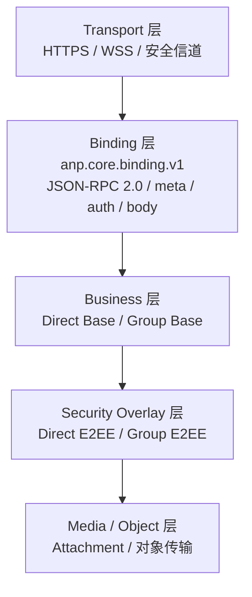
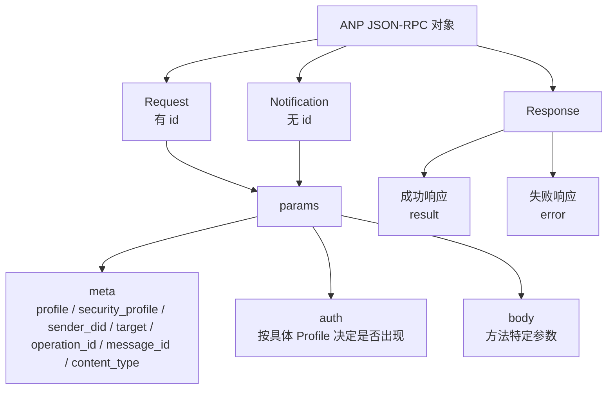
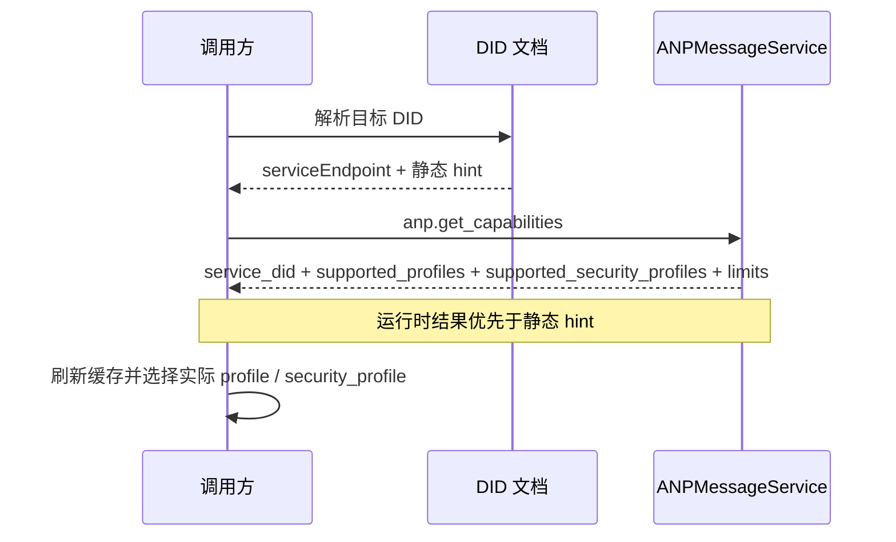

> 日本語参考訳（機械翻訳・未校閲）。規範となるのは原文です。コード例・識別子・規範キーワードは原文を保持しています。
> 原文: [chinese/deprecated/01-核心绑定.md](../../../chinese/deprecated/01-核心绑定.md) / 基準コミット: `0837cfdfaf4ddcf834f0890ddaf34fc4c824e066`

# ANP 生産 1: コア結合

- 文書番号: ANP-P1
- 見出し: コア結合
- ステータス:公開
- バージョン: 1.1
- 原文言語: 中文 / このページは日本語参考訳
- 適用範囲: このプロフィールはすべてのAMPの基礎プロフィールおよび保証の積み重なるプロフィールに適用します。

---

## 1. 目的:

このプロファイルは、統一された外部レベルのメッセージ結合、一般的なフィールド、コンピテンシー協議、エラーモデルと相互運用性制約を定義します。

このページの目的は、次の通りです。

1. (a) AMP メソッドの全てのメッセージがエンベロープされるようにする。
2. 異なるビジネスアプリケーションのための発明の要求、応答、通知および誤ったフォーマットの重複を避ける。
3. プロジェクトのベース、グループベース、ダイレクトE2EE、グループE2E、添付ファイル、フェデレーションなどの共通基盤を提供します。
4. JSON-RPC 2.0 の基本的な互換性は保存され、選択の自由は、分岐率の低下を抑制するためにきつくられます。

---

## 2. 用語と規範的な関与

### 2.1 仮鍵

このテキスト **MUST**、**MUST NOT**、**REQUIRED**、**SHALL**、**SHALL NOT**、**SHOULD**、**SHOULD NOT**、**RECOMMENDED**、**NOT RECOMMENDED**、**MAY**、**OPTIONAL** 資本金を基準とする規範的な要件として解釈される。

### 2.2 用語集

- **ANPエンドポイント**プロトコルは、ANP、通常、エントリーサービス、グループホストサービス、またはエージェントのドメインに対するその他の宣言されたサービスのエンドポイントを達成するためにエンドポイントを指しています。
- **リクエスト**: と `id` JSON-RPC の呼び出し側。
- **インフォメーション**: ご利用いただけません `id` JSON-RPC の呼び出し側。
- **結果発表**: 成功する回答者の中で `result` 会員様
- **エラー**: 反応できなかったオブジェクトの中で `error` 会員様
- **プロフィール**: ANPプロトコル容量モジュール、例: `anp.direct.base.v1`。
- **セキュリティプロファイル**: ANPセキュリティのセマンティックユニット、例えば。 `transport-protected`、`direct-e2ee`、`group-e2ee`。
- **運営会社**: メッセージの送信、グループの構築、人の追加、グループステータスの変更の送信など、特定できるプロトコルアクション。
- **メッセージの保有操作**: アプリケーションレベルのメッセージの読み込みを運ぶ操作など `direct.send`、`group.send`、`group.e2ee.send`。
- **メッセージの受信通知**: アプリケーションレイヤーの情報に対する通知負荷としての配信方法、例えばg. `direct.incoming`、`group.incoming`、`group.e2ee.notice`。
- **制御操作**: 契約状況や業務内容の変更、アプリケーションレベルのサービスメッセージの送信など `group.create`、`group.add`、`group.remove`。
- **起源の証拠**: 事業者の秘密鍵で生成し、採用 `auth.origin_proof` 応用層の発信者証明書を刻印しました。
- **オブジェクトの証拠**: オブジェクトを介して埋め込まれる `proof` 削除 `proof` 後者全体オブジェクトは、オブジェクトのアサーションの検証可能なレベルです。
- **署名された要求の目的**: によって `method`、`meta`、`body` 構成、計算のため `contentDigest` . 業務オブジェクトの共有と標準化

---

## 3. デザイン原則

### 3.1 層ベースの原則

AMP は、以下のレイヤーを使用します。

1. **輸送の層**:HTTP(S)、WebSocketセキュリティなど
2. **結合層**このプロファイルで定義されているJSON-RPC 2.0バインディング。
3. **営業体制**直接基盤、グループの基盤、等;
4. **保安の積み重なる層**以下は、Direct E2EE および Group E2EE のセキュリティ・シンタックスです。
5. **メディア/オブジェクトレイヤー**: 添付ファイル拡張などの大物。


リーダーがAMPのストラティフィケーション境界を素早く構築できるようにするため、次のチャートでは、転送レイヤーの概要をメディア/オブジェクト層に提供します。 次のデータは、このストラティフィケーションフレームでオブジェクト、プロセス、制約を締め続けます。



*図 P1-1:AMP のストラテライズの概要(非正規)。*

数値は、展開のパターンではなく、責任の行を強調します。特定の達成は、1つのサービスで複数のレイヤーを組み合わせることができますが、相互運用時に分離される必要があります。
### 3.2 最小相互運用性の原則

このプロファイル制約を満たすことで、異なる実現を共有できます。

- リクエスト/応答形式;
- (a)通知のフォーム。
- (a) 一般的なフィールド構文。
- (b) 容量相談のためのモーダリティ;
- エラーモデル;
- 治療の原則等

### 3.3 非ターゲット

ベンジャー **なし、いいえ。**次の機能を定義します。

- 歴史;
- (a) 読み取りステータス;
- 機器の同期;
- (a) オンラインステータス;
- (a)内部コピーの一貫性;
- 特定の E2EE アルゴリズム。

これらの機能は、AMP 規格を超えて宣言する他のプロファイルまたは明示的に定義する必要があります。

### 3.4 プロフィールの同一証明

このProfile の標準的な名前は、次のとおりです。

`anp.core.binding.v1`

依存性を宣言するとき、次のプロファイル**MUST** ファイル名を使用してファイルを引用します。

---

## 4. 結合のための基盤

### 4.1 JSON-RPC版

ANPコア結合 **MUST** JSON-RPC 2.0 を使用する。

各リクエストの対応と対応オブジェクト `jsonrpc` 会員名簿 **MUST** 精密はひもを等しい `"2.0"`。

### 4.2 安全な伝送要件

ANP の結合すべて **MUST** 認証された安全な転送層で実行します。

- HTTPS の
- WSS;
- 機密性、完全性およびエンドツーエンド認証を提供するその他の安全なチャネル。

このプロファイルは、未認証の暗号化されていないnudity伝送で実行することはできません。

### 4.3 伝達の不当性

送信に関係しない論理的に、HTTP(S)とWSSは推奨されますが、許可されるわけではありません。
このファイルの同義語が変更されていないこと、すなわち新しいバインディングは提供しました。 **MAY** 補足の境界文書として定義されます。

---

## 5. JSON-RPC 相互運用コントレイント

### 5.1 `params` フォーム

JSON-RPC オリジナル・ノーム許可 `params` オブジェクトの名前のオブジェクトで、場所や場所のセットを使用してください。
サインイン`params` **MUST** (a) オブジェクトへ**MUST NOT** 配列フォームを使用します。  
配列フォームで受信した場合 `params`受取人。 **MUST** バックナンバー `anp.invalid_params_shape` エラー。

### 5.2 `id` 仕様

JSON-RPC オリジナル・ノーム許可 `id` 文字列、数値または `null`。
リクエストのAMP `id` **MUST** 空でない文字列です。  
ANPリクエスト **MUST NOT** 数字を使う `id`。  
ANPリクエスト **MUST NOT** 利用条件 `null` として `id`。  
要件を満たしていない場合、 `id`受取人。 **MUST** バックナンバー `anp.invalid_request_id`。

### 5.3 通知の範囲

AMP の通知 **おすすめ**次のシナリオについて:

1. (a) 側から切除したイベント
2. エラーの詳細は片道のヒントは必要ありません。または返されるべきではありません。

下記業務 **MUST NOT** 通知を使用する:

- 耐久性を変更する操作を制御します。
- 確認が必要なメッセージの送信
- 呼び出し側は、成功しているか、失敗している操作を感知する必要があります。

### 5.4 バッチバン

JSON-RPC 時計コール **MUST NOT** 利用する。  
クライアント **MUST NOT** 時計を送ろう  
時計を受け取ったとき **MUST** 取り込みと返し `anp.batch_not_supported`。

### 5.5 メソッド名制限

方法名前 **MUST** 文字列で、次の命名規則に従います。

- (a) 論理的な命名空間の使用;
- (a) 文字を小文字で開始します。
- 段落間の使用 `.` (b) 委任;
- 方法名前 **MUST NOT** 詳細はこちら `rpc.` (a) 始まり;
- 運用アプローチ **SHOULD** 利用条件 `<domain>.<action>` スタイル。

推奨例:

- `anp.get_capabilities`
- `direct.send`
- `group.create`
- `group.add`
- `group.send`

### 5.6 応答制約

通知以外のサービス側 **MUST** 各ReQuestのResponsのいずれかを返します。  
成功の応答 **MUST** 組織図 `result`とりあえず **MUST NOT** 組織図 `error`。  
失敗した応答 **MUST** 組織図 `error`とりあえず **MUST NOT** 組織図 `result`。  
応答による写真 `id` **MUST** コルレスト `id` 確かに。

---

## 6. ユニバーサル `params` 構造:

### 6.1トップレベルのオブジェクト

特定の例外を含むAMP `params` **MUST** 次の構造を採用します:

```json
{
  "meta": { "...": "..." },
  "auth": { "...": "..." },
  "body": { "...": "..." }
}
```

の の の の の の の の の の の の の の の の の の の の の の の の の の の の の の の の の の の の の の の の の の の の の の の の の の の の の の の の の の の の の の の の の の の の の の です:

- `meta`一般的なメタデータ、状況の説明、ターゲット、戦術、安全パターンなど;
- `auth`: 任意認証および証明書オブジェクト;指定されたプロファイル要件が指定されるときのみ。
- `body`: メソッド固有のパラメータ。

特定のプロファイルが定義されていない場合 `auth`, 呼び出し者 **MAY** それを無視します。  
指定された場合 `auth`, 呼び出し者 **MUST** プロバイダーおよび受取人 **MUST** 確認する。  
ダイワディド `meta`、`auth`、`body` 外のトップ レイヤー `params` プロフィールへの特定の参照の定義が明確になれば、メンバーは表示されるだけを許可します。


次の図は、テキストのリエマージする外側のレイヤーを統一されたビューに凝縮します。これにより、読者はリクエスト、通知、応答間でどのような構造が共有されているかを理解します。 `meta`、`auth`、`body` 責任を問わない。



*図P1-2: ANP JSON-RPC 封筒構造(非調整)。*

すべてのフォローアップ操作プロファイルとセキュリティオーバーレイは、 `body` 必要とされている `auth` 制約は、このマップと競合する別のトップ・カップリング構造として拡張され、再作成しないでください。
### 6.2 `meta` オブジェクト

`meta` オブジェクトフィールドは、次の通り定義されます。

#### 6.2.1 `anp_version`

- タイプ: ひも
- リクエスト:**MAY**
- サブドメイン: AMP Master Tip
- デフォルト: 省略した場合は、受信者 **MUST** プレス `"1.0"` エクスポーラ
- 注意:
  - このフィールドは、表示されたデバッグまたはクロスバージョンゲートウェイのために保持されます。
  - v1の中優先度 `profile` (b) 解釈の規則に決定する。
  - 新規獲得 **SHOULD** 主要な相談分野ではなく、対応するフィールドとして検討してください。

#### 6.2.2 `profile`

- タイプ: ひも
- リクエスト:**MUST**
- 著名な:この要求のみについての説明
- 注意:
  - `profile` 「リクエストの現在の宣言」について `body`、`result`, プロファイルは、間違った制約とメソッドの構文を説明しています。
  - `profile` **MUST NOT** (b) 複数のプロファイルの構文の同時式。
  - `security_profile` 交換しないセキュリティモードを明示するだけです。 `profile`。
- 事例:
  - `"anp.direct.base.v1"`
  - `"anp.group.base.v1"`
  - `"anp.direct.e2ee.v1"`
  - `"anp.group.e2ee.v1"`

#### 6.2.3 `security_profile`

- タイプ: ひも
- リクエスト:**MUST**
- Semantic: 今回呼び出しのセキュリティモード
- 許可された価値:
  - `"transport-protected"`
  - `"direct-e2ee"`
  - `"group-e2ee"`
- 注意:
  - `security_profile` リクエストで現在必要とされているセキュリティモデルを表現する。
  - セキュリティレベルやセキュリティのセマンティックス、 `body` (a) 通訳の文法;
  - いったん... `profile` 一部は許可されています `security_profile` グループは、対応するプロファイルで明確に定義する必要があります。

#### 6.2.4 `sender_did`

- タイプ: ひも(DDI)
- 被災者様の状況を把握するために、政府も情報提供をお願いしております。**MUST**
- 管理:ビジネス構文DID(ビジネスオリジン/論理シンダーDD)におけるこの要求の主な送信者
- 注意:
  - リクエスト`sender_did` **SHOULD** 現行のビジネススポンサーをエクスプレス化
  - サービスの発生通知、省略を許可するかどうか `sender_did` または、特定のプロファイルで定義された別のフィールドに論理発行者を置き換えます。
  - `sender_did` **MUST NOT** 外部転送接続に自動装備されているジャンパーのアイデンティティ。

#### 6.2.5 `target`

- タイプ: オブジェクト
- リクエスト: 合意レベルのターゲットにメソッドが存在する場合 **MUST**
- 構造:

```json
{
  "kind": "agent | group | service",
  "did": "did:example:..."
}
```

- 注意:
  - `kind = "agent"` ターゲットが単一のエージェントであることを示す。
  - `kind = "group"` (a) 対象が単一のグループであることを示す。
  - `kind = "service"` ターゲットは特定の公共であることを意味します。 `ANPMessageService.serviceDid`；
  - `target.did` **MUST NOT** (a) 直接積込み層 URL ;
  - 任意のメソッドプロファイル **MUST** クリアにしておくと、 `agent-addressed`、`group-addressed`、`service-scoped` または、それは? `endpoint-local`；
  - 許可の省略 `target`，**MUST** 特定のプロファイルの可視宣言、発信者および受取人 **MUST NOT** 自己調節。
  - メソッドが要求される場合 `auth.origin_proof`, それから `meta.target` **MUST** 存在し、 `meta.target.kind` **MUST** あり あり `agent`、`group`、`service` ワン。

#### 6.2.5.1 目的モデルの宣言のためのルール

差異を排除する `target` , 特定の **MUST** (b)以下のモデルの目的がその方法論から派生するという明確な声明:

1. **エージェントアドレス**
   - `meta.target.kind = "agent"`
   - `meta.target.did` アニメーションDID

2. **グループアドレス**
   - `meta.target.kind = "group"`
   - `meta.target.did` ターゲットグループDID

3. **サービススコープ**
   - `meta.target.kind = "service"`
   - `meta.target.did` 対象は一般です。 `ANPMessageService.serviceDid`

4. **エンドポイントローカル**
   - プロフィールの特定の文に対応する場合のみ、省略が許可されます。 `meta.target`

メソッドがエンドポイントローカルとして明示的に宣言されていない場合、受信者 **MUST** プレス「必須事項」 `target`ハンドル

何かをお願いしているなら... `meta.target.kind` 方法論文の目的モデルと一致しない、受取人 **MUST** バックナンバー `anp.invalid_target_binding`。


#### 6.2.6 `operation_id`

- タイプ: ひも
- リクエスト:ステータスを変更するすべてのアクション **MUST**
- 機能的:この操作のための禅タン識別
- ルール:
  - 同じスポンサーは、同じ意味の文脈で、彼は人ではない人として見られない新しい環境を作成するために再び試みます。`operation_id` **MUST** (b) 変更が未だ
  - & 量子 **MUST** (a) 特定のプロファイルによる明確な定義
  - 業務内容 **MUST** (b)まず、衝撃の有効期間のテストを行い、最適化または事前条件チェックを行います。
  - メッセージクラス操作、送信者 **SHOULD** 直接注文 `operation_id = message_id`「メッセージマーク」と「操作再試行マーク」の区別が必須ではありません。

#### 6.2.7 `message_id`

- タイプ: ひも
- メッセージ・バイアリング・オペレーションによる写真 **MUST**
- 管理:層メッセージの同一証明を適用して下さい
- 注意:
  - `message_id` (a) 情報レベルに対する一意または重複した同一の識別。
  - `message_id` とりあえず `operation_id` 同じか別の場合もあります;
  - 独立ライフサイクルがない場合、長い道になります。**SHOULD** 直接再使用 `message_id` として `operation_id`；
  - `message_id` **MUST NOT** 目に見えない交換 `operation_id` (a) 汎用構文、対応するプロファイルが同じことを明示的に許可しない限り。
  - 特定の方法がメッセージテイク非コンプライアンスである場合、この記事は均等に適用される。

#### 6.2.8 `created_at`

- タイプ: ひも(RFC 3339の時間)
- リクエスト:**SHOULD**
- セマンティックス:イニシエは、この操作のタイムスタンプを作成します
- コメント: 上記以外の法律は、他に提供しません。`created_at` 再合併に対する唯一の防衛ではありません。

#### 6.2.9 `trace_id`

- タイプ: ひも
- リクエスト:**標準の相互運用可能な分野として消散**
- 管理:内部追跡の印
- 注意:
  - 展開がクロスサービストラッキングを必要とする場合、状況を追跡する方法は見つかりません。**SHOULD** 転送層メタデータやプライベートエクステンションフィールド(例: `x_trace_id`）；
  - スタッフ **MUST NOT** それらはあらゆるセキュリティの皮下、公認の判断または判断に組み込まれます。

#### 6.2.10 `content_type`

- タイプ: ひも
- メッセージ・バイアリング・オペレーションによる写真 **MUST**
- 分離: 現在のメッセージ操作の主負荷タイプ; currentProfile / Overlay が別の外部レイヤーを使用している場合は、外層のエンベロープの種類です。

ルールは以下の通りです。

1. BaseProfile の場合 `body` コンテナを運ぶだけ(例、 `text` / `payload` / `payload_b64u` (構造の反動)、 `meta.content_type` **MUST** JSON コンテナオブジェクト自体の型ではなく、コンテナ内のプライマリサービス負荷のタイプを記述します。
2. セキュリティーのオーバーレイで、 `body` 別の秘密を運ぶ, その後 `meta.content_type` **MUST** これは、外側層のワイヤオブジェクトタイプです。
3. 元のアプリケーションタイプは、アウターレイヤーのアプリケーションタイプと異なり、新しいアプリケーションタイプではありません。**MUST** 対応する内部フィールドにオーバーレイ (例:g) `application_content_type`(i) テキストで;
4. 特定のメソッドがメッセージテイクアウトの非コンプライアンスであるとき、この規則は等しく適用されます。
5. えー。 `meta.content_type` 通訳の基本的権利は、このプロフィールによってのみ提供されます。その他の事業案内およびセキュリティ上敷 **MUST NOT** 基本的なセマティクスを書き換えます。

事例:

- ベーステキストメッセージの直接:`text/plain`
- グループベースJSON:`application/json`
- 直接E2EEテキストメッセージ:外側層 `meta.content_type = "application/anp-direct-cipher+json"`内部の層 `application_content_type = "text/plain"`
- グループ E2EE 添付メッセージ: 外層 `meta.content_type = "application/anp-group-cipher+json"`

業務負荷が正常な構造であるJSONのときの内容のタイプ **MUST** 利用条件
`application/json`JSON オブジェクト **MUST** 入れるだけ。 `body.payload` 確かにそうではありません。
または安全なオーバーレイの内側層に置く。 `payload` プロフィールおよび適用 **MUST NOT**
コマンド、ステータス、タスク、結果などのビジネス間の差別化のための追加の意味を定義するだけ
型を入力します。これらの意味は、JSONオブジェクト内の応用レベルの構文であり、
コア結合層。

グループE2EEの内層の元のビジネスタイプが別館リストである場合、内部セクションに記述する必要があります。

```json
{
  "application_content_type": "application/anp-attachment-manifest+json"
}
```

と... **ありません。** 外部に。 `meta.content_type` , と引き続き、附属書リストの型を書き留めます.

### 6.3 `body` オブジェクト

`body` Object はメソッド固有のパラメータセットです。

- オペレーション **MUST** (a) フィールドを定義する。
- オーバーレイプロファイル **MUST** パスワードフィールドを定義します。
- `body` 認識されていないフィールドは無視できます。**MUST** 対応するプロファイル仕様により。
- セキュリティ、ルート、パーミッション、ギル、ステータスのシンネームに影響を及ぼす未知のフィールド **MUST** 注射器。

---

## 7. ロードはルールです

### 7.1 JSONオブジェクト優先度

JSON のビジネスオブジェクトとして自分を表現できるなら、**SHOULD** JSONオブジェクトの直接的です。  
アクセシビリティ **MUST NOT** JSON 文字列の 2 列を "JSON を再埋め込む" としてデフォルトで使用します。

### 7.2 バイナリ式

バイナリロードが必要なフィールド **MUST** 未充填のbase64urlテキストとして表現されます。  
関連するフィールド名 **SHOULD** 詳細はこちら `_b64u` 文の末尾、例えば:

- `ciphertext_b64u`
- `key_package_b64u`
- `welcome_b64u`

### 7.3 値

異なる言語の大きな整数、カウンター、シリアル番号の表現の違いを避けるため、以下のフィールド **MUST** 決定文字列で、次のことを示します。

- (a) カウンター;
- (a) シリアル番号;
- (a) 論理時計;
- プチ;
- 生成;
- (a) 大きい整数の長さ;
- IEEE 754の二重精密保証整数範囲を超える可能性のある値。

その後のプロファイルがJSONの署名を正規化する必要がある場合は、入力に署名するためのシリアライズルールを明確に定義する必要があります。
ファイルが署名されたペイロードまたは同等のパスワード境界オブジェクトを定義したら、プロファイル **MUST** 規範的なアルゴリズムだけを指定する;異なる実現 **MUST NOT** 異なる「テーブルシーケンス」戦略を選択します。

---

## 8. 能力相談

### 8.1 一般規定

ANPエンドポイント **MUST** 露出能力の相談インターフェイス。  
能力相談の外来 **MUST** 少なくとも:

- ASPプロファイルリストがサポートしました。
- 保安製品のサポートリスト
- (a) 業務サービスID;
- (b) 制約(最大負荷、最大オブジェクトサイズ、現在の保存ポリシーなど)を達成する。

アクコンプリシャ **MAY** より細かい粒径の拡張フィールド(例、コンテンツタイプがサポートされている、メソッドレベルの機能、通知容量、認証スキームの機能)を返しますが、このセクションで定義される最小標準応答構造には影響しません。

### 8.2 標準方法論:`anp.get_capabilities`

#### 8.2.1 リクエスト

```json
{
  "jsonrpc": "2.0",
  "id": "req-001",
  "method": "anp.get_capabilities",
  "params": {
    "meta": {
      "profile": "anp.core.binding.v1",
      "security_profile": "transport-protected",
      "operation_id": "op-cap-001",
      "created_at": "2026-03-29T12:00:00Z"
    },
    "body": {}
  }
}
```

注意:

- `anp.get_capabilities` **MAY** 匿名の公開発見機能として呼び出される。
- 政府は「絶対電話」の問題に取り組んできました。`meta.sender_did` **MAY** (a) 省略;
- サービスのプロバイダがアイデンティティに基づいて異なる電源サブセットを返す場合の呼び出し **MAY** 認定されたコンテキストのコンテキストで再び呼び出します。

#### 8.2.2 応答の成功

```json
{
  "jsonrpc": "2.0",
  "id": "req-001",
  "result": {
    "service_did": "did:example:service",
    "supported_profiles": [
      "anp.core.binding.v1",
      "anp.direct.base.v1",
      "anp.group.base.v1",
      "anp.direct.e2ee.v1"
    ],
    "supported_security_profiles": [
      "transport-protected",
      "direct-e2ee"
    ],
    "limits": {
      "max_request_bytes": "1048576",
      "max_message_bytes": "262144"
    },
    "supported_content_types": [
      "text/plain",
      "application/json",
      "application/anp-attachment-manifest+json"
    ]
  }
}
```

注意:

- `result.service_did` (a) 現在の実行時間容量の結果のためのサービス ID を指示します;
- 静的な DID 文書は、実行中の時間機能の結果としてヒントだけを提供します。
- `supported_content_types` 推奨の延長ですが、非常に一般的でサービスエンド **SHOULD** 戻って来てみたい。

### 8.3 相談のための規則

- DID 文書の静的拡張フィールドは、キャッシュ可能な静的なヒントのみです。
- `anp.get_capabilities` 返された結果は、運用当局(ランタイム能力)を表します。
- 静的ヒントが実行時能力に対抗している場合の呼び出し側 **MUST** (a) タイム・ツー・タイム容量の結果に基づいてキャッシュを再イントロデュースします。
- コールア **SHOULD** (a) 最初にやり取りする前に、またはキャッシュが期限切れになった後にターゲットを絞ったサービスを配信する能力を必要とする。
- リクエスト `profile` または `security_profile` 対応していないサービスプロバイダ **MUST** 特定のエラーを返します。
- コールア **MUST NOT** 「ベースプロファイルは、もう一方の側面をサポートしていると仮定して、E2EEオーバーレイを確かにサポートしています。」

---


下記の図は、相談の推奨注文を設定し、「静的情報を発見するために使用される」という原則を強調表示します。実行時間の結果は、適応に使用されます。



*図P1-3: 競技相談と時間使用の権限(非規範)。*

実行時容量で、実行時に静的ヒントを競合させると、このチャートの動作の結果が使用されるものとし、競合はローカルキャッシュの更新を必要とすると考えられます。
## 9. ♪ と、そうで、上りに♪

### 9.1 ニール原則

ステータス変更操作をすべて **MUST** 禅と対アルを支えます。  
まつげ `(sender_did, target_scope, method, operation_id)` リクエスト:

- 構文等と同等のサービスレベルの場合 **MUST** 同じ結果または同等の結果を返す。
- 対面的な紛争が生じた場合のサービスレベル **MUST** バックナンバー `anp.idempotency_conflict`。

の の の の の の の の の の の の の の の の の の の の の の の の の の の の の の の の の の の の の の の の の の の の の の の の の の の の の の の の の の の の の の の の の の の の の の です:

- `target_scope` と指定された値。 **MUST** 対応するプロファイル定義により;
- 直接方法、`target_scope` 普通 `target.did`；
- グループメソッド`target_scope` 普通 `group_did`。

### 9.2 再試行メッセージ

メッセージ送信クラス操作のため:

- もう一度お試しください `message_id` **MUST** (b) 変更が未だ
- もう一度お試しください `operation_id` **MUST** (b) 変更が未だ
- 独立した構文が達成されていない場合、送信者 **SHOULD** 同じようにする。
- 業務内容 **MUST** 運用レベルの記録などをチェックする。
- メッセージレベルをダブル識別するために使用されるキー(含まれている場合) `message_id`) は、対応するメッセージProfile で明確に定義する必要があります。

### 9.3 非塩等

待機しないと、製品の価値に相当します。 **MUST** ラベル作成と代替のリドレス機構が付与されます。  
明らかに示されていない場合、すべてのものは同じ条件の対象と見なされます。

---

## 10. エラーモデル

### 10.1 一般規定

JSON-RPC と ANP `error` オブジェクトのロードエラー。
アクセシビリティ **宿泊予約** JSON-RPC の標準的なエラーコードは、AMP 独自のアプリケーションエラーエンコーディングを定義しながら元の構文です。

サービスのエンドのための: **SHOULD** プレパーJSON-RPC標準エラーコード:

| シーン | 推奨JSON-RPCエラーコード |
|---|---|
| JSON を解析できない | `-32700 Parse error` |
| 違法JSON-RPCオブジェクト | `-32600 Invalid Request` |
| 方法が存在しません | `-32601 Method not found` |
| 変数 形の無効 | `-32602 Invalid params` |
| サービスエンド内部異常 | `-32603 Internal error` |

Anpビジネスレイヤーエラー、サービス終了 **SHOULD** この文書と同時に定義されている1000以上のエラーコードを使用する `error.data.anp_code` . . .

### 10.2 ANPエラーオブジェクトの拡張子

`error` オブジェクト固有の提案構造:

```json
{
  "code": 1001,
  "message": "Unsupported profile",
  "data": {
    "anp_code": "anp.unsupported_profile",
    "retryable": false,
    "details": {}
  }
}
```

いつ? `code` AMP のカスタマイズしたエラー範囲に関しては、`error.data.anp_code` **MUST** そこ。

### 10.3 AMP パブリックエラーコード

| `code` | `anp_code` | 意味する |
|---|---|---|
| 1000 | `anp.invalid_request_id` | `id` イルガル |
| 1001 | `anp.unsupported_profile` | 未サポートリクエストプロファイル |
| 1002 | `anp.unsupported_security_profile` | 要求されたセキュリティモードをサポートしていない |
| 1003 | `anp.invalid_params_shape` | `params` 構造は条件に一致しません |
| 1004 | `anp.batch_not_supported` | 未対応 |
| 1005 | `anp.unauthorized` | 認定資格なし |
| 1006 | `anp.forbidden` | 認定資格が認められていない |
| 1007 | `anp.target_not_found` | 対象のDIDが存在しない、または利用できない |
| 1008 | `anp.idempotency_conflict` | 鍵の秘密 |
| 1009 | `anp.unsupported_content_type` | 未対応のコンテンツの種類 |
| 1010 | `anp.delivery_rejected` | 対象サービス拒否 |
| 1011 | `anp.rate_limited` | トリガー限界の流れ |
| 1012 | `anp.temporarily_unavailable` | 一時的にサービスが利用できなくなった場合 |
| 1013 | `anp.invalid_security_binding` | セキュリティモードは負荷構造に一致しません |
| 1014 | `anp.invalid_target_binding` | 方法論で必要となるモデルと実性をターゲットに `meta.target` マッチしない |

### 10.4 間違いのリターン条件

- はい AMP カスタムエラー、サービス **MUST** 機械に落とされるリターン `anp_code`；
- `message` **SHOULD** 短く、読みやすく;
- `data.retryable` **SHOULD** (b) 再試行ができるかどうかを明確にするため
- エラー **MUST NOT** 不要な内部の機密状態を発見します。
- 以下は、ターゲットの誤り、サービススコープ/エンドポイントローカルの誤用など、最新の問題の例のリストです。**SHOULD** バックナンバー `anp.invalid_target_binding`。

---

## 11. 方法登録とネーミングスペース

### 11.1 ネーミングスペース

下記の1つの命名空間を推奨します。

- `anp.*`
- `direct.*`
- `group.*`
- `attachment.*`
- `federation.*`

### 11.2 バージョン管理

プロフィール名 **MUST** 可視テープバージョン:

- `anp.core.binding.v1`
- `anp.identity.discovery.v1`
- `anp.direct.base.v1`

### 11.3 延長方法

アクコンプリシャ **MAY** プライベートエクステンションメソッドを定義しますが、:

- **MUST NOT** (a) 標準方式の後に名前を付けて下さい;
- **SHOULD** (a) 接頭辞の利用目的
- **MUST NOT** これら方法の理解を深める手段が達成されると仮定します。

---

## 12. 互換性とバージョン進化

### 12.1 フォワード・コンパシビリティ

未知の拡張フィールドに対処するための受取人のルールは次のとおりです。

- 不明なコアへ `meta` フィールド、受信者 **MUST** 注射;
- あり。 `x_` 初期実現拡張 `meta` フィールド、受信者 **MAY** 無視;
- はい、不明 `auth` フィールド、受信者 **MUST** プロファイル明示的なステートメントが拡張されていない限り、拒否。
- はい、不明 `body` フィールドは、プロファイルに特定のステートメントが必須である場合にのみ **MAY** 無視;
- 未知のフィールドがセキュリティ、ルート、パーミッション、thiphone、ステータスの構文に影響を及ぼす場合、 **MUST** 注射器。

### 12.2 破壊的な変化

以下の変更は破壊的とみなされ、アップグレードする必要があります。

- `meta` (a) フィールドの意味の変化
- (a) 間違ったコードの構文の変更
- (a) 方法の皮下の変化;
- (a) セキュリティモデルのセマンティックな変化;
- 負荷構造はもはや互換性がありません。

---

## 13. セキュリティ対策

### 13.1 固定される保証モード

コールアとサービス **MUST NOT** 明示的な相談なしに、高セキュリティモデルから低セキュリティモデルへのデエスカレーションはサイレントです。  
ターゲットが要求をサポートしていない場合 `security_profile`、サービス **MUST** クリアリターン `anp.unsupported_security_profile`。

### 13.2 タイムスタンプは、再活性化に対する第一次保護ではありません

`created_at` **MUST NOT** 再教育に対する唯一の保護として。  
重み設定は、セッション、メッセージ、グループで後続のプロファイルによって定義されるべきです。

### 13.3 追跡フィールド分離

`trace_id`、ログ タグ、監視フィールド **MUST NOT** パスワードのバインディングやビジネス許可審査にご参加ください。

### 13.4 相互リバフを荷を積む

特定のプロファイル定義の場合 `body.payload` とりあえず `body.payload_b64u` 相互参照分野のために、送ります **MUST NOT** どちらも利用できます。受取人が紛争の入力を受信したときに **MUST** 注射器。

いつ? `meta.content_type` あり あり `application/json` 、対応するペイロードの積込み機
**MUST** JSONオブジェクトです。 送信者 **MUST NOT** シリアル化された JSON 文字列を
`body.text`え、え。 **MUST NOT** オブジェクトの2番目のシーケンスをJSON文字列に
`body.payload`。

---

## 14. プライバシーに関する懸念

### 14.1 最小メタデータ原理

カレンダー **SHOULD** おすすめ `meta` 相互受精に必要な最小メタデータを配置します。

### 14.2 デバイスの解剖学

このプロファイルは、デバイス、ターミナル、コピー、内部実行単位を定義することなく、エージェントとグループを識別します。
これらのコンセプトは、コア結合の標準的なフィールドとして実現する内部であり、課外できません。

### 14.3 機能キャッシュ

コールア **SHOULD** キャッシュ容量の相談が、 **MUST** 容量の変更、検証の失敗、サービス終了ポイントの切換えまたはキャッシュの失敗時に再構成します。

---

## 15. 最小相互運用可能な要件

ANPコア結合のコンプライアンスを少なくとも **MUST** サポート:

1. JSON-RPC 2.0 の仕様
2. オブジェクトフォーム `params`；
3. ストリング `id`；
4. `anp.get_capabilities`；
5. パブリックエラーコード;
6. 待たせます。 `operation_id`；
7. `meta` / `body` トップレベルの構造;
8. 安全な伝達;
9. 匿名または認定される方 `anp.get_capabilities` (a) 処理;
10. ユニファイド `content_type` 分離: 外層は常態ワイヤー オブジェクトのタイプを意味します;
11. 各メソッドの対象のモデリングを目に見えるようにします。`agent-addressed`、`group-addressed`、`service-scoped` または `endpoint-local`；
12. えー。 `service-scoped` 必須確認方法 `meta.target.kind = "service"` とりあえず `target.did = serviceDid`；
13. えー。 `endpoint-local` 省略する方法の可視宣言 `target`記載されていない場合、曖昧に省略することを拒否します。

## 16. 事例:

コア結合アウターレイヤー:サポート、オーバーレイメソッド(例:g)のコア結合用として以下の例が示されています。 `group.e2ee.send`、`group.e2ee.notice`同データソースは、厚生省のウェブサイトで利用できます。`meta`、ターゲット・モデリングおよび間違いモデル結合。

### 16.1 `direct.send` 事例例リクエスト

```json
{
  "jsonrpc": "2.0",
  "id": "req-10001",
  "method": "direct.send",
  "params": {
    "meta": {
      "profile": "anp.direct.base.v1",
      "security_profile": "transport-protected",
      "sender_did": "did:example:agent-a",
      "target": {
        "kind": "agent",
        "did": "did:example:agent-b"
      },
      "operation_id": "msg-10001",
      "message_id": "msg-10001",
      "created_at": "2026-03-29T12:00:00Z",
      "content_type": "text/plain"
    },
    "auth": {
      "scheme": "anp-rfc9421-origin-proof-v1",
      "origin_proof": {
        "contentDigest": "sha-256=:BASE64_SHA256_OF_SIGNED_DIRECT_PAYLOAD:",
        "signatureInput": "sig1=(\"@method\" \"@target-uri\" \"content-digest\");created=1774785600;expires=1774785660;nonce=\"n-10001\";keyid=\"did:example:agent-a#key-1\"",
        "signature": "sig1=:BASE64_SIGNATURE:"
      }
    },
    "body": {
      "text": "hello"
    }
  }
}
```

### 16.2 成功した応答の例

```json
{
  "jsonrpc": "2.0",
  "id": "req-10001",
  "result": {
    "accepted": true,
    "message_id": "msg-10001",
    "operation_id": "msg-10001",
    "target_did": "did:example:agent-b",
    "accepted_at": "2026-03-29T12:00:01Z"
  }
}
```

---

## 17. IANA/登録場所

この標準のサブシーケントバージョン **SHOULD** 下記の登録フォームを作成します。

1. AMPプロフィール名登録フォーム
2. (a)セキュリティプロファイル登録フォーム;
3. コンテンツタイプ登録フォーム;
4. Anp エラー番号登録フォーム。

---

## 18. 業績の参考書(非定性)

本サイトに着陸する際に、次の原則が実現する者にとって有用である場合があります。

- コア結合は、実際に実現のための妥協の要件を横断するフィールドを保持します。
- DID 文書の静的ヒントは、検索のみで実行時間決定はありません。
- 業務レベルは、ビジネスの構文とセキュリティの詳細のみがオーバーレイに配置されていることを懸念しています。
- 追跡、ルートおよび内部のゲートウェイフィールドは、標準相互運用境界を入力することなく、プライベートエクステンションまたは伝送レイヤーに設置されます。

---
# 付録A(仮称):起源の証拠の受け継ぎを分ける

この付録は、合意のホストとして将来の操作のために共有されるP3、P4、P6およびアプリケーションレイヤー元の(Origin Proof)証明書を定義します。

このページの先頭へ**繰り返し定義なし**一般的なシグネチャアルゴリズム、シリアライズされた構造フィールドまたはJSON規格アルゴリズム。これらは、次の基準によって直接提供されます。

* **RFC 8785の特長**:JSON 加速度式化スキーム(JCS)
* **RFC 9530の特長**：`Content-Digest` フィールド値のフォーマット
* **RFC 9421の特長**：`Signature-Input`、`Signature`、signature基礎構造および検証モデル
* **RFC 3986の特長**:URI パーセンテージコードルール
* えー。 `did:wba` DID は、認証方法の承認とルーティングチェックを解決し、対応する **d:wba方法論的仕様**

ANP は、この付録の次の自己定義された部分だけを定義します。

1. `auth.origin_proof` フィールドと
2. ユニファイド **署名された要求の目的**；
3. アプリケーションレイヤー `@method` / `@target-uri` / `content-digest` (a) コンポーネントマッピング;
4. ホップ/サービス認証、クロスドメイン転送の義務ライン。

## A.1 調和 `auth.scheme` とりあえず `auth.origin_proof`

業務用アプリケーションソースの証明を使用するとき:

* `auth.scheme` **MUST** イーグル `anp-rfc9421-origin-proof-v1`
* `auth.origin_proof` **MUST** プレゼンス
* `auth` それだけで **MUST NOT** 要約入力を入力

推奨構造は以下の通りです。

```json
{
  "auth": {
    "scheme": "anp-rfc9421-origin-proof-v1",
    "origin_proof": {
      "contentDigest": "sha-256=:BASE64_SHA256_DIGEST:",
      "signatureInput": "sig1=(\"@method\" \"@target-uri\" \"content-digest\");created=1733402096;expires=1733402156;nonce=\"abc123\";keyid=\"did:wba:example.com:user:alice:e1_<fingerprint>#key-1\"",
      "signature": "sig1=:BASE64_SIGNATURE:"
    }
  }
}
```

注意:

* `contentDigest` RFC 9530 で保存 `Content-Digest` フィールド値
* `signatureInput` RFC 9421 で保存 `Signature-Input` フィールド値
* `signature` RFC 9421 で保存 `Signature` フィールド値

## A.2 シェアリング `origin_proof` オブジェクト構造

`origin_proof` **MUST** 以下に示すフィールドが少なくとも存在します。

* `contentDigest`
* `signatureInput`
* `signature`

将来バージョンで提供されていない限り、v1は次のように合意します。

* `contentDigest` **MUST** 利用条件 `sha-256`
* `signatureInput` **MUST** タブを使用する `sig1`
* `signature` **MUST** タブを使用する `sig1`
* コンポーネントのオーバーライドアセンブリ **MUST** 固定:

```text
("@method" "@target-uri" "content-digest")
```

これらのフィールドの特定の構文、シーケンスおよび検証された値、送信者および認証パーティ **MUST** RFC 9530およびRFC 9421に指示して下さい、 **MUST NOT** 代替フォーマットのアイデア。

## A.3 共有署名リクエストオブジェクト

`contentDigest` **MUST** 包含なしで1つを結びます `auth` 標準的なビジネス目標、として知られている **署名された要求の目的**。

共通の構造は次です:

```json
{
  "method": "<jsonrpc method>",
  "meta": {
    "...": "..."
  },
  "body": {
    "...": "..."
  }
}
```

ルールは以下の通りです。

* 署名された要求の目的 **MUST** 参加する `method`、`meta`、`body`
* ・・・ **MUST NOT** 組織図 `jsonrpc`、`id`、`auth`
* カレンダー **MUST** RFC 8785 JCS を使用して計算する前に、そのシーケンスを正規化します `contentDigest`
* デフォルトオプションフィールド **MUST** 直接排出
* 流出サービスルート情報、ローカルキャッシュフィールド、輸送寸法追跡フィールド **MUST NOT** 署名されたレビューオブジェクト

注意:

* オペレーション **MAY** 継続的制約 `meta` / `body` 選択したフィールドが選択されるフィールド
* しかし、もしそうなら、尋ねる方法がある `auth.origin_proof`, その要約の主題は、Refileの新しい汎用シェルではなく、この付録に署名されたリクエストオブジェクトとして常に定義されます

## A.4 グローバルコンポーネントマッピング

時に:wba 認証情報は AMP JSON-RPC リクエストで行われます。署名がクロスサービス転送下で安定していることを確認するため、`Signature-Input` 主要コンポーネント **MUST** 以下のグローバルアプリケーションレイヤーマップを使用します。

* `@method`:地図から `Signed Request Object.method`
* `@target-uri`:地図から `anp://{meta.target.kind}/{pct-encoded meta.target.did}`
* `content-digest`: 署名されたリクエストオブジェクトへのマップ `contentDigest` バリュー

の の の の の の の の の の の の の の の の の の の の の の の の の の の の の の の の の の の の の の の の の の の の の の の の の の の の の の の の の の の の の の の の の の の の の の です:

* `pct-encoded` **MUST** 基本情報 `meta.target.did` そのためには、RFC 3986 としてエンコードする UTF-8 バイト
* メソッドが要求されるとき `auth.origin_proof` できるかどうかはわかりません。`meta.target` **MUST** プレゼンス
* `meta.target.kind` **MUST** 削除 `agent`、`group`、`service` それらのうちの1つ。
* 将来導入が必要である場合のエンドポイントローカルメソッド `auth.origin_proof`，**MUST** 対象のモデリングと再構築ルールを、対応するプロファイルが見えるように定義します。

説明の要件:

`meta.target.kind` 署名された要求オブジェクトによって入力 `contentDigest`；`@target-uri` 可視キャリングを続けてください `kind`、署名ベースでターゲットカテゴリを維持するため**可読性、監査可能で独立的検査**ターゲットタイプを知る前に、抽象オブジェクト全体を拡張するために認証者に依存するのではなく、安定性の皮下がります。


P1 付録 A は、複数の操作で共有された発信者の証明の基礎です。次の図表 `Signed Request Object`、`contentDigest` とりあえず `@method / @target-uri / content-digest` 3 の関係は、その後の文書を直接再利用できるようにするチャートに圧縮されます。

```mermaid
flowchart LR
M1[method]
M2[meta]
M3[body]

M1 --> SRO[Signed Request Object]
M2 --> SRO
M3 --> SRO

SRO --> JCS[RFC 8785 JCS]
JCS --> CD[contentDigest]

M1 --> HM[@method]
M2 --> TU[@target-uri<br/>anp://kind/pct-encoded-did]

HM --> SB[Signature Base]
TU --> SB
CD --> SB

SB --> SI[signatureInput]
SB --> SG[signature]

CD --> OP[auth.origin_proof]
SI --> OP
SG --> OP
```

*図 P1-4: 署名されたレビューオブジェクトと起源の証拠(unnormative)。*

フォローアップリクエスト `auth.origin_proof` 業務方法は、このパブリックバインダーに戻り、サマリー入力とシグネチャコンポーネントのソースを理解し、それぞれの文書で新しい汎用署名シェルを定義するよりも、します。
## A.5 スタンダード・シグネチャーモデルとの関係

この付録、送信者および認証パーティで定義されているアプリケーションレイヤーコンポーネントマップに加えて **MUST** RFC 9421 のシグネチャモデルを直接再制定:

* `signatureInput` フィールドバリューコンストラクト
* `signature` フィールドバリューコンストラクト
* 署名ケースを生成
* コンポーネントの注文説明を上書きする
* `@signature-params` & 構造と検証

つまり、

* カレンダー **MUST** RFC 9421 の皮下にある署名的な場合に署名して下さい
* **MUST NOT** 元のJSONリクエストテキストを直接署名する
* **MUST NOT** 右上。 `signatureInput` この JSON 文字列フィールド自体を署名する

この付録はレイヤーのみを置き換えます。 "コンポーネントの値が由来していた":
標準的なHTTPメッセージ署名では、通常はHTTPメッセージから派生しています。ANPでは、この付録で定義されているアプリケーションレイヤーマップから派生しています。

## A.6 最低の証明の条件

認証 **MUST** 少なくとも次のステップが実装されています。

1. フィードバック `auth.origin_proof`
2. リッピング `contentDigest`、`signatureInput`、`signature`
3. リクエストされた現在使用してください `method`、`params.meta`、`params.body` 署名されたリクエストオブジェクトを再構築する
4. RFC 8785 JCS を用いたシーケンスを正規化
5. コストを削減 `contentDigest`
6. から `method` 再建 `@method`
7. から `meta.target.kind` とりあえず `meta.target.did` 再建 `@target-uri`
8. RFC 9421モデルを再構築し、検証する
9. パーシング `keyid` 点数の DID 文書、認証方法が存在することを確認し、 `authentication` 関係の承認
10. 対応するDIDメソッドルールで、署名、時刻ウィンドウ、および再置換ポリシーを検証

どのステップでも失敗した場合は、認証パーティー **MUST** リクエストがなかった。

## A.7 特定・認証関係

* `keyid` **MUST** パーサブルなDID URLへのポイント
* 認証 **MUST** パーシング `keyid` 検証方法が使用されるDID文書で、それがいつか確認する `authentication` 関係の承認
* `keyid` のIDの **MUST** 業務内容のディディットを操作プロフィールで必要としている業務上の一貫性
* はい、: wba パス タイプ `e1_` 証拠、証拠 **MUST** パス指紋チェックの追加実行

注意:

* P3、P4、P6の現在の構文では、ビジネスの主題DIDは通常です `meta.sender_did`
* 将来の通知または宣言ファイルが異なるビジネスの対象DIDを使用している場合は、テキスト内の「通知」という用語を使用することはできません。**MUST** プロフィール別に

## A.8 ジャンプの認定関係

`anp-rfc9421-origin-proof-v1` 現行のネットワークではなく、事業の元身が証明されています。

したがって:

* ジャンプホップ/サービス認証 **MAY** 変更点
* 中間サービス **MUST NOT** 新規事業としてサービスステータスを再プロファイリング
* ターゲット受取人 **MUST** 独立した検証操作の起源の証拠、および **MUST NOT** 稼働状況を上流サービス状態にのみ基づいた体制の前提

## A.9 クロスドメイン転送

原発の業務依頼の場合 `auth.origin_proof`、横断ドメイン送信機:

* **MUST** 変更を解除し、リクエストと共に送信してください
* **MUST NOT** 新規事業の再生
* **MUST NOT** 外部 HTTP を使用する `serviceDid` 署名の置換 `auth.origin_proof`

注意:

* 外部レベルのクロスドメイン HTTP 認証で「現在次のジャンプを呼び出しているサービス」が証明されます。
* `auth.origin_proof` 「誰が行動を始めたのか」の証明のために
* 二つの責任は異なる。**MUST NOT** 置換。

---
# 付録B(仮称):有観的な証拠プロフィールを共有する

この付録は、将来のオブジェクト型プロファイルのP4、P5、P6、および「オブジェクトプルーフ」構成を定義します。 オブジェクトチャプターは、 `proof` この付録を使用するとき、 `proof` **MUST** 現付の付録に続いて下さい。

## B.0 定款・位置決め

この付録は、次の通り再現されます。 **W3Cデータ整合性** フレームワークとその関連するパスワードパッケージの証拠、および**ありません。**検証可能な認証データモデルを全体として使用してください。

具体的に:

- `DataIntegrityProof` 一般的な証拠フレームワーク、次の **[W3C 検証可能な認証データ整合性 1.0](https://www.w3.org/TR/vc-data-integrity/)**；
- `eddsa-jcs-2022` 暗号スイート生成と認証ルール、続いて **[W3Cデータ整合性 EdDSA Cryptosuites v1.0](https://www.w3.org/TR/vc-di-eddsa/)**；
- JSON 標準化アルゴリズム、フォロー **[RFC 8785: JSON のキャニシリゼーション・スキーム(JCS)](https://www.rfc-editor.org/rfc/rfc8785)**；
- バイトシーケンスエンコーディング、フォロー **[RFC 3629:ISO 10646の変形フォーマットのUTF-8](https://www.rfc-editor.org/rfc/rfc3629)**；
- DID ドキュメントモデル、検証関係、DD URL の基本的な構文、以下 **[W3C DIDの中心1.0](https://www.w3.org/TR/did-core/)**；
- デプロイされたら、使用して下さい `did:wba`、方法特定の分解、指紋の結合および他の付加的な確認は対応するDIDの方法学的指定に続きますのような **[d:wbaメソッド仕様](https://agentnetworkprotocol.com/en/specs/03-did-wba-method-specification/)**。

このページの先頭へ**繰り返し定義なし** データ整合性、`eddsa-jcs-2022`, JCS, UTF-8, DIDコア, DIDメソッド自体.  
ANPは、この付録に次の点だけを害する:

1. オブジェクトレベル `proof` ;固定軸受け形;
2. (a) 保護された文書の決定ルール
3. (a) UTF-8 + RFC 8785 JCSの正規化のための条件;
4. `proofPurpose = "assertionMethod"` デフォルトの構文。
5. 認証ステップと特定のオブジェクト間の労働の分岐を共有します。

## B.1 適用範囲

オブジェクトの次の v1 **MUST** この付録を使用する:

- プチ4 `group_receipt.proof`
- プチ5 `prekey_bundle.proof`
- プチ6 `did_wba_binding.proof`

他の FutureProfile が同じオブジェクトレベルを導入する場合 `proof`プロジェクトの異なる定義なし、 **SHOULD** 再追加。

## B.2 調和 `proof` 構造:

この付録のオブジェクトの使用、 `proof` **MUST** 少なくとも含まれます:

- `type`
- `cryptosuite`
- `verificationMethod`
- `proofPurpose`
- `created`
- `proofValue`

推奨構造は以下の通りです。

```json
{
  "proof": {
    "type": "DataIntegrityProof",
    "cryptosuite": "eddsa-jcs-2022",
    "verificationMethod": "did:example:issuer#key-1",
    "proofPurpose": "assertionMethod",
    "created": "2026-03-29T12:00:00Z",
    "proofValue": "z..."
  }
}
````

v1 均一要件は以下の通りです。

* `proof.type` **MUST** イーグル `DataIntegrityProof`
* `proof.cryptosuite` **MUST** イーグル `eddsa-jcs-2022`
* `proof.proofPurpose` **MUST** イーグル `assertionMethod`
* `proof.verificationMethod` **MUST** 完全な DID URL のため
* `proof.created` **MUST** RFC 3339 時間のひもとして
* `proof.proofValue` **MUST** base58-btc のマルチベース() を使う`z...`）

オブジェクトが十分に見える場合を除き達成 **MUST NOT** 共有プロファイルのこれらの公共フィールドのセマティクスを再説明します。

## B.3 保護された文書

この付録内の任意のオブジェクトの使用を生成し、検証します。 `proof` 保護された文書 **MUST** あり:

> **オブジェクトのトップレベルを削除します。 `proof` メンバーの後にオブジェクト全体**

つまり、

* 保護の規模 **MUST NOT** ローカルフィールドをいくつかズーム
* えー。 **MUST NOT** 外部レイヤーに拡張する JSON-RPC のインターナショナル、HTTP ヘッダ、レイヤーメタデータやローカルキャッシュフィールドを転送
* フィールドを選択するデフォルト **MUST** 直接排出
* **MUST NOT** 利用条件 `null`, 空の文字列, 空のオブジェクトの位置または他の親指の置換 " フィールドは存在しません"

将来のオブジェクトが propof を必要とする場合, 分岐させたサブオブジェクトまたは他の特殊な圧倒モデル, それは、オブジェクトは特定のプロジェクトで覆われている初めてになります.**MUST** 対応するプロファイル明示的な定義により、そのような定義がなされていない場合、このセクションは同じ方法で処理されます。

## B.4 定形・シーケンス

この付録を使用するときに保護された文書 **MUST** 最初:

1. RFC 8785 JSON キヤノン化化学(JCS)正規化
2. UTF-8 エンコーディング

それからもう一度押します。 `eddsa-jcs-2022` 質問の生成または認証 `proof`。

認証パーティーとジェネレーターは、他の方法でカウンターパーティProfile で指定されていない限り **MUST NOT** このセクションの要件を他の「安定シーケンス化」と置き換えます。 「キャストカスタムソート」またはローカル固有のコードを「キャストカスタム」します。

## B.5 被験者IDの発行と認証方法の承認

この付録の各オブジェクトを使用して、**MUST** 対応するオブジェクトで明確に述べたProfile**発行者ID(発行者ID)**。

任意のオブジェクトの証拠:

* `proof.verificationMethod` のIDの **MUST** objectProfile で指定された発行者 DID を同等
* `proof.verificationMethod` **MUST** 発行者 DID 文書
* `proof.verificationMethod` **MUST** 発行者 DID 文書による `assertionMethod` 関係の承認
* `proofPurpose` 固定式 `assertionMethod`, デフォルトは意味:**Sosuer DIDは、被写体全体について説明しています。**

対応するDIDメソッドが利用可能である場合、追加の検証も必要です(例: `did:wba` パスのタイプ `e1_` DID パス指紋) **MUST** DID方式で必要な追加チェックも実施しています。

## B.6 対象者の特定の業務制約による労働の課

この付録は調和しています **証拠フレーム**オブジェクトの構文ではなく。

したがって:

* 共有部品のための均一な条項 `proof` Syntax: 保護された文書、規範的なアプローチとデフォルトの承認関係
* ObjectProfile の使い方 **MUST** 個別の規定:

  * 誰が男、ソサーDIDですか?
  * オブジェクトが持つべきセキュリティキーフィールドは、少なくとも何
  * 検証後に、よりビジネスの一貫性チェックが必要となるかどうか

つまり、認証パーティーは `proof` 採用の後で、**MUST** フィールドの完全性、オブジェクトのセマティクスおよび対応するオブジェクトプロファイルで指定された状態の制約を検証し続けます。 **MUST NOT** ・・・ `proof` 検証は、ビジネスレベルを通過します。

## B.7 最低の証明の条件

この付録で使用したオブジェクトのために、認証パーティー **MUST** 少なくとも次のステップが実装されています。

1. オブジェクトを読み込む `proof`
2. 検査検査 `type`、`cryptosuite`、`verificationMethod`、`proofPurpose`、`created`、`proofValue` この付録の要件の既存と完全性
3. 対応するオブジェクトでDIDのステータスを決定
4. 再構築はトップレイヤーを削除します `proof` オブジェクト全体が保護された文書です
5. UTF-8+RFC 8785 JCS を用いたシーケンス保護文書の正規化
6. 発行者 DID 文書の解析
7. 検査検査 `proof.verificationMethod` 既存の、発行者 DID 文書によって使用される `assertionMethod` 権威の委任
8. プレス `DataIntegrityProof + eddsa-jcs-2022` 証拠の証拠
9. フィールドの整合性、タイムウィンドウ、ステータス参照などの操作チェックを objectProfile で実行します。

どのステップでも失敗した場合は、認証パーティー **MUST** オブジェクトを取り出します。
