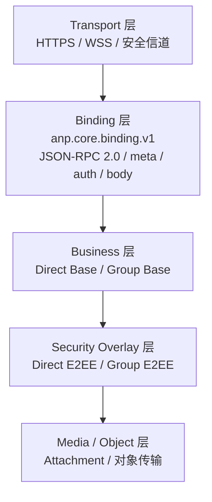
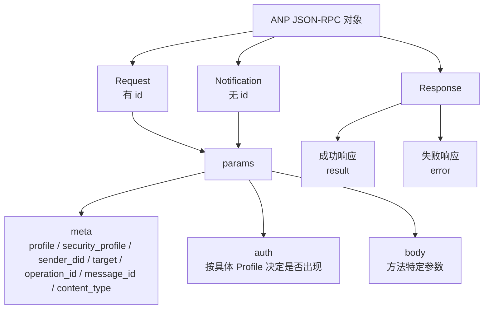
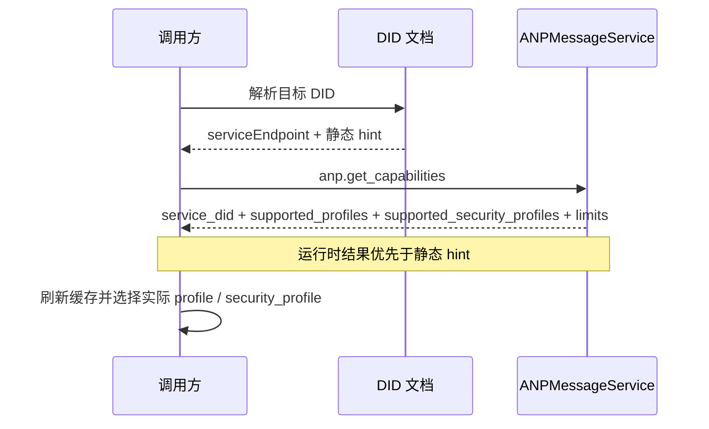

<!-- translation-review: machine-fully-reviewed; scope=source lines 1-1246; inventory=japanese/reviews/core-deprecated-review.json; full prose compared against source -->
> 日本語参考訳（機械翻訳を原文と全文照合し、意味・用語を校閲済み）。規範となるのは原文です。コード例・識別子・規範キーワードは原文を保持しています。
> 原文: [chinese/deprecated/01-核心绑定.md](../../../chinese/deprecated/01-核心绑定.md) / 基準コミット: `0837cfdfaf4ddcf834f0890ddaf34fc4c824e066`

# ANP Profile 1: コアバインディング

- 文書ID: ANP-P1
- 題名: コアバインディング
- 状態: Released（公開済み）
- バージョン: 1.1
- 原文の言語：中国語（本ファイルは日本語訳）。
- 適用範囲: 本プロファイルは、ANPのすべての基本プロファイルとセキュリティオーバーレイプロファイルに適用されます。

---

## 1. 目的

本プロファイルは、ANPの統一された外側のメッセージバインディング、共通フィールド、機能交渉、エラーモデル、相互運用上の制約を定義します。

本プロファイルの目標は、次のとおりです。

1. ANPのすべてのメソッドに、統一されたメッセージエンベロープを提供します。
2. 異なるアプリケーションプロファイルで、要求・応答・通知・エラーの形式を繰り返し作り直すことを避けます。
3. Direct Base、Group Base、Direct E2EE、Group E2EE、Attachment、Federationなどのプロファイルに、共通の基盤を提供します。
4. JSON-RPC 2.0との基本的な互換性を保ちながら、任意に選べる範囲を絞り、実装間の解釈の曖昧さを減らす。

---

## 2. 用語と規範上の表記規則

### 2.1 規範キーワード

本書では、**MUST**、**MUST NOT**、**REQUIRED**、**SHALL**、**SHALL NOT**、**SHOULD**、**SHOULD NOT**、**RECOMMENDED**、**NOT RECOMMENDED**、**MAY**、**OPTIONAL**を、この大文字表記に従って規範的な要件として解釈します。

### 2.2 用語集

- **ANPエンドポイント**: ANP を実装するプロトコルエンドポイント、通常、エージェントが配置されているドメインの入り口サービス、グループホストサービス、またはその他の宣言されたサービスのエンドポイント。
- **Request（要求）**: `id`を持つJSON-RPC呼び出しオブジェクト。
- **Notification（通知）**: `id`を持たないJSON-RPC呼び出しオブジェクト。
- **Result（結果）**: 成功応答オブジェクトの`result`メンバー。
- **Error（エラー）**: 失敗応答オブジェクトの`error`メンバー。
- **Profile（プロファイル）**: `anp.direct.base.v1`などの、ANPのプロトコル機能の単位。
- **Security Profile（セキュリティプロファイル）**: `transport-protected`、`direct-e2ee`、`group-e2ee`などの、ANPのセキュリティセマンティクスの単位。
- **Operation（操作）**: メッセージ送信、グループ作成、メンバー追加、グループ状態変更の送信など、冪等な形で識別できるプロトコル操作。
- **Message-bearing Operation（メッセージを伴う操作）**: `direct.send`、`group.send`、`group.e2ee.send`など、アプリケーション層のメッセージペイロードを運ぶ操作。
- **Message-bearing Notification（メッセージを伴う通知）**: `direct.incoming`、`group.incoming`、`group.e2ee.notice`など、アプリケーション層のメッセージペイロードを運ぶ通知。
- **Control Operation（制御操作）**: アプリケーション層のビジネスメッセージを運ばず、プロトコル状態やビジネス状態を変更する操作。`group.create`、`group.add`、`group.remove`など。
- **Origin Proof（発信者証明）**: ビジネス主体の秘密鍵で生成し、`auth.origin_proof`に載せるアプリケーション層の発信者証明。
- **Object Proof（オブジェクト証明）**: 「`proof`を取り除いたオブジェクト全体」について、オブジェクト内の`proof`によって行う、検証可能なオブジェクトレベルの表明。
- **Signed Request Object（署名対象の要求オブジェクト）**: `method`、`meta`、`body`から構成し、`contentDigest`の計算に使用する、共通の正規化されたビジネスオブジェクト。

---

## 3. 設計原則

### 3.1 階層化の原則

ANP は、次の階層を採用します。

1. **トランスポート層**：HTTP(S)、WebSocket Secure などの安全な転送。
2. **バインディング層**：本 Profile の JSON-RPC 2.0 バインディング。
3. **業務層**：Direct Base、Group Base などの業務上の意味。
4. **Security Overlay 層**：Direct E2EE、Group E2EE などの安全性の意味。
5. **メディア／オブジェクト層**: Attachmentなど、大きなオブジェクトを扱う拡張。


ANPの層の境界の全体像をつかめるよう、次の図にトランスポート層からメディア／オブジェクト層までを示します。後続のプロファイルは、この階層構成に基づき、それぞれのオブジェクト、フロー、要件をさらに制約します。



*図P1-1: ANPの階層構成の概要（非規範的）。*

この図は、配備構成よりも責任の境界を重視しています。実装では複数の層を同じサービスにまとめてもかまいませんが、実装間の相互運用性のため、各層の意味上の分離は維持するべきです。
### 3.2 最小相互運用性原則

異なる実装でも、本プロファイルの制約を満たせば、次のものを共通化できます。

- リクエスト/応答形式;
- 通知形式;
- 共通フィールドのセマンティクス。
- 能力交渉の方法。
- エラーモデル;
- 冪等な処理の原則。

### 3.3 非目標

このプロファイルは、次の機能を定義しません。

- 履歴の取得。
- 既読状態。
- 機器の同期;
- オンラインステータス;
- 内部コピー間の一貫性。
- 特定の E2EE アルゴリズム。

これらの機能は、他のプロファイルで定義するか、ANP標準の範囲外であると明示する必要があります。

### 3.4 プロファイルの識別

このプロファイルの標準的な名前は、次のとおりです。

`anp.core.binding.v1`

後続のプロファイルは、依存関係を宣言する際、本プロファイルを参照するためにこの名前を使用しなければなりません（**MUST**）。

---

## 4. バインディングの基本

### 4.1 JSON-RPC版

ANP Core Bindingは、JSON-RPC 2.0を使用しなければなりません（**MUST**）。

すべての要求・応答オブジェクトの`jsonrpc`メンバーは、文字列`"2.0"`と厳密に一致しなければなりません（**MUST**）。

### 4.2 安全な伝送要件

すべてのANPバインディングは、次のような、認証された安全なトランスポート層上で動作しなければなりません（**MUST**）。

- HTTPS。
- WSS;
- 機密性、完全性、ピア認証を提供するその他のセキュアなチャネル。

このプロファイルは、未認証の暗号化されていない生転送上の動作を許可しません。

### 4.3 トランスポートからの独立性

本プロファイルは、論理的にはトランスポートに依存しません。HTTP(S)とWSSは推奨バインディングですが、許可されるものはそれだけではありません。
本 Profile のメッセージオブジェクトの意味を変えない新たなバインディングは、補足文書として定義してもかまいません（**MAY**）。

---

## 5. JSON-RPC 相互運用性制約

### 5.1 `params`の形式

元のJSON-RPC仕様では、`params`に位置による配列と名前によるオブジェクトのどちらも使用できました。
ANPでは、`params`はオブジェクトでなければならず（**MUST**）、配列形式を使用してはなりません（**MUST NOT**）。
配列形式の`params`を受信した場合、受信者は`anp.invalid_params_shape`エラーを返さなければなりません（**MUST**）。

### 5.2 `id`の型

元のJSON-RPC仕様では、`id`に文字列、数値、`null`を使用できました。
ANPでは、Requestの`id`は空でない文字列でなければなりません（**MUST**）。
ANP Requestでは、数値の`id`を使用してはなりません（**MUST NOT**）。
ANP要求では、`id`に`null`を使用してはなりません（**MUST NOT**）。
要件に適合しない`id`を受信した場合、受信者は`anp.invalid_request_id`を返さなければなりません（**MUST**）。

### 5.3 通知利用範囲

ANP で Notification を使うのは、次の場合**だけ**です。

1. 相手から能動的にプッシュする非同期イベント。
2. 確認を必要とせず、エラー詳細を返すべきでない一方向の通知。

次の操作でNotificationを使用してはなりません（**MUST NOT**）。

- 永続状態を変更する制御操作。
- 冪等な確認を必要とするメッセージ送信。
- 呼び出し元が成功・失敗を認識する必要のある操作。

### 5.4 Batch の禁止

ANP で JSON-RPC の batch 呼び出しを使ってはなりません（**MUST NOT**）。
クライアントはバッチを送信してはなりません（**MUST NOT**）。
サーバーは、バッチを受信したら拒否し、`anp.batch_not_supported`を返さなければなりません（**MUST**）。

### 5.5 メソッド名制約

メソッド名は文字列で、次の命名規則に従わなければなりません（**MUST**）。

- 論理名前空間を使用する;
- 小文字で始めます。
- 各部分を`.`で区切ります。
- メソッド名を`rpc.`で始めてはなりません（**MUST NOT**）。
- ビジネスメソッドには、`<domain>.<action>`形式を推奨します（**SHOULD**）。

推奨例:

- `anp.get_capabilities`
- `direct.send`
- `group.create`
- `group.add`
- `group.send`

### 5.6 応答制約

Notificationを除き、サーバーは要求ごとに応答を返さなければなりません（**MUST**）。
成功応答は`result`を含まなければならず（**MUST**）、`error`を含めてはなりません（**MUST NOT**）。
失敗応答は`error`を含まなければならず（**MUST**）、`result`を含めてはなりません（**MUST NOT**）。
応答の`id`は、対応する要求の`id`と厳密に同一でなければなりません（**MUST**）。

---

## 6. 共通の`params`構造

### 6.1トップレベルのオブジェクト

所定の例外を除き、ANPの`params`は次の構造でなければなりません（**MUST**）。

```json
{
  "meta": { "...": "..." },
  "auth": { "...": "..." },
  "body": { "...": "..." }
}
```

それらの中で:

- `meta`: 解釈に用いるプロファイル、宛先、冪等性、セキュリティプロファイルなどを含む共通メタデータ。
- `auth`: 任意の認証・証明オブジェクト。具体的なプロファイルが明示的に要求する場合だけ含めます。
- `body`: メソッド固有のパラメータ。

具体的なプロファイルで`auth`を定義していない場合、呼び出し元は省略してもかまいません（**MAY**）。
具体的なプロファイルが`auth`を明示的に要求する場合、呼び出し元は提供しなければならず（**MUST**）、受信者は検証しなければなりません（**MUST**）。
`params`のトップレベルで`meta`、`auth`、`body`以外のメンバーを許可するのは、対応するプロファイルがそれを明示的に定義している場合だけです。


次の図は、本プロファイルで繰り返し登場する外側のエンベロープをまとめたものです。Request、Notification、Responseが共有する構造と、`meta`、`auth`、`body`がそれぞれ担う責任を示します。



*図P1-2: ANP JSON-RPCエンベロープの構造（非規範的）。*

後続のビジネスプロファイルとセキュリティオーバーレイは、この図と競合する別のトップレベル構造を作らず、`body`と必要な`auth`の制約だけを拡張するべきです。
### 6.2 `meta` オブジェクト

`meta`オブジェクトの各フィールドを、次のように定義します。

#### 6.2.1 `anp_version`

- タイプ: 文字列
- リクエスト:**MAY**
- 意味：ANPのメジャーバージョンのヒント。
- デフォルト値：省略された場合、受信者は `"1.0"` と解釈しなければならない（**MUST**）。
- 説明:
  - このフィールドは、明示的なデバッグやバージョン間ゲートウェイ用に残している。
  - v1では、優先的に `profile` によって解釈規則を決める。
  - 新しい実装は、主要な交渉フィールドではなく、互換性のためのフィールドとみなすことが望ましい（**SHOULD**）。

#### 6.2.2 `profile`

- タイプ: 文字列
- 条件: **MUST**
- セマンティクス: この要求を解釈する唯一のProfile。
- 説明:
  - `profile`は、現在の要求の`body`、`result`、エラー制約、メソッドのセマンティクスを、どのProfileで解釈するかを宣言します。
  - `profile`で、複数プロファイルを合併したセマンティクスを同時に表してはなりません（**MUST NOT**）。
  - `security_profile`はセキュリティ方式だけを表し、`profile`を置き換えません。
- 事例:
  - `"anp.direct.base.v1"`
  - `"anp.group.base.v1"`
  - `"anp.direct.e2ee.v1"`
  - `"anp.group.e2ee.v1"`

#### 6.2.3 `security_profile`

- タイプ: 文字列
- 条件: **MUST**
- セマンティックス:このコールのセキュリティプロファイル
- 許可された値:
  - `"transport-protected"`
  - `"direct-e2ee"`
  - `"group-e2ee"`
- 説明:
  - `security_profile`は、現在の要求要件で使用するセキュリティプロファイルを示します。
  - セキュリティ水準やセキュリティセマンティクスを記述するものであり、`body`の解釈構文を表すものではありません。
  - ある`profile`が特定の`security_profile`との組み合わせだけを許可する場合は、そのプロファイルで明示する必要があります。

#### 6.2.4 `sender_did`

- 型: 文字列（DID）。
- 要件: 匿名の公開発見機能を除き、必須（**MUST**）。
- セマンティクス: ビジネスセマンティクス上、この要求を送信する主体のDID（ビジネス上の発信元DID／論理的な送信者DID）。
- 説明:
  - 通常の要求では、`sender_did`は現在のビジネス上の発信者を示すべきです（**SHOULD**）。
  - サーバーが生成する通知で、`sender_did`を省略してよいか、他のフィールドで論理的な発行者を表すかは、具体的なプロファイルが定義します。
  - `sender_did`を、外側のトランスポート接続における1ホップの呼び出し元の識別と、自動的に同一視してはなりません（**MUST NOT**）。

#### 6.2.5 `target`

- タイプ: オブジェクト
- 要件: メソッドがプロトコルレベルの宛先を持つ場合は必須（**MUST**）。
- 構造:

```json
{
  "kind": "agent | group | service",
  "did": "did:example:..."
}
```

- 説明:
  - `kind = "agent"` ターゲットが単一のエージェントであることを示します。
  - `kind = "group"` ターゲットが単一のグループであることを示します。
  - `kind = "service"`は、宛先が公開された`ANPMessageService.serviceDid`であることを示します。
  - `target.did`にトランスポート層のURLを直接載せてはなりません（**MUST NOT**）。
  - 各メソッドのプロファイルは、`agent-addressed`、`group-addressed`、`service-scoped`、`endpoint-local`のどれに属するかを明示的に宣言しなければなりません（**MUST**）。
  - `target`の省略を許可するかは、具体的なプロファイルが明示的に宣言しなければならず（**MUST**）、呼び出し元や受信者が独自に推測してはなりません（**MUST NOT**）。
  - メソッドが`auth.origin_proof`を要求する場合、`meta.target`が存在しなければならず（**MUST**）、`meta.target.kind`は`agent`、`group`、`service`のいずれかでなければなりません（**MUST**）。

#### 6.2.5.1 宛先モデルの宣言規則

異なるプロファイル間で`target`の解釈が分かれないよう、具体的なプロファイルは、各メソッドが次の宛先モデルのどれに属するかを明示的に宣言しなければなりません（**MUST**）。

1. **agent-addressed（Agent宛て）**
   - `meta.target.kind = "agent"`
   - `meta.target.did` は、宛先 Agent DID を指します。

2. **group-addressed（Group宛て）**
   - `meta.target.kind = "group"`
   - `meta.target.did` は、宛先 Group DID を指します。

3. **service-scoped（サービス単位）**
   - `meta.target.kind = "service"`
   - `meta.target.did`は、宛先の公開された`ANPMessageService.serviceDid`を指します。

4. **endpoint-local（エンドポイント内）**
   - `meta.target` 対応するプロファイルが明示的に宣言した場合のみ省略できます

メソッドのプロファイルがendpoint-localであると明示的に宣言していない場合、受信者は「明示的な`target`が必要」として扱わなければなりません（**MUST**）。

要求の`meta.target.kind`が、そのメソッドで宣言した宛先モデルと一致しない場合、受信者は`anp.invalid_target_binding`を返さなければなりません（**MUST**）。


#### 6.2.6 `operation_id`

- タイプ: 文字列
- 要件: 状態を変更するすべての操作で必須（**MUST**）。
- セマンティクス: この操作の冪等性識別子。
- ルール:
  - 同じ発信者が同じ意味的コンテキストで再試行する場合、`operation_id`を変更してはなりません（**MUST**）。
  - 冪等性の範囲は、具体的なProfileで明確に定義しなければなりません（**MUST**）。
  - サーバーは先に冪等性記録への一致を検査し、その後、楽観的並行性やバージョンの事前条件を検査しなければなりません（**MUST**）。
  - メッセージ型操作では、送信者は、メッセージ識別と操作再試行の識別を区別する必要がある場合を除き、`operation_id = message_id`とするべきです（**SHOULD**）。

#### 6.2.7 `message_id`

- タイプ: 文字列
- 要件: メッセージを伴う操作で必須（**MUST**）。
- セマンティクス: アプリケーション層のメッセージ識別。
- 説明:
  - `message_id`は、メッセージ単位の一意な識別、または重複の識別に使います。
  - `message_id`と`operation_id`は、同じでも異なっていてもかまいません。
  - 実装に独立した操作ライフサイクルがない場合は、`message_id`をそのまま`operation_id`として再利用するべきです（**SHOULD**）。
  - 対応するProfileが明示的に許可しない限り、`message_id`によって`operation_id`の一般的な冪等性セマンティクスを暗黙に置き換えてはなりません（**MUST NOT**）。
  - 具体的なメソッドが、メッセージを伴うNotificationである場合も、この制約を適用します。

#### 6.2.8 `created_at`

- 型: 文字列（RFC 3339の時刻）。
- 条件: **SHOULD**
- セマンティクス: 発信者が操作を作成した時刻のタイムスタンプ。
- 注: 後続のプロファイルで別途定めない限り、`created_at`を唯一のリプレイ防止の根拠として使用してはなりません。

#### 6.2.9 `trace_id`

- タイプ: 文字列
- 要求：**標準の相互運用フィールドではありません**。
- セマンティクス: 実装内部の追跡識別子。
- 説明:
  - 配備環境でサービス間の追跡が必要な場合は、トランスポート層のメタデータや、`x_trace_id`などの非公開拡張フィールドを使うべきです（**SHOULD**）。
  - 受信者は、これをセキュリティセマンティクス、認可の判断、冪等性の判断に組み込んではなりません（**MUST NOT**）。

#### 6.2.10 `content_type`

- タイプ: 文字列
- 要件: メッセージを伴う操作で必須（**MUST**）。
- セマンティクス: 現在のメッセージ操作の主要なビジネスペイロードの型。プロファイル／Overlayが独立した外側のエンベロープを使う場合は、その外側のエンベロープの型を示します。

ルールは以下の通りです。

1. Base Profileで、`body`が単なる構造化された入れ物（たとえば相互排他的な`text` / `payload` / `payload_b64u`構造）である場合、`meta.content_type`は、JSONの入れ物自体の型ではなく、そこに格納する主要なビジネスペイロードの型を表さなければなりません（**MUST**）。
2. Security Overlayで、`body`に独立した暗号文エンベロープを含める場合、`meta.content_type`は外側のエンベロープの通信オブジェクトの型を表さなければなりません（**MUST**）。
3. 元のアプリケーションのコンテンツ型が外側のエンベロープの型と異なる場合、対応するOverlayの`application_content_type`などの内部フィールドで表現しなければなりません（**MUST**）。
4. 具体的なメソッドが、メッセージを伴うNotificationである場合も、この規則を適用します。
5. `meta.content_type`の基本的な解釈は本プロファイルだけが定義します。他のアプリケーションプロファイルやセキュリティOverlayが、その基本セマンティクスを再定義してはなりません（**MUST NOT**）。

事例:

- Direct Baseのテキストメッセージ: `text/plain`
- グループベースJSONメッセージ: `application/json`
- Direct E2EEのテキストメッセージ: 外側は`meta.content_type = "application/anp-direct-cipher+json"`、内側は`application_content_type = "text/plain"`。
- グループ E2EE 添付メッセージ: 外 `meta.content_type = "application/anp-group-cipher+json"`

ビジネスペイロードが通常の構造化JSONの場合、コンテンツ型は次の値でなければなりません（**MUST**）。
`application/json`。JSONオブジェクトは、直接`body.payload`に含めなければなりません（**MUST**）。
またはセキュリティOverlay内の`payload`に含めます。プロファイルやアプリケーションは、次の目的だけで追加のコンテンツ型を定義してはなりません（**MUST NOT**）。
すなわち、次のようなビジネス上の意味を区別する目的です。
コマンド、状態更新、タスク、結果などがあります。これらの意味はアプリケーション層の
JSONオブジェクト内のセマンティクスであり、このコアバインディング層の範囲外です。

Group E2EEで、内側の元のビジネス型が添付リストである場合は、内側の平文に次のように記述します。

```json
{
  "application_content_type": "application/anp-attachment-manifest+json"
}
```

外側の `meta.content_type` に、添付 manifest の型を引き続き書くわけでは**ありません**。

### 6.3 `body` オブジェクト

`body`オブジェクトは、メソッド固有のパラメーターの集合です。

- ビジネスプロファイルは、そのフィールドを定義しなければなりません（**MUST**）。
- Security Overlay Profileは、その暗号関連のフィールドを定義しなければなりません（**MUST**）。
- `body`の未知のフィールドを無視してよいかは、対応するプロファイルで明確に定めなければなりません（**MUST**）。
- 受信者は、セキュリティ、ルーティング、権限、冪等性、状態機械のセマンティクスに影響する未知のフィールドを拒否しなければなりません（**MUST**）。

---

## 7. ペイロードの表現規則

### 7.1 JSONオブジェクトを優先

JSON オブジェクトで自然に表現できる業務オブジェクトは、そのまま JSON オブジェクトで表すことが望まれます（**SHOULD**）。
ANPは、既定の方法として「JSON文字列内にJSONを入れる」二重シリアライズを使ってはなりません（**MUST NOT**）。

### 7.2 バイナリ表現

バイナリペイロードを送る必要がある場合、そのフィールドはパディングなしのbase64urlテキストで表さなければなりません（**MUST**）。
関連するフィールド名は、次のように`_b64u`で終えることを推奨します（**SHOULD**）。

- `ciphertext_b64u`
- `key_package_b64u`
- `welcome_b64u`

### 7.3 数値表現

大きな整数、カウンター、連番の表現が言語間で異なることを避けるため、次のフィールドは10進文字列で表さなければなりません（**MUST**）。

- カウンター;
- シーケンス番号。
- 論理時計;
- epoch。
- 世代。
- 大きな整数で表す長さ。
- IEEE 754の倍精度で安全に表現できる整数の範囲を超える可能性がある値。

後続の Profile が JSON を正規化して署名する場合、署名入力のシリアライズ規則を明示する必要があります。
プロファイルがSigned Payloadまたは同等の暗号バインディングオブジェクトを定義した場合、一意に定まる正規化アルゴリズムを規定しなければなりません（**MUST**）。実装ごとに異なる「安定したシリアライズ」方式を選んではなりません（**MUST NOT**）。

---

## 8. 機能交渉

### 8.1 全般

ANPエンドポイントは、機能交渉インターフェースを公開しなければなりません（**MUST**）。
機能交渉の結果は、少なくとも次のものを含まなければなりません（**MUST**）。

- 対応する ANP プロファイルのリスト。
- サポートされているセキュリティプロファイルリスト;
- ランタイムサービスID;
- 実装の制約（最大ペイロード、最大オブジェクトサイズ、レート制限ポリシーなど）。

実装者は、対応するコンテンツ型、メソッド単位の機能、Notification機能、認証方式の機能など、より詳細な拡張フィールドを返してもかまいません（**MAY**）。ただし、これらによって本節で定義する標準の最小応答構造が変わることはありません。

### 8.2 標準方法: `anp.get_capabilities`

#### 8.2.1 リクエスト

```json
{
  "jsonrpc": "2.0",
  "id": "req-001",
  "method": "anp.get_capabilities",
  "params": {
    "meta": {
      "profile": "anp.core.binding.v1",
      "security_profile": "transport-protected",
      "operation_id": "op-cap-001",
      "created_at": "2026-03-29T12:00:00Z"
    },
    "body": {}
  }
}
```

注意:

- `anp.get_capabilities`は、匿名の公開発見機能として呼び出してもかまいません（**MAY**）。
- 匿名で呼び出す場合、`meta.sender_did`を省略してもかまいません（**MAY**）。
- サーバーが識別に応じて異なる機能の部分集合を返す場合、呼び出し元は認証したコンテキストで再度呼び出してもかまいません（**MAY**）。

#### 8.2.2 応答の成功

```json
{
  "jsonrpc": "2.0",
  "id": "req-001",
  "result": {
    "service_did": "did:example:service",
    "supported_profiles": [
      "anp.core.binding.v1",
      "anp.direct.base.v1",
      "anp.group.base.v1",
      "anp.direct.e2ee.v1"
    ],
    "supported_security_profiles": [
      "transport-protected",
      "direct-e2ee"
    ],
    "limits": {
      "max_request_bytes": "1048576",
      "max_message_bytes": "262144"
    },
    "supported_content_types": [
      "text/plain",
      "application/json",
      "application/anp-attachment-manifest+json"
    ]
  }
}
```

注意:

- `result.service_did` 現在のランタイム機能の結果に対応するサービス ID DID を示します。
- 静的な DID 文書はヒントだけを提供します。実行時の能力は、この返却結果を判断基準にします。
- `supported_content_types`は推奨される拡張です。実用上可能なら、サーバーはこれを返すべきです（**SHOULD**）。

### 8.3 交渉規則

- DID 文書の静的拡張フィールドは、キャッシュ可能な静的なヒントのみを表します。
- `anp.get_capabilities`の返却結果が、実行時の機能についての正しい基準です。
- 静的なヒントと実行時の機能が食い違う場合、呼び出し元は実行時の機能の結果を判断基準とし、キャッシュを更新しなければなりません（**MUST**）。
- 呼び出し元は、最初のやり取りの前、またはキャッシュの有効期限が切れた後に、対象サービスの機能を取得することを推奨します（**SHOULD**）。
- 要求の`profile`または`security_profile`に対応していない場合、サーバーは明示的なエラーを返さなければなりません（**MUST**）。
- 呼び出し元は、Base Profileへの対応がE2EE Overlayへの対応を意味すると仮定してはなりません（**MUST NOT**）。

---


DID文書の静的なヒントと、実行時の機能の結果は混同されがちです。次の図は推奨する交渉順序を示し、静的な情報は発見に、実行時の結果は最終判断に使うという原則を強調しています。



*図P1-3: 機能交渉と、実行時の判断基準（非規範的）。*

静的なヒントと実行時の機能が食い違う場合、実装はこの図の実行時の結果に従い、食い違いをローカルキャッシュの更新が必要という合図として扱うべきです。
## 9. 冪等性と再試行

### 9.1 冪等性の原則

状態を変更するすべての操作は、冪等性をサポートしなければなりません（**MUST**）。
同じ`(sender_did, target_scope, method, operation_id)`を持つ重複要求について、次の規則を適用します。

- 意味的に等価なら、サーバーは同じ結果または等価な結果を返さなければなりません（**MUST**）。
- 意味的な競合がある場合、サーバーは`anp.idempotency_conflict`を返さなければなりません（**MUST**）。

それらの中で:

- `target_scope`の具体的な値は、対応するプロファイルが定義しなければなりません（**MUST**）。
- Direct系のメソッドでは、`target_scope`は通常`target.did`です。
- Group系のメソッドでは、`target_scope`は通常`group_did`です。

### 9.2 メッセージのリトライ

メッセージ送信操作には、次の規則を適用します。

- 再試行で`message_id`を変更してはなりません（**MUST**）。
- 再試行で`operation_id`を変更してはなりません（**MUST**）。
- 実装に独立した操作セマンティクスがない場合、送信者は両者を同じ値にするべきです（**SHOULD**）。
- サーバーは、操作レベルの冪等性記録を最初に検査しなければなりません（**MUST**）。
- メッセージ単位の重複識別キーに`message_id`を含めるかなどの規則は、対応するメッセージプロファイルが明示的に定義する必要があります。

### 9.3 冪等でない操作

本質的に冪等でない操作は、対応するプロファイルで明示し、代替となる対処機構を提供しなければなりません（**MUST**）。
明示的な記載がない操作は、すべて冪等性への対応が必要なものとして扱います。

---

## 10. エラーモデル

### 10.1 全般

ANPは、JSON-RPCの`error`オブジェクトでエラーを表現します。
ANP は、JSON-RPC 標準エラーコードの元の意味を**維持**しながら、独自のアプリケーションエラーも定義します。

次の場合、サーバーはJSON-RPC標準エラーコードを優先して使用するべきです（**SHOULD**）。

| シナリオ | 推奨JSON-RPCエラーコード |
|---|---|
| JSON を解析できない | `-32700 Parse error` |
| 不正なJSON-RPCオブジェクト | `-32600 Invalid Request` |
| メソッドが存在しない | `-32601 Method not found` |
| 不正なパラメーター構造 | `-32602 Invalid params` |
| サーバ内部例外 | `-32603 Internal error` |

ANPのビジネス層のエラーには、本書で定義する1000番台以降のエラーコードを使用し、`error.data.anp_code`に機械可読なセマンティクスも含めることを推奨します（**SHOULD**）。

### 10.2 ANPエラーオブジェクトの拡張

`error`オブジェクトの推奨構造:

```json
{
  "code": 1001,
  "message": "Unsupported profile",
  "data": {
    "anp_code": "anp.unsupported_profile",
    "retryable": false,
    "details": {}
  }
}
```

`code`がANP独自エラーの範囲に属する場合、`error.data.anp_code`が存在しなければなりません（**MUST**）。

### 10.3 ANP 共通エラーコード

| `code` | `anp_code` | 意味 |
|---|---|---|
| 1000 | `anp.invalid_request_id` | 不正な`id` |
| 1001 | `anp.unsupported_profile` | リクエストされたプロファイルはサポートされていません |
| 1002 | `anp.unsupported_security_profile` | 要求されたセキュリティプロファイルはサポートされていません |
| 1003 | `anp.invalid_params_shape` | `params` 構造は条件を満たしません |
| 1004 | `anp.batch_not_supported` | バッチはサポートされていません |
| 1005 | `anp.unauthorized` | 認証を通過できなかった |
| 1006 | `anp.forbidden` | 認証されたが、権限がない |
| 1007 | `anp.target_not_found` | 宛先DIDが存在しないか、到達できない |
| 1008 | `anp.idempotency_conflict` | 冪等性キーの競合 |
| 1009 | `anp.unsupported_content_type` | コンテンツタイプがサポートされていない |
| 1010 | `anp.delivery_rejected` | 対象サービスが受信を拒否した |
| 1011 | `anp.rate_limited` | レート制限に達した |
| 1012 | `anp.temporarily_unavailable` | サービスが一時的に利用できない。 |
| 1013 | `anp.invalid_security_binding` | セキュリティプロファイルとペイロード構造は一致しません |
| 1014 | `anp.invalid_target_binding` | メソッドが要求する宛先モデルと、実際の`meta.target`が一致しない |

### 10.4 エラーのリターン要件

- ANP独自エラーでは、サーバーは機械判定できる`anp_code`を返さなければなりません（**MUST**）。
- `message` は、短く読みやすいことが望まれます（**SHOULD**）。
- `data.retryable`は、呼び出し元が再試行してよいかを示すべきです（**SHOULD**）。
- いかなるエラーでも、不必要に機微な内部状態を漏らしてはなりません（**MUST NOT**）。
- 宛先バインディングの誤りやservice-scoped／endpoint-localの誤用には、`anp.invalid_target_binding`を返すべきです（**SHOULD**）。

---

## 11. メソッドの登録と名前空間

### 11.1 名前空間

次の第1階層の名前空間を推奨します。

- `anp.*`
- `direct.*`
- `group.*`
- `attachment.*`
- `federation.*`

### 11.2 バージョン管理

プロファイル名には、次のようにバージョンを明示しなければなりません（**MUST**）。

- `anp.core.binding.v1`
- `anp.identity.discovery.v1`
- `anp.direct.base.v1`

### 11.3 拡張メソッド

実装者は非公開の拡張メソッドを定義してもかまいません（**MAY**）。ただし、次の規則に従います。

- 標準メソッドと同じ名前にしてはなりません（**MUST NOT**）。
- 実装は、独自のプレフィックスを使用するべきです（**SHOULD**）。
- 他の実装がこれらのメソッドを理解すると仮定してはなりません（**MUST NOT**）。

---

## 12. 互換性とバージョン進化

### 12.1 前方互換性

未知の拡張フィールドのレシーバーの処理ルールは以下の通りです。

- 受信者は、コアの`meta`にある未知のフィールドを拒否しなければなりません（**MUST**）。
- 実装拡張用の`meta`フィールドのうち、`x_`で始まるものは、受信者が無視してもかまいません（**MAY**）。
- 未知の`auth`フィールドは、対応するプロファイルが拡張可能と明示する場合を除き、受信者が拒否しなければなりません（**MUST**）。
- 未知の`body`フィールドは、対応するプロファイルが無視してよいと明示する場合に限り、受信者が無視してもかまいません（**MAY**）。
- 未知のフィールドがセキュリティ、ルーティング、権限、冪等性、状態機械のセマンティクスに影響する場合、受信者は拒否しなければなりません（**MUST**）。

### 12.2 破壊的変更

次の変更は破壊的変更と見なし、プロファイルのメジャーバージョンを上げる必要があります。

- `meta` (a) フィールドの意味の変化
- (a) 間違ったコードの構文の変更
- (a) 方法の皮下の変化;
- (a) セキュリティモデルのセマンティックな変化;
- 負荷構造はもはや互換性がありません。

---

## 13. セキュリティの考慮事項

### 13.1 セキュリティ方式の固定

呼び出し元もサーバーも、明示的な交渉なしに、高いセキュリティプロファイルから低いものへ黙ってダウングレードしてはなりません（**MUST NOT**）。
宛先が要求の `security_profile` に対応しない場合、サーバーは `anp.unsupported_security_profile` を明示的に返さなければなりません（**MUST**）。

### 13.2 タイムスタンプは、メインのアンチリプレイ機構ではありません

`created_at`を、唯一のリプレイ防止機構として使用してはなりません（**MUST NOT**）。
リプレイ防止は、後続のプロファイルがセッション状態、メッセージ状態、グループ状態の中で定義するべきです。

### 13.3 追跡フィールド分離

`trace_id`、ログラベル、監視フィールドを、暗号バインディングやビジネス上の認可判断に使ってはなりません（**MUST NOT**）。

### 13.4 ペイロードの相互排他

プロファイルが`body.payload`と`body.payload_b64u`を相互排他と定義する場合、送信者は両方を同時に提供してはならず（**MUST NOT**）、受信者は競合する入力を拒否しなければなりません（**MUST**）。

`meta.content_type`が`application/json`の場合、対応するペイロードの格納先は、
JSONオブジェクトでなければなりません（**MUST**）。送信者は、シリアライズしたJSON文字列を次に入れてはなりません（**MUST NOT**）。
`body.text`。また、オブジェクトをJSON文字列に二重シリアライズして、次の内部に入れてはなりません（**MUST NOT**）。
`body.payload`.

---

## 14. プライバシーに関する考慮事項

### 14.1 最小メタデータ原則

送信者は、実装間の相互運用に必要な最小限のメタデータだけを`meta`に置くべきです（**SHOULD**）。

### 14.2 デバイスの意味を導入しない

本Profileが識別するのはAgentとGroupだけであり、デバイス、端末、レプリカ、内部の実行単位は定義しない。
これらの概念は実装内部に属し、Core Bindingの標準フィールドとして必須化してはならない。

### 14.3 機能キャッシュ

呼び出し側は能力交渉の結果をキャッシュすることが望まれます（**SHOULD**）が、能力変更、検証失敗、サービスエンドポイントの切り替え、キャッシュ失効時には再交渉しなければなりません（**MUST**）。

---

## 15. 最小相互運用性要件

ANP Core Binding の適合実装は、少なくとも次に対応しなければなりません（**MUST**）。

1. JSON-RPC 2.0 の仕様
2. オブジェクトフォーム `params`;
3. ストリング `id`;
4. `anp.get_capabilities`;
5. パブリックエラーコード;
6. 冪等性を持つ`operation_id`。
7. `meta` / `body` 最上位レベルの構造;
8. 安全な伝達;
9. 匿名または認証済みの`anp.get_capabilities`の処理。
10. 統一された`content_type`のセマンティクス。外側は常に現在の通信オブジェクトの型を表します。
11. 各メソッドの宛先モデルを、`agent-addressed`、`group-addressed`、`service-scoped`、`endpoint-local`のいずれかとして明示的に宣言すること。
12. `service-scoped`メソッドで、`meta.target.kind = "service"`と`target.did = serviceDid`の検証を必須にすること。
13. `endpoint-local` メソッドでは `target` を省略できると明示的に宣言し、宣言がない場合は曖昧な省略を拒否すること。

## 16. 例

次の例は、Core Bindingの外側のエンベロープだけを示します。`group.e2ee.send`、`group.e2ee.notice`などのOverlayメソッドにも、本プロファイルの要求／通知、`meta`、宛先モデル、エラーモデルの規則を適用します。

### 16.1 `direct.send` リクエスト例

```json
{
  "jsonrpc": "2.0",
  "id": "req-10001",
  "method": "direct.send",
  "params": {
    "meta": {
      "profile": "anp.direct.base.v1",
      "security_profile": "transport-protected",
      "sender_did": "did:example:agent-a",
      "target": {
        "kind": "agent",
        "did": "did:example:agent-b"
      },
      "operation_id": "msg-10001",
      "message_id": "msg-10001",
      "created_at": "2026-03-29T12:00:00Z",
      "content_type": "text/plain"
    },
    "auth": {
      "scheme": "anp-rfc9421-origin-proof-v1",
      "origin_proof": {
        "contentDigest": "sha-256=:BASE64_SHA256_OF_SIGNED_DIRECT_PAYLOAD:",
        "signatureInput": "sig1=(\"@method\" \"@target-uri\" \"content-digest\");created=1774785600;expires=1774785660;nonce=\"n-10001\";keyid=\"did:example:agent-a#key-1\"",
        "signature": "sig1=:BASE64_SIGNATURE:"
      }
    },
    "body": {
      "text": "hello"
    }
  }
}
```

### 16.2 応答例

```json
{
  "jsonrpc": "2.0",
  "id": "req-10001",
  "result": {
    "accepted": true,
    "message_id": "msg-10001",
    "operation_id": "msg-10001",
    "target_did": "did:example:agent-b",
    "accepted_at": "2026-03-29T12:00:01Z"
  }
}
```

---

## 17. IANA/レジストリプレースホルダー

本標準の将来のバージョンでは、次のレジストリーを整備するべきです（**SHOULD**）。

1. ANP Profile名のレジストリー。
2. セキュリティプロファイルレジストリ;
3. コンテンツタイプレジストリ;
4. ANP エラーコードレジストリ。

---

## 18. 参照実装の注意事項（非規範的）

本 Profile を実装する際は、次の原則を推奨します。

- Core Bindingに残すのは、実装間で一致していなければならないフィールドだけです。
- DID 文書の静的ヒントは、発見のみを実行し、ランタイム判定を実行しません。
- ビジネス層はビジネスセマンティクスだけを扱い、セキュリティの詳細はOverlayに置きます。
- 追跡、ルーティング、内部ゲートウェイ用のフィールドは、できる限り非公開拡張やトランスポート層に置き、標準の相互運用境界には持ち込みません。

---
# 付録 A（規範的）：共通の Origin Proof 格納規約

本付録は、P3、P4、P6、および将来の業務 Profile が共有する、アプリケーション層の発信者証明（Origin Proof）の格納規約を定義します。

本付録は、共通の署名アルゴリズム、Structured Field のシリアライズ、JSON の正規化アルゴリズムを**定義し直しません**。これらは次の標準が直接提供します。

* **RFC 8785**: JSON Canonicalization Scheme（JCS）。
* **RFC 9530**: `Content-Digest`フィールドの値の形式。
* **RFC 9421**: `Signature-Input`、`Signature`、署名ベースの構築・検証モデル。
* **RFC 3986**: URIのパーセントエンコード規則。
* `did:wba` のDID解決、検証メソッドの認可関係、パスのフィンガープリント束縛の検査は、対応する **did:wbaメソッド仕様** に従う。

ANPが本付録で独自に定義するのは、次の部分だけです。

1. `auth.origin_proof`の格納フィールド。
2. 共通の**Signed Request Object**。
3. アプリケーション層の`@method` / `@target-uri` / `content-digest`コンポーネントのマッピング。
4. ホップ／サービス認証およびドメイン間転送との責任の境界。

## A.1 `auth.scheme`と`auth.origin_proof`の統一

アプリケーションプロファイルがアプリケーション層の発信者証明を使用する場合、次の規則を適用します。

* `auth.scheme`は`anp-rfc9421-origin-proof-v1`と一致しなければなりません（**MUST**）。
* `auth.origin_proof`が存在しなければなりません（**MUST**）。
* `auth`自体をダイジェストの入力に含めてはなりません（**MUST NOT**）。

推奨構造は以下の通りです。

```json
{
  "auth": {
    "scheme": "anp-rfc9421-origin-proof-v1",
    "origin_proof": {
      "contentDigest": "sha-256=:BASE64_SHA256_DIGEST:",
      "signatureInput": "sig1=(\"@method\" \"@target-uri\" \"content-digest\");created=1733402096;expires=1733402156;nonce=\"abc123\";keyid=\"did:wba:example.com:user:alice:e1_<fingerprint>#key-1\"",
      "signature": "sig1=:BASE64_SIGNATURE:"
    }
  }
}
```

注意:

* `contentDigest`には、RFC 9530の`Content-Digest`フィールドの値を格納します。
* `signatureInput`には、RFC 9421の`Signature-Input`フィールドの値を格納します。
* `signature`には、RFC 9421の`Signature`フィールドの値を格納します。

## A.2 共通の`origin_proof`オブジェクト構造

`origin_proof`は、少なくとも次のフィールドを含まなければなりません（**MUST**）。

* `contentDigest`
* `signatureInput`
* `signature`

将来バージョンで提供されていない限り、v1は次のように合意します。

* `contentDigest`には`sha-256`を使用しなければなりません（**MUST**）。
* `signatureInput`にはタグ`sig1`を使用しなければなりません（**MUST**）。
* `signature`にはタグ`sig1`を使用しなければなりません（**MUST**）。
* 保護対象コンポーネントの集合を、次のとおり固定しなければなりません（**MUST**）。

```text
("@method" "@target-uri" "content-digest")
```

フィールド値の具体的な構文、シリアライズ、検証は、送信者も検証者もRFC 9530とRFC 9421に直接従わなければならず（**MUST**）、代替形式を独自に作ってはなりません（**MUST NOT**）。

## A.3 共通のSigned Request Object

`contentDigest`は、`auth`を含まない、**Signed Request Object**と呼ぶ標準ビジネスオブジェクトに結び付けなければなりません（**MUST**）。

一般的な構造は以下の通りです。

```json
{
  "method": "<jsonrpc method>",
  "meta": {
    "...": "..."
  },
  "body": {
    "...": "..."
  }
}
```

ルールは以下の通りです。

* Signed Request Objectには、`method`、`meta`、`body`だけを含めなければなりません（**MUST**）。
* `jsonrpc`、`id`、`auth`を含めてはなりません（**MUST NOT**）。
* 送信者は、`contentDigest`を計算する前に、RFC 8785 JCSで正規化・シリアライズしなければなりません（**MUST**）。
* 指定されていない任意フィールドは、そのまま省略しなければなりません（**MUST**）。
* 上流サービスのルーティング情報、ローカルキャッシュフィールド、運用・保守の追跡フィールドを、Signed Request Objectに含めてはなりません（**MUST NOT**）。

注意:

* ビジネスプロファイルは、`meta` / `body`の必須フィールドをさらに制約してもかまいません（**MAY**）。
* ただし、メソッドが`auth.origin_proof`を要求する限り、ダイジェストの対象は、常に本付録で定義するSigned Request Objectです。各プロファイルで新しい汎用署名エンベロープを定義することはありません。

## A.4 グローバルコンポーネントマッピング

did:wba認証情報をANPのJSON-RPC要求に含める場合、サービスをまたぐ転送でも署名が安定するよう、`Signature-Input` の主要コンポーネントには、次の共通のアプリケーション層マッピングを使わなければならない（**MUST**）。

* `@method`: `Signed Request Object.method`に対応します。
* `@target-uri`: `anp://{meta.target.kind}/{pct-encoded meta.target.did}`に対応します。
* `content-digest`: Signed Request Objectの`contentDigest`値に対応します。

それらの中で:

* `pct-encoded`は、`meta.target.did`のUTF-8バイト列をRFC 3986に従ってパーセントエンコードして得なければなりません（**MUST**）。
* メソッドが`auth.origin_proof`を要求する場合、`meta.target`が存在しなければなりません（**MUST**）。
* `meta.target.kind`は、`agent`、`group`、`service`のいずれかでなければなりません（**MUST**）。
* 将来、endpoint-localメソッドが`auth.origin_proof`を導入する場合、そのプロファイルは宛先モデルと再構築の規則を明示的に定義しなければなりません（**MUST**）。

根拠:

`meta.target.kind`は、Signed Request Objectを通じて`contentDigest`に含まれています。それでも`@target-uri`に`kind`を明示的に含めるのは、検証者が対象種別を知るためにダイジェスト対象オブジェクト全体を先に展開することへ依存せず、署名ベース上で読みやすく、監査可能で、独立検査できる安定した対象種別のセマンティクスを維持するためです。


P1 付録 A は、複数の業務 Profile が共有する発信者証明の基盤です。次の図は、`Signed Request Object`、`contentDigest`、`@method / @target-uri / content-digest` の関係を一枚にまとめ、後続文書から直接再利用できるようにしています。

```mermaid
flowchart LR
M1[method]
M2[meta]
M3[body]

M1 --> SRO[Signed Request Object]
M2 --> SRO
M3 --> SRO

SRO --> JCS[RFC 8785 JCS]
JCS --> CD[contentDigest]

M1 --> HM[@method]
M2 --> TU[@target-uri<br/>anp://kind/pct-encoded-did]

HM --> SB[Signature Base]
TU --> SB
CD --> SB

SB --> SI[signatureInput]
SB --> SG[signature]

CD --> OP[auth.origin_proof]
SI --> OP
SG --> OP
```

*図P1-4: Signed Request ObjectとOrigin Proofのバインディング（非規範的）。*

後続のビジネスメソッドで`auth.origin_proof`を要求する場合は、各文書で新しい汎用署名エンベロープを定義せず、この共通バインディングの図を使って、ダイジェスト入力と署名コンポーネントの取得元を理解するべきです。
## A.5 標準署名モデルとの関連

本付録のアプリケーション層コンポーネントの対応付け以外は、送信者と検証者は RFC 9421 の署名モデルを直接再利用しなければなりません（**MUST**）。

* `signatureInput`のフィールド値の構築。
* `signature`のフィールド値の構築。
* 署名ベースの生成
* 保護対象コンポーネントの順序の解釈。
* `@signature-params`の構築と検証。

具体的に:

* 送信者は、RFC 9421のセマンティクスに従って署名ベースに署名しなければなりません（**MUST**）。
* 送信者は、生のJSON要求テキストに直接署名してはなりません（**MUST NOT**）。
* 送信者は、`signatureInput`というJSON文字列フィールドに直接署名してはなりません（**MUST NOT**）。

本付録が置き換えるのは、「コンポーネントの値をどこから取得するか」という部分だけです。
標準的な HTTP メッセージ署名では、通常は HTTP メッセージから来ます。 ANP では、この付録で定義されたアプリケーション層マッピングからなります。

## A.6 最小認証要件

検証者は、少なくとも次の手順を実行しなければなりません（**MUST**）。

1. `auth.origin_proof`を読み取ります。
2. `contentDigest`、`signatureInput`、`signature`を抽出します。
3. 現在の要求の`method`、`params.meta`、`params.body`を使い、Signed Request Objectを再構築します。
4. RFC 8785 JCS を使用して正規化およびシリアライズします
5. `contentDigest`を再計算します。
6. `method`から`@method`を再構築します。
7. `meta.target.kind`と`meta.target.did`から`@target-uri`を再構築します。
8. RFC 9421のモデルに従い、署名ベースを再構築して検証します。
9. `keyid` が指すDID文書を解決し、検証メソッドが存在して `authentication` 関係で認可されていることを確認する。
10. 対応するDIDメソッドの規則に従って、署名、有効時間帯、リプレイ防止ポリシーを検証する。

いずれかの手順に失敗した場合、検証者は要求を拒否しなければなりません（**MUST**）。

## A.7 DIDと検証関係

* `keyid` は、解決可能な DID URL を指さなければなりません（**MUST**）。
* 検証者は、`keyid`が属するDID文書を解決し、その検証メソッドが`authentication`関係で権限を与えられているか確認しなければなりません（**MUST**）。
* `keyid`が属するDIDは、適用するプロファイルが要求するビジネス主体のDIDと一致しなければなりません（**MUST**）。
* did:wbaのパス型 `e1_` DIDについては、検証者はパスのフィンガープリント束縛も追加で検査しなければならない（**MUST**）。

注意:

* 現在のP3、P4、P6の要求セマンティクスでは、ビジネス主体のDIDは通常`meta.sender_did`です。
* 将来、通知や宣言用プロファイルで別のビジネス主体DIDを使う場合は、そのプロファイルが当該DIDを明示しなければなりません（**MUST**）。

## A.8 ホップ認証と関係

`anp-rfc9421-origin-proof-v1`が証明するのは、ビジネス上の発信者の識別であり、現在のネットワークの1ホップの呼び出し元の識別ではありません。

したがって:

* 各ホップのホップ／サービス認証は変わってもかまいません（**MAY**）。
* 中間サービスは、自分のサービスレベルの識別を、新しいビジネス上のOrigin Proofに書き換えてはなりません（**MUST NOT**）。
* 対象の受信者は、ビジネス上のOrigin Proofを独立して検証しなければなりません（**MUST**）。上流サービスの識別だけを根拠に、その証明が成立したと仮定してはなりません（**MUST NOT**）。

## A.9 クロスドメイン転送

元のサービス要求が`auth.origin_proof`を含む場合、ドメイン間の送信者には次の規則を適用します。

* 元のProofを変更せず、要求とともに転送しなければなりません（**MUST**）。
* 新しいビジネス上のOrigin Proofを作成してはなりません（**MUST NOT**）。
* `auth.origin_proof`を、外側のHTTPの`serviceDid`署名で置き換えてはなりません（**MUST NOT**）。

注意:

* 外部のクロスドメイン HTTP 認証は「現在次のホップを呼び出しているサービス」を証明するために使用されます。
* `auth.origin_proof`は、「どのビジネス主体がこの操作を開始したか」を証明します。
* 両者の責務は異なり、互いを代替してはなりません（**MUST NOT**）。

---
# 付録 B（規範的）：共通の Object Proof Profile

本付録は、P4、P5、P6、および将来のオブジェクトベースのプロファイルが共有するObject Proofの構成を定義します。オブジェクトの章で、その`proof`が本付録を使うと宣言する場合、その`proof`は本付録に従わなければなりません（**MUST**）。

## B.0 規範参照と位置付け

本付録が再利用するのは **W3C Data Integrity** の証明フレームワークと関連暗号スイートであり、Verifiable Credentials のデータモデル全体を採用するわけでは**ありません**。

具体的に:

- `DataIntegrityProof`の共通Proofフレームワークは、**[W3C Verifiable Credential Data Integrity 1.0](https://www.w3.org/TR/vc-data-integrity/)**に従います。
- `eddsa-jcs-2022`暗号スイートの生成・検証規則は、**[W3C Data Integrity EdDSA Cryptosuites v1.0](https://www.w3.org/TR/vc-di-eddsa/)**に従います。
- JSON正規化アルゴリズムは、**[RFC 8785: JSON Canonicalization Scheme（JCS）](https://www.rfc-editor.org/rfc/rfc8785)**に従います。
- バイト列のエンコードは、**[RFC 3629: UTF-8, a transformation format of ISO 10646](https://www.rfc-editor.org/rfc/rfc3629)**に従います。
- DID文書モデル、検証関係、DID URLの基本的なセマンティクスは、**[W3C DID Core 1.0](https://www.w3.org/TR/did-core/)**に従います。
- デプロイ環境が `did:wba` を使う場合、メソッド固有の解決、パスのフィンガープリント束縛、その他の追加検査には、対応するDIDメソッド仕様、たとえば **[did:wbaメソッド仕様](https://agentnetworkprotocol.com/en/specs/03-did-wba-method-specification/)** に従う。

本付録は、Data Integrity、`eddsa-jcs-2022`、JCS、UTF-8、DID Core、DID メソッド自体を**定義し直しません**。
ANPが本付録で統一するのは、次の事項だけです。

1. オブジェクトレベルの`proof`の固定された格納形式。
2. 保護された文書の決定規則;
3. UTF-8 + RFC 8785 JCSによる標準化されたシリアライズの要件。
4. `proofPurpose = "assertionMethod"`の共通の既定セマンティクス。
5. 共通の検証手順とオブジェクト固有の制約との責任の境界。

## B.1 適用範囲

現在のv1では、次のオブジェクトは本付録を使わなければならない（**MUST**）。

- `group_receipt.proof` P4用
- `prekey_bundle.proof` P5 用
- `did_wba_binding.proof` P6 用

将来、他のプロファイルが同種のオブジェクトレベルの`proof`を導入し、別のプロファイルを明示的に定義しない場合は、本付録を再利用するべきです（**SHOULD**）。

## B.2 `proof`構造の統一

本付録を使うオブジェクトの`proof`は、少なくとも次のフィールドを含まなければなりません（**MUST**）。

- `type`
- `cryptosuite`
- `verificationMethod`
- `proofPurpose`
- `created`
- `proofValue`

推奨構造は以下の通りです。

```json
{
  "proof": {
    "type": "DataIntegrityProof",
    "cryptosuite": "eddsa-jcs-2022",
    "verificationMethod": "did:example:issuer#key-1",
    "proofPurpose": "assertionMethod",
    "created": "2026-03-29T12:00:00Z",
    "proofValue": "z..."
  }
}
````

v1 の統一された要件は以下の通りです。

* `proof.type`は`DataIntegrityProof`と一致しなければなりません（**MUST**）。
* `proof.cryptosuite`は`eddsa-jcs-2022`と一致しなければなりません（**MUST**）。
* `proof.proofPurpose`は`assertionMethod`と一致しなければなりません（**MUST**）。
* `proof.verificationMethod`は、完全なDID URLでなければなりません（**MUST**）。
* `proof.created`は、RFC 3339の時刻文字列でなければなりません（**MUST**）。
* `proof.proofValue` は、base58-btc multibase（`z...`）で表さなければなりません（**MUST**）。

対応するオブジェクトの Profile が明示的に認めない限り、この共通 profile の各フィールドの意味を解釈し直してはなりません（**MUST NOT**）。

## B.3 保護された文書

本付録を使うオブジェクトでは、`proof`を生成・検証する際の保護対象文書は、次のものでなければなりません（**MUST**）。

> **オブジェクトのトップレベルの`proof`メンバーを取り除いた後の、オブジェクト全体**

つまり、

* 保護範囲を、一部のフィールドだけに縮小してはなりません（**MUST NOT**）。
* 保護範囲を、外側のJSON-RPCエンベロープ、HTTPヘッダー、トランスポート層メタデータ、ローカルキャッシュフィールドに拡大してはなりません（**MUST NOT**）。
* 指定されていない任意フィールドは、そのまま省略しなければなりません（**MUST**）。
* 実装は、省略フィールドを表すために、`null`、空文字列、空オブジェクトのプレースホルダー、その他のダミー値を使用してはなりません（**MUST NOT**）。

将来、オブジェクトにネストしたProof、個別の部分オブジェクトのProof、その他の特別な保護範囲モデルが必要な場合、対応するプロファイルがそのモデルを明示的に定義しなければなりません（**MUST**）。それ以外は、本節を適用します。

## B.4 正規化とシリアライズ

本付録を使う場合、まず保護対象文書に、次の処理を行わなければなりません（**MUST**）。

1. RFC 8785 JSON Canonicalization Scheme（JCS）による正規化。
2. UTF-8 エンコーディング

その後、`eddsa-jcs-2022`の要件に従い、`proof`を生成または検証します。

対応するオブジェクトのプロファイルに別途明示する場合を除き、生成者や検証者は、本節の要件を、別の「安定したシリアライズ」、実装独自の並べ替え、整形済みJSON、ローカル固有のエンコードで代替してはなりません（**MUST NOT**）。

## B.5 発行主体のDIDと検証メソッドの権限付与

本付録を使う各オブジェクトは、対応するオブジェクトのプロファイルで、発行者DIDを宣言しなければなりません（**MUST**）。

すべてのオブジェクト証明に、次の規則を適用します。

* `proof.verificationMethod`が属するDIDは、オブジェクトのプロファイルが指定する発行者DIDと一致しなければなりません（**MUST**）。
* `proof.verificationMethod`は、発行者のDID文書内に存在しなければなりません（**MUST**）。
* `proof.verificationMethod`は、発行者のDID文書の`assertionMethod`関係で権限を与えられていなければなりません（**MUST**）。
* `proofPurpose` は `assertionMethod` に固定します。既定の意味は、**issuer DID がオブジェクト全体について表明していること**です。

対応する DID メソッドが、例えば `did:wba` のパス型 `e1_` DID におけるパス指紋の結合など、追加の検証を要求する場合、検証者はそのメソッドの追加検査も実行しなければなりません（**MUST**）。

## B.6 オブジェクト固有のビジネス制約との責任分担

本付録が統一するのは **proof のフレームワーク**であり、オブジェクトの意味ではありません。

したがって:

* 共通プロファイルは、`proof`の共通構文、保護対象文書、正規化規則、既定の権限関係を定義します。
* 各オブジェクトのプロファイルは、少なくとも次のものを指定しなければなりません（**MUST**）。

  * そのオブジェクトの発行者DIDはどれか。
  * オブジェクトに、セキュリティ上重要な最低限のどのフィールドを含める必要があるか。
  * proof の検証成功後に、どの業務上の一貫性検査が必要か。

つまり、`proof`の検証に成功した後も、検証者は対応するオブジェクトのプロファイルに従って、フィールドの完全性、オブジェクトのセマンティクス、状態の制約を検証し続けなければなりません（**MUST**）。`proof`が通ったという理由だけで、ビジネス層の検証を省略してはなりません（**MUST NOT**）。

## B.7 最小限の検証要件

検証者は、本付録を使うオブジェクトに、少なくとも次の手順を実行しなければなりません（**MUST**）。

1. オブジェクトの`proof`を読み取ります。
2. `type`、`cryptosuite`、`verificationMethod`、`proofPurpose`、`created`、`proofValue`が存在し、本付録の要件を満たすことを確認します。
3. 対応するオブジェクトプロファイルに従って発行者 DID を決定します
4. 「トップレベルの`proof`を取り除いたオブジェクト全体」を、保護対象文書として再構築します。
5. UTF-8 + RFC 8785 JCSを使用して、保護された文書を正規化およびシリアライズします
6. 発行者 DID 文書の解析
7. `proof.verificationMethod`が存在し、発行者のDID文書の`assertionMethod`で権限を与えられていることを確認します。
8. `DataIntegrityProof + eddsa-jcs-2022`に従い、Proofを検証します。
9. オブジェクトのプロファイルが規定する、フィールドの完全性、有効時間帯、状態参照、その他のビジネス上の検査を実行します。

いずれかの手順に失敗した場合、検証者はオブジェクトを拒否しなければなりません（**MUST**）。
