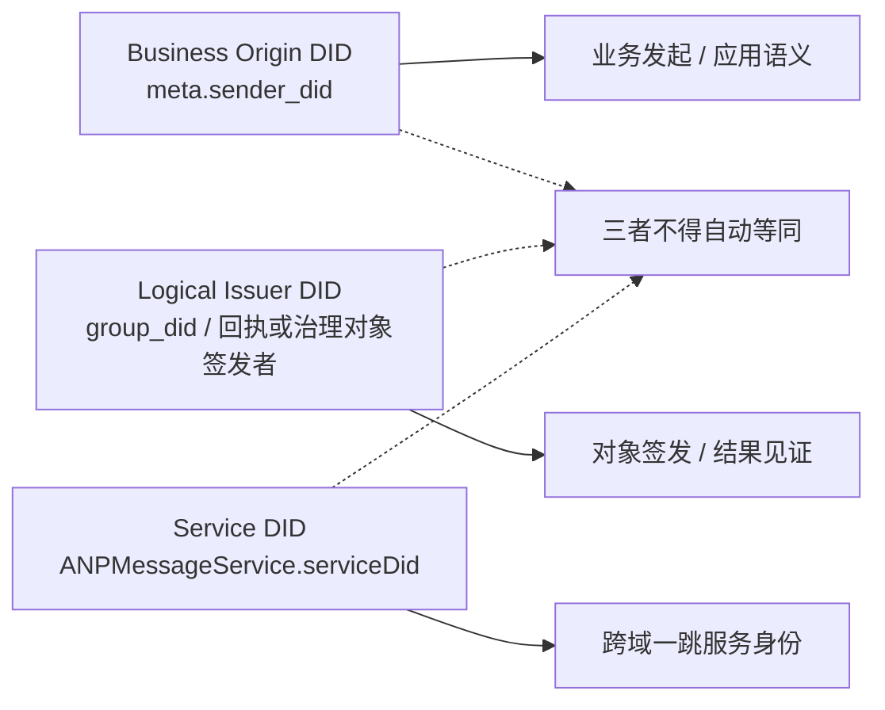
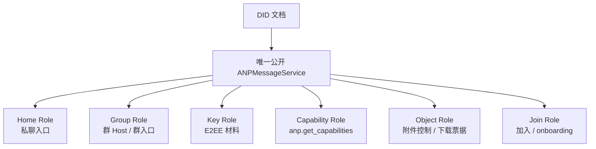
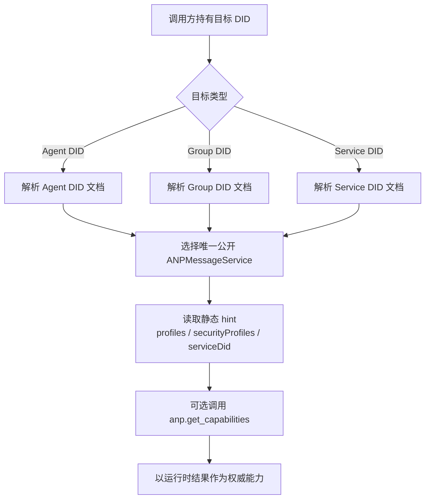

> 日本語参考訳（機械翻訳・未校閲）。規範となるのは原文です。コード例・識別子・規範キーワードは原文を保持しています。
> 原文: [chinese/deprecated/02-身份与发现.md](../../../chinese/deprecated/02-身份与发现.md) / 基準コミット: `0837cfdfaf4ddcf834f0890ddaf34fc4c824e066`

# ANP プロフィール 2: アイデンティティとディスカバリー

- 文書番号: ANP-P2
- タイトル:アイデンティティとディスカバリー
- ステータス:公開
- バージョン: 1.1
- 原文言語: 中文 / このページは日本語参考訳
- 適用範囲:このプロフィールはANPの代理店の同一性、グループ同一性、サービス発見およびサービスのエンドポイントの解釈に適用される。

---

## 1. 目的:

このプロファイルは、AMP のマークとディスカバリーモデルを定義します。

1. エージェントとグループがDIDを使用して自分自身を表現する方法。
2. DID 文書のどの属性が ANP に関連しないか
3. DID 文書で AMP サービスエンドポイントが表現される方法
4. コールアが DID 文書に基づくインタラクティブな AMP サービスを見つける方法
5. DID ドキュメントに動的状態が置かれないもの。

このプロファイルは定義しません。

- (a) DDメソッド自体;
- DDはプロトコル自体を解析します。
- (a) 装置印;
- 内部コピーの同期;
- 特定のE2EEのアルゴリズムの細部;
- 特定のグループの状態機械細部。

---

## 2. 用語と規範的な関与

### 2.1 仮鍵

このテキスト **MUST**、**MUST NOT**、**REQUIRED**、**SHALL**、**SHALL NOT**、**SHOULD**、**SHOULD NOT**、**RECOMMENDED**、**NOT RECOMMENDED**、**MAY**、**OPTIONAL** 資本金を基準とする規範的な要件として解釈される。

### 2.2 用語集

- **エージェントID**: は、エージェントプロトコルにキーの DID を表します。
- **グループID**: グループプロトコルの対象の DID を表します。
- **コントローラー**: DID ドキュメントを更新したり、DID を代わって制御されたアクションを開始できるエンティティティティティティティ
- **ANPMessageサービス**: DID 文書公開 UAMP サービス入口
- **連邦サービスDID**: デプロイパーティがサービスHTTP IDにクロスドメインサービスでサービスを提供するDIDは、通常、 `ANPMessageService.serviceDid` 宣言。
- **インフォメーション**: DID に基づいて DID ドキュメントをパースし、適切なサービス終了点を選択して、その後の対話プロセスを完了します。

---

## 3. 識別モデル

### 3.1 基本原則

ANPは、次のファーストクラスのマーキングを採用しています。

- **エージェントID**
- **グループID**

ANPプロトコルレイヤー **なし、いいえ。**デバイス DID、端末 DID、セッション DID、または DID のコピーを定義します。
複数の操作コピー、複数のデバイス、および複数のインストーラーが特定の実現に含まれている場合、これらのエンティティティはエージェント内にあり、AMP 境界線を横断しません。

### 3.2 エージェントID

ANPプロトコルの対象としてメッセージを送信または受信できるすべてのエージェント **MUST** 保持 1 `agent_did`。

`agent_did` のために:

1. (b) 送信者と直接メッセージの受信者の識別。
2. (b) 制御操作のスポンサーの特定;
3. (b) 利用可能なサービスエンドポイントをパースする。
4. (b) 安全上敷の公に利用できる材料へのアクセス;
5. 権限と監査文の委任を確立します。

### 3.3 グループID

境界線、引用符、管理または大量メッセージで送信できるグループ **MUST** 保持 1 `group_did`。

`group_did` のために:

1. (a) グループとしてのグローバルレイヤー化
2. グループ発見とガバナンスのアンカーとして;
3. グループ管理とコミュニティメッセージの共通の目標として。
4. (a) グループサービスエンドポイントとしてのディスカバリーポータル
5. プロファイルをフォローアップグループとして暗号化するためのバインディングオブジェクトとして。

### 3.4 暗号化マーク分離

続いているセキュリティオーバーレイプロファイルが独立したパスワード内部識別子を定義する場合、例えば `crypto_group_id`、`session_id`、`channel_id`と:

- かわい... **MAY** とりあえず `group_did` または `agent_did` 異なる;
- プロフィール **MUST** (b) これらの内部マーキングが DID でエンコードされるかを指定するため
- こんなにバインディング。 **MUST** 受取人によって確認することができます。

### 3.5 ANPのアイデンティティ 層

文書間で異なるレベルのアイデンティティを混合することを避けるため、APPは少なくとも3つのDIDの区別します。

1. **業務用原産品 DID**: 業務スポンサーやビジネスのロジックの対象、例えば、リクエスト `meta.sender_did`；
2. **論理発行体 DID**: 特定の通知の発行者、論理的に表現するガバナンスの返信またはオブジェクトなど。 `group_did`；
3. **サービスID**: コールするホップレベルのサービスを実行するサービス ID、すなわち、 `ANPMessageService.serviceDid`。

上記3つのステータスのカテゴリ:

- **MUST NOT** (a) 同じ主題と自動的に考慮される;
- **MUST** (a) 対応するプロファイルは、署名を担当している人物を明らかにし、承認者と誰がルーティングを担当するかを明確に示します。
- ブロガーは、政府が法律に関係しないと述べています。`serviceDid` **MUST NOT** (a) 代替事業体 DID;
- `serviceDid` 本サービスを取得する唯一の方法は、政府が呼び出される「公務員の入り口がジャンプコールを実行している」と言うことです。**MUST NOT** 直接グループに参加するために使われています。 `owner/admin/member` など。

---


ANPの最も簡単に読みやすい場所の一つは、ビジネス送信者、オブジェクト発行者、および1つのジャンプサービスを混合することです。次の図では、各製品に対する後続的な参照のために同じビューでDIDの3層を置きます。



*図P2-1:APP IDの stratification (非放射性)。*

その後のドキュメントが署名、承認、またはルートを必要とする場合、デフォルトリーダーではなく、DID のどのレベルがそれ自身で使用されているかを指定するべきです。
## 4. AMP の DID 文書のための解釈ルール

### 4.1 一般ルール

ANP では、DID 文書は以下の業務を行なっています。

1. (b) 安定したアイデンティティポータルを提供。
2. (a) 認証関係と信頼されるキー素材の宣言
3. 万博サービスエンドポイント;
4. サービスの配達の鉛。

DID ドキュメント **MUST NOT** と考慮される:

- (a) リアルタイムのニュースステータスデータベース;
- グループメンバーのリアルタイムストレージ。
- オンラインストレージ;
- HFキーの回転丸太;
- エージェントの内部コピーのリスト。

### 4.2 DIDドキュメントの最小要件

ANP で使用される DID 文書の場合:

- `id` **MUST** 存在;
- 発見され、インタラクティブなDIDの場合`service` **MUST** 存在;
- 認証や参照のみの DID の場合、`service` **MAY** (a) デフォルト;
- スポンサーとしてリクエストに表示されるDIDの場合、`authentication` **MUST** 存在;
- 宣言署名をサポートしている場合`assertionMethod` **SHOULD** 存在;
- 暗号化をサポートしている場合は、オーバーレイは最初に使用できるようにします。`keyAgreement` **SHOULD** 存在;
- `capabilityInvocation` ブログは、情報の人気でアクセスしやすいソースです。**MAY** 既存のものではなく、v1の最小相互運用可能な要件には属しません。

### 4.3 DID文書のミニミス原則

DID文書の情報 **SHOULD** 維持:

- 低い頻度変更;
- 低い感受性;
- 低い関連性;
- DIDの使用に直接関連した。

(a)上記要件を満たしていない要素**SHOULD** 提供されているサービスエンドポイントに移動し、DID ドキュメントに直接埋め込む代わりに。

---

## 5. エージェント DID コード

### 5.1 エージェントの DID 文書が必要 セマティック

ANP のエージェント DID ドキュメント **MUST** 少なくとも言う:

1. `id`
2. 少なくとも 1 つで、インタラクションをフォローできます。 `service`

### 5.2 認定関係

エージェント DID がビジネススポンサーである場合、 `meta.sender_did`、または使用される任意のステートメントに表示 `anp-rfc9421-origin-proof-v1` 証拠のためのビジネス `keyid` 認証リンクで、DID文書 **MUST** 提供: `authentication` 関係。

リクエストがなれば `auth.origin_proof`、認証者 **MUST** 検査検査 `keyid` 指名認証方法が DID ドキュメントの対象であるかどうか `authentication` 関係の承認。

エージェント DID がパッシブリファレンス、オブジェクトアトリビューション、オフラインコンテキスト検証のみに使用され、リクエストスポンサーとして ANP インタラクションに参加していない場合、 `authentication` **MAY** デフォルト。

エージェントがグループマネージャーのアサーションをする必要がある場合、宣言されたオブジェクト、署名されたコントロールオブジェクト、その後DIDドキュメント **SHOULD** 提供: `assertionMethod` 関係。

### 5.3 主な相談関係

エージェントがE2EE Overlayをサポートしている場合のDID文書 **SHOULD** 提供: `keyAgreement` 関係。  
のために `keyAgreement` 使用される検証方法 **MUST** 機密情報を交渉または受信する際に DID が使用できる公開鍵のみ。

### 5.4 サービスエンドポイント

ダイレクト、資本金、オブジェクトコントロールなどのAMP機能のレシートをサポートしている場合、エージェントDIDドキュメントを使用できます。**MUST** 少なくとも1つ。 `ANPMessageService`。

ユニファイドサービスエントランス **MAY** 以下は、以下の機能も実施しています。

- 正面玄関への直接情報
- 能力相談;
- 安全に資料へのアクセスを監視する
- オブジェクト制御とオブジェクトダウンロードポータルが見つかった。

デプロイメントが内部で複数のコンポーネントにこれらの機能を分割している場合、このスプリットは実現の詳細は、DID ドキュメント **SHOULD NOT** これらの機能については、別々のAPPサービスタイプが公開されます。

公開可能なアンexes の制御手段 **MUST** 未開通のDID文書を介した非アニムース `ANPMessageService` 入る。デプロイパーティが独立したサブコンポテントサービス、キーサービスまたはグループホストサブコンポーネントへのリクエストを内部化するかにかかわらず、外部標準サービスのディスカバリーモデルを変更しません。

---

## 6. グループIDコード

### 6.1 グループ DID ドキュメント 必須 セマティックス

ANPグループDドキュメント **MUST** 少なくとも言う:

1. `id`
2. `controller`
3. 少なくとも1つのグループ サービス端(%)`ANPMessageService`）

### 6.2 クラスタ制御

`controller` 単一の DID か複数の DID はある場合もあります。
複数のコントローラーがある場合、それらの間のコラボレーションの内部メカニズムは、このプロファイルでは定義されていないが、:

- DID ドキュメントの更新の有効性 **MUST** DID メソッドで
- コールア **MUST** その結果の DID ドキュメントの解像度に基づいています。
- クラスタ・ガバナンス **MUST** クラスター内のロールと委任規則のさらなる定義。

### 6.3 グループガバナンスの認定関係

支援サービス `anp.group.base.v1` グループDID文書:

- `assertionMethod` **MUST** 存在;
- `capabilityInvocation` **MAY** 信頼関係は、追加のガバナンス能力として存在しますが、置換しません `assertionMethod`。

グループマネージャー、グループポリシーオブジェクト、およびグループステータスオブジェクトが認証のために署名する必要がある場合の認証パーティー **MUST** DID ドキュメントを使用して認証関係を許します。

### 6.4 グループDID文書禁止内容

以下は要素です。 **MUST NOT** 直接埋め込まれたグループDID文書:

- ダイナミックメンバーのリスト
- 会員のオンラインリスト
- 現在のメッセージのシリアル番号;
- 現在のグループ epoch;
- (a) 情報によるメールのステータス;
- (a) 1回にプレキーの一覧。
- MLS KeyPackage リアルタイムコレクション;
- HF は招待/グループガバナンスのキューを変更します。
- エージェントの内部コピーのリスト。

### 6.5 グループ DID 文書の任意

以下は要素です。 **MAY** 既存の機密開示は避けなければなりません:

- (a) グループ表示名;
- グループ アイコンの参照;
- グループのパブリック 説明;
- グループのパブリック戦略の概要;
- (a) ドキュメント版情報。
- サービス容量のまとめ。

任意分野が明らかなプライバシーの開示または関連性を危険にさらす可能性がある場合、それが達成される当事者 **SHOULD NOT** DID ドキュメントに書き込んで、制限されたサービスエンドポイントに移動します。

---

## 7. AMP サービスエンドポイントタイプ

### 7.1 一般規定

DID ドキュメントに基づく ANP `service` サービスの発見を行なう。
AMP サービスエンドポイントオブジェクト **MUST** と:

- `id`
- `type`
- `serviceEndpoint`

サービスポイントオブジェクト **MAY** 静的ヒントを数多く運ぶが、v1 標準は以下だけを必要とする:

- `profiles`
- `securityProfiles`
- `serviceDid`

AMP は、現在のバージョンで公開されている DID 文書の標準的なサービスタイプです。 **SHOULD** 利用のみ `ANPMessageService`。  
ファイナイザーが社内のプライベートな会話、グループ、キー、オブジェクト、またはクロスドメインのリレーを複数のコンポーネントに分解する場合、この分割はDIDファイル内の詳細と独立した基準の関連性の問題です `service type`。

境界線を横断する際のサービス選択の曖昧性を減らすために各DID文書 **MUST** 一方のクロスドメインのコール可能なだけが露出されました `ANPMessageService`。  
複数のサービスコンポーネントが社内に存在している場合は、 **MUST** 同じパブリックドメインに制限される。 `ANPMessageService` 以下。

### 7.2 `ANPMessageService`

#### 7.2.1 科学

`ANPMessageService` DID 文書に公開されている統一されたメッセージとインタラクティブなエントリです。

#### 7.2.2 利用

- インフォメーション `direct.send`
- インフォメーション `group.get_info`、`group.send`、`group.e2ee.send` グループ管理/グループ E2EE関連アクション
- 提供: `anp.get_capabilities`
- ダイレクト/グループE2EE公開アクセス
- ロード `group.e2ee.notice` 受信または配信(サポートグループE2EEが展開されている場合)
- 提供: `attachment.create_slot`、`attachment.commit_object`、`attachment.abort_object`、`attachment.get_download_ticket`
- ダウンロードエントリ(デプロイメントでサポートされている場合)で見つかったサービスアンカーは、オブジェクトHTTP(S)として

公開可能なアンexes の制御手段 **MUST** それでもDIDの露出を通した統一 `ANPMessageService` 入る。デプロイパーティが独立したサブコンポテントサービス、キーサービスまたはグループホストサブコンポーネントへのリクエストを内部化するかにかかわらず、外部標準サービスのディスカバリーモデルを変更しません。

#### 7.2.3 条件

- 積極的に発見され、対話的であることができる代表的なDID文書 **MUST** 少なくとも1つ。 `ANPMessageService`
- グループID文書 **MUST** 少なくとも1つ。 `ANPMessageService`
- 必要であれば `ANPMessageService` 通話にクロスドメインサービスに関与し、サービスエントリが行われます。 **MUST** 新着情報 `serviceDid`
- 内部の複数のコンポーネントの存在が達成される場合の DID 文書 **MUST** 単一のエントリーポイントが1つだけ露出され、より細かい粒子容量境界が運用能力交渉によって返されました
- 公益サービススコープ法は、主要な材料のアプローチとアンナックス制御面を含みます。**MUST** 統一された入口を使って。 `serviceDid` 対応するプロファイルが明示的にエンドポイントローカルとして宣言しない限り、ターゲットサービス ID アンカーとして


横断的なサービス選択性を低下させるために、V1は単一の公開露出だけを励ます。 `ANPMessageService`. 次の図は、この統一されたエントリーを共通の内部論理的役割と組み合わせ、読者が「公共サービスタイプ」と「労働の内分裂」の間で区別できるようにします。



*図P2-2:ANPMmessageServiceと内部ロール関係の調和(非規範的)。*

このチャートのロールは内部容量のデモンストレーションだけであり、新しいDIDを構成するものではありません。 `service type`ノルは、標準化されたサービス検出分野に代わるものとして使用すべきです。
### 7.3 `ANPMessageService` 論理的役割

このセクションは、このセクションの唯一の目的のためです**非定着ノート**統一された入口の背後にある共通の機能境界;それらはDIDファイルで独立したサービス タイプではないです、またはV1のサービス選択分野です。

#### 7.3.1 ホームロール

ホーム ロールは、受信のためのエージェント側の主なアクセス機能を示します `direct.send`、機能情報を返すし、さらにインタラクティブなパスを示します。

#### 7.3.2 キーの役割

キーロールは、セキュリティ上敷に必要な公に利用可能な材料を発行または発見する能力を示します。

- 開示の求めに応じてE2EEをダイレクトメッセージ
- E2EEグループを検知するために必要なガイダンス素材
- 続いているセキュリティプロファイル定義のパブリックオブジェクトを見つけます

#### 7.3.3 グループの役割

グループまたはホスト機能のメインエントランスを表すグループロール:

- プロセス `group.create` グループの経営行動
- インフォメーション `group.send` とりあえず `group.e2ee.send`
- 露出グループ戦略、グループE2EE機能または関連するアクセス制御
- 権限ポータルでグループステータス変更をシーケンス

#### 7.3.4 役割を結ぼう

役割を担って、招待状関連のポータルを入力するポジションにあることを示します。

#### 7.3.5 機能の役割

機能のロールは、アクセスを交渉する能力を示します。

#### 7.3.6 オブジェクトの役割

オブジェクトロールは、オブジェクトのオブジェクトをアップロードしたり、オブジェクトのアクセス制御、ドキュメントのダウンロードやエントリポイントからオブジェクトをダウンロードしたりする機能を示します。

#### 7.3.7 クロスドメイン転送機能

導入事例 **MAY** あり。 `ANPMessageService` トランスドメイン転送またはドメインゲートウェイ機能がバックの後ろで実行されますが、現在のバージョン **なし、いいえ。**この関数のスタンドアローン DID サービスタイプを定義します。

デプロイメント者がサービスにアクセスできる場合、ドメインゲートウェイまたはフィールドサービスは外部HTTP IDを実行しています。**SHOULD** ドメインネーム所有者が保持する連邦サービスDIDは、通常のエージェントDIDまたはグループDIDの代わりに。 対応ルールはP8によって定義されます。

#### 7.3.8 透明性のディレクトリと監査インデックス

デプロイメントがディレクトリ、透明なログ、または監査インデックスの透明性をサポートしている場合 **MAY** として `ANPMessageService` ; 現在のバージョンは、スタンドアローンの DID サービスタイプを定義しません。

---

## 8. ANPサービスエンドポイント拡張フィールド

横断面では、このプロファイルは、v1静的ヒントとして小さなフィールドのみを使用しています。機能情報の残り **SHOULD** 一番下まで。 `anp.get_capabilities`。

### 8.1 `profiles`

- タイプ: 文字列配列
- Semantic: サービスエンドポイントが直接サポートするAMPプロファイルコレクション
- リクエスト:**SHOULD**
- Note: このフィールドは静的、キャッシュ可能な粗粒密度ヒントだけを表現し、実行時の容量の相談には代用されません。

### 8.2 `securityProfiles`

- タイプ: 文字列配列
- 管理: サービスエンドポイントでサポートされるセキュリティモードの収集
- リクエスト:**SHOULD**
- Note: このフィールドはエンドポイントのサポート範囲を表し、すべてのメソッドがすべての安全モードで利用できることを保証しません。

### 8.3 `acceptedContentTypes`

- タイプ: 文字列配列
- 著名: サービスエンドポイントに受け入れられるメッセージベースのコンテンツのコレクション
- リクエスト:**v1標準のDIDヒントを動作させない**
- 注意:
  - こちらの情報を調べる必要があれば、情報も使えます。**SHOULD** パス。 `anp.get_capabilities` 返品・返金
  - DID ドキュメントにこのフィールドが表示された場合、受信者 **MAY** 拡大の達成手段として考慮してください。

### 8.4 `acceptedObjectTypes`

- タイプ: 文字列配列
- 管理: サービス終了ポイントに許容される制御レベルの目的のコレクション
- リクエスト:**v1標準のDIDヒントを動作させない**
- 注: DID 文書に静的ではなく、実行時間機能として返すことが推奨されます。

### 8.5 `priority`

- タイプ: 整数
- 皮の優先順位:
- リクエスト:**v1標準のDIDヒントを動作させない**
- 注意:
  - v1 仕様は DID ドキュメントに依存しません `priority` (b) サービスの選択肢
  - フィールドが自己定義されている場合は、プライベート拡張と見なされます。

### 8.6 `authSchemes`

- タイプ: 文字列配列
- Semantic: コールア??? サービスコールア認証方式は、このエンドポイントでサポート
- リクエスト:**v1標準のDIDヒントを動作させない**
- 注意:
  - この機能は、ゲートウェイの構成で通常変更されます。
  - 合格する方が良いです。 `anp.get_capabilities` 露出;
  - と... **なし、いいえ。** 業務レベルの説明 `anp-rfc9421-origin-proof-v1` . 証拠の負荷のためのフォーマット。

### 8.7 `serviceDid`

- タイプ: ひも
- 著名: の `ANPMessageService` ドメインサービスがHTTP認証に利用されるDID
- リクエスト: エンドポイントがサービスコールにクロスドメインサービスに関与している場合、 **MUST**

ルール:

1. `serviceDid` **MUST** DID 文字列ではなく、DID URL です。
2. HTTPメッセージの外部レイヤー 署名 `keyid` **MUST** それにポイントをつけて下さい。 `serviceDid` 一部 - `authentication` (a) 関係の承認の確認方法
3. あり。 `did:web` とりあえず `did:wba` 導入,`serviceDid` **SHOULD** (a) nud ドメイン DID の使用を優先する。
4. `serviceDid` 式は「境界線を越えるサービスステータス」で、 `meta.sender_did` 表現する事業体のアイデンティティ;
5. `serviceDid` 特定の実行時間チェックプロセスはP8によって定義されます;
6. DID ドキュメント `serviceDid` P8 の実行時間の完全な検証に基づいている真の信頼構築であるヒントは、あります。
7. はいサービススコープ方式、コータ **SHOULD** - それを置きます。 `meta.target.did` ターゲットを絞る公開に結びます。 `ANPMessageService.serviceDid`; オブジェクト制御、重要な材料アプローチとグループ入力のアプローチは、特定のプロファイルが明示的にエンドポイントローカルとして宣言されていない限り、この原則に従う。

---

## 9. プロセスを探索


この章の次のセクションでは、エージェント、グループ、および `serviceDid` 次のチャートは、最終的に公開される3つのパスの一般的な概要を与えます。 `ANPMessageService` 稼働時間能力に関する相談



*図P2-3:エージェント/グループ/サービスのためのユニークなディスカバリープロセス(非派生)。*

9.1、9.2、9.3の次の読みは、3つの別々の発見哲学ではなく、この統一された発見マップの簡潔化として理解することができます。
### 9.1 エージェントディスカバリー

えー。 `agent_did` 発見プロセスは次の通りです:

1. パーシング `agent_did`, DID ドキュメントを取得する;
2. フィードバック `service` リスト;
3. 選択するだけクロスエリア `ANPMessageService`；
4. サービスコールにクロスドメインサービスが続くと、サービスエントリを読む `serviceDid`；
5. 結合される `profiles`、`securityProfiles`稼働時間容量の相談とローカル戦略の結果は、この統合ポータルで利用可能な特定の機能を特定します。
6. 可視交渉機能が必要な場合は、同じ入口に電話をかけます。 `anp.get_capabilities`。

### 9.2 グループが見つけられました

えー。 `group_did` 発見プロセスは次の通りです:

1. パーシング `group_did`, DID ドキュメントを取得する;
2. 読むだけ `ANPMessageService`；
3. サービスコールにクロスドメインサービスが続くと、サービスエントリを読む `serviceDid`；
4. 結合される `profiles`、`securityProfiles`, 実行中の時間の容量の相談と、グループ管理のための機能を決定するためのローカル戦略の結果, グループメッセージ, メンバーシップまたはグループE2EE この統一ポータルで利用可能;
5. グループ E2EE が有効になっている場合、プロファイルの暗号化のためにグループに縛られたグループの公然利用可能な材料は、パスワード結果と関連する制御アクションを同じ入口で配信する機能です。 サイドツーサイド入力マテリアルは、エージェント DID の単一のエントリポイントに残っています。

### 9.3 サービスDIDの発見

呼び出し側がサービススコープ方式の対象を把握する場合 `serviceDid` プロセスは次の通りです:

1. パーシング `serviceDid` 対応するDID文書;
2. 詳しくはこちら `serviceDid` 対応する `ANPMessageService`；
3. フィードバック `serviceEndpoint` 静的ヒントを使って;
4. 境界線に精密なものが必要な場合は、同じ入口を呼び出します。 `anp.get_capabilities`；
5. P8 で指定されたサービス ID の認証が適用された後のみ `serviceDid` 信頼できるクロスドメインサービスステータスを考慮してください。

添付ファイルのダウンロード機器の買収、コーダ **MUST** 添付リストから元のメッセージ送信者DIDを、発見のためのアンカーとして運ぶことによって公衆をパース `ANPMessageService`; グループシーンでは、DIDは元のグループメッセージ送信者からではなく取られます `group_did`. コールアー **MUST NOT** のみどころ `object_uri` . URLドメイン名は、フェイスサービスを制御する逆にします。


### 9.4 サービスの選択

複数の候補者が複数の人が存在する場合の呼び出し **MUST** 選択は、次の順序で行われます。

1. 質問をしただけ。 `profile` フィルタリング;
2. リクエストに応じて。 `security_profile` フィルタリング;
3. 実行中の容量の相談の結果は、その後、権威的な検証として使用されます。
4. 複数の結果がまだある場合は、ローカル戦略に従って選択してください。

v1 コード **なし、いいえ。**DID文書の信頼性 `supportedMethods`、`logicalRoles` または `priority` 標準的なサービス選択。

### 9.5 キャッシュ

コールア **MAY** キャッシュID解析結果とサービス選択結果。  
しかし、次の場合では、 **SHOULD** 解決:

- 署名認証が失敗しました。
- 重要な相談は失敗しました;
- (a) サービスエンドポイントのリターン機能の変更;
- 制御の DID の中断された変更;
- `serviceDid` 検証が失敗しました。
- エンドポイントオリジンバインディングが失敗しました。
- 静的ヒントは、実行時間容量結果と競合します。
- ローカルキャッシュが期限切れになります。

---

## 10. セキュリティー・オーバーレイに関するDID文書の関連

### 10.1 `keyAgreement` 利用条件

エージェント DID またはグループ DID ドキュメントが宣言されている場合 `keyAgreement`、フォローアップは安全します **MUST** DIDの機密情報を受信または交渉できるメソッドのみを使用してください。

### 10.2 署名認証関係

オブジェクトが DID で主張されると主張する場合:

利用場所 `auth.origin_proof` リクエスト、認証パーティー **MUST** 認定制御として機能し、それをチェックアウトすると考えてください。 `authentication`。

- 被験者が認定管理である場合、認証パーティー **SHOULD** 検査検査 `authentication`；
- 人がステートメントまたは署名主張の著者である場合、認証パーティー **SHOULD** 検査検査 `assertionMethod`；
- ターゲットがガバナンスコールの場合、認証パーティー **MAY** 検査検査 `capabilityInvocation`しかし、これはv1の最小相互運用可能な要件ではありません。

### 10.3 動的セキュリティ材料の外部化

以下は要素です。 **SHOULD** DID 文書に埋め込まれるのではなく、管理されたサービスエンドポイントによって提供:

- 開口部材の高周波回転;
- (a) 単一時間の指導材料;
- (b) EPoch関連材料;
- ダイナミックグループステータスの概要

---

## 11. グループDIDとグループガバナンス

### 11.1 グループDIDの役割

`group_did` アプリケーションのレイヤーをグループ内でグローバルに識別し、内部 ID の特定のコードには相当しません。

### 11.2 グループガバナンスのアウトプレース

グループ会員関係、ロール承認、招待状ステータス、会員資格、戦略版、グループステータス集計など**SHOULD** によって:

- グループ `ANPMessageService`
- または将来のグループガバナンス

DID ドキュメントではなく、署名を付与します。

### 11.3 グループ戦略による制御の分離

DID ドキュメント `controller` DID 文書自体をコントロールしている人だけ。
グループ内で「戦略の追加、キック、変更」は、アプリケーションレベルでのガバナンスルールであり、直接リンクされていない `controller` 機械的特化。
作家ではない。`serviceDid` つまり、サービスコールは直接グループに解釈されないことを意味します。 `owner/admin/member` そういうビジネスの役目。

---

## 12. プライバシーと最低限の開示

### 12.1 サービスエンドポイントの最小化

DID ドキュメント `service` アイテム **SHOULD** 最小化。  
公にサービスが発見されなければ、 **SHOULD NOT** DID ドキュメントに表示される。

### 12.2 関係制御

アクコンプリザー **SHOULD** 避けて下さい:

- 複数のDID文書に非常に関連性の高いユニークなエンドポイントを再利用します。
- (a) 組織構造、展開スプロールおよび内部の役割配分に直接余分に置くことができるDIDファイルの説明の配置。
- DID文書による情報、アクティビティ、オンラインステータス、内部コピー構造の量を把握します。

### 12.3 開閉の解除

必要な情報開示 **MAY** (a) DID 文書を差し込むため  
管理された情報へのアクセス **SHOULD** サービスのエンドポイントを制限することで、返品。

---

## 13. 最小相互運用可能な要件

製品を少なくともマッチする製品 **MUST** 土産:

1. エージェントは、 `agent_did`；
2. グループ会社 `group_did`；
3. エージェントのDIDとグループDID文書の少なくとも1つ `ANPMessageService`；
4. DID文書に基づくサービスディスカバリーをサポート
5. 静的ヒントを少なくともサポート `profiles`、`securityProfiles`、`serviceDid`；
6. ランタイム機能と `anp.get_capabilities` (a) 権威ある者
7. DID ドキュメントに動的グループ状態を埋め込むことはありません。
8. デバイス/コピーコンセプトをプロトコルレイヤーに導入しないでください。

---

## 14. 事例:

### 14.1 Agent DID ドキュメントクリップの例

```json
{
  "id": "did:example:agent-a",
  "verificationMethod": [
    {
      "id": "did:example:agent-a#sig-1",
      "type": "JsonWebKey2020",
      "controller": "did:example:agent-a",
      "publicKeyJwk": {
        "kty": "OKP",
        "crv": "Ed25519",
        "x": "..."
      }
    },
    {
      "id": "did:example:agent-a#ka-1",
      "type": "JsonWebKey2020",
      "controller": "did:example:agent-a",
      "publicKeyJwk": {
        "kty": "OKP",
        "crv": "X25519",
        "x": "..."
      }
    }
  ],
  "authentication": [
    "did:example:agent-a#sig-1"
  ],
  "assertionMethod": [
    "did:example:agent-a#sig-1"
  ],
  "keyAgreement": [
    "did:example:agent-a#ka-1"
  ],
  "service": [
    {
      "id": "did:example:agent-a#message",
      "type": "ANPMessageService",
      "serviceEndpoint": "https://agent-a.example.com/anp",
      "serviceDid": "did:example:domain-a",
      "profiles": [
        "anp.core.binding.v1",
        "anp.direct.base.v1",
        "anp.direct.e2ee.v1",
        "anp.attachment.v1"
      ],
      "securityProfiles": [
        "transport-protected",
        "direct-e2ee"
      ]
    }
  ]
}
```

### 14.2 グループ DID ドキュメントクリップの例

```json
{
  "id": "did:example:group-123",
  "controller": [
    "did:example:group-host",
    "did:example:group-admin-controller"
  ],
  "verificationMethod": [
    {
      "id": "did:example:group-123#gov-1",
      "type": "JsonWebKey2020",
      "controller": "did:example:group-123",
      "publicKeyJwk": {
        "kty": "OKP",
        "crv": "Ed25519",
        "x": "..."
      }
    }
  ],
  "assertionMethod": [
    "did:example:group-123#gov-1"
  ],
  "service": [
    {
      "id": "did:example:group-123#message",
      "type": "ANPMessageService",
      "serviceEndpoint": "https://group-host.example.com/anp/groups/group-123",
      "serviceDid": "did:example:group-host-domain",
      "profiles": [
        "anp.core.binding.v1",
        "anp.group.base.v1",
        "anp.group.e2ee.v1"
      ],
      "securityProfiles": [
        "transport-protected",
        "group-e2ee"
      ]
    }
  ]
}
```

---

## 15. 参加登録フォームの設置場所

この標準のサブシーケントバージョン **SHOULD** 下記の登録フォームを作成します。

1. ANP DIDサービスタイプ登録フォーム;
2. (a) AMP サービスエンドポイントの延長フィールド登録フォーム;
3. (a) AMP ID エラー番号登録フォーム;
4. AMPグループガバナンスオブジェクトタイプ登録フォーム。

---

## 16. 業績の参考書(非定性)

本サイトに着陸する際に、次の原則が実現する者にとって有用である場合があります。

- DID 文書は「安定したアクセスポイント」、"リアルタイムステータステーブル";
- サービスエンドポイントは「ディスカバリーアンカー」ではなく、「すべてのデータコンテナ」ではありません。
- ダイナミックな機能が、可能な限り高まる `anp.get_capabilities` DID 文書に積み重ねられていないリターン;
- グループ DID は「アプリケーション層識別」であり、「すべてのパスワード内部状態の唯一のシーケンス」ではありません。
- 機器、コピー、内部のインストーラーなどのコンセプトはエージェント内にあり、ラインプロトコルを入力しません。