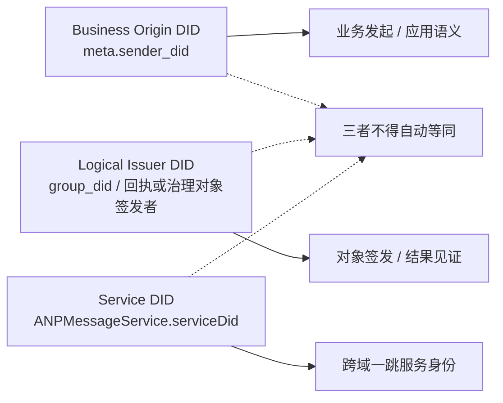
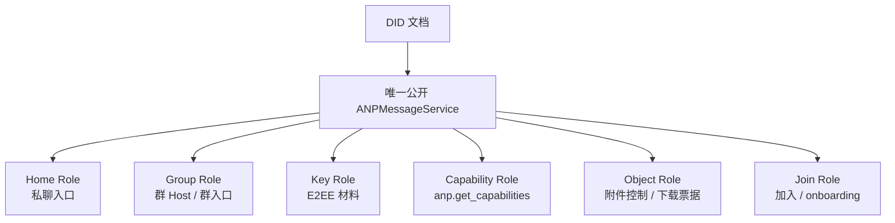
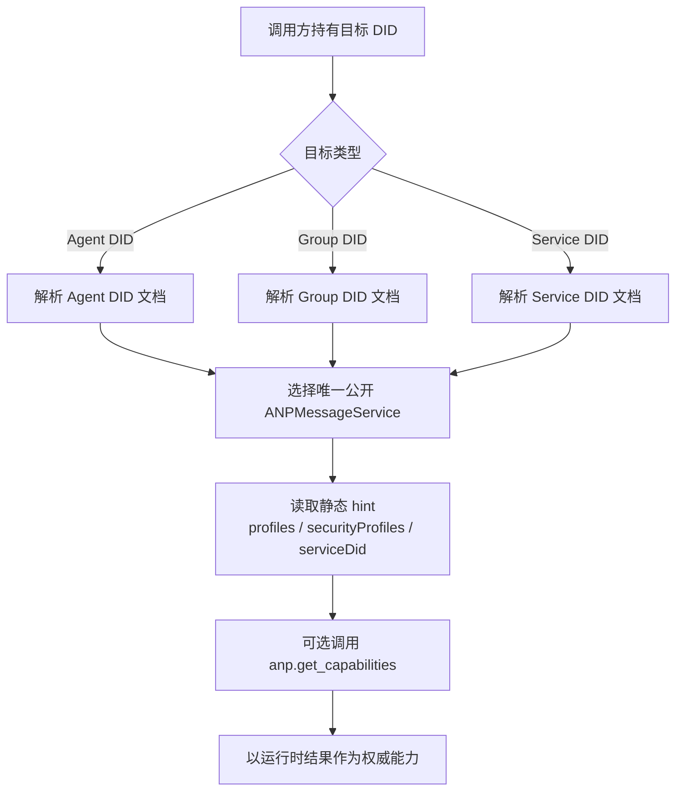

<!-- translation-review: full; source=chinese/deprecated/02-身份与发现.md -->
> 日本語参考訳（原文全文照合・校閲済み）。廃止文書として保存された1.1/v1の旧版です。文書・身元・サービスの境界を現行版の内容に置き換えていません。
> 原文: [chinese/deprecated/02-身份与发现.md](../../../chinese/deprecated/02-身份与发现.md) / 基準コミット: `0837cfdfaf4ddcf834f0890ddaf34fc4c824e066`

# ANPプロファイル2：アイデンティティと発見

- 文書ID：ANP-P2
- タイトル：アイデンティティと発見
- 状態：公開済み（Released）
- バージョン：1.1
- 原文言語：中国語／本ページは日本語参考訳
- 適用範囲：ANPにおけるAgentとGroupのアイデンティティ、サービス発見、サービスエンドポイントの解釈。

---

## 1. 目的

本プロファイルは、ANPの識別モデルと発見モデルを定義し、次を規定します。

1. DIDを使ってAgentとGroupを表す方法。
2. DID文書内のどの属性がANPに規範的な意味を持つか。
3. DID文書でANPサービスエンドポイントを表す方法。
4. DID文書から、やり取りに利用できるANPサービスを発見する方法。
5. DID文書に含めてはならない動的状態。

本プロファイルでは、次を定義しません。

- DIDメソッドそのもの。
- DID解決のプロトコルそのもの。
- 端末の識別。
- 内部複製の同期。
- E2EEアルゴリズムの具体的な詳細。
- グループ状態機械の具体的な詳細。

---

## 2. 用語と規範上の慣例

### 2.1 規範キーワード

本書の**MUST**、**MUST NOT**、**REQUIRED**、**SHALL**、**SHALL NOT**、**SHOULD**、**SHOULD NOT**、**RECOMMENDED**、**NOT RECOMMENDED**、**MAY**、**OPTIONAL**は、大文字の場合に規範的な要求として解釈します。

### 2.2 用語

- **Agent DID**：Agentというプロトコル主体のDID。
- **Group DID**：Groupというプロトコル主体のDID。
- **Controller**：DID文書を更新したり、DIDに代わって制御された操作を開始したりできる主体。
- **ANPMessageService**：DID文書が外部へ公開する、統一されたANPサービスの入口。
- **フェデレーションサービスDID**：ドメイン間のサービス間HTTP認証に使うサービスDID。通常は`ANPMessageService.serviceDid`で宣言します。
- **発見**：DID文書を解決・解釈し、後続のやり取りに適したサービスエンドポイントを選ぶ処理。

---

## 3. アイデンティティモデル

### 3.1 基本原則

ANPは、次の第一級の識別を採用します。

- **Agent DID**
- **Group DID**

ANPのプロトコル層は、デバイスDID、端末DID、セッションDID、複製DIDを定義しません。
複数の稼働中の複製、端末、実行主体が存在しても、それらはAgentの内部実装上の問題であり、ANP相互運用の境界には含まれません。

### 3.2 Agent DID

ANPの主体としてメッセージを送受信できる各Agentは、`agent_did`を持たなければなりません（MUST）。

`agent_did`の用途は次のとおりです。

1. 直接メッセージの送受信者の識別。
2. 制御操作の開始者の識別。
3. 利用できるサービスエンドポイントの解決。
4. セキュリティオーバーレイが必要とする公開素材の取得。
5. 認可と監査のコンテキストの確立。

### 3.3 Group DID

ドメインをまたいで発見・参照・管理できる、またはメッセージを送信できる各Groupは、`group_did`を持たなければなりません（**MUST**）。

`group_did`の用途は次のとおりです。

1. グループのアプリケーション層のグローバル識別子。
2. グループの発見と管理の基点。
3. グループ管理とメッセージ送信に共通の宛先識別子。
4. グループサービスのエンドポイントを発見する入口。
5. 後続のグループ暗号化プロファイルのバインド対象。

### 3.4 暗号識別子を分離

後続のセキュリティオーバーレイが、`crypto_group_id`、`session_id`、`channel_id`などの独立した暗号処理内部の識別子を定義する場合、

- `group_did`や`agent_did`とは異なっていてもかまいません（**MAY**）。
- ただし、そのプロファイルは、内部識別子をDIDへ暗号学的に結び付ける方法を明示しなければなりません（**MUST**）。
- 受信者がその結び付けを検証できなければなりません（**MUST**）。

### 3.5 ANPのIDの階層

文書間で異なる層のIDが混同されないよう、ANPは少なくとも次の3種類を区別します。

1. **業務送信元DID（Business Origin DID）**：要求の`meta.sender_did`など、業務の開始者または論理送信主体。
2. **論理発行者DID（Logical Issuer DID）**：`group_did`など、通知、受領証、管理オブジェクトが論理的に代表する発行主体。
3. **サービスDID（Service DID）**：`ANPMessageService.serviceDid`、すなわちホップ単位のサービス間呼び出しのID。

これら3種類について、

- 自動的に同じ主体として扱ってはなりません（**MUST NOT**）。
- 各プロファイルは、署名、認可、ルーティングを誰が担うかを明示しなければなりません（**MUST**）。
- ドメイン間では、`serviceDid`を業務主体のDIDの代わりにしてはなりません（**MUST NOT**）。
- `serviceDid`が示すのは、1ホップのサービス呼び出しを行う公開入口だけです。グループの`owner/admin/member`などの業務ロールの判定へ直接使ってはなりません（**MUST NOT**）。

---

業務送信者、オブジェクト発行者、1ホップのサービスIDの混同は、ANPで特に起きやすい誤りです。次の図は3層をまとめ、後続のプロファイルが別々に参照できるようにします。



*図P2-1：ANPのIDの階層関係（非規範的）。*

後続文書が署名、認可、ルーティングを求める際は、3つの主体を同一視させるのではなく、使うDIDの層を明示することが望まれます。

## 4. DID文書のANPによる解釈規則

### 4.1 一般規則

ANPでDID文書が担うのは、次の役割です。

1. 安定したIDの入口を提供。
2. 認証関係と信頼できる鍵素材を宣言。
3. サービスエンドポイントを公開。
4. サービス発見の手掛かりを提供。

DID文書を、次のものとして扱ってはなりません（**MUST NOT**）。

- リアルタイムのメッセージ状態データベース。
- グループメンバーのリアルタイム格納先。
- オンライン状態の格納先。
- 高頻度の鍵ローテーションのログ。
- Agent内部の複製の一覧。

### 4.2 DID文書の最低要件

ANPで用いるDID文書について、

- `id`が存在しなければなりません（**MUST**）。
- 能動的に発見してやり取りするDIDには、`service`が必要です（**MUST**）。
- 検証や参照だけに使うDIDでは、`service`を省略してもかまいません（**MAY**）。
- 要求の業務送信元DIDとなるDIDには、`authentication`が必要です（**MUST**）。
- 宣言的な署名オブジェクトに対応する場合、`assertionMethod`が存在することが望まれます（**SHOULD**）。
- 暗号化オーバーレイに対応する場合、`keyAgreement`が存在することが望まれます（**SHOULD**）。
- `capabilityInvocation`は任意の拡張として存在してもかまいません（**MAY**）。v1の最低相互運用要件には含みません。

### 4.3 DID文書最小化の原則

DID文書の情報は、次の性質を保つことが望まれます（**SHOULD**）。

- 変更頻度が低い。
- 機微性が低い。
- 関連付けの度合いが低い。
- DIDの使用に直接関係する。

これに合わない内容はDID文書へ直接埋め込まず、制御されたサービスエンドポイントで提供することが望まれます（**SHOULD**）。

---

## 5. Agent DIDの規定

### 5.1 Agent DID文書に必要な意味

ANPのAgent DID文書は、少なくとも次を表さなければなりません（MUST）。

1. `id`
2. 後続のやり取りに利用できる`service`を少なくとも1つ。

### 5.2 認証関係

Agent DIDが業務開始者として`meta.sender_did`に現れる場合、または`anp-rfc9421-origin-proof-v1`を使う業務proofの`keyid`検証経路に現れる場合、DID文書に`authentication`関係を設けなければなりません（**MUST**）。

要求が`auth.origin_proof`を使う場合、認証者は`keyid`が指す認証メソッドが、そのDID文書の`authentication`関係で認められているか確認しなければなりません（**MUST**）。

受動的な参照、オブジェクト所有、オフライン検証だけに使い、要求開始者としてANPのやり取りへ参加しないAgent DIDでは、`authentication`を省略してもかまいません（**MAY**）。

グループ管理、宣言、署名付き制御オブジェクトについて主張する必要があれば、`assertionMethod`関係を設けることが望まれます（**SHOULD**）。

### 5.3 鍵合意関係

E2EE Overlayに対応するAgentのDID文書には、`keyAgreement`関係を設けることが望まれます（**SHOULD**）。
`keyAgreement`が参照する検証メソッドは、鍵合意または機密情報の受信のための公開鍵素材を表す用途に限らなければなりません（**MUST**）。

### 5.4 サービスエンドポイント

直接メッセージ、能力、オブジェクト制御など、能動的発見を必要とするANP機能を支援するAgent DID文書には、`ANPMessageService`を少なくとも1つ含めなければなりません（**MUST**）。

この統一された入口は、次の能力も担ってかまいません（**MAY**）。

- 直接メッセージの主要な入口。
- 能力交渉。
- セキュリティオーバーレイの公開素材へのアクセス。
- オブジェクト制御プレーンと、ダウンロード入口の発見。

内部で複数の部品に分けても、その分割は実装の詳細です。能力ごとに独立した複数のANPサービス種別をDID文書へ公開しないことが望まれます（**SHOULD NOT**）。

外部へ公開する添付の制御プレーンメソッドも、DID文書の統一`ANPMessageService`経由でアクセスしなければなりません（**MUST**）。内部でObject Service、Key Service、Group Hostへ振り分けても、外部の標準発見モデルは変わりません。

---

## 6. Group DIDの規定

### 6.1 Group DID文書に必要な意味

ANPのGroup DID文書は、少なくとも次を表さなければなりません（MUST）。

1. `id`
2. `controller`
3. グループサービスのエンドポイント（`ANPMessageService`）を少なくとも1つ。

### 6.2 グループの制御権

`controller`には単一または複数のDIDを指定できます。
複数のController間の内部協調は定義しません。ただし次に従います。

- DID文書更新の正当性は、DIDメソッドが保証しなければなりません（**MUST**）。
- 呼び出し元は、解決したDID文書を基準にしなければなりません（**MUST**）。
- グループ管理プロファイルは、内部ロールと認可規則をさらに定義しなければなりません（**MUST**）。

### 6.3 グループ管理の検証関係

`anp.group.base.v1`に対応するGroup DID文書では、

- `assertionMethod`が必要です（**MUST**）。
- `capabilityInvocation`を追加の管理能力委任の関係として設けてもかまいません（**MAY**）。ただし`assertionMethod`は置き換えません。

グループ管理、ポリシー、状態の各オブジェクトに署名が必要な場合、検証者はDID文書が認める検証関係を使わなければなりません（**MUST**）。

### 6.4 Group DID文書に含めてはならない内容

次をGroup DID文書へ直接埋め込んではなりません（MUST NOT）。

- 動的なメンバー一覧。
- オンラインメンバー一覧。
- 現在のメッセージシーケンス番号。
- 現在のグループepoch。
- メッセージごとの状態。
- ワンタイム事前鍵の一覧。
- MLS KeyPackageのリアルタイムの集合。
- 頻繁に変わる招待・グループ管理のキュー。
- Agent内部の複製一覧。

### 6.5 Group DID文書の任意内容

次を含めてもかまいませんが（**MAY**）、機微な情報の開示は避ける必要があります。

- グループの表示名。
- グループアイコンへの参照。
- グループの公開説明。
- グループの公開ポリシーの要約。
- 文書のバージョン情報。
- サービス能力の要約。

任意フィールドに重大なプライバシー漏えいや関連付けのリスクがある場合、DID文書へ書かず（**SHOULD NOT**）、アクセスを制限したサービスエンドポイントで提供することが望まれます。

---

## 7. ANPサービスエンドポイント種別

### 7.1 一般事項

ANPは、DID文書の`service`に基づいてサービスを発見します。
すべてのANPサービスエンドポイントオブジェクトには、次が必要です（**MUST**）。

- `id`
- `type`
- `serviceEndpoint`

エンドポイントには少数の静的ヒントを含めてもかまいません（**MAY**）。ただし、v1標準相互運用で必要なのは次だけです。

- `profiles`
- `securityProfiles`
- `serviceDid`

現在の版では、DID文書に公開する標準ANPサービス種別を`ANPMessageService`だけにすることが望まれます（**SHOULD**）。
直接メッセージ、グループ、鍵、オブジェクト、ドメイン間転送を内部で分割しても、それは実装の詳細であり、DID文書の別の標準`service type`にはなりません。

ドメイン間呼び出しでの選択の曖昧さを減らすため、各DID文書が公開するドメイン間呼び出し可能な`ANPMessageService`は、1つだけでなければなりません（**MUST**）。
内部に複数の部品があっても、外部へ公開する同じドメイン間`ANPMessageService`の配下へ集約しなければなりません（**MUST**）。

### 7.2 `ANPMessageService`

#### 7.2.1 意味

`ANPMessageService`は、DID文書でANPが公開発見する、統一されたメッセージ送受信・対話の入口を表します。

#### 7.2.2 用途

- `direct.send`の受信
- `group.get_info`、`group.send`、`group.e2ee.send`と、グループ管理・E2EE関連操作の受信
- `anp.get_capabilities`の提供
- Direct/Group E2EEの公開素材へのアクセス
- `group.e2ee.notice`の受信・配信（配置がグループE2EEに対応する場合）
- `attachment.create_slot`、`attachment.commit_object`、`attachment.abort_object`、`attachment.get_download_ticket`の提供
- オブジェクトのHTTP(S)ダウンロード入口を発見するサービスアンカー（配置が対応する場合）

外部へ公開する添付の制御プレーンメソッドも、このDIDの統一`ANPMessageService`経由で受け付けなければなりません（**MUST**）。内部でObject Service、Key Service、Group Hostへ振り分けても、外部の標準発見モデルは変わりません。

#### 7.2.3 要件

- 能動的に発見してやり取りするAgent DID文書は、`ANPMessageService`を少なくとも1つ含める（**MUST**）。
- Group DID文書は、`ANPMessageService`を少なくとも1つ含める（**MUST**）。
- その`ANPMessageService`がドメイン間のサービス間呼び出しに参加する場合、エントリーに`serviceDid`を宣言する（**MUST**）。
- 内部に複数の部品があってもDID文書は統一入口だけを公開し、細かな能力境界は実行時の能力交渉で返す（**MUST**）。
- 鍵素材や添付制御など、外部公開のサービス範囲のメソッドは、明示的なendpoint-local指定がない限り、統一入口の`serviceDid`を宛先サービスIDのアンカーに使う（**MUST**）。

v1はドメイン間の選択の曖昧さを減らすため、統一`ANPMessageService`を1つだけ公開することを推奨します。次の図は、その入口と内部の論理的役割を並べ、公開種別と内部の分担を区別します。



*図P2-2：統一ANPMessageServiceと内部の役割の関係（非規範的）。*

図の役割は、内部能力の境界を例示するだけです。新しいDIDの`service type`値を定義せず、標準の発見フィールドの代わりにもなりません。


### 7.3 `ANPMessageService`の論理的役割

本節は、統一入口の背後の典型的な能力境界を**非規範的に説明**するものです。独立した標準DIDサービス種別でも、v1のサービス選択フィールドでもありません。

#### 7.3.1 Home Role

Home RoleはAgent側の主要な入口の能力を表します。`direct.send`の受信、能力情報の返却、後続の対話経路の提示に使います。

#### 7.3.2 Key Role

Key Roleは、セキュリティオーバーレイに必要な公開素材を発行・発見する能力で、次を担います。

- 直接メッセージE2EEに必要な公開素材の発見。
- グループE2EEへの導入に必要な素材の発見。
- 後続のセキュリティプロファイルが定義する公開オブジェクトの発見。

#### 7.3.3 Group Role

Group Roleはグループの主要入口またはHostの能力で、次を担います。

- `group.create`以降のグループ管理操作の処理。
- `group.send`と`group.e2ee.send`の受信。
- ポリシー、グループE2EE能力、関連制御入口の公開。
- グループ状態変更を順序付ける、権威ある入口。

#### 7.3.4 Join Role

Join Roleは、参加や招待に関連する入口の能力を表します。

#### 7.3.5 Capability Role

Capability Roleは、能力交渉の入口の能力を表します。

#### 7.3.6 Object Role

Object Roleは、オブジェクトのアップロード、アクセス制御、ダウンロードチケット発行、ダウンロード入口の発見を表します。

#### 7.3.7 ドメイン間転送機能

配置者は`ANPMessageService`の背後でドメイン間転送やゲートウェイ機能を実装してもかまいません（**MAY**）。現在の版では、この機能用の独立したDIDサービス種別を**定義しません**。

ドメイン間サービス呼び出しを有効にする場合、外側のHTTP認証では、通常のAgent DIDやGroup DIDではなく、ドメイン所有者が確保するフェデレーションサービスDIDを使うことが望まれます（**SHOULD**）。規則はP8で定義します。

#### 7.3.8 透明性のあるディレクトリーと監査索引

ディレクトリーの透明性、透明性ログ、監査索引に対応する配置では、`ANPMessageService`の拡張として提供してもかまいません（**MAY**）。独立したDIDサービス種別は定義しません。

---

## 8. ANPサービスエンドポイントの拡張フィールド

実装間の発見を容易にするため、v1の静的ヒントは少数のフィールドだけとします。その他の能力情報は`anp.get_capabilities`へ移すことが望まれます（**SHOULD**）。

### 8.1 `profiles`

- 型：文字列の配列
- 意味：エンドポイントが直接対応するANP Profileの集合。
- 要件：推奨（**SHOULD**）。
- 注：静的でキャッシュ可能な粗いヒントに限られ、実行時の能力交渉は置き換えません。

### 8.2 `securityProfiles`

- 型：文字列の配列
- 意味：エンドポイントが対応するセキュリティプロファイルの集合。
- 要件：推奨（**SHOULD**）。
- 説明：エンドポイント全体で対応する集合です。宣言するすべてのモードですべてのメソッドを使えるとは保証しません。

### 8.3 `acceptedContentTypes`

- 型：文字列の配列
- 意味：エンドポイントが受け入れられるメッセージ内容種別の集合。
- 要件：**標準v1 DIDヒントではありません**。
- 説明：
  - 公開する必要があれば、`anp.get_capabilities`で返すことが望まれます（**SHOULD**）。
  - DID文書に存在する場合、実装拡張として扱ってもかまいません（**MAY**）。

### 8.4 `acceptedObjectTypes`

- 型：文字列の配列
- 意味：エンドポイントが受け入れられる制御プレーンのオブジェクト種別の集合。
- 要件：**標準v1 DIDヒントではありません**。
- 説明：静的DIDヒントではなく、実行時の能力として扱うことを推奨します。

### 8.5 `priority`

- 型：整数
- 意味：エンドポイントの優先度。
- 要件：**標準v1 DIDヒントではありません**。
- 説明：
  - v1は、DID文書の`priority`にサービス選択を依存しません。
  - 独自にこのフィールドを設ける場合、独自の拡張として扱うことが望まれます。

### 8.6 `authSchemes`

- 型：文字列の配列
- 意味：エンドポイントが対応する「呼び出し元 → サービス」の呼び出し元認証方式。
- 要件：**標準v1 DIDヒントではありません**。
- 説明：
  - 通常は、実行時のゲートウェイ設定に応じて変わります。
  - `anp.get_capabilities`での公開に適しています。
  - 業務層の`anp-rfc9421-origin-proof-v1`のproof保持形式を表すものでも**ありません**。

### 8.7 `serviceDid`

- 型：文字列
- 意味：ドメイン間のサービス間HTTP認証で使う、`ANPMessageService`のDID。
- 要件：このエンドポイントがドメイン間のサービス間呼び出しに参加する場合は必須（**MUST**）。

規則：

1. `serviceDid`はDID文字列でなければならず（**MUST**）、DID URLではありません。
2. 外側のHTTP Message Signaturesの`keyid`は、`serviceDid`文書の`authentication`関係で認められた検証メソッドを指さなければなりません（**MUST**）。
3. `did:web`と`did:wba`では、`serviceDid`にドメイン単位のパスのないDIDを優先することが望まれます（**SHOULD**）。
4. `serviceDid`が表すのは呼び出すサービスのIDであり、`meta.sender_did`が表す業務主体のIDではありません。
5. `serviceDid`の具体的な実行時検証はP8が定義します。
6. DID文書の`serviceDid`は発見ヒントです。実際の信頼の確立には、P8の実行時検証の成功が必要です。
7. サービス範囲のメソッドでは、呼び出し元は`meta.target.did`を宛先の公開`ANPMessageService.serviceDid`へ結び付けることが望まれます（**SHOULD**）。明示的なendpoint-local指定がない限り、オブジェクト制御、鍵素材、グループ参加素材のメソッドも同じ原則に従います。

---

## 9. 発見手順

以下ではAgent、Group、`serviceDid`の発見を説明します。まず次の図で、3経路がいずれも公開`ANPMessageService`と実行時の能力交渉へ集約されることを示します。



*図P2-3：Agent・Group・Serviceの統一発見フロー（非規範的）。*

第9.1～9.3節は、独立した3つの発見思想ではなく、この統一フローを各宛先種別へ具体化したものとして読んでください。

### 9.1 Agentの発見

`agent_did`の発見手順は次のとおりです。

1. `agent_did`を解決し、DID文書を取得。
2. `service`一覧を読む。
3. 唯一のドメイン間`ANPMessageService`を選択。
4. 後でドメイン間サービス呼び出しを使う場合、選んだエントリーの`serviceDid`を読む。
5. `profiles`、`securityProfiles`、実行時の能力交渉結果、ローカルポリシーから、統一入口で利用できる能力を判断。
6. 明示的な交渉には、同じ入口の`anp.get_capabilities`を呼ぶ。

### 9.2 Groupの発見

`group_did`の発見手順は次のとおりです。

1. `group_did`を解決し、DID文書を取得。
2. 唯一の`ANPMessageService`を読む。
3. 後でドメイン間サービス呼び出しを使う場合、選んだエントリーの`serviceDid`を読む。
4. `profiles`、`securityProfiles`、実行時交渉結果、ローカルポリシーから、利用できる管理・グループメッセージ・参加・E2EEの能力を判断。
5. グループE2EEが有効なら、グループ側の公開素材、暗号結果配信、関連制御を同じ入口から発見。メンバー参加用の素材は、引き続きAgent DIDに対応する統一入口から発見。

### 9.3 Service DIDの発見

サービス範囲メソッドの宛先`serviceDid`が既知の場合、次に従います。

1. `serviceDid`のDID文書を解決。
2. その`serviceDid`に対応する`ANPMessageService`を選択。
3. `serviceEndpoint`と静的ヒントを読む。
4. 正確な能力境界が必要なら、同じ入口で`anp.get_capabilities`を呼ぶ。
5. P8の実行時サービスIDバインド検証に成功して初めて、その`serviceDid`を信頼できるドメイン間サービスIDと見なす。

添付ダウンロードチケットの取得では、添付マニフェストを含む元のメッセージの送信者DIDを発見の基点にし、その公開`ANPMessageService`を解決しなければなりません（**MUST**）。グループでも`group_did`ではなく元のグループメッセージ送信者DIDを使います。`object_uri`のURLドメイン名だけから制御プレーンサービスを逆算してはなりません（**MUST NOT**）。


### 9.4 サービス選択

複数の候補がある場合、次の順序で選ばなければなりません（**MUST**）。

1. 要求された`profile`で絞り込む。
2. 要求された`security_profile`で絞り込む。
3. 実行時の能力交渉の結果を権威ある確認とする。
4. なお複数あれば、ローカルポリシーで選ぶ。

v1の標準サービス選択は、DID文書の`supportedMethods`、`logicalRoles`、`priority`に依存しません。

### 9.5 キャッシュ

呼び出し元は、DID解決とサービス選択の結果をキャッシュしてもかまいません（**MAY**）。
ただし、次の場合は再解決することが望まれます（**SHOULD**）。

- 署名検証に失敗。
- 鍵合意に失敗。
- エンドポイントが能力の変更を返す。
- DIDの制御権の変更が疑われる。
- `serviceDid`検証に失敗。
- エンドポイントとオリジンのバインドに失敗。
- 静的ヒントと実行時の能力結果が競合。
- ローカルキャッシュが期限切れ。

---

## 10. DID文書とセキュリティオーバーレイの関係

### 10.1 `keyAgreement`の使用

Agent DIDまたはGroup DID文書が`keyAgreement`を宣言する場合、後続のセキュリティプロファイルは、そのDID宛ての機密情報受信や鍵合意に、そこで認めるメソッドだけを使用しなければなりません（**MUST**）。

### 10.2 署名の検証関係

あるDIDによる主張とされるオブジェクトでは、

特に`auth.origin_proof`を使う要求は、認証制御操作として`authentication`を確認しなければなりません（**MUST**）。

- 認証制御操作なら、`authentication`を確認することが望まれます（**SHOULD**）。
- 宣言や署名による主張なら、`assertionMethod`を確認することが望まれます（**SHOULD**）。
- 管理能力の呼び出しなら、`capabilityInvocation`を確認してもかまいません（**MAY**）。ただしv1最低相互運用要件ではありません。

### 10.3 動的な安全性素材は外部へ配置

次はDID文書へ埋め込まず、制御されたサービスエンドポイントで提供することが望まれます（**SHOULD**）。

- 高頻度で更新する公開素材。
- 使い捨ての導入素材。
- グループepochの関連素材。
- 動的なグループ状態の要約。

---

## 11. Group DIDとグループ管理

### 11.1 Group DIDの役割

`group_did`はグループのアプリケーション層のグローバル識別子であり、特定の暗号実装の内部IDとは同じではありません。

### 11.2 グループ管理を外部へ分離

メンバー構成、ロールの認可、招待状態、メンバー状態、ポリシー版、グループ状態要約などは、次を通じて表すことが望まれます（**SHOULD**）。

- グループに対応する`ANPMessageService`。
- または将来のグループ管理プロファイル。

DID文書内へ格納するのではなく、署名付きで提供します。

### 11.3 制御権とグループポリシーを分離

DID文書の`controller`が示すのは、その文書自体の制御権だけです。
グループ内で誰がメンバー追加・削除・ポリシー変更をできるかはアプリケーション層の管理規則であり、`controller`から機械的に導くべきではありません。
同様に、`serviceDid`はサービス呼び出しのIDだけを表し、`owner/admin/member`などのグループの業務ロール主体として直接解釈すべきではありません。

---

## 12. プライバシーと開示の最小化

### 12.1 サービスエンドポイント最小化

DID文書の`service`部分は最小化することが望まれます（**SHOULD**）。
公開発見に不要なサービスは、DID文書に載せないことが望まれます（**SHOULD NOT**）。

### 12.2 関連付けの制御

実装者は次を避けることが望まれます（**SHOULD**）。

- 複数のDID文書で特徴的なエンドポイントのパターンを再利用し、強い相関を生むこと。
- 組織構造、配置トポロジー、内部ロールの分布を直接推測できる記述を載せること。
- メッセージ量、活動、オンライン状態、内部複製構造を公開すること。

### 12.3 公開情報と制限情報を分離

公開発見に必要な情報はDID文書へ載せてもかまいません（**MAY**）。
アクセス制御が必要な情報は、制限付きエンドポイントで返すことが望まれます（**SHOULD**）。

---

## 13. 最低相互運用要件

適合する実装は、少なくとも次を満たさなければなりません（MUST）。

1. 各Agentが`agent_did`を持つ。
2. 各Groupが`group_did`を持つ。
3. Agent DID・Group DID文書が少なくとも1つの`ANPMessageService`を提供する。
4. DID文書に基づくサービス発見に対応。
5. 静的ヒントで、少なくとも`profiles`、`securityProfiles`、`serviceDid`に対応。
6. 実行時能力では`anp.get_capabilities`を権威ある結果とする。
7. 動的グループ状態をDID文書に埋め込まない。
8. 端末や複製の概念をプロトコル層へ導入しない。

---

## 14. 例

### 14.1 Agent DID文書の断片例

```json
{
  "id": "did:example:agent-a",
  "verificationMethod": [
    {
      "id": "did:example:agent-a#sig-1",
      "type": "JsonWebKey2020",
      "controller": "did:example:agent-a",
      "publicKeyJwk": {
        "kty": "OKP",
        "crv": "Ed25519",
        "x": "..."
      }
    },
    {
      "id": "did:example:agent-a#ka-1",
      "type": "JsonWebKey2020",
      "controller": "did:example:agent-a",
      "publicKeyJwk": {
        "kty": "OKP",
        "crv": "X25519",
        "x": "..."
      }
    }
  ],
  "authentication": [
    "did:example:agent-a#sig-1"
  ],
  "assertionMethod": [
    "did:example:agent-a#sig-1"
  ],
  "keyAgreement": [
    "did:example:agent-a#ka-1"
  ],
  "service": [
    {
      "id": "did:example:agent-a#message",
      "type": "ANPMessageService",
      "serviceEndpoint": "https://agent-a.example.com/anp",
      "serviceDid": "did:example:domain-a",
      "profiles": [
        "anp.core.binding.v1",
        "anp.direct.base.v1",
        "anp.direct.e2ee.v1",
        "anp.attachment.v1"
      ],
      "securityProfiles": [
        "transport-protected",
        "direct-e2ee"
      ]
    }
  ]
}
```

### 14.2 Group DID文書の断片例

```json
{
  "id": "did:example:group-123",
  "controller": [
    "did:example:group-host",
    "did:example:group-admin-controller"
  ],
  "verificationMethod": [
    {
      "id": "did:example:group-123#gov-1",
      "type": "JsonWebKey2020",
      "controller": "did:example:group-123",
      "publicKeyJwk": {
        "kty": "OKP",
        "crv": "Ed25519",
        "x": "..."
      }
    }
  ],
  "assertionMethod": [
    "did:example:group-123#gov-1"
  ],
  "service": [
    {
      "id": "did:example:group-123#message",
      "type": "ANPMessageService",
      "serviceEndpoint": "https://group-host.example.com/anp/groups/group-123",
      "serviceDid": "did:example:group-host-domain",
      "profiles": [
        "anp.core.binding.v1",
        "anp.group.base.v1",
        "anp.group.e2ee.v1"
      ],
      "securityProfiles": [
        "transport-protected",
        "group-e2ee"
      ]
    }
  ]
}
```

---

## 15. レジストリーのプレースホルダー

後続版では、次のレジストリーを設けることが望まれます（**SHOULD**）。

1. ANP DIDサービス種別。
2. ANPサービスエンドポイント拡張フィールド。
3. ANPのID・発見エラーコード。
4. ANPグループ管理オブジェクト種別。

---

## 16. 参考実装上の注意（非規範的）

実装者は、次の原則に従うことが望まれます。

- DID文書は安定した入口であり、リアルタイムの状態表ではありません。
- サービスエンドポイントは発見の基点であり、すべてのデータの格納先ではありません。
- 動的能力はDID文書へ積み上げず、できるだけ`anp.get_capabilities`で返すことが望まれます。
- Group DIDはアプリケーション層のグループ識別子であり、すべての暗号内部状態を一意にシリアライズしたものではありません。
- 端末、複製、内部実行主体の概念はAgent内部にとどめ、ワイヤープロトコルへ入れません。
