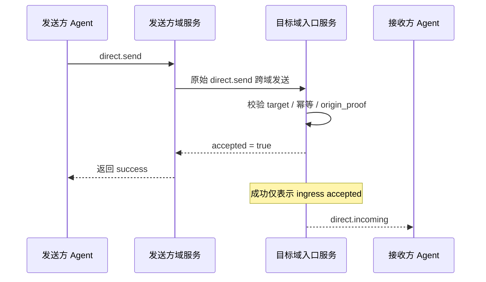

<!-- translation-review: full; source=chinese/deprecated/03-私聊基础语义.md -->
> 日本語参考訳（原文全文照合・校閲済み）。保存された旧版1.1/v1です。受理、処理、表示、永続化の境界と、BaseとE2EEの原発信者証明の差を、原文のとおり保持しています。
> 原文: [chinese/deprecated/03-私聊基础语义.md](../../../chinese/deprecated/03-私聊基础语义.md) / 基準コミット: `0837cfdfaf4ddcf834f0890ddaf34fc4c824e066`

# ANPプロファイル3：直接メッセージの基本的な意味

- 文書ID：ANP-P3
- タイトル：直接メッセージの基本的な意味
- 状態：公開済み（Released）
- バージョン：1.1
- 原文言語：中国語／本ページは日本語参考訳
- 適用範囲：エージェント間の直接メッセージの基本的な意味を定義します。エンドツーエンド暗号化のアルゴリズム自体は含みません。

---

## 1. 目的

本プロファイルは、ANPの直接メッセージの基本的な意味を定義し、次を規定します。

1. エージェント間の直接メッセージの表現方法。
2. メッセージの最低限の相互運用フィールドと内容モデル。
3. メッセージの成功、冪等性、順序付けの意味。
4. E2EEを使わず単独で動作させる方法。
5. did:wbaに基づく送信者認証と、ドメイン間Origin Proofの表現。
6. Direct E2EE Profileを本プロファイルの業務上の意味に重ねる方法。

本プロファイルでは、次を定義しません。

- 具体的なE2EEアルゴリズム。
- 端末や内部複製の概念。
- 履歴の取得。
- 既読状態。
- プレゼンス。
- エージェント内部の同期。
- 大容量オブジェクトの暗号文形式。

---

## 2. 用語と規範上の慣例

### 2.1 規範キーワード

本書の**MUST**、**MUST NOT**、**REQUIRED**、**SHALL**、**SHALL NOT**、**SHOULD**、**SHOULD NOT**、**RECOMMENDED**、**NOT RECOMMENDED**、**MAY**、**OPTIONAL**は、大文字の場合に規範的な要求として解釈します。

### 2.2 用語

- **直接メッセージ**：あるエージェントから他のエージェントへ送るアプリケーション層のメッセージ。
- **送信エージェント**：`direct.send`を開始するエージェント。外側の`params.meta.sender_did`で識別します。
- **受信エージェント**：`direct.send`の宛先エージェント。外側の`params.meta.target.did`で識別します。
- **入口サービス**：直接メッセージを受け取るため、宛先エージェントが外部へ公開する主要なサービス。
- **会話**：送受信者間のアプリケーション層の会話コンテキスト。安定した`conversation_id`を持つかどうかは業務層で決めます。
- **受理済み**：宛先エージェントの入口サービスがメッセージを受け付け、その処理境界の内側へ入った状態。
- **拒否**：プロトコル層で拒まれ、宛先エージェントの処理境界へ入らなかった状態。
- **Origin Proof**：送信エージェントがdid:wbaのJSON内に格納する認証方式に基づいて生成する、アプリケーション層の送信元証明。
- **ホップ認証**：各ホップのサービス間、またはエージェントとサービスの間で行う、伝送層・要求層のID認証。
- **論理宛先URI**：中継を通じてアプリケーション層の署名を安定させるため、P1付録Aが全体に共通して定義する論理宛先URI。

---

## 3. 設計原則

### 3.1 プロトコルの終端はエージェント

ANP直接メッセージの終端はエージェントであり、デバイス、端末、セッション複製、内部実行単位ではありません。

宛先エージェントの入口サービスが受理すれば、本プロファイルの配送の役割は完了です。その内部で何個の複製、実行主体、端末へどう同期するかは、相互運用の範囲に含みません。

### 3.2 基本の意味とセキュリティオーバーレイを分離

本プロファイルは業務とメッセージの意味だけを定義します。後からDirect E2EE Profileを加える場合も、次のようになります。

- 業務操作は引き続き`direct.send`。
- 対象は引き続き`sender_did -> recipient_did`。
- 内容種別とアプリケーション上の意味は引き続き本プロファイルが定義。
- 追加の暗号オブジェクト、セッション状態、安全性のバインドはE2EE Profileが定義。

### 3.3 最小限の成功の意味

`direct.send`の成功が意味するのは、次だけです。

- 宛先エージェントの入口サービスがメッセージを受理した。
- 宛先エージェントのプロトコル処理境界の内側へ入った。

アプリケーションの内容を処理した、ユーザーへ表示した、内部で永続化を完了した、という意味ではありません。

P3の最小限の成功は、相手がすでに読んだという意味に誤解されやすい箇所です。次の図は送信者、送信元ドメインサービス、宛先入口サービス、宛先エージェントを同じ経路に置き、成功の境界を明示します。



*図P3-1：`direct.send`のエンドツーエンドのシーケンス（非規範的）。*

したがって成功が答えるのは、宛先の入口サービスが受理したかだけです。ユーザーの既読や表示、相手内部での永続化の完了は示しません。

### 3.4 対象外の機能

本プロファイルは、次の提供を目指しません。

- エンドツーエンドの機密性。
- 複数端末間の一貫性。
- 全体にわたる厳密な順序。
- 履歴を再生できる意味付け。
- 端末単位の配送証明。

### 3.5 Origin Proofとホップ認証を分離

ドメイン間の`direct.send`には、少なくとも次の2種類の認証が関与する場合があります。

1. **Origin Proof**：`sender_did`に対応する秘密鍵で生成し、業務メッセージを送信エージェントが送ったと証明します。
2. **ホップ認証**：現在の接続の1ホップの呼び出し元が生成し、このネットワーク要求を次のホップへ提出したサービスまたはエージェントを証明します。

本プロファイルでは次を要求します。

- `direct.send`の業務上のOrigin Proofを、転送経路全体で安定して保たなければなりません（**MUST**）。
- サービス単位の認証は、ホップごとに変わってもかまいません（**MAY**）。
- 受信者は、上流サービスのIDだけから`meta.sender_did`の業務送信元のIDを推定してはなりません（**MUST NOT**）。

---

## 4. プロファイル識別子と依存関係

### 4.1 プロファイル名

本プロファイルの標準名は次のとおりです。

`anp.direct.base.v1`

### 4.2 依存関係

本プロファイルは、次のプロファイルに依存しなければなりません（**MUST**）。

- `anp.core.binding.v1`
- `anp.identity.discovery.v1`

### 4.3 セキュリティプロファイル

基本の直接メッセージプロファイルとして単独で動作する場合、次に従います。

- `meta.profile`は`anp.direct.base.v1`でなければなりません（**MUST**）。
- `meta.security_profile`は`transport-protected`でなければなりません（**MUST**）。

後続のDirect E2EE Overlayが本プロファイルの業務操作と意味を再利用する場合は、次に従います。

- オーバーレイは、`direct.send`の意味にセキュリティオブジェクトを重ねる方法を明示しなければなりません（**MUST**）。
- 受信者は、明示的な交渉なしに、高いセキュリティプロファイルから`transport-protected`へ暗黙に下げてはなりません（**MUST NOT**）。
- `meta.profile = "anp.direct.e2ee.v1"`では、本書の`auth.origin_proof`に対する必須要件をDirect E2EE Profileが上書きします。
- これは意図的な設計です。`direct-e2ee`では、より強い否認可能性を優先します。送信者の認証は主にE2EEセッション確立素材、セッションへのバインド、メッセージAADが担い、既定ではP3のアプリケーション層`origin_proof`を要求しません。

---

## 5. 直接アドレッシングとセッションモデル

### 5.1 宛先の種類

`direct.send`では、`meta.target.kind`が`"agent"`でなければなりません（**MUST**）。
`meta.target.did`は、解決可能な`agent_did`でなければなりません（**MUST**）。

`target.kind`が`"agent"`でない場合、受信者は`anp.invalid_target_binding`を返さなければなりません（**MUST**）。

### 5.2 送信者と受信者

1回の`direct.send`では、

- 送信エージェントは1体だけでなければなりません（**MUST**）。
- 受信エージェントは1体だけでなければなりません（**MUST**）。
- 複数の宛先エージェントへ直接ブロードキャストしてはなりません（**MUST NOT**）。

### 5.3 `conversation_id`

`conversation_id`を、送受信者間のアプリケーション層コンテキストの表現に用いてもかまいません（**MAY**）。

`conversation_id`が存在する場合、

- 文字列でなければなりません（**MUST**）。
- 端末、セッション複製、内部実行主体のIDとして解釈してはなりません（**MUST NOT**）。
- 送信者が生成しても、双方の業務ロジックの交渉で決めてもかまいません（**MAY**）。
- 唯一のセキュリティコンテキストやリプレイ防止識別子として使ってはなりません（**MUST NOT**）。

### 5.4 エージェント内部の実装を公開しない

次の受信側の内部詳細を、ワイヤープロトコルの相互運用上の意味として公開してはなりません（**MUST NOT**）。

- 内部キュー数。
- 内部複製数。
- 内部ワークフローノード数。
- 内部端末数。
- 内部転送経路。

---

## 6. 内容モデル

### 6.1 内容種別

`direct.send`には`meta.content_type`が存在しなければなりません（**MUST**）。

Direct Baseの`body`は構造化された格納用コンテナーです。`meta.content_type`はその中の主な業務ペイロードの種類を表し、JSONコンテナー自体の型ではありません。P1の`meta.content_type`の統一定義に従います。

最低限の相互運用では、次の内容種別に対応しなければなりません（**MUST**）。

- `text/plain`
- `application/json`
- `application/anp-attachment-manifest+json`

実装者はさらに多くの内容種別に対応してもかまいません（**MAY**）。未対応の種類には`anp.unsupported_content_type`を返さなければなりません（**MUST**）。

### 6.2 `body`の構造

`direct.send`の`body`はオブジェクトでなければならず（**MUST**）、次のフィールドを含められます。

#### 6.2.1 `conversation_id`

- 型：文字列
- 要件：任意（**MAY**）。
- 意味：アプリケーション層のセッションコンテキスト識別子。
- 注：表示や会話の統合の手掛かりであり、最低相互運用の強い制約には含みません。

#### 6.2.2 `reply_to_message_id`

- 型：文字列
- 要件：任意（**MAY**）。
- 意味：このメッセージの返信先となる先行メッセージを示します。

#### 6.2.3 `annotations`

- 型：オブジェクト
- 要件：任意（**MAY**）。
- 意味：送信者が独自に付加するアプリケーション層のメタデータ。
- 規則：
  - 中継サービスは、許可なく変更してはなりません（**MUST NOT**）。
  - 受信者は、未知のフィールドを無視してもかまいません（**MAY**）。
  - 認可、安全性の判断、経路判断を変える隠れた制御上の意味を、密かに運ぶために使うべきではありません。

#### 6.2.4 `text`

- 型：文字列
- 要件：`content_type = "text/plain"`の場合は必須（**MUST**）。
- 規則：`text`を使う場合、`payload`や`payload_b64u`を併存させてはなりません（**MUST NOT**）。

#### 6.2.5 `payload`

- 型：JSONオブジェクト
- 要件：`content_type = "application/json"`の場合は必須（**MUST**）。
- 規則：`payload`はアプリケーションオブジェクトを直接表さなければなりません（**MUST**）。JSON内にJSON文字列を埋め込む二重シリアライズは禁止です（**MUST NOT**）。JSONオブジェクト内部のフィールドの業務上の意味は定義しません。

#### 6.2.6 `payload_b64u`

- 型：文字列
- 要件：バイナリ拡張または独自拡張オブジェクトの場合に使用可能（**MAY**）。
- 規則：
  - パディングなしのbase64urlでなければなりません。
  - `payload_b64u`を使う場合、`text`や`payload`を併存させてはなりません（**MUST NOT**）。

### 6.3 ペイロードフィールドの排他規則

`direct.send`の`text`、`payload`、`payload_b64u`には、次を適用します。

- ちょうど1つだけ存在しなければなりません（**MUST**）。
- 複数が存在すれば、受信者は要求を拒否しなければなりません（**MUST**）。
- 3つとも存在しなければ、受信者は要求を拒否しなければなりません（**MUST**）。


### 6.4 `auth`オブジェクト

`meta.profile = "anp.direct.base.v1"`かつ`meta.security_profile = "transport-protected"`の場合、`direct.send`の`params`に`auth`オブジェクトを含めなければなりません（**MUST**）。

本節のproofの保持規則、Signed Request Object、署名要素の対応付けは、P1付録Aの統一定義を再利用しなければなりません（**MUST**）。P3は、独自のproofフィールド名、独自のSigned Payload構造、局所的な`@target-uri`の対応付けを**もはや定義しません**。

推奨構造は次のとおりです。

```json
{
  "auth": {
    "scheme": "anp-rfc9421-origin-proof-v1",
    "origin_proof": {
      "contentDigest": "sha-256=:BASE64_SHA256_DIGEST:",
      "signatureInput": "sig1=(\"@method\" \"@target-uri\" \"content-digest\");created=1733402096;expires=1733402156;nonce=\"abc123\";keyid=\"did:wba:example.com:user:alice:e1_<fingerprint>#key-1\"",
      "signature": "sig1=:BASE64_SIGNATURE:"
    }
  }
}
```

規則：

- `auth.scheme`は`anp-rfc9421-origin-proof-v1`でなければなりません（**MUST**）。
- `auth.origin_proof`が存在しなければなりません（**MUST**）。
- `auth`自体を`contentDigest`の計算に含めてはなりません（**MUST NOT**）。

### 6.5 共有Signed Request Objectへのバインド

`auth.origin_proof.contentDigest`は、P1付録Aの共有**Signed Request Object**へバインドしなければなりません（**MUST**）。

`direct.send`では、

- `method`は`direct.send`でなければなりません（**MUST**）。
- `meta.target.kind`は`agent`でなければなりません（**MUST**）。
- `meta.target.did`は受信対象のエージェントDIDでなければなりません（**MUST**）。
- `meta.message_id`と`meta.content_type`が存在しなければなりません（**MUST**）。

### 6.6 全体に共通する署名要素の対応付けを参照

`direct.send`は、P1付録Aの全体共通の署名要素の対応付けを使用しなければなりません（**MUST**）。

したがって、

- 検証者は、`method = "direct.send"`から`@method`を再構築しなければなりません（**MUST**）。
- 検証者は、`meta.target.kind = "agent"`と`meta.target.did`から`@target-uri = anp://agent/<pct-encoded meta.target.did>`を再構築しなければなりません（**MUST**）。
- これらはP1の共通規則に由来し、P3が独自に定義した局所的な対応付けでは**ありません**。

---

## 7. 標準メソッド

### 7.1 `direct.send`

#### 7.1.1 意味

`direct.send`は、送信エージェントが宛先エージェントへ直接メッセージを送ることを表します。

#### 7.1.2 要求の要件

適合する`direct.send`要求は、次を満たさなければなりません（**MUST**）。

1. `method = "direct.send"`
2. `meta.profile = "anp.direct.base.v1"`
3. `meta.security_profile = "transport-protected"`
4. `meta.sender_did`が存在（**MUST**）。
5. `meta.target.kind = "agent"`
6. `meta.target.did`が存在（**MUST**）。
7. `meta.operation_id`が存在（**MUST**）。
8. `meta.message_id`が存在（**MUST**）。
9. `meta.content_type`が存在（**MUST**）。
10. `body`が本プロファイルの内容排他規則を満たす（**MUST**）。
11. `auth.scheme`が`anp-rfc9421-origin-proof-v1`である（**MUST**）。
12. `auth.origin_proof`が存在し、Signed Request Objectへバインドしている（**MUST**）。

#### 7.1.3 成功応答

成功応答の`result`には、少なくとも次を含めなければなりません（**MUST**）。

- `accepted`：真偽値で、`true`でなければなりません（**MUST**）。
- `message_id`：要求の`meta.message_id`と一致。
- `operation_id`：要求の`meta.operation_id`と一致。
- `target_did`：宛先エージェントDID。
- `accepted_at`：RFC 3339形式の時刻文字列。

成功応答に次を含めてもかまいません（**MAY**）。

- `conversation_id`

#### 7.1.4 失敗条件

次の場合、受信者は`direct.send`を拒否しなければなりません（**MUST**）。

- 宛先DIDが存在しない、または到達できない。
- 現在の接続の1ホップの呼び出し元が、そのホップの呼び出し元認証に成功していない。
- 内容種別が未対応。
- 本文が内容排他規則に従わない。
- 宛先のポリシーがメッセージを禁止する。
- セキュリティプロファイルの要件に違反する。
- `auth.origin_proof`がない、無効、期限切れ、またはリプレイの疑いがある。
- `auth.origin_proof`内の`keyid`が属するDIDと`meta.sender_did`が一致しない。

### 7.2 `direct.incoming`（必須通知）

#### 7.2.1 意味

`direct.incoming`は、本プロファイルの標準プッシュ通知です。ANP Endpointが、宛先入口で受理済みの直接メッセージを宛先エージェントへプッシュするために使います。P3の最低相互運用能力に含まれます。

#### 7.2.2 使用範囲

- このメソッドを実装しなければなりません（**MUST**）。
- 標準プッシュ経路ですが、`direct.send`の成功の意味は変更しません。
- 適合する実装は、`direct.incoming`の送信、受信、または処理ができなければなりません（MUST）。

#### 7.2.3 制約

- `direct.incoming`はNotificationとして送信しなければなりません（**MUST**）。
- 受信者はJSON-RPC Responseを返してはなりません（**MUST NOT**）。
- `params.meta.profile`は`anp.direct.base.v1`でなければなりません（**MUST**）。
- `params.meta.security_profile`は、元の`direct.send`を受理したときのセキュリティプロファイルと一致しなければなりません（**MUST**）。
- `params.meta.target.kind`は`"agent"`でなければなりません（**MUST**）。
- `params.meta.target.did`は通知受信者DIDと一致しなければなりません（**MUST**）。
- `params.meta.sender_did`は元の業務メッセージの論理送信主体DIDと一致しなければなりません（**MUST**）。
- `params.meta.operation_id`は元の`direct.send.meta.operation_id`と一致しなければなりません（**MUST**）。
- `params.meta.message_id`は元の`direct.send.meta.message_id`と一致しなければなりません（**MUST**）。
- `params.meta.content_type`は元の業務メッセージの`meta.content_type`と一致しなければなりません（**MUST**）。
- `params.body`は元のメッセージと一致する業務ペイロードを運ばなければなりません（**MUST**）。
- `params.auth`が存在する場合、
  - `params.auth.scheme`は`anp-rfc9421-origin-proof-v1`でなければなりません（**MUST**）。
  - `params.auth.origin_proof`は、元の`origin_proof`の損失のないコピーでなければなりません（**MUST**）。
  - 中間サービスは新しい業務proofを再生成してはなりません（**MUST NOT**）。

---

## 8. 配送、冪等性、順序の意味

### 8.1 受理の意味

`direct.send`が成功応答を返すと、次だけを意味します。

- 宛先エージェントの入口サービスがメッセージを受理した。
- ローカルポリシーが別途要求しない限り、送信者は同じ`operation_id`での再試行を止めてもかまいません。

### 8.2 冪等性と重複排除

受信者は、次の最小集合に基づいて冪等性を判断しなければなりません（**MUST**）。

- `sender_did`
- `target.did`
- `method`
- `operation_id`

メッセージ単位の重複識別では、さらに次を基にすることが望まれます（**SHOULD**）。

- `sender_did`
- `target.did`
- `message_id`

これらで重複を識別します。

### 8.3 順序の意味

本プロファイルは、全体にわたる厳密な順序を保証しません。

直接メッセージでは、

- 実装は、同じ`conversation_id`内でベストエフォートの順次処理をしてもかまいません（**MAY**）。
- ドメイン間相互運用層は、ネットワークやサービスが当然に厳密なFIFO順序を提供すると仮定してはなりません（**MUST NOT**）。

### 8.4 再試行

`direct.send`で同じメッセージを再試行する場合、

- `operation_id`を変更してはなりません（**MUST**）。
- `message_id`を変更してはなりません（**MUST**）。
- 業務ペイロードの意味を同等に保たなければなりません（**MUST**）。

`direct.incoming`で同じ受理済みメッセージを再度プッシュする場合、

- `params.meta.operation_id`を変更しないことが望まれます（**SHOULD**）。
- `params.meta.message_id`を変更しないことが望まれます（**SHOULD**）。
- `params.body`の意味を元の通知と同等に保つことが望まれます（**SHOULD**）。

`direct.send`と`direct.incoming`について、伝送失敗後の自動再送をローカルポリシーで決めてもかまいません（**MAY**）。本プロファイルは、再送、固定の試行回数、固定のバックオフ方式を要求してはなりません（**MUST NOT**）。

---

実装上の難しさは、`direct.send`のフィールド自体よりも、再試行時に`operation_id`と`message_id`のどちらを先に確認するかです。次の図は最低相互運用の判断順を明示します。

```mermaid
flowchart TD
R1[收到 direct.send]
R1 --> K1{(sender_did,target.did,method,operation_id)<br/>是否已存在}

K1 -->|否| P[正常处理]
P --> M1{message_id 是否重复}
M1 -->|否| S[写入幂等记录并返回 accepted]
M1 -->|是| D[按重复消息策略处理]

K1 -->|是| K2{请求语义是否等价}
K2 -->|是| E[返回同一结果或等价结果]
K2 -->|否| C[anp.idempotency_conflict]
```

*図P3-2：直接メッセージの冪等性と再試行の判断（非規範的）。*

まず操作単位の冪等性を確認してから、メッセージ単位の重複検出を行うことが望まれます。そうしなければ、ネットワークの再試行やドメイン間リプレイ防止の場面で、意味が同等の要求を競合と誤認する可能性があります。

## 9. セキュリティとポリシー

### 9.1 伝送保護の要件

単独で動作する場合、認証された安全な伝送層に依存しなければなりません（**MUST**）。保護のないHTTPやWebSocket、その他の未認証チャネルを使ってはなりません（**MUST NOT**）。

### 9.2 `direct.send`の送信者認証

`meta.profile = "anp.direct.base.v1"`で`meta.sender_did`を宣言するすべての`direct.send`では、

- 送信者は`auth.origin_proof`を提供しなければなりません（**MUST**）。
- 受信側の入口サービスは、did:wba仕様に従い`auth.origin_proof`を検証しなければなりません（**MUST**）。
- 受信者は、`auth.origin_proof`内の`keyid`が属するDIDと`meta.sender_did`が一致することを検証しなければなりません（**MUST**）。
- 受信者は、`keyid`の指す認証メソッドが、DID文書の`authentication`関係で認められていることを検証しなければなりません（**MUST**）。
- パス型の`e1_` DIDでは、完全なDIDバインド確認を行わなければならず（**MUST**）、`authentication`に利用可能な公開鍵があるという理由だけで有効と見なしてはなりません（**MUST NOT**）。

`e1_` DIDの最低要件は次のとおりです。

1. DID文書の最上位に`proof`が存在する（**MUST**）。
2. `proof`がdid:wbaの求めるData Integrity検証に成功する（**MUST**）。
3. `proof.verificationMethod`が、文書で認められたEd25519のバインド鍵を指す（**MUST**）。
4. 受信者が`proof.verificationMethod`に対応する公開鍵からRFC 7638のサムプリントを再計算する（**MUST**）。
5. 再計算した結果がDIDパスの`e1_`フィンガープリントと完全に一致する（**MUST**）。

つまり、DID文書の任意の`authentication`鍵で検証できるだけでは、`meta.sender_did`の有効性は成立しません。要求のproof、DIDパスのフィンガープリント、バインドされた公開鍵がすべて一致することで成立します。

### 9.3 `origin_proof`の検証手順

受信者の`auth.origin_proof`の検証手順は、P1付録Aの統一定義を参照してください。


### 9.4 ドメイン間転送と上流サービス認証

ドメイン間の配置では、

- 元の`auth.origin_proof`をメッセージとともに転送しなければならず（**MUST**）、中間サービスが上書きしてはなりません（**MUST NOT**）。
- 受信する宛先ドメインは、`auth.origin_proof`を直接検証しなければなりません（**MUST**）。
- 各サービスホップで、サービス単位のID認証を追加で行わなければなりません（**MUST**）。
- 上流サービスは、転送前にローカルで`auth.origin_proof`を検証してもかまいません（**MAY**）。ただし、その成功を理由に宛先ドメインの独立した検証を免除してはなりません（**MUST NOT**）。

### 9.5 Access Tokenによる最適化（非規範的）

did:wbaに基づくアクセストークンの処理で繰り返し要求を最適化してもかまいません（**MAY**）。ただし最低相互運用の本流には含まれません。

`direct.send`では、

- アクセストークンを、ドメイン間Origin Proofとしての`auth.origin_proof`の代わりにしてはなりません（**MUST NOT**）。
- 通常のBearer tokenより、送信者に制約されたアクセストークンを優先することが望まれます（**SHOULD**）。
- トークンの具体的なプロファイル、発行形式、制約の仕組みは、上位の配置仕様や実装文書で定義できます。


### 9.6 セキュリティプロファイルの強化と弱体化

エージェントのポリシーが`direct-e2ee`を要求する場合、

- 送信者は対応するDirect E2EE Profileを使わなければなりません（**MUST**）。
- 受信者は、`transport-protected`の`direct.send`を受け取った場合、拒否しなければなりません（**MUST**）。
- 明示的な交渉なしに弱いプロファイルを暗黙に受け入れてはなりません（**MUST NOT**）。

### 9.7 オーバーレイとのバインド点

後続のDirect E2EE Overlayは、少なくとも次のフィールドを認証対象のコンテキストへ含めることが望まれます（**SHOULD**）。

- `sender_did`
- `target.did`
- `message_id`
- `conversation_id`（存在する場合）
- `content_type`
- `security_profile`
- `auth.origin_proof.contentDigest`または同等のOrigin Proofのダイジェスト

---

## 10. プライバシー上の考慮事項

### 10.1 メタデータ最小化の原則

送信者は、相互運用に必要な最小限のメタデータだけを送ることが望まれます（**SHOULD**）。

### 10.2 内部トポロジーを公開しない

いかなる実装も、本プロファイルを通じて次を公開してはなりません（**MUST NOT**）。

- 内部端末数。
- 内部複製数。
- 内部ワークフローのトポロジー。
- 内部配送経路。

### 10.3 中継が知る情報を最小化

中継や入口サービスは、相互運用に必要な最小限のフィールドだけを調べることが望まれます（**SHOULD**）。
アプリケーションの内容を理解する必要がない場合は、不透明なペイロードとして扱うことが望まれます（**SHOULD**）。

---

## 11. プロファイル固有のエラー（推奨）

ANP Coreの共通エラーモデルに従う前提で、次の`anp_code`を推奨します。

| `code` | `anp_code` | 意味 |
|---|---|---|
| 2000 | `direct.recipient_unreachable` | 宛先エージェントへ一時的に到達不能 |
| 2001 | `direct.policy_violation` | 宛先のポリシーが拒否 |
| 2002 | `direct.invalid_payload_shape` | 直接メッセージのペイロード構造が不正 |
| 2003 | `direct.conversation_conflict` | 会話コンテキストが競合 |
| 2004 | `direct.security_mode_required` | 宛先がより高いセキュリティプロファイルを要求 |
| 2005 | `direct.invalid_origin_proof` | 送信元proofが無効、期限切れ、または欠落 |
| 2006 | `direct.origin_did_mismatch` | `meta.sender_did`と`keyid`が属するDIDが不一致 |
| 2007 | `direct.origin_proof_replayed` | 送信元proofにリプレイの疑い |

---

## 12. 最低相互運用要件

本プロファイルに適合する実装は、少なくとも次に対応しなければなりません（MUST）。

1. `direct.send`
2. `direct.incoming`
3. `target.kind = "agent"`
4. `text/plain`
5. `application/json`
6. `application/anp-attachment-manifest+json`
7. `text` / `payload` / `payload_b64u`の排他規則。
8. `message_id`と`operation_id`の冪等処理。
9. `auth.origin_proof`の提出と検証。
10. 本プロファイルが定めるSigned Request Objectの正規化とダイジェストの計算規則。
11. 安全な伝送に基づく動作方式。

`conversation_id`、`reply_to_message_id`、`annotations`はよく使われる任意フィールドですが、v1の強い最低相互運用制約には含まれません。

---

## 13. 例

### 13.1 テキストメッセージの例

```json
{
  "jsonrpc": "2.0",
  "id": "req-20001",
  "method": "direct.send",
  "params": {
    "meta": {
      "profile": "anp.direct.base.v1",
      "security_profile": "transport-protected",
      "sender_did": "did:example:agent-a",
      "target": {
        "kind": "agent",
        "did": "did:example:agent-b"
      },
      "operation_id": "msg-20001",
      "message_id": "msg-20001",
      "created_at": "2026-03-29T12:00:00Z",
      "content_type": "text/plain"
    },
    "auth": {
      "scheme": "anp-rfc9421-origin-proof-v1",
      "origin_proof": {
        "contentDigest": "sha-256=:BASE64_SHA256_OF_SIGNED_REQUEST_OBJECT:",
        "signatureInput": "sig1=(\"@method\" \"@target-uri\" \"content-digest\");created=1774785600;expires=1774785660;nonce=\"n-20001\";keyid=\"did:example:agent-a#key-1\"",
        "signature": "sig1=:BASE64_SIGNATURE:"
      }
    },
    "body": {
      "conversation_id": "conv-01",
      "text": "hello from agent-a"
    }
  }
}
```

### 13.2 添付マニフェストの例

```json
{
  "jsonrpc": "2.0",
  "id": "req-20002",
  "method": "direct.send",
  "params": {
    "meta": {
      "profile": "anp.direct.base.v1",
      "security_profile": "transport-protected",
      "sender_did": "did:example:agent-a",
      "target": {
        "kind": "agent",
        "did": "did:example:agent-b"
      },
      "operation_id": "msg-20002",
      "message_id": "msg-20002",
      "created_at": "2026-03-29T12:05:00Z",
      "content_type": "application/anp-attachment-manifest+json"
    },
    "auth": {
      "scheme": "anp-rfc9421-origin-proof-v1",
      "origin_proof": {
        "contentDigest": "sha-256=:BASE64_SHA256_OF_SIGNED_REQUEST_OBJECT:",
        "signatureInput": "sig1=(\"@method\" \"@target-uri\" \"content-digest\");created=1774785900;expires=1774785960;nonce=\"n-20002\";keyid=\"did:example:agent-a#key-1\"",
        "signature": "sig1=:BASE64_SIGNATURE:"
      }
    },
    "body": {
      "payload": {
        "attachments": [
          {
            "attachment_id": "att-001",
            "filename": "report.pdf",
            "mime_type": "application/pdf",
            "size": "1048576",
            "digest": {
              "alg": "sha-256",
              "value_b64u": "BASE64URL_DIGEST"
            },
            "access_info": {
              "object_uri": "https://objects.example.com/objects/obj-plain-001"
            },
            "encryption_info": {
              "mode": "none"
            }
          }
        ],
        "caption": "请查收附件"
      }
    }
  }
}
```

> 注：この添付マニフェストの例はP7に従い、`access_info`に制御プレーンのサービスDIDを明示的に含めません。受信者は、ダウンロード前に元のメッセージ送信者DIDから公開`ANPMessageService`を解決し、`attachment.get_download_ticket`を呼び出すことが望まれます。

### 13.3 通常のJSONペイロードの例

次の例は、`application/json`の格納方法だけを示します。
`payload`内のフィールドはアプリケーションが定め、ANPは規定しません。

```json
{
  "jsonrpc": "2.0",
  "id": "req-20003",
  "method": "direct.send",
  "params": {
    "meta": {
      "profile": "anp.direct.base.v1",
      "security_profile": "transport-protected",
      "sender_did": "did:example:agent-a",
      "target": {
        "kind": "agent",
        "did": "did:example:agent-b"
      },
      "operation_id": "msg-20003",
      "message_id": "msg-20003",
      "created_at": "2026-03-29T12:10:00Z",
      "content_type": "application/json"
    },
    "body": {
      "conversation_id": "conv-01",
      "payload": {
        "type": "example",
        "data": {
          "hello": "world"
        }
      }
    }
  }
}
```

### 13.4 did:wba Origin Proof付きの`direct.send`の例

```json
{
  "jsonrpc": "2.0",
  "id": "req-direct-003",
  "method": "direct.send",
  "params": {
    "meta": {
      "profile": "anp.direct.base.v1",
      "security_profile": "transport-protected",
      "sender_did": "did:wba:a.example:agents:alice:e1_<fingerprint>",
      "target": {
        "kind": "agent",
        "did": "did:wba:b.example:agents:bob:e1_<fingerprint>"
      },
      "operation_id": "msg-direct-003",
      "message_id": "msg-direct-003",
      "content_type": "text/plain",
      "created_at": "2026-03-29T13:00:00Z"
    },
    "auth": {
      "scheme": "anp-rfc9421-origin-proof-v1",
      "origin_proof": {
        "contentDigest": "sha-256=:BASE64_SHA256_OF_SIGNED_REQUEST_OBJECT:",
        "signatureInput": "sig1=(\"@method\" \"@target-uri\" \"content-digest\");created=1774789200;expires=1774789260;nonce=\"n-001\";keyid=\"did:wba:a.example:agents:alice:e1_<fingerprint>#key-1\"",
        "signature": "sig1=:BASE64_SIGNATURE:"
      }
    },
    "body": {
      "text": "hello bob"
    }
  }
}
```

---

## 14. レジストリーのプレースホルダー

後続版では、次のレジストリーを設けることが望まれます（**SHOULD**）。

1. 直接メッセージの内容種別。
2. 直接メッセージのエラーコード。
3. 直接メッセージのNotificationメソッド。

---

## 15. 参考実装上の注意（非規範的）

実装者は、次の原則に従うことが望まれます。

- `direct.send`が答えるのは宛先エージェントの受理であり、エンドユーザーの既読ではありません。
- `direct.incoming`は標準プッシュ経路ですが、失敗後に自動再送するかは実装が決めます。
- `annotations`と`conversation_id`は便宜上のフィールドであり、安全性やルーティングの意味を過度に担わせるべきではありません。
- 送信者のOrigin Proofとホップ単位のサービス認証は、別の層にする必要があります。
- 実装を簡略化するため、メッセージ操作では通常`operation_id = message_id`をそのまま使えます。
