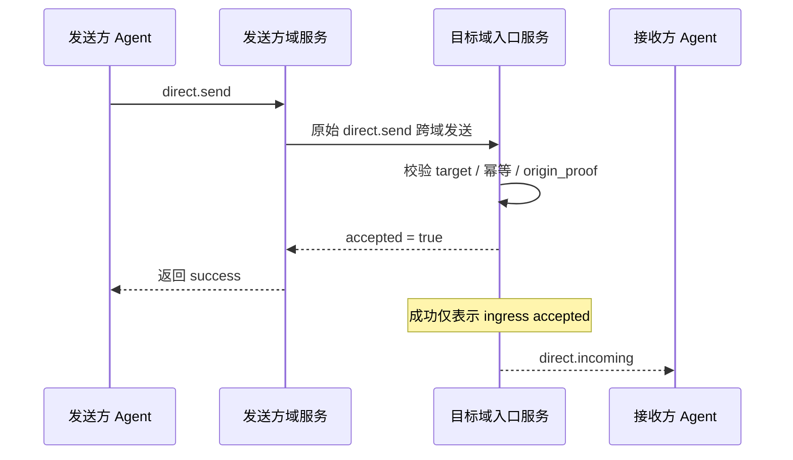

> 日本語参考訳（機械翻訳・未校閲）。規範となるのは原文です。コード例・識別子・規範キーワードは原文を保持しています。
> 原文: [chinese/deprecated/03-私聊基础语义.md](../../../chinese/deprecated/03-私聊基础语义.md) / 基準コミット: `0837cfdfaf4ddcf834f0890ddaf34fc4c824e066`

# ANPプロフィール3: プライベート・セマンティックス

- 文書番号: ANP-P3
- タイトル:プライベート会話の基礎知識
- ステータス:公開
- バージョン: 1.1
- 原文言語: 中文 / このページは日本語参考訳
- アプリケーションの範囲: このプロファイルは、エンドツーエンドの暗号化アルゴリズム自体を含むことなく、エージェントとエージェントの間の基本的なプライベートのセマンティックに適用されます。

---

## 1. 目的:

このプロファイルは、AMP のプライベートな会話式の基本レベルを定義します。

1. エージェントからエージェントへのダイレクトメッセージはどういう意味ですか?
2. プライベートチャットの最小相互運用可能なフィールドとコンテンツモデル。
3. 成功するセマンティクス、プライベートチャットの対称性、ハイフェネーションの対称的なシラブル。
4. (b) プライベートチャットが非E2EEモードで独立して実行する方法
5. (a) 入札識別に基づく:wbaとクロスドメインの発信者認証;
6. プロファイルビジネスの構文を上書きする方法をE2EEに指示します。

ベンジャー **なし、いいえ。**定義:

- 特定のE2EEアルゴリズム;
- (a) 装置または内部のコピーの概念;
- 歴史;
- (a) 読み取りステータス;
- プレゼンス
- エージェントの非同期;
- 大きいオブジェクトのテキスト形式。

---

## 2. 用語と規範的な関与

### 2.1 仮鍵

このテキスト **MUST**、**MUST NOT**、**REQUIRED**、**SHALL**、**SHALL NOT**、**SHOULD**、**SHOULD NOT**、**RECOMMENDED**、**NOT RECOMMENDED**、**MAY**、**OPTIONAL** 資本金を基準とする規範的な要件として解釈される。

### 2.2 用語集

- **ダイレクトメッセージ**: 別のエージェントアプリケーションに 1 つのエージェント.
- **ベンダーエージェント**: 起動 `direct.send` 外部層からエージェント。 `params.meta.sender_did` 識別。
- **受精剤**：`direct.send` ターゲット、外部層によるエージェント `params.meta.target.did` 識別。
- **侵入サービス**ターゲットエージェントは、直接情報を受信するメインエントランスサービスに公開されます。
- **会話**: 送信者と受信者の間のアプリケーションレベルのセッションのコンテキスト。 安定性がある場合 `conversation_id` 運用レベルに決定します。
- **受付中**: 対象となるエージェントのアクセスサービスからメッセージを受信し、処理境界を入力する。
- **注射液**: プロトコルレベルでメッセージが拒否され、ターゲットエージェントの処理境界は入力されていない。
- **起源の証拠**: 送信者によって生成されたアプリケーションレベルの元のd:wba JSONキャリアに基づくソースコード証明書。
- **ホップ認証**: サービスのジャンプサービス、サービス間の転送層へのエージェント/レベルの識別を要求する。
- **論理的ターゲット URI**: P1付録Aが全として定義したURIの論理的目的は、アプリケーションレイヤー署名が再び安定して維持できるようにします。

---

## 3. デザイン原則

### 3.1 エージェントは、取引の終了です。

ANPダイレクトメッセージングの合意された終了は、デバイス、端末、セッションのコピー、内部実行モジュールではなく、エージェントです。

ターゲットエージェントのアクセスサービスがメッセージを受信する限り、このプロジェールのデリバリーミッションが完了します。ゴールエージェントは、現在のバージョンのコピー数、実行者数、またはターゲット内で同期されるデバイス数を含みます。

### 3.2 セキュリティオーバーレイからベースセパラティズム

このProfile は、構文とメッセージの代名詞のみを定義します。 続いている場合は、E2EE プロファイル:

- まだまだビジネスの動きは... `direct.send`；
- あなたとプライベートで話した人は、まだ... `sender_did -> recipient_did`；
- コンテンツタイプとアプリケーションのセマティクスは、このプロファイルによって定義されます。
- 追加パスワードオブジェクト、セッションステータス、セキュリティバインディングはE2EEProfileで定義されます。

### 3.3 成功の最小の皮脂

このプロジェクトが開発されたのは初めてです。 `direct.send` 成功は、次の手段を意味します。

- ターゲットエージェントのアクセスサービスは、メッセージを受信しました。
- メッセージを対象とするエージェントの契約で、境界線に対処する。

・・・**なし、いいえ。**つまり、ターゲットエージェントはアプリケーション負荷を処理し、ユーザーに実証したり、内部のパーマニエンスを完了したりすることを意味します。


P3の「最小成功セマニティック」は、「逆にメッセージを読みました」と簡単に誤解されます。 下のシーケンスは、送信者、降水サービス、ターゲットエントリーサービスと目標エージェントを同じチェーンに配置して、どの境界が実際に嘘をつくかを決定します。



*図 P3-1:`direct.send` エンドツーエンドタイムシリーズ(非放射性)。*

そのため、このRefileの成功は「エージェントのアクセスサービスが受け入れられる」だけに答え、ユーザーが読み込んだかどうか、最終的に永続的な内部化を実証または完了しているか?
### 3.4 非ターゲット

ベンジャー **なし、いいえ。**提供しようとする:

- エンドツーエンドの機密性;
- 多等設備の一貫性;
- (a) 厳格なグローバルオーダー
- 歴史は再活性化することができます。
- 装置レベルのサービス証明書。

### 3.5 オリジナイザー ' s 証明書は、ジャンプ認証から分離します

ブロガーは、政府が法律に関係しないと述べています。`direct.send` 認定資格の2種類以上が関与する場合があります。

1. **元の証拠**: によって `sender_did` 「送信者エージェントがメッセージを送る」と証明する、プライベートキー生成に対応。
2. **ホップアセスメント**: 現在の接続の1つのジャンパーによって生成され、「サービスまたはエージェントがこのリクエストを次のジャンプに提出した」と証明します。

プロフィールのリクエスト:

- `direct.send` 業務用ベンダー証明書 **MUST** (b) チェーン全体で安定的である。
- ジャンプのためのサービスレベルの認定 **MAY** 変更点
- スタッフ **MUST NOT** 稼働中のサービスとして、単独で状況を想定 `meta.sender_did` 創業当初から、創業の時代を継いでいます。

---

## 4. プロフィールの印および依存性

### 4.1 プロフィール名

このProfile の標準的な名前は、次のとおりです。

`anp.direct.base.v1`

### 4.2 依存症

ベンジャー **MUST** 次のデータに依存します。

- `anp.core.binding.v1`
- `anp.identity.discovery.v1`

### 4.3 セキュリティモード

Ben Profile が独立した方法でプライベートチャットの基礎として使用したとき:

- `meta.profile` **MUST** イーグル `anp.direct.base.v1`
- `meta.security_profile` **MUST** イーグル `transport-protected`

直接 E2EE オーバーレイレプリカが、一般的なビジネスアクションと用語的に続く場合:

- Opposite オーバーレイ **MUST** 方法を明確にする方法 `direct.send` (a) 意味論はセキュリティオブジェクトを上回る。
- スタッフ **MUST NOT** 目に見える相談なしで、高セキュリティモードでサイレントダウングレードから `transport-protected`；
- いつ? `meta.profile = "anp.direct.e2ee.v1"` 、現在のバージョンの `auth.origin_proof` 必須の要件は、直接E2EEプロファイルで覆われています。
- この適用範囲はように設計されます:`direct-e2ee` より大きなネゴティビリティを保持する優先します。, 送信者の識別は主に E2EE チェーンによって共有されています。, セッション結合と P3 アプリケーションレベルでデフォルトではなく AAD にメッセージ `origin_proof`。

---

## 5. ダイレクトアドレスインタビューモデル

### 5.1 目的のタイプ

`direct.send` ・・・ `meta.target.kind` **MUST** あり あり `"agent"`。  
`meta.target.did` **MUST** 解析可能な一種のものです。 `agent_did`。

場合 `target.kind` ありません。 `"agent"`受取人。 **MUST** バックナンバー `anp.invalid_target_binding`。

### 5.2 送り主および受信機

一度。 `direct.send`：

- **MUST** 送信者1名、エージェントのみ。
- **MUST** 受取人1名、代理人のみ
- **MUST NOT** 複数のターゲット、エージェントの放送に直接。

### 5.3 `conversation_id`

ベンジャー **MAY** 利用条件 `conversation_id` 送信者と受信者のアプリケーションレイヤーのコンテキストです。

存在する場合 `conversation_id`：

- ・・・ **MUST** 文字列です。
- ・・・ **MUST NOT** (a) は、機器、セッションのコピー、内部のインキュベーター識別子として解釈されます。
- ・・・ **MAY** (a) 送信者または当事者間の論理的合意による。
- ・・・ **MUST NOT** セキュリティコンテキストや再入力マークのみとして。

### 5.4 エージェントの内部実現は見えない

受信者の次の内部の詳細: **MUST NOT** プロトコルの構文を行なう露光:

- (a)単位の単位の数;
- 内部コピーの数;
- 内部ワークフローノード数;
- 内部装置の数;
- 内部転送パス。

---

## 6. コンテンツモデル

### 6.1 コンテンツの種類

`direct.send` ・・・ `meta.content_type` **MUST** そこ。

直接基盤で、`body` (a) は構造化されたキャリアです;`meta.content_type` 以下はP1-Systemsです。 `meta.content_type` 均一定義。

ベンプロファイル最小相互運用 **MUST** 下記サポート項目をご案内いたします。

- `text/plain`
- `application/json`
- `application/anp-attachment-manifest+json`

アクコンプリシャ **MAY** コンテンツの種類をさらにサポートするが、コンテンツタイプではない **MUST** バックナンバー `anp.unsupported_content_type`。

### 6.2 `body` 構造:

`direct.send` ・・・ `body` **MUST** オブジェクトで、次のフィールドを含むことができます。

#### 6.2.1 `conversation_id`

- タイプ: ひも
- リクエスト:**MAY**
- 管理:レベルセッションのコンテキスト識別を適用します
- Note: これは、少なくとも相互運用性制約ではない表示および集計ヒントフィールドです。

#### 6.2.2 `reply_to_message_id`

- タイプ: ひも
- リクエスト:**MAY**
- 著名:このメッセージに対する応答を示す最後のメッセージ

#### 6.2.3 `annotations`

- タイプ: オブジェクト
- リクエスト:**MAY**
- Semantic: 送信者カスタムアプリケーションレイヤー追加メタデータ
- ルール:
  - リレーサービス **MUST NOT** (b) 不正な書き;
  - 認識されていないフィールド **MAY** (a) 受信者によって無視される。
  - 不正な管理のセマティクスを、認証、セキュリティ、ルート決定の変更に密接に運ぶことはできません。

#### 6.2.4 `text`

- タイプ: ひも
- リクエスト: いつ `content_type = "text/plain"` タイムタイム **MUST**
- ルール: 使用 `text` できるかどうかはわかりません。`payload` とりあえず `payload_b64u` **MUST NOT** あとは、同じ時間があります。

#### 6.2.5 `payload`

- タイプ: JSON オブジェクト
- リクエスト: いつ `content_type = "application/json"` タイムタイム **MUST**
- ルール:`payload` **MUST** (a) 直接、申請の対象を記述する。**MUST NOT** このRefileは内部JSONオブジェクトフィールドのビジネスの意味を定義しません。

#### 6.2.6 `payload_b64u`

- タイプ: ひも
- リクエスト:コンテンツがバイナリまたはプライベートの場合 **MAY**
- ルール:
  - 不満をなさなければならない。
  - 利用条件 `payload_b64u` できるかどうかはわかりません。`text` とりあえず `payload` **MUST NOT** あとは、同じ時間があります。

### 6.3 ロードフィールド断層保護ルール

あり。 `direct.send` 確かにそうではありません。`text`、`payload`、`payload_b64u` 3つの:

- **MUST** 事件が起きた。
- 以上あれば、受取人 **MUST** (a) リクエストを拒絶する。
- それらのどれも存在しなかった場合、受取人 **MUST** 拒否。要求


### 6.4 `auth` オブジェクト

いつ? `meta.profile = "anp.direct.base.v1"` とりあえず `meta.security_profile = "transport-protected"` できるかどうかはわかりません。`direct.send` ・・・ `params` **MUST** 組織図 `auth` オブジェクト。

証拠の負荷規則、署名された共和国の目的および署名する部品図 **MUST** P1 を再利用する 錬金術の定義; P3 **もうありません。** スタンドアローンの証拠フィールド名、別の署名されたペイロード構造またはローカルを定義します `@target-uri` 地図を。

推奨構造は以下の通りです。

```json
{
  "auth": {
    "scheme": "anp-rfc9421-origin-proof-v1",
    "origin_proof": {
      "contentDigest": "sha-256=:BASE64_SHA256_DIGEST:",
      "signatureInput": "sig1=(\"@method\" \"@target-uri\" \"content-digest\");created=1733402096;expires=1733402156;nonce=\"abc123\";keyid=\"did:wba:example.com:user:alice:e1_<fingerprint>#key-1\"",
      "signature": "sig1=:BASE64_SIGNATURE:"
    }
  }
}
```

ルール:

- `auth.scheme` **MUST** イーグル `anp-rfc9421-origin-proof-v1`
- `auth.origin_proof` **MUST** プレゼンス
- `auth` それだけで **MUST NOT** 参加申込 `contentDigest` . 計算の

### 6.5 共有署名されたリクエストオブジェクトへの結合

`auth.origin_proof.contentDigest` **MUST** バイナリP1付録A定義共有 **署名された要求の目的**。

えー。 `direct.send` のために:

- `method` **MUST** イーグル `direct.send`
- `meta.target.kind` **MUST** イーグル `agent`
- `meta.target.did` **MUST** ターゲット受取人エージェントDIDと同じ
- `meta.message_id` とりあえず `meta.content_type` **MUST** プレゼンス

### 6.6 グローバルコンポーネントマッピングへの参照

`direct.send` **MUST** P1 Appendix A で定義されているグローバルシグネチャコンポーネントをマップします。

したがって:

- 認証 **MUST** ベーシス `method = "direct.send"` 再建 `@method`
- 認証 **MUST** ベーシス `meta.target.kind = "agent"` とりあえず `meta.target.did` 再建 `@target-uri = anp://agent/<pct-encoded meta.target.did>`
- 結果はP1のグローバルルールから、 **ありません。** P3 ローカルマップの自衛セット

---

## 7. 標準方法論

### 7.1 `direct.send`

#### 7.1.1 統計学

`direct.send` これにより、送信者エージェントがターゲットエージェントにダイレクトメッセージを送ることを示します。

#### 7.1.2 リクエスト

普通のもの。 `direct.send` リクエスト **MUST** 土産:

1. `method = "direct.send"`
2. `meta.profile = "anp.direct.base.v1"`
3. `meta.security_profile = "transport-protected"`
4. `meta.sender_did` **MUST** プレゼンス
5. `meta.target.kind = "agent"`
6. `meta.target.did` **MUST** プレゼンス
7. `meta.operation_id` **MUST** プレゼンス
8. `meta.message_id` **MUST** プレゼンス
9. `meta.content_type` **MUST** プレゼンス
10. `body` **MUST** このプロファイルコンテンツのクロスチェックルールを満たします
11. `auth.scheme` **MUST** イーグル `anp-rfc9421-origin-proof-v1`
12. `auth.origin_proof` **MUST** 署名された署名された要求の目的

#### 7.1.3 成功的な応答

成功の応答。 `result` **MUST** 少なくとも含まれます:

- `accepted`値のブール値、および **MUST** あり あり `true`
- `message_id`_: リクエスト `meta.message_id` めちゃくちゃ。
- `operation_id`_: リクエスト `meta.operation_id` めちゃくちゃ。
- `target_did`ターゲットID
- `accepted_at`: RFC 3339 時間のひも

成功の応答 **MAY** 含まれる:

- `conversation_id`

#### 7.1.4 障害の状況

下記の場合、受取人 **MUST** 注射器 `direct.send`：

- ターゲットIDは存在しません。または利用できません。
- 現在の接続は、このホップの呼び出し者によって認証されていません。
- コンテンツの種類はサポートされていません。
- (b) リクエストは、クロスレフェラルのルールに従わない。
- ターゲット戦略は、メッセージの禁止をします。
- (b) 要求は、セキュリティモデルの要件に違反しています。
- `auth.origin_proof` (a) 紛失、無効、期限切れ、または再インスタンス化されると疑わしい。
- `auth.origin_proof` メディス `keyid` ダイドと `meta.sender_did` 導入事例

### 7.2 `direct.incoming`♪ 真実♪

#### 7.2.1 科学

`direct.incoming` これは、ターゲットの進行によって受け入れられているターゲットエージェントに ANP エンドポイントから直接メッセージを送信するこのRefile 用の標準的なプッシュ通知です。 P3 の最小相互接続能力です。

#### 7.2.2 利用範囲

- 方法論 **MUST** 達成される;
- 標準的なプッシュパスですが、変更しません。 `direct.send` (a) 成功した意味;
- こちらの商品にマッチする結果 **MUST** 送受信、処理が可能 `direct.incoming`。

#### 7.2.3 制約

- `direct.incoming` **MUST** 通知として送信する。
- スタッフ **MUST NOT** JSON-RPC レスポンスに戻ります。
- `params.meta.profile` **MUST** イーグル `anp.direct.base.v1`；
- `params.meta.security_profile` **MUST** オリジナルエクアドル `direct.send` (a) 受諾時のセキュリティモデル;
- `params.meta.target.kind` **MUST** あり あり `"agent"`；
- `params.meta.target.did` **MUST** 通知DDの受信者と等しいです。
- `params.meta.sender_did` **MUST** 元のビジネスメッセージの論理的な配達は主題DIDです;
- `params.meta.operation_id` **MUST** オリジナルエクアドル `direct.send.meta.operation_id`；
- `params.meta.message_id` **MUST** オリジナルエクアドル `direct.send.meta.message_id`；
- `params.meta.content_type` **MUST** オリジナルのビジネスメッセージと同じです。 `meta.content_type`；
- `params.body` **MUST** (a) 業務を遂行する際、元のメッセージと一貫して読み込む。
- 存在する場合 `params.auth`と:
  - `params.auth.scheme` **MUST** イーグル `anp-rfc9421-origin-proof-v1`；
  - `params.auth.origin_proof` **MUST** オリジナル `origin_proof` 文書の非破壊的なコピー。
  - 中間サービス **MUST NOT** 新規事業の実証を新たに開始

---

## 8. 配信、禅など、セマンティックスをソート

### 8.1 皮質の受諾

一度。 `direct.send` 成功裏に、以下を示す:

- ターゲットエージェントのアクセスサービスは、メッセージを受信しました。
- 同じように停止するために送って下さい `operation_id` ローカル戦略がそれ以外の場合

### 8.2 量子ら。

スタッフ **MUST** 発光組成を判断するために、以下の最小コレクションを使用します。

- `sender_did`
- `target.did`
- `method`
- `operation_id`

繰り返しメッセージレベル、受信機 **SHOULD** 更に基づいて:

- `sender_did`
- `target.did`
- `message_id`

繰り返し識別。

### 8.3 セマンティックソート

ベンジャー **なし、いいえ。**基板全体で厳しいシーケンス保証を提供

ダイレクトメッセージの場合:

- アクコンプリシャ **MAY** 同じ。 `conversation_id` 社内のベスト・フォート・シーケンス;
- しかし、間ドメイン層。 **MUST NOT** 厳しいFIFOを発揮するためにネットワークやサービスが自然となればと仮定。

### 8.4 再試行

あり。 `direct.send`送信者は同じメッセージを再試します:

- `operation_id` **MUST** (b) 変更が未だ
- `message_id` **MUST** (b) 変更が未だ
- 業務負荷 **MUST** 準則的な等価を保つ。

あり。 `direct.incoming`本サービスが同じ受信したメッセージを送金することを選択した場合:

- `params.meta.operation_id` **SHOULD** (b) 変更が未だ
- `params.meta.message_id` **SHOULD** (b) 変更が未だ
- `params.body` **SHOULD** 元の通知と同等の構文を保持します。

えー。 `direct.send` とりあえず `direct.incoming` 一方、失敗した送信後に自動再オフする必要がある場合。**MAY** ローカル戦略による:ベンプロファイル **MUST NOT** 要件は再発行、再発行の固定数、または固定出金アルゴリズムでなければなりません。

---


実現する人にとっては、本当に間違っていることができる人ではない。 `direct.send` と、最初に見るべきです。 `operation_id` または、それは? `message_id`. 以下の図は、最低限の断面認証に必要な判断の順を示しています。

```mermaid
flowchart TD
R1[收到 direct.send]
R1 --> K1{(sender_did,target.did,method,operation_id)<br/>是否已存在}

K1 -->|否| P[正常处理]
P --> M1{message_id 是否重复}
M1 -->|否| S[写入幂等记录并返回 accepted]
M1 -->|是| D[按重复消息策略处理]

K1 -->|是| K2{请求语义是否等价}
K2 -->|是| E[返回同一结果或等价结果]
K2 -->|否| C[anp.idempotency_conflict]
```

*図P3-2: プライベートチャットなど、再テスト(非暫定的)。*

運用レベル等優先、情報レベルの重複認識の処理を行うことで達成すべきです。そうしないとネットワークのリトライやクロスフィールドリセット保護されたシーンでは、意味のある要求は誤って計算されることがあります。
## 9. セキュリティと戦略

### 9.1 伝達保護条件

現状の非常に重要な例です。**MUST** 認証されたセキュリティ転送レイヤーを連想させます。保護されていないnud HTTP、nud WebSocketまたは他の未認証チャネル **MUST NOT** 利用する。

### 9.2 `direct.send` 送信者識別

あらゆるもののため `meta.profile = "anp.direct.base.v1"` とりあえず、 `meta.sender_did` ・・・ `direct.send`：

- カレンダー **MUST** 提供: `auth.origin_proof`；
- アクセスサービス **MUST** プレスは認証するwba `auth.origin_proof`；
- スタッフ **MUST** 認証 `auth.origin_proof` メディス `keyid` ダイドと `meta.sender_did` (a) 関係;
- スタッフ **MUST** 認証 `keyid` 指す認証方法は、DID ドキュメントの 1 つです。 `authentication` (a) 関係の承認;
- パスのタイプ `e1_` DID、受信機 **MUST** 完全な DID の結合点検を行い、 **MUST NOT** ちょうどだから `authentication` 公開鍵があれば、DIDが有効と見なされます。

えー。 `e1_` DID の最小要件には、以下が含まれます。

1. DID ドキュメントトップレベル `proof` **MUST** 存在;
2. `proof` **MUST** d:wbaによるデータ情報の検証
3. `proof.verificationMethod` **MUST** 文書の承認に拘束されるEd25519キーへのポイント。
4. スタッフ **MUST** 利用条件 `proof.verificationMethod` RFC 7638 の kumbprint のための公共のキーを再計算して下さい;
5. コストパフォーマンス **MUST** DID パス `e1_` 指紋は完全に一貫しています。

blogger は次のように追加します。`meta.sender_did` バリデーションは「DID」ファイルのいずれかではありません `authentication` キーは有効ですが、「要求の証拠、DIDパス指紋が公開鍵結合と一致しているかどうか」のみがはいです。

### 9.3 `origin_proof` ..検証プロセスの

受取人が正しい。 `auth.origin_proof` P1 付録 A


### 9.4 クロスドメイン転送と上流サービス認証

地域間展開:

- オリジナル `auth.origin_proof` **MUST** メッセージを転送し、 **MUST NOT** 中間サービスによる書き換え
- 目的地のフィールドを受け取る **MUST** 直接認証 `auth.origin_proof`；
- サービス間 **MUST** (b) サービスレベルの識別の実装。
- アップストリームサービス **MAY** ローカルで最初に有効化 `auth.origin_proof` 送金元を再送信するが、ローカルの検証は成功している。 **MUST NOT** ターゲットドメインの独立した検証から免除。

### 9.5 アクセストークンの最適化(非暫定的)

d:wbaに基づくアクセスプロセス **MAY** 繰り返しリクエストの最適化が、このプロファイルの最小相互接続メインラインには属しません。

えー。 `direct.send` のために:

- アクセストークン **MUST NOT** 代替品 `auth.origin_proof` (a) 十字ドメインの発信者として証明する。
- 送信者禁忌のアクセストークン **SHOULD** (a) 普通のベアラートークンに対する優先順位;
- アクセストークンの特定プロファイル、発行形式、およびバインディング機構は、より高いレベルまたは文書定義で標準化することができます。


### 9.6 セキュリティモードのアップグレードとダウングレード

エージェントの戦略が要求される場合 `direct-e2ee`：

- カレンダー **MUST** E2EE の直接プロフィール;
- 受付開始 `transport-protected` ・・・ `direct.send` タイムタイム **MUST** 注射;
- スタッフ **MUST NOT** 可視相談なしで、セキュリティモデルの弱さを静かに受け入れます。

### 9.7 オーバーレイのタイポイント

フォローアップダイレクトE2EEオーバーレイ **SHOULD** 認証のコンテキストには、少なくとも次のフィールドが含まれている:

- `sender_did`
- `target.did`
- `message_id`
- `conversation_id`(もしあれば)
- `content_type`
- `security_profile`
- `auth.origin_proof.contentDigest` または同等のもの

---

## 10. プライバシーに関する懸念

### 10.1 最小メタデータ原理

カレンダー **SHOULD** 相互運用に必要な最小メタデータのみが送信されます。

### 10.2 内部の捕食への暴露なし

あらゆる実現 **MUST NOT** このページのトップへ

- 内部装置の数;
- 内部コピーの数;
- 社内作業が拡大する。
- 内部配達道。

### 10.3 リレー最低知識

リレーまたはアクセスサービス **SHOULD** 相互合意に必要な最低限の分野だけ。  
アプリケーションの負荷が理解できない場合、 **SHOULD** 透明でない負荷を考慮してください。

---

## 11. プロファイル固有のエラー(推奨)

このページでは、AMP Core パブリックエラーモデルの次の操作を推奨しています。 `anp_code`：

| `code` | `anp_code` | 意味する |
|---|---|---|
| 2000 | `direct.recipient_unreachable` | ターゲット、エージェントは利用できません。 |
| 2001 | `direct.policy_violation` | ターゲット戦略は、メッセージを拒否します |
| 2002 | `direct.invalid_payload_shape` | 秘密の負荷構造は違法です |
| 2003 | `direct.conversation_conflict` | セッションコンテクストの競合 |
| 2004 | `direct.security_mode_required` | ターゲットは、より高いセキュリティモードが必要です。 |
| 2005 | `direct.invalid_origin_proof` | 送信者 ' s 元の送信者は、無効、期限切れまたは欠落している証明しました |
| 2006 | `direct.origin_did_mismatch` | `meta.sender_did` とりあえず `keyid` DIDは矛盾しています |
| 2007 | `direct.origin_proof_replayed` | 送信者の元帳は疑わしい再生を証明します |

---

## 12. 最小相互運用可能な要件

製品を少なくともマッチする製品 **MUST** サポート:

1. `direct.send`
2. `direct.incoming`
3. `target.kind = "agent"`
4. `text/plain`
5. `application/json`
6. `application/anp-attachment-manifest+json`
7. `text` / `payload` / `payload_b64u` クロスレストレントのルール
8. `message_id` とりあえず `operation_id` ♪ たわき♪
9. `auth.origin_proof` 提出と認証
10. このプロファイル定義の Object 計算ルールを署名
11. 安全な伝送に基づくメソッドを実行

`conversation_id`、`reply_to_message_id` とりあえず `annotations` 一般的なオプションフィールドですが、v1の最小相互運用可能な制約ではありません。

---

## 13. 事例:

### 13.1 テキストメッセージの例

```json
{
  "jsonrpc": "2.0",
  "id": "req-20001",
  "method": "direct.send",
  "params": {
    "meta": {
      "profile": "anp.direct.base.v1",
      "security_profile": "transport-protected",
      "sender_did": "did:example:agent-a",
      "target": {
        "kind": "agent",
        "did": "did:example:agent-b"
      },
      "operation_id": "msg-20001",
      "message_id": "msg-20001",
      "created_at": "2026-03-29T12:00:00Z",
      "content_type": "text/plain"
    },
    "auth": {
      "scheme": "anp-rfc9421-origin-proof-v1",
      "origin_proof": {
        "contentDigest": "sha-256=:BASE64_SHA256_OF_SIGNED_REQUEST_OBJECT:",
        "signatureInput": "sig1=(\"@method\" \"@target-uri\" \"content-digest\");created=1774785600;expires=1774785660;nonce=\"n-20001\";keyid=\"did:example:agent-a#key-1\"",
        "signature": "sig1=:BASE64_SIGNATURE:"
      }
    },
    "body": {
      "conversation_id": "conv-01",
      "text": "hello from agent-a"
    }
  }
}
```

### 13.2 アネックスリストの例

```json
{
  "jsonrpc": "2.0",
  "id": "req-20002",
  "method": "direct.send",
  "params": {
    "meta": {
      "profile": "anp.direct.base.v1",
      "security_profile": "transport-protected",
      "sender_did": "did:example:agent-a",
      "target": {
        "kind": "agent",
        "did": "did:example:agent-b"
      },
      "operation_id": "msg-20002",
      "message_id": "msg-20002",
      "created_at": "2026-03-29T12:05:00Z",
      "content_type": "application/anp-attachment-manifest+json"
    },
    "auth": {
      "scheme": "anp-rfc9421-origin-proof-v1",
      "origin_proof": {
        "contentDigest": "sha-256=:BASE64_SHA256_OF_SIGNED_REQUEST_OBJECT:",
        "signatureInput": "sig1=(\"@method\" \"@target-uri\" \"content-digest\");created=1774785900;expires=1774785960;nonce=\"n-20002\";keyid=\"did:example:agent-a#key-1\"",
        "signature": "sig1=:BASE64_SIGNATURE:"
      }
    },
    "body": {
      "payload": {
        "attachments": [
          {
            "attachment_id": "att-001",
            "filename": "report.pdf",
            "mime_type": "application/pdf",
            "size": "1048576",
            "digest": {
              "alg": "sha-256",
              "value_b64u": "BASE64URL_DIGEST"
            },
            "access_info": {
              "object_uri": "https://objects.example.com/objects/obj-plain-001"
            },
            "encryption_info": {
              "mode": "none"
            }
          }
        ],
        "caption": "请查收附件"
      }
    }
  }
}
```

> Note: この附属書の例のリストはP7と一致しており、もはや存在しません。 `access_info` 媒体焦点負荷制御サービスDID。 受信者は、ダウンロードする前に元の送信者DIDを使用して、その公開を解釈する必要があります `ANPMessageService`, 再び電話 `attachment.get_download_ticket`。

### 13.3 通常の JSON ペイロード例

以下に示す例は、以下の例のみです。 `application/json` - 運ばれる方法。`payload` フィールドはアプリケーションで定義され、AMP 規格のフィールドに所属しません。

```json
{
  "jsonrpc": "2.0",
  "id": "req-20003",
  "method": "direct.send",
  "params": {
    "meta": {
      "profile": "anp.direct.base.v1",
      "security_profile": "transport-protected",
      "sender_did": "did:example:agent-a",
      "target": {
        "kind": "agent",
        "did": "did:example:agent-b"
      },
      "operation_id": "msg-20003",
      "message_id": "msg-20003",
      "created_at": "2026-03-29T12:10:00Z",
      "content_type": "application/json"
    },
    "body": {
      "conversation_id": "conv-01",
      "payload": {
        "type": "example",
        "data": {
          "hello": "world"
        }
      }
    }
  }
}
```

### 13.4 は:wba の原始者による証明をしました `direct.send` 事例:

```json
{
  "jsonrpc": "2.0",
  "id": "req-direct-003",
  "method": "direct.send",
  "params": {
    "meta": {
      "profile": "anp.direct.base.v1",
      "security_profile": "transport-protected",
      "sender_did": "did:wba:a.example:agents:alice:e1_<fingerprint>",
      "target": {
        "kind": "agent",
        "did": "did:wba:b.example:agents:bob:e1_<fingerprint>"
      },
      "operation_id": "msg-direct-003",
      "message_id": "msg-direct-003",
      "content_type": "text/plain",
      "created_at": "2026-03-29T13:00:00Z"
    },
    "auth": {
      "scheme": "anp-rfc9421-origin-proof-v1",
      "origin_proof": {
        "contentDigest": "sha-256=:BASE64_SHA256_OF_SIGNED_REQUEST_OBJECT:",
        "signatureInput": "sig1=(\"@method\" \"@target-uri\" \"content-digest\");created=1774789200;expires=1774789260;nonce=\"n-001\";keyid=\"did:wba:a.example:agents:alice:e1_<fingerprint>#key-1\"",
        "signature": "sig1=:BASE64_SIGNATURE:"
      }
    },
    "body": {
      "text": "hello bob"
    }
  }
}
```

---

## 14. 参加登録フォームの設置場所

この標準のサブシーケントバージョン **SHOULD** 下記の登録フォームを作成します。

1. 直接コンテンツの種類登録フォーム;
2. 直接エラー番号登録フォーム;
3. 直接通知方法登録フォーム

---

## 15. 業績の参考書(非定性)

本サイトに着陸する際に、次の原則が実現する者にとって有用である場合があります。

- `direct.send` 「ターゲットは受け入れる」と「エンドユーザがそれを読み込む」だけに答えます。
- `direct.incoming` 標準的なプッシュパスですが、 送信後に自動的に再発行するかどうかは、実現に残されます。
- `annotations` とりあえず `conversation_id` (b) アプリケーションのフィールドを容易にし、セキュリティやルーティングを強制しないでください。
- (a) 送信者 ' s 元の証明書は、ホップレベルのサービス認証を紐づける必要があります。
- 実装を簡素化するため、メッセージ型操作は通常直接使用されます。 `operation_id = message_id`。
