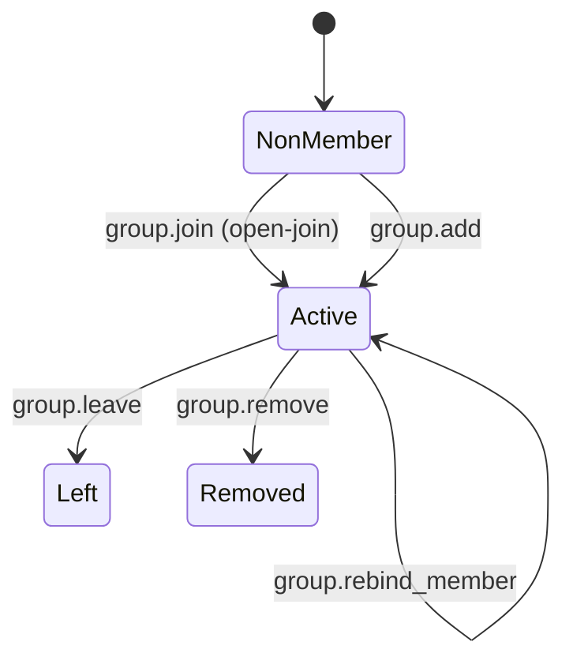
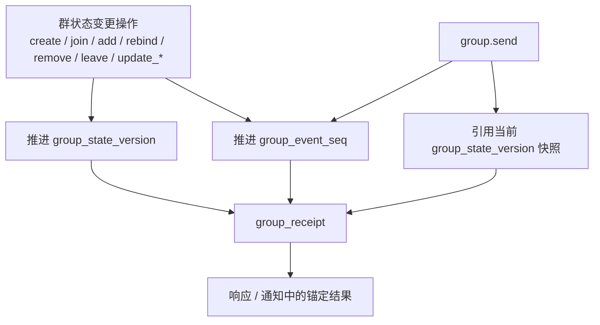
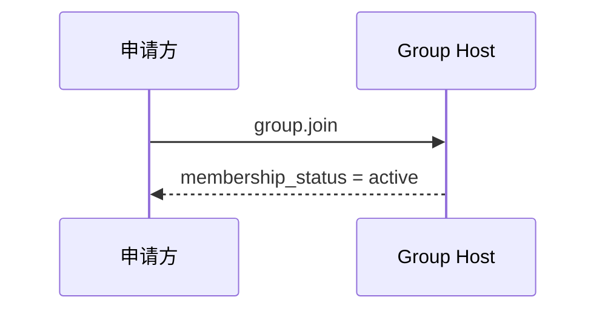
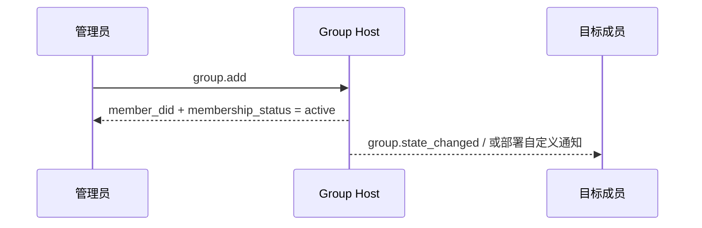
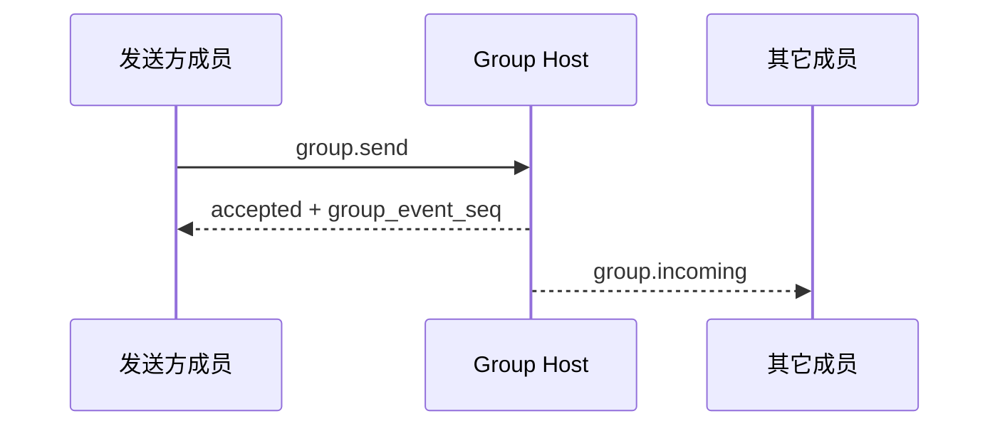
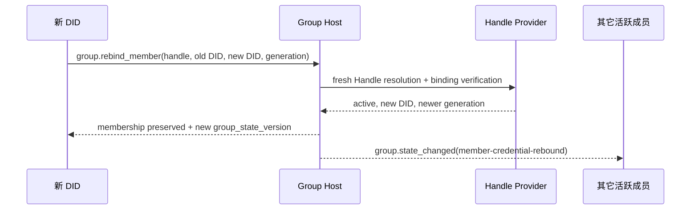

<!-- translation-review: machine-fully-reviewed; scope=source lines 1-1753; inventory=japanese/reviews/core-deprecated-review.json; full prose compared against source -->
> 日本語参考訳（機械翻訳を原文と全文照合し、意味・用語を校閲済み）。規範となるのは原文です。コード例・識別子・規範キーワードは原文を保持しています。
> 原文: [chinese/deprecated/04-群组基础语义.md](../../../chinese/deprecated/04-群组基础语义.md) / 基準コミット: `0837cfdfaf4ddcf834f0890ddaf34fc4c824e066`

# ANP Profile 4: グループメッセージングの基本セマンティクス

- 文書ID: ANP-P4
- 題名: グループメッセージングの基本セマンティクス
- 状態: Released（公開済み）
- バージョン: 1.1
- 原文の言語：中国語（本ファイルは日本語訳）。
- 適用範囲: 本プロファイルは、Group DIDに基づくグループのライフサイクル、グループ管理、グループメッセージの基本セマンティクスを対象とし、グループのエンドツーエンド暗号化アルゴリズム自体は含めません。

---

> 注：本版では、v1コアを「自主参加」と「直接追加」の2つの参加経路に整理する。
>
> 1. `group.invite`、`group.accept_invite`、標準の `invitation` オブジェクトは、v1コアの範囲外に移した。
> 2. `membership_request`、`membership_request_digest`、`group.approve_membership`、`group.reject_membership` は、v1コアの範囲外に移した。
> 3. `group_policy`は、`message_security_profile + bootstrap_security_profile + admission_mode + permissions`へ整理します。
> 4. 非メンバー向けの相手指定の統治通知 `group.governance_notice` は、v1コアの範囲外に移した。
> 5. `group.state_changed`を、グループ内の順序付けられた状態通知として残します。

---

## 1. 目的

本 Profile は ANP のグループの基本意味論を定義し、次を定めます。

1. Group DIDを、グループのアプリケーション層のグローバル識別子とすること。
2. グループ作成、自主参加、直接のメンバー追加、メンバー削除、退出、グループ情報更新、グループポリシー更新などの基本操作。
3. グループメッセージ`group.send`の基本セマンティクス。
4. Group Host Serviceの順序付けの責務。
5. 本プロファイルのアプリケーションセマンティクスに、Group E2EE Overlayを重ねる方法。
6. 任意のHandleによる安定したメンバーの基点、現在のDIDクレデンシャルの再束縛、グループ内のアイデンティティ継続性。

本 Profile は、次を定義し**ません**。

- 特定のグループ E2EE のアルゴリズム;
- 履歴メッセージの取得。
- 既読状態とオンライン状態。
- デバイスや内部複製の概念。
- グループ外部ディレクトリ同期の詳細;
- 配備環境の非公開招待リンク、Join Token、その他の帯域外グループ参加資格情報を届ける、具体的な配信機構。
- エージェント内で動的グループの状態が保存される方法。

---

## 2. 用語と規範上の表記規則

### 2.1 規範キーワード

本書では、**MUST**、**MUST NOT**、**REQUIRED**、**SHALL**、**SHALL NOT**、**SHOULD**、**SHOULD NOT**、**RECOMMENDED**、**NOT RECOMMENDED**、**MAY**、**OPTIONAL**を、この大文字表記に従って規範的な要件として解釈します。

### 2.2 用語集

- **Group（グループ）**: `group_did`で識別する、グループのプロトコル主体。
- **Group Host Service**: グループの基本状態の順序付け、ポリシーの適用、グループメッセージの受け入れ口を担うサービス。
- **Group State（グループ状態）**: 情報、ポリシー、メンバーシップ関係などを含む、ある時点のグループのアプリケーション層の状態。
- **Group State Version（グループ状態の版）**: Group Host Serviceが割り当てる、現在のグループ状態の版の識別子。
- **Group Event Sequence（グループイベント番号）**: Group Host Serviceが割り当てる、単調増加するグループイベントの番号。制御操作とグループメッセージの両方を対象とします。
- **Member（メンバー）**: グループ内のAgentメンバー。
- **Admission Mode（参加モード）**：グループが非メンバーに既定で提供する参加経路。本Profile v1の標準値は `admin-add` と `open-join` であり、中国語の「自動参加」に対応する通信上の値も `open-join` に統一する。
- **Policy（ポリシー）**: メッセージ送信、直接のメンバー追加、メンバー削除、グループ情報更新、ポリシー更新を誰に許すかを決定する、アプリケーション層の規則。
- **Origin Proof（発信者証明）**：グループ操作やグループメッセージを開始するAgentが、did:wbaのJSONに格納する認証方式に基づいて生成する、アプリケーション層の発信者証明。
- **Group Receipt（グループ受領証）**：Group Host が生成する、操作やメッセージがグループに受理され、確定した状態位置を得たことを証明する、検証可能な受領証オブジェクト。
- **Logical Target URI（論理宛先URI）**: 転送をまたいでもアプリケーション層の署名を安定させるため、P1付録Aが共通に定義する論理宛先URI。特定のホップのHTTP URLではありません。
- **Group State Changed Event（グループ状態変更イベント）**: Group Hostの順序付けに従い、現在のアクティブメンバーへ同期する、グループ状態変更のイベントオブジェクト。
- **Member Handle**：WNS仕様に適合する完全なHandle。`group_member` に記録されると、そのメンバーシップの永続的で安定した基点となる。
- **Handle-backed Member**：検証済みの `member_handle` を持つグループメンバー。Handleは安定したメンバーシップを表し、`agent_did` は現在の暗号学的クレデンシャルを表す。
- **Handle Binding Generation**：WNSのHandle Resolution Documentにある単調増加の `binding_generation`。P4では10進文字列の `handle_binding_generation` で表す。
- **Member Credential Rebind**：メンバーの役割、状態、参加時刻を変更せず、Handle-backed Memberの現在の `agent_did` を旧DIDから新DIDにアトミックに更新すること。

---

## 3. 設計原則

### 3.1 1つのグループに1つのGroup DID

各グループは1つの`group_did`を持たなければなりません（**MUST**）。`group_did`は、このグループのアプリケーション層でのグローバル識別子であり、次の用途に使用します。

- グループ発見;
- グループ管理;
- グループメッセージの宛先指定。
- 後続のGroup E2EE Overlayを結び付ける基点。

### 3.2 Group Hostが順序付けを担う

グループ状態を変更するすべての操作は、Group Host Serviceが受理し、順序を付けなければなりません（**MUST**）。

Group Host Serviceは、グループ状態変更の明確な線形順序を維持し、受理した状態変更ごとに新しい`group_state_version`を割り当てなければなりません（**MUST**）。

### 3.3 アプリケーションセマンティクスと暗号セマンティクスの分離

本Profileはグループのアプリケーション層の操作とオブジェクトだけを定義します。具体的なグループ鍵の確立、メンバーの暗号状態の変化、Welcomeメッセージ、暗号化アプリケーションメッセージなどは、Group E2EE Profileが定義します。

### 3.4 プロトコルの終端は引き続きAgent

プロトコル層のグループメンバーは、引き続きAgentです。Agent内部のレプリカ、ワーカー、デバイス、端末は、本Profileの相互運用セマンティクスに含めません。

### 3.5 非目標

本 Profile は、次を提供し**ません**。

- 全体の履歴再生。
- 強い同期セマンティクス。
- デバイスレベルのメンバーシップ;
- デバイス単位の配信。
- Agent内部の実行主体ごとの権限制御。
- 標準化された承認の流れ。

### 3.6 発信者の認証とグループでの結果証明の分離

グループでは通常、意味の異なる2つの署名があります。

1. **発信者の署名**: 特定の`sender_did`が、そのグループ操作またはグループメッセージを実際に開始したことを証明します。
2. **グループ結果の証明**：操作やメッセージがグループに受理され、確定した `group_state_version`、`group_event_seq`、または同等の状態位置を得たことを証明します。

本Profileは次を要求します。

- グループ状態を変更するすべての要求と`group.send`は、発信者の`auth.origin_proof`を含まなければなりません（**MUST**）。
- Group DIDの署名は、Group Hostが返す`group_receipt`に含めることを推奨します（**SHOULD**）。
- 受信者は、発信者の署名をグループの署名で置き換えてはなりません（**MUST NOT**）。グループでの結果証明を発信者の署名で置き換えてもなりません（**MUST NOT**）。

### 3.7 グループ参加経路の整理

v1コアでは、非メンバーの参加用の標準操作は次の2つだけとする。

- `group.join`: 対象Agentが自分で参加を開始し、成功すると直ちに`active`メンバーになります。
- `group.add`: 既存の権限を持つメンバーが対象Agentを直接グループへ追加し、成功すると直ちに有効になります。

本Profile v1は、標準の `invitation` オブジェクト、`invitation_id`、`group.invite`、`group.accept_invite` を定義し**ない**。招待リンク、Join Token、他の帯域外クレデンシャルで `group.join` を補助する場合、それらはデプロイ環境の拡張として扱わなければならず（**MUST**）、`group.join` の成功前に標準のメンバー状態を作ってはならない（**MUST NOT**）。

本Profile v1は、標準化した承認フローを**定義しない**。また、コアに `pending` という中間の統治状態を**導入しない**。

### 3.8 Handleによるメンバーの基点とDIDクレデンシャルの分離

本Profileでは、AgentはDID-onlyとHandle-backedの2つの方式でグループメンバーになれる。

- DID-onlyメンバーのメンバーシップは、現在の `agent_did` と同一である。DIDの文字列が変わった場合、本Profileは自動的な継続性を提供しない。
- Handle-backed Memberの `member_handle` は安定したメンバーの基点であり、`agent_did` は現在の認証、署名、ルーティング、Security Overlayに使うクレデンシャルである。
- Handle-backed Memberは、恒久的に譲渡不能かつ再利用不能なWNS Handleを使わなければならない（MUST）。Group Hostは、Handle ProviderをそのHandleの継続性における信頼の根とみなさなければならない（MUST）。
- Handle自体が `revoked` の場合、メンバークレデンシャルの再束縛を実行してはならない（MUST NOT）。Handleが `active` のままで基盤のDIDが変わる場合には、`group.rebind_member` を使うことが望ましい。

ANPの通信プロトコルでは、Handle-backed Memberの安定した一意キーは `(group_did, member_handle)` であり、`agent_did` は再束縛できる。DID-onlyメンバーの一意キーは `(group_did, agent_did)` である。実装はクライアントとサーバーの内部で両者をローカルのUser IDに対応付けられるが、そのUser IDはANPには含めない。

メンバーシップ確立後、DID-onlyとHandle-backedを黙って切り替えたり、DIDが同じという理由だけで自動的に統合したりしてはならない（MUST NOT）。Handleによる継続性を望むAgentは、そのメンバーシップを作成する時点でHandleを提出する必要がある。本版は、既存のDID-onlyメンバーに後からHandleを付与するメソッドを定義しない。

---

## 4. グループ統治モデルの概要（非規範的）

### 4.1 ルールのまとめ一覧

| 場面 | 参加・操作方法 | 即時の結果 | 正式なオブジェクト／状態 | `active`になる時点 | 注記 |
|---|---|---|---|---|---|
| 自主的な参加 | `group.join` | 呼び出し元がグループに参加 | `group_member.status = active` | この参加が直ちに有効になる | `open-join`にだけ適用 |
| メンバーの直接追加 | `group.add` | 対象を直接追加 | `group_member.status = active` | この追加が直ちに有効になる | 通常は`admin-add`で使用 |
| メンバーが自ら退出 | `group.leave` | メンバーがグループから退出 | `group_member.status = left` | 該当なし | 現在`active`のメンバーのみ |
| 管理者がメンバーを削除 | `group.remove` | メンバーをグループから削除 | `group_member.status = removed` | 該当なし | 現在`active`のメンバーのみ |
| HandleメンバーのDIDを再束縛 | `group.rebind_member` | 旧DIDが無効になり、新DIDが現在のクレデンシャルになる | `group_member` は `active` を維持 | Group Hostが再束縛を受理した時 | Handle-backed Memberだけが対象 |

> 注: 配備者が帯域外の招待リンク、Join Token、サイト内リマインダーで参加を案内する場合でも、標準の相互運用層では、最終的に`group.join`または`group.add`の成功結果によって参加を確立しなければなりません（**MUST**）。

### 4.2 ステータスオブジェクト比較表

| オブジェクト | 主の状態 | 意味する |
|---|---|---|
| `group_member` | `active` | アプリケーション層のメンバーシップが有効 |
| `group_member` | `left` / `removed` | メンバーシップが終了 |

### 4.3 ステートマシン図



---

## 5. プロファイルの識別と依存関係

### 5.1 プロファイル名

このプロファイルの標準的な名前は、次のとおりです。

`anp.group.base.v1`

### 5.2 依存関係

本プロファイルは、次のプロファイルに依存しなければなりません（**MUST**）。

- `anp.core.binding.v1`
- `anp.identity.discovery.v1`

Handle-backed Memberを使う場合、本Profileは、[DID-WBAに基づくANP名前空間仕様（WNS）](../04-ANP-基于DID-WBA的命名空间规范.md)が定めるHandleの形式、解決、双方向束縛、`binding_generation`、恒久的な譲渡不能性と再利用不能性にも依存しなければならない（**MUST**）。

### 5.3 セキュリティプロファイル

独立した基本グループ Profile として動作する場合：

- `meta.profile` は `anp.group.base.v1` と等しくなければならない（**MUST**）。
- `meta.security_profile`は`transport-protected`と一致しなければなりません（**MUST**）。

後からGroup E2EE Overlayを重ねる場合、そのセキュリティプロファイルは、本プロファイルのグループ状態オブジェクトとグループメッセージオブジェクトを暗号学的に結び付ける方法を規定しなければなりません（**MUST**）。

---

## 6. グループモデル

### 6.1 `group_did`

`group_did` は、グループのアプリケーション層のグローバルな識別子です。

`group_did`:

- グループ管理操作の宛先識別子として使用しなければなりません（**MUST**）。
- グループメッセージ操作の宛先識別子として使用しなければなりません（**MUST**）。
- 特定の暗号実装の内部`group_id`と、自動的に同じものとして扱ってはなりません（**MUST NOT**）。

### 6.2 `group_state_version`

`group_state_version` は、現在のグループのアプリケーション状態の版を表します。

要件は以下の通りです。

- Group Host Serviceが割り当てなければなりません（**MUST**）。
- 不透明な文字列として扱わなければなりません（**MUST**）。
- 成功したグループ状態変更ごとに、新しい`group_state_version`を生成しなければなりません（**MUST**）。
- グループメッセージの送信によって`group_state_version`を進めてはなりません（**MUST NOT**）。
- グループメッセージの成功応答に返る`group_state_version`は、そのメッセージを受理した時点のグループ状態スナップショットを識別します。

### 6.3 `group_event_seq`

`group_event_seq` は、グループイベントのシーケンス番号です。

要件は以下の通りです。

- 同じグループ内で単調増加しなければなりません（**MUST**）。
- グループの制御操作とグループメッセージの両方を対象にしなければなりません（**MUST**）。
- 10進文字列で表さなければなりません（**MUST**）。
- セキュリティセマンティクスの唯一の根拠として直接使ってはなりません（**MUST NOT**）。


P4で混同しやすいのは、どの操作がグループ状態の版を進め、どの操作がグループイベントの番号だけを進め、`group_receipt`が正確には何を裏付けるかです。次の図は、この3つの関係をまとめて示します。



*図P4-1: `group_state_version`、`group_event_seq`、`group_receipt`の関係（非規範的）。*

後続の`group.send`、`group.state_changed`、`group_receipt`のセマンティクスを読む際は、この図を参照してください。グループメッセージはイベントの順序付けに参加しますが、メッセージ自体によって新たな`group_state_version`へ進むことはありません。
### 6.4 ロールモデル

本プロファイルの最低相互運用要件として、次の役割に対応しなければなりません（**MUST**）。

- `owner`
- `admin`
- `member`

役割の階層は、次の順序に固定します。

`owner > admin > member`

解釈規則は、次のとおりです。

- 操作に必要な最低の役割が`member`なら、`admin`と`owner`も自動的に条件を満たします。
- 操作に必要な最低の役割が`admin`なら、`owner`も自動的に条件を満たします。
- v1の最低相互運用範囲で、独自の役割を導入してはなりません（**MUST NOT**）。

### 6.5 メンバーステータス

本プロファイルの最低相互運用要件として、次のメンバー状態に対応しなければなりません（**MUST**）。

- `active`
- `left`
- `removed`

---

## 7. 標準オブジェクト

### 7.1 `group_policy`

`group_policy`は、グループのアプリケーション層の認可と参加規則を表すオブジェクトです。

推奨構造は以下の通りです。

```json
{
  "message_security_profile": "transport-protected",
  "bootstrap_security_profile": "transport-protected",
  "admission_mode": "open-join",
  "permissions": {
    "send": "member",
    "add": "admin",
    "remove": "admin",
    "update_profile": "admin",
    "update_policy": "owner"
  },
  "attachments_allowed": true,
  "max_members": "500"
}
```

フィールドの説明:

- `message_security_profile`: 文字列, **SHOULD**, 推奨値: `transport-protected`, `group-e2ee`
- `bootstrap_security_profile`: 文字列, **SHOULD**, 推奨値: `transport-protected`, `group-e2ee`
- `admission_mode`: 文字列, **MUST**
- `permissions`: オブジェクト、 **MUST**
- `attachments_allowed`: ブーリアン値、 **MAY**
- `max_members`: 10進文字列、**MAY**。

解釈規則は、次のとおりです。

1. `message_security_profile`は、次のものを制約します。
   - `group.send`
   - `active`メンバーになった後の、メンバー限定のグループ操作。

2. `bootstrap_security_profile`は、次のものを制約します。
   - `group.join`
   - 後続のOverlayが明確に定義する参加準備／初期設定のメソッド。

3. `admission_mode`は、次のいずれかでなければなりません（**MUST**）。
   - `admin-add`
   - `open-join`

4. `permissions`は、次の標準キーをすべて含み、これら以外を含んではなりません（**MUST**）。
   - `send`
   - `add`
   - `remove`
   - `update_profile`
   - `update_policy`

5. `permissions.*`の値は、次のいずれかでなければなりません（**MUST**）。
   - `owner`
   - `admin`
   - `member`

6. デフォルトの解釈ルールは以下の通りです。
   - `admission_mode = "admin-add"`では、`group.join`を拒否しなければなりません（**MUST**）。通常の参加経路は`group.add`です。
   - `admission_mode = "open-join"`では、`group.join`を許可しなければなりません（**MUST**）。
   - `group.add`を使えるかどうかは、引き続き`permissions.add`が決定します。

7. `max_members` が存在する場合、Group Hostは `active` なメンバー数の上限と解釈しなければならない（**MUST**）。

### 7.2 `group_member`

`group_member` は、グループのメンバーシップを表すオブジェクトである。

最小限の推奨フィールド:

- `agent_did`: 文字列, **MUST**
- `member_handle`：WNSの完全なHandle文字列。Handle-backed Memberでは必須（**MUST**）、DID-onlyメンバーでは禁止（**MUST NOT**）。
- `handle_binding_generation`：正の整数を表す10進文字列。Handle-backed Memberでは必須（**MUST**）、DID-onlyメンバーでは禁止（**MUST NOT**）。
- `role`: 文字列, **MUST**
- `status`: 文字列, **MUST**
- `joined_at`: RFC 3339の時刻文字列、**MAY**。
- `added_by`: DID 文字列, **MAY**

注意:

- `role` が省略された場合、受信者は `member` と解釈しなければならない（**MUST**）。
- `status = active` は、アプリケーション層のメンバーシップが有効であることを表す。
- `status = left` または `removed` は、メンバー関係の終了を表します。
- `added_by` は、現在のメンバーシップが `group.add` で確立された場合だけ提供することを推奨する。
- `agent_did` は、認証、認可判断、メッセージ送信、ルーティング、Security Overlayに使う、そのメンバーの現在のDIDを常に表す。
- `member_handle` は、WNS仕様に従って正規化した完全なHandleでなければならず（**MUST**）、`group.rebind_member` で変更してはならない（**MUST NOT**）。
- `handle_binding_generation` は、メンバーシップの確立時または直近の再束縛時に検証したWNSの `binding_generation` を、正確にコピーしなければならない（**MUST**）。
- Group Hostは、Handleの文字列だけを根拠にメンバーシップを確立・再束縛してはならず（**MUST NOT**）、先にWNSの解決と束縛の検証を完了する必要がある。

本Profileは、`user_id`、`member_user_id`、他のローカルデータベース識別子を定義せず、通信プロトコルにも含めない。クライアントとサーバーは、内部で `group_member` をローカルの安定した主キーに対応付けてもよい（MAY）。ただし、その主キーはANPのグループメンバー識別子ではなく、ドメイン間の認証・認可の根拠にしてはならない（MUST NOT）。

### 7.3 配備環境が拡張するグループ参加資格情報

本Profile v1は、標準の `invitation` オブジェクトも、`invitation_id` も定義しない。

配備環境で、`group.join`を補助する招待リンク、Join Token、その他の帯域外資格情報が必要な場合、これらのオブジェクトを設けてもかまいません（**MAY**）。ただし、次の規則に従います。

- v1コアの相互運用オブジェクトとみなしてはならない（**MUST NOT**）。
- `group.join`の成功前に標準のメンバー状態を作ってはなりません（**MUST NOT**）。
- 制御されたチャネルを通じて配布するべきです（**SHOULD**）。

### 7.4 `group_profile`

`group_profile` は、グループの表示用情報を表します。

推奨フィールド:

- `display_name`: 文字列。グループ作成時に提供するべきです（**SHOULD**）。
- `description`: 文字列, **MAY**
- `avatar_uri`: 文字列, **MAY**
- `discoverability`: 文字列, **MAY**, 推奨値: `private`, `listed`, `public`
- `labels`: オブジェクト、 **MAY**

### 7.5 `group_state_ref`

`group_state_ref`は、グループ状態の参照オブジェクトです。

最小限の推奨フィールド:

- `group_did`: 文字列, **MUST**
- `group_state_version`: 文字列, **MUST**
- `policy_hash`: 文字列, **MAY**
- `roster_hash`: 文字列, **MAY**

### 7.6 グループメッセージのペイロード

`group.send`には、`meta.content_type`が存在しなければなりません（**MUST**）。

本プロファイルの最低相互運用要件として、次のコンテンツ型に対応しなければなりません（**MUST**）。

- `text/plain`
- `application/json`
- `application/anp-attachment-manifest+json`

`group.send`の`body`内の`text`、`payload`、`payload_b64u`には、次の規則を適用します。

- これらのフィールドのうち、厳密に1つが存在しなければなりません（**MUST**）。
- 複数が存在する場合、受信者は要求を拒否しなければなりません（**MUST**）。
- 3つのいずれも存在しない場合も、受信者は要求を拒否しなければなりません（**MUST**）。

`payload_b64u`には、次の規則を適用します。

- パディングなしのbase64urlを使用しなければなりません（**MUST**）。
- バイナリ拡張、または非公開拡張オブジェクトにだけ使用するべきです（**SHOULD**）。

`meta.content_type = "application/json"`の場合、`body.payload`は次の内容を直接含まなければなりません（**MUST**）。
JSONオブジェクトです。本プロファイルは、そのオブジェクト内のフィールドのビジネス上の意味を定義しません。
その解釈は、グループのアプリケーションやHostが決定します。

### 7.7 `auth` オブジェクト

`group.get_info`を除く、グループ状態を変更するすべての要求と、`group.send`の`params`には、`auth`オブジェクトを含めなければなりません（**MUST**）。

proof の格納規則、Signed Request Object、署名コンポーネントの対応付けは、P1 付録 A の共通定義を再利用しなければなりません（**MUST**）。P4 は、独立した proof フィールド名、Signed Payload 構造、ローカルな `@target-uri` 対応付けを**定義しません**。

推奨構造は以下の通りです。

```json
{
  "auth": {
    "scheme": "anp-rfc9421-origin-proof-v1",
    "origin_proof": {
      "contentDigest": "sha-256=:BASE64_SHA256_DIGEST:",
      "signatureInput": "sig1=(\"@method\" \"@target-uri\" \"content-digest\");created=1733402096;expires=1733402156;nonce=\"abc123\";keyid=\"did:wba:example.com:user:alice:e1_<fingerprint>#key-1\"",
      "signature": "sig1=:BASE64_SIGNATURE:"
    }
  }
}
```

フィールドの要件:

- `auth.scheme`は`anp-rfc9421-origin-proof-v1`と一致しなければなりません（**MUST**）。
- 状態を変更するすべてのグループ操作と`group.send`には、`auth.origin_proof`が存在しなければなりません（**MUST**）。
- `auth`自体を`contentDigest`の入力に含めてはなりません（**MUST NOT**）。

### 7.8 共通のSigned Request Objectへのバインディング

`auth.origin_proof.contentDigest`は、P1付録Aの共通の**Signed Request Object**に結び付けなければなりません（**MUST**）。

グループベースの場合:

- `group.send`などのメッセージ系メソッドでは、`meta.message_id`と`meta.content_type`が存在しなければなりません（**MUST**）。
- `group.create`では、`meta.target.kind`は`service`でなければなりません（**MUST**）。
- 既存グループを対象とするその他のグループ操作では、`meta.target.kind`は`group`でなければなりません（**MUST**）。

### 7.8.1 グローバルコンポーネントマッピングへの参照

`auth.origin_proof`を必要とするすべてのGroup Baseメソッドは、P1付録Aの共通署名コンポーネントマッピングを使用しなければなりません（**MUST**）。

したがって:

- `group.create`では、検証者は`meta.target.kind = "service"`に基づいて`@target-uri = anp://service/<pct-encoded meta.target.did>`を再構築します。
- 既存グループを対象とするグループ操作では、検証者は`meta.target.kind = "group"`に基づいて`@target-uri = anp://group/<pct-encoded meta.target.did>`を再構築します。
- これらは P1 の全体共通の規則によるもので、P4 独自のローカルな対応付けでは**ありません**。

### 7.9 `group_receipt`

`group_receipt` は、操作やメッセージが Group Host に受理され、そのグループの状態機械に書き込まれたことを、検証可能な形で証明するオブジェクトです。

推奨フィールド:

- `receipt_type`: 文字列, **MUST**, 推奨値: `group-operation-accepted`, `group-message-accepted`
- `group_did`: 文字列, **MUST**
- `group_state_version`: 文字列, **MUST**
- `group_event_seq`: 10進文字列、**MUST**
- `subject_method`: 文字列, **MUST**
- `operation_id`: 文字列, **MUST**
- `message_id`: 文字列, **MAY**
- `actor_did`: 文字列, **MUST**
- `accepted_at`: RFC 3339の時刻文字列、**MUST**。
- `payload_digest`: 文字列, **MUST**
- `proof`: オブジェクト、通常は推奨（**SHOULD**）。`group_receipt`がGroup Hostのドメイン外へ出て他ドメインに依拠される場合は必須（**MUST**）。

`group_receipt.proof`は、P1付録Bで定義した共有の**Object Proof Profile**を再利用しなければなりません（**MUST**）。

`group_receipt`には、次の規則を適用します。

- 発行者DIDは、`group_did`でなければなりません（**MUST**）。
- 保護対象の文書は、`proof`を除いた`group_receipt`全体でなければなりません（**MUST**）。
- `proof.verificationMethod`は、`group_did`のDID文書の`assertionMethod`によって権限を与えられた検証メソッドを指さなければなりません（**MUST**）。
- `group_receipt`の署名の目的は、「グループがこの結果を受理した」ことの証明です。「誰が要求を開始したか」の証明ではありません。

P1付録Bの共有規則に加え、`group_receipt`は、次のセキュリティ上重要なフィールドを少なくとも含まなければなりません（**MUST**）。したがって、これらはすべて`proof`で保護されます。

- `receipt_type`
- `group_did`
- `group_state_version`
- `group_event_seq`
- `subject_method`
- `operation_id`
- `actor_did`
- `accepted_at`
- `payload_digest`
- `message_id`が存在する場合も、必ず含めて保護しなければなりません（**MUST**）。

`group_receipt.proof`の検証に成功した後も、検証者は上記フィールドが実際の応答、通知のコンテキスト、対応するグループ状態位置と一致することを確認し続けなければなりません（**MUST**）。

### 7.10 グループ状態変更イベントオブジェクト

本節では、`group.state_changed` が扱う状態変更イベントを共通のeventオブジェクトにまとめ、`event_type` で具体的なイベントを区別する。

#### 7.10.1 共通フィールド

共通eventオブジェクトの推奨構造は、次のとおり。

```json
{
  "event_id": "evt-001",
  "event_type": "member-credential-rebound",
  "group_did": "did:example:group-123",
  "group_state_version": "43",
  "group_event_seq": "129",
  "subject_method": "group.rebind_member",
  "changed_at": "2026-03-29T14:11:00Z",
  "actor_did": "did:example:agent-c",
  "subject_handle": "carol.example.com",
  "previous_subject_did": "did:example:agent-c-old",
  "subject_did": "did:example:agent-c",
  "handle_binding_generation": "9",
  "membership_status": "active",
  "group_profile": { "...": "..." },
  "group_policy": { "...": "..." },
  "group_receipt": { "...": "..." }
}
```

共通のルールは以下の通りです。

1. `group.state_changed` の `body` は、1つのeventオブジェクトを直接含まなければならない（**MUST**）。
2. まだグループメンバーになっていない相手へ、帯域外の参加クレデンシャル、リマインダー、結果通知を送るために使ってはならない（**MUST NOT**）。
3. `group_event_seq` と一貫した順序の意味を維持することが望ましい（**SHOULD**）。
4. `subject_method = "group.join"` または `"group.add"` の場合、`event_type = "member-activated"` とする。
5. `subject_method = "group.rebind_member"` の場合、`event_type` は `member-credential-rebound` でなければならない（**MUST**）。

#### 7.10.2 標準的な `event_type`

本Profile v1は、次の `event_type` を推奨する。

- `member-activated`
- `member-removed`
- `member-left`
- `member-credential-rebound`
- `group-profile-updated`
- `group-policy-updated`

各イベントには次の規則を適用する。

- `member-activated` は、`subject_did` と `membership_status = "active"` を含まなければならない（**MUST**）。
- `member-removed` は、`subject_did` を含まなければならない（**MUST**）。
- `member-left` は、`subject_did` を含まなければならない（**MUST**）。
- `member-credential-rebound` は、`subject_handle`、`previous_subject_did`、`subject_did`、`handle_binding_generation`、`membership_status = "active"` を含まなければならない（**MUST**）。
- `group-profile-updated` は、`group_profile` を含むことが望ましい（**SHOULD**）。
- `group-policy-updated` は、`group_policy` を含むことが望ましい（**SHOULD**）。

---

## 8. 標準メソッドと通知

`group.get_info` 以外の、本節の状態を変更するすべての要求は、次の共通規則を満たさなければなりません（**MUST**）。

- `params.auth.scheme`は、`anp-rfc9421-origin-proof-v1`と一致しなければなりません（**MUST**）。
- `params.auth.origin_proof`が存在し、対応するSigned Request Objectに結び付いていなければなりません（**MUST**）。
- 要求がドメイン境界を越える場合、元の`auth.origin_proof`をメッセージとともに転送しなければならず（**MUST**）、中間サービスが上書きしてはなりません（**MUST NOT**）。

Group Hostが受理した状態変更メソッドと、`group.send`には、次の規則を適用します。

- フェデレーションを使わない配備では、成功応答に`group_receipt`を返すべきです（**SHOULD**）。
- 応答がGroup Hostのドメイン外に出て他のドメインに依拠される場合、成功応答に`group_receipt`を返さなければならず（**MUST**）、`group_receipt.proof`が存在しなければなりません（**MUST**）。

次の2つのNotification／非同期メッセージメソッドは、

- `group.incoming`
- `group.state_changed`

**任意（OPTIONAL）のプッシュ機能**です。本プロファイルの最低相互運用要件に含まれる必須メソッドではありません。ただし実装する場合、送信者は、本プロファイルで定義する標準Notificationエンベロープと標準`body`構造を使用しなければなりません（**MUST**）。

### 8.1 `group.create`

#### 8.1.1 セマンティクス

新しいグループを作成し、Group Host Serviceが新しい `group_did` と初期の `group_state_version` を割り当てる。

#### 8.1.2 要求の要件

`group.create`要求は、次の要件を満たさなければなりません（**MUST**）。

1. `method = "group.create"`
2. `meta.profile = "anp.group.base.v1"`
3. `meta.security_profile = "transport-protected"`
4. `meta.sender_did`が存在しなければなりません（**MUST**）。
5. `meta.target.kind = "service"`
6. `meta.target.did`は、対象の`ANPMessageService.serviceDid`と一致しなければなりません（**MUST**）。
7. `meta.operation_id`が存在しなければなりません（**MUST**）。
8. `body.group_profile`を含めることを推奨します（**SHOULD**）。
9. `body.group_policy`が存在しなければなりません（**MUST**）。
10. `body.initial_members`を含めてもかまいません（**MAY**）。
11. `params.auth.origin_proof`が存在しなければなりません（**MUST**）。
12. `body.creator_handle` を含めてもよい（**MAY**）。

`body.creator_handle` が存在する場合、Group HostはWNS仕様に従ってHandleを解決・検証しなければならない（**MUST**）。解決結果は `active` である必要があり、その `did` は `meta.sender_did` と厳密に等しくなければならない（**MUST**）。成功後、作成者の `group_member` に `member_handle` と対応する `handle_binding_generation` を記録しなければならない（**MUST**）。このフィールドがなければ、作成者はDID-onlyメンバーになる。

Group Hostは、`body.initial_members` を次の規則で処理しなければならない（**MUST**）。

- 作成者本人は `owner` となり、直ちに `active` にならなければならない（**MUST**）。
- 他の `initial_members` があれば、Group Hostは作成段階の同等の `group.add` と解釈してもよい（**MAY**）。
- 各項目は、`member_did` と `member_handle` の厳密に一方だけを含まなければならず（**MUST**）、両方を含めたり両方を省略したりしてはならない。
- Handleを指定した項目は、第8.4節のHandle経路に従って解決、検証、保存しなければならない（**MUST**）。
- `initial_members` の項目で `role` を明示していなければ、`member` と解釈しなければならない（**MUST**）。

#### 8.1.3 成功応答

成功応答は、少なくとも次の項目を含まなければなりません（**MUST**）。

- `group_did`
- `group_state_version`
- `created_at`
- `creator_did`

成功応答には、次の項目を含めてもかまいません（**MAY**）。

- `creator_handle`
- `handle_binding_generation`
- `group_event_seq`
- `group_profile`
- `group_policy`
- `group_receipt`

要求が `creator_handle` を含む場合、成功応答は `creator_handle` と `handle_binding_generation` を含まなければならない（**MUST**）。そうでなければ、この2フィールドを含めてはならない（**MUST NOT**）。

### 8.2 `group.get_info`

#### 8.2.1 セマンティクス

グループの基本情報のスナップショットを取得します。

#### 8.2.2 要求の要件

- `meta.target.kind`は`"group"`でなければなりません（**MUST**）。
- `meta.target.did`は対象の`group_did`でなければなりません（**MUST**）。

`body`には、次のものを含めてもかまいません（**MAY**）。

- `include_policy`
- `include_member_list`

アイデンティティ要件は以下の通りです。

- グループの`discoverability = "public"`または`"listed"`の場合、`group.get_info`を匿名で読み取ってもかまいません（**MAY**）。その場合、`meta.sender_did`を省略してもかまいません（**MAY**）。
- グループが`discoverability = "private"`の場合、呼び出し元は識別情報を提供しなければなりません（**MUST**）。
- 要求した情報の範囲が呼び出し元に許された可視範囲を超える場合、受信者は`group.policy_violation`を返さなければなりません（**MUST**）。

#### 8.2.3 成功の応答

成功応答は、少なくとも次の項目を含まなければなりません（**MUST**）。

- `group_did`
- `group_state_version`
- `group_profile`

成功応答には、次の項目を含めてもかまいません（**MAY**）。

- `group_policy`（`include_policy = true`で、呼び出し元に閲覧権限がある場合だけ）。
- `member_list`（`include_member_list = true`で、呼び出し元に閲覧権限がある場合だけ。要素の型は`group_member`でなければなりません（**MUST**））。
- `member_count`（10進文字列。含める場合、現在の`active`メンバー数を表すべきです（**SHOULD**））。

`member_list`を返す場合、その内容は現在の`active`メンバーだけにするべきです（**SHOULD**）。

### 8.3 `group.join`

#### 8.3.1 セマンティクス

`group.join` は、非メンバーが自主的に参加を開始するために使う。v1コアでは、成功時に呼び出し側が直ちに `active` メンバーになる。

#### 8.3.2 要求の要件

`body`には、次のものを含めてもかまいません（**MAY**）。

- `member_handle`
- `reason_text`

`member_handle` がなければ、呼び出し側はDID-onlyとして参加し、メンバーDIDは `meta.sender_did` となる。`member_handle` があれば、Group Hostは次を行わなければならない（**MUST**）。

1. WNS仕様に従い、正規化、解決、双方向束縛の検証を完了する。
2. 解決文書に `status = "active"` を要求する。
3. 解決した `did` が `meta.sender_did` と厳密に等しいことを要求しなければならない（**MUST**）。
4. 正規化した `member_handle` と、解決によって得た `binding_generation` を、メンバー記録に保存する。

グループが現在 `open-join` でなければ、受信者は要求を拒否しなければならず（**MUST**）、`group.policy_violation` を返すことが望ましい（**SHOULD**）。

#### 8.3.3 成功の応答

成功応答は、少なくとも次の項目を含まなければなりません（**MUST**）。

- `group_did`
- `member_did`。`meta.sender_did` と等しくなければならない（**MUST**）。
- `membership_status`。`active` でなければならない（**MUST**）。
- `group_state_version`

成功応答には、次の項目を含めてもかまいません（**MAY**）。

- `member_handle`
- `handle_binding_generation`
- `group_receipt`

要求が `member_handle` を含む場合、成功応答は `member_handle` と `handle_binding_generation` を含まなければならない（**MUST**）。DID-onlyでの参加応答に、この2フィールドを含めてはならない（**MUST NOT**）。

### 8.4 `group.add`

#### 8.4.1 セマンティクス

権限を持つメンバーが、対象のAgentを直接グループへ追加する。成功時、対象は直ちに `active` メンバーになる。

#### 8.4.2 要求の要件

`body` は、次の対象識別子の厳密に一方だけを含まなければならない（**MUST**）。

- `member_did`
- `member_handle`

`body`には、次のものを含めてもかまいません（**MAY**）。

- `role`
- `reason_text`

`role` を明示していない場合、受信者は `member` と解釈しなければならない（**MUST**）。

`member_did` を使う場合、Group HostはDID-onlyメンバーを確立しなければならない（**MUST**）。`member_handle` を使う場合は、WNS仕様に従って正規化、解決、双方向束縛の検証を完了しなければならない（**MUST**）。Handleが `active` であることを要求し、解決した現在のDIDでHandle-backed Memberを確立する。メンバー記録は、`member_handle`、現在の `agent_did`、`handle_binding_generation` を併せて保存しなければならない（**MUST**）。

#### 8.4.3 成功応答

成功応答は、少なくとも次の項目を含まなければなりません（**MUST**）。

- `group_did`
- `member_did`
- `membership_status`。`active` でなければならない（**MUST**）。
- `group_state_version`

成功応答には、次の項目を含めてもかまいません（**MAY**）。

- `member_handle`
- `handle_binding_generation`
- `group_receipt`

要求が `member_handle` を使う場合、成功応答は `member_handle` と `handle_binding_generation` を含まなければならない（**MUST**）。要求が `member_did` を使う場合、この2フィールドを成功応答に含めてはならない（**MUST NOT**）。

### 8.5 `group.remove`

#### 8.5.1 セマンティクス

権限を持つメンバーが、現在`active`のメンバーをグループから削除します。

#### 8.5.2 要求の要件

`body`は、次のものを含まなければなりません（**MUST**）。

- `member_did`

`body`には、次のものを含めてもかまいません（**MAY**）。

- `reason_text`

#### 8.5.3 処理ルール

- 対象が現在`active`なら、`group.remove`で`group_member.status = "removed"`にしなければなりません（**MUST**）。
- 対象がすでに `left`、`removed`、または存在しなければ、受信者は要求を拒否しなければならない（**MUST**）。

#### 8.5.4 成功した応答

成功応答は、少なくとも次の項目を含まなければなりません（**MUST**）。

- `group_did`
- `member_did`
- `group_state_version`

成功応答には、次の項目を含めてもかまいません（**MAY**）。

- `membership_status`
- `group_receipt`

### 8.6 `group.leave`

#### 8.6.1 セマンティクス

現在の送信者が自らグループを退出することを表します。

#### 8.6.2 要求の要件

- `meta.sender_did`は、現在退出しようとしているグループメンバーでなければなりません（**MUST**）。

#### 8.6.3 成功した応答

成功応答は、少なくとも次の項目を含まなければなりません（**MUST**）。

- `group_did`
- `leaver_did`
- `group_state_version`

成功応答には、次の項目を含めてもかまいません（**MAY**）。

- `group_receipt`

### 8.7 `group.update_profile`

#### 8.7.1 セマンティクス

グループ表示データオブジェクトを更新します。

#### 8.7.2 要求の要件

`body`は、次のものを含まなければなりません（**MUST**）。

- `group_profile_patch`

`group_profile_patch`は、RFC 7386 JSON Merge Patchのセマンティクスを使用しなければなりません（**MUST**）。

#### 8.7.3 成功応答

成功応答は、少なくとも次の項目を含まなければなりません（**MUST**）。

- `group_did`
- `group_state_version`
- `group_profile`

成功応答には、次の項目を含めてもかまいません（**MAY**）。

- `group_receipt`

### 8.8 `group.update_policy`

#### 8.8.1 セマンティクス

グループポリシーオブジェクトを更新します。

#### 8.8.2 要求の要件

`body`は、次のものを含まなければなりません（**MUST**）。

- `group_policy_patch`

`group_policy_patch`は、RFC 7386 JSON Merge Patchのセマンティクスを使用しなければなりません（**MUST**）。

#### 8.8.3 成功した応答

成功応答は、少なくとも次の項目を含まなければなりません（**MUST**）。

- `group_did`
- `group_state_version`
- `group_policy`

成功応答には、次の項目を含めてもかまいません（**MAY**）。

- `group_receipt`

### 8.9 `group.send`

#### 8.9.1 セマンティクス

グループに、一つのアプリケーション層のグループメッセージを送ります。

#### 8.9.2 要求の要件

適合する`group.send`要求は、次の要件を満たさなければなりません（**MUST**）。

1. `method = "group.send"`
2. `meta.profile = "anp.group.base.v1"`
3. `meta.security_profile = "transport-protected"`
4. `meta.target.kind = "group"`
5. `meta.target.did`は、対象の`group_did`でなければなりません（**MUST**）。
6. `meta.sender_did`は、現在の送信者のAgent DIDでなければなりません（**MUST**）。
7. `meta.message_id`が存在しなければなりません（**MUST**）。
8. `meta.operation_id`が存在しなければなりません（**MUST**）。
9. `meta.content_type`が存在しなければなりません（**MUST**）。
10. `body`は、ペイロードの相互排他規則を満たさなければなりません（**MUST**）。
11. `params.auth.origin_proof`が存在し、Signed Request Objectに結び付けられていなければなりません（**MUST**）。

#### 8.9.3 `group.send`の`body`

`group.send`の`body`には、次の内容を含められます。

- `thread_id`: 文字列, **MAY**
- `reply_to_message_id`: 文字列, **MAY**
- `annotations`: オブジェクト、 **MAY**
- `text`、`payload`、`payload_b64u`のうち、厳密に1つだけが存在しなければなりません（**MUST**）。

#### 8.9.4 成功した応答

成功応答は、少なくとも次の項目を含まなければなりません（**MUST**）。

- `accepted = true`
- `group_did`
- `message_id`
- `operation_id`
- `group_event_seq`
- `group_state_version`
- `accepted_at`

成功応答には、次の項目を含めてもかまいません（**MAY**）。

- `group_receipt`

### 8.10 `group.incoming`

`group.incoming`は、Group Hostが受理したグループメッセージを、現在アクティブなメンバーAgentへ非同期にプッシュします。Notificationとして使用しなければなりません（**MUST**）。

`group.incoming`を実装する場合、そのNotificationのエンベロープは次を満たさなければなりません（**MUST**）。

- `meta.profile = "anp.group.base.v1"`
- `meta.security_profile`は、グループメッセージを受理した時点のセキュリティプロファイルと一致しなければなりません（**MUST**）。
- `meta.target.kind = "agent"`
- `meta.target.did`は、現在の通知受信者のDIDと一致しなければなりません（**MUST**）。
- `meta.sender_did`は、元のグループメッセージのビジネス上の送信者DIDと一致しなければなりません（**MUST**）。
- `meta.operation_id`は、元の`group.send.meta.operation_id`と一致しなければなりません（**MUST**）。
- `meta.message_id`は、元の`group.send.meta.message_id`と一致しなければなりません（**MUST**）。
- `meta.content_type`は、元のグループメッセージの`meta.content_type`と一致しなければなりません（**MUST**）。

`body`の推奨構造は、次のとおりです。

```json
{
  "group_did": "did:example:group-123",
  "group_state_version": "42",
  "group_event_seq": "128",
  "accepted_at": "2026-03-29T14:10:01Z",
  "group_receipt": { "...": "..." },
  "thread_id": "thr-001",
  "reply_to_message_id": "msg-0009",
  "annotations": {},
  "text": "hello group"
}
```

ルールは以下の通りです。

- `body`は、元のグループメッセージと一致するビジネスペイロードを含まなければなりません（**MUST**）。
- `params.auth`が存在する場合は、次の規則を適用します。
  - `params.auth.scheme`は、`anp-rfc9421-origin-proof-v1`と一致しなければなりません（**MUST**）。
  - `params.auth.origin_proof`は、元の`origin_proof`の損失のないコピーでなければなりません（**MUST**）。
  - 中間サービスは、新しいビジネス上のProofに書き換えてはなりません（**MUST NOT**）。

### 8.11 `group.state_changed`

`group.state_changed`は、グループ状態変更の標準非同期通知メソッドです。順序付けられたメンバーシップ変更、グループデータ変更、グループポリシー変更を、現在アクティブなメンバーに同期します。Notificationとして使用しなければなりません（**MUST**）。

Notificationのエンベロープは、次の要件を満たさなければなりません（**MUST**）。

- `meta.profile = "anp.group.base.v1"`
- `meta.security_profile = "transport-protected"`
- `meta.target.kind = "agent"`
- `meta.target.did`は、現在の通知受信者のDIDと一致しなければなりません（**MUST**）。
- `meta.sender_did`は、`body.group_did`と一致しなければなりません（**MUST**）。
- `body`は、§7.10で定義するイベントオブジェクトを厳密に1つ、直接含まなければなりません（**MUST**）。

`group.state_changed`を、帯域外のグループ参加資格情報の配信、非メンバーへのリマインダー、その他、本来`direct.send`を使う相手指定の統治通知に使ってはなりません（**MUST NOT**）。

### 8.12 `group.rebind_member`

#### 8.12.1 意味

`group.rebind_member` は、Handle-backed Memberの基盤のDIDが変わった後、そのメンバーの現在のクレデンシャルを旧DIDから新DIDへアトミックに再束縛するために使う。新しいメンバーを作らず、メンバーの基点を変えず、DID-onlyメンバーを復旧することもない。

WNSの対応付けの変更だけでは、「新しい束縛を検知できる」ことを意味するにとどまり、グループメンバーを自動的に書き換えてはならない（MUST NOT）。Group Hostがポーリングやキャッシュ更新で新DIDを先に観測しても、新DIDがグループごとに本メソッドを呼び出して成功するのを待つ必要がある。したがって、本メソッドとその厳密に増加する `handle_binding_generation` が、グループにDID変更を知らせる標準の仕組みとなる。

#### 8.12.2 呼び出し元と要求の要件

本メソッドは、新DIDが開始しなければならず（**MUST**）、次を満たす。

- `meta.security_profile` は `transport-protected` と等しくなければならない（**MUST**）。
- `meta.sender_did` は `body.new_member_did` と等しくなければならない（**MUST**）。
- `auth.origin_proof` は、新DIDの有効な `authentication` 検証メソッドで生成しなければならない（**MUST**）。
- `body` は、`member_handle`、`previous_member_did`、`new_member_did`、`handle_binding_generation` を含まなければならない（**MUST**）。

`body`の推奨構造は、次のとおりです。

```json
{
  "member_handle": "alice.example.com",
  "previous_member_did": "did:wba:example.com:agents:alice:e1_<old-fingerprint>",
  "new_member_did": "did:wba:example.com:agents:alice:e1_<new-fingerprint>",
  "handle_binding_generation": "9"
}
```

Group Hostは、要求の受理前に次を行わなければならない（**MUST**）。

1. 同じグループ内で、`status = "active"`、`member_handle` が厳密に一致、現在の `agent_did = previous_member_did` という条件を満たす一意のメンバー記録を特定する。
2. `member_handle` を新たにWNSで解決し、双方向束縛を検証する。現在のTTLを超えたキャッシュ結果だけに頼ってはならない。
3. 解決文書の `status = "active"` と、その `did` が `new_member_did` に厳密に等しいことを要求する。
4. 解決文書の `binding_generation` が `handle_binding_generation` と厳密に等しく、10進整数として比較してメンバー記録の旧 `handle_binding_generation` より厳密に大きいことを要求する。
5. 新DIDのDID文書と、新DIDの保持証明を検証する。旧DIDの署名を、継続性の十分な証明として扱ってはならない。
6. `new_member_did` が、同じグループの別の `active` メンバーシップにまだ対応していないことを確認する。
7. Handleが `suspended`、`revoked`、WNS検証を完了できない、または何らかの並行処理の競合がある場合、拒否する側に倒す。

検証成功後、Group Hostは1回のアトミックな状態変更で、次を行わなければならない（**MUST**）。

- その記録の `agent_did` を `new_member_did` に更新する。
- `handle_binding_generation` を新しい値に更新する。
- `member_handle`、`role`、`status`、`joined_at`、`added_by`、アクティブなメンバー数を維持する。
- `group_state_version` と `group_event_seq` を進める。
- `previous_member_did` が、そのメンバーに代わって新しいグループ操作を行う認可を直ちに停止する。
- `member-credential-rebound` 状態イベントを生成する。

過去のメッセージ、過去の `group_receipt`、過去のイベント、それらのDIDや署名を書き換えてはならない（**MUST NOT**）。

#### 8.12.3 成功応答

成功応答は、少なくとも次の項目を含まなければなりません（**MUST**）。

- `group_did`
- `member_handle`
- `previous_member_did`
- `member_did`。値は新DIDとする。
- `handle_binding_generation`
- `membership_status`。`active` でなければならない（**MUST**）。
- `group_state_version`

成功応答は `group_receipt` を含んでもよい（**MAY**）。

---

## 9. フローの概要（非規範的）

### 9.1 自主的な参加経路（`open-join`）



### 9.2 メンバーの直接追加経路（`admin-add`）



### 9.3 グループメッセージパス



### 9.4 Handle-backed MemberのDID再束縛



---

## 10. 順序付け、並行性、競合

### 10.1 順序付けの責務

Group Host Serviceは、同じ`group_did`で受理した全イベントの線形順序を維持しなければなりません（**MUST**）。次のものを順序付けの対象に含めます。

- `group.create`
- `group.join`
- `group.add`
- `group.rebind_member`
- `group.remove`
- `group.leave`
- `group.update_profile`
- `group.update_policy`
- `group.send`

### 10.2 グループメッセージと状態の版

`group.send`を受理した後は、次の規則を適用します。

- 新しい`group_event_seq`を割り当てなければなりません（**MUST**）。
- メッセージそのものを理由に`group_state_version`を進めてはなりません（**MUST NOT**）。
- 応答と `group_receipt` の `group_state_version` は、メッセージを受理した時点のグループ状態のスナップショットを表します。

### 10.3 冪等性と重複排除

グループ状態変更とグループメッセージでは、受信者は次のフィールドを冪等性の基準として使用しなければなりません（**MUST**）。

- `sender_did`
- `group_did`
- `method`
- `operation_id`

以上を用いて、冪等性を判断します。

`group.send`では、受信者は次のフィールドも重複検出に使用するべきです（**SHOULD**）。

- `sender_did`
- `group_did`
- `message_id`

以上を用いて、メッセージの重複を認識します。

---

## 11. セキュリティとポリシー

### 11.1 セキュアな伝送要件

本プロファイルを単独で動かす場合、認証された安全なトランスポート層に依存しなければなりません（**MUST**）。

### 11.2 グループ操作の発信者認証

状態を変更するすべてのグループ操作と`group.send`について、次の要件を適用します。

- Group Host Service は `auth.origin_proof` を検証しなければなりません（**MUST**）。
- `auth.origin_proof`の`keyid`が属するDIDは、`meta.sender_did`と一致しなければなりません（**MUST**）。
- `keyid` の検証メソッドは、DID 文書の `authentication` 関係で認可されていなければなりません（**MUST**）。
- パス型の `e1_` DIDでは、Group Host Serviceはdid:wba仕様に従ってDIDと束縛公開鍵の関係を検証しなければならない（**MUST**）。
- proof の格納規則は、P1 付録 A の共通 Origin Proof 規約も満たさなければなりません（**MUST**）。

### 11.3 発信者認証とグループポリシーによる認可の関係

メンバー追加・削除、グループ情報やポリシーの更新、メッセージ送信を誰に許すかという権限は、`group_policy`によって決定しなければなりません（**MUST**）。

具体的には、受信者は次の項目に基づいて、現在の要求を認可するか決定しなければなりません（**MUST**）。

- `group_policy.permissions.send`
- `group_policy.permissions.add`
- `group_policy.permissions.remove`
- `group_policy.permissions.update_profile`
- `group_policy.permissions.update_policy`
- `group_policy.admission_mode`

リクエストが承認されるかどうかを判断します。

### 11.4 グループDIDの署名を使用する場所

Group DID の署名は、クライアントから入る要求の第二署名では**ありません**。正しい用途は次のとおりです。

- 受理したグループ状態変更の結果を証明する。
- 受理した`group.send`の結果を証明する。
- 操作やメッセージが実際にグループに受理されたことを、ドメイン間の呼び出し元に対して持ち運べる形で証明する。

`group_receipt.proof`の構文、保護対象文書、検証手順は、P1付録Bの共通Object Proof Profileを再利用しなければなりません（**MUST**）。

### 11.5 クロスドメイン転送

グループ操作やグループメッセージが他のサービスで転送される場合:

- 元の`auth.origin_proof`を変更せず、要求とともに転送しなければなりません（**MUST**）。
- 対象のGroup Hostは、`auth.origin_proof`を独立して検証しなければなりません（**MUST**）。
- サービスの各ホップ間でも、追加でサービスレベルの認証を行わなければなりません（**MUST**）。

### 11.6アクセストークンの最適化

did:wbaに基づくアクセストークンのフローは、呼び出し側とGroup Host間、またはサービス間の繰り返し呼び出しの最適化に使ってもよい（**MAY**）。ただし、次の条件に従う。

- アクセストークンで`auth.origin_proof`を置き換えてはなりません（**MUST NOT**）。
- 通常のBearerトークンより、送信者に結び付けたアクセストークンを優先するべきです（**SHOULD**）。

### 11.7 セキュリティプロファイルの要件

グループポリシーの`message_security_profile`が`group-e2ee`を要求する場合:

- `group.send`と、`active`メンバーになった後のメンバー限定グループ操作では、送信者はGroup E2EE Profileを使用しなければなりません（**MUST**）。
- Group Host Service は、該当する `transport-protected` の要求を受けたら拒否しなければなりません（**MUST**）。

グループポリシーの`bootstrap_security_profile`が`group-e2ee`を要求する場合:

- `group.join`と、後続のOverlayが明確に定義する参加準備／初期設定のメソッドでは、送信者はGroup E2EE Profileを使用しなければなりません（**MUST**）。
- Group Host Serviceは、明示的な交渉なしに`transport-protected`へ黙ってダウングレードしてはなりません（**MUST NOT**）。

`group.rebind_member` は復旧用の制御操作であり、既存のMLSメンバーが生成できる通常のメンバー限定操作ではない。`transport-protected` と新DIDの `origin_proof` を使ってP4の再束縛を完了しなければならない（**MUST**）。E2EEが有効なグループでは、現在のownerがP6 MLS Controllerとして `group.e2ee.add(new DID)` を自動で調整・実行した後、`group.e2ee.remove(old DID)` を行わなければならない（**MUST**）。Group Hostは、P6に従ってその間のアプリケーションメッセージを一時停止しなければならず（**MUST**）、P4のproofをいずれのMLS Commitの代わりにしてもならない。

### 11.8 Overlayとのバインディング箇所

後続のGroup E2EE Overlayは、少なくとも次のフィールドを結び付けるべきです（**SHOULD**）。

- `group_did`
- `sender_did`
- `group_state_version` または同等のステータスの参照
- `message_id`
- `content_type`
- `security_profile`
- `auth.origin_proof.contentDigest`、または同等の発信者証明のダイジェスト。

### 11.9 Handleの解決と再束縛の安全性

- Handleは、WNSで検証した安定したメンバーの基点としてだけ使い、DIDによる要求署名の代わりにしてはならない（**MUST NOT**）。
- Handle Providerは、Handleが恒久的に譲渡不能・再利用不能であると約束し、失効したHandleを恒久的なtombstoneで保持しなければならない（**MUST**）。この約束を満たさないHandleを、Handle-backed Memberに使ってはならない（**MUST NOT**）。
- Group Hostは、最後に受理した `handle_binding_generation` を永続化し、同じ世代、古い世代、10進数として比較できない世代を拒否しなければならない（**MUST**）。
- Handle解決結果のキャッシュが期限切れとなった場合や、要求中の新しい世代番号と競合する場合、Group Hostは再解決し、拒否する側に倒さなければならない（**MUST**）。
- `group.rebind_member` は、新DIDが現在の `agent_did` になる前に開始できる限定的な例外である。その認可範囲は、第8.12節で定義する同じHandleのクレデンシャル再束縛を完了することに限られる。
- 再束縛の受理後、旧DIDのトークン、セッション、ルートキャッシュをどう無効にするかはデプロイの仕組みに属するが、旧DIDはP4の認可検査を再び通過してはならない（**MUST NOT**）。

---

## 12. プロファイル固有のエラー(推奨)

ANP Coreの共通エラーモデルに従うことを前提に、本プロファイルでは次の`anp_code`を推奨します。

| `code` | `anp_code` | 意味 |
|---|---|---|
| 3000 | `group.not_member` | 呼び出し側はグループのメンバーではありません |
| 3001 | `group.already_member` | 対象は既にグループメンバーです |
| 3002 | `group.admission_not_allowed` | 現在の参加経路を使えない、または参加の前提条件を満たさない。 |
| 3003 | `group.policy_violation` | 操作がグループポリシーに違反する |
| 3005 | `group.member_conflict` | メンバー状態の競合 |
| 3006 | `group.security_mode_required` | グループが、より高いセキュリティモードを要求する。 |
| 3007 | `group.host_unavailable` | グループホストは一時的に利用できません |
| 3008 | `group.invalid_origin_proof` | 発信者のOrigin Proofが無効、期限切れ、または欠落している |
| 3009 | `group.origin_did_mismatch` | `meta.sender_did`と`keyid`が属するDIDが一致しない |
| 3010 | `group.invalid_group_receipt` | グループレシートの署名が無効な場合、または返された結果に一致しない |
| 3011 | `group.invalid_handle_binding` | Handleの形式、状態、解決結果、または双方向束縛の検証が無効 |
| 3012 | `group.handle_binding_stale` | Handle束縛の世代番号が厳密に増加していない、ロールバックした、またはキャッシュ結果が古すぎる |
| 3013 | `group.rebind_not_allowed` | 対象が再束縛できるアクティブなHandle-backed Memberではない、またはHandleが一時停止・失効済み |
| 3014 | `group.rebind_conflict` | 新DIDが他のアクティブメンバーに使用されている、または再束縛中に並行した状態変更の競合が発生 |

---

## 13. プライバシーに関する考慮事項

### 13.1 会員リストの最小開示

実装が`include_member_list`に対応していても、Group Hostは、認可済みの呼び出し元に必要最小限のメンバーシップ情報だけを返すべきです（**SHOULD**）。公開グループでも、匿名の読み取りで、既定で全メンバー一覧を公開するべきではありません（**SHOULD NOT**）。

Handle-backed方式を選ぶと、メンバー一覧の閲覧権限を持つ呼び出し側には、完全な `member_handle` が開示される。実装は、このプライバシーの境界を明示することが望ましい（**SHOULD**）。その場合でも、公開・匿名向けのメンバー一覧でHandleをデフォルトで開示することは望ましくない（**SHOULD NOT**）。

### 13.2 帯域外のグループ参加資格情報の配布

配備者が、非公開招待リンク、Join Token、その他の帯域外資格情報を使って`group.join`を開始させる場合、実装者は、実際に操作へ利用できるこれらの資格情報を無関係な相手に公開しないようにするべきです（**SHOULD**）。制御されたチャネル、帯域外チャネル、保護されたダイレクトメッセージングを優先して届けるべきです（**SHOULD**）。

### 13.3 公開の発見と匿名の読み取り

グループが`public`または`listed`の場合、匿名の読み取りでは最小限のデータスナップショットだけを返すべきです（**SHOULD**）。呼び出し元は、その読み取りから内部のメンバーシップ、役割の分布、その他の不必要な状態を推定するべきではありません（**SHOULD NOT**）。

---

## 14. 最小相互運用性要件

適合実装は、少なくとも次に対応しなければなりません（**MUST**）。

1. `group.create`
2. `group.get_info`
3. `group.join`
4. `group.add`
5. `group.remove`
6. `group.leave`
7. `group.update_profile`
8. `group.update_policy`
9. `group.send`
10. `group.rebind_member`
11. `group_did`
12. `group_state_version`
13. `group_event_seq`
14. DID-onlyとHandle-backedという2つのメンバー方式。
15. 役割:`owner`、`admin`、`member`
16. 会員資格:`active`、`left`、`removed`
17. `group.state_changed` の共通イベントオブジェクトの意味と、`member-credential-rebound` イベント。
18. 安全なトランスポート上での動作。

実装がプッシュ機能を提供する場合、`group.incoming`と`group.state_changed`は、本プロファイルの標準Notificationセマンティクスに従わなければなりません（**MUST**）。

---

## 15. 例

### 15.1 `group.create`の例

```json
{
  "jsonrpc": "2.0",
  "id": "req-30001",
  "method": "group.create",
  "params": {
    "meta": {
      "profile": "anp.group.base.v1",
      "security_profile": "transport-protected",
      "sender_did": "did:wba:a.example:agents:alice:e1_<fingerprint>",
      "target": {
        "kind": "service",
        "did": "did:wba:groups.example"
      },
      "operation_id": "op-30001",
      "created_at": "2026-03-29T12:30:00Z"
    },
    "auth": {
      "scheme": "anp-rfc9421-origin-proof-v1",
      "origin_proof": {
        "contentDigest": "sha-256=:BASE64_SHA256_OF_SIGNED_REQUEST_OBJECT:",
        "signatureInput": "sig1=(\"@method\" \"@target-uri\" \"content-digest\");created=1774787400;expires=1774787460;nonce=\"n-30001\";keyid=\"did:wba:a.example:agents:alice:e1_<fingerprint>#key-1\"",
        "signature": "sig1=:BASE64_SIGNATURE:"
      }
    },
    "body": {
      "group_profile": {
        "display_name": "Cross-Domain Agents",
        "description": "协作群",
        "discoverability": "private"
      },
      "group_policy": {
        "message_security_profile": "transport-protected",
        "bootstrap_security_profile": "transport-protected",
        "admission_mode": "admin-add",
        "permissions": {
          "send": "member",
          "add": "admin",
          "remove": "admin",
          "update_profile": "admin",
          "update_policy": "owner"
        },
        "attachments_allowed": true,
        "max_members": "500"
      },
      "initial_members": [
        {
          "agent_did": "did:wba:a.example:agents:alice:e1_<fingerprint>",
          "role": "owner"
        }
      ]
    }
  }
}
```

通常のJSONペイロード例:

```json
{
  "jsonrpc": "2.0",
  "id": "req-30005",
  "method": "group.send",
  "params": {
    "meta": {
      "profile": "anp.group.base.v1",
      "security_profile": "transport-protected",
      "sender_did": "did:wba:a.example:agents:alice:e1_<fingerprint>",
      "target": {
        "kind": "group",
        "did": "did:wba:groups.example:team:dev:e1_<fingerprint>"
      },
      "operation_id": "msg-30005",
      "message_id": "msg-30005",
      "created_at": "2026-03-29T12:51:00Z",
      "content_type": "application/json"
    },
    "body": {
      "thread_id": "thr-001",
      "payload": {
        "type": "example",
        "data": {
          "hello": "group"
        }
      }
    }
  }
}
```

`payload`内のフィールドはアプリケーションが定義するものであり、ANPは規定しません。

応答の成功例:

```json
{
  "jsonrpc": "2.0",
  "id": "req-30001",
  "result": {
    "group_did": "did:wba:groups.example:team:dev:e1_<fingerprint>",
    "group_state_version": "1",
    "group_event_seq": "1",
    "created_at": "2026-03-29T12:30:01Z",
    "creator_did": "did:wba:a.example:agents:alice:e1_<fingerprint>",
    "group_receipt": {
      "receipt_type": "group-operation-accepted",
      "group_did": "did:wba:groups.example:team:dev:e1_<fingerprint>",
      "group_state_version": "1",
      "group_event_seq": "1",
      "subject_method": "group.create",
      "operation_id": "op-30001",
      "actor_did": "did:wba:a.example:agents:alice:e1_<fingerprint>",
      "accepted_at": "2026-03-29T12:30:01Z",
      "payload_digest": "sha-256=:BASE64_SHA256_OF_SIGNED_REQUEST_OBJECT:",
      "proof": {
        "type": "DataIntegrityProof",
        "cryptosuite": "eddsa-jcs-2022",
        "verificationMethod": "did:wba:groups.example:team:dev:e1_<fingerprint>#assert-1",
        "proofPurpose": "assertionMethod",
        "created": "2026-03-29T12:30:01Z",
        "proofValue": "zBASE58MULTIBASE_PROOF"
      }
    }
  }
}
```

### 15.2 `group.add`の例

```json
{
  "jsonrpc": "2.0",
  "id": "req-30002",
  "method": "group.add",
  "params": {
    "meta": {
      "profile": "anp.group.base.v1",
      "security_profile": "transport-protected",
      "sender_did": "did:wba:a.example:agents:alice:e1_<fingerprint>",
      "target": {
        "kind": "group",
        "did": "did:wba:groups.example:team:dev:e1_<fingerprint>"
      },
      "operation_id": "op-30002",
      "created_at": "2026-03-29T12:40:00Z"
    },
    "auth": {
      "scheme": "anp-rfc9421-origin-proof-v1",
      "origin_proof": {
        "contentDigest": "sha-256=:BASE64_SHA256_OF_SIGNED_REQUEST_OBJECT:",
        "signatureInput": "sig1=(\"@method\" \"@target-uri\" \"content-digest\");created=1774788000;expires=1774788060;nonce=\"n-30002\";keyid=\"did:wba:a.example:agents:alice:e1_<fingerprint>#key-1\"",
        "signature": "sig1=:BASE64_SIGNATURE:"
      }
    },
    "body": {
      "member_handle": "bob.b.example",
      "role": "member",
      "reason_text": "加入协作群"
    }
  }
}
```

応答の成功例:

```json
{
  "jsonrpc": "2.0",
  "id": "req-30002",
  "result": {
    "group_did": "did:wba:groups.example:team:dev:e1_<fingerprint>",
    "member_did": "did:wba:b.example:agents:bob:e1_<fingerprint>",
    "member_handle": "bob.b.example",
    "handle_binding_generation": "3",
    "group_state_version": "2",
    "membership_status": "active",
    "group_receipt": {
      "receipt_type": "group-operation-accepted",
      "group_did": "did:wba:groups.example:team:dev:e1_<fingerprint>",
      "group_state_version": "2",
      "group_event_seq": "2",
      "subject_method": "group.add",
      "operation_id": "op-30002",
      "actor_did": "did:wba:a.example:agents:alice:e1_<fingerprint>",
      "accepted_at": "2026-03-29T12:40:01Z",
      "payload_digest": "sha-256=:BASE64_SHA256_OF_SIGNED_REQUEST_OBJECT:",
      "proof": {
        "type": "DataIntegrityProof",
        "cryptosuite": "eddsa-jcs-2022",
        "verificationMethod": "did:wba:groups.example:team:dev:e1_<fingerprint>#assert-1",
        "proofPurpose": "assertionMethod",
        "created": "2026-03-29T12:40:01Z",
        "proofValue": "zBASE58MULTIBASE_PROOF"
      }
    }
  }
}
```

### 15.3 `group.join`の例（参加を開放）

```json
{
  "jsonrpc": "2.0",
  "id": "req-30003",
  "method": "group.join",
  "params": {
    "meta": {
      "profile": "anp.group.base.v1",
      "security_profile": "transport-protected",
      "sender_did": "did:wba:c.example:agents:carol:e1_<fingerprint>",
      "target": {
        "kind": "group",
        "did": "did:wba:groups.example:public:news:e1_<fingerprint>"
      },
      "operation_id": "op-30003",
      "created_at": "2026-03-29T12:45:00Z"
    },
    "auth": {
      "scheme": "anp-rfc9421-origin-proof-v1",
      "origin_proof": {
        "contentDigest": "sha-256=:BASE64_SHA256_OF_SIGNED_REQUEST_OBJECT:",
        "signatureInput": "sig1=(\"@method\" \"@target-uri\" \"content-digest\");created=1774788300;expires=1774788360;nonce=\"n-30003\";keyid=\"did:wba:c.example:agents:carol:e1_<fingerprint>#key-1\"",
        "signature": "sig1=:BASE64_SIGNATURE:"
      }
    },
    "body": {
      "reason_text": "订阅公开群"
    }
  }
}
```

応答の成功例:

```json
{
  "jsonrpc": "2.0",
  "id": "req-30003",
  "result": {
    "group_did": "did:wba:groups.example:public:news:e1_<fingerprint>",
    "member_did": "did:wba:c.example:agents:carol:e1_<fingerprint>",
    "membership_status": "active",
    "group_state_version": "8",
    "group_receipt": {
      "receipt_type": "group-operation-accepted",
      "group_did": "did:wba:groups.example:public:news:e1_<fingerprint>",
      "group_state_version": "8",
      "group_event_seq": "41",
      "subject_method": "group.join",
      "operation_id": "op-30003",
      "actor_did": "did:wba:c.example:agents:carol:e1_<fingerprint>",
      "accepted_at": "2026-03-29T12:45:01Z",
      "payload_digest": "sha-256=:BASE64_SHA256_OF_SIGNED_REQUEST_OBJECT:",
      "proof": {
        "type": "DataIntegrityProof",
        "cryptosuite": "eddsa-jcs-2022",
        "verificationMethod": "did:wba:groups.example:public:news:e1_<fingerprint>#assert-1",
        "proofPurpose": "assertionMethod",
        "created": "2026-03-29T12:45:01Z",
        "proofValue": "zBASE58MULTIBASE_PROOF"
      }
    }
  }
}
```

### 15.4 `group.send`の例

```json
{
  "jsonrpc": "2.0",
  "id": "req-30004",
  "method": "group.send",
  "params": {
    "meta": {
      "profile": "anp.group.base.v1",
      "security_profile": "transport-protected",
      "sender_did": "did:wba:a.example:agents:alice:e1_<fingerprint>",
      "target": {
        "kind": "group",
        "did": "did:wba:groups.example:team:dev:e1_<fingerprint>"
      },
      "operation_id": "msg-30004",
      "message_id": "msg-30004",
      "created_at": "2026-03-29T12:50:00Z",
      "content_type": "text/plain"
    },
    "auth": {
      "scheme": "anp-rfc9421-origin-proof-v1",
      "origin_proof": {
        "contentDigest": "sha-256=:BASE64_SHA256_OF_SIGNED_REQUEST_OBJECT:",
        "signatureInput": "sig1=(\"@method\" \"@target-uri\" \"content-digest\");created=1774788600;expires=1774788660;nonce=\"n-30004\";keyid=\"did:wba:a.example:agents:alice:e1_<fingerprint>#key-1\"",
        "signature": "sig1=:BASE64_SIGNATURE:"
      }
    },
    "body": {
      "thread_id": "thr-001",
      "text": "大家好"
    }
  }
}
```

応答の成功例:

```json
{
  "jsonrpc": "2.0",
  "id": "req-30004",
  "result": {
    "accepted": true,
    "group_did": "did:wba:groups.example:team:dev:e1_<fingerprint>",
    "message_id": "msg-30004",
    "operation_id": "msg-30004",
    "group_event_seq": "9",
    "group_state_version": "2",
    "accepted_at": "2026-03-29T12:50:01Z",
    "group_receipt": {
      "receipt_type": "group-message-accepted",
      "group_did": "did:wba:groups.example:team:dev:e1_<fingerprint>",
      "group_state_version": "2",
      "group_event_seq": "9",
      "subject_method": "group.send",
      "operation_id": "msg-30004",
      "message_id": "msg-30004",
      "actor_did": "did:wba:a.example:agents:alice:e1_<fingerprint>",
      "accepted_at": "2026-03-29T12:50:01Z",
      "payload_digest": "sha-256=:BASE64_SHA256_OF_SIGNED_REQUEST_OBJECT:",
      "proof": {
        "type": "DataIntegrityProof",
        "cryptosuite": "eddsa-jcs-2022",
        "verificationMethod": "did:wba:groups.example:team:dev:e1_<fingerprint>#assert-1",
        "proofPurpose": "assertionMethod",
        "created": "2026-03-29T12:50:01Z",
        "proofValue": "zBASE58MULTIBASE_PROOF"
      }
    }
  }
}
```

### 15.5 `group.rebind_member` の例

```json
{
  "jsonrpc": "2.0",
  "id": "req-30005",
  "method": "group.rebind_member",
  "params": {
    "meta": {
      "profile": "anp.group.base.v1",
      "security_profile": "transport-protected",
      "sender_did": "did:wba:b.example:agents:bob:e1_<new-fingerprint>",
      "target": {
        "kind": "group",
        "did": "did:wba:groups.example:team:dev:e1_<fingerprint>"
      },
      "operation_id": "op-30005",
      "created_at": "2026-03-29T13:00:00Z"
    },
    "auth": {
      "scheme": "anp-rfc9421-origin-proof-v1",
      "origin_proof": {
        "contentDigest": "sha-256=:BASE64_SHA256_OF_SIGNED_REQUEST_OBJECT:",
        "signatureInput": "sig1=(\"@method\" \"@target-uri\" \"content-digest\");created=1774789200;expires=1774789260;nonce=\"n-30005\";keyid=\"did:wba:b.example:agents:bob:e1_<new-fingerprint>#key-1\"",
        "signature": "sig1=:BASE64_SIGNATURE:"
      }
    },
    "body": {
      "member_handle": "bob.b.example",
      "previous_member_did": "did:wba:b.example:agents:bob:e1_<old-fingerprint>",
      "new_member_did": "did:wba:b.example:agents:bob:e1_<new-fingerprint>",
      "handle_binding_generation": "4"
    }
  }
}
```

応答の成功例:

```json
{
  "jsonrpc": "2.0",
  "id": "req-30005",
  "result": {
    "group_did": "did:wba:groups.example:team:dev:e1_<fingerprint>",
    "member_handle": "bob.b.example",
    "previous_member_did": "did:wba:b.example:agents:bob:e1_<old-fingerprint>",
    "member_did": "did:wba:b.example:agents:bob:e1_<new-fingerprint>",
    "handle_binding_generation": "4",
    "membership_status": "active",
    "group_state_version": "3"
  }
}
```

---

## 16. レジストリプレースホルダー

本標準の将来のバージョンでは、次のレジストリーを整備するべきです（**SHOULD**）。

1. グループの役割のレジストリー。
2. グループのメンバー状態のレジストリー。
3. `group_policy.admission_mode` レジストリ;
4. `group.state_changed.event_type` レジストリ;
5. グループのエラーコードのレジストリー。

---

## 17. 参照実装の注意事項（非規範的）

本 Profile の実装には、次の原則を推奨します。

- v1コアは、参加結果オブジェクトである `group_member` だけを管理し、標準の `invitation` や標準化した承認オブジェクトは導入しない。
- `group_policy`は、固定の`admission_mode + permissions`構造を使用します。これは、多数の真偽値の切り替えより明確で、実装しやすい構造です。
- `group.incoming`はグループメッセージのプッシュを、`group.state_changed`はグループ内の順序付けられた状態同期を担います。
- 実装内部では、ローカルの `user_id` でデータを関連付けてもよいが、P4の通信オブジェクトでは現在のDIDと任意の安定したHandleだけを使う。
- Handle-backed Memberは、`member_handle` に基づいてメンバーシップの継続性を維持し、`agent_did` を再束縛可能な現在のクレデンシャルとして扱うことが望ましい。
- DID-onlyメンバーでDIDの文字列が変わっても自動的な継続性はなく、推測によって統合してはならない。
- 非公開の招待リンク、Join Token、サイト内リマインダーなどはデプロイ環境の拡張であり、v1コアの相互運用要件ではない。
- `group.send`は、グループ状態の版による並行性制御には参加しません。サーバーが確認するのは、送信者が現在`active`メンバーで、`send`権限を持つかどうかです。
