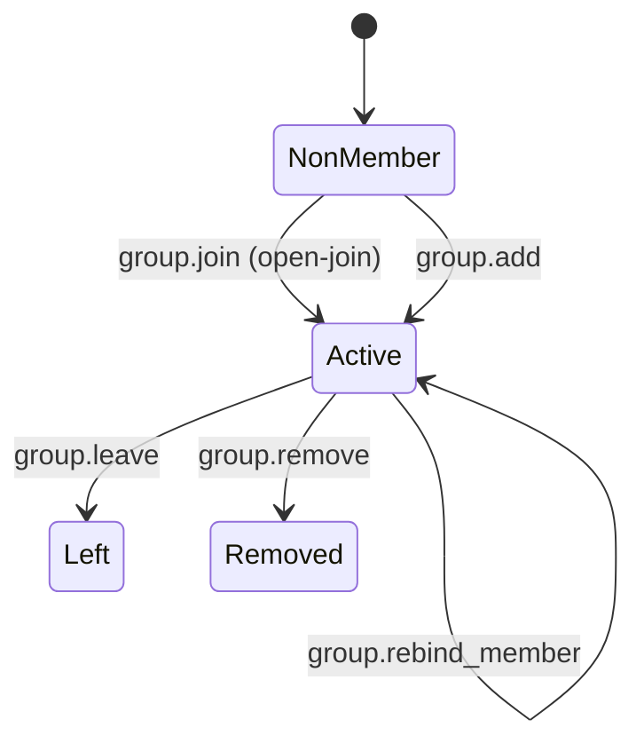
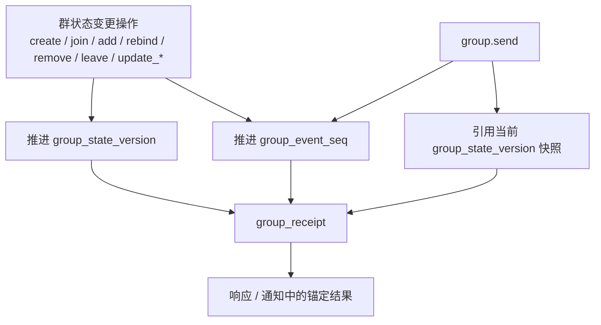
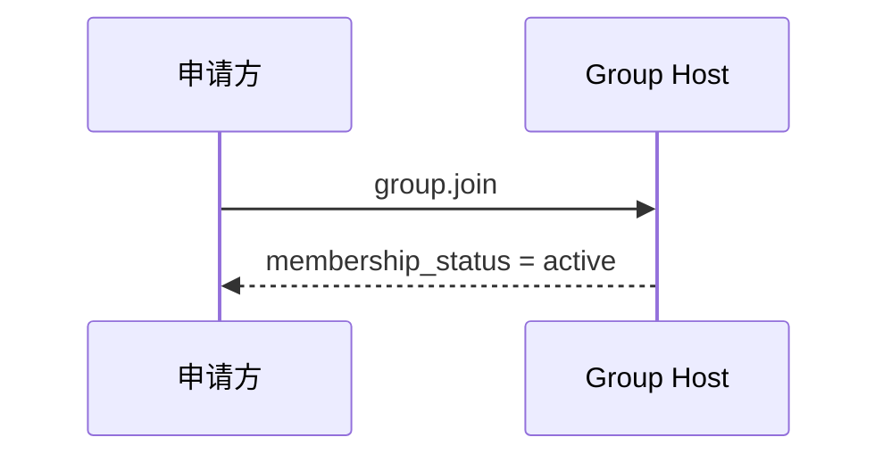
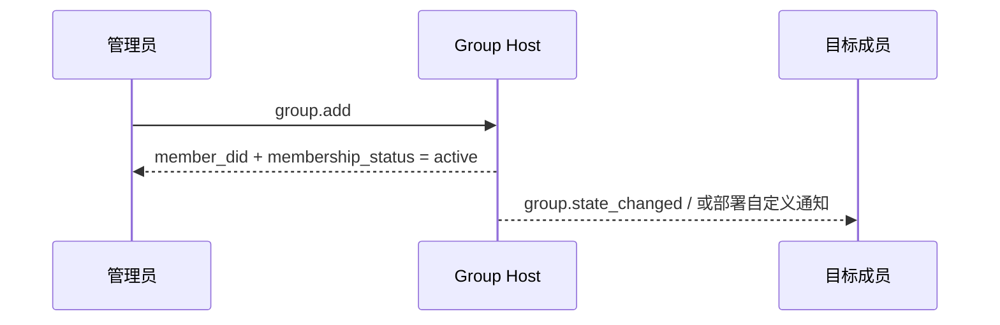
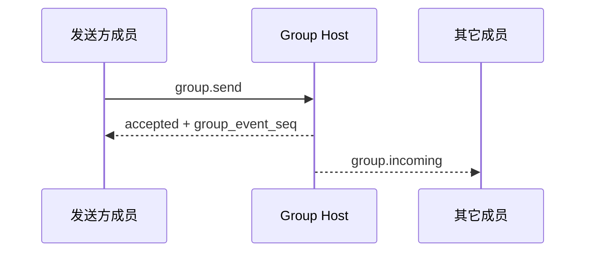
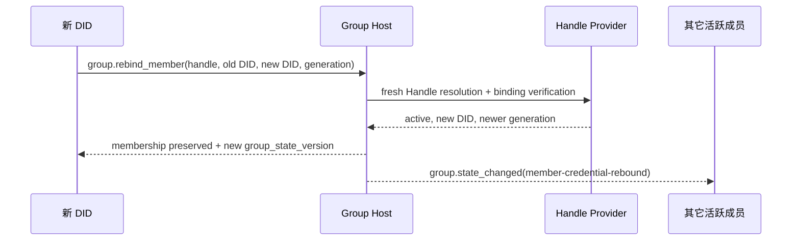

> 日本語参考訳（機械翻訳・未校閲）。規範となるのは原文です。コード例・識別子・規範キーワードは原文を保持しています。
> 原文: [chinese/deprecated/04-群组基础语义.md](../../../chinese/deprecated/04-群组基础语义.md) / 基準コミット: `0837cfdfaf4ddcf834f0890ddaf34fc4c824e066`

# ANP プロフィール 4: グループ基本的なセマンティック

- 文書番号: ANP-P4
- タイトル:グループ基本セマンティックス
- ステータス:公開
- バージョン: 1.1
- 原文言語: 中文 / このページは日本語参考訳
- アプリケーションの範囲: このプロファイルは、グループ間対エンドの暗号化アルゴリズム自体なしで、グループDIDに基づいてグループライフサイクル、グループ管理およびグループメッセージ基本構文に適用されます。

---

> Note: このバージョンでは、"セルフヘルプ、直接プラス"の2つのパスにコアv1を削減します。
>
> 1. `group.invite`、`group.accept_invite` 規格と基準 `invitation` オブジェクトは、v1コアから移動しました。
> 2. `membership_request`、`membership_request_digest`、`group.approve_membership`、`group.reject_membership` v1コアから移動。
> 3. `group_policy` 集中する `message_security_profile + bootstrap_security_profile + admission_mode + permissions`；
> 4. 非会員制ガバナンスの方向性円 `group.governance_notice` v1コアから移動。
> 5. 宿泊予約 `group.state_changed` グループ内での業務を順調に定める状態として通知します。

---

## 1. 目的:

このProfile は、AMP のベースセマンティックレイヤーを定義します。

1. グループの適用のためのグローバルラベルとしてグループDID;
2. グループ作成、セルフヘルプ、直接追加、メンバーの削除、分離、グループ情報の更新、グループ戦略の更新などの基本的な行動;
3. グループメッセージ `group.send` (a) 基礎的意味;
4. グループホストサービスのソート機能;
5. グループE2EEは、このプロファイルアプリケーションのセマティクスを上回る方法を公開しています。
6. 会員アンカーの安定化、スイッチアップおよびグループアイデンティティの継続のための現在のDIDバウチャーを任意ハンドル。

ベンジャー **なし、いいえ。**定義:

- 特定のグループ E2EE アルゴリズム;
- 歴史のアウトリーチ;
- オンラインで読むこと;
- (a) 装置または内部のコピーの概念;
- グループ外部ディレクトリの同期化。
- (b) 外部ソースとのプライベート招待リンク、トークンまたは他の特定の配信メカニズムの展開。
- エージェント内で動的グループの状態が保存される方法

---

## 2. 用語と規範的な関与

### 2.1 仮鍵

このテキスト **MUST**、**MUST NOT**、**REQUIRED**、**SHALL**、**SHALL NOT**、**SHOULD**、**SHOULD NOT**、**RECOMMENDED**、**NOT RECOMMENDED**、**MAY**、**OPTIONAL** 資本金を基準とする規範的な要件として解釈される。

### 2.2 用語集

- **グループ会社**: によって `group_did` グループプロトコルの対象をマークします。
- **グループホストサービス**: グループのニュースポータルの基本的なステータスシーケンシング、戦略的アプリケーション、サービスに対する責任。
- **グループ州**: 情報、戦略、会員関係など、特定の時点でのグループの適用の状態。
- **グループ州版**: グループホストサービスで与えられたロゴの現在のグループステータスバージョン。
- **グループイベント シーケンス**: グループホストサービスによるグループイベントの単一シリアル増分、圧倒的な制御操作とグループメッセージ。
- **会員名**: グループのメンバー
- **入学モード**: デフォルトは非メンバーに開くグループパス。このファイルv1の標準的な値が `admin-add`、`open-join`. 中国のAutoAccessingオンラインプロトコルが値の統一された書き込みを取る場所 `open-join`。
- **運営方針**: 送信できるメッセージのルールをアプリケーションレイヤーで定義し、直接ユーザーを追加したり、メンバーを削除したり、情報を更新したり、戦略を更新したりします。
- **起源の証拠**: 起動グループ操作やグループメッセージで生成されたwba JSONキャリアアプリケーションソース証明書に基づくエージェント。
- **グループレシート**: グループホストが生成する検証可能な応答機で、グループ操作やグループメッセージの受け入れを証明し、配置されている。
- **論理的ターゲット URI**: 転送中のアプリケーションレイヤーのシグネチャを安定させるために、URIは特定のHTTP URLではなく、P1 Appendix Aによって定義される論理的ターゲットです。
- **グループ変更イベント**: グループホストはグループステートイベントオブジェクトの現在のアクティブメンバーとソートして同期します。
- **会員ハンドル**: WNS 規範に合致するハンドルを、記録されると `group_member` その時に、メンバーの「関係」のための永続的なアンカーとして。
- **ハンドル・バックメンバー**: 検証済み `member_handle` グループのメンバーとそのハンドルは、彼らが安定していると言います。`agent_did` 現在のパスワード証明書です。
- **ハンドルの結合の生成**: WNSハンドルの解決文書からのアンテレフォン `binding_generation`,P4 と Decimal 文字列 `handle_binding_generation` - ショー。
- **会員資格取得**: 会員のロール、ステータス、時間を変更することなく、現在のハンドルバックメンバー `agent_did` 古いDID原子を新しいDIDに更新します。

---

## 3. デザイン原則

### 3.1 1グループ、グループ1グループDID

各グループ **MUST** いっしょに。 `group_did`。`group_did` アプリケーションレイヤーのグローバル識別です。

- (a) グループ発見;
- (a) グループ管理;
- グループメッセージアドレス;
- グループE2EEオーバーレイの固定に続いて。

### 3.2 グループホストはソートを担当しています

グループの状態を変更するすべての操作 **MUST** グループホストサービスが受入・ソート後

グループホストサービス **MUST** グループステータス変更のための決定可能な線形順を維持し、各々の承認された変化に新しいものを割り当てます `group_state_version`。

### 3.3 暗号からの構文の分離可能性

このプロファイルは、アプリケーションレイヤーのアクションとオブジェクトだけを定義します。グループキー構築、メンバー暗号化状態の進化、ウェルカムメッセージ、暗号化アプリケーションなどは、グループE2EEプロファイルによって定義されます。

### 3.4 合意の終了はエージェントを維持します

グループのメンバーはプロトコルレベルでエージェントを残しています。このプロファイルの構文に、任意の Agent の内部のコピー、ワーカー、デバイス、またはターミナルはありません。

### 3.5 非ターゲット

ベンジャー **なし、いいえ。**提供:

- グローバル歴史再生;
- (b) 強い同期の皮下;
- (a) 設備レベルのメンバーシップ;
- (a)装置段階配達;
- 内部実行者レベルの権利制御;
- 標準化された承認の流れ。

### 3.6 グループ結果の著者認定および分離

通常、グループシーンには2つの異なる構文署名があります。

1. **スポンサーの署名**: 特定のものを作る `sender_did` グループが実際に起動したか、グループメッセージが送信されたか
2. **結果は目撃者です。**: グループで一定の操作やメッセージが受け入れられていることを証明し、確認される `group_state_version`、`group_event_seq` または同等のステータス位置。

プロフィールのリクエスト:

- グループステータスを変更し、 `group.send`，**MUST** スポンサーの募集 `auth.origin_proof`；
- グループDIDの署名 **SHOULD** グループホストに戻りましょう `group_receipt` 媒体;
- スタッフ **MUST NOT** スポンサーの署名をグループ署名に置き換える **MUST NOT** スポンサーの「署名」でグループ結果を置換します。

### 3.7 トロピックの制限

v1 コアでは、非メンバーは 2 つの標準アクションのみを保持します。

- `group.join`: ターゲットエージェントは、自らのアクセシビリティを約束し、成功直後に `active` (b) 会員
- `group.add`: 既存の有能なメンバーは、クラスターのターゲットエージェントに直接参加し、成功するとすぐに効果をとります。

ベンプロファイルv1 **なし、いいえ。**定義基準 `invitation` オブジェクト、`invitation_id`、`group.invite` または `group.accept_invite`. デプロイメントが招待リンクを必要とする場合, トークンまたは他の外部のドキュメントに参加して展開をサポート `group.join`♪ そして、これらの機能 **MUST** 展開の延長処理として、 **MUST NOT** あり。 `group.join` 成功前のスタンダードな会員資格をつくりました。

ベンプロファイルv1 **なし、いいえ。**標準化された承認の流れを定義して下さい、また **なし、いいえ。**コアに。 `pending` (c) 中間ガバナンス。

### 3.8 DIDの証明書から分離されるハンドルのメンバーのアンカー ポイント

このプロファイルは、エージェントが2つのモードでグループメンバーになることを可能にします。

- DD-only会員関係と現在の `agent_did` 同じ; DID テキストが変更された場合、この Refile は自動継続性を提供していません。
- ハンドル・バックメンバー `member_handle` サイトの運営は、安定した会員アンカーです。`agent_did` 認証、署名、ルート、セキュリティオーバーレイの現在の証明書です。
- ハンドル・バック・メンバーは必須です(MUST) 永久に譲渡不能かつ非再利用可能なWNSハンドルを使用する; グループホストは(MUSTそのためには、ハンドルプロジェクトがハンドルの継続性において信頼されるという主な理由です。
- ハンドルは自分自身でした `revoked` - 禁止します。MUST NOT)証明書の変更によってアクセスされる;ハンドルは維持します `active` 変更時にDIDが一番下で使うべき `group.rebind_member`。

AMP ラインプロトコルでは、ハンドル・バック・メンバーの唯一の安定したメンバーキーが `(group_did, member_handle)`詳しくはこちら `agent_did` 切り替えることができます。DD専用メンバーのみのキーは、 `(group_did, agent_did)`. クライアントとサービスエンドのローカルユーザーIDにマッピングできるが、このユーザIDはANPを入力しない。

会員関係が確立された後、DID専用モードとハンドルバックモードは許可されていません()MUST NOT)は、静かに交換されるか、同じDIDによって自動的に結合されます。 ハンドルの継続性を取得したいエージェントは、そのメンバーの関係を作成する時にハンドルを提出する必要があります。 このバージョンでは、DD専用のメンバーにハンドルのアフタータイムを追加する方法を定義していません。

---

## 4. グループガバナンスモデルの概要(非暫定的)

### 4.1 ルールのまとめ

| シーン | エントリーへのアプローチ | 結果の即時化 | 認可されたオブジェクト/ステータス | いつになるか `active` | 免責事項 |
|---|---|---|---|---|---|
| セルフヘルプ | `group.join` | コールアグループ | `group_member.status = active` | このアクセスですぐに有効 | 詳しくはこちら `open-join` |
| - 私は男を得るつもりです。 | `group.add` | ターゲットは直接関与しています。 | `group_member.status = active` | すぐに追加で有効 | 典型的なのための `admin-add` |
| 会員は積極的に失業 | `group.leave` | 会員はグループを終了します | `group_member.status = left` | 該当なし | 現行の専用 `active` 会員名簿 |
| 管理者はメンバーを削除 | `group.remove` | 会員はグループから削除されます。 | `group_member.status = removed` | 該当なし | 現行の専用 `active` 会員名簿 |
| ハンドル、スイッチDID。 | `group.rebind_member` | 古いIDは無効です。新しいIDが現在の状態になります | `group_member` ホールド `active` | グループホストに縛られた場合 | ハンドルバックメンバーのみ |

> Note: デプロイメントが外部の招待リンクから参加する際、標準の相互運用可能なレイヤーは、最終的には残されます。トークンまたはステーションベースのリマインダーに参加する **MUST** 一度にいた。 `group.join` または `group.add` 成功の成果。

### 4.2 ステータスオブジェクト比較表

| オブジェクト | 重要な状態 | 意味する |
|---|---|---|
| `group_member` | `active` | 応用レベル 会員資格 有効 |
| `group_member` | `left` / `removed` | 会員は定休日 |

### 4.3 ステータスマトリクス



---

## 5. プロフィールの印および依存性

### 5.1 プロフィール名

このProfile の標準的な名前は、次のとおりです。

`anp.group.base.v1`

### 5.2 依存症

ベンジャー **MUST** 次のデータに依存します。

- `anp.core.binding.v1`
- `anp.identity.discovery.v1`

ハンドルバックメンバーを使用した際にもベンプロファイルも提供 **MUST** 依存症 [DID-WBA(WNS)に基づくANPのネーミングスペース規格](../04-ANP-基于DID-WBA的命名空间规范.md) ハンドルのフォーマットのために、パーシング、双方向タイ、`binding_generation`、永久的な非transferabilityおよび永久的な不可逆性の用語の定義。

### 5.3 セキュリティモード

このプロファイルは、独立して動作するベースグループであるとき:

- `meta.profile` **MUST** イーグル `anp.group.base.v1`
- `meta.security_profile` **MUST** イーグル `transport-protected`

グループE2EEオーバーレイでフォローすると、安全です。 **MUST** グループメッセージオブジェクトでこのプロファイルのグループステータスオブジェクトをエンコードする方法を定義します。

---

## 6. グループモデル

### 6.1 `group_did`

`group_did` グループ向けアプリケーション識別のグローバルレイヤーです。

`group_did`：

- **MUST** (a) グループ管理業務の対象識別子として機能するため
- **MUST** (a) グループメッセージ操作のターゲット識別子として;
- **MUST NOT** 与えられたパスワードの認識を自動で均等化します `group_id`。

### 6.2 `group_state_version`

`group_state_version` 現在のグループアプリケーションの状態のバージョンです。

その要件は次のとおりです。

- **MUST** グループホストサービスによる
- **MUST** (a) 未透明の文字列として処理する。
- 成功するグループ状態の変化 **MUST** 新規作成 `group_state_version`；
- グループメッセージ送信 **MUST NOT** 新着情報そのものが新しい動きをしています。 `group_state_version`；
- グループのメッセージの返しに成功しました `group_state_version` 受信したグループステータスのスナップショットです。

### 6.3 `group_event_seq`

`group_event_seq` グループイベントのシリアル番号です。

その要件は次のとおりです。

- **MUST** (a) 同じグループ内でのユニークな増分の増加;
- **MUST** グループ制御操作とグループメッセージのオーバーライド
- **MUST** (a) 決定書文字列で表現する。
- **MUST NOT** セキュリティのセマンティックスのための唯一の基礎として直接。


P4 これらは、グループステータスバージョンを先取りするアクションで、グループイベントシーケンスだけを進行させるアクションです。 `group_receipt` アンカーはどれですか?次の図は読者が共通の理解を造るのを助けるために一緒にこれら3を持って来ます。



*図 P4-1:`group_state_version`、`group_event_seq` とりあえず `group_receipt` 関係(非規範的)。*

フォローアップを読む `group.send`、`group.state_changed` とりあえず `group_receipt` 意味論が使われると、このイメージに常に戻ってくるはずです。グループニュースはイベントの順番に関わっていますが、メッセージ自体のために新しい情報を押しません `group_state_version`。
### 6.4 ロールモデル

ベンプロファイル最小相互運用 **MUST** 以下の役割をサポート:

- `owner`
- `admin`
- `member`

役割レベルは次のように固定されます。

`owner > admin > member`

通訳のルールは以下の通りです。

- アクションが最小文字を必要とする場合 `member` できるかどうかはわかりません。`admin` とりあえず `owner` (a) 自動満足;
- アクションが最小文字を必要とする場合 `admin` できるかどうかはわかりません。`owner` (a) 自動満足;
- v1 最小相互運用可能な範囲 **MUST NOT** カスタムロールを導入

### 6.5 会員

ベンプロファイル最小相互運用 **MUST** 会員資格の認定申請を受け付けます。

- `active`
- `left`
- `removed`

---

## 7. 標準オブジェクト

### 7.1 `group_policy`

`group_policy` これは、グループの適用層の承認とエントリールールです。

推奨構造は以下の通りです。

```json
{
  "message_security_profile": "transport-protected",
  "bootstrap_security_profile": "transport-protected",
  "admission_mode": "open-join",
  "permissions": {
    "send": "member",
    "add": "admin",
    "remove": "admin",
    "update_profile": "admin",
    "update_policy": "owner"
  },
  "attachments_allowed": true,
  "max_members": "500"
}
```

フィールドの状態:

- `message_security_profile`文字列,**SHOULD**, 推奨値:`transport-protected`、`group-e2ee`
- `bootstrap_security_profile`文字列,**SHOULD**, 推奨値:`transport-protected`、`group-e2ee`
- `admission_mode`文字列,**MUST**
- `permissions`オブジェクト、**MUST**
- `attachments_allowed`ボオラン,**MAY**
- `max_members`: 文字列の決定**MAY**

通訳のルールは以下の通りです。

1. `message_security_profile` 結合:
   - `group.send`
   - とりあえず `active` アフターメンバー専用グループ運営

2. `bootstrap_security_profile` 結合:
   - `group.join`
   - 続いてオーバーレイは、オンボーディング/ブートストリームメソッドを明確に定義しました

3. `admission_mode` **MUST** 以下のいずれかを服用してください。
   - `admin-add`
   - `open-join`

4. `permissions` **MUST** 下記の標準キーのみを含んだ。
   - `send`
   - `add`
   - `remove`
   - `update_profile`
   - `update_policy`

5. `permissions.*` 値の **MUST** は:
   - `owner`
   - `admin`
   - `member`

6. 通訳のデフォルトルールは以下の通りです。
   - いつ? `admission_mode = "admin-add"` できるかどうかはわかりません。`group.join` **MUST** 拒否;典型的なグループパスは `group.add`
   - いつ? `admission_mode = "open-join"` できるかどうかはわかりません。`group.join` **MUST** 許可される
   - `group.add` 、まだによる利用できる `permissions.add` デコレーション

7. 存在する場合 `max_members`、グループ ホスト **MUST** そのままに `active` 会員数

### 7.2 `group_member`

`group_member` グループメンバー関係を指示します。

最小限の推薦された分野:

- `agent_did`文字列,**MUST**
- `member_handle`:WNS ハンドル文字列、ハンドルバックメンバー **MUST**, DID会員 **MUST NOT**
- `handle_binding_generation`: 正解な文字列、ハンドルバックメンバー **MUST**, DID会員 **MUST NOT**
- `role`文字列,**MUST**
- `status`文字列,**MUST**
- `joined_at`: RFC 3339 時間のひも、**MAY**
- `added_by`: DID 文字列,**MAY**

注意:

- `role` 受信者、デフォルト **MUST** プレス `member` 通訳;
- `status = active` (a) 申請階層の会員が強制的に入っていることを表明する。
- `status = left` または `removed` (a) 会員関係が終了したことを表明する。
- `added_by` 現行の会員関係のみ `group.add` (b) 設立時に規定する場合には、
- `agent_did` (a) 常に認証、審査の承認、情報送信、経路およびセキュリティを時間をかけてメンバーの現在のIDを示します。
- `member_handle` **MUST** 完全で統一されたハンドルであり、 **MUST NOT** あり。 `group.rebind_member` 変更;
- `handle_binding_generation` **MUST** 制作や最終再リンクでWNS体験の正確なコピー `binding_generation`；
- グループホスト **MUST NOT** WNS は、確認を解決し、バインドしなければなりません。ハンドルテキストがメンバーの関係を確立または交換するために使用される場合にのみ、完了します。

このプロファイルは、オンラインプロトコルで定義および転送しません `user_id`、`member_user_id` . 顧客およびサービスエンドMAY♪ 店内ドア♪ `group_member` ローカルの主キーを安定させるための投影が、メインキーはAMPグループメンバー識別子ではなく、許可されていない()MUST NOT)クロスドメイン認証または承認の基準として。

### 7.3 拡張グループ証拠の展開

ベンプロファイルv1 **なし、いいえ。**定義基準 `invitation` オブジェクト、また **なし、いいえ。**定義 `invitation_id`。

デプロイメントが招待状リンクが必要な場合は、トークンまたは他の外部のドキュメントに結合してサポートします。 `group.join`, これらのオブジェクト **MAY** ありますが、それらは次のものがあります。

- **MUST NOT** 考慮されたv1中心の相互運用の目的;
- **MUST NOT** あり。 `group.join` (b) 成功前に、標準のメンバーシップステータスを作成します。
- **SHOULD** 制御されたチャネルによって伝達されます。

### 7.4 `group_profile`

`group_profile` これは、構造資源オブジェクトのグループです。

推奨分野:

- `display_name`文字列、グループを作成するとき **SHOULD** 提供:
- `description`文字列,**MAY**
- `avatar_uri`文字列,**MAY**
- `discoverability`文字列,**MAY**, 推奨値:`private`、`listed`、`public`
- `labels`オブジェクト、**MAY**

### 7.5 `group_state_ref`

`group_state_ref` グループステータス参照オブジェクトです。

最小限の推薦された分野:

- `group_did`文字列,**MUST**
- `group_state_version`文字列,**MUST**
- `policy_hash`文字列,**MAY**
- `roster_hash`文字列,**MAY**

### 7.6 グループメッセージの負荷

`group.send` ・・・ `meta.content_type` **MUST** そこ。

ベンプロファイル最小相互運用 **MUST** 下記サポート項目をご案内いたします。

- `text/plain`
- `application/json`
- `application/anp-attachment-manifest+json`

`group.send` ・・・ `body` 確かにそうではありません。`text`、`payload`、`payload_b64u` 3つの:

- **MUST** 事件が起きた。
- 以上あれば、受取人 **MUST** (a) リクエストを拒絶する。
- それらのどれも存在しなかった場合、受取人 **MUST** 拒否。要求

あり。 `payload_b64u`：

- **MUST** 埋め込まれていない base64url を使用してください。
- **SHOULD** バイナリまたはプライベートエクステンションオブジェクトのみ。

いつ? `meta.content_type = "application/json"` できるかどうかはわかりません。`body.payload` **MUST**
JSON オブジェクトを直接読み込みます。このファイルは、このオブジェクトの内フィールドのビジネスの意味を定義しません。グループアプリケーションまたは
ホストは説明する方法を決定します。

### 7.7 `auth` オブジェクト

ダイワディド `group.get_info` グループの状態を変更するすべてのリクエスト、 `group.send`詳しくはこちら `params` **MUST** 組織図 `auth` オブジェクト。

証拠の負荷規則、署名された共和国の目的および署名する部品図 **MUST** P1 再使用の付録は調和した定義を; P4 **もうありません。** スタンドアローンの証拠フィールド名、別の署名されたペイロード構造またはローカルを定義します `@target-uri` 地図を。

推奨構造は以下の通りです。

```json
{
  "auth": {
    "scheme": "anp-rfc9421-origin-proof-v1",
    "origin_proof": {
      "contentDigest": "sha-256=:BASE64_SHA256_DIGEST:",
      "signatureInput": "sig1=(\"@method\" \"@target-uri\" \"content-digest\");created=1733402096;expires=1733402156;nonce=\"abc123\";keyid=\"did:wba:example.com:user:alice:e1_<fingerprint>#key-1\"",
      "signature": "sig1=:BASE64_SIGNATURE:"
    }
  }
}
```

フィールドは、次のものが必要です。

- `auth.scheme` **MUST** イーグル `anp-rfc9421-origin-proof-v1`
- `auth.origin_proof` **MUST** あらゆるステート・チェンジのグループ操作を主張し、 `group.send`
- `auth` それだけで **MUST NOT** エントリー `contentDigest`

### 7.8 共有署名されたリクエストオブジェクトへの結合

`auth.origin_proof.contentDigest` **MUST** バイナリP1付録A定義共有 **署名された要求の目的**。

グループベースの場合:

- えー。 `group.send` 一方、ニュースは他の方法と同じです。`meta.message_id` とりあえず `meta.content_type` **MUST** プレゼンス
- えー。 `group.create`，`meta.target.kind` **MUST** あり あり `service`
- 政府は、既に既存のグループをターゲットとする他のグループとまた働いています。`meta.target.kind` **MUST** あり あり `group`

### 7.8.1 グローバルコンポーネントマッピングへの参照

リクエスト `auth.origin_proof` グループベースメソッド **MUST** P1 Appendix A で定義されているグローバルシグネチャコンポーネントをマップします。

したがって:

- えー。 `group.create`、証明の党基礎 `meta.target.kind = "service"` 再建 `@target-uri = anp://service/<pct-encoded meta.target.did>`
- 団体様向け、認定会は、 `meta.target.kind = "group"` 再建 `@target-uri = anp://group/<pct-encoded meta.target.did>`
- 結果はP1のグローバルルールから、 **ありません。** P4 自衛局地マップセット

### 7.9 `group_receipt`

`group_receipt` グループ・ホストがグループ・オペレーションやグループ・メッセージの受け入れをし、グループ・ステータス・マシンの検証可能な証人に書き込むことを意味する。

推奨分野:

- `receipt_type`文字列,**MUST**, 推奨値:`group-operation-accepted`、`group-message-accepted`
- `group_did`文字列,**MUST**
- `group_state_version`文字列,**MUST**
- `group_event_seq`: 文字列の決定**MUST**
- `subject_method`文字列,**MUST**
- `operation_id`文字列,**MUST**
- `message_id`文字列,**MAY**
- `actor_did`文字列,**MUST**
- `accepted_at`: RFC 3339 時間のひも、**MUST**
- `payload_digest`文字列,**MUST**
- `proof`オブジェクト、**SHOULD**;when の `group_receipt` グループホストドメインを離れ、他のドメインに依存している場合 **MUST**

`group_receipt.proof` **MUST** P1付録B定義の共有を適用する **オブジェクトの証拠のプロフィール**。

えー。 `group_receipt` のために:

- 発行者 DID **MUST** あり あり `group_did`
- 保護された文書 **MUST** 削除 `proof` あとで。 `group_receipt`
- `proof.verificationMethod` **MUST** スポット `group_did` ドキュメント by `assertionMethod` 認証方法
- `group_receipt` 署名の目的は、「リクエストを開始した」ではなく「この結果を受け入れている」ことを証明することです。

最初には、P1付録Bの共有ルールで、共有だけでなく、他の部分と共有される。`group_receipt` まさか **MUST** 少なくとも全体として含まれているし、苦しみます。 `proof` 次のセキュリティキーフィールドを保護する:

- `receipt_type`
- `group_did`
- `group_state_version`
- `group_event_seq`
- `subject_method`
- `operation_id`
- `actor_did`
- `accepted_at`
- `payload_digest`
- 存在する場合 `message_id`ですから。 **MUST** 含まれ、保護される

認証パーティーは `group_receipt.proof` 試験は進行中です。**MUST** 上記のフィールドを実際の応答、通知のコンテキスト、およびカウンターパートグループのポジションで確認し続けます。

### 7.10 グループステータス変更イベントオブジェクト

このセクションは `group.state_changed` 使用されるステータス変更イベントは、統一されたオブジェクトに凝縮され、渡されます `event_type` 特定のイベントを具体的に。

#### 7.10.1 共通フィールド

推奨統一オブジェクトの構造は次のとおりです。

```json
{
  "event_id": "evt-001",
  "event_type": "member-credential-rebound",
  "group_did": "did:example:group-123",
  "group_state_version": "43",
  "group_event_seq": "129",
  "subject_method": "group.rebind_member",
  "changed_at": "2026-03-29T14:11:00Z",
  "actor_did": "did:example:agent-c",
  "subject_handle": "carol.example.com",
  "previous_subject_did": "did:example:agent-c-old",
  "subject_did": "did:example:agent-c",
  "handle_binding_generation": "9",
  "membership_status": "active",
  "group_profile": { "...": "..." },
  "group_policy": { "...": "..." },
  "group_receipt": { "...": "..." }
}
```

共通のルールは以下の通りです。

1. `group.state_changed` ・・・ `body` **MUST** オブジェクトを直接運ぶ。
2. ・・・ **MUST NOT** (b) 外部証明書、リマインダー、または結果通知をグループのメンバーでないオブジェクトに送信するには
3. ・・・ **SHOULD** とりあえず `group_event_seq` (a) 一貫性の可聴性;
4. 場合 `subject_method = "group.join"` または `"group.add"`, それから `event_type = "member-activated"`；
5. 場合 `subject_method = "group.rebind_member"`, それから `event_type` **MUST** あり あり `member-credential-rebound`。

#### 7.10.2 基準 `event_type`

このRefile v1は、以下のことを推奨します。 `event_type`：

- `member-activated`
- `member-removed`
- `member-left`
- `member-credential-rebound`
- `group-profile-updated`
- `group-policy-updated`

の の の の の の の の の の の の の の の の の の の の の の の の の の の の の の の の の の の の の の の の の の の の の の の の の の の の の の の の の の の の の の の の の の の の の の です:

- `member-activated` **MUST** 組織図 `subject_did` とりあえず `membership_status = "active"`
- `member-removed` **MUST** 組織図 `subject_did`
- `member-left` **MUST** 組織図 `subject_did`
- `member-credential-rebound` **MUST** 組織図 `subject_handle`、`previous_subject_did`、`subject_did`、`handle_binding_generation` とりあえず `membership_status = "active"`
- `group-profile-updated` **SHOULD** 組織図 `group_profile`
- `group-policy-updated` **SHOULD** 組織図 `group_policy`

---

## 8. 標準方法論と通知

ダイワディド `group.get_info` 外部では、このセクションでステータスのアプローチを変更するすべてのリクエスト **MUST** 下記の一般規則が満たされています。

- `params.auth.scheme` **MUST** イーグル `anp-rfc9421-origin-proof-v1`
- `params.auth.origin_proof` **MUST** サインイン
- 境界線を横断したい場合は、それは生です。 `auth.origin_proof` **MUST** メッセージを転送し、 **MUST NOT** 中間サービスで書き換える

グループホストが認めた全てのステータス変更 `group.send`：

- ノンクロスでの成功応答 **SHOULD** バックナンバー `group_receipt`
- 応答結果がグループホストを離れ、他のドメインに依存している場合、成功します。 **MUST** バックナンバー `group_receipt`, および返し `group_receipt.proof` **MUST** プレゼンス

次の2つの非コンプライアンス/ステップメッセージメソッド:

- `group.incoming`
- `group.state_changed`

所属する **OPTIONAL プッシュ機能**. 彼らはこのプロファイルの最も一般的なオプションではありません。しかし、それが達成されると、送信者 **MUST** このプロファイル定義を使用するための標準 `body` 構造。

### 8.1 `group.create`

#### 8.1.1 統計学

グループホストサービスでグループを新規作成し、グループホストサービスで新しいグループを割り当てる `group_did` 初期値 `group_state_version`。

#### 8.1.2 リクエスト

`group.create` リクエスト **MUST** 土産:

1. `method = "group.create"`
2. `meta.profile = "anp.group.base.v1"`
3. `meta.security_profile = "transport-protected"`
4. `meta.sender_did` **MUST** プレゼンス
5. `meta.target.kind = "service"`
6. `meta.target.did` **MUST** ターゲットです。 `ANPMessageService.serviceDid`
7. `meta.operation_id` **MUST** プレゼンス
8. `body.group_profile` **SHOULD** プレゼンス
9. `body.group_policy` **MUST** プレゼンス
10. `body.initial_members` **MAY** プレゼンス
11. `params.auth.origin_proof` **MUST** プレゼンス
12. `body.creator_handle` **MAY** プレゼンス

場合 `body.creator_handle` 既存のグループホスト **MUST** WNS標準でハンドルをパースして検証し、結果はWNS基準でなければならない `active`詳しくはこちら `did` **MUST** 正確な等しい `meta.sender_did`. 成功の後、創設者 `group_member` **MUST** レコード `member_handle` 対応する `handle_binding_generation`;フィールドが存在しない場合、創設者はDIDのみのメンバーです。

新着情報 `body.initial_members`、グループ ホスト **MUST** 以下は、次の規則を規定する。

- クリエイター自身 **MUST** なるほど `owner` すぐに。 `active`；
- 詳しくはこちら `initial_members` 存在する場合、グループホスト **MAY** 制作段階での同等価格と同等 `group.add`；
- 各エントリー **MUST** 含まれている場合 `member_did` または `member_handle` これら1つは、同時に含まれていないか、省略される可能性があります。
- ハンドルの記入項目 **MUST** (a) セクションのハンドルパスに従って、パーシング、検証および保存 8.4;
- `initial_members` 見えない宣言 `role` * 投稿記事のエントリー**MUST** プレス `member` 説明。

#### 8.1.3 成功の応答

成功の応答 **MUST** 少なくとも含まれます:

- `group_did`
- `group_state_version`
- `created_at`
- `creator_did`

成功の応答 **MAY** 含まれる:

- `creator_handle`
- `handle_binding_generation`
- `group_event_seq`
- `group_profile`
- `group_policy`
- `group_receipt`

リクエストが含まれている場合 `creator_handle`♪ 答えはありそうです♪ **MUST** 組織図 `creator_handle` とりあえず `handle_binding_generation`;またはこれらの2つのフィールド **MUST NOT** 是非お越し下さい。

### 8.2 `group.get_info`

#### 8.2.1 科学

現在のグループの基本スナップショットを取得します。

#### 8.2.2 リクエスト

- `meta.target.kind` **MUST** あり あり `"group"`
- `meta.target.did` **MUST** おすすめ `group_did`

`body` **MAY** 含まれる:

- `include_policy`
- `include_member_list`

アイデンティティ要件は以下の通りです。

- グループとして `discoverability = "public"` または `"listed"` できるかどうかはわかりません。`group.get_info` **MAY** 匿名の読み取りコールとして; この時点で `meta.sender_did` **MAY** (a) 省略;
- グループとして `discoverability = "private"` , コール **MUST** (b) アイデンティティの提供
- リクエストされた投影が呼び出し者の可視性を超えている場合、受取人 **MUST** バックナンバー `group.policy_violation`。

#### 8.2.3 応答の成功

成功の応答 **MUST** 少なくとも含まれます:

- `group_did`
- `group_state_version`
- `group_profile`

成功の応答 **MAY** 含まれる:

- `group_policy`いつしか `include_policy = true` (電話機は参照する権利があります)
- `member_list`いつしか `include_member_list = true` および発信者は、その要素タイプを閲覧する権利を有します。 **MUST** あり あり `group_member`）
- `member_count`(決定文字列; 現時点では、**SHOULD** エクスプレス・カレント `active` 会員数

返された場合 `member_list`、その内容 **SHOULD** 現行のもののみが含まれている `active` 会員様

### 8.3 `group.join`

#### 8.3.1 統計学

`group.join` 会員以外の自発的なアクセスのために。 v1コアの場合、発信者はすぐになります `active` 会員様

#### 8.3.2 リクエスト

`body` **MAY** 含まれる:

- `member_handle`
- `reason_text`

場合 `member_handle` 存在しない、コールアは DID 専用モードに結合し、DID のメンバーは `meta.sender_did`・・・ `member_handle` 既存のグループホスト **MUST**：

1. (a) WNS 規範による対面結合認証を正規化、解釈し、完了させる。
2. 書類の提出 `status = "active"`；
3. 見つけたものを解決するために要求して下さい。 `did` **MUST** 正確な等しい `meta.sender_did`；
4. 会員のレコードを正規化した後 `member_handle` 再会です。 `binding_generation`。

団体が現在ない場合 `open-join` モード、受取人 **MUST** (b) リクエストを拒絶し、 **SHOULD** バックナンバー `group.policy_violation`。

#### 8.3.3 応答の成功

成功の応答 **MUST** 少なくとも含まれます:

- `group_did`
- `member_did`とりあえず **MUST** イーグル `meta.sender_did`
- `membership_status`とりあえず **MUST** あり あり `active`
- `group_state_version`

成功の応答 **MAY** 含まれる:

- `member_handle`
- `handle_binding_generation`
- `group_receipt`

リクエストが含まれている場合 `member_handle`♪ 答えはありそうです♪ **MUST** 組織図 `member_handle` とりあえず `handle_binding_generation`;DD-only が応答に参加しました **MUST NOT** フィールドに2つのフィールドが含まれています。

### 8.4 `group.add`

#### 8.4.1 統計

エージェントは、有能なメンバーが直接参加するターゲットです。 ゴールは成功するとすぐになります `active` 会員様

#### 8.4.2 情報へのリクエスト

`body` **MUST** 次のターゲット識別子を含むことが起こります。

- `member_did`
- `member_handle`

`body` **MAY** 含まれる:

- `role`
- `reason_text`

見えない `role` , 受取人 **MUST** プレス `member` 説明。

利用する場合 `member_did`、グループ ホスト **MUST** DID 専用メンバーを作成します。 `member_handle`、グループ ホスト **MUST** WNS規格の2方向結合認証をアライグ、パース、完了します。 `active`現行のDIDを解析し、ハンドルバックメンバーを作成 **MUST** 同時に保存 `member_handle`流れの `agent_did` とりあえず `handle_binding_generation`。

#### 8.4.3 成功の応答

成功の応答 **MUST** 少なくとも含まれます:

- `group_did`
- `member_did`
- `membership_status`とりあえず **MUST** あり あり `active`
- `group_state_version`

成功の応答 **MAY** 含まれる:

- `member_handle`
- `handle_binding_generation`
- `group_receipt`

リクエスト `member_handle`♪ 答えはありそうです♪ **MUST** 組織図 `member_handle` とりあえず `handle_binding_generation`;要求される `member_did`♪ 答えはありそうです♪ **MUST NOT** フィールドに2つのフィールドが含まれています。

### 8.5 `group.remove`

#### 8.5.1 統計学

特定の会員は、 `active` 会員はグループから退会しました。

#### 8.5.2 情報へのリクエスト

`body` **MUST** 含まれる:

- `member_did`

`body` **MAY** 含まれる:

- `reason_text`

#### 8.5.3 治療の規則

- 対象が現在ある場合 `active`, それから `group.remove` **MUST** それを作って下さい `group_member.status = "removed"`；
- 既に対象がすでにある場合、 `left`、`removed` または、受取人ではなく **MUST** 拒否。要求

#### 8.5.4 応答の成功

成功の応答 **MUST** 少なくとも含まれます:

- `group_did`
- `member_did`
- `group_state_version`

成功の応答 **MAY** 含まれる:

- `membership_status`
- `group_receipt`

### 8.6 `group.leave`

#### 8.6.1 経済学

現行の送信者がグループから自発的に撤退したことを示します。

#### 8.6.2 リクエスト

- `meta.sender_did` **MUST** 現行のエンタアングルメントです。

#### 8.6.3 成功した応答

成功の応答 **MUST** 少なくとも含まれます:

- `group_did`
- `leaver_did`
- `group_state_version`

成功の応答 **MAY** 含まれる:

- `group_receipt`

### 8.7 `group.update_profile`

#### 8.7.1 統計学

オーディエンスのグループ表示を更新します。

#### 8.7.2 リクエスト

`body` **MUST** 含まれる:

- `group_profile_patch`

`group_profile_patch` **MUST** RFC 7386 JSON のマージパッチ構文を使用します。

#### 8.7.3 成功の応答

成功の応答 **MUST** 少なくとも含まれます:

- `group_did`
- `group_state_version`
- `group_profile`

成功の応答 **MAY** 含まれる:

- `group_receipt`

### 8.8 `group.update_policy`

#### 8.8.1 統計学

グループポリシーオブジェクトを更新します。

#### 8.82 リクエスト

`body` **MUST** 含まれる:

- `group_policy_patch`

`group_policy_patch` **MUST** RFC 7386 JSON のマージパッチ構文を使用します。

#### 8.3.3 成功の応答

成功の応答 **MUST** 少なくとも含まれます:

- `group_did`
- `group_state_version`
- `group_policy`

成功の応答 **MAY** 含まれる:

- `group_receipt`

### 8.9 `group.send`

#### 8.9.1 統計

アプリケーションのレイヤーメッセージをグループに送信します。

#### 8.9.2 リクエスト

普通のもの。 `group.send` リクエスト **MUST** 土産:

1. `method = "group.send"`
2. `meta.profile = "anp.group.base.v1"`
3. `meta.security_profile = "transport-protected"`
4. `meta.target.kind = "group"`
5. `meta.target.did` **MUST** ターゲットです。 `group_did`
6. `meta.sender_did` **MUST** 現在の送信者
7. `meta.message_id` **MUST** プレゼンス
8. `meta.operation_id` **MUST** プレゼンス
9. `meta.content_type` **MUST** プレゼンス
10. `body` **MUST** ロードオーバーオールを満たします
11. `params.auth.origin_proof` **MUST** 署名された署名された要求の目的

#### 8.9.3 `group.send` ・・・ `body`

`group.send` ・・・ `body` 含まれるもの:

- `thread_id`文字列,**MAY**
- `reply_to_message_id`文字列,**MAY**
- `annotations`オブジェクト、**MAY**
- `text` / `payload` / `payload_b64u`3 の **MUST** 一つは、その人で起きた。

#### 8.9.3 成功の応答

成功の応答 **MUST** 少なくとも含まれます:

- `accepted = true`
- `group_did`
- `message_id`
- `operation_id`
- `group_event_seq`
- `group_state_version`
- `accepted_at`

成功の応答 **MAY** 含まれる:

- `group_receipt`

### 8.10 `group.incoming`

`group.incoming` グループホストが認めたグループメッセージに、アクティブなメンバーエージェントをオフステップで送信する。 **MUST** 通知として使用される。

達成される場合 `group.incoming`通知の楽しみ **MUST** 土産:

- `meta.profile = "anp.group.base.v1"`
- `meta.security_profile` **MUST** メッセージのセキュリティモードは、受け入れられるときにグループに等しいです。
- `meta.target.kind = "agent"`
- `meta.target.did` **MUST** 現在の通知受信者を同等 DID
- `meta.sender_did` **MUST** 生グループメッセージのビジネス送信者と同じ DID
- `meta.operation_id` **MUST** オリジナルエクアドル `group.send.meta.operation_id`
- `meta.message_id` **MUST** オリジナルエクアドル `group.send.meta.message_id`
- `meta.content_type` **MUST** 元のメッセージと同じです。 `meta.content_type`

おすすめ商品 `body` 構造は次の通りです:

```json
{
  "group_did": "did:example:group-123",
  "group_state_version": "42",
  "group_event_seq": "128",
  "accepted_at": "2026-03-29T14:10:01Z",
  "group_receipt": { "...": "..." },
  "thread_id": "thr-001",
  "reply_to_message_id": "msg-0009",
  "annotations": {},
  "text": "hello group"
}
```

ルールは以下の通りです。

- `body` **MUST** 元のグループメッセージと一貫したビジネスロードの運送;
- 存在する場合 `params.auth`と:
  - `params.auth.scheme` **MUST** イーグル `anp-rfc9421-origin-proof-v1`
  - `params.auth.origin_proof` **MUST** オリジナル `origin_proof` ..and 未だコピーの
  - 中間サービス **MUST NOT** 新規事業の証拠を刷新。

### 8.11 `group.state_changed`

`group.state_changed` グループ変更の標準的なウォークイン通知です。これは、メンバーの状態のシーケンスされた変更を同期し、グループ情報の変更や、現在のアクティブメンバーとグループ戦略の変更に使用されます。 **MUST** 通知として使用される。

通知は含まれます **MUST** 土産:

- `meta.profile = "anp.group.base.v1"`
- `meta.security_profile = "transport-protected"`
- `meta.target.kind = "agent"`
- `meta.target.did` **MUST** 現在の通知受信者を同等 DID
- `meta.sender_did` **MUST** イーグル `body.group_did`
- `body` **MUST** 直接およびセクション 7.10 で定義される 1 つのオブジェクトだけ

`group.state_changed` **MUST NOT** 外部グループ文書、非会員からのリマインダーまたは任意の代替品を持参するために使用される `direct.send` ガバナンスの円を標的。

### 8.12 `group.rebind_member`

#### 8.12.1 統計学

`group.rebind_member` ハンドル・バック・メンバーが、DID 原子から下段の DID の変更後に新しい DID にメンバーの現在の証明書を変換する。新規メンバーを作成せず、アンカー ポイントを変更したり、DID 専用のメンバーシップを復元したりすることはありません。

WNSのマップは「新しいバインディングが検出可能」ではなく、それ自体を変える(MUST NOT) グループメンバーを自動処理します。新しい DID が、各グループに提出し、このメソッドを通過する新しい DID が事前に観察される場合でも、この方法論とその厳しい増分性を待つ必要があります。 `handle_binding_generation` DID変更を理解するための標準的なメカニズムです。

#### 8.12.2 コールワーズとリクエスト

メソッド **MUST** 新しく DID によって進水し、満たされる:

- `meta.security_profile` **MUST** イーグル `transport-protected`；
- `meta.sender_did` **MUST** イーグル `body.new_member_did`；
- `auth.origin_proof` **MUST** 新規IDで有効 `authentication` (a) 認証のメソッドが生成されます。
- `body` **MUST** 組織図 `member_handle`、`previous_member_did`、`new_member_did` とりあえず `handle_binding_generation`。

おすすめ商品 `body` 構造は次の通りです:

```json
{
  "member_handle": "alice.example.com",
  "previous_member_did": "did:wba:example.com:agents:alice:e1_<old-fingerprint>",
  "new_member_did": "did:wba:example.com:agents:alice:e1_<new-fingerprint>",
  "handle_binding_generation": "9"
}
```

リクエストを受け付ける前のグループホスト **MUST**：

1. 同じグループを見つけました。 `status = "active"`、`member_handle` 同じ、流れをそのまま `agent_did = previous_member_did` (a) 会員のみの記録
2. えー。 `member_handle` 新規WNSの解像度と双方向のバインディング認証を実行し、現在のTTLを超えるキャッシュ結果にのみ依存しない。
3. ドキュメントの解析をリクエストする `status = "active"`とりあえず `did` 正確な等しい `new_member_did`；
4. 書類の提出 `binding_generation` 正確な等しい `handle_binding_generation`以前のメンバーのレコードよりも小数化して整数を上回る `handle_binding_generation`；
5. 新しい DID 文書と新しい DID の投稿プログラムを検証します。 古い DID 署名は、継続の十分な証拠として許可されていません。
6. 確認します。 `new_member_did` 同じグループではまだもう1つではありません。 `active` 会員名
7. ハンドルが `suspended`、`revoked`, WNS の検証や同時のコンフリクトを完成できなかった, その後、失敗しました.

検証の成功の後、グループホスト **MUST** 原子状態が単一の変化で:

- - レコードに置く。 `agent_did` 更新として `new_member_did`；
- ウィル `handle_binding_generation` 新規価値の更新
- ホールド `member_handle`、`role`、`status`、`joined_at`、`added_by` (a) アクティブなメンバーの数の変更はありません。
- プッシュ! `group_state_version` とりあえず `group_event_seq`；
- すぐにこの許可を停止するつもりです。 `previous_member_did` (a) 会員の代理でグループを新規に運営する。
- 生成する `member-credential-rebound` ステータスイベント

歴史・歴史 `group_receipt`、歴史的なイベントとDIDまたは署名 **MUST NOT** - 書き換えです。

#### 8.13.3 応答の成功

成功の応答 **MUST** 少なくとも含まれます:

- `group_did`
- `member_handle`
- `previous_member_did`
- `member_did`, その値が新しい DID である
- `handle_binding_generation`
- `membership_status`とりあえず **MUST** あり あり `active`
- `group_state_version`

成功の応答 **MAY** 組織図 `group_receipt`。

---

## 9. フローチャートの概要(非定)

### 9.1 セルフヘルプアクセスパス(AAD)`open-join`）



### 9.2 パス(ピログラム)を直接`admin-add`）



### 9.3 グループメッセージパス



### 9.4 ハンドルバックメンバーの DID スイッチ



---

## 10. ソート、マージ、クラッシュ

### 10.1 ランキングの責任

グループホストサービス **MUST** 同じのため `group_did` . 並び替え:

- `group.create`
- `group.join`
- `group.add`
- `group.rebind_member`
- `group.remove`
- `group.leave`
- `group.update_profile`
- `group.update_policy`
- `group.send`

### 10.2 グループメッセージとステータスバージョン

`group.send` 受入後:

- **MUST** 新規登録 `group_event_seq`；
- **MUST NOT** 新着情報そのものが新しい動きをしています。 `group_state_version`；
- 応答および `group_receipt` から返される `group_state_version` 「受理された際の情報のステータスをグループスナップショット」メッセージです。

### 10.3量子および重量

グループステータス変更とグループメッセージ、レシーバー **MUST** 基づいて:

- `sender_did`
- `group_did`
- `method`
- `operation_id`

ホールドを手に入れるつもりなら、私は確信していません。

あり。 `group.send`受取人。 **SHOULD** 更に基づいて:

- `sender_did`
- `group_did`
- `message_id`

繰り返し識別。

---

## 11. セキュリティと戦略

### 11.1 安全輸送機器

現状の非常に重要な例です。**MUST** 認定されたセキュリティ転送層への信頼性。

### 11.2 グループ オペレータの証明

あらゆるステート・チェンジのグループ操作のため `group.send`：

- グループホストサービス **MUST** 認証 `auth.origin_proof`；
- `auth.origin_proof` ・・・ `keyid` のIDの **MUST** とりあえず `meta.sender_did` (a) 関係;
- `keyid` 認証方法のポイント **MUST** DID ドキュメント `authentication` (a) 関係の承認;
- パスのタイプ `e1_` DID、グループホストサービス **MUST** プレスは:wba仕様をDIDと公開鍵の結合の関係を確認する;
- 証拠の負荷規則 **MUST** また、P1付録Aの共有Origin Proof契約も紹介します。

### 11.3 スポンサーの「認定とクラスター戦略マンデートの関係

グループには「誰がメッセージを追加、キック、アップデート、更新戦略、送信」など、権利があります。**MUST** によって `group_policy` 決定。

具体的には、受取人 **MUST** 基づいて:

- `group_policy.permissions.send`
- `group_policy.permissions.add`
- `group_policy.permissions.remove`
- `group_policy.permissions.update_profile`
- `group_policy.permissions.update_policy`
- `group_policy.admission_mode`

現行の依頼は、認定資格として審査されます。

### 11.4 グループID 署名の場所

グループDIDの署名 **ありません。** クライアントエンドのエントリーリクエストは2つ目の署名です。その正しい使用は次のとおりです。

- 受入グループステータス変更の可否
- 受付のため `group.send` 結果は目撃者である。
- 「この操作/メッセージを受信したグループが、この作業を承諾した」というクロスドメインの呼び出し元にマイグレーション証明書を提供します。

えー。 `group_receipt.proof` 例えば、その証拠の構文、保護された文書および認証手順 **MUST** P1付録Bの株式を返済

### 11.5 十字方向の転送

グループ操作やグループメッセージが他のサービスを通じて送信される場合:

- オリジナル `auth.origin_proof` **MUST** (a) 変更されず、要求で送信されるようにする。
- ターゲットグループホスト **MUST** 独立した検証 `auth.origin_proof`；
- サービス間 **MUST** サービスのレベルの識別も行います。

### 11.6アクセストークンの最適化

d:wbaに基づくアクセスプロセス **MAY** 呼び出し側とグループホスト間のダブルコールの最適化、またはサービス/サービス提供:

- アクセストークン **MUST NOT** 代替品 `auth.origin_proof`；
- 送信者禁忌のアクセストークン **SHOULD** 通常のベアラートークンを優先します。

### 11.7 セキュリティモードの要件

グループ戦略で `message_security_profile` リクエスト `group-e2ee`：

- えー。 `group.send` なるほど `active` 会員専用グループ運営、送信機 **MUST** グループE2EEデータの使用
- グループホストサービス、コピー。 `transport-protected` リクエストの場合には **MUST** 注射器。

グループ戦略で `bootstrap_security_profile` リクエスト `group-e2ee`：

- えー。 `group.join` 続いてオーバーレイは、オンボーディング/ブートストリームメソッド、送信者を明確に定義しました **MUST** グループ E2EE リソースを使用する。
- グループホストサービス **MUST NOT** 目に見える相談なしで静かに分解 `transport-protected`。

`group.rebind_member` 復元制御操作は、MLSメンバーが生成する通常の会員専用操作ではありません。 **MUST** 利用条件 `transport-protected` 新しくなったDID `origin_proof` 完了 P4 untie; グループが E2EE を有効化した場合、現在の所有者は P6 MLS のコントローラーとして **MUST** 自動彫刻 `group.e2ee.add(new DID)` あとはやります。 `group.e2ee.remove(old DID)`、グループ ホスト **MUST** P6を押して、この期間中にP4メッセージのアプリケーションを中断し、PS4プログラムを任意のMLS委員会の代替として使用しません。

### 11.8 オーバーレイのタイポイント

フォローアップグループ E2EEオーバーレイ **SHOULD** (b) 少なくとも次のフィールドを結合します。

- `group_did`
- `sender_did`
- `group_state_version` または同等のステータスの参照
- `message_id`
- `content_type`
- `security_profile`
- `auth.origin_proof.contentDigest` または同等のもの

### 11.9 ハンドルのパーシングとスイッチングの安全

- ハンドルはWNSによって証明される安定したメンバーのアンカーとしてだけ役立つことができます。**MUST NOT** (a) DIDのlieuで署名を要求するため;
- ハンドルプロバイダ **MUST** 引き金ハンドルを維持するために永久に譲渡不能、非再使用可能な墓石の墓石であるべき約束のハンドル;約束は約束を満足しないために扱います **MUST NOT** ハンドルバックメンバーの場合
- グループホスト **MUST** 最終受入を終わらせます `handle_binding_generation`同じ、古いまたは非決定的比較を拒絶する。
- キャッシュハンドルの解像度、グループホストは一度期限切れまたは新しい世代の要求と競合します **MUST** 再分類および公正な閉鎖;
- `group.rebind_member` 現行していない新しいDIDです。 `agent_did` (a) 以前に制限された例外; その義務は、セクション 8.12 で定義されているハンドルバウチャーの交換を完了するに限定される。
- グループホストは、スイッチを受け入れ、古い DID トークン、セッションとルートキャッシュがデプロイメカニズムですが、 古い DID です。 **MUST NOT** P4 認証を通したチェック

---

## 12. プロファイル固有のエラー(推奨)

このページでは、AMP Core パブリックエラーモデルの次の操作を推奨しています。 `anp_code`：

| `code` | `anp_code` | 意味する |
|---|---|---|
| 3000 | `group.not_member` | コールワーズはグループのメンバーではありません。 |
| 3001 | `group.already_member` | 対象は既にグループメンバーです。 |
| 3002 | `group.admission_not_allowed` | 現在のグループ化パスは利用できません。またはグループ前の条件が満たされていない |
| 3003 | `group.policy_violation` | グループポリシーに対する運用 |
| 3005 | `group.member_conflict` | 会員の紛争 |
| 3006 | `group.security_mode_required` | グループはより安全なモードを要求します。 |
| 3007 | `group.host_unavailable` | ホストは時間内に利用できません |
| 3008 | `group.invalid_origin_proof` | 元の発信者 's 証明書無効、期限切れまたは欠落 |
| 3009 | `group.origin_did_mismatch` | `meta.sender_did` とりあえず `keyid` DIDは矛盾しています |
| 3010 | `group.invalid_group_receipt` | グループ内定の署名が無効または返された結果と一致しない |
| 3011 | `group.invalid_handle_binding` | ハンドル形式、状態、解像度、または双方向のバインディング検証無効 |
| 3012 | `group.handle_binding_stale` | ハンドルの結合は厳密に増分、ロールバックまたはキャッシュの結果が古い |
| 3013 | `group.rebind_not_allowed` | ハンドル・バック活動のメンバー、または中断された/取消されるハンドル |
| 3014 | `group.rebind_conflict` | 新規IDは他のアクティブなメンバーによって使用されているか、または縛られたり、競合した |

---

## 13. プライバシーに関する懸念

### 13.1 会員リストの最小開示

支援している場合でも `include_member_list`グループホストも **SHOULD** 会員の最低限の必須メンバーに関する情報を返送する権利者のみ。 **SHOULD NOT** 会員の常時露出リスト

会員の一覧を読んでいただけるコールアの完全性を開示するために、ハンドル・バック・メンバーシップを選択 `member_handle`達成しました。 **SHOULD** このプライバシーの境界を明確化します。 パブリックまたは匿名かどうか、メンバーのリスト、 **SHOULD NOT** そのため、デフォルトではハンドルに。

### 13.2 外部証拠による差別化

デプロイパーティーがプライベート招待リンクを使用していれば、トークンや他の外部文書にトリガーする `group.join`達成した者 **SHOULD** これらの運用文書を非相対的なパーティーに公開しないようにします。 **SHOULD** 優先順位は、管理されたチャネル、出口チャネルまたは保護された個人的な会話を通した伝達に与えられます。

### 13.3 公開ディスカバリーと匿名の読書

グループセットを `public` または `listed` 匿名で読む **SHOULD** 最小データスナップショットのみを返します。 呼び出し **SHOULD NOT** 社内の会員関係を推論し、ロールの配布や匿名読書による不必要な事務状態の整理を行います。

---

## 14. 最小相互運用可能な要件

製品を少なくともマッチする製品 **MUST** サポート:

1. `group.create`
2. `group.get_info`
3. `group.join`
4. `group.add`
5. `group.remove`
6. `group.leave`
7. `group.update_profile`
8. `group.update_policy`
9. `group.send`
10. `group.rebind_member`
11. `group_did`
12. `group_state_version`
13. `group_event_seq`
14. DID のみとハンドル バックのメンバーシップ モード
15. 役割:`owner`、`admin`、`member`
16. 会員資格:`active`、`left`、`removed`
17. `group.state_changed` 統一されたオブジェクトの構文と `member-credential-rebound` イベント情報
18. 安全な移動の操業

プッシュ容量を提供する達成すれば、 `group.incoming` とりあえず `group.state_changed` **MUST** このプロファイルの標準的な通知構文に従います。

---

## 15. 事例:

### 15.1 `group.create` 事例:

```json
{
  "jsonrpc": "2.0",
  "id": "req-30001",
  "method": "group.create",
  "params": {
    "meta": {
      "profile": "anp.group.base.v1",
      "security_profile": "transport-protected",
      "sender_did": "did:wba:a.example:agents:alice:e1_<fingerprint>",
      "target": {
        "kind": "service",
        "did": "did:wba:groups.example"
      },
      "operation_id": "op-30001",
      "created_at": "2026-03-29T12:30:00Z"
    },
    "auth": {
      "scheme": "anp-rfc9421-origin-proof-v1",
      "origin_proof": {
        "contentDigest": "sha-256=:BASE64_SHA256_OF_SIGNED_REQUEST_OBJECT:",
        "signatureInput": "sig1=(\"@method\" \"@target-uri\" \"content-digest\");created=1774787400;expires=1774787460;nonce=\"n-30001\";keyid=\"did:wba:a.example:agents:alice:e1_<fingerprint>#key-1\"",
        "signature": "sig1=:BASE64_SIGNATURE:"
      }
    },
    "body": {
      "group_profile": {
        "display_name": "Cross-Domain Agents",
        "description": "协作群",
        "discoverability": "private"
      },
      "group_policy": {
        "message_security_profile": "transport-protected",
        "bootstrap_security_profile": "transport-protected",
        "admission_mode": "admin-add",
        "permissions": {
          "send": "member",
          "add": "admin",
          "remove": "admin",
          "update_profile": "admin",
          "update_policy": "owner"
        },
        "attachments_allowed": true,
        "max_members": "500"
      },
      "initial_members": [
        {
          "agent_did": "did:wba:a.example:agents:alice:e1_<fingerprint>",
          "role": "owner"
        }
      ]
    }
  }
}
```

通常のJSONペイロード例:

```json
{
  "jsonrpc": "2.0",
  "id": "req-30005",
  "method": "group.send",
  "params": {
    "meta": {
      "profile": "anp.group.base.v1",
      "security_profile": "transport-protected",
      "sender_did": "did:wba:a.example:agents:alice:e1_<fingerprint>",
      "target": {
        "kind": "group",
        "did": "did:wba:groups.example:team:dev:e1_<fingerprint>"
      },
      "operation_id": "msg-30005",
      "message_id": "msg-30005",
      "created_at": "2026-03-29T12:51:00Z",
      "content_type": "application/json"
    },
    "body": {
      "thread_id": "thr-001",
      "payload": {
        "type": "example",
        "data": {
          "hello": "group"
        }
      }
    }
  }
}
```

`payload` フィールドはアプリケーションで定義され、AMP 標準フィールドに所属しません。

成功する応答の例:

```json
{
  "jsonrpc": "2.0",
  "id": "req-30001",
  "result": {
    "group_did": "did:wba:groups.example:team:dev:e1_<fingerprint>",
    "group_state_version": "1",
    "group_event_seq": "1",
    "created_at": "2026-03-29T12:30:01Z",
    "creator_did": "did:wba:a.example:agents:alice:e1_<fingerprint>",
    "group_receipt": {
      "receipt_type": "group-operation-accepted",
      "group_did": "did:wba:groups.example:team:dev:e1_<fingerprint>",
      "group_state_version": "1",
      "group_event_seq": "1",
      "subject_method": "group.create",
      "operation_id": "op-30001",
      "actor_did": "did:wba:a.example:agents:alice:e1_<fingerprint>",
      "accepted_at": "2026-03-29T12:30:01Z",
      "payload_digest": "sha-256=:BASE64_SHA256_OF_SIGNED_REQUEST_OBJECT:",
      "proof": {
        "type": "DataIntegrityProof",
        "cryptosuite": "eddsa-jcs-2022",
        "verificationMethod": "did:wba:groups.example:team:dev:e1_<fingerprint>#assert-1",
        "proofPurpose": "assertionMethod",
        "created": "2026-03-29T12:30:01Z",
        "proofValue": "zBASE58MULTIBASE_PROOF"
      }
    }
  }
}
```

### 15.2 `group.add` 事例:

```json
{
  "jsonrpc": "2.0",
  "id": "req-30002",
  "method": "group.add",
  "params": {
    "meta": {
      "profile": "anp.group.base.v1",
      "security_profile": "transport-protected",
      "sender_did": "did:wba:a.example:agents:alice:e1_<fingerprint>",
      "target": {
        "kind": "group",
        "did": "did:wba:groups.example:team:dev:e1_<fingerprint>"
      },
      "operation_id": "op-30002",
      "created_at": "2026-03-29T12:40:00Z"
    },
    "auth": {
      "scheme": "anp-rfc9421-origin-proof-v1",
      "origin_proof": {
        "contentDigest": "sha-256=:BASE64_SHA256_OF_SIGNED_REQUEST_OBJECT:",
        "signatureInput": "sig1=(\"@method\" \"@target-uri\" \"content-digest\");created=1774788000;expires=1774788060;nonce=\"n-30002\";keyid=\"did:wba:a.example:agents:alice:e1_<fingerprint>#key-1\"",
        "signature": "sig1=:BASE64_SIGNATURE:"
      }
    },
    "body": {
      "member_handle": "bob.b.example",
      "role": "member",
      "reason_text": "加入协作群"
    }
  }
}
```

成功する応答の例:

```json
{
  "jsonrpc": "2.0",
  "id": "req-30002",
  "result": {
    "group_did": "did:wba:groups.example:team:dev:e1_<fingerprint>",
    "member_did": "did:wba:b.example:agents:bob:e1_<fingerprint>",
    "member_handle": "bob.b.example",
    "handle_binding_generation": "3",
    "group_state_version": "2",
    "membership_status": "active",
    "group_receipt": {
      "receipt_type": "group-operation-accepted",
      "group_did": "did:wba:groups.example:team:dev:e1_<fingerprint>",
      "group_state_version": "2",
      "group_event_seq": "2",
      "subject_method": "group.add",
      "operation_id": "op-30002",
      "actor_did": "did:wba:a.example:agents:alice:e1_<fingerprint>",
      "accepted_at": "2026-03-29T12:40:01Z",
      "payload_digest": "sha-256=:BASE64_SHA256_OF_SIGNED_REQUEST_OBJECT:",
      "proof": {
        "type": "DataIntegrityProof",
        "cryptosuite": "eddsa-jcs-2022",
        "verificationMethod": "did:wba:groups.example:team:dev:e1_<fingerprint>#assert-1",
        "proofPurpose": "assertionMethod",
        "created": "2026-03-29T12:40:01Z",
        "proofValue": "zBASE58MULTIBASE_PROOF"
      }
    }
  }
}
```

### 15.3 `group.join` 例(参加開始)

```json
{
  "jsonrpc": "2.0",
  "id": "req-30003",
  "method": "group.join",
  "params": {
    "meta": {
      "profile": "anp.group.base.v1",
      "security_profile": "transport-protected",
      "sender_did": "did:wba:c.example:agents:carol:e1_<fingerprint>",
      "target": {
        "kind": "group",
        "did": "did:wba:groups.example:public:news:e1_<fingerprint>"
      },
      "operation_id": "op-30003",
      "created_at": "2026-03-29T12:45:00Z"
    },
    "auth": {
      "scheme": "anp-rfc9421-origin-proof-v1",
      "origin_proof": {
        "contentDigest": "sha-256=:BASE64_SHA256_OF_SIGNED_REQUEST_OBJECT:",
        "signatureInput": "sig1=(\"@method\" \"@target-uri\" \"content-digest\");created=1774788300;expires=1774788360;nonce=\"n-30003\";keyid=\"did:wba:c.example:agents:carol:e1_<fingerprint>#key-1\"",
        "signature": "sig1=:BASE64_SIGNATURE:"
      }
    },
    "body": {
      "reason_text": "订阅公开群"
    }
  }
}
```

成功する応答の例:

```json
{
  "jsonrpc": "2.0",
  "id": "req-30003",
  "result": {
    "group_did": "did:wba:groups.example:public:news:e1_<fingerprint>",
    "member_did": "did:wba:c.example:agents:carol:e1_<fingerprint>",
    "membership_status": "active",
    "group_state_version": "8",
    "group_receipt": {
      "receipt_type": "group-operation-accepted",
      "group_did": "did:wba:groups.example:public:news:e1_<fingerprint>",
      "group_state_version": "8",
      "group_event_seq": "41",
      "subject_method": "group.join",
      "operation_id": "op-30003",
      "actor_did": "did:wba:c.example:agents:carol:e1_<fingerprint>",
      "accepted_at": "2026-03-29T12:45:01Z",
      "payload_digest": "sha-256=:BASE64_SHA256_OF_SIGNED_REQUEST_OBJECT:",
      "proof": {
        "type": "DataIntegrityProof",
        "cryptosuite": "eddsa-jcs-2022",
        "verificationMethod": "did:wba:groups.example:public:news:e1_<fingerprint>#assert-1",
        "proofPurpose": "assertionMethod",
        "created": "2026-03-29T12:45:01Z",
        "proofValue": "zBASE58MULTIBASE_PROOF"
      }
    }
  }
}
```

### 15.4 `group.send` 事例:

```json
{
  "jsonrpc": "2.0",
  "id": "req-30004",
  "method": "group.send",
  "params": {
    "meta": {
      "profile": "anp.group.base.v1",
      "security_profile": "transport-protected",
      "sender_did": "did:wba:a.example:agents:alice:e1_<fingerprint>",
      "target": {
        "kind": "group",
        "did": "did:wba:groups.example:team:dev:e1_<fingerprint>"
      },
      "operation_id": "msg-30004",
      "message_id": "msg-30004",
      "created_at": "2026-03-29T12:50:00Z",
      "content_type": "text/plain"
    },
    "auth": {
      "scheme": "anp-rfc9421-origin-proof-v1",
      "origin_proof": {
        "contentDigest": "sha-256=:BASE64_SHA256_OF_SIGNED_REQUEST_OBJECT:",
        "signatureInput": "sig1=(\"@method\" \"@target-uri\" \"content-digest\");created=1774788600;expires=1774788660;nonce=\"n-30004\";keyid=\"did:wba:a.example:agents:alice:e1_<fingerprint>#key-1\"",
        "signature": "sig1=:BASE64_SIGNATURE:"
      }
    },
    "body": {
      "thread_id": "thr-001",
      "text": "大家好"
    }
  }
}
```

成功する応答の例:

```json
{
  "jsonrpc": "2.0",
  "id": "req-30004",
  "result": {
    "accepted": true,
    "group_did": "did:wba:groups.example:team:dev:e1_<fingerprint>",
    "message_id": "msg-30004",
    "operation_id": "msg-30004",
    "group_event_seq": "9",
    "group_state_version": "2",
    "accepted_at": "2026-03-29T12:50:01Z",
    "group_receipt": {
      "receipt_type": "group-message-accepted",
      "group_did": "did:wba:groups.example:team:dev:e1_<fingerprint>",
      "group_state_version": "2",
      "group_event_seq": "9",
      "subject_method": "group.send",
      "operation_id": "msg-30004",
      "message_id": "msg-30004",
      "actor_did": "did:wba:a.example:agents:alice:e1_<fingerprint>",
      "accepted_at": "2026-03-29T12:50:01Z",
      "payload_digest": "sha-256=:BASE64_SHA256_OF_SIGNED_REQUEST_OBJECT:",
      "proof": {
        "type": "DataIntegrityProof",
        "cryptosuite": "eddsa-jcs-2022",
        "verificationMethod": "did:wba:groups.example:team:dev:e1_<fingerprint>#assert-1",
        "proofPurpose": "assertionMethod",
        "created": "2026-03-29T12:50:01Z",
        "proofValue": "zBASE58MULTIBASE_PROOF"
      }
    }
  }
}
```

### 15.5 `group.rebind_member` 事例:

```json
{
  "jsonrpc": "2.0",
  "id": "req-30005",
  "method": "group.rebind_member",
  "params": {
    "meta": {
      "profile": "anp.group.base.v1",
      "security_profile": "transport-protected",
      "sender_did": "did:wba:b.example:agents:bob:e1_<new-fingerprint>",
      "target": {
        "kind": "group",
        "did": "did:wba:groups.example:team:dev:e1_<fingerprint>"
      },
      "operation_id": "op-30005",
      "created_at": "2026-03-29T13:00:00Z"
    },
    "auth": {
      "scheme": "anp-rfc9421-origin-proof-v1",
      "origin_proof": {
        "contentDigest": "sha-256=:BASE64_SHA256_OF_SIGNED_REQUEST_OBJECT:",
        "signatureInput": "sig1=(\"@method\" \"@target-uri\" \"content-digest\");created=1774789200;expires=1774789260;nonce=\"n-30005\";keyid=\"did:wba:b.example:agents:bob:e1_<new-fingerprint>#key-1\"",
        "signature": "sig1=:BASE64_SIGNATURE:"
      }
    },
    "body": {
      "member_handle": "bob.b.example",
      "previous_member_did": "did:wba:b.example:agents:bob:e1_<old-fingerprint>",
      "new_member_did": "did:wba:b.example:agents:bob:e1_<new-fingerprint>",
      "handle_binding_generation": "4"
    }
  }
}
```

成功する応答の例:

```json
{
  "jsonrpc": "2.0",
  "id": "req-30005",
  "result": {
    "group_did": "did:wba:groups.example:team:dev:e1_<fingerprint>",
    "member_handle": "bob.b.example",
    "previous_member_did": "did:wba:b.example:agents:bob:e1_<old-fingerprint>",
    "member_did": "did:wba:b.example:agents:bob:e1_<new-fingerprint>",
    "handle_binding_generation": "4",
    "membership_status": "active",
    "group_state_version": "3"
  }
}
```

---

## 16. 参加登録フォームの設置場所

この標準のサブシーケントバージョン **SHOULD** 下記の登録フォームを作成します。

1. (a) グループの役割の登録フォーム;
2. (a) グループ会員資格登録フォーム;
3. `group_policy.admission_mode` (a) 参加登録フォーム
4. `group.state_changed.event_type` (a) 参加登録フォーム
5. グループエラー番号登録フォーム

---

## 17. 業績の参考書(非定性)

本サイトに着陸する際に、次の原則が実現する者にとって有用である場合があります。

- v1 コアのみ維持 `group_member` グループ結果オブジェクト、標準ではなく `invitation` または標準化された承認;
- `group_policy` 固定使用 `admission_mode + permissions` (a) 構造、より明確で、多数のブールンのスイッチよりもアクセス可能;
- `group.incoming` ブロガーは次のように述べています。`group.state_changed` グループ内の状態の順調な同期のために責任を負います。
- ローカルで利用することができます。 `user_id` 協会データ, しかし、P4ラインオブジェクトは、現在のDIDとオプションのハンドルのみを使用します。
- ハンドル・バックメンバー `member_handle` 会員の継続性を維持し、 `agent_did` 現時点での取り外し可能な文書として;
- DID会員のみのDIDテキスト変更は、自動継続性がなく、統合について行う可能性があるわけではありません。
- (a) 個別にリンクを招待し、トークンとサイト内アラートを結合することは、v1コアの相互運用性要件ではなく、展開の一部です。
- `group.send` グループの状態バージョンとリリース制御がなければ、サービスエンドは「送信者は現在であるか」を検証する必要があります `active` 会員と利用状況 `send` 「パワー」。
