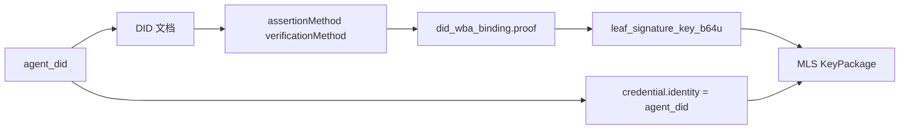
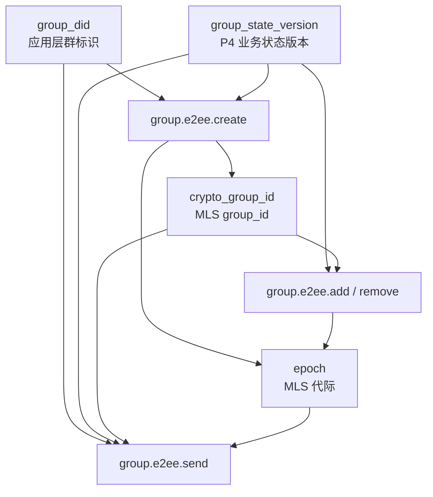
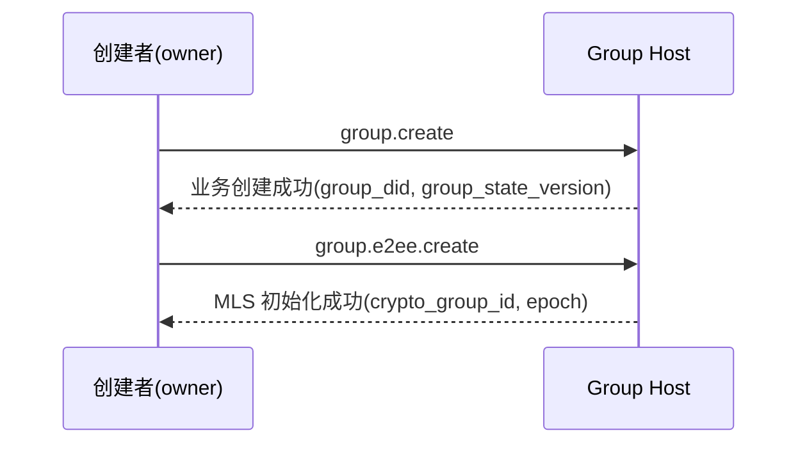
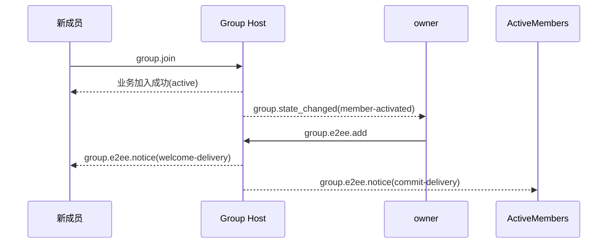
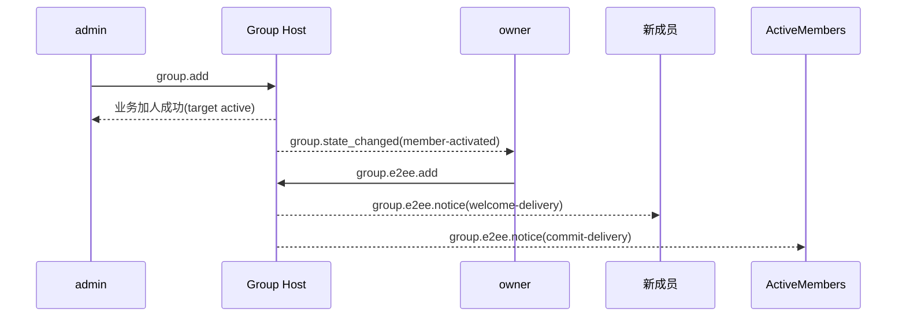
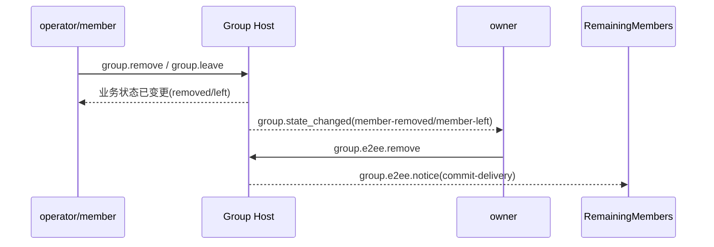
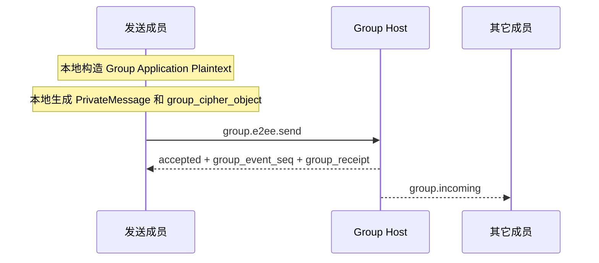
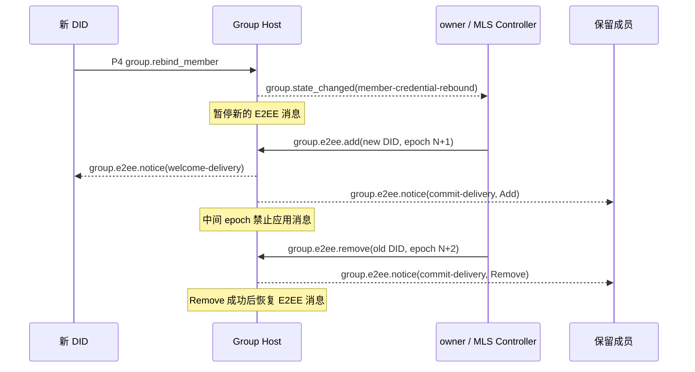

> 日本語参考訳（機械翻訳・未校閲）。規範となるのは原文です。コード例・識別子・規範キーワードは原文を保持しています。
> 原文: [chinese/deprecated/06-群组端到端加密.md](../../../chinese/deprecated/06-群组端到端加密.md) / 基準コミット: `0837cfdfaf4ddcf834f0890ddaf34fc4c824e066`

# ANPプロファイル6:グループ間対エンド暗号化

- 文書番号: ANP-P6
- タイトル:グループ・ツー・エンドの暗号化
- ステータス:公開
- バージョン: 1.1
- 原文言語: 中文 / このページは日本語参考訳
- アプリケーションの範囲: このプロファイルは、グループDIDに基づいてグループ対エンドの暗号化制御レイヤーに適用され、密接に整列 `anp.group.base.v1` 利用する。

---

## 1. 目的:

このProfile は、AMP のグループ・ツー・エンドの暗号化制御レイヤーを定義します。

1. 入れる方法 `group_did`、`group_state_version`、`group_event_seq` (b) パスワードスタタスマシンのグループに結びます。
2. (a) MLS は、グループキーの作成、メンバー変更、メッセージ保護のアプリケーションのためのベースプロトコルとしてどのように使用されます。
3. 今後の予定 `did:wba` (b) MLSメンバーの「証明書、KeyPacageおよび葉」とアイデンティティの結合。
4. 別のセットを定義する方法 `group.e2ee.*` MLSパスワードアクションを運ぶJSON-RPCメソッド。
5. ???????????????????????????????????????????????????????????????????????????????????????????????????????????????????????????????????????????????????????????????????????????????????????????????????????????????????????????????????????????????????????????????????????????????????????????????????????????????????????????????????????????????????????????????????????????????????????????????????????????????????????????????????????????????????????????????????????????????????????????????????????????????????????????????**州のアライメント**代わりに "P4メソッドは、MLSハンドシェイクオブジェクトを組み込みました" `anp.group.base.v1` コラボレーションを閉じる
6. ??????????????????????????????????????????????????????????????????????????????????????????????????????????????????????????????????????????????????????????????????????????????????????????????????????????????????????????????????????????????????????????????????????????????????????????????????????????????????????????????????????????????????????????????????????????????????????????????????????????????????????????????????????????????????????????????????????????????????????????????????????????????????????????????? `epoch`、`Welcome`、`PrivateMessage`、`PublicMessage`、`epoch_authenticator`、フォークの検出および回復。
7. P4で縛られるハンドル・バックされたメンバーのDIDを受け入れ、そしてそれを回すことをする方法 `group.e2ee.add` とりあえず `group.e2ee.remove` 対応するMLSleafを置換します。

ベンジャー **なし、いいえ。**定義:

- 歴史のアウトリーチ;
- オンラインで読むこと;
- (a) 装置または内部のコピーの概念;
- エージェント内の複数の実装ユニット間でグループキーの状態が共有される方法
- グループ外図同期の特定実現;
- グループ以外のシーンのエンドツーエンド暗号化;
- 外的なコミットの本管;
- `group_join_info` とりあえず `group.e2ee.get_join_info`；
- `accept_welcome` (a) 合意の方法;
- 会員モデルの第二弾。
- MLSのエポック・シークレットの歴史は、復元または再発行されます。

---

## 2. 用語と規範的な関与

### 2.1 仮鍵

このテキスト **MUST**、**MUST NOT**、**REQUIRED**、**SHALL**、**SHALL NOT**、**SHOULD**、**SHOULD NOT**、**RECOMMENDED**、**NOT RECOMMENDED**、**MAY**、**OPTIONAL** 資本金を基準とする規範的な要件として解釈される。

### 2.2 用語集

- **グループID**: グループの適用層のグローバルマーカー、すなわち `group_did`。
- **暗号グループID**: クラスターパスワード内部識別、MLS対応 `group_id`と、 `group_did` 違います。
- **グループホストサービス**: グループベースの状態シーケンシング、戦略的アプリケーションおよびグループメッセージポータルの責任を負うサービス。 MLSコントローラではなく。
- **MLSグループの状態**: MLSメンテナンスに基づくグループパスワード状態
- **エスポック**: MLSグループ状態のインタージェネラル・アドバンス。
- **キーパッケージ**: MLS は、グループに新しいメンバーを追加するためにマテリアルオブジェクトを追加します。
- **おすすめ**: MLSは、新規メンバーがグループ化を開始できるようにオブジェクトを歓迎します。
- **プライベートメッセージ**: 会員認証でMLSメッセージを暗号化しました。
- **パブリックメッセージ**: 暗号化されたMLSメッセージなしでサインインするだけです。
- **行なった:wbaの結合**: MLS の葉署名キー、会員証明書または KeyPacage を特定のものに結合する `agent_did` . . .
- **MLS のコントローラー**: MLSメンバーの実行を担当する身体 ' 制御操作を変更します。 V1 はグループに固定されます `owner`。
- **州のカップリング**P4 と P6 はメソッド単位でマップしませんが、ビジネスステータスを変更することでパスワードのコーディングをトリガーします。
- **E2EE 通知**: 配達のためのP6自己定義された独立した暗号化された通知の目的 `commit`、`welcome` コードの結果が待ちます。
- **フォーク**: 同じのため `group_did`異なるメンバーは、不安定な観察をしました `epoch` / `epoch_authenticator` / ステータスブスターシーケンス。
- **MLSメンバー認証レバインド**: P4 が同じハンドルのメンバーの DID を承認した後、ターンで渡します `group.e2ee.add(new DID)` とりあえず `group.e2ee.remove(old DID)` 2つのCommitは、MLSの葉をパスワード組織に置き換えます。

---

## 3. デザイン原則

### 3.1 グループIDとパスワードステータスのストラテジー

このプロフィールは明確な区別を作ります:

- `group_did`: 応用層の全体的な同一証明;
- `crypto_group_id`(a)パスワードコミュニティの内部識別;
- `group_state_version`: グループホストが指定したアプリケーションレイヤーステータスバージョン。
- `epoch`: MLSステータスマシンが指定したパスワード生成

これら4つの **MUST NOT** メカニカルに等しい。しかし、それらの間で **MUST** 汎用的な結合関係があります。

### 3.2 エージェント = 外部グループメンバー

ベンプロファイルの外部接続では、MLSグループのメンバーは、常に現在のレベルに存在しています `agent_did` P4 の任意です `member_handle` 会社のアンカーですが、ビジネスメンバーのアンカレッジです。 **MUST NOT** MLS を置換する `credential.identity` . プロトコルレイヤー **なし、いいえ。**機器、端末、ローカルユーザーID、社内コピーメンバーのコンセプトをご紹介します。

エージェント内で複数の実行コピーがある場合、MLS グループの状態を共有または同期する方法は Agent に統合され、このプロファイルの構文には属しません。

### 3.3 P4はビジネスマスターの合意、P6はパスワード制御レベルです。

ベンプロファイルと `anp.group.base.v1` 関係は次のようにします。

- P4 業務の行動、運用状況、グループ化と返信の対称を定義する。
- P6 は、MLS パスワードのアクション、パスワードオブジェクト、バインディングルール、認証要件を定義します。
- P4は運用レベルでの権限を維持します。
- プチ6 **なし、いいえ。**再定義 `active / left / removed` (b) 運営メンバーのステータス
- プチ6 **なし、いいえ。**MLS の主物体が P4 メソッドで直接実行される必要があります。

### 3.4 ステートツーステートカップリング、メソッド別マップマッピングではなく

P4-P6 カップリング**ステータス**「P4メソッドは直接P6メソッドをマッピングする」ではなく、Achieved。

つまり、

- P4は、何かが動作しているかどうかを決定します。
- P6 運用状況の変化を観察し、MLSを事前に確認する。

たとえば:

- P4で作成した人のグループが成功し、創設者になった `owner` ??? 独自のオート実行 `group.e2ee.create`
- 会員はP4会員になります `active`, まだMLSメンバーコレクションでアクティブにしていませんか? 所有者 `group.e2ee.add`
- P4 のメンバーが `left` または `removed`, まだMLSメンバーコレクションで活動中 `group.e2ee.remove`
- P4 で生成されたハンドルバックメンバー `member-credential-rebound`, 古い DID リーフは、まだ MLS メンバーコレクションでアクティブです `group.e2ee.add(new DID)`成功後 `group.e2ee.remove(old DID)`

### 3.5 は MLS のコントローラーだけです

v1 は、**オーナーだけがMLSコントローラーの役割を想定**。

オーナーは、以下の責任を負います。

- MLSグループを作成します。
- 導入事例 `add`；
- 導入事例 `remove`；
- 注文で。 `add(new DID)` とりあえず `remove(old DID)` (b) 役員の証明書の交換
- 会員様の変更を発生させる `commit`；
- 新規メンバーの生成 `welcome`；
- 会員の変更に伴い、退会後 `epoch`。


P6のコアアイデアは、MLSオブジェクトをP4メソッドにプッシュするものではありませんが、パスワードがビジネスと並んで移動し続けることは不可能です。次の図は、この「ステートツーステート」を一般的な画像に凝縮し、読者はメソッド間の因果関係を理解し、セクションの制約を後ろに読み込むのを助けます。

```mermaid
flowchart TB
P4[P4 业务状态变化<br/>group.create / member active / member left or removed / credential rebound]
OBS[owner 观察业务状态]

CREATE[group.e2ee.create]
ADD[group.e2ee.add]
REMOVE[group.e2ee.remove]
REBIND_ADD[group.e2ee.add(new DID)]
REBIND_REMOVE[group.e2ee.remove(old DID)]

HOST[Group Host]
NOTICE[group.e2ee.notice]

P4 --> OBS
OBS -->|群已创建且尚无 crypto_group_id| CREATE
OBS -->|成员已 active 且未进入 MLS| ADD
OBS -->|成员已 left or removed 且仍在 MLS| REMOVE
OBS -->|Handle 成员已换绑且旧 leaf 仍在 MLS| REBIND_ADD

CREATE --> HOST
ADD --> HOST
REMOVE --> HOST
REBIND_ADD --> HOST
REBIND_ADD -->|换绑 Add 已接受后执行| REBIND_REMOVE
REBIND_REMOVE --> HOST

HOST --> NOTICE
```

*図P6-1: P4/P6 状態の収束(非調整)。*

数値は、新しい運用状況のマシンではなくトリガー関係を強調します。P4は、ビジネスレベルで権威を維持し、P6はこれらの結果だけを観察し、MLSのキュレート/追加/削除にそれらを置きます。
### 3.6 グループ ホストは、MLS 制御ではなくソートを担当しています

グループホストサービスの職務は次のとおりです。

- P4 の動作を受け取り、ソートします。
- 受入事件の配分 `group_event_seq`；
- プッシュ! `group_state_version`；
- 生成する `group_receipt`；
- ニュースレターのニュースグループとE2EE Noteが配布されました。
- 経営レベルでのMLS制御結果の低下を拭く。

デフォルトでは、グループホストサービス:

- **いったん。** MLS のコントローラーとして;
- **いったん。** MLSグループのメンバーとして
- **いったん。** 明示的に分類された機能のグループを保持します。

### 3.7 オーナーグループステータス、アクティブメンバーグループメッセージ

あなただけのコントロールは、

- (a) 会員の変更
- (a) グループパスワードのステータスの推移;
- `epoch` 更新情報

全て すべて `active` 会員は、次のことができます。

- グループメッセージのメッセージをグループの状態で生成します。
- コールセンター `group.e2ee.send` 独自のメッセージのグループを送信します。
- 新着情報は受け付けていません。

ベンジャー **なし、いいえ。**ユーザーは、グループメッセージが全て所有者によって暗号化されるように要求します。

### 3.8 v1 対応していません

v1 で:

- 未対応
- 未定義 `group_join_info`；
- 未定義 `group.e2ee.get_join_info`；
- 未定義 `accept_welcome` (c) プロトコルメソッド。

エントリーパスは、最終的に所有者が開始したMLSのパスワードレベルに収斂 `add`。

### 3.9 情報のみがPrivateMessageに入力

v1 で:

- ちょうど... `group.e2ee.send` MLS にメッセージ内容を適用 `PrivateMessage` 暗号化されている。
- `group.e2ee.create`、`group.e2ee.add`、`group.e2ee.remove` 明示的なJSON-RPCリクエストを引き続き使用し、リセット `add` とりあえず `remove`, 要求の新しいメソッドを定義しません。
- `commit`、`welcome` 同等オブジェクトは、P4ビジネスメソッドを埋め込むのではなく、入る方法や通知負荷として表示されます。

---

## 4. 依存性、プロファイル識別およびターゲットモデリング

### 4.1 プロフィール名

このProfile の標準的な名前は、次のとおりです。

`anp.group.e2ee.v1`

### 4.2 依存症

ベンジャー **MUST** 次のデータに依存します。

- `anp.core.binding.v1`
- `anp.identity.discovery.v1`
- `anp.group.base.v1`

### 4.3 セキュリティモード

このファイルを使用する際:

- `meta.profile` **MUST** イーグル `anp.group.e2ee.v1`。

の の の の の の の の の の の の の の の の の の の の の の の の の の の の の の の の の の の の の の の の の の の の の の の の の の の の の の の の の の の の の の の の の の の の の の です:

- `group.e2ee.publish_key_package`、`group.e2ee.get_key_package`、`group.e2ee.notice` **MUST** 利用条件 `transport-protected`
- `group.e2ee.create`、`group.e2ee.add`、`group.e2ee.remove`、`group.e2ee.send` **MUST** 利用条件 `group-e2ee`

えー。 `group.e2ee.send` blogger は次のように追加します。`group-e2ee` これは、それが運ぶメッセージがグループE2EEに意味することを意味します。これは、その外部層JSON-RPCリクエストボディがグループによって再び暗号化されるという意味ではありません。

### 4.4 方法論的目的モデリング

### 4.4.1 サービススコープ

次の取り組み **MUST** あり あり `service-scoped`：

- `group.e2ee.publish_key_package`
- `group.e2ee.get_key_package`
- `group.e2ee.create`

ルール:

- `meta.target.kind = "service"`
- `meta.target.did` **MUST** ターゲットが開いているようなもの。 `ANPMessageService.serviceDid`

のは、 `group.e2ee.create` サービススコープの採用理由は次のとおりです。
運用レベル `group.create` 成功の先、グループが設立されました。`group_did` 生成されたものの、作成アクション自体は、パスワードの初期化のためにホストサービスポータルをグループ化し、したがってv1は均一な方法でサービススコープを使用する。

### 4.4.2 グループアドレス

次の取り組み **MUST** あり あり `group-addressed`：

- `group.e2ee.add`
- `group.e2ee.remove`
- `group.e2ee.send`

ルール:

- `meta.target.kind = "group"`
- `meta.target.did` **MUST** ターゲットです。 `group_did`

### 4.4.3 エージェントが通知をアドレス指定

新着情報 **MUST** あり あり `agent-addressed`：

- `group.e2ee.notice`

ルール:

- `meta.target.kind = "agent"`
- `meta.target.did` **MUST** 通知の受信者に同等

---

## 5. パスワード 主要なラインおよびMTIのパッケージ

### 5.1 メインライン契約

このプロファイルグループキーメインライン **MUST** 構文に基づいてMLS 1.0が達成されますが、v1は制限された使用サブセットだけを固定します。

v1 主要なラインは少なくとも含んでいます:

- キーパッケージ
- アクセサリー
- 削除
- コンテンツ
- おすすめ
- プライベートメッセージ
- Epoch プッシュ

ハンドルバックメンバーのバウチャースワップは、新しいP6メソッドやMLSを導入していません。最初に渡されます `group.e2ee.add` 新規のDIDリーフを追加し、その後パスする委員会を作成します。 `group.e2ee.remove` 古いDIDリーフを削除した委員会を作成します。

の の の の の の の の の の の の の の の の の の の の の の の の の の の の の の の の の の の の の の の の の の の の の の の の の の の の の の の の の の の の の の の の の の の の の の です:

- `commit_b64u` **MUST** 完全なMLSによって `MLSMessage`（`mls-public-message`)は、TLSの元バイトによってシーケンスされる;
- `welcome_b64u` **MUST** によって MLS `Welcome` オブジェクトは TLS がシーケンスした後に元のバイトとして表現されます。
- `PrivateMessage` **MUST** グループアプリケーションに対するメッセージの唯一の受信者として。

MLSライブラリー **MAY** 追加のサポート `Update`標準機能、標準監視、PSK、ReInit; がこれらの機能 **なし** このProfile v1 の最小プロトコルメインラインも **会員でない** v1 は相互運用性を必要とします。

### 5.2 必須-対増幅パッケージ

最小相互接続性を確保するために、このファイルの達成と一致 **MUST** 以下のMTIパッケージをサポート:

`MLS_128_DHKEMX25519_AES128GCM_SHA256_Ed25519`

### 5.3 パッケージの余分

受賞作品 **MAY** MLSパッケージのサポート

- 同じグループのメンバー全員が参加する。 **MUST** (a) 使用するパッケージの同意
- グループポリシーが制限されている場合、MLS契約者はパッケージコレクションを許可します **MUST** 戦略を満足させないパッケージを注入します。

### 5.4 関係をした:wba

このプロファイルのメインラインは、次のようにしてwbaをしました。

- DID ドキュメント `authentication` / `assertionMethod` (b) アイデンティティの結合のため;
- DID ドキュメント `keyAgreement` **SHOULD** (a) は、エージェントが E2EE 機能を持っていることを示す少なくとも 1 つの X25519 エントリが含まれています。
- MLSグループメンバーのリーフ署名キー **いったん。** DID の長期署名キーと直接等しい;
- 葉署名キー **SHOULD** 分離生成され、 `did:wba Binding` ♪ ネクタイへ `agent_did`。

---

## 6. 行なった:MLS の wba 結合モデル

### 6.1 ターゲティング

このプロファイルは、次のMLS要素を結合する必要があります。 `agent_did`：

1. KeyPacageの所有者;
2. 現在の葉の署名キー;
3. グループ会員証

### 6.2 犯罪者ID規則

このプロフィールのために、MLSのメンバーの証明書 `credential.identity` **MUST** 流れ葉を等しくします `agent_did` . ハンドル **MUST NOT** 執筆または置換 `credential.identity`。

受賞作品 **MUST NOT** ローカルアカウントID、デバイスID、値ユーザID、その他の非DID文字列で置換 `credential.identity`。

### 6.3 `did_wba_binding` オブジェクト

このプロファイル定義 `did_wba_binding` オブジェクトは、MLS リーフ署名キーを結合する `agent_did`。

推奨構造は以下の通りです。

```json
{
  "agent_did": "did:wba:example.com:agents:alice:e1_<fingerprint>",
  "verification_method": "did:wba:example.com:agents:alice:e1_<fingerprint>#key-1",
  "leaf_signature_key_b64u": "BASE64URL_ED25519_LEAF_PK",
  "issued_at": "2026-03-29T12:00:00Z",
  "expires_at": "2026-04-29T12:00:00Z",
  "proof": {
    "type": "DataIntegrityProof",
    "cryptosuite": "eddsa-jcs-2022",
    "created": "2026-03-29T12:00:00Z",
    "proofPurpose": "assertionMethod",
    "verificationMethod": "did:wba:example.com:agents:alice:e1_<fingerprint>#key-1",
    "proofValue": "z..."
  }
}
```

`did_wba_binding.proof` **MUST** P1付録B定義の共有を適用する **オブジェクトの証拠のプロフィール**。

えー。 `did_wba_binding` のために:

- 発行者 DID **MUST** あり あり `agent_did`
- 保護された文書 **MUST** 削除 `proof` あとで。 `did_wba_binding` オブジェクト
- `proof.verificationMethod` **MUST** スポット `agent_did` ドキュメント by `assertionMethod` 認証方法

### 6.4 `did_wba_binding` 認証ルール

受取人は新規ユーザーだけでなく、KeyPaackage、Fリーフノードの更新や新メンバーを受け入れる前に、ボードの新しいメンバーです。**MUST** 下記の検証が完了しました。

1. `agent_did` 解読することができます。
2. `verification_method` DID ドキュメントで行っている
3. `verification_method` **MUST** DID ドキュメント `assertionMethod` (a) 認可;
4. `proof` **MUST** 存在し、 **MUST** (a) P1付録Bの株式
5. `proof` ソーザーDID **MUST** イーグル `agent_did`；
6. `proof` 検証パス;
7. `proof` 文書のコンテンツの結合 **MUST** 少なくとも上書き `agent_did`、`verification_method`、`leaf_signature_key_b64u`、`issued_at`、`expires_at`；
8. KeyPaackage/Fリーフノードの葉署名のための実際の公共鍵 `leaf_signature_key_b64u` (a) 関係;
9. MLS証明書 `credential.identity` とりあえず `agent_did` (a) 関係;
10. 存在する場合 `issued_at` / `expires_at`受賞作品 **MUST** ローカルタイムの有効期間ポリシーに従って時間ウィンドウを確認します。


P6 定義する理由 `did_wba_binding`、MLSの葉署名キーは、DID永続的なアイデンティティ署名鍵に直接等しくないべきではないので。次の図は `agent_did`、DID 文書、バインディングオブジェクト、KeyPaackage/credential.idity リンクは、リーダーが認証の順序を理解しているのを支援します。



*図P6-2: wbaとMLSのタイイン(unnormative)をした。*

実際の認証が行われる場合、受信者は内部のMLS署名が有効であるかどうかをチェックするだけでなく、このチェーンに沿って確認し続ける必要があります。 `credential.identity`、葉の署名キーおよび `agent_did` それら間の結合は完了します。
### 6.5 `e1_` とりあえず `k1_` 互換性

- あり あり `e1_` ドイド,`did_wba_binding.proof` **MUST** 再制定P1の付録BのshareObjectの証拠の教授;
- 互換性 `k1_` ドイド,`did_wba_binding.proof` **MAY** 未使用の相談定義の代替を使用してください。ただし、不審な延長協議では、v1 MTI **なし、いいえ。**- それを置きます。 `k1_` デフォルトの相互運用パスとしてタイの証拠;
- ID のアイデンティティ・カーブが、MLS グループのための MTI の葉署名のキーに存在しているものは何でも **MAY** Ed25519 を使うと、結合証明書が確立されるのは十分です。

---

## 7. コアオブジェクト

### 7.1 `crypto_group_id`

`crypto_group_id` MLS用インナー `group_id`。

ルールは以下の通りです。

- `crypto_group_id` **MUST** (a) 不透明度バイトとして扱われます;
- ジェイソン **MUST** 採用情報 `base64url` フィールド名が推奨されることを示します。 `crypto_group_id_b64u`；
- `crypto_group_id` **MUST** とりあえず `group_did` 検証可能なバインディングを作成します。

### 7.2 `group_state_ref`

このプロファイルは、P4 を再使用 `group_state_ref` コンセプトは、E2EEグループで少なくとも必要です。

- `group_did`
- `group_state_version`
- `policy_hash`「戦術の馬車が橋渡しされると」


グループE2EEでは、リーダーは、識別/バージョンの4つの異なるレベルを持つ脳内のエラーに最も有利です。グループID、ビジネスステータスバージョン、パスワード内部グループ_idとMLSの画期的な図。次の図は、これらの4人のそれぞれのソースとプロモーションとの関係を示しています。



*図 P6-3:`group_did`、`crypto_group_id`、`group_state_version` とりあえず `epoch` 関係(非規範的)。*

その後のオブジェクトと認証ルールの構造は、座標の異なるレベルであると考えられているような方法で読み込まれるべきです。それらはバインドする必要がありますが、互いに交換したり、カイナーと機械的に同等のものとみなされることはありません。
### 7.3 `group_key_package`

このプロファイル定義グループは、材料包装オブジェクトを追加します。

```json
{
  "key_package_id": "kp-001",
  "owner_did": "did:wba:example.com:agents:bob:e1_<fingerprint>",
  "suite": "MLS_128_DHKEMX25519_AES128GCM_SHA256_Ed25519",
  "mls_key_package_b64u": "BASE64URL_KEYPACKAGE",
  "did_wba_binding": { ... },
  "expires_at": "2026-04-30T00:00:00Z"
}
```

の の の の の の の の の の の の の の の の の の の の の の の の の の の の の の の の の の の の の の の の の の の の の の の の の の の の の の の の の の の の の の の の の の の の の の です:

- `key_package_id` **MUST** 存在;
- `owner_did` **MUST** 存在;
- `suite` **MUST** 存在;
- `mls_key_package_b64u` **MUST** 存在;
- `did_wba_binding` **MUST** 存在;
- `expires_at` **SHOULD** 存在;
- `mls_key_package_b64u` **MUST** MLS への `KeyPackage` オブジェクトは、ベース64url を埋めずに MLS 1.0 TLS でシーケンスされます。

`group_key_package` 主に所有者のフォローアップのために `group.e2ee.add`。

### 7.4 `group_cipher_object`

`group_cipher_object` あり。 `group.e2ee.send` . 行ベースのメッセージオブジェクト。

推奨構造は以下の通りです。

```json
{
  "crypto_group_id_b64u": "BASE64URL_GROUPID",
  "epoch": "7",
  "private_message_b64u": "BASE64URL_PRIVATEMESSAGE",
  "group_state_ref": {
    "group_did": "did:wba:groups.example:team:dev:e1_<fingerprint>",
    "group_state_version": "42",
    "policy_hash": "sha-256:..."
  },
  "epoch_authenticator": "BASE64URL_AUTH"
}
```

ルール:

- `crypto_group_id_b64u` **MUST** 存在;
- `epoch` **MUST** 存在;
- `private_message_b64u` **MUST** 存在;
- `private_message_b64u` **MUST** MLS への `PrivateMessage` (a) MLS 1.0 TLS で配列するオブジェクトの元のバイトアンフィリングベース64url;
- `group_state_ref.group_did` **MUST** 外部ターゲットと等しい。 `group_did`。

### 7.5 `Group Application Plaintext`

グループがメッセージをMLSに適用する `PrivateMessage` ブロガーは次のように述べています。**MUST** 次のオブジェクトは内部レイヤーで定義されます。

```json
{
  "application_content_type": "text/plain | application/json | application/anp-attachment-manifest+json | ...",
  "thread_id": "thr-001",
  "reply_to_message_id": "msg-0009",
  "annotations": {},
  "text": "...",
  "payload": {},
  "payload_b64u": "..."
}
```

ルール:

- `application_content_type` **MUST** 存在;
- `text` / `payload` / `payload_b64u` **MUST** 事件が起きた。
- P4 メッセージの同義語 フィールド `thread_id`、`reply_to_message_id`、`annotations` グループE2EEの下 **MUST** (a)はオブジェクトの内部層にあります。
- 暗号化前の送信者 **MUST** ♪ みんなで盛りだくさん♪ `Group Application Plaintext` UTF-8 + RFC 8785 JCS のシーケンスを使用してバイトを強制的に実行するオブジェクト。 受信者による復号化後 **MUST** オブジェクトは同じルールに従って解釈されます。

いつ? `application_content_type = "application/json"` できるかどうかはわかりません。`payload` **MUST**
JSON オブジェクトを直接読み込みます。このファイルは、そのオブジェクトの内フィールドのビジネスの意味を定義しません。

通常のJSONグループアプリケーションフィールド:

```json
{
  "application_content_type": "application/json",
  "thread_id": "thr-001",
  "payload": {
    "type": "example",
    "data": {
      "hello": "group"
    }
  }
}
```

### 7.6 `e2ee_notice_object`

P6 は、パスワード結果の配信のためにスタンドアローン暗号化された通知オブジェクトを定義します。

推奨構造は以下の通りです。

```json
{
  "notice_id": "en-001",
  "notice_type": "commit-delivery | welcome-delivery",
  "group_did": "did:wba:groups.example:team:dev:e1_<fingerprint>",
  "group_state_ref": {
    "group_did": "did:wba:groups.example:team:dev:e1_<fingerprint>",
    "group_state_version": "43",
    "policy_hash": "sha-256:..."
  },
  "crypto_group_id_b64u": "BASE64URL_GROUPID",
  "epoch": "8",
  "subject_did": "did:wba:b.example:agents:bob:e1_<fingerprint>",
  "subject_status": "active | removed",
  "commit_b64u": "BASE64URL_MLSMESSAGE",
  "welcome_b64u": "BASE64URL_WELCOME",
  "ratchet_tree_b64u": "BASE64URL_RATCHET_TREE",
  "epoch_authenticator": "BASE64URL_AUTH",
  "group_receipt": { ... }
}
```

ルール:

- `notice_type` **MUST** 存在;
- `group_did` **MUST** 存在;
- `group_state_ref` **MUST** 存在;
- `crypto_group_id_b64u` **MUST** 存在;
- `epoch` **MUST** 存在;
- `notice_type = "commit-delivery"` できるかどうかはわかりません。`commit_b64u` **MUST** 存在;
- `notice_type = "welcome-delivery"` できるかどうかはわかりません。`welcome_b64u` とりあえず `ratchet_tree_b64u` **MUST** (a)同時プレゼンス;
- ドキュメントの名前は、良い考えではありません。`group_state_ref` **MUST** 正確に2つのP6操作のための受け入れられたP4を引用 `member-credential-rebound` イベント. 受信者 **MUST** P4イベントからハンドル、バインド、古いDID、新しいDIDを取得、P6通知に依存しないで、再び継続的にフィールドを運ぶ;
- `subject_did` とりあえず `subject_status` このP6操作リーフのインパクトだけを記述:新しいIDと加え、 `active`,Remove は古い DID を使用し、 `removed`；
- `ratchet_tree_b64u` **MUST** トラッカーツリーのTLSの元のバイトをシリアライズするための未充填ケース64url。
- `group_receipt` **MAY** 業務ランキングでパスワード結果のリンクをすること。

---

## 8. KeyPacage の普及と発見方法

### 8.1 `group.e2ee.publish_key_package`

#### 8.1.1 統計学

エージェントが自ら公開した人 `ANPMessageService` グループが参加するKeyPaackageをグループで利用できるようになりました。

#### 8.1.2 リクエスト

- `method = "group.e2ee.publish_key_package"`
- `meta.profile = "anp.group.e2ee.v1"`
- `meta.security_profile = "transport-protected"`
- `meta.target.kind = "service"`
- `meta.target.did` **MUST** 出版社自身と同じです。 `ANPMessageService.serviceDid`
- `meta.sender_did` **MUST** プレゼンス
- `body.group_key_package` **MUST** プレゼンス
- `body.group_key_package.owner_did` **MUST** イーグル `meta.sender_did`

証明の制約:

- メソッドは、 **サービススコープ** フェイスメソッドの制御
- コールア **MUST** 認証されたローカルセッションまたは同等のホップ/サービス認証のコンテキストで実行します。
- の1 **リクエストなし** この方法論の新しいビジネスレイヤーの追加定義 `origin_proof`。

#### 8.1.3 成功の応答

成功の応答 **MUST** 少なくとも含まれます:

- `published = true`
- `owner_did`
- `key_package_id`
- `published_at`

### 8.2 `group.e2ee.get_key_package`

#### 8.2.1 科学

ターゲットエージェント `ANPMessageService` 利用可能なKeyPaackageを入手してください。

#### 8.2.2 リクエスト

- `meta.profile = "anp.group.e2ee.v1"`
- `meta.security_profile = "transport-protected"`
- `meta.target.kind = "service"`
- `meta.target.did` **MUST** ターゲット、エージェントです。 `ANPMessageService.serviceDid`

`body` **MUST** 含まれる:

- `target_did`

`body` **MAY** 含まれる:

- `preferred_suite`
- `require_fresh`

証明の制約:

- メソッドは、 **サービススコープ** フェイスメソッドの制御
- v1 最低の相互運用の条件少なくともホップ/サービス レベル証明;
- **KeyPackage は v1 MTI に完全アクセスしません。**。

#### 8.2.3 応答の成功

成功の応答 **MUST** 少なくとも含まれます:

- `target_did`
- `group_key_package`

#### 8.2.4 サービスの終了の発行規則

`ANPMessageService` バックリング `group_key_package` _その他組織

- **SHOULD** 未確認、解読、不燃のKeyPackageを返します。
- **MAY** 返送後、これを「P」としてマークする `reserved` (b) 並列および重複発行を避けるための価格の同等性。
- 正しいものになると `group.e2ee.add`グループのホストが正常に受け入れられ、パスワードメンバーの変更を完了した後、ユーザの名前を取得することができませんでした。**MUST** マークとして `consumed` またはリリースプールから削除します。
- 対応するプロセスが失敗した場合、キャンセルまたは超過時間の場合、予約済みKeyPackageをデプロイ戦略で決定するか否か、 **SHOULD NOT** 両方を成功させるのと同じKeyPacageです。 `group.e2ee.add` 操作および再使用;
- コールワー教育、フロー制限、アンチアブラス戦略 **MUST** ホップ/サービスレベルの認証に基づく実行

---

## 9. MLS 制御フェイスメソッド

### 9.1 一般規定

この章はスタンドアローンJPON-RPCのアプローチに基づいています。 P4ビジネスメソッドには「追加フィールド」ではなく、独自のパスワード制御アクションです。

の の の の の の の の の の の の の の の の の の の の の の の の の の の の の の の の の の の の の の の の の の の の の の の の の の の の の の の の の の の の の の の の の の の の の の です:

- `group.e2ee.create`、`group.e2ee.add`、`group.e2ee.remove` あり。**メンバーのコントロール方法の変更**
- `group.e2ee.send` あり。**メッセージ送信方法**
- `group.e2ee.create/add/remove` 創業の事業状態にP4をつないで、**P4 新規会員登録が作成されない**
- `group.e2ee.send` オンラインで直接送る方法として、もはや渡しません `group.send` 二次包装

### 9.2 `group.e2ee.create`

#### 9.2.1 科学

新規のMLSグループ状態を作成し、所有者を初期メンバーとして参加します。

#### 9.2.2 コールワー

オーナーのみ。

#### 9.2.3 リクエスト

- `method = "group.e2ee.create"`
- `meta.profile = "anp.group.e2ee.v1"`
- `meta.security_profile = "group-e2ee"`
- `meta.target.kind = "service"`
- `meta.target.did` **MUST** 対象グループと同じ ホストが公開した `ANPMessageService.serviceDid`
- `meta.sender_did` **MUST** 現行グループへの同等 `owner`
- `auth.origin_proof` **MUST** プレゼンス

`body` **MUST** 少なくとも含まれます:

- `group_did`
- `group_state_ref`
- `suite`
- `creator_key_package`
- `crypto_group_id_b64u`
- `epoch`

ルール:

- `creator_key_package.owner_did` **MUST** イーグル `meta.sender_did`
- `group_state_ref.group_did` **MUST** イーグル `body.group_did`
- `epoch` 初期グループステータスについて **SHOULD** あり あり `"0"` または、合意した初期値を達成するために

#### 9.2.4 応答の成功

成功の応答 **MUST** 少なくとも含まれます:

- `created = true`
- `group_did`
- `group_state_ref`
- `crypto_group_id_b64u`
- `epoch`
- `accepted_at`

注意:

- `group.e2ee.create` それだけで **MUST NOT** 別々に新しいP4ビジネスグループを作成します。
- ちょうど... `group.create` 運用レベルでの受入後実施
- 新たなものを一人で作らない。 `group_state_version` または `group_event_seq`。

### 9.3 `group.e2ee.add`

#### 9.3.1 統計

オーナーが実行するMLS `add`♪ビジネスレベルにもう1人で♪ `active`しかし、まだMLS会員グループに入らないメンバーはパスワードコミュニティに参加しました。

#### 9.3.2 コールワー

オーナーのみ。

#### 9.3.3 情報へのリクエスト

- `method = "group.e2ee.add"`
- `meta.profile = "anp.group.e2ee.v1"`
- `meta.security_profile = "group-e2ee"`
- `meta.target.kind = "group"`
- `meta.target.did` **MUST** ターゲットです。 `group_did`
- `meta.sender_did` **MUST** 現行グループへの同等 `owner`
- `auth.origin_proof` **MUST** プレゼンス

`body` **MUST** 少なくとも含まれます:

- `member_did`
- `group_state_ref`
- `group_key_package`
- `crypto_group_id_b64u`
- `epoch`
- `commit_b64u`
- `welcome_b64u`
- `ratchet_tree_b64u`

ルール:

- `group_state_ref.group_did` **MUST** 外部ターゲットと等しい。 `group_did`
- `group_key_package.owner_did` **MUST** イーグル `member_did`
- `commit_b64u` **MUST** 完全なMLSのため `MLSMessage` TLS で配列される未充填オブジェクト
- `welcome_b64u` **MUST** MLS への `Welcome` TLS で配列される未充填オブジェクト
- `ratchet_tree_b64u` **MUST** オリジナルバイトを埋め立てたトラックセットツリーのシリアル化 TLS
- `epoch` **MUST** 今回は、 `add` あとで新しい。 `epoch`
- 参加する一般的なパスは、平均的な人です。`member_did` **MUST** P4流れ `active` これらは、MLSメンバーがまだDIDの一部ではないという事実です。
- ウェストの女王は、世界の非常に重要な部分です。`group_state_ref` **MUST** 正確に受け入れられるP4を引用 `member-credential-rebound` イベント`member_did` **MUST** イベントと同じです。 `subject_did`、および新しいKeyPackage **MUST** 新しいIDを結びます。
- スイッチングパス `group.e2ee.add(new DID)` **MUST** 対応する `group.e2ee.remove(old DID)` 成功前。

#### 9.3.4 応答の成功

成功の応答 **MUST** 少なくとも含まれます:

- `accepted = true`
- `group_did`
- `member_did`
- `group_state_ref`
- `crypto_group_id_b64u`
- `epoch`
- `accepted_at`

注意:

- `group.e2ee.add` それだけで **MUST NOT** 対象メンバーのP4ステータスを切り替える `active`；
- 運用状況はP4で決定しなければならない。
- このアプローチは、MLS への動作の結果の着陸にのみ責任を負います。

### 9.4 `group.e2ee.remove`

#### 9.4.1 統計

オーナーが実行するMLS `remove`♪ 既にビジネスレベルを上回る `removed` または `left` グループのメンバーは、パスワード収集から外に移動するか、または受け入れられたハンドルスイッチから古いDIDリーフを削除します。

#### 9.4.2 コールワー

オーナーのみ。

#### 9.4.3 リクエスト

- `method = "group.e2ee.remove"`
- `meta.profile = "anp.group.e2ee.v1"`
- `meta.security_profile = "group-e2ee"`
- `meta.target.kind = "group"`
- `meta.target.did` **MUST** ターゲットです。 `group_did`
- `meta.sender_did` **MUST** 現行グループへの同等 `owner`
- `auth.origin_proof` **MUST** プレゼンス

`body` **MUST** 少なくとも含まれます:

- `member_did`
- `group_state_ref`
- `crypto_group_id_b64u`
- `epoch`
- `commit_b64u`

ルール:

- `commit_b64u` **MUST** 完全なMLSのため `MLSMessage` TLS で配列される未充填オブジェクト
- `epoch` **MUST** 今回は、 `remove` あとで新しい。 `epoch`
- 正常な取り外しの道,`member_did` 対応するP4会員ステータス **MUST** 既に終了です。 `removed` または `left`；
- 例外は、ルートを変更するだけです。`member_did` **MUST** 引用されたP4を等しい `member-credential-rebound` イベント情報 `previous_subject_did`，`group_state_ref` **MUST** 過去の成功事例 `group.e2ee.add(new DID)` 正確に同じです。そして、Addはイベントに成功した参加しました `subject_did`；
- 境界線を変更します。 **MUST NOT** 任意のまだ削除するために使用される `active` 会員様

#### 9.4.4 応答の成功

成功の応答 **MUST** 少なくとも含まれます:

- `accepted = true`
- `group_did`
- `member_did`
- `group_state_ref`
- `crypto_group_id_b64u`
- `epoch`
- `accepted_at`

### 9.5 `group.e2ee.send`

#### 9.5.1 統計

直接MLS暗号化されたメッセージをグループに送信します。

#### 9.5.2 コールワー

任意の電流 `active` 会員様

#### 9.5.3 情報リクエスト

普通のもの。 `group.e2ee.send` リクエスト **MUST** 土産:

1. `method = "group.e2ee.send"`
2. `meta.profile = "anp.group.e2ee.v1"`
3. `meta.security_profile = "group-e2ee"`
4. `meta.target.kind = "group"`
5. `meta.target.did` **MUST** ターゲットです。 `group_did`
6. `meta.sender_did` **MUST** 現在の送信者
7. `meta.message_id` **MUST** プレゼンス
8. `meta.operation_id` **MUST** プレゼンス
9. `meta.content_type` **MUST** 固定式 `application/anp-group-cipher+json`
10. `auth.origin_proof` **MUST** プレゼンス
11. `body` **MUST** - すぐに。 `group_cipher_object`

注意:

- `group.e2ee.send` 直接オンライン伝送の方法です。
- P4をもう通過しない。 `group.send` レイヤーを1つずつパックします。

#### 9.5.4 応答の成功

成功の応答 **MUST** 少なくとも含まれます:

- `accepted = true`
- `group_did`
- `message_id`
- `operation_id`
- `group_event_seq`
- `group_state_version`
- `accepted_at`
- `epoch`
- `group_receipt`

成功状態の皮下:

- グループホストは、MLS シークレットオブジェクトを承諾し、ソートしました。
- ・・・ **なし、いいえ。**会員全員がメッセージを自動的に分類します。

---

## 10. 国家中心規則

### 10.1 一般規定

P4-P6 カップリング**運用状況の変化**ドネ。
ベンジャー **なし、いいえ。**リクエストをもっと。 `group.create -> create`、`group.add -> add` . . .

オーナー **MUST** 信頼できる状況から次の情報を入手しました。

- 当社グループは、事業レベルで作成しています。
- 会員は、会員になる。 `active`；
- 会員は、会員になる。 `left` または `removed`；
- 一部のハンドルバックメンバーが生成されました `member-credential-rebound`。

状態の観察モード **MAY** あり:

- ローカルおよびグループホストの内部組織;
- えー。 `group.state_changed` サブスクリプション;
- または、他の同等の、信頼できる状態の観察機構。

### 10.2 クラスタ作成のカップリング規則

個々の場合、次の運用状態を監視します。

- かまさか `group_did` 作成;
- 創業者は自分自身です。
- 団体は、まだ何も添付されていない。 `crypto_group_id`

オーナー **MUST** トリガーを一度。 `group.e2ee.create`。

### 10.3 コンコルドルールの会員への参加

個々の場合、次の運用状態を監視します。

- かまさか `member_did` P4 に既にグループがあります。 `active` (b) 会員
- 会員は、現在MLSグループでは存在しません。
- 会員は、会員様が有意義なメンバーを抱えています。 `group_key_package`

オーナー **MUST** トリガーを一度。 `group.e2ee.add`。

以下に規定するルールは、次の規則が適用されます。

- `group.join`
- `group.add`
- 展開拡大のための招待状
- 導入承認の承認 承認される拡大

そのため、コードレベルに一度にP-4エントリーポイントを1つに閉じました。 `group.e2ee.add`。

### 10.4 会員は、アライメントルールを解除/分離する

個々の場合、次の運用状態を監視します。

- かまさか `member_did` P4では、それがなってきた `removed` または `left`；
- 会員は、まだMLSグループにいます

オーナー **SHOULD** トリガーを一度。 `group.e2ee.remove`。

### 10.5 メンバー間の証明書の交換に関するルール

都会者がP4を観察したとき `member-credential-rebound` 事件、事件。 `subject_did` 新規のDIDは新しいものです。`previous_subject_did` 古い DID を記述します。 古い DID の葉がまだ MLS メンバーコレクション、所有者に残っている場合 **MUST** 現在の方法論は、次の順序で組織されます。

1. 事故の発生 `subject_did` キーパージコールと新しいキーパーケージ呼び出し `group.e2ee.add`；
2. Add: 成功して、エポックを進展させた後、イベントを使用する `previous_subject_did` コールセンター `group.e2ee.remove`；
3. パスワードスイッチを完了し、再びEPOCを正常に削除し、再度EPOTを事前設定します。

リクエスト2件 **MUST** 同じP4の正確な引用 `member-credential-rebound` ・・・ `group_state_ref`.追加 **MUST** 削除する前に、成功; 削除はアイテムを削除することができます `previous_subject_did`他メンバーの除去は、スイッチ・ツー・トリップ・プロセスによって容易にできないことがあります。

レイアウト変更時のグループホスト **MUST** P6メンバーのシリアル化は、コントロールアクションを変更します。 追加の成功の後、現在のステップとその後の一致の試行とは別に、グループホスト **MUST NOT** 再訓練が完了する前に、受け入れるつもりはない。 `group.e2ee.add` または `group.e2ee.remove`。

P4から成功を取り除き、グループホスト **MUST** 新規グループをパユース `group.e2ee.send`ミドルエポックを生成する追加 **MUST NOT** アプリケーションのメッセージを読み込む。失敗したときに追加、達成 **MUST** 再使用して、再度試してみてください。失敗し、古いおよび新しい葉を一時的に共存させることができますが、達成される間、正常に追加して下さい **MUST** 再配布、再試行を続けて下さい。

P6 失敗した **MUST NOT** 変更、古いIDのP4権限を回復するか、新しいP6ビジネスメンバーシップを作成することによってP4をロールバックします。 P4会員、役割、ステータス、アクセス日時、およびメンバーは元のスイッチイベントによって常に決定されます。

スイッチのオブジェクトが所有者である場合、新しいDID **MUST** 現行のP4オーナーと自分として `origin_proof` 進水。 移行の追加委員会 **MAY** 回復後に保持される古い所有者MLSの葉の状態を使用して作成します。 新しい所有者の葉は追加しました **MUST** 新規オーナーリーフで生成。所有者が現在のMLS状態を失い、他の権限のコントローラーが続行できない場合は、システムを使用して新しいシステムを作成できます。 **MUST** 行くつもりはない。

### 10.6 メッセージの送信に関するルール

`group.e2ee.send` **ありません。**ステートカップリングのメソッドはトリガーします。
会員様が参加するオンライン起動方法です。

しかし、そのビジネスの一貫性の要件は、P4に密接に結び付けられています。

- カレンダー **MUST** 流れの `active` (b) 会員
- カレンダー **MUST** P4 の特長 `group_policy.permissions.send`
- 成功の応答 `group_event_seq`、`group_state_version`、`group_receipt` グループのメッセージのP4定義に従うSemantics。

---


## 11. MLS利用プロファイル(仮称)

### 11.1 一般規定および外部規範的参照

この章では、MLS に対するプロファイルのバージョンを定義します。**限られた使用法のサブセットおよび固定構成**。
この章の目的は、MLS規格を書き換えるものではありませんが、以下に示すようにします。

- v1 オブジェクトとステートマヌービルMLSが許可されているか。
- これらのオブジェクトはオンラインプロトコルでコードされる方法
- 主催者、活動的なメンバー、グループホストのローカル状態と治療の義務は異なります。
- `group.e2ee.create`、`group.e2ee.add`、`group.e2ee.remove`、`group.e2ee.send` 背後にあるMLSの構文は何ですか?

受賞作品 **MUST NOT** MLS のコアをフランス語に変更する。ただし、MLS 標準ライブラリがこの Profile v1 に抵触する自由でデフォルトでは、テキストの「混合」バージョンを使用することができない。**MUST** ベンプロファイルとして取る。

### 11.2 v1 は MLS サブセットを許しました

このプロファイルv1 MLSメインラインは、次のオブジェクトと操作可能な境界線を入力するアクションのみを使用できます。

- `KeyPackage`
- `Add`
- `Remove`
- `Commit`
- `Welcome`
- `PrivateMessage`
- `epoch` プッシュ!

このプロファイルv1:

- `commit_b64u` **MUST** 完全なMLSに相当 `MLSMessage`、ワイヤー フォーマット **MUST** あり あり `mls-public-message`
- `welcome_b64u` **MUST** メルマガ `Welcome`
- `private_message_b64u` **MUST** メルマガ `PrivateMessage`

ベンプロファイルv1 **なし、いいえ。**(a) 相互接続ラインに次の機能の統合:

- 外部コミット
- `GroupInfo` / `group_join_info`
- `group.e2ee.get_join_info`
- 独立性 `accept_welcome` 合意の方法
- 複数のコントローラーを提出し、
- 会員の非所有者が変更を開始
- プロトコルレベルのメインラインアクションとして `Update`
- 政府は、対面の要請として、当局との連絡をとっています。
- 再入力、PSK、サブグループまたはカスタムMLS拡張v1 MTI

使用されるMLSライブラリの実現 **MAY** これらの機能のサポートでは、相談の大きな拡大がなければ、**MUST NOT** v1 ラインプロトコルを相互に引き込む。

### 11.3 MTIパッケージと固定アルゴリズム

ベンプロファイルv1 **MUST** 以下のMTIパッケージを準備します。

`MLS_128_DHKEMX25519_AES128GCM_SHA256_Ed25519`

固定アルゴリズムの構成は次のとおりです。

- ケム/HPKE DH:`DHKEMX25519`
- エイエイド:`AES-128-GCM`
- ハッシュ/KDFの基礎:`SHA-256`
- 署名:`Ed25519`

また、このProfile のすべての IPON オブジェクトは、その証拠、AAD または内部層によって明示的にバインドされた **MUST** UTF-8 + RFC 8785 JCS を使用してください。以下に少なくとも適用されます。

- `did_wba_binding` 保護された目的
- `Group Application Plaintext`
- `group.e2ee.send` ・・・ `authenticated_data`
- 会員から提出された認定対象オブジェクトの変更

### 11.4 `group.e2ee.create` MLS の構文

`group.e2ee.create` おすすめ `group.create` 運用レベルでの受入後実施

導入事例 `group.e2ee.create` ローカル MLS のランタイム **MUST**：

1. 認証 `creator_key_package`
2. それらの中で検証する `did_wba_binding`
3. 新しいMLSグループの状態を作成する
4. 新規生成 `crypto_group_id`
5. オーナーを最初のMLSメンバーとして追加
6. オリジナル `epoch`
7. 都会的な耐久性を生む

`group.e2ee.create` **MUST NOT** 新規 P4 のビジネスグループを作成します。既存の操作で対応する初期 MLS ステータスのみが作成されます。

### 11.5 `group.e2ee.add` MLS の構文

`group.e2ee.add` v1 の標準的なグループパスワードメインラインのみです。

導入事例 `group.e2ee.add` ローカル MLS のランタイム **MUST**：

1. ターゲットメンバーの獲得と検証 `group_key_package`
2. 検証 `KeyPackage` とりあえず `did_wba_binding`
3. ターゲットDIDを正規のアクセシオンパスでP4に検証 `active` 会員、または引用したP4 `member-credential-rebound` 事件。 `subject_did`
4. 現在のグループの状態に基づくMLS `Add`
5. 新規生成 `Commit`
6. 新規メンバーの生成 `Welcome`
7. 新規メンバーがブートストリームに収まるのを許すために十分なトラッカーリソース素材をエクスポートまたは構築する
8. ♪ 新規に押して `epoch`
9. ホーマーのローカルグループの状態を更新する

そのため、v1の標準的なエンコードされたメインラインは次のとおりです。

```text
KeyPackage
→ Add
→ Commit
→ Welcome
→ ratchet_tree
→ 新 epoch
```

包囲の量を減らすために、v1は以下を提供します。

- `commit_b64u` **MUST** 完全なMLSのため `MLSMessage` 、TLSのシリアライズされた元のバイト;
- `welcome_b64u` **MUST** MLS への `Welcome` 、TLSのシリアライズされた元のバイト;
- `ratchet_tree_b64u` **MUST** (a) スタンドアローンフォームで新規会員登録をしていただく
- `welcome-delivery` **MUST NOT** 銀行レベルのオプションの動作として「Welcome」の可能な自動運転されたトラッカーに依存します。

クーポンスワップでは、このセクションのAddは最初のステップです。 **MUST** 参照 P4 へ キッズナッピング イベント `group_state_ref`, 新しい DID に葉を追加し、新しい DID にそれを配信します。 古い DID リーフ自体を削除しません。

### 11.6 `group.e2ee.remove` MLS の構文

導入事例 `group.e2ee.remove` ローカル MLS のランタイム **MUST**：

1. 対象者を正規のパスで確認する `removed` または `left`、またはスイッチパスの P4 参照イベントです。 `previous_subject_did`
2. 会員がまだMLSグループにいることを検証
3. 現在のグループの状態に基づくMLS `Remove`
4. 新規生成 `Commit`
5. ♪ 新規に押して `epoch`
6. ホーマーのローカルグループの状態を更新する
7. 削除されたメンバーの除去はフォローアップメッセージを復号化する能力を失いました。

`group.e2ee.remove` ライン出力 **MUST** 少なくとも含まれます:

- `commit_b64u`
- `crypto_group_id_b64u`
- `epoch`
- `group_state_ref`

クーポンスワップの手配では、このセクションの削除は2番目のステップです。 のみで使用できます Add(新しいDID) `group_state_ref` 成功して実行し、このP4イベントの古いDIDリーフのみを削除することができます。

### 11.7 `group.e2ee.send` 暗号化の構文

送信者コール `group.e2ee.send` ローカル MLS ランタイム **MUST**：

1. 現在、現在ご利用中のお客様の確認 `active` 会員名簿
2. P4で満足度を検証 `permissions.send`
3. コンサルティング `Group Application Plaintext`
4. 第13章 節 `authenticated_data`
5. 現行のMLSグループ状態を使用して内部レイヤーを明示的にMLSに暗号化する `PrivateMessage`
6. コンサルティング `group_cipher_object`
7. このオブジェクトを以下のように考慮する `group.e2ee.send` ・・・ `body` グループホストに提示

`group.e2ee.send` 成功は、次の手段を意味します。

- グループホストは、MLS シークレットオブジェクトを承諾し、ソートしました。
- ・・・ **なし、いいえ。**会員全員がメッセージを自動的に分類します。

### 11.8 情報分類義務のグループ

受入メンバーによる受入 `group.e2ee.send` テキストは秘密ではありません。**MUST**：

1. 基本情報 `group_did` ローカルMLSグループの状態を把握
2. 検証 `crypto_group_id_b64u` ローカルバインディングに一貫性のある
3. 検証 `epoch` 許容窓のどちらでも
4. ローカルMLSのstateの復号化を使用して下さい `private_message_b64u`
5. 検証 `authenticated_data`
6. 内部の層を分けます `Group Application Plaintext`
7. チェック完了後、トップレベルにメッセージを送る

どのステップでも失敗した場合は、受信者 **MUST NOT** メッセージを有用なグループメッセージ配信アプリケーションとして利用します。

### 11.9 `group.e2ee.notice` 現地治療の義務

#### 11.9.1 `commit-delivery`

コピーする。 `notice_type = "commit-delivery"` ローカルから受取人へ **MUST**：

1. 解読・解 `commit_b64u`
2. 検証 `group_did`、`group_state_ref`、`crypto_group_id_b64u`、`epoch`
3. ローカルMLSグループの状態にこのグループを適用します
4. ローカルで現在の更新 `epoch`
5. 必要な記録 `epoch_authenticator` または一貫性(もしあれば)

#### 11.9.2 `welcome-delivery`

コピーする。 `notice_type = "welcome-delivery"` , 新しいメンバーはローカルMLSランタイムです **MUST**：

1. 解読・解 `welcome_b64u`
2. 解読・解 `ratchet_tree_b64u`
3. 検証 `group_did`、`group_state_ref`、`crypto_group_id_b64u`、`epoch`
4. 利用条件 `welcome_b64u` + `ratchet_tree_b64u` ローカルMLSグループの状態を初期化
5. 地元の人たちと結びます。 `group_did`
6. フォローアップを受け取る準備をします。 `commit-delivery` グループメッセージで

歓迎の処理はあります**現地の行動規範**, 新しい JSON-RPC プロトコルメソッドではなく.

### 11.10 ローカル持久力要件

再発と通知の間の時間ラインの下で実現を確保するための参加者 **SHOULD** 少なくとも最後の状態は、次の状態が配置されています。

#### 11.10.1 オーナー

オーナー **SHOULD** 少なくとも最後の:

- `group_did`
- `crypto_group_id`
- 流れの `epoch`
- 現在のMLSグループの状態
- 現行のグループビュー
- 最後の成功のアプリケーション `add/remove` 抽選結果は、バウチャースワップアレンジの2つのステップを含む引用された

#### 11.10.2 アクティブメンバー

ノーマルアクティブメンバー **SHOULD** 少なくとも最後の:

- `group_did`
- `crypto_group_id`
- 現在の利用できるMLSのグループ州
- 流れの `epoch`
- 最後の成功のアプリケーション `commit/welcome` リファレンス

#### 11.10.3 グループホスト

グループホスト **SHOULD** 少なくとも最後の:

- `group_state_version`
- `group_event_seq`
- `group_receipt`
- とりあえず `crypto_group_id`、`epoch` をクリックし、
- 受付可 `create/add/remove` 現在のDID-to-leafパブリックプロジェクション;選択 **MUST NOT** MLS の秘密鍵かepoch の秘密を含んで下さい
- 新規のプロトコルレベルのメンバーステータスではなく、現在実行されているバウチャースワップ組織の内部進捗。

グループホスト デフォルト **リクエストなし** メッセージの永続的復号化のMLSプライベートステータスは、解読することができます。

### 11.11 v1 サポートされていないMLS機能

セクション11.2に掲げる除外に加えて、配布資料も用意しています。 **未対応**：

- - それを置きます。 `Update` スタンドアローンプロトコルレベルのアクションとして露光
- 通知によるUnbound配達 `group_state_ref` コード研究の結果
- MLSライブラリに依存して、欠落したツリー素材を自動回復
- 会員以外のメンバーは変更を提出しましょう `Commit`
- グループホストは、メンバーの所定のMLSの有効性判断を完了させます

### 11.12 ハンドル・バック・メンバーのトランスバンドされたMLS組織のセマティクス

オーナー向けローカルMLSランタイム **MUST**：

1. 検証 P4 `member-credential-rebound` ステータスイベントと古いIDの確認 `group_state_ref`；
2. 古い DID の検証は、現在対応する MLS リーフです。
3. 新しいIDを入手して完了 `group_key_package` とりあえず `did_wba_binding`；
4. コミットの最初の生成、パス `group.e2ee.add` 新しいDIDの葉を追加し、EPOCOT N+1に先立って;
5. 新規IDに対応した配信 `Welcome` 可視なトラッカーツリーで、現在のメンバーにAdd委員会を届けます。
6. 第二コミットを生成します。, によって `group.e2ee.remove` 古いDIDの葉を取除き、EPOCCH N + 2に先立って;
7. 会員への配送 退会
8. 成功を取り除き、古い葉が派生または分類されていないエポックN + 2およびその後のアプリケーションであることを確実にした後にメッセージを復元します。

二つのコミット。 **MUST** 同じP4にタイ `group_state_ref`. エポックN+1はエポックの取り替えを完了するのにだけ使用されます、**MUST NOT** アプリケーションの読み込み。新しい DID は、このヘルプを通じて現在およびその後のステータスのみ取得します。 **MUST NOT** 失われた歴史を回復する。

スイッチが個人の場合、移行委員会を追加 **MAY** 古い所有者MLSの葉の状態を使用して回復後に残します。 新しい所有者の葉が追加されました **MUST** 新規オーナーリーフで生成します。これは、所有者が現在のMLS状態を失い、他の承認されたMLS契約者はv1に存在していない場合に行われます **MUST** 失敗は閉まりました;ベン・プロファイルは、独自のMLSの自動回復を提供しません。また、グループ・ホストから新しいDIDに電流または歴史のエポック・シークレットを送ることができます。

---

## 12. 独立通知モデル

### 12.1 一般規定

P6 独自の独立した通知を定義します。

- `group.e2ee.notice`

・・・**未使用** プチ4 `group.state_changed` ウェルカムまたはコミットを渡す。  
プチ4 `group.state_changed` 自分を守っていきましょう。**運用状況の変化**；
プチ6 `group.e2ee.notice` 専門化。**パスワードの結果を配信**。

### 12.2 `group.e2ee.notice`

#### 12.2.1 経済学

対象者へのグループパスワード関連の結果の配信を目標に

#### 12.2.2 通知制約

- `method = "group.e2ee.notice"`
- `meta.profile = "anp.group.e2ee.v1"`
- `meta.security_profile = "transport-protected"`
- `meta.target.kind = "agent"`
- `meta.target.did` **MUST** 現在の通知受信者を同等 DID
- `meta.sender_did` **SHOULD** イーグル `group_did`
- `body` **MUST** 直接負荷 `e2ee_notice_object`

### 12.3 `notice_type = "commit-delivery"`

既存のMLS会員への配送について:

- `commit_b64u`
- 新着情報 `epoch`
- 新着情報 `epoch_authenticator`(利用可能な場合)

受取者は、受領後、現地のMLSランタイム規則に従って委員会を処理します。

### 12.4 `notice_type = "welcome-delivery"`

新規会員への配送を対象とする:

- `welcome_b64u`
- `ratchet_tree_b64u`
- 新着情報 `epoch`
- `group_state_ref`

ルールは以下の通りです。

- `welcome_b64u` **MUST** MLS への `Welcome` 、TLSのシリアライズされた元のバイト;
- `ratchet_tree_b64u` **MUST** トラッカーの試用用にTLSのシリアライズのためのオリジナルのバイト。
- 新着情報 **MUST NOT** 対象の新規会員以外の受取人へ
- 新規会員登録 **MUST** 利用条件 `welcome_b64u + ratchet_tree_b64u` ローカルブートストリームを終了します。
- 変更 証明書セットに追加、ターゲットを通知 **MUST** イベント情報です。 `subject_did` 新規ID、なし `previous_subject_did` ようこそ!

### 12.5 P4通知との関係

- プチ4 `group.state_changed`: 運営イベントのみ実施
- プチ4 `group.incoming`: グループメッセージ配信を続けて
- プチ6 `group.e2ee.notice`: パスワードのみの持ち運び

お互いに不快な3つが明確で、他人を偽りなくしている。

---

## 13. タイ、ADおよび認証要件

### 13.1 最小結合コレクション

フィールド **MUST** 認定結合へのアクセス:

- `group_did`
- `crypto_group_id`
- `group_state_version`(または) `group_state_ref`）
- `policy_hash`(もしあれば)
- `meta.sender_did`
- `meta.message_id` / `meta.operation_id`
- `meta.security_profile = group-e2ee`

### 13.1.1 `group.e2ee.send` ・・・ `authenticated_data`

`group.e2ee.send` MLS の使用 `PrivateMessage` タイム, `authenticated_data` **MUST** UTF-8+RFC 8785 JCS がコードする JSON オブジェクトの次のバイトです。

```json
{
  "content_type": "application/anp-group-cipher+json",
  "group_did": "<outer meta.target.did>",
  "crypto_group_id_b64u": "<body.crypto_group_id_b64u>",
  "group_state_ref": { "...": "..." },
  "security_profile": "group-e2ee",
  "sender_did": "<outer meta.sender_did>",
  "message_id": "<outer meta.message_id>",
  "operation_id": "<outer meta.operation_id>"
}
```

### 13.1.2 `group.e2ee.add/remove` ..投稿に拘束される

♪ 地元でダウンローダー♪ `group.e2ee.add/remove` 生成する `commit_b64u` できるかどうかはわかりません。**SHOULD** 認定結合(MLSなど)に、少なくとも次のセマティックスが配置されます。 `authenticated_data` または同等のもの:

```json
{
  "group_did": "<outer meta.target.did>",
  "crypto_group_id_b64u": "<body.crypto_group_id_b64u>",
  "group_state_ref": { "...": "..." },
  "subject_method": "group.e2ee.add | group.e2ee.remove",
  "member_did": "<body.member_did>",
  "epoch": "<body.epoch>",
  "security_profile": "group-e2ee",
  "sender_did": "<outer meta.sender_did>",
  "operation_id": "<outer meta.operation_id>"
}
```

デフォルトフィールド **MUST** ブロガーは次のように述べています。**MUST NOT** 利用条件 `null`省略されたフィールドの代わりに、空の文字列または他のプレースホルダー。`member_did` **MUST** 常に実際のターゲットIDを追加または削除します。

クーポン変更のレイアウトは、2つの委員会 **MUST** 上記結合を使用して、同じP4を引用します `group_state_ref`: アドオン `member_did` **MUST** イベントを盛り上げる `subject_did`削除する。 `member_did` **MUST** イベントを盛り上げる `previous_subject_did`P6 はリクエストが加えられません `member_handle`、`handle_binding_generation`、`previous_member_did` または `new_member_did`; これらの継続フィールドは、引用されたP4イベントによって提供されます。

### 13.2 KeyPackage 検証

受取人は、グループ内での使用にKeyPacageを承諾するまで、グループのメンバーではありません。**MUST**：

1. MLS のデコード `KeyPackage`
2. プログラムバージョンとスーツを検証して、このグループの要件を満たします
3. 消費されるように、反発されずマークされていない、それは未経験であることを確認して下さい
4. 検証 `leaf_node` えー。 `KeyPackage` 有効。
5. 利用条件 `leaf_node.credential` 公開鍵の検証 `KeyPackage` 会員規約
6. 検証 `credential.identity == owner_did`
7. 検証 `did_wba_binding`
8. 葉署名のための公開鍵を確認します `did_wba_binding.leaf_signature_key_b64u` めちゃくちゃ。

KeyPackageが一度使用されていれば `group.e2ee.add`グループホストが認めた(再訓練された追加を含む) **MUST NOT** 可視宣言の最後のリゾートの展開を除き、有効な再利用可能な入力と見なされます。

### 13.3 `group.e2ee.send` リクエスト認証

グループホストは1つを受け入れています `group.e2ee.send` 確かにそうではありません。**MUST** 少なくとも確認して下さい:

1. `auth.origin_proof` 法律上の注意
2. `group_did` 現在のホストによる既存および管理
3. `group_state_ref.group_did` 外部ターゲットに一貫性のある
4. `meta.sender_did` しばらくお待ちください。 `active` 会員名簿
5. `group_policy.permissions.send` 送信者を許可する
6. `group_cipher_object` フィールドは完全で、正しく整形されています

### 13.4 `group.e2ee.add/remove` リクエスト認証

グループホストは1つを受け入れています `group.e2ee.add` または `group.e2ee.remove` 確かにそうではありません。**MUST** 少なくとも確認して下さい:

1. `auth.origin_proof` 法律上の注意
2. `meta.sender_did` グループです。 `owner`
3. `group_state_ref.group_did` 外部ターゲットに一貫性のある
4. `crypto_group_id` グループのための現在のパスワード結合に一貫した
5. `member_did` 要求されたターゲットの皮下でアライグ
6. `commit_b64u`(と) `welcome_b64u`, 存在する場合)フィールド形式が有効

加えて:

- ノーマル追加 **MUST** 流れP4を使って `active` まだMLSに入らないDIDをターゲティングする; 変更を追加 **MUST** 精密引用 P4 `member-credential-rebound`イベント `subject_did` ターゲットと新しいKeyPackage結合IDを確認します。
- ノーマル **MUST** P4 として `removed` または `left` DID ターゲット;削除 **MUST** 同じP4イベントで `previous_subject_did` 右折、まったく同じをAdd `group_state_ref`Add(新しいID)が成功していることを確認します。
- グループホスト **MUST** 対応する追加の前に削除を拒否する, また **MUST** 他の例外を削除するために拒否 `active` (b) 会員
- 成功後の追加、グループホスト **MUST** 次の許容メンバーの変更制御アクションとして削除し、関連する追加/削除を拒否します。
- 同じP4削除されたイベントを再試行し、追加して削除します **MUST** ティオペのようなセマティクスがあります。

グループホストの上記チェック **MUST NOT** 会員のMLSランタイムの最終検証をCommitとウェルカムに置き換えます。

### 13.5 `group.e2ee.create` リクエスト認証

グループホストは1つを受け入れています `group.e2ee.create` 確かにそうではありません。**MUST** 少なくとも確認して下さい:

1. `auth.origin_proof` 法律上の注意
2. `meta.sender_did` 現業レベル
3. `creator_key_package.owner_did` とりあえず `meta.sender_did` めちゃくちゃ。
4. `crypto_group_id_b64u`、`epoch`、`group_state_ref` フィールドコンプリート
5. 現在、グループではMLS初期状態が認められていない

---

## 14. ソート, Epoch, 応答とフォーク

### 14.1 ランキングの責任

- P4 オペレーションと操作 `group.e2ee.send` グループホストによるイベントのソートリンク
- `group.e2ee.create/add/remove` 既存の事業状況を組み合わせた「シプートコントロールアクション」は、プロセスの鍵となります。**MUST NOT** 一人で新しいP4を作成 `group_state_version`；
- 渡されたコードワークの結果。 `group.e2ee.notice` 配達。

### 14.2 `epoch` プロセス

- `epoch` **MUST** (a) 外部レイヤーオブジェクトの小数文字列として表現。
- スタッフ **MUST** 公差の窓を超えて、明確に古い情報を使用し、行くことを拒否する。
- 受賞作品 **MAY** 遅延メッセージの限られた古いepochの復号化ウィンドウを保存しますが、 **MUST** 天井をセットします。

### 14.3 `epoch_authenticator`

パッケージのエクスポート可能 `epoch_authenticator` またはマッチの同等性、達成される **SHOULD** で:

- `group_cipher_object`
- `group.e2ee.notice`
- `group_receipt`(該当する場合)

これにより、会員が一貫したチェックを行えるようになります。

### 14.4 グループ応答

- `group_receipt` グループホストの世代を続けよう。
- えー。 `group.e2ee.send`，`group_receipt` (a) それでも標準的なリターン フィールド;
- えー。 `group.e2ee.add/remove/create`，`group_receipt` **MAY** として `group.e2ee.notice` パスワードの結果を対応するビジネスに固定するために追加情報を利用できます。
- 場合 `group_receipt` カリカリ `proof`、証拠の構文のために、保護された文書および認証手順 **MUST** 共有オブジェクトの証拠プロファイル用のP4セクション7.9とP1付録Bを再使用。

### 14.5 フォーク テスト

会員が観察する場合:

- まつげ `group_did` 大変なご迷惑をおかけします。 `crypto_group_id`
- 同じか隣接した状態の矛盾 `epoch_authenticator`
- 同じコンテキストで異なるバリデーション `Commit`

受賞作品 **SHOULD** グループをマークする `fork-suspected`, 新しいグループメッセージが更新されるまで中断します。

---

## 15. フローチャートの章

### 15.1 コンソーシアム・ビルディング・プロセス



### 15.2 セルフヘルプアクセスプロセス(オープンジョイント)



### 15.3 直接プラスプロセス(admin-add)



### 15.4 削除/グループプロセスをオフ



### 15.5 グループメッセージングプロセス



### 15.6 ハンドルバックメンバーバウチャースイッチプロセス



---

## 16. セキュリティと戦略的要件

### 16.1 ホストは、会員の暗号化権限を置き換えません

グループホスト **MUST NOT** シーケンシングの責任があるので、クリアカットの分類機能を持つと考えられます。

### 16.2 `origin_proof` MLS会員の署名との関係

- `auth.origin_proof` 「この行動を申請したのは、アプリケーションレベルで要求した」と証明する。
- MLS会員の署名/会員資格は、「会員が秘密や委員会を制作した」と認定します。

両方とも **MUST NOT** 置換。

### 16.3 グループ戦略は、純粋な暗号能力を優先的に受け取る

会員が純粋にMLSの観点から「人・人・人文・私的精神を生む」と実行できる場合でも **MUST** によって P4 `group_policy` 審査委員

### 16.4 `group.e2ee.send` 許可を送信

送信者の場合のみ:

- しばらくお待ちください。 `active` (b) 会員
- 佐藤 智 `group_policy.permissions.send`；

とグループホストは、それを受け入れます。 `group.e2ee.send`。

### 16.5 所有者は、唯一のコントローラとして

v1 がマルチコントローラモデルに拡張されていない限り、次のようになります。

- 所有者のみがコールできる `group.e2ee.create/add/remove`
- 管理者はこれらのメソッドを直接呼び出すことはできません。
- 管理者のビジネスレイヤーアクションはP4ステータスにのみ影響し、最終的に所有者からMLSに上陸します

### 16.6 反ベルト後の将来の機密性と歴史的境界

- `group.e2ee.remove(old DID)` . 受け入れられるコミット古いIDの葉 **MUST NOT** 新しいエポックまたはその後のエポックを解読する。
- Add(新しいID)とRemove(古いDID)間のepoch **MUST NOT** (a) ローディングの塗布;
- 新しいDIDは、この歓迎、ベンプロファイルを通じて新しいEPOCとそれ以降のステータスのみを得ることができます **MUST NOT** 失われた歴史をそのままに
- 歴史の秘密、歴史の送信者 DID、歴史 MLS の資格と歴史の修正 **MUST NOT** ネクタイの変容の結果として書き換える。
- アプリケーションが明示的な履歴回復を必要とする場合、このファイル以外の可視された暗号化されたバックアップ機構を使用する必要があります。

---

## 17. プロファイル固有のエラー(推奨)

このページでは、AMP Core パブリックエラーモデルの次の操作を推奨しています。 `anp_code`：

| `code` | `anp_code` | 意味する |
|---|---|---|
| 5000 | `group.e2ee.key_package_not_found` | 利用可能なKeyPaackageが見つかりません |
| 5001 | `group.e2ee.invalid_key_package` | KeyPacage 無効 |
| 5002 | `group.e2ee.did_binding_invalid` | 渡された:wba 結合の認証失敗 |
| 5003 | `group.e2ee.controller_required` | 現在の呼び出し主はMLSコントローラーではありません |
| 5004 | `group.e2ee.state_not_ready` | 未準備の運用状況を未然に整理 |
| 5005 | `group.e2ee.epoch_conflict` | epoch のコンフリクト |
| 5006 | `group.e2ee.crypto_group_mismatch` | `group_did` とりあえず `crypto_group_id` 結合は矛盾しています。 |
| 5007 | `group.e2ee.private_message_invalid` | グループメッセージが無効です。 |
| 5008 | `group.e2ee.commit_invalid` | Invalid Commオブジェクト |
| 5009 | `group.e2ee.welcome_invalid` | 歓迎された目的の無効 |
| 5010 | `group.e2ee.fork_suspected` | 潜在的なフォーク検出 |
| 5011 | `group.e2ee.notice_type_unsupported` | サポートされていないE2EEノートタイプ |
| 5012 | `group.e2ee.key_package_consumed` | KeyPacage は再使用可能なものではなく、消費されています |

ファイル・ツー・ライトは、排他的なエラーコードを定義しません。 ステータスが準備されていない、Commit は無効で、epoch の競合や呼び出しはコントローラーではなく、それぞれ別々に呼び出されます `group.e2ee.state_not_ready`、`group.e2ee.commit_invalid`、`group.e2ee.epoch_conflict` とりあえず `group.e2ee.controller_required`。

---

## 18. 最小相互運用可能な要件

製品を少なくともマッチする製品 **MUST** サポート:

1. `MLS_128_DHKEMX25519_AES128GCM_SHA256_Ed25519`
2. MLS 使用法のプロフィール 限定 サブセットは第 11 章で定義されます
3. `group.e2ee.publish_key_package`
4. `group.e2ee.get_key_package`
5. `group.e2ee.create`
6. `group.e2ee.add`
7. `group.e2ee.remove`
8. `group.e2ee.send`
9. 認証:wba 結合認証
10. `group.e2ee.create` サービススコープ対象モデル
11. `group.e2ee.add/remove/send` グループで展開するターゲットモデル
12. `group.e2ee.notice` . エージェント・アドビド通知モデル
13. 所有者はMLSのコントローラーだけとして
14. P4ビジネスステートドライブ `create/add/remove`
15. によって P4 `member-credential-rebound` ドライバー `add(new DID)` 後続。 `remove(old DID)`同じに縛られた2つのステップ `group_state_ref`
16. P4 削除時にメッセージのアプリケーションを承認し、メンバーの変更操作をシリアライズして追加と削除
17. `group.e2ee.send` 直接MLSテキストを送信し、渡らない `group.send` パッケージング
18. `group.e2ee.notice` のために `welcome-delivery` とりあえず `commit-delivery`
19. `welcome-delivery` 中小分け配送 `ratchet_tree_b64u`
20. `group.incoming` グループメッセージとしてコールを受信し続ける
21. 情報だけ。 `PrivateMessage`
22. `group_receipt`、`group_state_version`、`group_event_seq` 業務の構文はP4に対応
23. 削除(古いDID)は、成功後の将来のメッセージの復号化を防ぐ

ベンプロファイルv1 **リクエストなし**：

- 外部コミット
- `group_join_info`
- `group.e2ee.get_join_info`
- `accept_welcome`
- 独立系 `get_state` 方法論
- プロトコルレベルのメインラインアクションとして `Update`
- 複数のコントローラーを提出し、

---

## 19. 事例:

### 19.1 `group.e2ee.publish_key_package` 事例:

```json
{
  "jsonrpc": "2.0",
  "id": "req-gk-001",
  "method": "group.e2ee.publish_key_package",
  "params": {
    "meta": {
      "anp_version": "1.0",
      "profile": "anp.group.e2ee.v1",
      "security_profile": "transport-protected",
      "sender_did": "did:wba:a.example:agents:alice:e1_<fingerprint>",
      "target": {
        "kind": "service",
        "did": "did:wba:a.example"
      },
      "operation_id": "op-gk-001",
      "created_at": "2026-03-29T16:00:00Z"
    },
    "body": {
      "group_key_package": {
        "key_package_id": "kp-001",
        "owner_did": "did:wba:a.example:agents:alice:e1_<fingerprint>",
        "suite": "MLS_128_DHKEMX25519_AES128GCM_SHA256_Ed25519",
        "mls_key_package_b64u": "BASE64URL_KEYPACKAGE",
        "did_wba_binding": {
          "agent_did": "did:wba:a.example:agents:alice:e1_<fingerprint>",
          "verification_method": "did:wba:a.example:agents:alice:e1_<fingerprint>#key-1",
          "leaf_signature_key_b64u": "BASE64URL_ED25519_LEAF_PK",
          "issued_at": "2026-03-29T16:00:00Z",
          "expires_at": "2026-04-29T16:00:00Z",
          "proof": {
            "type": "DataIntegrityProof",
            "cryptosuite": "eddsa-jcs-2022",
            "created": "2026-03-29T16:00:00Z",
            "proofPurpose": "assertionMethod",
            "verificationMethod": "did:wba:a.example:agents:alice:e1_<fingerprint>#key-1",
            "proofValue": "z..."
          }
        },
        "expires_at": "2026-04-30T00:00:00Z"
      }
    }
  }
}
```

### 19.2 `group.e2ee.create` 事例:

```json
{
  "jsonrpc": "2.0",
  "id": "req-gec-001",
  "method": "group.e2ee.create",
  "params": {
    "meta": {
      "anp_version": "1.0",
      "profile": "anp.group.e2ee.v1",
      "security_profile": "group-e2ee",
      "sender_did": "did:wba:a.example:agents:alice:e1_<fingerprint>",
      "target": {
        "kind": "service",
        "did": "did:wba:groups.example"
      },
      "operation_id": "op-gec-001",
      "created_at": "2026-03-29T16:10:00Z"
    },
    "auth": {
      "scheme": "anp-rfc9421-origin-proof-v1",
      "origin_proof": {
        "contentDigest": "sha-256=:BASE64_DIGEST:",
        "signatureInput": "sig1=(\"@method\" \"@target-uri\" \"content-digest\");created=1774797000;expires=1774797060;nonce=\"n-create\";keyid=\"did:wba:a.example:agents:alice:e1_<fingerprint>#key-1\"",
        "signature": "sig1=:BASE64_SIGNATURE:"
      }
    },
    "body": {
      "group_did": "did:wba:groups.example:team:dev:e1_<fingerprint>",
      "group_state_ref": {
        "group_did": "did:wba:groups.example:team:dev:e1_<fingerprint>",
        "group_state_version": "1",
        "policy_hash": "sha-256:abcd"
      },
      "suite": "MLS_128_DHKEMX25519_AES128GCM_SHA256_Ed25519",
      "creator_key_package": {
        "key_package_id": "kp-owner-001",
        "owner_did": "did:wba:a.example:agents:alice:e1_<fingerprint>",
        "suite": "MLS_128_DHKEMX25519_AES128GCM_SHA256_Ed25519",
        "mls_key_package_b64u": "BASE64URL_KEYPACKAGE",
        "did_wba_binding": { "agent_did": "did:wba:a.example:agents:alice:e1_<fingerprint>" }
      },
      "crypto_group_id_b64u": "BASE64URL_GROUPID",
      "epoch": "0"
    }
  }
}
```

### 19.3 `group.e2ee.add` 事例:

```json
{
  "jsonrpc": "2.0",
  "id": "req-gea-001",
  "method": "group.e2ee.add",
  "params": {
    "meta": {
      "anp_version": "1.0",
      "profile": "anp.group.e2ee.v1",
      "security_profile": "group-e2ee",
      "sender_did": "did:wba:a.example:agents:alice:e1_<fingerprint>",
      "target": {
        "kind": "group",
        "did": "did:wba:groups.example:team:dev:e1_<fingerprint>"
      },
      "operation_id": "op-gea-001",
      "created_at": "2026-03-29T16:20:00Z"
    },
    "auth": {
      "scheme": "anp-rfc9421-origin-proof-v1",
      "origin_proof": {
        "contentDigest": "sha-256=:BASE64_DIGEST:",
        "signatureInput": "sig1=(\"@method\" \"@target-uri\" \"content-digest\");created=1774797600;expires=1774797660;nonce=\"n-add\";keyid=\"did:wba:a.example:agents:alice:e1_<fingerprint>#key-1\"",
        "signature": "sig1=:BASE64_SIGNATURE:"
      }
    },
    "body": {
      "member_did": "did:wba:b.example:agents:bob:e1_<fingerprint>",
      "group_state_ref": {
        "group_did": "did:wba:groups.example:team:dev:e1_<fingerprint>",
        "group_state_version": "2",
        "policy_hash": "sha-256:efgh"
      },
      "group_key_package": {
        "key_package_id": "kp-bob-001",
        "owner_did": "did:wba:b.example:agents:bob:e1_<fingerprint>",
        "suite": "MLS_128_DHKEMX25519_AES128GCM_SHA256_Ed25519",
        "mls_key_package_b64u": "BASE64URL_KEYPACKAGE",
        "did_wba_binding": { "agent_did": "did:wba:b.example:agents:bob:e1_<fingerprint>" }
      },
      "crypto_group_id_b64u": "BASE64URL_GROUPID",
      "epoch": "1",
      "commit_b64u": "BASE64URL_MLSMESSAGE_COMMIT",
      "welcome_b64u": "BASE64URL_WELCOME",
      "ratchet_tree_b64u": "BASE64URL_RATCHET_TREE"
    }
  }
}
```

### 19.4 `group.e2ee.send` 事例:

```json
{
  "jsonrpc": "2.0",
  "id": "req-ges-001",
  "method": "group.e2ee.send",
  "params": {
    "meta": {
      "anp_version": "1.0",
      "profile": "anp.group.e2ee.v1",
      "security_profile": "group-e2ee",
      "sender_did": "did:wba:a.example:agents:alice:e1_<fingerprint>",
      "target": {
        "kind": "group",
        "did": "did:wba:groups.example:team:dev:e1_<fingerprint>"
      },
      "operation_id": "msg-ges-001",
      "message_id": "msg-ges-001",
      "content_type": "application/anp-group-cipher+json",
      "created_at": "2026-03-29T16:30:00Z"
    },
    "auth": {
      "scheme": "anp-rfc9421-origin-proof-v1",
      "origin_proof": {
        "contentDigest": "sha-256=:BASE64_DIGEST:",
        "signatureInput": "sig1=(\"@method\" \"@target-uri\" \"content-digest\");created=1774798200;expires=1774798260;nonce=\"n-send\";keyid=\"did:wba:a.example:agents:alice:e1_<fingerprint>#key-1\"",
        "signature": "sig1=:BASE64_SIGNATURE:"
      }
    },
    "body": {
      "crypto_group_id_b64u": "BASE64URL_GROUPID",
      "epoch": "1",
      "private_message_b64u": "BASE64URL_PRIVATEMESSAGE",
      "group_state_ref": {
        "group_did": "did:wba:groups.example:team:dev:e1_<fingerprint>",
        "group_state_version": "2",
        "policy_hash": "sha-256:efgh"
      },
      "epoch_authenticator": "BASE64URL_AUTH"
    }
  }
}
```

### 19.5 `group.e2ee.notice` 例(welcome-delivery)

```json
{
  "jsonrpc": "2.0",
  "method": "group.e2ee.notice",
  "params": {
    "meta": {
      "profile": "anp.group.e2ee.v1",
      "security_profile": "transport-protected",
      "sender_did": "did:wba:groups.example:team:dev:e1_<fingerprint>",
      "target": {
        "kind": "agent",
        "did": "did:wba:b.example:agents:bob:e1_<fingerprint>"
      },
      "operation_id": "op-notice-001",
      "created_at": "2026-03-29T16:21:00Z"
    },
    "body": {
      "notice_id": "en-001",
      "notice_type": "welcome-delivery",
      "group_did": "did:wba:groups.example:team:dev:e1_<fingerprint>",
      "group_state_ref": {
        "group_did": "did:wba:groups.example:team:dev:e1_<fingerprint>",
        "group_state_version": "2",
        "policy_hash": "sha-256:efgh"
      },
      "crypto_group_id_b64u": "BASE64URL_GROUPID",
      "epoch": "1",
      "subject_did": "did:wba:b.example:agents:bob:e1_<fingerprint>",
      "welcome_b64u": "BASE64URL_WELCOME",
      "ratchet_tree_b64u": "BASE64URL_RATCHET_TREE"
    }
  }
}
```

### 19.6 ハンドルバックメンバー例

プチ4 `member-credential-rebound` 受諾し、中断された、所有者は最初に追加を提出します(新しいID):

```json
{
  "jsonrpc": "2.0",
  "id": "req-ger-add-001",
  "method": "group.e2ee.add",
  "params": {
    "meta": {
      "anp_version": "1.0",
      "profile": "anp.group.e2ee.v1",
      "security_profile": "group-e2ee",
      "sender_did": "did:wba:a.example:agents:alice:e1_<fingerprint>",
      "target": {
        "kind": "group",
        "did": "did:wba:groups.example:team:dev:e1_<fingerprint>"
      },
      "operation_id": "op-ger-add-001",
      "created_at": "2026-03-29T16:25:00Z"
    },
    "auth": {
      "scheme": "anp-rfc9421-origin-proof-v1",
      "origin_proof": {
        "contentDigest": "sha-256=:BASE64_DIGEST:",
        "signatureInput": "sig1=(\"@method\" \"@target-uri\" \"content-digest\");created=1774797900;expires=1774797960;nonce=\"n-rebind-add\";keyid=\"did:wba:a.example:agents:alice:e1_<fingerprint>#key-1\"",
        "signature": "sig1=:BASE64_SIGNATURE:"
      }
    },
    "body": {
      "member_did": "did:wba:b.example:agents:bob:e1_<new-fingerprint>",
      "group_state_ref": {
        "group_did": "did:wba:groups.example:team:dev:e1_<fingerprint>",
        "group_state_version": "3",
        "policy_hash": "sha-256:efgh"
      },
      "group_key_package": {
        "key_package_id": "kp-bob-002",
        "owner_did": "did:wba:b.example:agents:bob:e1_<new-fingerprint>",
        "suite": "MLS_128_DHKEMX25519_AES128GCM_SHA256_Ed25519",
        "mls_key_package_b64u": "BASE64URL_NEW_KEYPACKAGE",
        "did_wba_binding": {
          "agent_did": "did:wba:b.example:agents:bob:e1_<new-fingerprint>"
        }
      },
      "crypto_group_id_b64u": "BASE64URL_GROUPID",
      "epoch": "2",
      "commit_b64u": "BASE64URL_ADD_NEW_DID_COMMIT",
      "welcome_b64u": "BASE64URL_NEW_DID_WELCOME",
      "ratchet_tree_b64u": "BASE64URL_RATCHET_TREE"
    }
  }
}
```

EPoch 2 およびグループホストに承認され、高度な追加は、アプリケーションメッセージの中断を続け、所有者は削除(古い DID)を提出します。 どちらのリクエストも同じです。 `group_state_ref`：

```json
{
  "jsonrpc": "2.0",
  "id": "req-ger-remove-001",
  "method": "group.e2ee.remove",
  "params": {
    "meta": {
      "anp_version": "1.0",
      "profile": "anp.group.e2ee.v1",
      "security_profile": "group-e2ee",
      "sender_did": "did:wba:a.example:agents:alice:e1_<fingerprint>",
      "target": {
        "kind": "group",
        "did": "did:wba:groups.example:team:dev:e1_<fingerprint>"
      },
      "operation_id": "op-ger-remove-001",
      "created_at": "2026-03-29T16:26:00Z"
    },
    "auth": {
      "scheme": "anp-rfc9421-origin-proof-v1",
      "origin_proof": {
        "contentDigest": "sha-256=:BASE64_DIGEST:",
        "signatureInput": "sig1=(\"@method\" \"@target-uri\" \"content-digest\");created=1774797960;expires=1774798020;nonce=\"n-rebind-remove\";keyid=\"did:wba:a.example:agents:alice:e1_<fingerprint>#key-1\"",
        "signature": "sig1=:BASE64_SIGNATURE:"
      }
    },
    "body": {
      "member_did": "did:wba:b.example:agents:bob:e1_<old-fingerprint>",
      "group_state_ref": {
        "group_did": "did:wba:groups.example:team:dev:e1_<fingerprint>",
        "group_state_version": "3",
        "policy_hash": "sha-256:efgh"
      },
      "crypto_group_id_b64u": "BASE64URL_GROUPID",
      "epoch": "3",
      "commit_b64u": "BASE64URL_REMOVE_OLD_DID_COMMIT"
    }
  }
}
```

---

## 20. 参加登録フォームの設置場所

この標準のサブシーケントバージョン **SHOULD** 下記の登録フォームを作成します。

1. グループE2EEスイート登録フォーム;
2. wba の結合証明書のタイプ登録フォーム;
3. `group.e2ee.notice.notice_type` (a) 参加登録フォーム
4. グループE2EEエラー番号登録フォーム

---

## 21. 業績の参考書(非定性)

プロフィールのサイトに着陸するとき、実現パーティーは、次のことを考慮するかもしれません。

- とりあえず `anp.group.base.v1` (a) 密接なコラボレーションのMLS制御層。
- オーナーグループ E2EE モデル メンバーの変更制御、一般的なメッセージ伝送のため。
- 状態の変化によって運転される `create/add/remove` - 再プレッシブプログラム;
- パス P4 `member-credential-rebound` 順序付け加える運転の後で(新しいDID)はCommitの2回(古いDID)取除きます;
- 独立性を貫く `group.e2ee.notice` 完了しました `commit` とりあえず `welcome` (c) プログラムの配信

今後、さらなる検討が期待できるバージョン:

- 代替MLSコントローラとして管理者;
- 多制御;
- 外部委員会を、再組み込むためのオプションの拡張として;
- (b)より詳細なフォーク回復メカニズム;
- 量子セットをポストして下さい。
