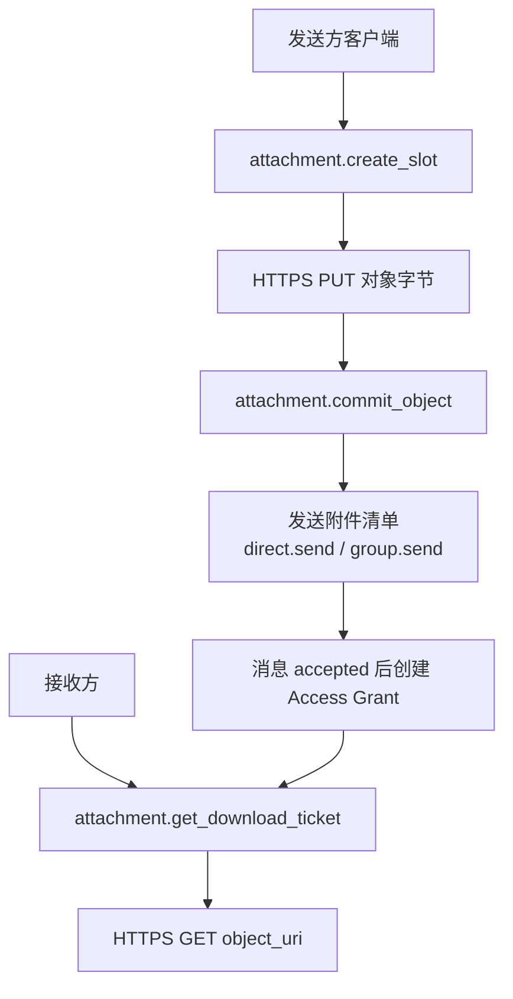
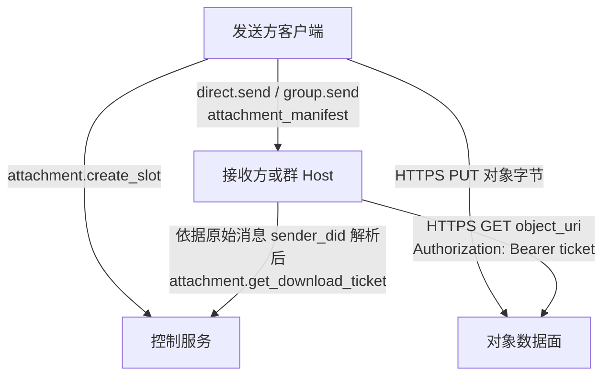
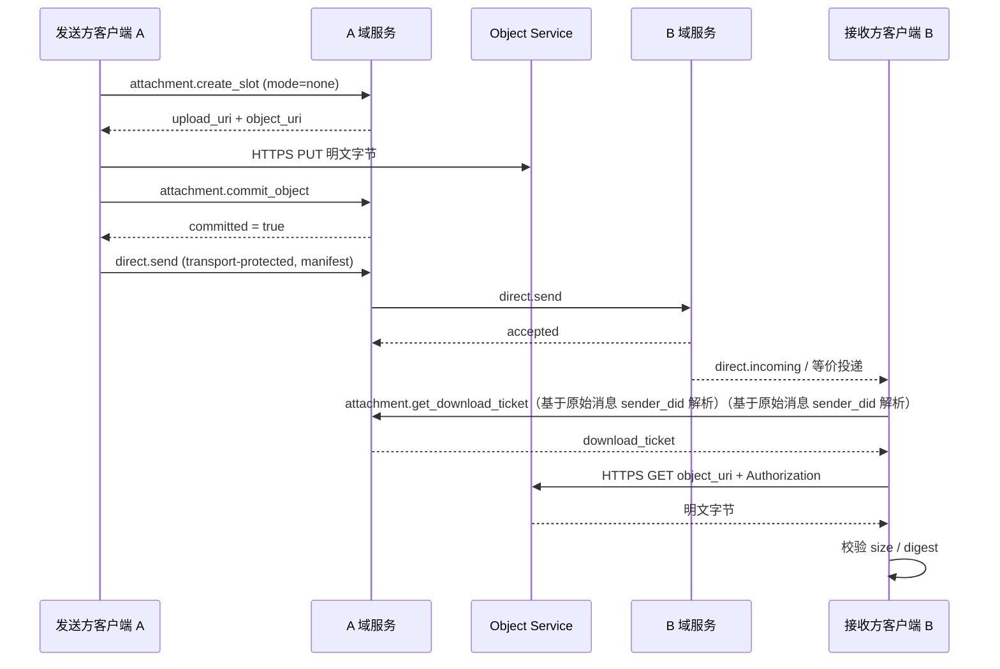
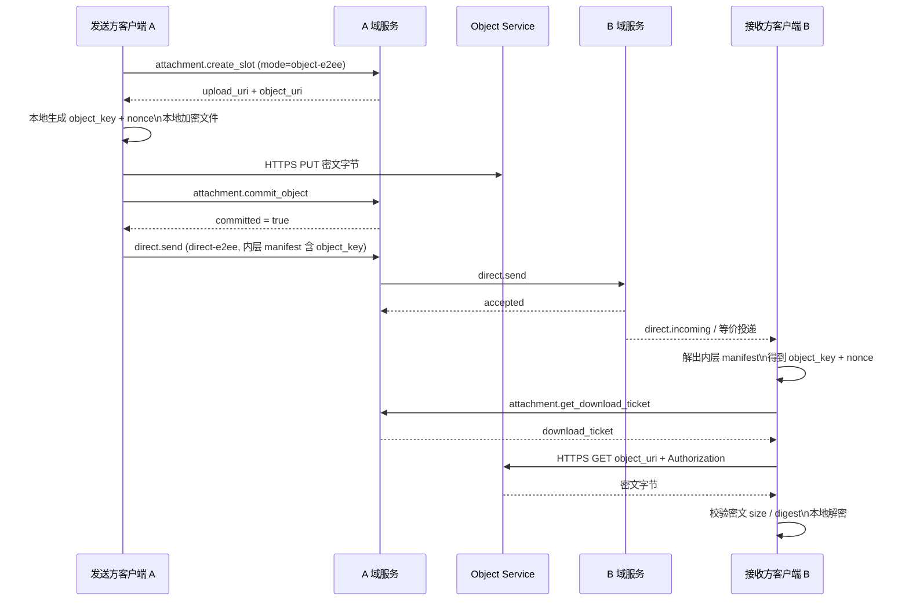
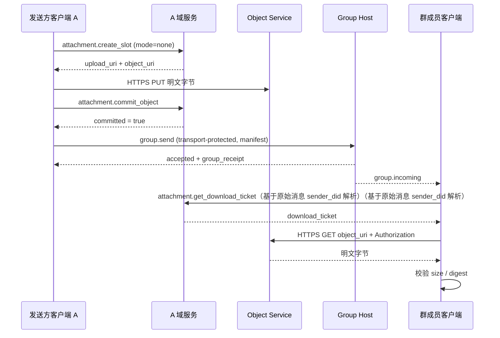
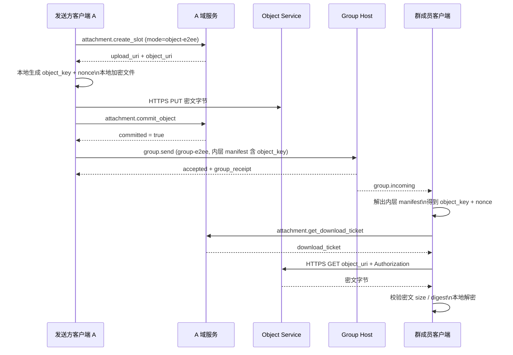
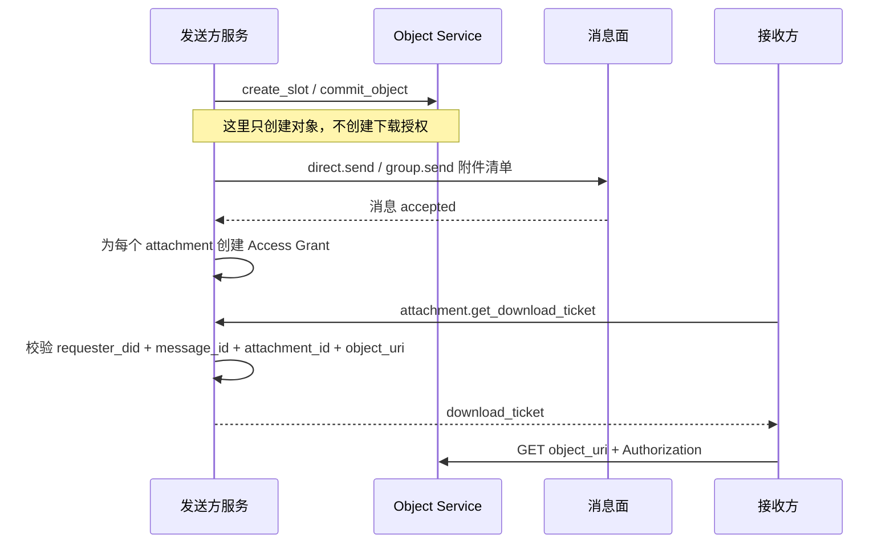
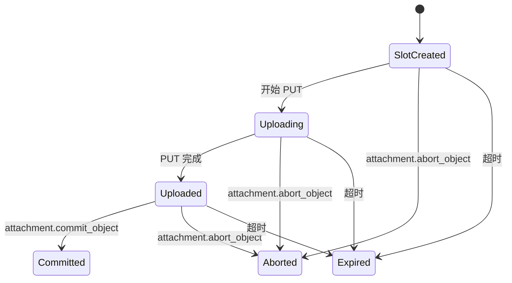

<!-- translation-review: full; source=chinese/deprecated/07-附件与对象传输.md -->
> 日本語参考訳（原文全文照合・校閲済み）。deprecated配下の旧版です。公開済み・1.1・v1は原文当時の状態です。現行仕様への変更を行わず、規範となる原文のコード例を保持しています。
> 原文: [chinese/deprecated/07-附件与对象传输.md](../../../chinese/deprecated/07-附件与对象传输.md) / 基準コミット: `0837cfdfaf4ddcf834f0890ddaf34fc4c824e066`

# ANPプロファイル7：添付とオブジェクト転送

- 文書ID：ANP-P7
- タイトル：添付とオブジェクト転送
- 状態：公開済み（Released）
- バージョン：1.1
- 原文言語：中国語／本ページは日本語参考訳
- 適用範囲：ANPにおける添付、大容量オブジェクト、メディアオブジェクトの相互運用の意味を定めます。直接・グループメッセージ、非E2EEとE2EEの両方のメッセージ内での格納に対応します。

---

## 1. 目的

本プロファイルは、添付とオブジェクト転送の意味を定義し、次を規定します。

1. 直接・グループメッセージでの添付の表現。
2. 非E2EEとE2EEの両方で共通の`attachment_manifest`を運ぶ方法。
3. メッセージ、制御、データという3プレーンへの分離。
4. 独立したHTTPSチャネルによるアップロードとダウンロード。
5. オブジェクト位置URI、短命なチケット、オブジェクト暗号化によるリンク漏えいのリスク軽減。
6. オブジェクト内容の完全性検証、アクセス制御、オブジェクト単位暗号化。
7. v1を明確・簡潔で実装可能に保つ方法。

本プロファイルでは、次を定義しません。

- オブジェクトストレージの内部実装。
- オブジェクトの審査やリスク管理の方針。
- ダウンロードチケットの具体的な暗号学的発行形式。
- ANPのドメイン間呼び出し経路によるバイトストリームの転送。
- `service-managed`オブジェクト暗号化モード。
- `wrapped_object_key`、ファイル単位の鍵合意、直接リンク、ミラーURI、インラインチケットなどの分岐経路。
- 専用サムネイル下位オブジェクトや、専用の分割マニフェスト。

---

## 2. 用語と規範キーワード

本書の**MUST**、**MUST NOT**、**REQUIRED**、**SHALL**、**SHALL NOT**、**SHOULD**、**SHOULD NOT**、**RECOMMENDED**、**NOT RECOMMENDED**、**MAY**、**OPTIONAL**は、大文字の場合に規範的な要求として解釈します。

用語を定義します。

- **添付**：ANPメッセージから参照する外部オブジェクト。ファイル、画像、音声、動画、任意のバイトストリームです。
- **オブジェクト**：添付に対応する実際のバイト内容。
- **添付メッセージ**：1つ以上の`attachment_manifest`を主なペイロードとして持つANPメッセージ。
- **添付マニフェスト**：位置、ダイジェスト、サイズ、メディア属性、暗号属性を説明する構造化オブジェクト。
- **Object Service**：添付の制御プレーンとオブジェクトのデータプレーンを担うサービス。
- **制御プレーン**：`attachment.create_slot`、`attachment.commit_object`、`attachment.abort_object`、`attachment.get_download_ticket`などのメソッドの層。
- **データプレーン**：独立したHTTPS PUT/GETでバイト列を転送する層。
- **メッセージプレーン**：`direct.send`、`group.send`で`attachment_manifest`を運ぶ層。
- **Upload Slot**：送信者がアップロードのために申請する、一時的なアップロード能力とメタデータの格納場所。
- **Committed Object**：アップロード済みで、メッセージから参照できるオブジェクト。
- **Object URI**：オブジェクトの位置URI。v1では位置を示すHTTPSアドレスであり、公開直接リンクと同じではありません。
- **Download Ticket**：ダウンロード時の一時アクセスチケット。
- **Access Grant**：添付メッセージの送信成功後、送信側サービスがその添付に設けるダウンロード認可記録。
- **オブジェクト単位の暗号化**：伝送の機密性だけに依存せず、送信者がローカルで行う内容の暗号化。
- **Object Key**：オブジェクトごとに送信者が個別生成するランダムな対称鍵。
- **Nonce**：オブジェクト暗号化のnonce。v1 MTIでは12バイトに固定。

---

## 3. 設計原則とv1での集約方針

### 3.1 3プレーンの分離

添付転送は、次の3プレーンとして理解しなければなりません（**MUST**）。

1. **メッセージ**：`attachment_manifest`を受信者へ送ることだけを担う。
2. **制御**：スロット申請、オブジェクト確定・破棄、チケット発行だけを担う。
3. **データ**：オブジェクトのPUT/GETだけを担う。

責任を混同してはなりません（**MUST NOT**）。特に、

- 制御メソッドは、添付の受信者への配送を担いません。
- メッセージプレーンは、バイト列の中継を担いません。
- データプレーンは、業務メッセージの配送を担いません。

### 3.2 v1の標準経路

v1の標準経路は次でなければなりません（**MUST**）。

1. `attachment.create_slot`を呼ぶ。
2. オブジェクト暗号化を使うなら、まずローカルでファイルを暗号化。
3. 独立したHTTPSの`PUT`でバイト列をアップロード。
4. `attachment.commit_object`を呼ぶ。
5. `direct.send`または`group.send`で添付マニフェストを送信。
6. 受信者は元の添付メッセージ送信者DIDから公開`ANPMessageService`を解決し、`attachment.get_download_ticket`でチケットを取得。
7. 独立したHTTPSの`GET object_uri`で、`Authorization`ヘッダーへチケットを付けてダウンロード。
8. ダイジェストを確認し、`object-e2ee`なら復号と復号後検証も行う。

次の概要は3プレーンをつなぎます。第5節の各場面で、オブジェクトが存在する、メッセージが送信された、ダウンロードが認可された、という3段階を区別するためです。



*図P7-1：添付の3プレーンと認可チェーンの概要（非規範的）。*

`create_slot` / `commit_object`はオブジェクトを作るだけです。受信者が実際にダウンロード可能になるのは、メッセージ受理後のAccess Grantと、後続のチケット取得フローによります。

### 3.3 オブジェクトモードは2種類だけ

v1の`encryption_info.mode`は、次の2値だけを認めなければなりません（**MUST**）。

- `none`
- `object-e2ee`

`service-managed`をプロトコルのフィールドへ出してはなりません（**MUST NOT**）。

ディスク暗号化、KMS、ストレージの保存時暗号化は実装の詳細であり、相互運用モードとしてモデル化してはなりません（**MUST NOT**）。

### 3.4 メッセージとオブジェクトの安全性を分離

添付には2層の安全性があります。

1. **メッセージの安全性**：マニフェストを運ぶ`transport-protected`、`direct-e2ee`、`group-e2ee`が決める。
2. **オブジェクトの安全性**：`encryption_info.mode`が決める。

v1の規則は次のとおりです。

- `transport-protected`で運ぶ添付は、`mode = "none"`としなければなりません（**MUST**）。
- `direct-e2ee`や`group-e2ee`で運ぶ添付は、`mode = "none"`または`mode = "object-e2ee"`を使ってもかまいません（**MAY**）。

### 3.5 オブジェクト鍵はE2EEマニフェストだけで配布

`mode = "object-e2ee"`の場合、

- `object_key_b64u`と`nonce_b64u`は、`direct-e2ee`または`group-e2ee`で保護するマニフェストだけに入れなければなりません（**MUST**）。
- `attachment.create_slot`や`attachment.commit_object`の制御要求へ`object_key_b64u`と`nonce_b64u`を入れてはなりません（**MUST NOT**）。
- v1は、独立したファイル単位の鍵合意を**定義しません**。

### 3.6 v1で明示的に除いた分岐経路

明確・簡潔で実装可能なv1を保つため、次の経路は本Profileへ**認めません**。

- `service-managed`
- `wrapped_object_key_b64u`
- `key_wrap_alg`
- インラインのDownload Ticket。
- 独自のチケット転送ヘッダーの交渉。
- 恒久的な公開直接リンク。
- ミラーURI。
- 専用の分割マニフェスト。
- 専用サムネイル下位オブジェクト。
- 業務メソッドでのバイト列の中継。

### 3.7 許可する組み合わせ

| 格納方式 | `meta.security_profile` | 許可する`encryption_info.mode` | マニフェストに`object_key_b64u`を入れられるか |
|---|---|---|---|
| Direct Base | `transport-protected` | `none` | 不可 |
| Group Base | `transport-protected` | `none` | 不可 |
| Direct E2EE | `direct-e2ee` | `none` / `object-e2ee` | 可 |
| Group E2EE | `group-e2ee` | `none` / `object-e2ee` | 可 |

---

## 4. プロファイル識別子と依存関係

### 4.1 プロファイル名

本プロファイルの標準名は次のとおりです。

`anp.attachment.v1`

### 4.2 依存関係

次に依存しなければなりません（**MUST**）。

- `anp.core.binding.v1`
- `anp.identity.discovery.v1`

次のProfileと併用してもかまいません（**MAY**）。

- `anp.direct.base.v1`
- `anp.group.base.v1`
- `anp.direct.e2ee.v1`
- `anp.group.e2ee.v1`

### 4.3 セキュリティプロファイル

新しい安全性のモードは定義せず、運ぶ業務Profileの次のモードを再利用します。

- `transport-protected`
- `direct-e2ee`
- `group-e2ee`

---

## 5. 添付転送のフロー図

### 5.1 全体の階層フロー



### 5.2 直接メッセージ／非暗号化添付



### 5.3 直接メッセージ／E2EE添付



### 5.4 グループメッセージ／非暗号化添付



### 5.5 グループメッセージ／E2EE添付



---

## 6. 格納規則：直接・グループ、暗号化・非暗号化

### 6.1 Direct Baseでの格納

`anp.direct.base.v1`で`direct.send`に添付マニフェストを入れる場合、

- `meta.profile`は`anp.direct.base.v1`でなければなりません（**MUST**）。
- `meta.security_profile`は`transport-protected`でなければなりません（**MUST**）。
- `meta.content_type`は`application/anp-attachment-manifest+json`（**MUST**）。
- `body.payload`は添付メッセージオブジェクト（**MUST**）。
- `auth.origin_proof`を持ち、P3の求めるSigned Direct Payload全体へバインド（**MUST**）。
- 各`attachment_manifest.encryption_info.mode`は`none`（**MUST**）。

### 6.2 Group Baseでの格納

`anp.group.base.v1`で`group.send`に添付マニフェストを入れる場合、

- `meta.profile`は`anp.group.base.v1`（**MUST**）。
- `meta.security_profile`は`transport-protected`でなければなりません（**MUST**）。
- `meta.content_type`は`application/anp-attachment-manifest+json`（**MUST**）。
- `body.payload`は添付メッセージオブジェクト（**MUST**）。
- `auth.origin_proof`を持ち、P4の求めるSigned Group Payload全体へバインド（**MUST**）。
- 成功応答で`group_receipt`を返すことが望まれます（**SHOULD**）。
- 各`attachment_manifest.encryption_info.mode`は`none`（**MUST**）。

### 6.3 Direct E2EEでの格納

`anp.direct.e2ee.v1`で送る場合、

- セッション確立後の通常経路では、外側の`meta.content_type`は`application/anp-direct-cipher+json`（**MUST**）。
- P5の初回initに業務メッセージを載せる経路なら、外側の`meta.content_type`に`application/anp-direct-init+json`を使ってもかまいません（**MAY**）。
- 暗号化前の`Application Plaintext`内部の業務オブジェクトにマニフェストを入れる（**MUST**）。
- 内側の`application_content_type`は`application/anp-attachment-manifest+json`（**MUST**）。

### 6.4 Group E2EEでの格納

`anp.group.e2ee.v1`で送る場合、

- 外側の`meta.content_type`は`application/anp-group-cipher+json`に固定（**MUST**）。
- 外側の`body`へ平文マニフェストを直接載せない（**MUST NOT**）。
- 暗号化前の`Group Application Plaintext`内部の業務オブジェクトにマニフェストを入れる（**MUST**）。
- 内側の`application_content_type`は`application/anp-attachment-manifest+json`（**MUST**）。

---

## 7. `attachment_message`と`attachment_manifest`

### 7.1 添付メッセージの最上位構造

推奨構造は次のとおりです。

```json
{
  "attachments": [
    {
      "attachment_id": "att-001",
      "filename": "report.pdf",
      "mime_type": "application/pdf",
      "size": "1048576",
      "digest": {
        "alg": "sha-256",
        "value_b64u": "BASE64URL_DIGEST"
      },
      "access_info": {
        "object_uri": "https://objects.example.com/objects/obj-001"
      },
      "encryption_info": {
        "mode": "none"
      }
    }
  ],
  "caption": "附件说明",
  "primary_attachment_id": "att-001"
}
```

規則：

- `attachments`を持ち、空でないこと（**MUST**）。
- `caption`は任意（**MAY**）。
- `primary_attachment_id`は任意（**MAY**）。あれば`attachments`内の既存`attachment_id`を指すこと（**MUST**）。

### 7.2 `attachment_id`の範囲

- `attachment_id`は1つの添付メッセージ内で一意（**MUST**）。
- メッセージをまたぐ`attachment_id`のグローバルな一意性は**保証しません**。
- チケットのバインド、認可・監査記録には、`attachment_id`単独でなく、`(message_id, attachment_id)`または`(object_uri, message_id, attachment_id)`を使う（**MUST**）。

### 7.3 個々の`attachment_manifest`

各`attachment_manifest`には次が必要です（**MUST**）。

- `attachment_id`
- `mime_type`
- `size`
- `digest`
- `access_info`
- `encryption_info`

各`attachment_manifest`には次を含めてもかまいません（**MAY**）。

- `filename`
- `media_info`

フィールドの説明：

- `filename`：表示用ファイル名（**MAY**）。
- `mime_type`：元のファイルのMIME型（**MUST**）。
- `size`：アップロードするバイト列の長さ。10進文字列（**MUST**）。
- `digest`：アップロードするバイト列のダイジェスト（**MUST**）。
- `access_info`：ダウンロード先の位置情報（**MUST**）。
- `encryption_info`：オブジェクト単位の暗号化情報（**MUST**）。
- `media_info`：画像・音声・動画などの補足説明（**MAY**）。

### 7.4 `digest`

`digest`には次が必要です（**MUST**）。

- `alg`
- `value_b64u`

規則：

- v1の`digest.alg`は`sha-256`に固定（**MUST**）。
- `digest.value_b64u`はアップロードするバイト列のSHA-256ダイジェスト（**MUST**）。
- `encryption_info.mode = "none"`なら平文のダイジェスト。
- `encryption_info.mode = "object-e2ee"`なら暗号文のダイジェスト。

### 7.5 `access_info`

`access_info`の構造：

```json
{
  "object_uri": "https://objects.example.com/objects/obj-001"
}
```

規則：

1. `object_uri`は`https://`のURL（**MUST**）。
2. `object_uri`は位置情報であり、恒久的な公開直接リンクではありません。
3. ダウンロード前に`attachment.get_download_ticket`を呼ぶ（**MUST**）。
4. 元の添付メッセージ送信者DIDから、公開`ANPMessageService`を解決（**MUST**）。
5. グループの場合も、添付を含む元の送信者（`group.incoming.meta.sender_did`など）からDIDを取る（**MUST**）。
6. 送信者の公開サービスに対応する`serviceDid`へ`attachment.get_download_ticket`を送る（**MUST**）。
7. `object_uri`へ`GET`し、`Authorization`ヘッダーでチケットを送る（**MUST**）。
8. `object_uri`のURLドメイン名だけから制御プレーンサービスを推測しない（**MUST NOT**）。

### 7.6 `media_info`

`media_info`は画像・音声・動画などに使えます。推奨フィールド：

- `width`
- `height`
- `duration_ms`
- `codec`

数値フィールドは10進文字列を使わなければなりません（**MUST**）。

### 7.7 サムネイルと分割

v1は専用の`thumbnail`も`chunking_info`も定義しません。

必要なサムネイルは通常の添付として送ることが望まれます（**SHOULD**）。

大容量ファイルの分割はHTTPアップロード実装内で行うことが望まれます（**SHOULD**）。マニフェスト構造は変わりません。

---

## 8. オブジェクト単位の暗号化

### 8.1 `encryption_info`

`encryption_info`は、次の2構造のいずれかでなければなりません（**MUST**）。

非暗号化オブジェクト：

```json
{
  "mode": "none"
}
```

オブジェクト単位で暗号化する場合：

```json
{
  "mode": "object-e2ee",
  "object_cipher": "chacha20-poly1305",
  "object_key_b64u": "BASE64URL_32_BYTES",
  "nonce_b64u": "BASE64URL_12_BYTES",
  "plaintext_size": "1048576"
}
```

規則：

1. `mode`は`none`か`object-e2ee`（**MUST**）。
2. `mode = "none"`は、送信者がローカルで内容を暗号化していないことを示します。
3. `mode = "object-e2ee"`は、ローカルで暗号化したバイト列をアップロードすることを示します。
4. `transport-protected`で運ぶ場合、`mode`は`none`（**MUST**）。
5. `transport-protected`のマニフェストに`object_key_b64u`と`nonce_b64u`を載せない（**MUST NOT**）。
6. `service-managed`、鍵ラッピング、ファイル単位の鍵合意は対象外です。

### 8.2 `object-e2ee`の必須実装アルゴリズム

v1の`object-e2ee`のMTIは次でなければなりません（**MUST**）。

- `object_cipher = "chacha20-poly1305"`
- `object_key_b64u`：32バイトのランダムな対称鍵。
- `nonce_b64u`：12バイトのランダムnonce。
- `plaintext_size`：元のファイルのバイト長。10進文字列。

### 8.3 送信者の暗号化手順（規範的）

`encryption_info.mode = "object-e2ee"`では、次を行わなければなりません（**MUST**）。

1. 元のファイルのバイト列を`P`とする。
2. 新しいランダムな32バイトの鍵`K`を生成。
3. 新しいランダムな12バイトのnonce `N`を生成。
4. `AAD = 空字节串`（AADは空バイト列）とする。
5. 計算：

```text
C = ChaCha20-Poly1305-Encrypt(
      key = K,
      nonce = N,
      aad = "",
      plaintext = P
    )
```

6. アップロードするバイト列は`C`（**MUST**）。
7. `attachment_manifest.size`は`len(C)`に等しい10進文字列（**MUST**）。
8. `attachment_manifest.digest`は`sha-256(C)`（**MUST**）。
9. `encryption_info.plaintext_size`は`len(P)`に等しい10進文字列（**MUST**）。
10. `mime_type`は暗号文ではなく元のファイルのMIME型を維持（**MUST**）。

追加要件：

- Committed Objectごとに新しいランダムな`K`を使う（**MUST**）。
- 同じ`(K, N)`を再利用しない（**MUST NOT**）。
- 同じ内容の再送でも、新たな`K`と`N`を生成することが望ましい（**SHOULD**）。
- `object_key_b64u`をP5のラチェット鍵から直接取らず（**MUST NOT**）、P6のMLS epoch secretなどのセッション鍵からも直接取らない（**MUST NOT**）。

### 8.4 `expected_size`と`plaintext_size`

v1 MTIの`chacha20-poly1305`では、

- アップロードサイズ = 元ファイルサイズ + 16バイトの認証タグ。
- `attachment.create_slot`の`expected_size`は、元のファイルサイズではなくアップロードするバイト列のサイズにすることが望まれます（**SHOULD**）。
- `mode = "object-e2ee"`なら、後で`encryption_info.plaintext_size`を書けるよう、元のサイズも保存することが望まれます（**SHOULD**）。

### 8.5 受信者の検証・復号手順（規範的）

バイト列を取得した受信者は、

1. まず長さが`attachment_manifest.size`と等しいか検証（**MUST**）。
2. `sha-256(下载字节)`（ダウンロードしたバイト列のSHA-256）を計算し、`attachment_manifest.digest`と比較（**MUST**）。
3. `encryption_info.mode = "none"`なら、検証成功後に上位層へ渡せます。
4. `encryption_info.mode = "object-e2ee"`なら、次を使う（**MUST**）。

```text
P = ChaCha20-Poly1305-Decrypt(
      key = object_key_b64u,
      nonce = nonce_b64u,
      aad = "",
      ciphertext = downloaded_bytes
    )
```

5. 復号失敗なら添付を拒否（**MUST**）。
6. 復号成功なら`len(P)`と`plaintext_size`の一致を検証（**MUST**）。
7. 検証後に平文を上位業務層へ渡せます。

### 8.6 オブジェクト鍵の配布規則

v1の標準鍵配布経路は1つだけです。

- `direct-e2ee`または`group-e2ee`のメッセージでは、内側の`attachment_manifest`へ`object_key_b64u`と`nonce_b64u`を直接入れてもかまいません（**MAY**）。
- 受信者はE2EEメッセージから鍵を得て、制御プレーンでチケットを取得し、データプレーンで暗号文をダウンロードします。

これは次を意味します。

- v1では、添付専用の複雑な鍵合意を別途設計する**必要はありません**。
- グループメッセージを復号できる者は、オブジェクト鍵も取得できます。
- v1は、取得済み権利の**遡及的な撤回を保証しません**。削除メンバーが鍵と内容をすでに取得していた場合、それを後から消去するとは約束しません。

---

## 9. アクセス認可とDownload Ticket

### 9.1 チケットの目的

チケットは正当な受信者の転送を絶対に防ぐためではなく、次を目的とします。

1. マニフェストだけを持つ第三者の直接ダウンロードを防ぐ。
2. `object_uri`が長期の公開リンクになるのを防ぐ。
3. 明確な要求者とメッセージコンテキストへ認可を制約。
4. 監査、レート制限、Object Serviceの認可取り消しの出発点を提供。

### 9.2 Access Grantの意味

`attachment.create_slot`と`attachment.commit_object`はオブジェクトを作る**だけ**で、受信者へダウンロード権限を与えません。

メッセージ受信者のダウンロード可否は、Access Grantで決めなければなりません（**MUST**）。

添付を含む`direct.send`や`group.send`を送信側サービスまたはGroup Hostが受理したら、各添付のAccess Grantを作成しなければなりません（**MUST**）。

Access Grantは少なくとも次へバインドします（**MUST**）。

- `message_id`
- `attachment_id`
- `object_uri`
- `message_security_profile`
- 直接メッセージでは`message_target_did`、グループでは`group_did`。

### 9.3 `intended_target`の境界

`attachment.create_slot.body.intended_target`は、アップロード段階のポリシーヒントにすぎません。

`intended_target`は、

- サイズ、種別、保持ポリシーの事前判断に使ってもかまいません（**MAY**）。
- 単独でダウンロード認可の根拠にしてはなりません（**MUST NOT**）。

実際の認可の根拠は、送信成功によるAccess Grantから得なければなりません（**MUST**）。

### 9.4 チケットのバインド

v1のチケットは少なくとも次へバインドしなければなりません（**MUST**）。

- `attachment_id`
- `object_uri`
- `requester_did`
- `message_id`
- `message_security_profile`
- 直接メッセージでは`message_target_did`、グループでは`group_did`。
- `expires_at`

### 9.5 チケットの有効期間と使用

- 短命なチケットが望ましい（**SHOULD**）。
- 既定の有効期間は5分を超えないことが望ましい（**SHOULD NOT**）。
- 特に機微な対象では使い捨てを使ってもかまいません（**MAY**）。
- HTTPの`Authorization`ヘッダーで運ぶ（**MUST**）。
- URLのクエリーパラメーターで運ばない（**MUST NOT**）。

v1の固定ダウンロード方式：

```http
GET {object_uri}
Authorization: Bearer {download_ticket}
```

### 9.6 チケット発行時の検証

`attachment.get_download_ticket`では、次を確認しなければなりません（**MUST**）。

1. `meta.target.kind = "service"`
2. `meta.target.did`は元の添付送信者DIDから解決した公開`ANPMessageService.serviceDid`と一致（**MUST**）。
3. `requester_did = meta.sender_did`
4. `(message_id, attachment_id, object_uri)`のAccess Grantが存在。
5. `message_security_profile`がAccess Grantと一致。
6. 直接メッセージでは、`message_target_did`が存在しポリシーに適合。
7. グループでは、`group_did`が存在し、`requester_did`が現在もアクセス方針に適合。

### 9.7 サービス間の同期

v1は内部サービス間のAccess Grant同期プロトコルを**別途標準化しません**。

既定経路では、元の添付送信者の公開`ANPMessageService`がチケットを発行します。内部で別のObject Serviceへ振り分けるかは実装の詳細です。部品を分離する場合、ローカル状態や内部同期から必要なAccess Grantを公開サービスが取得できるようにしなければなりません（**MUST**）。

### 9.8 メンバー変更後のアクセス境界

v1は、**権利の遡及的な撤回を保証しません**。

すなわち、

- 現在のグループ状態に基づき、削除メンバーへの新規チケット発行を拒否することが望まれます（**SHOULD**）。
- バイト列、鍵、ダウンロード内容が正当なメンバーへすでに届いていた場合、取得済みアクセス能力を後から撤回するとは**約束しません**。

オブジェクトの存在は、ダウンロード可能性を意味しません。次の図は確定、メッセージ受理、Access Grant作成、チケット発行、ダウンロードをつなぎ、認可を正しく適用できるようにします。



*図P7-2：Access GrantとDownload Ticketの認可チェーン（非規範的）。*

`attachment.get_download_ticket`の認可は、`object_uri`やアップロード時の`intended_target`だけでなく、メッセージコンテキストとAccess Grantに基づくことが望まれます。

---

## 10. 制御プレーンのメソッド

### 10.1 一般事項

これらはオブジェクト制御用であり、`direct.send`や`group.send`の成功の意味を変更**しません**。

既定では次で動作します。

- `meta.profile = "anp.attachment.v1"`
- `meta.security_profile = "transport-protected"`

次の認証モデルを使います。

1. `attachment.create_slot`
2. `attachment.commit_object`
3. `attachment.abort_object`
4. `attachment.get_download_ticket`

すべて**service-scoped**の制御メソッドです。

したがって、

- `meta.target.kind`は`service`（**MUST**）。
- `meta.target.did`は宛先の公開`ANPMessageService.serviceDid`（**MUST**）。
- 外側のドメイン間認証は、P8の`serviceDid + HTTP Message Signatures`による。
- v1は、Object Serviceによる最終受信者の`origin_proof`の再検証を要求**しません**。

Upload SlotとCommitted Objectは同じ状態ではありません。次の図は作成、アップロード、確定、中止、失効を同じライフサイクルへまとめます。



*図P7-3：Upload Slot／Objectのライフサイクル（非規範的）。*

`object_uri`の取得を、メッセージからすでに参照可能という意味に解釈すべきではありません。`Committed`状態になって初めて、マニフェストから正当に参照できます。

### 10.2 `attachment.create_slot`

#### 10.2.1 意味

アップロードするオブジェクトのUpload Slotを申請します。

#### 10.2.2 要求の要件

次を使用しなければなりません（**MUST**）。

- `meta.target.kind = "service"`
- `meta.target.did = 目标公开 ANPMessageService.serviceDid`（宛先の公開serviceDid）

`body`には次が必要です（**MUST**）。

- `attachment_id`
- `intended_message_security_profile`
- `object_encryption_mode`

`body`へ次を含めることが望まれます（**SHOULD**）。

- `expected_size`
- `mime_type`

`body`へ次を含めてもかまいません（**MAY**）。

- `filename`
- `expected_digest`
- `intended_target`

フィールドの規則：

- `attachment_id`：文字列。
- `intended_message_security_profile`: `transport-protected` / `direct-e2ee` / `group-e2ee`
- `object_encryption_mode`: `none` / `object-e2ee`
- `expected_size`：アップロードするバイト列の長さ。10進文字列。
- `expected_digest`：アップロードするバイト列のダイジェスト。
- `intended_target`：オブジェクト。推奨構造：

```json
{
  "kind": "agent | group",
  "did": "did:example:..."
}
```

制約：

1. `intended_message_security_profile = "transport-protected"`なら、`object_encryption_mode`は`none`（**MUST**）。
2. `object_encryption_mode = "object-e2ee"`なら、`expected_size`は暗号文の長さが望ましい（**SHOULD**）。
3. `intended_target`はヒントにすぎず、単独で認可を構成しない（**MUST NOT**）。

#### 10.2.3 成功応答

成功応答には少なくとも次が必要です（**MUST**）。

- `attachment_id`
- `slot_id`
- `upload_uri`
- `object_uri`
- `commit_token`
- `expires_at`

成功応答に次を含めてもかまいません（**MAY**）。

- `upload_headers`

`attachment_manifest.access_info`を構築する際、`object_uri`は`attachment.create_slot`または`attachment.commit_object`の成功応答から直接取ることが望まれます（**SHOULD**）。受信者はダウンロード前に、元の添付送信者DIDからチケットサービスを発見します。

### 10.3 `attachment.commit_object`

#### 10.3.1 意味

アップロード済みで、参照可能なオブジェクトとして確定できるとObject Serviceへ通知します。

#### 10.3.2 要求の要件

次を使用しなければなりません（**MUST**）。

- `meta.target.kind = "service"`
- `meta.target.did = 目标公开 ANPMessageService.serviceDid`（宛先の公開serviceDid）

`body`には少なくとも次が必要です（**MUST**）。

- `attachment_id`
- `slot_id`
- `commit_token`
- `size`
- `digest`
- `object_encryption_mode`

`body`へ次を含めてもかまいません（**MAY**）。

- `plaintext_size`
- `media_info`

規則：

1. `digest.alg`は`sha-256`（**MUST**）。
2. `object_encryption_mode = "object-e2ee"`なら、`plaintext_size`が必要（**MUST**）。
3. `attachment.commit_object`で`object_key_b64u`を送らない（**MUST NOT**）。
4. `attachment.commit_object`で`nonce_b64u`を送らない（**MUST NOT**）。
5. `attachment.commit_object`の成功は、受信者への認可と**同じではありません**。実際の認可は、その後のメッセージ送信成功によるAccess Grant次第です。

#### 10.3.3 成功応答

成功応答には少なくとも次が必要です（**MUST**）。

- `committed`
- `attachment_id`
- `object_uri`
- `committed_at`

ここで、

- `committed`は`true`（**MUST**）。

### 10.4 `attachment.abort_object`

#### 10.4.1 意味

未完了または不要になったUpload Slotを中止します。

#### 10.4.2 要求の要件

次を使用しなければなりません（**MUST**）。

- `meta.target.kind = "service"`
- `meta.target.did = 目标公开 ANPMessageService.serviceDid`（宛先の公開serviceDid）

`body`には少なくとも次が必要です（**MUST**）。

- `attachment_id`
- `slot_id`

#### 10.4.3 成功応答

成功応答には少なくとも次が必要です（**MUST**）。

- `aborted`
- `attachment_id`
- `aborted_at`

ここで、

- `aborted`は`true`（**MUST**）。

### 10.5 `attachment.get_download_ticket`

#### 10.5.1 意味

アクセスにチケットが必要な場合、受信者が一時チケットをこのメソッドで取得します。

#### 10.5.2 要求の要件

次を使用しなければなりません（**MUST**）。

- `meta.target.kind = "service"`
- `meta.target.did`は元の添付送信者DIDから解決する公開`ANPMessageService.serviceDid`と一致（**MUST**）。

`body`には少なくとも次が必要です（**MUST**）。

- `attachment_id`
- `object_uri`
- `requester_did`
- `message_security_profile`
- `message_id`

コンテキストに応じて、次のどちらかを追加します。

- 直接メッセージ：`message_target_did`
- グループメッセージ：`group_did`

`body`へ次を含めてもかまいません（**MAY**）。

- `one_time`

フィールドの規則：

- `requester_did`は`meta.sender_did`（**MUST**）。
- `message_security_profile`は添付を運んだメッセージのモードであり、現在の制御呼び出しの`meta.security_profile`ではありません。
- `message_target_did`は元の直接メッセージの宛先Agent DID。
- `group_did`は元のグループメッセージの所属Group DID。
- 送信前に、元の添付送信者DIDから公開`ANPMessageService`を解決する（**MUST**）。グループでも、`group_did`でなく元の送信者DIDを使います。

#### 10.5.3 成功応答

成功応答には少なくとも次が必要です（**MUST**）。

- `download_ticket_b64u`
- `expires_at`
- `ticket_binding`

`ticket_binding`には少なくとも次が必要です（**MUST**）。

- `attachment_id`
- `object_uri`
- `requester_did`
- `message_id`
- `message_security_profile`

コンテキストに応じて、次のどちらかを追加します。

- `message_target_did`
- `group_did`

---

## 11. データプレーンの規則

### 11.1 アップロード

別のHTTPSチャネルで、`upload_uri`へ`PUT`しなければなりません（**MUST**）。

規則：

- `object_encryption_mode = "none"`なら平文バイト列をアップロード。
- `object_encryption_mode = "object-e2ee"`なら暗号文バイト列をアップロード。
- `upload_headers`を付けてもかまいません（**MAY**）。
- ANPのJSON-RPC業務メッセージへバイト列を埋め込んではなりません（**MUST NOT**）。

### 11.2 ダウンロード

別のHTTPSチャネルで、`object_uri`へ`GET`しなければなりません（**MUST**）。

固定形式：

```http
GET {object_uri}
Authorization: Bearer {download_ticket}
```

通常の転送経路として、ANPのドメイン間サービス呼び出し経路でバイト列を中継してはなりません（**MUST NOT**）。

### 11.3 ダウンロード後の検証

少なくとも次を検証しなければなりません（**MUST**）。

1. バイト長。
2. ダイジェスト。
3. `mode = "object-e2ee"`なら、復号と`plaintext_size`の検証。

重要な検証がどれか失敗したら、

- 有効な添付として上位アプリケーションへ渡さない（**MUST NOT**）。
- 診断情報を記録することが望ましい（**SHOULD**）。

---

## 12. エラー条件と推奨コード

添付・転送エラーには`6000-6013`を固定で割り当てます。応答に`error.data.anp_code`が必要です（**MUST**）。

| `code` | `anp_code` | 意味 |
|---|---|---|
| 6000 | `anp.attachment.slot_not_found` | スロットがないか、`slot_id`がコンテキストと不一致 |
| 6001 | `anp.attachment.slot_expired` | スロットが失効し、アップロード・確定・中止ができない |
| 6002 | `anp.attachment.commit_token_invalid` | 確定トークンが欠落、不正、検証失敗、またはコンテキストと不一致 |
| 6003 | `anp.attachment.object_too_large` | サイズがサービス・ポリシー制限や許容範囲を超過 |
| 6004 | `anp.attachment.unsupported_mime_type` | `mime_type`を受け付けない |
| 6005 | `anp.attachment.grant_not_found` | Access Grantがないか、認可が未成立 |
| 6006 | `anp.attachment.unauthorized_requester` | `requester_did`が方針・宛先・グループ制約に不適合 |
| 6007 | `anp.attachment.download_ticket_invalid` | チケットが欠落、不正、署名検証失敗、解析不能、または無効化済み |
| 6008 | `anp.attachment.ticket_binding_mismatch` | チケットの対象・メッセージ・要求者の関連付けが実要求と不一致 |
| 6009 | `anp.attachment.ticket_expired` | チケットが期限切れ |
| 6010 | `anp.attachment.digest_mismatch` | アップロード・ダウンロード後のダイジェストが期待値と不一致 |
| 6011 | `anp.attachment.decrypt_failed` | `object-e2ee`の復号失敗 |
| 6012 | `anp.attachment.object_unavailable` | 未確定、中止、削除、または一時的に利用不能 |
| 6013 | `anp.attachment.encryption_policy_violation` | 暗号モードとメッセージの安全性の組み合わせが不正、または要件違反 |

エラーの`error.data`には、次を提供することが望まれます（**SHOULD**）。

- `attachment_id`
- `slot_id`
- `object_uri`
- `message_id`
- `expected_digest`

## 13. 最低相互運用要件

本プロファイルに適合する実装は、少なくとも次に対応しなければなりません（MUST）。

1. `attachment.create_slot`
2. `attachment.commit_object`
3. `attachment.abort_object`
4. `attachment.get_download_ticket`
5. `application/anp-attachment-manifest+json`
6. `attachment_message.attachments`
7. `attachment_manifest`の`attachment_id`、`mime_type`、`size`、`digest`、`access_info`、`encryption_info`。
8. `access_info.object_uri`
9. 元の添付送信者DIDからの`attachment.get_download_ticket`宛先発見。
10. `digest.alg = sha-256`
11. 独立したHTTPSの`PUT upload_uri`。
12. 独立したHTTPSの`GET object_uri`。
13. `Authorization: Bearer {download_ticket}`方式。
14. すべての`attachment.*`制御メソッドで`target.kind = "service"`。
15. 業務メッセージやドメイン間サービス呼び出しでバイト列を中継しない。
16. `transport-protected`では`mode = "none"`。

E2EE添付への対応を表明する実装は、さらに次へ対応しなければなりません（MUST）。

17. `mode = "object-e2ee"`。
18. 本書の`chacha20-poly1305`による暗号化。
19. E2EEマニフェスト内での`object_key_b64u`と`nonce_b64u`の直接配布。
20. ダウンロード後の暗号文ダイジェスト検証とローカル復号。
21. v1が取得済み権利の遡及的撤回を保証しないという境界を遵守。

---

## 14. 例

### 14.1 `attachment.create_slot`要求

```json
{
  "jsonrpc": "2.0",
  "id": "req-70001",
  "method": "attachment.create_slot",
  "params": {
    "meta": {
      "anp_version": "1.0",
      "profile": "anp.attachment.v1",
      "security_profile": "transport-protected",
      "sender_did": "did:example:agent-a",
      "target": {
        "kind": "service",
        "did": "did:example:domain-a"
      },
      "operation_id": "op-70001",
      "created_at": "2026-03-29T14:00:00Z"
    },
    "body": {
      "attachment_id": "att-001",
      "expected_size": "1048592",
      "mime_type": "application/pdf",
      "filename": "report.pdf",
      "intended_message_security_profile": "direct-e2ee",
      "intended_target": {
        "kind": "agent",
        "did": "did:example:agent-b"
      },
      "object_encryption_mode": "object-e2ee"
    }
  }
}
```

### 14.2 `attachment.create_slot`成功応答

```json
{
  "jsonrpc": "2.0",
  "id": "req-70001",
  "result": {
    "attachment_id": "att-001",
    "slot_id": "slot-70001",
    "upload_uri": "https://objects.example.com/upload/slot-70001",
    "upload_headers": {
      "Content-Type": "application/octet-stream"
    },
    "object_uri": "https://objects.example.com/objects/obj-abc",
    "commit_token": "ct-abc-123",
    "expires_at": "2026-03-29T14:15:00Z"
  }
}
```

### 14.3 `attachment.commit_object`要求

```json
{
  "jsonrpc": "2.0",
  "id": "req-70002",
  "method": "attachment.commit_object",
  "params": {
    "meta": {
      "anp_version": "1.0",
      "profile": "anp.attachment.v1",
      "security_profile": "transport-protected",
      "sender_did": "did:example:agent-a",
      "target": {
        "kind": "service",
        "did": "did:example:domain-a"
      },
      "operation_id": "op-70002",
      "created_at": "2026-03-29T14:03:00Z"
    },
    "body": {
      "attachment_id": "att-001",
      "slot_id": "slot-70001",
      "commit_token": "ct-abc-123",
      "size": "1048592",
      "digest": {
        "alg": "sha-256",
        "value_b64u": "BASE64URL_SHA256_OF_CIPHERTEXT"
      },
      "object_encryption_mode": "object-e2ee",
      "plaintext_size": "1048576"
    }
  }
}
```

### 14.4 `attachment.commit_object`成功応答

```json
{
  "jsonrpc": "2.0",
  "id": "req-70002",
  "result": {
    "committed": true,
    "attachment_id": "att-001",
    "object_uri": "https://objects.example.com/objects/obj-abc",
    "committed_at": "2026-03-29T14:03:05Z"
  }
}
```

### 14.5 `attachment.abort_object`要求

```json
{
  "jsonrpc": "2.0",
  "id": "req-70003",
  "method": "attachment.abort_object",
  "params": {
    "meta": {
      "anp_version": "1.0",
      "profile": "anp.attachment.v1",
      "security_profile": "transport-protected",
      "sender_did": "did:example:agent-a",
      "target": {
        "kind": "service",
        "did": "did:example:domain-a"
      },
      "operation_id": "op-70003",
      "created_at": "2026-03-29T14:04:00Z"
    },
    "body": {
      "attachment_id": "att-abort-001",
      "slot_id": "slot-abort-001"
    }
  }
}
```

### 14.6 `attachment.abort_object`成功応答

```json
{
  "jsonrpc": "2.0",
  "id": "req-70003",
  "result": {
    "aborted": true,
    "attachment_id": "att-abort-001",
    "aborted_at": "2026-03-29T14:04:01Z"
  }
}
```

### 14.7 `attachment.get_download_ticket`要求（直接メッセージ・E2EE）

```json
{
  "jsonrpc": "2.0",
  "id": "req-70004",
  "method": "attachment.get_download_ticket",
  "params": {
    "meta": {
      "anp_version": "1.0",
      "profile": "anp.attachment.v1",
      "security_profile": "transport-protected",
      "sender_did": "did:example:agent-b",
      "target": {
        "kind": "service",
        "did": "did:example:domain-a"
      },
      "operation_id": "op-70004",
      "created_at": "2026-03-29T14:10:00Z"
    },
    "body": {
      "attachment_id": "att-001",
      "object_uri": "https://objects.example.com/objects/obj-abc",
      "requester_did": "did:example:agent-b",
      "message_security_profile": "direct-e2ee",
      "message_id": "msg-70008",
      "message_target_did": "did:example:agent-b",
      "one_time": true
    }
  }
}
```

### 14.8 `attachment.get_download_ticket`成功応答

```json
{
  "jsonrpc": "2.0",
  "id": "req-70004",
  "result": {
    "download_ticket_b64u": "BASE64URL_TICKET",
    "expires_at": "2026-03-29T14:15:00Z",
    "ticket_binding": {
      "attachment_id": "att-001",
      "object_uri": "https://objects.example.com/objects/obj-abc",
      "requester_did": "did:example:agent-b",
      "message_id": "msg-70008",
      "message_security_profile": "direct-e2ee",
      "message_target_did": "did:example:agent-b"
    }
  }
}
```

### 14.9 HTTPSアップロード（データプレーン）

```http
PUT /upload/slot-70001 HTTP/1.1
Host: objects.example.com
Content-Type: application/octet-stream
Content-Length: 1048592

<encrypted object bytes>
```

### 14.10 `direct.send`での非暗号化マニフェスト（Direct Base）

```json
{
  "jsonrpc": "2.0",
  "id": "req-70005",
  "method": "direct.send",
  "params": {
    "meta": {
      "profile": "anp.direct.base.v1",
      "security_profile": "transport-protected",
      "sender_did": "did:example:agent-a",
      "target": {
        "kind": "agent",
        "did": "did:example:agent-b"
      },
      "operation_id": "msg-70005",
      "message_id": "msg-70005",
      "created_at": "2026-03-29T14:20:00Z",
      "content_type": "application/anp-attachment-manifest+json"
    },
    "auth": {
      "scheme": "anp-rfc9421-origin-proof-v1",
      "origin_proof": {
        "contentDigest": "sha-256=:BASE64_SHA256_OF_SIGNED_DIRECT_PAYLOAD:",
        "signatureInput": "sig1=(\"@method\" \"@target-uri\" \"content-digest\");created=1774794000;expires=1774794060;nonce=\"n-70005\";keyid=\"did:example:agent-a#key-1\"",
        "signature": "sig1=:BASE64_SIGNATURE:"
      }
    },
    "body": {
      "payload": {
        "attachments": [
          {
            "attachment_id": "att-plain-001",
            "filename": "report.pdf",
            "mime_type": "application/pdf",
            "size": "1048576",
            "digest": {
              "alg": "sha-256",
              "value_b64u": "BASE64URL_SHA256_OF_PLAINTEXT"
            },
            "access_info": {
              "object_uri": "https://objects.example.com/objects/obj-plain-001"
            },
            "encryption_info": {
              "mode": "none"
            }
          }
        ],
        "caption": "请查收附件",
        "primary_attachment_id": "att-plain-001"
      }
    }
  }
}
```

### 14.11 `group.send`での非暗号化マニフェスト（Group Base）

```json
{
  "jsonrpc": "2.0",
  "id": "req-70006",
  "method": "group.send",
  "params": {
    "meta": {
      "profile": "anp.group.base.v1",
      "security_profile": "transport-protected",
      "sender_did": "did:example:agent-a",
      "target": {
        "kind": "group",
        "did": "did:example:group-123"
      },
      "operation_id": "msg-70006",
      "message_id": "msg-70006",
      "created_at": "2026-03-29T14:25:00Z",
      "content_type": "application/anp-attachment-manifest+json"
    },
    "auth": {
      "scheme": "anp-rfc9421-origin-proof-v1",
      "origin_proof": {
        "contentDigest": "sha-256=:BASE64_SHA256_OF_SIGNED_GROUP_PAYLOAD:",
        "signatureInput": "sig1=(\"@method\" \"@target-uri\" \"content-digest\");created=1774794300;expires=1774794360;nonce=\"n-70006\";keyid=\"did:example:agent-a#key-1\"",
        "signature": "sig1=:BASE64_SIGNATURE:"
      }
    },
    "body": {
      "payload": {
        "attachments": [
          {
            "attachment_id": "att-group-plain-001",
            "filename": "team-plan.pdf",
            "mime_type": "application/pdf",
            "size": "204800",
            "digest": {
              "alg": "sha-256",
              "value_b64u": "BASE64URL_SHA256_OF_PLAINTEXT"
            },
            "access_info": {
              "object_uri": "https://objects.example.com/objects/obj-group-plain-001"
            },
            "encryption_info": {
              "mode": "none"
            }
          }
        ],
        "caption": "群文件",
        "primary_attachment_id": "att-group-plain-001"
      }
    }
  }
}
```

### 14.12 `direct.send`の外側暗号文（Direct E2EE）

```json
{
  "jsonrpc": "2.0",
  "id": "req-70008",
  "method": "direct.send",
  "params": {
    "meta": {
      "anp_version": "1.0",
      "profile": "anp.direct.e2ee.v1",
      "security_profile": "direct-e2ee",
      "sender_did": "did:example:agent-a",
      "target": {
        "kind": "agent",
        "did": "did:example:agent-b"
      },
      "operation_id": "msg-70008",
      "message_id": "msg-70008",
      "created_at": "2026-03-29T14:30:00Z",
      "content_type": "application/anp-direct-cipher+json"
    },
    "body": {
      "session_id": "BASE64URL_16_BYTES",
      "ratchet_header": {
        "dh_pub_b64u": "BASE64URL_DH_PUB",
        "pn": "12",
        "n": "3"
      },
      "ciphertext_b64u": "BASE64URL_DIRECT_CIPHERTEXT"
    }
  }
}
```

### 14.13 Direct E2EE内側の`Application Plaintext`（オブジェクト暗号化あり）

```json
{
  "application_content_type": "application/anp-attachment-manifest+json",
  "payload": {
    "attachments": [
      {
        "attachment_id": "att-001",
        "filename": "report.pdf",
        "mime_type": "application/pdf",
        "size": "1048592",
        "digest": {
          "alg": "sha-256",
          "value_b64u": "BASE64URL_SHA256_OF_CIPHERTEXT"
        },
        "access_info": {
          "object_uri": "https://objects.example.com/objects/obj-abc"
        },
        "encryption_info": {
          "mode": "object-e2ee",
          "object_cipher": "chacha20-poly1305",
          "object_key_b64u": "BASE64URL_32_BYTES_OBJECT_KEY",
          "nonce_b64u": "BASE64URL_12_BYTES_NONCE",
          "plaintext_size": "1048576"
        }
      }
    ],
    "caption": "请查收附件",
    "primary_attachment_id": "att-001"
  }
}
```

### 14.14 `group.send`の外側暗号文（Group E2EE）

```json
{
  "jsonrpc": "2.0",
  "id": "req-70009",
  "method": "group.send",
  "params": {
    "meta": {
      "anp_version": "1.0",
      "profile": "anp.group.e2ee.v1",
      "security_profile": "group-e2ee",
      "sender_did": "did:example:agent-a",
      "target": {
        "kind": "group",
        "did": "did:example:group-123"
      },
      "operation_id": "msg-70009",
      "message_id": "msg-70009",
      "created_at": "2026-03-29T14:35:00Z",
      "content_type": "application/anp-group-cipher+json"
    },
    "auth": {
      "scheme": "anp-rfc9421-origin-proof-v1",
      "origin_proof": {
        "contentDigest": "sha-256=:BASE64_SHA256_OF_SIGNED_GROUP_PAYLOAD:",
        "signatureInput": "sig1=(\"@method\" \"@target-uri\" \"content-digest\");created=1774794900;expires=1774794960;nonce=\"n-70009\";keyid=\"did:example:agent-a#key-1\"",
        "signature": "sig1=:BASE64_SIGNATURE:"
      }
    },
    "body": {
      "crypto_group_id_b64u": "BASE64URL_GROUPID",
      "epoch": "8",
      "private_message_b64u": "BASE64URL_PRIVATE_MESSAGE",
      "group_state_ref": {
        "group_did": "did:example:group-123",
        "group_state_version": "43",
        "policy_hash": "sha-256:BASE64URL_POLICY_HASH"
      },
      "epoch_authenticator": "BASE64URL_EPOCH_AUTH"
    }
  }
}
```

### 14.15 Group E2EE内側の`Group Application Plaintext`（オブジェクト暗号化あり）

```json
{
  "application_content_type": "application/anp-attachment-manifest+json",
  "payload": {
    "attachments": [
      {
        "attachment_id": "att-group-e2ee-001",
        "filename": "design.png",
        "mime_type": "image/png",
        "size": "524304",
        "digest": {
          "alg": "sha-256",
          "value_b64u": "BASE64URL_SHA256_OF_CIPHERTEXT"
        },
        "access_info": {
          "object_uri": "https://objects.example.com/objects/obj-group-e2ee-001"
        },
        "encryption_info": {
          "mode": "object-e2ee",
          "object_cipher": "chacha20-poly1305",
          "object_key_b64u": "BASE64URL_32_BYTES_OBJECT_KEY",
          "nonce_b64u": "BASE64URL_12_BYTES_NONCE",
          "plaintext_size": "524288"
        },
        "media_info": {
          "width": "1920",
          "height": "1080"
        }
      }
    ],
    "caption": "设计稿",
    "primary_attachment_id": "att-group-e2ee-001"
  }
}
```

### 14.16 HTTPSダウンロード（データプレーン）

```http
GET /objects/obj-abc HTTP/1.1
Host: objects.example.com
Authorization: Bearer BASE64URL_TICKET
```

---

## 付録A（参考）：実装の推奨事項

1. 既定では`operation_id = message_id`。
2. 既定では添付ごとに`attachment.get_download_ticket`を呼ぶ。
3. 既定ではオブジェクトごとに新しいランダム鍵を使用。
4. サムネイルは、新たな下位構造を作らず独立添付にする。
5. 複雑な機能はv1経路を再分岐させず、将来版で別途定義することが望まれます。
