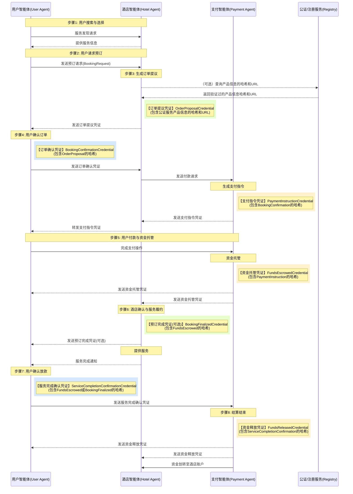

<!-- translation-review: full; source=chinese/deprecated/09-ANP-智能体点对点交易规范.md -->
> 日本語参考訳（原文全文照合・校閲済み）。歴史的な草案です。VC v2.0のCR状態、独自VCハッシュ連鎖、仲裁・否認防止・安全性への主張は原文当時の記述です。
> 原文: [chinese/deprecated/09-ANP-智能体点对点交易规范.md](../../../chinese/deprecated/09-ANP-智能体点对点交易规范.md) / 基準コミット: `0837cfdfaf4ddcf834f0890ddaf34fc4c824e066`

# ANPを基盤とするエージェント間の直接取引仕様（草案）

## 1. はじめに

### 1.1 安全で相互運用できる取引の必要性

AIの急速な発展に伴い、エージェントが普及し、人に代わってインターネットへアクセスし、情報を処理し、作業を行うようになります。新たなやり取りの形が生まれています。

将来は、人同士や人とサイトではなく、エージェント同士が直接接続して通信するかもしれません。仲介を減らし、情報伝達と判断を速めるため、従来より効率的です。

しかし、インターネットは本来信頼できない環境です。代理の取引には、次の課題があります。
- **本人確認**：相手が本物か。
- **情報の真正性**：交換した情報が改変されていないか。
- **安全な取引**：中央のプラットフォームなしで、どう安全を保つか。
- **紛争解決**：問題をどう効果的に解決するか。

安全、効率的、直感的な直接取引の方式は、エージェント経済の基盤です。ANPは、孤立したデータを解放し、完全なコンテキストと、相互接続・協働を目指します (1)。

### 1.2 ANPによる取引の枠組み

利用者、ホテル、決済機関、仲裁者などを代表するエージェントが、ANPでやり取りします (2)。

1. **ANP**：発見、対話、配送の基礎として、安全で相互運用する通信を定義します (2)。
2. **DID**：主体と代理者を一意に示し、検証用の公開鍵などを関連付け、信頼の基礎にします (3)。
3. **W3C VCとData Integrity Proofs**：注文提案や支払い確認など、構造化した検証可能な主張を交換し、真正性、完全性、否認防止を確保します (6)。前の資格情報のハッシュを主体に含め、連鎖の改変を防ぎます。

ホテル予約と決済を例に、要件、流れ、技術、安全機構を説明します。最小の信頼、追跡可能性、自動化、本人の制御、相互運用を原則に、安全で透明かつ効率的な分散商取引を目指します。

## 2. システムの要件

### 2.1 機能

- **エージェントの能力**：
  - **利用者**：発見、予約要求、ホテルの資格情報の検証、確認発行、支払い指示の処理、支払い、完了確認または紛争開始が必須です。
  - **ホテル**：情報公開、価格を含む提案、仮在庫確保、本人確認の検証、請求、入金と予約確定、履行記録、取消・紛争対応が必須です。
  - **決済**：請求の受信・検証、預かり用リンクなどの指示、支払いと資金預かり、状態通知、本人確認・期限・裁定に基づく送金や返金が必須です。
  - **仲裁（任意）**：両者の証拠を受け、規則に基づき調停・裁定し、拘束力のある紛争解決の資格情報を発行できる必要があります。
- **ライフサイクル**：発見、見積もり・提案、確認、請求・指示、預かり、履行確認、決済・返金、紛争の開始・解決まで、第4部の流れ全体への対応が必須です。
- **資格情報**：各主体は、必要なVCを発行・提示・受信・検証できる必要があります。proofと発行者の署名を暗号学的に検証し、credentialSubjectにある前VCのハッシュで連鎖も確認します。提案、予約、請求、預かりなど、重要な節目を網羅します (6)。
- **状態管理**：有効なVCや期限などの出来事で移行する正確な状態を維持します。新規、支払い待ち、預かり、履行、精算待ち、精算済み、場合により取消・紛争を含みます。
- **例外**：原文の第5部で述べる、検証失敗、支払い期限、空室不足・売り過ぎ、支払い前後の取消、紛争、支払い失敗、自動送金期限、鍵漏えい・身元異常、通信停止を扱う必要があります。通常、特定のエラーまたは状態VCを送り、対応を明確にします。

### 2.2 非機能

- **安全性**：
  - **通信**：盗聴・改変を防ぐE2EEが必須です。ANPの安全層に依存します (1)。
  - **本人確認**：DIDの強い認証が必須です (1)。
  - **完全性**：重要なVCに暗号証明が必須です (12)。
  - **否認防止**：有効に署名した発行を否認できません。
  - **改変防止**：主体の前ハッシュで、過去を変えられない検証可能な連鎖にするべきです。
  - **鍵管理**：生成、保存、使用、更新、回復の安全な仕組みが必須です。

- **相互運用**：ANP、W3C DID、VCを厳密に守り、異なる開発者間で連携できる必要があります (2)。
- **追跡と監査**：重要な手順と状態変更を、時刻・署名付きVCに記録し、改変を防ぐ監査の連鎖にします。VC、Data Integrity、主体のハッシュ連鎖が中心です (12)。
- **信頼性・可用性**：一部の一時障害に耐えるべきです。ANPのキューや再試行などの配送保証と、各主体の状態保存を明確にする必要があり、ANP自体の堅牢性に依存します (1)。
- **拡張性**：主体と取引の増加に対応し、大規模利用時のANPの実性能を考慮するべきです (2)。
- **プライバシー**：決済側へ不要な注文詳細を渡さないなど、取引要件の範囲で保護します。W3C VCは、将来のBBS+による選択的開示なども可能にします (13)。

## 3. 中心概念と構造

### 3.1 用語

- **ANP**：発見、対話、配送を定義する公開された安全な通信の枠組みで、エージェント時代のHTTPを目指します (15)。
- **Agent**：利用者やホテルを代表し、ANPで作業する自律ソフトウェアです。
- **DID**：中央の登録者に頼らず、主体が生成・制御する世界で一意の識別子で、DID文書へ解決できます (3)。
- **DID文書**：公開鍵などの検証素材と、サービスの宛先などです (16)。
- **VC**：発行者が主体について述べる主張と暗号上の証明で、受け手が独立に真正性と完全性を検証できます (6)。通常JSON-LDです (18)。
- **Data Integrity Proof**：VC等の真正性と完全性を守る、通常proof属性に置く暗号証明です (12)。
- **VC Hash Chain**：各credentialSubjectに前VCのハッシュを入れ、順序と改変防止を保ちます。
- **State Machine**：取引の状態と、それを変える出来事・条件です。
- **Issuer**：VCの作成・発行者。例えば注文を提案するホテルです (6)。
- **Holder**：保持して提示する者。例えばホテルの提案を持つ利用者です (7)。
- **Verifier**：VCを受け、有効性を確認する者。例えば本人の確認を検証するホテルです (7)。
- **Credential Subject**：利用者と予約詳細など、主張の対象です (6)。本方式では、最初以外は前VCのハッシュも含めます。
- **Cryptosuite**：変換、ハッシュ、署名など、生成・検証のアルゴリズムの組み合わせです (12)。
- **DID Resolution**：通常はリゾルバーで、DIDを文書へ変換します (16)。
- **VDR**：DID文書、VC schema、失効一覧などを管理する、データベース、台帳、その他の信頼できる登録システムです。

### 3.2 全体の構造

各当事者を代理するエージェントが分散し、ANPで直接、または複数者間で通信します。

中央の業務プラットフォームで調整せず、Data Integrity付きVCの交換・検証で状態を進め、合意します。信頼は、評判ではなく暗号技術に基づきます。

1. **本人確認**：ANPの身元層で、DIDと文書を確認してから通信します (15)。
2. **データ**：VCの証明で、真正性、完全性、信頼できる出所を確かめます (12)。
3. **流れの完全性**：前VCのハッシュで、履歴の改変を防ぎます。

ANPは、DID認証と暗号通信、さらにメタプロトコルの交渉やアプリの枠組みを提供します (15)。主に身元・暗号層と配送を使い、定義済みVCを交換します。


*図1：利用者、ホテル、決済、任意の仲裁・公証サービスの関係。すべてANPで通信し、VCで伝達・検証します。*

### 3.3 参加者と責任

表1：役割。

| 役割 | 主な責任 | 詳細 |
| --- | --- | --- |
| 利用者 | 最終消費者 | ホテルを必要とする個人 |
| User Agent | 選択→確認→支払い→評価・紛争 | DIDと秘密鍵を管理し、ANPで発見、予約、ホテルVCの確認、確認発行、支払い指示の処理、支払い、完了・紛争を行い、ハッシュ連鎖を保存・検証 |
| ホテル | 提供者 | 宿泊を提供する主体 |
| Hotel Agent | 見積もり→仮確保→確認検証→請求→履行 | DIDと秘密鍵を管理し、情報、価格付き提案、在庫、本人の確認、請求、入金と予約確定、履行、取消・紛争をANPで処理し、連鎖を保存・検証 |
| 決済基盤 | 資金処理 | Alipayや銀行など、支払い、預かり、精算の基盤 |
| Payment Agent | 預かり→通知→精算・返金 | DIDと鍵を管理し、請求検証、リンクなどの指示、支払い、預かり通知、本人・期限・裁定に基づく資金処理をANPで行い、連鎖を保存・検証 |
| Arbitration Agent（任意） | 紛争受付→調停・裁定 | 中立機関を代表し、DIDと鍵を管理。協議で解決できない時に両者のVCを検証し、規則で拘束力のある解決VCを発行、ANPで通信 |
| 公証・登録（任意） | 情報の保存・証明 | ホテルや商品のハッシュなどを、VCから参照できるよう信頼できる第三者が保管・証明 |

表1は、処理・対話・機能の分担を理解するため、全参加者の責任と期待する行動を明確にします。任意の公証の役割も追加しています。

## 4. 処理の仕様

### 4.1 理想的な取引と状態の移行

以下は、すべてANPでVCを渡すホテル予約です。credentialSubjectの前VCハッシュで、順序と改変防止を保ちます。

**手順1：見積もりと仮在庫確保**
- **開始**：利用者が発見したホテルへ照会・予約を要求します。
- **処理**：ホテルが価格と在庫を確認します。
- **VC**：OrderOfferCredentialを作ります。主体に部屋、価格、期間、取消条件、仮注文IDが必須です。任意で公証・登録先と情報のハッシュも含め、ホテルの秘密鍵でproofを作ります。
- **状態**：仮確保し、Offeredになります。
- **交換**：利用者へANPで送ります。

**手順2：利用者の確認**
- **開始**：提案の署名と内容を検証し、本人が予約を決めます。
- **VC**：BookingConfirmationCredentialに、提案IDと受諾、OrderOfferCredentialのハッシュ（previousCredentialHashなど）を入れ、本人の秘密鍵で署名します。
- **交換**：ホテルへ送ります。
- **状態**：ホテルがproofとハッシュを検証し、Pending Paymentにします。

**手順3：支払いの要求**
- **開始**：有効な本人確認を受けます。
- **VC**：PaymentRequestCredentialにorderId（または確認VCの参照）、amount、currency、payeeDid（ホテル）、payerDid（本人）、paymentAgentDidだけを入れます。不要な商品・ホテルの詳細は除きます。BookingConfirmationCredentialのハッシュを含め、ホテルが署名します。
- **交換**：指定の決済エージェントへ送ります。
- **状態**：Payment Initiation Pendingです。

**手順4：預かり指示の生成と転送**
- **開始**：決済側が請求、proof、previousCredentialHashを検証します。
- **VC**：PaymentInstructionCredentialに取引ID、金額、リンク・QRなどの方法、期限、PaymentRequestCredentialのハッシュを入れ、決済側が署名します。
- **交換1**：決済→ホテルへ送ります。
- **交換2**：ホテルが受け、任意で検証してから、利用者へ転送します。
- **状態**：Awaiting Paymentです。

**手順5：本人の支払いと預かり**
- **開始**：転送された指示とproof・ハッシュを検証し、本人がリンク等から支払います。
- **処理**：資金が預かり口座に入ります。
- **VC**：決済側が確認し、FundsEscrowedCredentialに取引ID、注文ID、金額、時刻、PaymentInstructionCredentialのハッシュを入れて署名します。
- **交換**：本人とホテルに送ります。
- **状態**：Escrowedです。

**手順6：ホテルの確定と履行**
- **開始**：預かりVC、proof、ハッシュを検証します。
- **処理**：正式に予約と資源を確保します。
- **任意VC**：BookingFinalizedCredentialにFundsEscrowedCredentialのハッシュを入れ、本人へ送れます。
- **提供**：本人が到着し、サービスを受けます。
- **状態**：In Service / Fulfillmentです。
- **完了**：ホテルはANPでServiceCompletedNotificationなどの通知・VCを送り、連鎖にも加えられます。

**手順7：本人による履行・送金の確認**
- **開始**：約束どおり完了したと、本人が確認します。
- **VC**：ServiceCompletionConfirmationCredentialに注文・取引ID、確認時刻、FundsEscrowedCredentialまたは手順6の任意VCのハッシュを入れ、本人が署名します。
- **交換**：決済側へ送ります。
- **期限**：一定期間、確認も紛争もなければ、自動確認と送金を設計できます。
- **状態**：Pending Settlementです。

**手順8：精算**
- **開始**：完了VCのproofとハッシュを検証するか、自動条件が成立します。
- **資金**：ホテルに送金します。
- **VC**：FundsReleasedCredentialに最終状態、詳細、ServiceCompletionConfirmationCredentialのハッシュを含め、決済側が署名します。
- **交換**：本人とホテルへ送ります。
- **最終状態**：Settledです。

**理想の流れ**：



*図2：検索から精算まで。VCの生成箇所と、本人・ホテル・決済のやり取りを示します。*

**概念的な状態図**：

```stateDiagram-v2
    [*] --> 新建(New)
    新建(New) --> 待付款(Pending_Payment): 用户确认 (凭证包含订单提议哈希)
    待付款(Pending_Payment) --> 已托管(Escrowed): 资金托管 (凭证包含支付指令哈希)
    待付款(Pending_Payment) --> 已取消(Cancelled): 支付超时 / 用户取消
    已托管(Escrowed) --> 履约中(In_Service): 酒店确认预订 (可选凭证包含托管凭证哈希)
    已托管(Escrowed) --> 已取消(Cancelled): 用户取消 (符合政策)
    已托管(Escrowed) --> 争议中(In_Dispute): 发起争议 (凭证包含托管凭证哈希)
    履约中(In_Service) --> 待结算(Pending_Settlement): 用户确认服务 (凭证包含托管/预订完成凭证哈希) / 自动确认超时
    履约中(In_Service) --> 争议中(In_Dispute): 发起争议 (凭证包含履约中状态哈希)
    待结算(Pending_Settlement) --> 已结算(Settled): 资金释放 (凭证包含服务完成确认哈希)
    待结算(Pending_Settlement) --> 争议中(In_Dispute): 发起争议 (凭证包含待结算状态哈希)
    争议中(In_Dispute) --> 已结算(Settled): 仲裁决定 (凭证) -> 释放资金
    争议中(In_Dispute) --> 已取消(Cancelled): 仲裁决定 (凭证) -> 退款
    已取消(Cancelled) --> [*]
    已结算(Settled) --> [*]
```

*図3：予約の状態と、それを進めるVCハッシュの関係です。*

**表2：中心的な状態の移行**

| 現在 | 契機 | 主な検証・動作 | 次 | 注 |
| --- | --- | --- | --- | --- |
| New/Offered | 本人のBookingConfirmationCredential | 本人署名、提案参照、主体のOrderOfferCredentialハッシュ | Pending_Payment | |
| Pending_Payment | 決済のFundsEscrowedCredential | 決済署名、金額、PaymentInstructionCredentialハッシュ | Escrowed | |
| Pending_Payment | 支払い期限 | 決済が検出し通知 | Cancelled | 期間を定義 |
| Escrowed | 内部処理／任意BookingFinalizedCredential | ホテルが確定。VCがあればFundsEscrowedCredentialハッシュ | In_Service | 予定どおり開始を仮定 |
| In_Service | 本人のServiceCompletionConfirmationCredential | 署名、完了、預かりまたは予約確定VCハッシュ | Pending_Settlement | |
| In_Service | 本人の確認期限 | 決済が事前規則で開始 | Pending_Settlement | 自動規則と期間を明示 |
| Pending_Settlement | 内部送金完了 | 決済し、完了確認ハッシュ付きFundsReleasedCredentialを発行 | Settled | |
| Escrowed/In_Service/Pending_Settlement | 本人・ホテルのDisputeInitiationCredential | 署名、資金停止、現在の最後のVCのハッシュ | In_Dispute | |
| In_Dispute | 仲裁のDisputeResolutionCredential | 仲裁署名、資金操作。VCがあれば紛争開始のハッシュ | Settled/Cancelled | 裁定で決定 |
| 任意 | 本人のCancellationRequestCredential | 状態・取消条件。VCがあれば連鎖を検証 | Cancelled／不変 | 条件は複雑な場合あり |
| 任意 | VCの検証失敗 | 署名・連鎖を含め拒否し、エラー通知 | 不変 | 処理を停止 |

表2は、契機、検証・動作、到達先を明確にし、主体のハッシュ検証による、確定的で一貫した、改変しにくい処理を示します。

**理想状態のVCハッシュ連鎖**

前VCのハッシュを含む連鎖が、全体の完全性と検証可能性を保ちます。色は発行者、矢印はハッシュ参照です。


*図4：注文の提案から最終精算まで、前のハッシュを含む完全な証拠の連鎖です。*

1. **全体の追跡**：最後から最初の提案まで追えます。
2. **改変防止**：一つを変えれば、後続のハッシュ確認が失敗します。
3. **責任の明確化**：発行者の色で分かります。
4. **選べる検証経路**：必須と任意の参照で柔軟にします。
5. **状態の一貫性**：生成と検証が、対応する状態移行も進めます。

## 4.2 例外処理

ANPでVCやエラーを送り、堅牢に処理する必要があります。例外のVCも、可能な限り関連する前VCのハッシュで結びます。

**表3：例外の一覧**

| 場面 | 契機 | 対応 |
| --- | --- | --- |
| 検証失敗 | VC受信時 | 署名、形式、内容、連鎖が不正なら拒否し、CredentialValidationErrorなどを送り、修正・人の介入まで停止 |
| 未払い | 手順4の後の期限 | PaymentInstructionCredentialハッシュ付きPaymentTimeoutCredentialを本人・ホテルへ。Cancelledにし、ホテルが仮在庫を解放 |
| 空室不足・売り過ぎ | 手順1・2 | OrderCancellationCredentialに理由と要求／OrderOfferCredentialハッシュを入れ本人へ。Cancelled |
| 支払い前の取消 | 手順5より前 | 本人がBookingConfirmationCredentialハッシュ付きCancellationRequestCredentialをホテルへ。了承ならその要求ハッシュ付きCancellationConfirmationCredentialを返し、Cancelled |
| 支払い後、履行前の取消 | 手順5後、手順6開始前 | 預かりVCハッシュ付き取消要求をホテル・決済へ。ホテルが条件で返金額を決め、要求ハッシュ付きCancellationProcessedCredentialを決済へ。決済が返金し、その処理ハッシュ付きFundsRefundedCredentialなどを送り、Cancelled |
| 宿泊・履行の紛争 | 手順6の途中・後 | 本人またはホテルが関連VCハッシュ付きDisputeInitiationCredentialを相手と決済へ。資金を止めIn Dispute。協議に失敗したら仲裁へ証拠VCを提出。仲裁が開始VCハッシュ付きDisputeResolutionCredentialを発行し、決済が資金操作と最終通知 |
| 支払い失敗・拒否 | 手順5 | 決済基盤が検出し、指示VCハッシュ付きPaymentFailedCredentialを双方へ。Pending Paymentへ戻るかFailed/Cancelled |
| 自動送金の期限 | 手順7 | 設定されていれば自動で送金し、預かりまたは予約確定VCハッシュ付きFundsReleasedCredentialを双方へ。Settled |
| 鍵漏えい・身元異常 | 随時 | 直ちに鍵失効を試み、SecurityAlertCredentialで関係者に個別・一斉通知。関係する取引を停止 |
| エージェント・網の停止 | 随時 | ANPのキュー・再試行と、主体の保存・期限処理に依存。送信側は再試行、受信側は重複に対応。長期停止は期限切れ失敗になり得る |

表3は、非理想の場面、VCによる対応、例外時のハッシュ連鎖をまとめ、失敗経路も含めた堅牢性と、開発者向けの処理指針を示します。

## 5. 技術設計

### 5.2 身元と信頼（DID）

- **用途**：全主体と代理者を一意に示し、持続的、検証可能、分散型の土台を作ります (3)。
- **文書**：DID Core v1.0に従い、verificationMethodのid/type/controller/publicKeyJwk/publicKeyMultibaseと、VC用assertionMethod・本人確認用authenticationを含めます。
- **解決**：did:wbaなど、使う方式を解決する安定した基盤が必須です。失敗するとVCを検証できません (1)。
- **鍵管理**：特に本人の負担が大きく、生成、HSM/TEE/ウォレットでの保存、使用、更新、回復の完全な方針が必要です。分散型普及の大きな障害です (3)(21)。
- **方式ごとの差**：ANPの例は主にdid:wbaで、他方式との相互運用には複数の解決が必要になり、依存と複雑さが増します (1)。

### 5.3 資格情報の管理

- **要件**：状態と責任を示すVCは、出所・完全性を独立に検証でき、発行後に否認できず、機械が読め、相互運用でき、主体のハッシュで改変防止の連鎖にする必要があります。
- **W3C VC Data Model v2.0を選ぶ理由**：
  - 標準が公開された生態系を助けます。
  - DIDと自然に統合します。
  - JSON-LDの@contextで明確な意味を与えます。
  - 柔軟で拡張しやすいモデルです。
  - BBS+など、選択的開示の可能性があります。
  - 執筆時点ではW3C Candidate Recommendation（CR）です。
- **JSON-LDの中心構造**：
  - `@context`：必須。最初はhttps://www.w3.org/ns/credentials/v2です。
  - `id`：任意・推奨。一意のURL。
  - `type`：必須。VerifiableCredentialと具体的な型の配列。
  - `issuer`：必須。DIDまたはそれを含むオブジェクト。
  - `issuanceDate` / `validFrom` / `validUntil`：任意／必須の時刻。
  - `credentialSubject`：必須。主張の集合。OrderOfferCredentialは重要なサービス詳細を、最初以外はpreviousCredentialHashを含める必要があります。
  - `proof`：必須。完全性と出所の証明。
  - `credentialSchema`：任意。データのschema。
  - `credentialStatus`：任意。失効などの状態の参照。
- **連鎖**：
  - 二つ目から、credentialSubject.previousCredentialHashに前VCのハッシュを入れる必要があります。
  - 計算法を明確にし、JCSなどの正規化後にSHA-256などを使うことを勧めます。
  - proofに加え、前VCを計算して値を比較する必要があります。
- **任意の外部検証**：
  - ホテルの全サービス記述のハッシュを、提案VCの主体に含めます。
  - 記述またはハッシュを信頼する公証・VDRに登録し、参照とハッシュを提案VCに含めます。
- **具体的なVC**：

**表4：VCの型（v3――VCハッシュ連鎖）**

| VC型 | 発行者 | 主体 | credentialSubjectの属性例 | 用途 | プライバシー・安全 |
| --- | --- | --- | --- | --- | --- |
| OrderOfferCredential | ホテルAgent | 利用者Agent, 注文詳細 | orderId, hotelDid, roomType, price, checkInDate, checkOutDate, cancellationPolicy, offerExpiry, （任意）serviceDescriptionHash, （任意）registryPointer | ホテルの価格と予約条件 | 重要なサービス詳細が必須。外部検証は任意。最初のVCなのでpreviousCredentialHashなし |
| BookingConfirmationCredential | 利用者Agent | ホテルAgent, 注文詳細 | orderId, offerCredentialId, userDid, confirmationTimestamp, previousCredentialHash: <hash_of_OrderOfferCredential> | 本人の提案受諾 | credentialSubjectに前VCのハッシュ |
| PaymentRequestCredential | ホテルAgent | 決済Agent, 利用者Agent | orderId （またはconfirmationCredentialId）, amount, currency, payeeDid (Hotel), payerDid (User), paymentAgentDid, previousCredentialHash: <hash_of_BookingConfirmationCredential> | ホテルから決済への請求 | 詳細な注文・商品情報は含めない。主体に前VCのハッシュ |
| PaymentInstructionCredential | 決済Agent | 利用者Agent, ホテルAgent | transactionId, orderId, amount, currency, paymentMethodDetails (例：URL), paymentDeadline, previousCredentialHash: <hash_of_PaymentRequestCredential> | 決済指示。まずホテルへ送り転送 | credentialSubjectに前VCのハッシュ |
| FundsEscrowedCredential | 決済Agent | 利用者Agent, ホテルAgent | transactionId, orderId, amount, currency, escrowTimestamp, previousCredentialHash: <hash_of_PaymentInstructionCredential> | 預かりの確認 | credentialSubjectに前VCのハッシュ |
| BookingFinalizedCredential （任意） | ホテルAgent | 利用者Agent | orderId, bookingReference, confirmationTimestamp, previousCredentialHash: <hash_of_FundsEscrowedCredential> | 入金後の予約確定 | credentialSubjectに前VCのハッシュ |
| ServiceCompletionConfirmationCredential | 利用者Agent | 決済Agent, ホテルAgent | orderId, transactionId, confirmationTimestamp, previousCredentialHash: <hash_of_FundsEscrowed_or_BookingFinalized> | 履行確認と送金の許可 | credentialSubjectに前VCのハッシュ |
| FundsReleasedCredential | 決済Agent | 利用者Agent, ホテルAgent | transactionId, orderId, amountReleased, settlementTimestamp, payeeDid, previousCredentialHash: <hash_of_ServiceCompletionConfirmation> | 受取人への送金の確認 | credentialSubjectに前VCのハッシュ |
| FundsRefundedCredential | 決済Agent | 利用者Agent, ホテルAgent | transactionId, orderId, amountRefunded, refundTimestamp, payerDid, previousCredentialHash: <hash_of_triggering_VC> | 支払人への返金の確認 | credentialSubjectに前VCのハッシュ |
| DisputeInitiationCredential | 利用者Agent / ホテルAgent | 仲裁Agent, 相手 | orderId, disputeReason, evidenceCredentialIds, initiatorDid, timestamp, previousCredentialHash: <hash_of_disputed_VC> | 紛争の開始 | credentialSubjectに前VCのハッシュ |
| DisputeResolutionCredential | 仲裁Agent | 利用者Agent, ホテルAgent, 決済Agent | disputeId, orderId, decision, resolutionDetails, resolvedTimestamp, previousCredentialHash: <hash_of_DisputeInitiation> | 仲裁結果 | credentialSubjectに前VCのハッシュ |
| CancellationRequestCredential | 利用者Agent | ホテルAgent, 決済Agent | orderId, reason, requestTimestamp, previousCredentialHash: <hash_of_relevant_VC> | 本人の取消要求 | credentialSubjectに前VCのハッシュ |
| CancellationConfirmationCredential | ホテルAgent / 決済Agent | 利用者Agent | orderId, cancellationResult, timestamp, previousCredentialHash: <hash_of_CancellationRequest> | 取消結果 | credentialSubjectに前VCのハッシュ |
| CredentialValidationError | 任意のAgent | 送信Agent | invalidCredentialId, errorDescription, timestamp | 検証失敗の通知 | ハッシュ連鎖に参加しない |
| PaymentTimeoutCredential | 決済Agent | 利用者Agent, ホテルAgent | transactionId, orderId, timeoutTimestamp, previousCredentialHash: <hash_of_PaymentInstruction> | 支払い期限の通知 | credentialSubjectに前VCのハッシュ |
| PaymentFailedCredential | 決済Agent | 利用者Agent, ホテルAgent | transactionId, orderId, failureReason, timestamp, previousCredentialHash: <hash_of_PaymentInstruction> | 支払い失敗の通知 | credentialSubjectに前VCのハッシュ |
| SecurityAlertCredential | 任意のAgent | 関係者 | alertType, affectedDid, details, timestamp | 安全警報 | ハッシュ連鎖に参加しない |

表4は、各手順を具体的なデータへ落とし込み、発行者、主体、属性、用途を示します。**請求の最小開示、提案の必須サービス詳細、previousCredentialHashによる連鎖**を明示します。

### 5.4 Data IntegrityとVCハッシュ連鎖

- **採用方式**：W3C Data Integrityで、真正性と完全性を保ちます。
- **改変防止の連鎖**：二つ目から前のハッシュを含み、過去の変更は検証失敗になります。自身のproofに加え、前との関係の検証も必須です。
- **推奨暗号**：EdDSAまたはECDSAとJCS。単純署名より複雑なので、標準適合ライブラリを推奨します。将来はBBS+なども検討できます。
- **生成**：
  1. VCデータから旧proofを除きます。
  2. 最初以外は、前VCを取得・正規化・ハッシュ化します。
  3. credentialSubject.previousCredentialHashへ入れます。
  4. 現在のVCを正規化します。
  5. ハッシュにします。
  6. 秘密鍵で署名します。
  7. type、cryptosuite、createdなどのproofを作ります。
  8. VCに加えます。
- **検証**：
  1. proofとデータを分けます。
  2. verificationMethodとDIDから公開鍵を得ます。
  3. cryptosuiteを得ます。
  4. 現在のVCを正規化します。
  5. ハッシュを計算します。
  6. 公開鍵とproofValueで署名を検証します。
  7. 最初以外はpreviousCredentialHashを読みます。
  8. 前VCを取得し、ハッシュを計算します。
  9. 両者を比較します。
  10. 任意でcreatedやproofPurposeも確認します。
- **追跡性**：連鎖自体が強い追跡性と改変防止を提供します。任意で重要なハッシュを公開台帳に記録し、追加の証拠点にできます。

### 5.5 安全設計

- **認証**：ANPのDID層に依存します。
- **許可**：有効なVCと連鎖内の位置を検証する、能力に基づくモデルです。
- **完全性**：Data Integrityとハッシュ連鎖で保ちます。
- **機密性**：ANPのE2EEに依存します。
- **否認防止**：VCへの署名で実現します。
- **履歴の改変防止**：連鎖で防ぎます。
- **プライバシー**：PaymentRequestCredentialの内容を制限します。
- **紛争**：仲裁へ渡す証拠は、連鎖した検証可能なVCが必須です。
- **鍵**：秘密鍵の強い保護が土台です。
- **ANP自体の安全**：DID解決へのDoSや通信の脆弱性を評価し、モデル主導の交渉ではプロンプト注入に注意し、独立した監査を推奨します。

**表5：安全機構の対応（v3）**

| 目標 | 中心の機構 | 関連部品 | 注 |
| --- | --- | --- | --- |
| 本人確認 | DID認証 | DID、文書、ANP身元層 | 分散した暗号証明 [1] |
| 完全性 | VCのData Integrity | VC、証明、Cryptosuite | 改変の防止 [12] |
| 機密性 | E2EE | ANP暗号層 | 転送中の内容 [1] |
| 否認防止 | Data Integrityの署名 | VC proof、DID鍵 | 有効な発行を否認できない [12] |
| 履歴 | VC Hash Chain | credentialSubject.previousCredentialHash、ハッシュ | 発行後の変更防止 |
| 許可 | VCと連鎖位置の能力検証 | VC検証ロジック | 特定の証拠の保持・検証が権限を示す |
| 追跡・監査 | 署名連鎖、任意の公開台帳 | VC列、証明、ハッシュ | 改変を防ぐ履歴 [12] |
| 決済のプライバシー | 請求内容の制限 | PaymentRequestCredentialの設計 | 不要な開示を減らす |
| 将来のプライバシー | BBS+などの選択的開示、ZKP | 高度なCryptosuite | 全体を見せず属性を証明 [18] |
| 鍵 | 安全な管理方針 | Agentの鍵管理 | 大きな課題 [21] |
| プロトコル | ANP設計の評価と監査 | ANP全体 | プロジェクトの堅牢性に依存 |
| DoS耐性 | ANPとリゾルバーの検討 | 網とDID解決 | 拒否攻撃に対抗 |

表5は、**主体のハッシュ連鎖を履歴保護の中心に加え、決済のプライバシー対策を明確にした**対応表です。

## 6. まとめと今後の考慮

### 6.1 振り返り

ANP、DID、W3C VC、Data Integrityで、ホテルの発見から精算・例外までの完全な循環を設計しました。
- **自動化**：対話の大部分を代理します。
- **安全**：DIDの本人確認、VCと証明の完全性・否認防止、ANP暗号、連鎖の履歴保護を組み合わせます。
- **追跡**：署名した連鎖が、透明で改変しにくい履歴を作ります。
- **相互運用**：公開標準が協働を助けます。
- **分散**：中央の仲介依存を減らし、本人の制御と耐障害性を高めます。
- **プライバシー**：不要な注文詳細を決済側へ送りません。

### 6.2 実装の課題

- **ANPの成熟と依存**：プロジェクトの発展に強く依存します (1)。
- **鍵管理**：安全で効率的な管理は、大きな課題です (21)。
- **VC・証明・連鎖**：実装には高い専門性が必要です (12)。このVCハッシュ連鎖はW3C標準ではなく、独自実装と合意が必要です。
- **DID解決**：安定・効率・安全な基盤が必要です。
- **標準の進化**：VC v2.0やData Integrityは、なお変わる可能性があります (6)。
- **既存との統合**：適応や代理の開発が必要です。
- **体験と信頼**：理解しやすく、信頼できる画面と流れが必要です。

### 6.3 改善の可能性

- **プライバシー**：BBS+などの選択的開示。
- **交渉**：メタ層のより深い利用 (1)。
- **相互接続**：Langchain Agent ProtocolやGoogle A2Aとの研究。
- **標準化**：業界別のVC schema (6)。
- **鍵管理**：便利で安全な方法。
- **サービス情報**：外部公証・登録を必須化または標準化。
- **標準Proof Chains**：独自方式からW3C Data IntegrityのProof Chainsへ戻し、相互運用を高める検討 (12)。

### 6.4 生態系の中で

ANPはDIDとVCを深く統合し、自動交渉のメタ層も含む点が独自です (15)。強い本人確認、信頼できる交換、柔軟な分散協働に適します。

Langchain Agent Protocolの標準的な実行や、Google A2Aの企業向け相互運用など、他方式の重点とは異なります。位置付けを理解すれば、適用判断や、将来の統合・変換に役立ちます。

ANPを選ぶことは、分散した信頼と適応的な協働の可能性を選ぶと同時に、新しさと、まだ構築中の生態系の課題にも向き合うことです。
