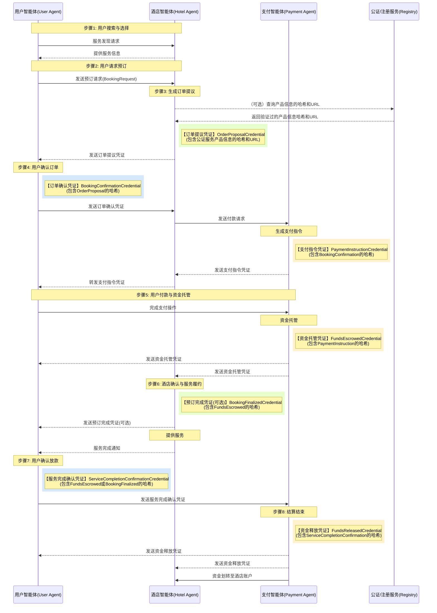

> 日本語参考訳（機械翻訳・未校閲）。規範となるのは原文です。コード例・識別子・規範キーワードは原文を保持しています。
> 原文: [chinese/deprecated/09-ANP-智能体点对点交易规范.md](../../../chinese/deprecated/09-ANP-智能体点对点交易规范.md) / 基準コミット: `0837cfdfaf4ddcf834f0890ddaf34fc4c824e066`

# AMP ベースのスマートポイントツーポイントトランザクション(案)

## 1. 導入事例

### 1.1. . 問題文:スマートボディの安全で、相互運用可能な取引の必要性

人工知能技術の急速な発展に伴い、AIエージェントは急速に普及し、ますますますますインターネットにアクセスして人件数を交換し、情報処理を行い、タスクを実行します。この時代では、インテリジェントな身体の増殖が進んでおり、新しい相互作用のパラダイムが現れています。

未来のインターネットは、人から人まで、ウェブサイト間のやり取りではなく、インテリジェントな身体とスマート間で直接接続やコミュニケーションを指示することができません。このような点から知的相互作用は、従来のインターメディアモデルよりも効率的になり、中リンクを減らし、情報伝達と意思決定プロセスをスピードアップします。

しかし、インターネットは基本的に信頼性の低い環境であり、ユーザーの代わりにスマート取引を行うときに次のコア課題に直面しています。

- **組織図**: インタラクティブな知能のアイデンティティが現実的で信頼性があることを、どうすればよいですか?
- **情報認証**: インテリジェントな身体が改ざんされていない情報を確認するにはどうすればよいですか?
- **貿易セキュリティ**: 中央のプラットフォームなしでプロセスを保護する方法は?
- **紛争解決**: 取引中に発生した問題が生じたときに、紛争は効果的に対処できるのは?

安全な、効率的かつ視覚的なスマートツーポイントのトレードポイントの設計は、インテリジェントな身体の経済発展のためのインフラとして特に重要です。 エージェントネットワークプロトコル(APP)のビジョンは、インテリジェントなボディネットワークにおける相互接続と効率的なコラボレーションの問題に対処するため、データの分離島を破り、完全なコンテキスト情報にアクセスするためのAIを可能にすることです(1)。

### .1.2.(日) ソリューションの概要:AMPベースのスマートボディトレーディングフレームワーク

このプログラムは、上記に対処するためのスマートテクノロジーに基づく取引のフレームワークを提案します。このフレームワークは、エージェントネットワークプロトコル(AMP)(2)を通じて相互作用するために、さまざまな参加者(ユーザー、ホテル、決済プラットフォーム、仲裁機関など)を表すインテリジェントなボディを使用します。

1. **エージェントネットワークプロトコル(ANP)**: インテリジェントな身体とのコミュニケーションの基本的な合意として、検出、相互作用を定義し、伝達メカニズムを指示して、安全で相互運用可能な通信を実現するために(2).
2. **センター識別(分散型識別子、DID)に移動**: 参加者やその知能体を識別し、本人の身元確認にリンクするために使用される公開鍵などの情報は、自信構築のための基礎です(3)。
3. **W3C 有効なクレジット、VCおよびデータ整合性証拠**: 文書の主題における橋値を含む文書のチェーンの非分子化、例えば構造化されたデータステートメント(例えば、購入注文提案、支払いの確認)の交換のために、情報の信頼性、完全性および不適切な性質を確保します。

この文書は、ユーザーが予約および支払いされたホテルの一例にあるフレームワークのニーズ、コアプロセス、技術設計およびセキュリティメカニズムに精通します。 全体の設計は、より安全な、透明で効率的な償却取引エコロジーを作成するためにビューと、最小限の信頼、トレーサビリティ、オートメーション、ユーザー制御および相互運用性の原則に基づいておりです。

## 2. システム要件

### .2.1.(日) 機能的な必要性

- **スマートボディ容量**:
  - **ユーザー スマート ボディ**: サービスのリクエスト、予約、ホテルの証明書の検証、確認書の作成、支払い注文の処理、決済の開始、サービス完了の確認、または紛争の開始などを行うことができる必要があります。
  - **ホテル インテリジェンス**: サービスの情報を公開し、購入注文提案券(引用を含む)を生成し、一時在庫をロックし、ユーザー確認証明書を検証し、回収依頼書の支払いを開始し、受領を確認し、予約、記録サービス性能、プロセスキャンセルまたは紛争対応を最終的に確認する必要があります。
  - **スマート決済**: 決済リクエストの受け取り、検証、支払い注文(ホスティングリンクなど)の作成、ユーザーによる決済処理、信託ステータスの入金、送金状況通知バウチャー、ホテルへの資金提供、または指示下にあるユーザーに返金する(ユーザー確認、期限切れ、賞)。
  - **仲裁スマート ボディ** (オプション): ルールに従って、当事者、合意または賞によって提出された証拠を受け取り、「紛争解決の決定」を結びます。

- **取引ライフサイクル**: 本サービスの発見、見積書および提案、注文の確認、支払いリクエストの作成、資金調達、サービスパフォーマンスの認識、資金の決済または返金、紛争の開始と解決など、システムが完全な取引プロセスをサポートしなければなりません。これらの手順は、ユーザー入力(Part IV)によって記述されたコアプロセスにマッピングする必要があります。

- **証明書の処理**: すべてのスマートには、特定の種類の検証可能な証明書(VC)を発行、提示、受信および検証する能力が必要です。認証プロセスには、証明書データの完全性(校正と発行者の署名による暗号学校)と文書チェーンの完全性の確認(事前申請書で事前に確認された証明書によるQashi)が含まれる必要があります。

- **ステータス管理**: 取引注文の精度を維持し、ステータスの移動は有効なVCまたは事前定義されたイベント(例えばタイムアウト)によってトリガーされます。コアの状態には、新しい構造、支払い、ホスティング、パフォーマンス、保留中の決済、定住、およびキャンセルおよび紛争のケースが含まれる場合があります。

- **異常な処置**: 本サービスは、利用者の入力(パートV)に記載する各種異常を処理することができるものとします。証明書認証障害、ユーザーの未払い決済のタイムオーバーラン、ホテルハウスレスネス/販売のオーバーホール、ユーザーによるキャンセル(前払い/後払い)、サービス紛争、支払いの失敗、自動リリース時間外への移行、キー漏れ/アイデンティティ異常、スマートボディ/ネットワークの破壊など。この処理は明確に定義され、通常、特定のエラー通知またはVCを含む状態を送信する必要があります。

### . 2.2. 機能不全の要求

- **セキュリティー**:
  - **通信セキュリティ**: スマート・インターボディの通信は、配線や操作を防ぐため、エンドに暗号化されなければなりません(ANPに依存するセキュリティレイヤー (1))。
  - **認証情報**: 強力なDIDベースの認証機構を使用して、インタラクティブオブジェクトの信頼性を確保する必要があります。 (1)
  - **データ完全性**: 交換されたすべての重要な文書は、操作を防止するためにパスワード(データ情報プルーフなど)を使用することで保護する必要があります (12).
  - **否定できない**: 文書の発行者は、有効な文書(デジタル署名による)を発行することができません。
  - **混入不可。**: トランザクションプロセスの文書は、初期文書(認証サブサブジェクトの事前認証を含む)で、その後の改ざんを防ぐことができる、検証可能なチェーンを形成する必要があります。
  - **鍵管理**: 人工知能の秘密鍵を生成、保存、使用、回転および復元するための安全なメカニズムが必要です。

- **相互運用性**: システム設計は、異なる開発者が達成したインテリジェントな身体のシームレスな相互作用を確保するために、ANP、W3C DID、W3C VCなどのオープン規格を厳密に遵守しなければなりません(2)。

- **レトロアクティブ/可聴性**: 取引の全ての重要なステップと状態の変更は、タイムスタンプと署名で検証可能な文書によって記録されなければなりません。また、レコードの混在性のない監査可能なチェーンを作成できます。VC、データ情報メカニズム、および証明書の対象の橋鎖は、この目標に集中しています(12)。

- **信頼性・可用性**システムは、一部のインテリジェントな身体またはネットワークノードの一時的な障害を許容するために非常に有用であるべきです。 ANPがニュースキューや再テストを提供するかどうか、情報がメカニズム(例えば、ANPによって送信されるか)を介して伝達され、インテリジェンスボディはパーマニエンスのために独自の能力を持っていることをクリアする必要があります(1)。

- **エクステンション**: 建築設計は、将来のインテリジェントおよび取引量の成長をサポートする必要があります。大規模なアプリケーションにおけるANP協定の実際の性能(2)を考慮する必要があります。

- **スタッフ**: 取引が満たす範囲では、ユーザーのプライバシーを保護するため、考慮すべき事項を提示します。例えば、不要な注文の詳細の開示を制限してスマートに支払います。W3C VC規格は将来の選択的な開示技術(例えば、BBC+ベースのVC (13))の可能性も提供します。
## 3. コアコンセプトとアーキテクチャ

### 3.1. . 主要用語

- **ANP(エージェントネットワークプロトコル)**: インテリジェント間のセキュアで相互運用可能な通信のためのオープンソースのプロトコルフレームワーク。スマートによる情報の発見、相互作用および伝達のメカニズムを定義し、インテリジェンスHTTP(15)時代を向けることを目指しています。
- **スマート(エージェント)**: タスクのパフォーマンスにおいて、特定のエンティティ(ユーザー、ホテルなど)を表す自動ソフトウェアプログラムで、APPプロトコルによるインタラクティブなプログラムです。
- **DID(分散型識別子)**: 拡張された識別子。新規でグローバルに一意の識別子は、エンティティティティが、中央登録(3)に依存することなく独自の識別子を生成し制御できるようにします。 DIDは、DID文書を解釈できます。
- **DID文書(DDD文書)**: 認証、サービス端末等(16)のパスワード素材(公開鍵)などDIDにリンクした情報を含むデータセット。
- **検証可能なクレジット、VC**: 発行者(Isuer)が、パスワード(Proof)の証明書を伴って発行者(Isuer)によって行われたステートメント(クレーム)のグループ。これにより、認証者の認証と完全性が独立して検証される(6)。
- **データ整合性証拠**: VCまたは他のデジタル文書の正当性や完全性を保護するパスワードの証拠機構は、通常VCの校正属性に埋め込まれています (12)。
- **VCハッシュチェーン**: VCのクレジットサブプロジェクトで前のVCのハッシュ値を含む複数のVCを順次リンクするために、このプログラムで使用されるメカニズムは、文書シリーズの完全性と偽の変更を確実にする。
- **ステータスマシン(ステートマシン)**: ライフサイクル中にトランザクション(例えば、注文)経験をし、状態の移行を引き起こすイベントや条件を定義する。
- **発行者(イシュアー)**: VCの作成と発行のエンティティティ(例:ホテルスマート・サワーオーダー提案VC) (6)。
- **ホルダー(ホルダー)**: VCをオンデマンド(例えば、ユーザースマート・ヘルド・ホテルオーダー提案VCなど)に保有し提示するエンティティーズ (7)。
- **検証**: VCを受信し、その妥当性を検証するエンティティティ(例えば、ホテルのスマートボディ検証ユーザーがVCを確認) (7)。
- **文書の主題(代表的なサブプロジェクト)**: VCは、その関係するエンティティティ(例えば、VCの宿泊予約の主な主題は、ユーザと予約の詳細)(6)を述べています。このプログラムでは、最初のVCに加えて、前のVCのハッシュ値が含まれている。
- **パスワードパッケージ(Cryptosue)**: データ情報証明書の生成と検証に使われるパスワードアルゴリズム(変換アルゴリズム、橋アルゴリズム、シグネチャアルゴリズム)の特定の組み合わせを定義します。 (12)
- **DID 解析 (DDD 解像度)**: DID を対応する DID ドキュメントに変換するプロセスは、DID ソルバー (16) で実行されます。
- **検証可能なデータ登録、VDR**: DIDファイル、VCモード、リボカレーションリストなど、VCやDIDに関連するデータを録画・管理するために使用されるシステム。これはデータベース、配布された本または他の信頼できるシステムであることができます。

### 3.2. . システムアーキテクチャの概要

プログラムは、インテリジェントに基づいて分散構造で構成されます。各参加者(ユーザー、ホテル、決済プラットフォーム、仲裁機関)は、独自のスマートボディによって表されます。

コアインタラクティブなプロセスは、州のコーディネートのための集中型ビジネスプラットフォームに依存しませんが、インテリジェントな組織間でのデータ情報プルーフ(VC)認証を渡すと検証することで、変更とコンセンサスビルディングを駆動します。トラストビルは、プラットフォームの信頼性ではなく暗号化に基づいています。

1. **組織図**インテリジェントな身体間の通信はAMP IDレイヤー(15)を介した識別が必要です。
2. **データ検証**: VC (12)のデータ情報証明書の有効化により、情報の信頼性、完全性、およびソースの信頼性を確保します。
3. **プロセス整合性**: VCのクレデンシャルサブプロジェクトで前のVCの橋値を組み込んで、歴史レコードが非分子であることを確認することで、VCハシチェーンが形成されます。

APP Barkは、ボトムレベルのセキュアな通信(暗号化)と識別(DIDに基づく)機能を提供し、可能なトップレベルのプロトコルの相談(Meta-Protocol)およびアプリケーションプロトコルフレームワーク(15)を提供します。このプログラムは、主にアイデンティティ/暗号化レイヤーとメッセージ配信能力の交換のために定義済みのVCを使用します。

以下は、システムとその関係に関わる様々な俳優の構造を示しています。


*図1:取引システムのANPスマートポイントツーポイント(AMP)スキーマ - ユーザーの、ホテル、決済システム、およびオプションの仲裁が公正なサービスとどのように相互作用するかを示しています。*

### 3.3. . 参加者の役割と責任

次の表では、システムおよびそのインテリジェントな身体の主要参加者の責任について詳しく説明します。

**表1:参加役**
| 役割・役割 | デューティーキーワード | 詳しい説明 |
|------|------------|----------|
| **ユーザー(ユーザー)** | 最終消費者 | ホテルサービスが必要な個人 |
| **ユーザーインテリジェンス(ユーザーエージェント)** | 選択確認の支払の性能のフィードバック/dispute | ユーザーのDIDとプライベートキーを管理し、AMPによるサービスを発見し、予約リクエストはホテルのバウチャーを検証し、確認証明書を作成したり、支払い注文を処理する、支払いを開始したり、サービスの完了を確認したり、紛争を解決したりします。 |
| **ホテル(ホテル)** | サービスプロバイダ | 宿泊施設サービス提供のエンティティティティ |
| **ホテルインテリジェンス(ホテルアゲット)** | 引用、ロック、確認、確認、開始、収集、サービス。 | ホテルのDIDとプライベートキー、問題サービス情報の管理、購入注文提案券(引用を含む)を生成し、在庫を一時的にロックし、ユーザーの確認証明書を検証し、支払いからの収集リクエストを開始し、受領を確認し、最終的に予約の確認、記録サービスのパフォーマンス、キャンセルまたは紛争対応を処理します。 |
| **決済インフラ(決済インフラ)** | 金融処理プラットフォーム | たとえば、決済宝、銀行などは、決済・ホスティング・決済サービス用のプラットフォームを提供します。 |
| **支払インテリジェンス** | 信託資金のステータス通知 クイック決済/返金 | DID と秘密鍵の管理、支払いリクエストの受け取りと検証、決済注文(ホスティングリンクなど)を生成し、ユーザーによる支払い処理を行い、信託を信頼状態に置き、送金状況通知バウチャー、ホテルへの資金提供、または指示に基づくユーザーに返金(ユーザー確認、期限切れ、アワード)、およびすべてのクロスカット AMPs を送信します。 |
| **仲裁インテリジェンス** (オプション) | 紛争の承認 Mediation/賞 | 利用者とホテルが紛争の解決を交渉できないとき、そのDIDおよび秘密鍵を管理することで、ルールに基づく当事者や仲介者または有利な証拠を受け、APPと相互作用する「紛争解決文書」を結合して作成します。 |
| **公証・登録サービス** (オプション) | サービス情報の保管・認証 | VCで引用されるホテル/製品情報、ハッシュまたは他のキー属性の保存および認証のために信頼できるサードパーティサービスを提供します。 |

表1のバリューステートメント:このテーブルは、システムとそのコアの責任において、さまざまな参加者を明確に定義します。 これは、プロセス設計、インテリジェントなインタラクションロジック、フォローアップのための機能ニーズの分布を理解することが不可欠です。 それは、システムの設計の完全性を確保し、各ロールによって期待される行動を識別します。

## 4. プロセス仕様

### 4.1. . プロセスとステータスの変換に最適

以下は、ユーザーがホテルの予約と支払いを行うための理想的なプロセスであり、インテリジェントな身体間のすべての相互作用は、AMPプロトコルを介して送信されたVCメッセージによって駆動されます。 キーバウチャーは、シーケンスと非分子性を確保するために、前回式サブサブジェクトの橋値によってリンクされています。

**ステップ1:引用とロックルーム(オファー&ロック在庫)**
- **トリガー**: ユーザインテリジェンスは、見積りや予約をホテルのインテリジェンスに送信する(サービスがANPを通じて見つけることができます)。
- **プロセス**:ホテルのインテリジェンスは在庫と価格をチェックします。
- **ドキュメント生成**: 画面の「注文オファー認証」(VCタイプ:OrderOfferCredential)をスマートに生成します。
  - クレデンシャルサブジェクトには、ハウスの種類、価格、サービスの期間、キャンセルポリシー、一時IDなど、主要なサービスの詳細が含まれている必要があります。
  - (オプション) サービスの詳細情報と外部の公証/登録サービスへのポインタを含む可能性のあるハッシュ値。
  - ホテルの秘密鍵で証書を生成します。
- **ステータス**: 旅館側の一時的なロックを対応する在庫に。注文エントリー(オファー)ステータス。
- **インタラクティブ**: ユーザのスマートボディに、ANPを通じてOrderOfferCredentialを送信します。

**ステップ2: ユーザ確認**
- **トリガー**: ユーザの知能はOrderOfficeCredentialの署名と内容を受信し、検証します。ユーザーは予約の確認を決定します。
- **ドキュメント生成**: 「予約確認証明書」を生成するユーザースマート(VCタイプ:予約コーディネートクレジット)。
  - CDSubject にはOrderOfficerCredential の ID リファレンスが含まれており、提案の受諾を示し、以前の VC (OrderOffice) ハッシュ値(例: 前項に格納されているCredentialHash プロパティ)を含みます。
  - ユーザーの秘密鍵署名を使って証拠を作成します。
- **インタラクティブ**: ANPを通じてホテルの知性に予約株式会社を送付する。
- **ステータス**: 決済の手続きとして、予約センターと「証拠」および「前払いハッシュ」の更新を行います。

**Step 3: リクエストの収集(支払い依頼)**
- **トリガー**: 有効な予約株式会社Credentialsを受け取るホテルのスマートな。
- **ドキュメント生成**スマートなボディは「支払い要求クレジット」(VCのタイプ:支払の要求のクレジット)を作り出します。
  - CredentialSubject には、必要な支払い情報のみが含まれています。 orderId (または BookingConfiliationCredential ' s ID), 金額, 保険料, PayeeDid (ホテル), PayerDid (ユーザー), PaymentAgentDid. 以前のVC(Booking CorporationCredential)ハッシュ値(例:以前のCredentialHash)が含まれています。
  - ホテルの秘密鍵で証書を生成します。
- **インタラクティブ**: ANPを通じて、所定の決済スマートボディにPaymentReQuestCredentialを送信します。
- **ステータス**: 決済起動にステータス更新を注文する。

**ステップ4: ホストコマンド生成とフォワード(Escrowインテグレーション全般&フォワーディング)**
- **トリガー**: PayReQuestCredential と、支払いインテリジェンスによって受けた証明書および前の認証情報ハッシュ。
- **ドキュメント生成(スマート決済)**: 決済スマートは、支払い取引ID、金額、支払方法の詳細(支払いリンク/二次元コードのホスティングなど)、支払い期限などの「支払い注文クレジット」(VCタイプ:PayInstruation Credit)を発行します。
  - credentialSubject には、以前の VC (PaymentReQuestCredential) の ashi 値 (例: 前回CredentialHash) が含まれています。
  - 決済プラットフォームの秘密鍵を使って証拠を生成します。
- **インタラクティブ1(スマート決済 - > ホテルのスマート)**: ANP経由ホテルシステムにPayInstruationCredentialが送られます。
- **インタラクティブ2(ホテルスマート - > ユーザースマート)**: 本サービスのインテリジェンスは、PaymentInstruationCredential(オプション)を受信し、ANPを介してユーザーの知能に転送します。
- **ステータス**: 決済状況を待ち受けるタスクに支払います。

**ステップ5: ユーザーの支払いと資金のホスティング(ユーザー決済&エスクロー)**
- **トリガー**: ユーザインテリジェンスは(ホテルのインテリジェンスから受け取る)、PaymentInstruationCredentialとその証拠と以前のCredentialHashを検証します。ユーザーは、ドキュメントをリンク/復元することで決済操作を完了します。
- **プロセス**: 決済プラットフォームのホスティングアカウントに資金が入っています。
- **ドキュメント生成**: 「資金のエスクロージャー」を生成するためのスマートベースの確認(クラストにエントリー)の支払い(VCタイプ:FUNDSEscrowed Trustual)。
  - CredentialSubject には、トランザクション ID、注文 ID、金額、タイムスタンプなどが含まれます。また、以前の VC (PaymentInstrationCredential) の Hashi 値(例: 前回CredentialHash)を含みます。
  - 決済プラットフォームの秘密鍵を使って証拠を生成します。
- **インタラクティブ**: ANP 経由でユーザーとホテルのインテリジェンスに FundsEscrowdedCredential を送信します。
- **ステータス**: ホストされる注文状況を更新

**ステップ6:ホテルの確認とサービスコンプライアンス(ホテル契約&サービスサービス)**
- **トリガー**: ファンドの承認と検証済みファンドの認証およびその証拠および以前のCredentialHash。
- **プロセス**: 当ホテルが正式に予約確認、リソースのロックを解除します。
- **文書生成(オプション)**: クレジットカード決済(VCタイプ:予約ファイナンシャル・エッジ・クレジット)を、前回のVC(Funds EscrowedCredential)を含むユーザーにスマートに生成できます。
- **業務内容**: 店舗・ホテルサービスにご予約いただくことができます。
- **ステータス**: 公演に入力した注文(サービス/フルフィルメント)
- **コンプライアンス完了**: サービス完了後、ホテルのインテリジェンスは、AMP を通じてユーザーの知能にヒントやバウチャー(サービス完了通知など)を VC として認証チェーンに接続することもできます。

**ステップ7:ユーザー認識ローンサービス**
- **トリガー**: 利用者(ユーザーインテリジェンスによる)は、本サービスが合意通り完了したことを確認します。
- **ドキュメント生成**: ユーザのスマートマニュファクチャリング「サービス完了認証クレジット」(VCタイプ:サービスマネジメント株式会社)
  - credentialSubject には、注文/取引 ID と確認回数のスタンプが付いており、以前の VC の キャッシュ値 (EscrowedCredential または Step 6) も含まれています。
  - ユーザーの秘密鍵署名を使って証拠を作成します。
- **インタラクティブ**: ANPを通じて、有料のスマートボディにサービス建設株式会社を送信します。
- **タイムアウト機構**: ユーザーが指定した時間内で紛争を確認または開始しない場合は、自動確認ロジックをトリガーする設計が可能です。
- **ステータス**: 決済状況に入力した注文。

**ステップ8: 決済終了**
- **トリガー**: 決済スマートは、サービス建設株式会社の認証およびその証拠および以前の認証情報を受信し、検証したり、自動融資条件をトリガーします。
- **ファンド・オペレーションズ**: 決済スマートは、信託をホテル口座に転送します。
- **ドキュメント生成**: 「クレジットを発売した資金」の生成(VCタイプ: クレジットが発行されたファンド)
  - 最終決済状況と取引内容は、前回のVC(サービス・コミュレーション・マネジメント)の橋値も含まれているクレデンシャル・サブジェから記録されます。
  - 決済プラットフォームの秘密鍵を使って証拠を生成します。
- **インタラクティブ**: ANP 経由でユーザーインテリジェンスとホテルのインテリジェンスに資金を解放する
- **ステータス**: 注文確定状態が更新され、決済(Settled)されます。

**理想的な状態の下のフローチャート:**



*図2:AMP Smart Ideallyトランザクションフローチャート - ユーザー検索から決済までのプロセスが完全に表示され、バウチャー生成リンク(VCタグ)を明確にマークし、ユーザーインテリジェンス、ホテルの知能と支払いインテリジェンス間の相互作用を明確に表示します。*

**中心の状態の転換(受け入れて下さい):**
```stateDiagram-v2
    [*] --> 新建(New)
    新建(New) --> 待付款(Pending_Payment): 用户确认 (凭证包含订单提议哈希)
    待付款(Pending_Payment) --> 已托管(Escrowed): 资金托管 (凭证包含支付指令哈希)
    待付款(Pending_Payment) --> 已取消(Cancelled): 支付超时 / 用户取消
    已托管(Escrowed) --> 履约中(In_Service): 酒店确认预订 (可选凭证包含托管凭证哈希)
    已托管(Escrowed) --> 已取消(Cancelled): 用户取消 (符合政策)
    已托管(Escrowed) --> 争议中(In_Dispute): 发起争议 (凭证包含托管凭证哈希)
    履约中(In_Service) --> 待结算(Pending_Settlement): 用户确认服务 (凭证包含托管/预订完成凭证哈希) / 自动确认超时
    履约中(In_Service) --> 争议中(In_Dispute): 发起争议 (凭证包含履约中状态哈希)
    待结算(Pending_Settlement) --> 已结算(Settled): 资金释放 (凭证包含服务完成确认哈希)
    待结算(Pending_Settlement) --> 争议中(In_Dispute): 发起争议 (凭证包含待结算状态哈希)
    争议中(In_Dispute) --> 已结算(Settled): 仲裁决定 (凭证) -> 释放资金
    争议中(In_Dispute) --> 已取消(Cancelled): 仲裁决定 (凭证) -> 退款
    已取消(Cancelled) --> [*]
    已结算(Settled) --> [*]
```

*図3: キャッシュのVC文書に基づくコア状態変換 - 予約プロセス内の全ての状態の明確な表示と、これらの変更を駆動する証明書ベースの橋リンク。*

**表2:コアステータス変換(Charcas-Hashiチェーン)**

| 現状状況 | トリガーイベント/証明書型 | 主な行動/認証 | 次のステータス | 免責事項 |
|---------|-----------------|--------------|--------|------|
| 新規 / 提案 | 注文確認書(株式会社予約認証)(利用者) | ユーザ署名を認証し、参照を提案し、クレデンシャルサブプロジェクトでHHHを検証してOrderOfferCredentialにマッチします。 | 支払われる質問(終わる)_お支払い | |
| 支払われる質問(終わる)_お支払い | ファンドベースの信託(Patr.) | 決済プラットフォームの署名、ホスティング金額、支払い処理によるクレームサブプロジェクトのハッシュ値と一致する認証 | ホスト | |
| 支払われる質問(終わる)_お支払い | タイムアウトを支払います | スマートボディ検出のタイムアウト、通知を送って下さい | キャンセル | タイムアウトを定義する必要があります |
| ホスト | (金融信用状を提示) | ホテルの指定予約リソースを確認し、ファンドのEscrowedCredentialにマッチする認証サブプロジェクトでHHSを確認 | 実装のプロセス(In)_サービス | 予定通りサービスが始まると仮定 |
| 実装のプロセス(In)_サービス | サービス完了確認証明書(ユーザー) | ユーザ署名を認証し、サービス完了を確認し、クライアントサブプロジェクトでHHがFundsEscroredCredentialまたはBookingFinalizedCredentialにマッチしていることを確認 | ペンディング(ペンディング)_定価(定額) | |
| 実装のプロセス(In)_サービス | ユーザはタイムアウトを確認します | プリセットルールに従ってスマートトリガーを支払います | ペンディング(ペンディング)_定価(定額) | 自動確認ルールと時間枠の明確な定義が必要です |
| ペンディング(ペンディング)_定価(定額) | (社内資金の譲渡完了) | 決済の実行や、資金リリースバウチャーの生成にスマートに支払います(クレジットカードによるサブプロジェクトにはサービス完了確認証明書が含まれています) | テライト | |
| 主催/演技(イン)_サービス/保留_定価(定額) | 紛争発生証明書(ユーザー/ホテル) | 署名を検証し、資金運用を停止し、現在の状態のサブプロジェクトが最後のVCと一致しているキャッシュ値を確認します。 | 紛争(In)_紛争) | |
| 紛争(In)_紛争) | 紛争解決証明書(DisputeResolationCredential) | 仲裁人の署名の検証, 賞に応じて資金運用の実行, と確認 (VC) 決定的なサブプロジェクトで、紛争の開始の証明書を一致させる橋値の | 定着/取消 | 仲裁結果によって駆動されるファイナリティ |
| ステータス | キャンセル申請書(利用者) | 現在のステータスとキャンセルポリシーに従って、クレデンシャルサブジェクト(利用可能な場合)のハッシュリンクを確認します。 | キャンセル・変更なし | キャンセルの戦略は複雑になる場合があります。 |
| ステータス | 一時的なフォルダを閉じることができません: %s | 拒否された文書(署名またはハッシュチェーン認証の失敗を含む)、誤った通知を送信 | (変更なし) | プロセスパユース |

**表2 値ステートメント**: この表は、目的のプロセスにおける状態変換のロジックを正確に記述し、推奨プロセスでHahi値によるステータス移行におけるVCチェーン認証の役割を強調表示します。各州のマイグレーション、検証または実行するアクションのトリガー条件を特定し、最終状態が到達し、プロセスの変更に対する確実性、一貫性および抵抗を保証します。

**VCハッシュチェーンは、理想的なステータス下**

次のチャートは、ANPプロトコルの目的の状態にある様々な文書(VC)間のハッシュリンクを示しています。各ドキュメントは、以前の証明書を含む変更できないチェーン構造を作成し、トランザクション全体の完全性と確率を保証します。異なる色は、異なるインテリジェントな機関によって発行された証明書を表し、ハッシュ参照を示す矢印です。


*図4: VC 橋チェーン in AMP 合意 - 提案された順序から最終決済までの文書の完全なチェーンを表示し、各々の支持文書は、前の 1 つの ' s 橋値を組み込むことで、トランザクションの完全性と確率を保証します。*

証明書チェーンの主な機能:
1. **完全なプロセス レトロアクティブ**: 資金の最終リリースから、ハッシュチェーンを元注文提案に戻すことができます
2. **偽造防止機構**: リンク文書の変更は、その後のバウチャーの橋渡し確認になります
3. **発行者 's の責任は明確です**:異なる色は、異なるインテリジェントな体によって発行された証明書を識別し、責任の限界を定義します
4. **選択的認証パス**: システム柔軟性を高めるためのオプションおよびオプションの橋切り道のサポート
5. **ステータス変換の一貫性**: 各ドキュメント生成と検証は、ステータスマップの対応する状態変更を駆動します

## 4.2. . 異常プロセス

システムは、異常に堅牢に対応できるようにしなければなりません。以下のことは、キーの異常なシナリオと処理プロセス、AMPやエラーメッセージによって運転されるステータスのすべての通知および変更です。

表3:例外処理の概要

| シーン | トリガーポイント | 短時間処理(ANP/VCによるBrief処理) |
|------|------------------------|-----------------------------------|
| 一時的なフォルダを閉じることができません: %s | 領収書リンク | 受信者のスマートボディは、無効な文書(非有効な署名、誤フォーマット、非構成コンテンツ、無効なVChashリンクなど)を拒否し、ANP(例:クレジット検証エラーVC)を介して不正確な情報を含む通知文書を返します。 このプロセスは、修正または手動介入を中断します。 |
| ユーザーの優れたタイムアウト | ステップ4 支払い指示が発行された後、タイムアウト | Payback Smart は決済タイムアウトを検出し、支払いタイムアウトを生成して送信し、ユーザーとホテルのスマート(CredentialSubject には HaymentInstractCredential Hasch が含まれます)に通知します。注文状況はキャンセルされます。 |
| ホテル ルームレス/エキストラ販売 | ステップ1または2 | 照会や確認に対処するときに、ホテルのインテリジェンスが不満(例:不十分な在庫)見つけた場合、注文キャンセルは、理由からユーザーの知能に生成され、送信されます(その犯罪者は、要求またはOrderOfferCredentialの橋を含みます)。 |
| キャンセル(お支払い前) | ステップ5前に | ユーザーのスマートは、ホテルのスマートボディ(クレデンシャルサブプロジェクトにはBookingConfilationCredential)にキャンセル認証を送信します。ホテルのスマートボディ認証リクエストは、「CancellationCredential」(クレデンシャルサブジェにはキャンセルリクエストCredential)に戻ります。 |
| 利用者のキャンセル(支払い/前処理後) | ステップ5、ステップ6の後にサービスが開始される前に | ユーザーの知性は、ホテルにRequestCredentialを送信し、スマートボディ(クレデンシャルの対象には、ファンドEcroratedCredential Hashiを含む)の支払いをします。このホテルインテリジェンスは、キャンセル戦略に基づいて返金額を計算し、「認証」証明書を生成および送信します。 |
| 住居/サービス紛争 | ステップ6 完了後または終了時のサービス | ユーザーの知性(またはホテルインテリジェンス)は、他の当事者に「認証」を生成し、スマートボディ(問題にある関連するVCを含む犯罪の橋)を支払います。 スマートボディを支払い、ローンを中断します。 注文状況は、In Disputeに移動します。 スマートボディは交渉しようとします。 失敗が発生した場合、証拠VCは仲裁スマートに提出されます。 仲裁スマートは、仲裁決定を行い、状態を生成し、送信する「決定書」には、この決定書が含まれます。 |
| 支払失敗または拒否 | ステップ5 ユーザーが支払うしようとすると | ペイタイムの有料クレジット(スマート決済)は、支払いの失敗を検出し、支払失敗した証明書を生成して送信することで、ユーザーのインテリジェンスとホテルのインテリジェンス(クライアントにはヘイメントインストラクト認証が含まれています)のユーザーに通知します。注文は、送金の支払いに再登録するか、またはFailed/Cancelledに直接移転することができます。 |
| 自動貸出タイムアウト | ステップ7 ユーザー確認チェーンタイムアウト | 自動確認機構が構成されている場合、スマートボディはリリースに自動的に触れ、決済を実行し、ANPを両当事者に渡るFUNDSReleasedCredentialに手紙を送ります(そのクレジット可能なサブプロジェクトには、FUNDSEscrowedCredentialまたはBookingFinalizedCredentralを含みます)。 |
| 主流/特定性異常 | ステージ | 取引は、関係する知能機関によって中断されます。 |
| スマート/ネットワークの破壊 | ステージ | ボトムアップの堅牢性(例、メッセージキュー、再テストメカニズム)とインテリジェンス独自の状態は耐久性と時間がかかります。 送信者は再び試してみてください。 受信者は重複したメッセージを処理できるようにする必要があります。 長い休憩はトランザクションに時間が経つ可能性があります。 |

**表3のバリューステートメント**: 本表は、AMP と VC に基づく取引およびアウトライン戦略の過程で発生する可能性のあるさまざまな望ましくないものを体系的に取りまとめています。ただし、認証チェーンへのリンクを不当なときに、認証サブサブジェクト内のハッシュ値を通して維持することの重要性を認識しています。これにより、システム設計の堅牢性が確保され、障害のあるパスを検討し、開発者が異常に対処するためのフレームワークを提供します。

## 5. 技術的な設計仕様

### 5.2. . アイデンティティと信頼レベル(ID)

- **DID利用と識別**: コア参加型エンティティティティティと、システム内のプロキシ・インテリジェンス・ボディは、DID(3)を一意にマークされます。 DIDは、永続的かつ検証可能なアイデンティティ・ベースを提供します。
- **DID 文書構造と認証方法**: 各 DID は、W3C DID Core v1.0 の後に DID 文書に関連します。 DID ドキュメントには、検証方法エントリ (id, type, controller, publickeyJwk や publickeyMulbase などの公開鍵情報を含む) と認証関係 (例: ansertionMethod は、VC の発行に使用されます) が使われます。
- **DID パースペリングリクエスト**:
  - ソルバーインフラストラクチャは、信頼性のあるDID解像度メカニズムに依存しています。 DIDメソッドを解釈できる IDのリゾルバ(例:wba (1))を展開またはアクセスする必要があります。 解像度のエラーは、ドキュメントを検証できません。
- **経営の重要な考慮事項**:
  - キー管理バーデン: DID コアは公開鍵と秘密鍵のコントロールです (3). スマート個人キーのセキュアな管理は、主要な課題であります, 特にユーザーのための. 生成をカバーするための完全な戦略, ストレージ (HSM/TEE/バレル), 使用, 回転, そして、修復. これは、集中システムを推進する主な障害です (21).
  - AMP の例は do:wba (1) に基づいています。異なる DID メソッドはそれらに依存しています。他の DID ベースのスマートとの相互作用は、分析と複雑性を高めるためのさまざまな方法のサポートを必要とする場合があります。do:wba の信頼性は、イソマー DID エコロジーにおける相互運用性を制限する可能性があります。

### 5.3. . クレジット

- **証拠の設計概念および条件**: 取引の過程で重要な状態証明書と責任定義は検証可能な文書に依存します。 これらの文書は、ソースと完全性、発行後の不適切な、機械読み取り可能、プラットフォーム全体での相互運用をサポートし、クレデンシャルサブジェクト値を通じて反偽物チェーンにリンクされていることから独立して検証する必要があります。

- **選考基準**: W3C 検証可能な認証データモデル v2.0:
  - 標準化と相互運用性:オープンエコロジーのためのW3C規格
  - DIDとの元の統合:DIDと密接に統合される設計
  - 豊富な意味:JSON-LDに基づいて、@contentで明確な意味の定義を許可します
  - 柔軟性とスケーラビリティ:データモデルは柔軟で簡単に拡張できます
  - 個人情報保護の可能性:選択的な開示(BBS+など)などの先進技術をサポート
  - 標準成熟度:W3Cの候補者の推薦書を書く時VC DM v2.0 (CR)

- **コアVC構造(JSON-LD)**: 各VCは、キープロパティを含む有効なJSON-LDオブジェクトでなければなりません。
  - `@context`: (必須) 用語のコンテキストを定義し、最初のエントリは "https://www.w3.org/ns/credentials/v2"
  - `id`: (オプション、推奨) VC(URL)の唯一の識別子
  - `type`: (必須) "VerifiableCredential" と特定のタイプで配列をタイプします
  - `issuer`: (必須) 発行者の DID または DID のオブジェクト
  - `issuanceDate` / `validFrom` / `validUntil`: (任意/必要) タイムスタンプ
  - `credentialSubject`: (必須) 宣言のオブジェクトセットが含まれています。OrderOfficerCredential の場合、キーサービスの詳細が含まれている必要があります。最初の VC 以外のすべての VC では、HASH 値の以前の VC ストレージに前の Credential Hash 値が含まれている必要があります。
  - `proof`: (必須) 証明書の被写体を含んだ上で、完全性およびソースの確認
  - `credentialSchema`: (オプション) VC が続くデータモードを記述します。
  - `credentialStatus`:(オプション) ドキュメントステータス情報へのポイント(キャンセルの場合)

- **VCハッシュチェーン**:
  - メカニズム: 2番目のVCから始まると、各VCのクレジットサブプロジェクトには以前のVCのHashi値である前のCredential Hashプロパティが含まれている必要があります。
  - ハッシュ計算: 橋計算は明確に定義しなければなりません。ハッシュ値がSHA-256などのアルゴリズムを使用して計算される前に、以前のVCを標準化(JCSなど)することを推奨しています
  - 認証: 証明書に加えて、以前のVCのHashi値を計算しなければなりません。これは現在のVCで前のCeditual Hash値と相乗しています

- **オプション: 外部サービスを使用して、サービス情報を検証**:
  - メッセージハッシュ:OrderOfficeCredentialSubjectのHashiの完全なサービスの説明が含まれています
  - 公証/登録サービス引用: 信頼できるサードパーティの公証またはVDRにホテルサービスの(またはその橋)の説明を登録し、OrderOfferCredentialには、登録フォームとハッシュのエントリへのリンクが含まれています

- **ドキュメントの特定のタイプの定義**:

**表4: 検証可能な認証タイプ(v3 - VCハッシュチェーン)**

| クーポンの種類(VCタイプ) | 発行者の役割<br>(イシュアー・ロール) | 主な役割<br>(ロールを差し込む) | KeycredentialSubject プロパティの例 | 目的・目的<br>(パルプ) | プライバシー/セキュリティの備考 |
|-------------------|------------------------|--------------------------|--------------------------------|---------------------|--------------|
| 注文オファー必須 | ホテルの代理店 | ユーザーエージェント、注文の詳細 | OrderId, hoteldid, roomType, 価格, checkInDate, checkOutDate, キャンセルポリシー, オファーExpiri, serviceDScriptionHash, (オプション) | ホテルのオファーと予約条件 | チェーンの最初のVCは、以前の認証ハッシュはありません。 |
| 予約確認必須 | ユーザーエージェント | ホテルの代理店、順序の細部 | orderId, OfferCredentialId, userDid,ConfirmTimestamp, beforeCredentialHash: クライアントのアカウントを、 <hash_of_OrderOfferCredential> | 注文提案の受諾を確認したユーザ | 以前のVCのHashiを含むCredentialSubject。 |
| お支払いについて | ホテルの代理店 | 支払代理店、ユーザーエージェント | OrderId(または変換CredentialId)、断続的、保留性、有料(ホテル)、有料(ユーザー)、支払いAgentidi、前方CredentialHash: <hash_of_BookingConfirmationCredential> | プラットフォームの支払いをホテルに予約します。 | 注文・商品情報には含まれていません。 |
| お支払い方法説明必須 | 支払代理店 | ユーザエージェント、ホテルエージェント | transactionId、orderId、金額、通貨、PaymentMethodDetails(例、URL)、PaymentDeadline、前方CredentialHash: <hash_of_PaymentRequestCredential> | 決済プラットフォームは、支払い手順(ホテルに最初に通知)を提供します。 | 以前のVCのHashiを含むCredentialSubject。 |
| 資金の開示 | 支払代理店 | ユーザエージェント、ホテルエージェント | transactionId、orderId、金額、通貨、escrowTimestamp、前のCredentialHash: <hash_of_PaymentInstructionCredential> | 決済プラットフォームは、ホスティングステータスで資金が確認されます | 以前のVCのHashiを含むCredentialSubject。 |
| 金融保険の支払い | ホテルの代理店 | ユーザーエージェント | orderId, bookingReference,ConfirmTimestamp, beforeCredentialHash: 以下は、次の手順で行います。 <hash_of_FundsEscrowedCredential> | ホテル最終確認予約(資金提供後) | 以前のVCのHashiを含むCredentialSubject。 |
| サービス完了確認認証 | ユーザーエージェント | 支払代理店、ホテルの代理店 | orderId, transactionId,ConfirmTimestamp, beforeCredentialHash: リリース <hash_of_FundsEscrowed_or_BookingFinalized> | ユーザ確認サービス完了と貸借契約 | 以前のVCのHashiを含むCredentialSubject。 |
| ファンドリース・資格 | 支払代理店 | ユーザエージェント、ホテルエージェント | transactionId、orderId、mountReleased、決済タイムスタンプ、ペイディード、前処理ハッシュ: <hash_of_ServiceCompletionConfirmation> | 決済プラットフォームは、送金先に資金がリリースされたことを確認 | 以前のVCのHashiを含むCredentialSubject。 |
| 資金返金保証 | 支払代理店 | ユーザエージェント、ホテルエージェント | transactionId、orderId、数量返金、払い戻しタイムスタンプ、ペイアディッド、前処理ハッシュ: <hash_of_triggering_VC> | 決済プラットフォームは、資金が支払者に返されたことを確認します | 以前のVCのHashiを含むCredentialSubject。 |
| 争訟開始資格 | ユーザエージェント/ホテルエージェント | 仲裁代理店, カウンターパーティー | orderId, 紛争Reason, 証拠CredentialIds, イニスターDid, タイムスタンプ, 前CredentialHash: <hash_of_disputed_VC> | 取引紛争の開始 | 以前のVCのHashiを含むCredentialSubject。 |
| 紛争解決資格 | 仲裁代理店 | ユーザエージェント、ホテルエージェント、決済代行 | 紛争ID、注文ID、決定、決議事項、解決タイムスタンプ、前のCredentialHash: <hash_of_DisputeInitiation> | 仲裁機関による紛争の成果の公表 | 以前のVCのHashiを含むCredentialSubject。 |
| キャンセルリクエスト必須 | ユーザーエージェント | ホテルの代理店、支払代理人 | orderId, 理由, リクエストタイムスタンプ, 前CredentialHash: <hash_of_relevant_VC> | 注文をキャンセルするユーザー要求 | 以前のVCのHashiを含むCredentialSubject。 |
| キャンセル確認必須 | ホテルの代理店/支払の代理店 | ユーザーエージェント | orderId, キャンセル結果, タイムスタンプ, 前CredentialHash: <hash_of_CancellationRequest> | ご注文のキャンセル確認 | 以前のVCのHashiを含むCredentialSubject。 |
| 認証の無効化エラー | あらゆる代理店 | ベンダーエージェント | 無効CredentialId、errorDescription、timestamp | 一時的なフォルダを閉じることができません: %s | 橋のチェーンにない。 |
| 支払期限切れ | 支払代理店 | ユーザエージェント、ホテルエージェント | transactionId, orderId, timeoutTimestamp, 前CredentialHash: <hash_of_PaymentInstruction> | 支払期限切れ通知 | 以前のVCのHashiを含むCredentialSubject。 |
| お支払い失敗必須 | 支払代理店 | ユーザエージェント、ホテルエージェント | transactionId、orderId、failReason、タイムスタンプ、CredentialHash: <hash_of_PaymentInstruction> | 通知が失敗しました | 以前のVCのHashiを含むCredentialSubject。 |
| セキュリティアラート認証 | あらゆる代理店 | 関連する部分 | alertType, 影響を受けたID, 詳細, timestamp | 無線セキュリティアラート | 橋のチェーンにない。 |

- *表4 値ステートメント*: この表は、実際にインテリジェントな体間で渡される必要があるデータバウチャーに抽象的なトランザクションフローのステップを具体的に翻訳します。各重要な文書の用途、発行者、主題およびコアデータフィールドを定義し、**個人情報保護対策(支払い依頼)、キーサービス情報(注文提案)および前項の債権ハッシュ属性によるVC-Hashiチェーンリンクの必須包括的**。

### 5.4. . 認証・認証機構(データ情報・VCハッシュチェーン)

- **選択的なメカニズム**: データの証拠:W3Cデータ情報を使用して、VCの信頼性と完全性を確保

- **VC のハッシュ チェーン 不変性のため**:
  - メカニズム: 2番目のVCから始まると、各VCのCredentialSubprojectには以前のCredential Hashプロパティが含まれているため、前のVCのHashi値が格納されます。
  - 効果:トランザクションシーケンス内のすべてのVCを検証可能なチェーンにリンクします。チェーンの以前のVCの変更は認証障害になります
  - 認定要件:認証者は、VC自体の証明だけでなく、フロントラインVCのハティへのリンクを検証しなければなりません。

- **パスワードパッケージ 推奨**: EdDSA または ECDSA に基づいてパスワードパッケージを使用するのが推奨され、JCS と組み合わせて標準化する
  - パスワードパッケージで達成される複雑さ:W3C仕様を満たすライブラリの使用を提案する、データ情報を実現するより単純なシグニチャよりも複雑
  - 将来のプライバシーの強化:選択的な開示をサポートするパスワードパッケージ(BBS+など)を導入するために可能な考慮事項を提供

- **証拠生成と認証プロセス(VCハッシュチェーンを含む)**:
  - 生成(イシュアー):
    1. VCデータの準備、古い証拠を取除いて下さい
    2. (最初のVCではありません) 前のVCを入手し、ハッシュ値の正規化と計算
    3. 計算された橋値を現在のVCのクレジットサブサブジェクトに追加します。 前回CredentialHash
    4. 現在のVCを正規化
    5. 標準化されたデータを計算するハッシュ
    6. Hash Signatureの秘密鍵を使う
    7. 証拠オブジェクトをビルドし、タイプ、暗号スイート、作成
    8. VCデータにプルーフオブジェクトを追加

  - 検証:
    1. 分離された証拠およびVCデータ
    2. 公鍵の検証方法とDIDを解析する
    3. ゲクリプソワ
    4. VCデータの標準化
    5. ハッシュの計算
    6. 公鍵と証拠金で署名を認証
    7. (非最初のVC) 前のCredentialHashをフェッチ
    8. (Next VC) 以前のVCをHash値の計算に取得
    9. (Next VC) 過去の認証ハッシュに橋を計算
    10. プレオブポーズなどのチェック

- **トレーサビリティの向上(橋アンカー)**:
  - 証明書チェーンの本質的なトレーサビリティ:VC橋機構自体は、改ざんに対する強いレトロアクティブと抵抗を提供します
  - オプションチェーンアンカー: パブリックアカウントブックにキーVCの橋本サマリーアンカーを、識別の追加のポイントとして配置することを検討してください

### ... 5. . セキュリティ設計

- **権威の認定と委任**:
  - 認定: ANP IDおよびDIDへの信頼性
  - 認可:効果的なVCとそのポジションをVCの橋チェーンで有効活用することで、業務を承認する能力に基づく認定モデル

- **情報の完全性および機密性**:
  - 完全性:VC上のデータの整合性とVCの橋鎖の証明書
  - 機密性: ANPに依存するエンドツーエンドの暗号化レイヤー

- **否定できない**: VCのデジタル署名による取得(データ情報証明書)

- **混入不可。**: VCハッシュチェーン機構による歴史的文書への変更を防止

- **個人情報保護**: 決済のデータの転送を制限することにより、プライバシーの保護

- **紛争解決のセキュリティ**: 仲裁スマートボディに提出された証拠は、検証可能なVCであり、証明書チェーンにリンクする必要があります

- **鍵管理のセキュリティ**: 安全管理の秘密鍵は、保護するために、角質と強力な対策が必要です

- **ANPセキュリティの検討**:
  - ドス、コミュニケーションギャップなどのDID解析など、ANP協定のリスクを評価する必要があります。
  - LLM 主導のメタプロトコル交渉は、攻撃の注入に警告する必要があります。
  - ANPの独立したセキュリティ監査のための推奨

- **セキュリティのメカニズムのマップ**:

**表5:セキュリティメカニズムマッピング(v3)**

| セキュリティ目標 | コア機構(メカニズム) | 関連コンポーネント/合意(コンポーネント/プロトコル) | 備考/参考文献(注記・参考) |
|--------------------------|----------------------|--------------------------------------|------------------------------|
| 認証情報 | DID認証 | DID、DID文書、ANPのアイデンティティ レイヤー | パスワードに基づいて、集中化します。 [1] |
| データ完全性 | VC上のデータの整合性証拠 | VC、データ整合性、Cryptosuites | 文書が改ざんされていないことを確認してください。 [12] |
| データ機密性 | 暗号化されたエンドツーエンドコミュニケーション | ANP暗号化レイヤー | 送信中のメッセージの内容を保護 [1] |
| 否定できない | デジタル署名(データ情報証拠による) | VC の証拠、ID のキー | 発行者は、発行された有効な文書を否定することはできません [12] |
| 非分子(歴史的記録) | VCハッシュチェーン(クレデンシャルサブジェクト経由) | VC 認証サブジェクト(前面CredentialHash)、ハッシュ化アルゴリズム | 発行された文書の変更を防止する |
| 権威の委任 | VCベースのコンピテンシー検証(VCハッシュチェーン認証を含む) | VC検証ロジック | 特定のVCおよびチェーン場所の隠し許可を把握し、確認して下さい |
| レトロアクティブ/可聴性 | 印鑑証明書チェーン(VCハッシュチェーン)(オプションチェーンの橋アンカー) | VC シーケンス、データの整合性証拠、ハッシュ | 取引の未熟な歴史を提供 [12] |
| 個人情報保護(支払い) | 決済の制限リクエスト必須コンテンツ | VC デザイン(支払いリクエスト認証) | 開示された情報を最小限に抑えて、 |
| プライバシー保護(将来) | 選択ディスクロージャー(BBS+など)、ZKP | 高度な Cryptosuites | あらゆる情報を開示することなく、プロパティを証明することを可能にします [18] |
| 鍵セキュリティ | セキュリティキー管理ポリシー | エージェントキー管理モジュール | 重要な課題 [21] |
| 契約は安全です。 | ANPプロトコルのセルフセキュリティ設計(評価される必要があります)、セキュリティ監査 | ANPプロトコルスタック | AMP プロジェクト堅牢性に関する信頼性 |
| カウンター ドック | (AMP と DID のソルバー設計検討が必要) | ANPネットワーク、ID の解決 | - サービスの拒否に対する。 |

  - *表5の価値文*: セキュリティアーキテクチャマップの更新と、新しいものになります。**特に、VCハッシュチェーン(クレデンシャルサブプロジェクトによる)は、非リムーバブル性のための中央機構として追加され、プライバシーの支払いに対する保護が明らかにされた**。

## 6. 概要と今後の検討

### 6.1. . プログラムレビュー

このプログラムは、AMP オープンソース・プロトコルフレームワーク、DID および W3C 認証証明書 (VC) およびデータ整合性証明書に基づいてスマート ボディトランザクション・プロセスを詳述します。ホテルの予約の例として、サービス発見から最終決済と異常な処理までの完全なクローズド・ループについて説明します。

- **オートメーション**: スマートで取引を自動実行する。
- **セキュリティー**: VCおよびデータ情報によって保証されるDID、データの完全性および非否定性の識別の妥当性、AMPによるエンドツーエンド暗号化されたコミュニケーション。VCハッシュチェーンメカニズムによって保障されるトランザクション履歴の非分子性。
- **レトロアクティビティ**: VC 橋チェーンは、透明で非分子的なトランザクションレコードを提供します。
- **相互運用性**: 異なるシステム間のコラボレーションを促進するためのオープン規格(AMP、DID、VC)の信頼性。
- **中央へ。**: 集中された仲介の信頼性を減らし、ユーザー制御およびシステム弾性を高めて下さい。
- **プライバシーの強化**: 不要な注文の詳細を送金する際の送金を制限します。

### 6.2. . 実践課題

プログラム設計の多くの利点にもかかわらず、物理的なランディング プロセスで直面する重要な課題はまだあります:

- **APPの成熟と依存リスク**: ANPプロジェクトと開発に大きく依存しているプログラム (1)
- **経営の複雑性**プライベートキーの安全で効果的な管理は、主要な課題です(21)。
- **VC/データ整合性/VCハッシュチェーン**: W3C VC、データ情報、カスタム VC ハッシュ システムの開発チームに要求されるより厳しい (12)。VC 橋鎖は、自己定義され、合意する必要がある W3C 標準機構ではありません。
- **DID 解析インフラ**: 安定的、効率的かつ安全なDID解像度サービスが必要です。
- **標準的な進化**: 依存するW3C規格(VCDMv2.0、データ情報など)は進行中であってもよい。(6)
- **システム統合**: 既存のシステムとの統合の必要性のための適合か、または開発のプロキシの知能。
- **ユーザーエクスペリエンスと信頼**: ユーザフレンドリーで、理解しやすい、信頼できるインターフェイスとプロセスの設計が必要です。

### 6.3. の 潜在的に強化された方向

プログラムは、次の方法で将来的に強化することができます。

- **プライバシーの強化**: 選択的な開示をサポートするパスワードパッケージ(BBS+など)の導入
- **契約相談**: AMPのメタアグリーメントレイヤー1のディープユース。
- **合意を横断する**: 他スマートボディ通信プロトコル(Langchain Age Protocol、Google A2Aなど)でANPの相互運用性を調べる。
- **標準化の深化**: VCスキーマ(6)の業界固有の標準化を推進します。
- **経営革新**: よりアクセス可能で安全なキー管理オプションをご覧ください。
- **サービス情報の検証**: 外部の公証・登録サービスの強制利用または標準化により、ホテル/製品情報の信頼性を検証します。
- **標準的な証拠の鎖を使用して**: W3Cデータ情報コードで定義されている「証拠チェーン機構( (12))」に切り替えてみると、標準化と相互運用性を改善するためのビューが見えます。

### 6.4. 6.4. 生態系のコンテキスト

より広いスマートボディ通信プロトコルエコロジーでANPを配置するユニークな機能は、集中されたアイデンティティ(DD)と、そのコアコンポーネントとして検証可能な証明書(VC)を統合し、自動協議のための革新的なメタアグリーメントレイヤー(15)です。これにより、強力な識別、信頼できるデータ交換および高い柔軟性を必要とする、集中的な共同景観に特に適しています。

対照的に、他の合意は、ビジネス環境(例えば、Google A2A)に固有の標準的なプロキシの執行プロセス(例:Langchain Agent Protocol)または相互運用性に焦点を当てる可能性があります。 このエコロジーにおけるANPの位置を理解することは、その適用性を評価し、将来のクロスアグリーメント統合または変換のための参照を提供することができます。

ANPの選択肢は、信頼と自己適応のコラボレーションを激化する可能性を秘めていることを意味します。また、比較的新しくてまだ構築された課題にも対処しています。