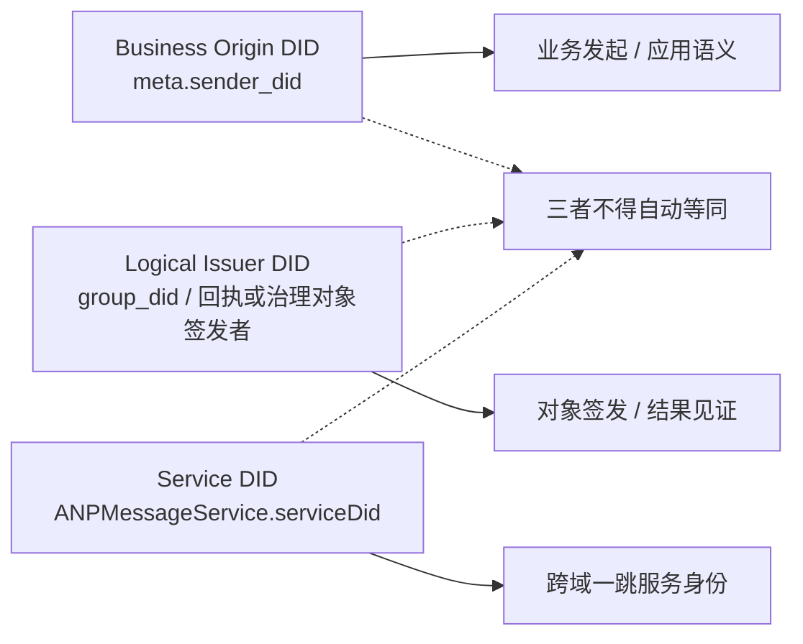
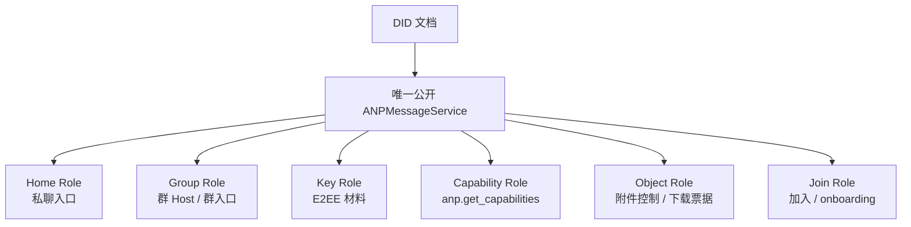
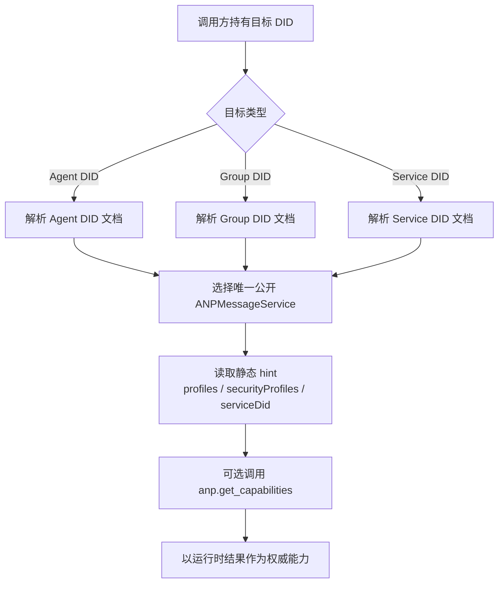

<!-- translation-review: full; source=chinese/message/02-身份与发现.md; basis=entire original read and manually compared paragraph by paragraph -->
> 日本語参考訳（機械翻訳を基に原文全文を照合済み）。規範となるのは原文です。コード例・識別子・規範キーワードは原文を保持しています。
> 原文: [chinese/message/02-身份与发现.md](../../../chinese/message/02-身份与发现.md) / 基準コミット: `0837cfdfaf4ddcf834f0890ddaf34fc4c824e066`

# ANP Profile 2：アイデンティティと発見

- 文書番号：ANP-P2
- 題名：アイデンティティと発見
- 状態：公開済み
- バージョン：1.2
- 仕様セット：ANP Messaging 1.2
- 原文の言語：中国語
- Profile：`anp.identity.discovery.v1`
- 依存先：`anp.core.binding.v1`
- 適用範囲：ANP の Agent／Group のアイデンティティ、サービス発見、サービスエンドポイントの解釈。

---

## 1. 目的

本 Profile は、ANP の識別と発見のモデルを定義します。

1. Agent と Group を DID で表す方法。
2. DID 文書のどのプロパティが、ANP で規範的な意味を持つか。
3. DID 文書で ANP サービスエンドポイントを表す方法。
4. 呼び出し側が、DID 文書から対話可能なサービスを発見する方法。
5. DID 文書に含めてはならない動的状態。
6. デバイス宛て E2EE Profile が、DID 単位の業務上の宛先指定を変えずに、最小限の暗号エンドポイント情報を発見する方法。

次は定義しません。

- DID メソッド自体。
- DID 解決プロトコル自体。
- ハードウェアやデバイスのアイデンティティ、製品上のデバイス名、登録手順。
- 内部複製の同期。
- 具体的な E2EE アルゴリズムの詳細。
- 具体的なグループ状態機械の詳細。

---

## 2. 用語と規範上の取り決め

### 2.1 規範キーワード

本書の **MUST**、**MUST NOT**、**REQUIRED**、**SHALL**、**SHALL NOT**、**SHOULD**、**SHOULD NOT**、**RECOMMENDED**、**NOT RECOMMENDED**、**MAY**、**OPTIONAL** は、大文字表記に従って規範要件として解釈します。

### 2.2 用語

- **Agent DID**：Agent というプロトコル主体を表す DID。
- **Group DID**：グループというプロトコル主体を表す DID。
- **Controller**：DID 文書を更新したり、DID を代表して管理下の操作を開始したりできる主体。
- **ANPMessageService**：DID 文書で公開する、ANP の統一されたサービスの入り口。
- **フェデレーションのサービス DID**：ドメイン間のサービス同士の HTTP 認証で使う DID。通常は `ANPMessageService.serviceDid` で宣言します。
- **Discovery**：DID 文書を解決し、後続のやり取りに適したエンドポイントを選ぶ手順。
- **Device Endpoint（デバイスエンドポイント）**：Agent DID 配下の暗号学的エンドポイント。デバイス宛て E2EE Profile のためだけに、不透明な `device_id` で識別します。DID でも業務上の参加者でもありません。
- **Device Manifest（デバイス目録）**：Agent DID 文書の任意の `deviceManifest` 構造。その DID がデバイス宛て E2EE Profile を宣言する場合だけ必須になります。
- **Eligible Device（適格なデバイス）**：使用時に、鍵参照と宣言した Profile セットが所属 E2EE Profile の要件を満たす、Device Manifest の項目。

---

## 3. 識別モデル

### 3.1 基本原則

第一級の識別子は、次のものです。

- **Agent DID**
- **Group DID**

ANP のプロトコル層は、デバイス DID、端末 DID、セッション DID、複製 DID を定義し**ません**。業務上の宛先、連絡先、メンバー関係、認可上の役割、通常のメッセージ配信は、引き続き Agent DID または Group DID に属します。

デバイス宛て E2EE Profile は、不透明な `device_id` で Agent DID 配下の暗号学的な Device Endpoint を選んでもかまいません（**MAY**）。これは第一級のアイデンティティ、メンバー、`target.kind` ではなく、Base Profile が要求したり含めたりしてはなりません（**MUST NOT**）。複数の稼働複製や、非 E2EE のデバイスへの配信は、引き続き内部実装です。

### 3.2 Agent DID

プロトコル主体として送受信する Agent は、`agent_did` を持たなければなりません（**MUST**）。

`agent_did` の用途：

1. 直接メッセージの送信者と受信者の識別。
2. 制御操作の開始者の識別。
3. 利用できるサービスエンドポイントの解決。
4. Security Overlay に必要な公開資料の取得。
5. 認可と監査の文脈の構築。

### 3.3 Group DID

ドメイン間で発見、参照、管理、メッセージ送信の対象になるグループは、`group_did` を持たなければなりません（**MUST**）。

`group_did` の用途：

1. グループのアプリケーション層のグローバルな識別。
2. グループの発見と管理の基点。
3. グループ管理とメッセージの共通の宛先。
4. グループサービスの発見の入り口。
5. グループ暗号化 Profile が結合する対象。

### 3.4 暗号学的な識別子の分離

Security Overlay が `crypto_group_id`、`session_id`、`channel_id` などの内部識別子を定義する場合：

- `group_did` や `agent_did` と異なってもかまいません（**MAY**）。
- Profile は、DID と暗号学的に結び付ける方法を明示しなければなりません（**MUST**）。
- 受信側が結合を検証できなければなりません（**MUST**）。

### 3.5 ANP のアイデンティティの層

異なる層を混同しないよう、少なくとも次の DID を区別します。

1. **Business Origin DID**：業務の開始者や論理的な送信主体。例えば `meta.sender_did`。
2. **Logical Issuer DID**：通知、受領証、管理オブジェクトが論理的に代表する発行主体。例えば `group_did`。
3. **Service DID**：サービス間の一ホップの呼び出しに使う身元、すなわち `ANPMessageService.serviceDid`。

この三者について：

- 自動的に同じ主体と見なしてはなりません（**MUST NOT**）。
- 署名、認可、ルーティングの責任者を、該当 Profile が明示しなければなりません（**MUST**）。
- ドメイン間では、`serviceDid` で業務主体の DID を置き換えてはなりません（**MUST NOT**）。
- `serviceDid` は、一ホップの呼び出しを行う公開サービスだけを表します。グループの `owner/admin/member` などの業務役割の判定に、そのまま用いてはなりません（**MUST NOT**）。

---

業務の送信者、オブジェクトの発行者、一ホップのサービスの身元は混同されがちです。次の図は三層を一緒に示し、各 Profile から参照できるようにします。



*図 P2-1：ANP のアイデンティティの層（参考情報）。*

後続文書が署名、認可、ルーティングを要求する場合、どの層の DID かを明示するべきです。三者が自動的に同じ主体になると仮定してはなりません。

## 4. DID 文書の ANP での解釈

### 4.1 一般規則

DID 文書の役割：

1. 安定したアイデンティティの入り口。
2. 検証関係と信頼できる鍵資料の宣言。
3. サービスエンドポイントの公開。
4. サービス発見の手掛かり。
5. デバイス宛て E2EE Profile を宣言する場合、暗号エンドポイントの検証に必要な、現在の最小限の Device Manifest の公開。

DID 文書を、次の用途に使ってはなりません（**MUST NOT**）。

- リアルタイムのメッセージ状態データベース。
- 現在のグループメンバーの格納。
- オンライン状態の格納。
- 頻繁な鍵更新のログ。
- Agent 内部の複製一覧。

<a id="method-validation"></a>
#### 4.1.1 DID メソッドの検証

[ANP-02 のアイデンティティ入力](../../../chinese/02-ANP-基于DID的身份认证协议.md#identity-input)と、適用する DID メソッドのバインディングに従って文書を解決・検証します。`did:wba`、`did:web`、その他の対応済みメソッドは、同じサービス発見、鍵用途、デバイス適格性の規則を使います。メソッド固有の文書検証は、そのメソッド仕様が定義します。

発見とオブジェクトの署名検証だけなら、要求認証フローの実行は不要です。ただし、`authentication`、`assertionMethod`、`keyAgreement` は、本 Profile と所属メッセージング Profile の各操作の要件に従って確認します。

### 4.2 DID 文書の最小要件

ANP で使う DID 文書について：

- `id` が必要です（**MUST**）。
- 能動的に発見・対話する DID には、`service` が必要です（**MUST**）。
- 検証や参照だけに使う DID では、`service` を省略できます（**MAY**）。
- 要求の業務開始者になる DID には、`authentication` が必要です（**MUST**）。
- 宣言的な署名オブジェクトに対応するなら、`assertionMethod` があることが望まれます（**SHOULD**）。
- 暗号化 Overlay に対応するなら、`keyAgreement` があることが望まれます（**SHOULD**）。
- `capabilityInvocation` は任意の拡張として存在してもかまいません（**MAY**）が、v1 の最小相互運用要件ではありません。
- デバイス宛て E2EE Profile を宣言する Agent DID には、第 5.5 節に従う `deviceManifest` が必要です（**MUST**）。Base だけなら不要です。

### 4.3 DID 文書の最小化

情報には、次の性質があることが望まれます（**SHOULD**）。

- 変更頻度が低い。
- 機密性が低い。
- 関連付けられにくい。
- DID の用途に直接関係する。

満たさない内容は、文書に埋め込まず、アクセスを管理するサービスエンドポイントで提供することが望まれます（**SHOULD**）。

---

## 5. Agent DID

### 5.1 必須の意味

ANP の Agent DID 文書は、少なくとも次を表さなければなりません（**MUST**）。

1. `id`
2. 後続のやり取りに使える、少なくとも一つの `service`。

### 5.2 認証関係

業務開始者として `meta.sender_did` に現れる Agent DID、または `anp-rfc9421-origin-proof-v1` の業務 proof の `keyid` の検証経路に現れる Agent DID は、`authentication` 関係を提供しなければなりません（**MUST**）。

`auth.origin_proof` を使う要求では、`keyid` が指す検証メソッドが DID 文書の `authentication` で認可されていることを、検証者が確認しなければなりません（**MUST**）。

受動的な参照、オブジェクトの帰属、オフライン検証だけに使い、要求の開始者にならない Agent DID は、`authentication` を省略できます（**MAY**）。

グループ管理、宣言、署名付き制御オブジェクトについて表明する Agent は、`assertionMethod` を提供することが望まれます（**SHOULD**）。

### 5.3 鍵合意の関係

E2EE Overlay に対応する Agent は、`keyAgreement` を提供することが望まれます（**SHOULD**）。  
`keyAgreement` 用の検証メソッドは、その DID の鍵合意や機密情報受信に使う公開鍵資料だけを表さなければなりません（**MUST**）。

### 5.4 サービスエンドポイント

Direct、Capability、Object 制御プレーンなど、能動的な発見を要する ANP 能力に対応する Agent DID 文書には、少なくとも一つの `ANPMessageService` が必要です（**MUST**）。

統一された入り口で、次を同時に提供してもかまいません（**MAY**）。

- 直接メッセージの主な入り口。
- 能力交渉。
- Security Overlay の公開資料へのアクセス。
- オブジェクト制御プレーンとダウンロードの入り口の発見。

これらを内部で複数の構成要素に分けても、それは実装詳細です。DID 文書で、それぞれを独立した複数の ANP サービス型として公開するべきではありません（**SHOULD NOT**）。

公開の添付制御メソッドにも、統一した `ANPMessageService` から入らなければなりません（**MUST**）。内部で Object Service、Key Service、Group Host に経路を分けるかは実装詳細で、標準の発見モデルを変えません。

### 5.5 デバイス宛て E2EE Profile の Device Manifest

`deviceManifest` は Agent DID 文書のトップレベル拡張で、Direct E2EE、Group E2EE など、暗号学的なデバイスエンドポイントを宛先にする安全性の Profile だけが使います。Agent DID を複数の業務アイデンティティの集合に変えるものではなく、通常の Base は使いません。

標準構造：

```json
{
  "deviceManifest": {
    "type": "ANPDeviceManifest",
    "devices": [
      {
        "device_id": "dev-a-7N3KQ2",
        "signing_key_id": "did:example:agent-a#dev-a-sign",
        "e2ee_key_id": "did:example:agent-a#dev-a-e2ee",
        "profiles": [
          "anp.core.binding.v1",
          "anp.identity.discovery.v1",
          "anp.direct.base.v1",
          "anp.direct.e2ee.v2"
        ]
      }
    ]
  }
}
```

規則：

1. デバイス宛て E2EE Profile を宣言・呼び出す Agent DID は、現在の `deviceManifest` を公開しなければなりません（**MUST**）。Base だけに対応する Agent DID は省略できます（**MAY**）。
2. `deviceManifest.type` は `ANPDeviceManifest`（**MUST**）、`devices` は配列（**MUST**）でなければなりません。標準の各項目は、`device_id`、`signing_key_id`、`e2ee_key_id`、`profiles` の四つだけを含めなければなりません（**MUST**）。
3. `device_id` は不透明な文字列で、現在の Agent DID の Manifest 内で一意でなければなりません（**MUST**）。削除後に再利用してはなりません（**MUST NOT**）。DID、製造番号、表示名、役割ではありません。
4. `signing_key_id` と `e2ee_key_id` は、同じ Agent DID 文書の検証メソッドを参照する DID URL でなければなりません（**MUST**）。`signing_key_id` は、所属 E2EE Profile の検証関係で認可される必要があります（**MUST**）。Origin Proof なら `authentication`、Object Proof なら `assertionMethod` です。`e2ee_key_id` は `keyAgreement` で認可されなければなりません（**MUST**）。
5. `profiles` は空でない文字列配列で、対応する完全な依存先セットを含めなければなりません（**MUST**）。P5 の項目は P1/P2/P3/P5、P6 は P1/P2/P4/P6 を含みます。Base を依存先に挙げても、Base 操作がデバイス宛てになるわけではありません。
6. P3 Direct Base、P4 Group Base、P7 の通常添付、その他の非 E2EE フローは、Manifest を参照して selector を要求したり、デバイス別結果を公開したり、DID 単位の配信の意味を変えたりしてはなりません（**MUST NOT**）。
7. デバイス削除では、その項目と有効なデバイス鍵参照を除いた DID 文書を公開します。その後に削除したデバイスを選ぶ、デバイス宛て操作は拒否しなければなりません（**MUST**）。再登録は新しい `device_id` と鍵を使います。
8. Manifest は DID 文書の一部として、その DID メソッドで保護・更新します。独立した Manifest endpoint、proof、epoch、hash、checkpoint、compare-and-swap プロトコルは定義しません。
9. Manifest に秘密鍵、製品内の役割や token、人間可読のデバイス名、ハードウェア識別子、オンライン状態、復旧状態、内部複製の構成を含めてはなりません（**MUST NOT**）。

---

## 6. Group DID

### 6.1 必須の意味

Group DID 文書は、少なくとも次を表さなければなりません（**MUST**）。

1. `id`
2. `controller`
3. 少なくとも一つのグループサービスエンドポイント（`ANPMessageService`）。

### 6.2 グループの制御権

`controller` は一つでも複数でもかまいません。  
複数の制御者の内部協働は定義しませんが：

- 文書更新の正当性は DID メソッドが保証しなければなりません（**MUST**）。
- 呼び出し側は、解決して得た DID 文書を基準にしなければなりません（**MUST**）。
- グループ管理 Profile が、役割と認可規則をさらに定義しなければなりません（**MUST**）。

### 6.3 グループ管理の検証関係

`anp.group.base.v2` に対応する Group DID 文書では：

- `assertionMethod` が必要です（**MUST**）。
- `capabilityInvocation` を追加の管理能力の委任関係として含めてもかまいません（**MAY**）が、`assertionMethod` を置き換えません。

グループ管理、ポリシー、状態のオブジェクトの署名を検証する場合、DID 文書で許可された検証関係を使わなければなりません（**MUST**）。

### 6.4 禁止する内容

次を Group DID 文書に直接埋め込んではなりません（**MUST NOT**）。

- 動的なメンバー一覧。
- オンラインのメンバー一覧。
- 現在のメッセージ番号。
- 現在のグループ epoch。
- メッセージごとの状態。
- ワンタイム事前鍵の一覧。
- 現在の MLS KeyPackage 集合。
- 頻繁に変わる招待／参加の管理キュー。
- Agent 内部の複製一覧。

### 6.5 任意の内容

機密情報を漏らさないようにしつつ、次を含めてもかまいません（**MAY**）。

- 表示名。
- アイコンの参照。
- 公開の説明。
- 公開ポリシーの要約。
- 文書のバージョン情報。
- サービス能力の要約。

プライバシーの漏えいや関連付けの明らかなリスクがある項目は、文書に含めず（**SHOULD NOT**）、アクセス制限したサービスで提供するべきです。

---

## 7. ANP サービスエンドポイント型

### 7.1 一般規則

DID 文書の `service` からサービスを発見します。  
すべての ANP サービスエンドポイントオブジェクトは、次を持たなければなりません（**MUST**）。

- `id`
- `type`
- `serviceEndpoint`

少量の静的ヒントを含めてもかまいません（**MAY**）が、v1 の標準相互運用で必要なのは次の項目です。

- `profiles`
- `securityProfiles`
- `serviceDid`

現在、DID 文書で公開する ANP 標準サービス型には、`ANPMessageService` だけを使うことが望まれます（**SHOULD**）。  
私信、グループ、鍵、オブジェクト、ドメイン間転送を内部で分けるのは実装詳細であり、独立した複数の標準 `service type` ではありません。

ドメイン間のサービス選択を曖昧にしないため、各 DID 文書は、ドメイン間呼び出しに使える `ANPMessageService` を一つだけ公開しなければなりません（**MUST**）。  
内部の複数構成要素は、その単一の公開 `ANPMessageService` の下にまとめなければなりません（**MUST**）。

### 7.2 `ANPMessageService`

#### 7.2.1 意味

`ANPMessageService` は、DID 文書から公開で発見する、メッセージと対話の統一された入り口です。

#### 7.2.2 用途

- `direct.send` の受信。
- `group.get_info`、`group.send`、`group.e2ee.send`、グループ管理／E2EE 操作の受信。
- `anp.get_capabilities` の提供。
- Direct／Group E2EE の公開資料へのアクセス。
- 対応する配備での `group.e2ee.notice` の受信・配信。
- `attachment.create_slot`、`attachment.commit_object`、`attachment.abort_object`、`attachment.get_download_ticket` の提供。
- 対応する配備での、オブジェクトの HTTP(S) ダウンロードの入り口を発見する基点。

公開の添付制御メソッドにも、統一した `ANPMessageService` から入らなければなりません（**MUST**）。内部の Object Service、Key Service、Group Host への振り分けは実装詳細で、公開の標準発見モデルを変えません。

#### 7.2.3 要件

- 能動的に発見・対話する Agent DID 文書には、少なくとも一つの `ANPMessageService` が必要です（**MUST**）。
- Group DID 文書にも、少なくとも一つの `ANPMessageService` が必要です（**MUST**）。
- ドメイン間サービス呼び出しに参加する `ANPMessageService` の項目は、`serviceDid` を宣言しなければなりません（**MUST**）。
- 内部に複数の構成要素があっても、DID 文書には統一した入り口だけを公開し、詳細な能力境界は実行時の能力交渉で返さなければなりません（**MUST**）。
- 公開の service-scoped メソッドは、鍵資料や添付制御も含め、Profile が endpoint-local と明示する場合を除き、統一した入り口の `serviceDid` を宛先サービスの身元の基点にしなければなりません（**MUST**）。

曖昧さを減らすため、v1 は統一した `ANPMessageService` の公開を推奨します。次の図は、それと内部の論理的な役割を示し、公開サービス型と実装内の責任分担を区別します。



*図 P2-2：統一された ANPMessageService と内部の役割（参考情報）。*

図の役割は内部の能力の境界を示すだけで、新たな DID の `service type` ではなく、標準の発見フィールドを置き換えるべきではありません。

### 7.3 `ANPMessageService` の論理的な役割

統一した入り口の背後の能力境界を示す**参考説明**です。独立した標準 service type でも、v1 のサービス選択フィールドでもありません。

#### 7.3.1 Home Role

Agent 側の主な入り口で、`direct.send` の受信、能力情報の返却、後続のやり取りの案内を担います。

#### 7.3.2 Key Role

Security Overlay の公開資料の公開・発見を担います。

- 直接メッセージ E2EE の公開資料の発見。
- グループ E2EE の初期設定資料の発見。
- 後続の Security Profile が定義する公開オブジェクトの発見。

#### 7.3.3 Group Role

グループの主な入り口または Host の能力です。

- `group.create` 後の管理操作。
- `group.send` と `group.e2ee.send` の受信。
- ポリシー、E2EE 能力、関連する制御の入り口の公開。
- グループ状態変更の順序付けの権威となる入り口。

#### 7.3.4 Join Role

参加と招待に関する入り口の能力です。

#### 7.3.5 Capability Role

能力交渉の入り口です。

#### 7.3.6 Object Role

アップロード、アクセス制御、ダウンロードチケット発行、ダウンロードの入り口の発見の能力です。

#### 7.3.7 ドメイン間の転送

`ANPMessageService` の背後でドメイン間の転送やゲートウェイを実装してもかまいません（**MAY**）が、現在は独立した DID service type を定義し**ません**。

ドメイン間サービス呼び出しを有効にする場合、外側の HTTP 認証を行うドメインゲートウェイやサービスは、通常の Agent DID／Group DID ではなく、ドメイン所有者が予約したフェデレーションのサービス DID を使うことが望まれます（**SHOULD**）。P8 が規則を定義します。

#### 7.3.8 透明性のあるディレクトリと監査索引

ディレクトリ透明性、透明性ログ、監査索引に対応する場合、`ANPMessageService` の拡張能力として提供してもかまいません（**MAY**）。現在は独立した DID service type を定義しません。

---

## 8. サービスエンドポイントの拡張フィールド

v1 の静的ヒントは少数のフィールドだけにし、その他の能力情報は `anp.get_capabilities` に移すことが望まれます（**SHOULD**）。

### 8.1 `profiles`

- 型：文字列配列。
- 意味：エンドポイントが直接対応する ANP Profile の集合。
- 要求：**SHOULD**。
- 説明：キャッシュ可能で粗い静的ヒントであり、実行時の能力交渉を置き換えません。

### 8.2 `securityProfiles`

- 型：文字列配列。
- 意味：対応するセキュリティモードの集合。
- 要求：**SHOULD**。
- 説明：エンドポイント全体の対応範囲であり、全メソッドが全モードで使える保証ではありません。

### 8.3 `acceptedContentTypes`

- 型：文字列配列。
- 意味：受け入れるメッセージ内容型の集合。
- 要求：**v1 の標準 DID ヒントには含めません**。
- 説明：
  - 公開するなら `anp.get_capabilities` で返すことが望まれます（**SHOULD**）。
  - DID 文書にあっても、実装拡張として扱ってかまいません（**MAY**）。

### 8.4 `acceptedObjectTypes`

- 型：文字列配列。
- 意味：受け入れる制御プレーンのオブジェクト型の集合。
- 要求：**v1 の標準 DID ヒントには含めません**。
- 説明：DID 文書への静的な記載ではなく、実行時の能力として返すことを推奨します。

### 8.5 `priority`

- 型：整数。
- 意味：エンドポイントの優先度。
- 要求：**v1 の標準 DID ヒントには含めません**。
- 説明：
  - v1 は、DID 文書の `priority` によるサービス選択に依存しません。
  - 独自に定義する場合は、非公開の拡張として扱います。

### 8.6 `authSchemes`

- 型：文字列配列。
- 意味：caller → service の呼び出し側の認証方式。
- 要求：**v1 の標準 DID ヒントには含めません**。
- 説明：
  - 実行時のゲートウェイ設定で変わる能力です。
  - `anp.get_capabilities` で公開する方が適しています。
  - 業務層の `anp-rfc9421-origin-proof-v1` の proof 格納形式を記述するものでも**ありません**。

### 8.7 `serviceDid`

- 型：文字列。
- 意味：`ANPMessageService` がドメイン間のサービス同士の HTTP 認証で使う DID。
- 要求：ドメイン間サービス呼び出しに参加する場合は **MUST**。

規則：

1. `serviceDid` は DID 文字列であり、DID URL ではありません（**MUST**）。
2. 外側の HTTP Message Signatures の `keyid` は、`serviceDid` 文書の `authentication` で認可された検証メソッドを指さなければなりません（**MUST**）。
3. `did:web`／`did:wba` の配備では、`serviceDid` にドメイン名だけの DID を優先することが望まれます（**SHOULD**）。
4. `serviceDid` はドメイン間呼び出しを行うサービスの身元であり、`meta.sender_did` の業務主体とは異なります。
5. `serviceDid` の実行時の検証手順は P8 が定義します。
6. DID 文書の `serviceDid` は発見のヒントであり、本当の信頼は P8 の実行時検証の成功で成立します。
7. service-scoped メソッドでは、`meta.target.did` を公開 `ANPMessageService.serviceDid` に結び付けることが望まれます（**SHOULD**）。オブジェクト制御、鍵資料、グループ参加資料のメソッドも、Profile が endpoint-local と明示する場合を除き、この原則に従います。

---

## 9. 発見の手順

Agent、Group、`serviceDid` の3つの経路は、最終的に公開 `ANPMessageService` と実行時の能力交渉に集約します。次の図は、その全体像を示します。



*図 P2-3：Agent／Group／Service の共通の発見手順（参考情報）。*

第 9.1、9.2、9.3 節は、この一つの手順を対象ごとに具体化したもので、独立した三つの考え方ではありません。

### 9.1 Agent の発見

`agent_did` について：

1. `agent_did` を解決し、DID 文書を得ます。
2. `service` 一覧を読みます。
3. 唯一のドメイン間 `ANPMessageService` を選びます。
4. サービス間の呼び出しが続く場合は、`serviceDid` を読みます。
5. `profiles`、`securityProfiles`、実行時能力、ローカルポリシーから、使える具体的な能力を決めます。
6. 通常の Base 操作は Agent DID と選択したサービスを直接使います。`deviceManifest` は不要で、デバイスを選ばず、既定のデバイスも捏造しません。
7. デバイス宛て E2EE では、現在の `deviceManifest` を解決し、所属 E2EE Profile に従ってだけ Eligible Device を選びます。
8. 明示的な能力交渉が必要なら、同じ入り口の `anp.get_capabilities` を呼びます。

### 9.2 Group の発見

`group_did` について：

1. `group_did` を解決し、DID 文書を得ます。
2. 唯一の `ANPMessageService` を読みます。
3. サービス間呼び出しが続く場合は、`serviceDid` を読みます。
4. `profiles`、`securityProfiles`、実行時能力、ローカルポリシーから、管理、メッセージ、参加、E2EE の能力を決めます。
5. グループ E2EE を使う場合は、同じ入り口から、グループ側の公開資料、暗号学的結果の配送能力、制御操作を発見します。メンバー側の参加資料は、各 Agent DID の統一した入り口で発見します。

### 9.3 Service DID の発見

service-scoped メソッドの宛先 `serviceDid` が既知の場合：

1. `serviceDid` の DID 文書を解決します。
2. その `serviceDid` に対応する `ANPMessageService` を選びます。
3. `serviceEndpoint` と静的ヒントを読みます。
4. 正確な能力境界が必要なら、同じ入り口の `anp.get_capabilities` を呼びます。
5. P8 の実行時サービス身元結合の検証に成功した後だけ、`serviceDid` を信頼できるドメイン間サービスの身元として扱えます。

添付のダウンロードチケットを取得する際は、manifest を運ぶ元のメッセージの送信者 DID を基点に、公開 `ANPMessageService` を解決しなければなりません（**MUST**）。グループでも、元の送信者の DID であり、`group_did` ではありません。`object_uri` の URL のドメイン名だけから、制御サービスを逆算してはなりません（**MUST NOT**）。

### 9.4 サービスの選択

候補が複数あれば、次の順で選ばなければなりません（**MUST**）。

1. 要求する `profile` で絞る。
2. 要求する `security_profile` で絞る。
3. 実行時の能力交渉結果で、権威ある検証を行う。
4. 残る候補はローカルポリシーで選ぶ。

v1 の標準選択は、DID 文書の `supportedMethods`、`logicalRoles`、`priority` に依存し**ません**。

### 9.5 キャッシュ

DID 解決とサービス選択の結果をキャッシュしてもかまいません（**MAY**）。  
次の場合は、再解決することが望まれます（**SHOULD**）。

- 署名検証の失敗。
- 鍵合意の失敗。
- エンドポイントからの能力変更の通知。
- DID 制御権の変更の疑い。
- `serviceDid` の検証失敗。
- endpoint-origin 結合の失敗。
- 静的ヒントと実行時能力の矛盾。
- ローカルキャッシュの期限切れ。

---

## 10. DID 文書と Security Overlay

### 10.1 `keyAgreement` の使用

Agent DID／Group DID 文書が `keyAgreement` を宣言する場合、Security Profile はそこで許可されたメソッドだけを、機密情報の受信や鍵合意の根拠に使わなければなりません（**MUST**）。

### 10.2 署名の検証関係

オブジェクトが、ある DID による表明だと主張する場合：

`auth.origin_proof` を使う要求は認証制御の行為として扱い、`authentication` を確認しなければなりません（**MUST**）。

- 認証制御の行為なら、`authentication` を確認することが望まれます（**SHOULD**）。
- 宣言や署名による表明なら、`assertionMethod` を確認することが望まれます（**SHOULD**）。
- 管理能力の呼び出しなら、`capabilityInvocation` を確認してもかまいません（**MAY**）が、v1 の最小相互運用要件ではありません。

### 10.2.1 デバイスの安全性の結合

デバイス selector や公開鍵を使う前に、デバイス宛て E2EE Profile は、現在の Agent DID の `deviceManifest` で選択した項目を検証しなければなりません（**MUST**）。項目は要求する E2EE Profile と依存先を宣言し（**MUST**）、鍵参照は実際の操作の鍵と一致しなければなりません（**MUST**）。

`auth.origin_proof` と `meta.sender_device_id` を併用する場合、proof の `keyid` は項目の `signing_key_id` と等しくなければなりません（**MUST**）。E2EE に `meta.recipient_device_id` を使う場合、暗号化や接続用の鍵は、選択した `e2ee_key_id` でなければなりません（**MUST**）。認証対象の文脈と拒否する時点は、所属 P5/P6 相当の E2EE Profile が定義します。

通常の Base は selector を含めずデバイス鍵も選ばないため、これらの検査は適用しません。

### 10.3 動的な安全性の資料を外に置く

次は DID 文書に埋め込まず、管理されたサービスで提供することが望まれます（**SHOULD**）。

- 頻繁に更新される公開資料。
- 一度限りの初期設定資料。
- グループ epoch に関する資料。
- 動的なグループ状態の要約。

---

## 11. Group DID とグループ管理

### 11.1 Group DID の役割

`group_did` はアプリケーション層のグローバルな識別子であり、特定の暗号実装内部の ID ではありません。

### 11.2 グループ管理を外に置く

メンバー関係、役割の認可、招待やメンバーの状態、ポリシーの版、状態の要約などは、次のものが提供・署名することが望まれます（**SHOULD**）。

- グループの `ANPMessageService`。
- 将来のグループ管理 Profile。

DID 文書に格納するものではありません。

### 11.3 制御権とグループポリシーの分離

`controller` は、DID 文書自体を制御できる者だけを表します。  
メンバーの追加・削除やポリシー変更の権限はアプリケーション層の規則で、`controller` から機械的に導くべきではありません。  
同様に、`serviceDid` はサービス呼び出しの身元で、グループの `owner/admin/member` などの業務役割の主体と直接解釈するべきではありません。

---

## 12. Agent DID 移行の検証

### 12.1 メソッド固有の移行 Profile

P2 は移行を呼び出す共通の意味を定義します。具体的な proof 規則は DID メソッド仕様が担います。次と等価な内部操作を提供することが望まれます（**SHOULD**）。

```text
resolve_current_agent_did(input_did, trusted_cache)
  -> { requested_did, current_did, transition_status, assurance }
  | error
```

結果は内部用であり、ANP Messaging の wire オブジェクトに `stable_subject_id`、安定主体パス、別のアイデンティティフィールドを追加してはなりません（**MUST NOT**）。

### 12.2 `e1_` パス型 did:wba の移行

最初に登録された自動移行の経路は、末尾が `e1_` 指紋 Profile のパス型 did:wba DID です。解決者は、それまで信頼していた DID から出発し、[ANP-03 メソッド規則](../../../chinese/03-did-wba方法规范.md#wba-method-rules)で各ホップと最終的な有効 DID 文書を検証し、循環、後継の競合、信頼済みキャッシュとの競合を拒否しなければなりません（**MUST**）。

信頼していない新 DID から逆向きに始めてはならず（**MUST NOT**）、既存アイデンティティとパスが似ているだけで連続性を導くこともできません。

### 12.3 連続性の assurance

移行結果は、本当の assurance を保持しなければなりません（**MUST**）。

- `verified`：旧 DID の結合ルート鍵が、無効化と後継の関係に署名した。
- `recovery_verified`：それまで信頼していた旧文書で事前に認可された復旧鍵が、移行を成立させた。
- `provider_asserted`：旧 binding key や事前認可 recovery key の proof はないものの、認証済みの同一オリジン HTTPS 解決が、直接の後継の完全なチェーンを検証し、proof が有効な active DID に到達した場合。または Provider が、独立に認証された recovery/transition の権威ある経路で、predecessor→successor の事実を提供した場合。単独の `successorDid`、Handle/WNS のマッピング、署名のない standalone ホップ、409 ヒントだけでは、この水準を満たさない。
- `unverified`：受け入れられる連続性の証拠がない。

移行 resolver が `provider_asserted` を返すのは、認証された完全なチェーンの解決に成功した場合だけです。独立に認証された Provider の権威ある経路については、所属業務システムが判断します。どちらの情報源も、binding key や recovery key による暗号学的な連続性に結果を格上げするものではありません。継承できる関係や認可は、業務システムが決めます。

業務 Profile は `provider_asserted` を `verified`／`recovery_verified` と見なしてはならず（**MUST NOT**）、`provider_asserted` というだけで強制失敗にしてもなりません（**MUST NOT**）。十分な assurance か、どの関係・認可を継承するかは業務システムが判断します。`unverified` では移行の連続性を成立させられません。

### 12.4 ヒントと未対応の移行 Profile

`alsoKnownAs` や同じ安定主体パスを候補の発見に使ってもかまいません（**MAY**）。ただし、移行、役割、メンバー関係、ACL、添付認可、E2EE 適格性を、それだけで認めることはできません。

ドメイン名だけの did:wba、`k1_` DID、結合指紋のない歴史的パス、`did:web`、その他の ANP 移行検証 Profile が未登録のメソッドでは：

- 有効かつ検証可能なら、元の完全な DID のまま使います。
- 名前、パス、`alsoKnownAs` だけから、DID をまたぐ連続性を導いてはなりません（**MUST NOT**）。
- DID が無効化されたら、安全側に拒否し（**MUST**）、`anp.did_transition_invalid` と `reason = transition_profile_not_supported` を返します。

### 12.5 Group DID の境界

Group DID の自動移行は定義しません。正確な `group_did` が無効化されたら、Host は新たなグループ操作と P6 アプリケーションメッセージ処理を拒否し（**MUST**）、Group DID の後継を自動的に追ってはなりません（**MUST NOT**）。過去の受領証と署名は、引き続き過去の Group DID で検証します。

---

## 13. プライバシーと最小限の公開

### 13.1 エンドポイントの最小化

DID 文書の `service` 項目は最小限にすることが望まれます（**SHOULD**）。  
公開の発見が不要なサービスは、文書に含めるべきではありません（**SHOULD NOT**）。

### 13.2 関連付けの抑制

実装は、次を避けることが望まれます（**SHOULD**）。

- 複数の DID 文書で、強い関連付けを生む特徴的なエンドポイント形式を再利用する。
- 組織構造、配備構成、内部の役割分布を直接推測できる説明を含める。
- メッセージ量、活動度、オンライン状態、内部複製構成を公開する。

### 13.3 公開と制限付き情報の分離

公開発見に必要な情報は DID 文書に含めてもかまいません（**MAY**）。  
アクセス制御が必要な情報は、制限付きサービスから返すことが望まれます（**SHOULD**）。

### 13.4 Device Manifest の最小化

Manifest が必要な場合、公開内容は第 5.5 節の四つのデバイス項目フィールドに限定しなければなりません（**MUST**）。利用者向けではない不透明な `device_id` を使い、デバイスのラベル、ハードウェアの詳細、オンライン状態、ローカルポリシー、復旧データは文書の外に置くべきです。

---

## 14. 最小相互運用要件

適合実装は、少なくとも次を満たさなければなりません（**MUST**）。

1. 各 Agent に `agent_did` がある。
2. 各 Group に `group_did` がある。
3. Agent／Group DID 文書に、少なくとも一つの `ANPMessageService` がある。
4. DID 文書によるサービス発見に対応する。
5. 静的ヒントは、最低限 `profiles`、`securityProfiles`、`serviceDid` に対応する。
6. 実行時能力の基準に `anp.get_capabilities` を使う。
7. 動的なグループ状態を DID 文書に埋め込まない。
8. 通常の Base 発見と配信は DID 単位を維持し、デバイス selector も Manifest も要求しない。
9. デバイス宛て E2EE を宣言する場合、第 5.5 節の最小の `deviceManifest` を公開・検証する。
10. Device DID、デバイスの業務メンバー関係、製品内の複製の意味を導入しない。
11. 登録済みの Agent DID 移行では真の assurance を返し、二重の wire identity を導入しない。
12. 第 12 節の `e1_` did:wba 移行 Profile への対応を宣言するなら、検証規則を実装する。
13. `alsoKnownAs` は候補発見だけに使い、移行 Profile が未登録の無効化済み DID は安全側に拒否する。
14. Group DID を自動移行しない。

---

## 15. 例

### 15.1 Agent DID 文書の抜粋

次は、Direct E2EE の暗号学的 Device Endpoint を二つ持つ Agent DID です。二つの Agent を作るのではなく、サービス一覧の通常の Base Profile は引き続き DID 宛てです。

```json
{
  "id": "did:example:agent-a",
  "verificationMethod": [
    {
      "id": "did:example:agent-a#dev-a-sign",
      "type": "JsonWebKey2020",
      "controller": "did:example:agent-a",
      "publicKeyJwk": {
        "kty": "OKP",
        "crv": "Ed25519",
        "x": "..."
      }
    },
    {
      "id": "did:example:agent-a#dev-a-e2ee",
      "type": "JsonWebKey2020",
      "controller": "did:example:agent-a",
      "publicKeyJwk": {
        "kty": "OKP",
        "crv": "X25519",
        "x": "..."
      }
    },
    {
      "id": "did:example:agent-a#dev-a2-sign",
      "type": "JsonWebKey2020",
      "controller": "did:example:agent-a",
      "publicKeyJwk": {
        "kty": "OKP",
        "crv": "Ed25519",
        "x": "..."
      }
    },
    {
      "id": "did:example:agent-a#dev-a2-e2ee",
      "type": "JsonWebKey2020",
      "controller": "did:example:agent-a",
      "publicKeyJwk": {
        "kty": "OKP",
        "crv": "X25519",
        "x": "..."
      }
    }
  ],
  "authentication": [
    "did:example:agent-a#dev-a-sign",
    "did:example:agent-a#dev-a2-sign"
  ],
  "assertionMethod": [
    "did:example:agent-a#dev-a-sign",
    "did:example:agent-a#dev-a2-sign"
  ],
  "keyAgreement": [
    "did:example:agent-a#dev-a-e2ee",
    "did:example:agent-a#dev-a2-e2ee"
  ],
  "service": [
    {
      "id": "did:example:agent-a#message",
      "type": "ANPMessageService",
      "serviceEndpoint": "https://agent-a.example.com/anp",
      "serviceDid": "did:example:domain-a",
      "profiles": [
        "anp.core.binding.v1",
        "anp.identity.discovery.v1",
        "anp.direct.base.v1",
        "anp.direct.e2ee.v2",
        "anp.attachment.v1"
      ],
      "securityProfiles": [
        "transport-protected",
        "direct-e2ee"
      ]
    }
  ],
  "deviceManifest": {
    "type": "ANPDeviceManifest",
    "devices": [
      {
        "device_id": "dev-a-7N3KQ2",
        "signing_key_id": "did:example:agent-a#dev-a-sign",
        "e2ee_key_id": "did:example:agent-a#dev-a-e2ee",
        "profiles": [
          "anp.core.binding.v1",
          "anp.identity.discovery.v1",
          "anp.direct.base.v1",
          "anp.direct.e2ee.v2"
        ]
      },
      {
        "device_id": "dev-a2-9R5TLM",
        "signing_key_id": "did:example:agent-a#dev-a2-sign",
        "e2ee_key_id": "did:example:agent-a#dev-a2-e2ee",
        "profiles": [
          "anp.core.binding.v1",
          "anp.identity.discovery.v1",
          "anp.direct.base.v1",
          "anp.direct.e2ee.v2"
        ]
      }
    ]
  }
}
```

### 15.2 Group DID 文書の抜粋

```json
{
  "id": "did:example:group-123",
  "controller": [
    "did:example:group-host",
    "did:example:group-admin-controller"
  ],
  "verificationMethod": [
    {
      "id": "did:example:group-123#gov-1",
      "type": "JsonWebKey2020",
      "controller": "did:example:group-123",
      "publicKeyJwk": {
        "kty": "OKP",
        "crv": "Ed25519",
        "x": "..."
      }
    }
  ],
  "assertionMethod": [
    "did:example:group-123#gov-1"
  ],
  "service": [
    {
      "id": "did:example:group-123#message",
      "type": "ANPMessageService",
      "serviceEndpoint": "https://group-host.example.com/anp/groups/group-123",
      "serviceDid": "did:example:group-host-domain",
      "profiles": [
        "anp.core.binding.v1",
        "anp.identity.discovery.v1",
        "anp.group.base.v2",
        "anp.group.e2ee.v2"
      ],
      "securityProfiles": [
        "transport-protected",
        "group-e2ee"
      ]
    }
  ]
}
```

Group DID はグループの業務上の身元なので、`deviceManifest` を持ちません。P6 がメンバーデバイスのエンドポイントを必要とする場合は、そのメンバーの Agent DID の Manifest を解決します。通常の Group Base の発見では行いません。

---

## 16. 将来のレジストリ

将来の版で、次を設けることが望まれます（**SHOULD**）。

1. ANP DID Service Type。
2. サービスエンドポイントの拡張フィールド。
3. アイデンティティ発見のエラーコード。
4. グループ管理のオブジェクト型。

---

## 17. 参考実装の説明（参考情報）

実装には、次の原則を推奨します。

- DID 文書は安定した入り口であり、リアルタイムの状態表ではありません。
- サービスエンドポイントは発見の基点であり、全データの入れ物ではありません。
- 動的な能力は、文書に詰め込まず、なるべく `anp.get_capabilities` で返します。
- グループ DID はアプリケーション層の識別子であり、全暗号状態の唯一のシリアライズではありません。
- Base のデバイスへの配信、登録状態、製品内のデバイス Registry 状態、複製、内部実行器は Agent 内部に保ち、wire に載せません。
- デバイス宛て E2EE は、現在の `deviceManifest`、参照鍵、宣言能力、所属 Profile の規則だけで適格性を判断します。宣言されていない Registry の版や checkpoint に依存してはなりません。
