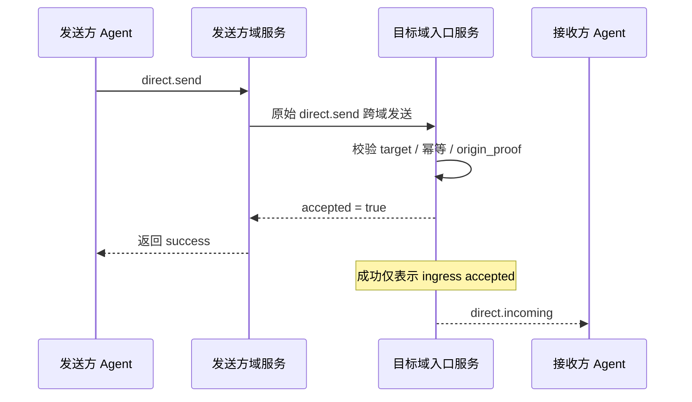

<!-- translation-review: full; source=chinese/message/03-私聊基础语义.md; basis=entire original read and manually compared paragraph by paragraph -->
> 日本語参考訳（機械翻訳を基に原文全文を照合済み）。規範となるのは原文です。コード例・識別子・規範キーワードは原文を保持しています。
> 原文: [chinese/message/03-私聊基础语义.md](../../../chinese/message/03-私聊基础语义.md) / 基準コミット: `0837cfdfaf4ddcf834f0890ddaf34fc4c824e066`

# ANP Profile 3：私信の基本意味論

- 文書番号：ANP-P3
- 題名：私信の基本意味論
- 状態：公開済み
- バージョン：1.2
- 仕様セット：ANP Messaging 1.2
- 原文の言語：中国語
- Profile：`anp.direct.base.v1`
- 依存先：`anp.core.binding.v1`、`anp.identity.discovery.v1`
- 適用範囲：Agent 間の基本的な私信の意味に適用し、エンドツーエンド暗号化のアルゴリズム自体は含みません。

---

## 1. 目的

本 Profile は ANP の私信の基本意味論を定義し、次を定めます。

1. Agent 間の直接メッセージの表現。
2. 最小限の相互運用フィールドと内容モデル。
3. 成功、冪等性、順序付けの意味。
4. E2EE を使わずに独立して動作する方法。
5. メソッドに依存しない送信者認証と、ドメインをまたぐ発信者証明の表現。
6. Direct E2EE Profile を業務の意味の上に重ねる方法。

次は定義し**ません**。

- 具体的な E2EE アルゴリズム。
- デバイスや内部複製の概念。
- 履歴の取得。
- 既読状態。
- Presence。
- Agent 内部の同期。
- 大きなオブジェクトの暗号文形式。

---

## 2. 用語と規範上の取り決め

### 2.1 規範キーワード

本書の **MUST**、**MUST NOT**、**REQUIRED**、**SHALL**、**SHALL NOT**、**SHOULD**、**SHOULD NOT**、**RECOMMENDED**、**NOT RECOMMENDED**、**MAY**、**OPTIONAL** は、大文字表記に従って規範要件として解釈します。

### 2.2 用語

- **Direct Message**：Agent から別の Agent へのアプリケーション層メッセージ。
- **Sender Agent**：`direct.send` を開始し、外側の `params.meta.sender_did` が識別する Agent。
- **Recipient Agent**：`direct.send` の宛先で、外側の `params.meta.target.did` が識別する Agent。
- **Ingress Service**：直接メッセージを受ける、宛先 Agent が公開する主な入り口サービス。
- **Conversation**：送受信者間のアプリケーション層の会話文脈。安定した `conversation_id` があるかは業務層が決めます。
- **Accepted**：宛先 Agent の入り口サービスが受理し、その処理境界内に入った状態。
- **Rejected**：プロトコル層で拒否され、宛先 Agent の処理境界内に入っていない状態。
- **Origin Proof**：送信側 Agent が、P1 付録 A の ANP-02 メッセージバインディングで生成する、アプリケーション層の発信者証明。
- **Hop Authentication**：サービス間、または Agent とサービス間の、ある一ホップの転送層／要求層の認証。
- **Logical Target URI**：中継をまたいでアプリケーション署名を安定させるため、P1 付録 A が全体共通で定義する論理的な宛先 URI。

---

## 3. 設計原則

### 3.1 Agent がプロトコルの終点

ANP Direct Messaging の終点は Agent です。デバイス、端末、会話の複製、内部実行単位ではありません。

宛先 Agent の入り口サービスが受理すれば、本 Profile の配信の役割は完了です。内部で何個の複製、実行器、デバイスに同期するかは、相互運用の対象外です。

したがって、transport-protected の `anp.direct.base.v1` は、`meta.sender_did` と `meta.target.did` だけで宛先を指定します。`meta.sender_device_id`、`meta.recipient_device_id`、デバイス一覧、デバイスごとの受理結果を含めてはなりません（**MUST NOT**）。宛先ドメイン内部のデバイスへの配信と、その局所的な結果は、ローカル実装の詳細です。

### 3.2 Base の意味と Security Overlay の分離

本 Profile は業務とメッセージの意味だけを定義します。後から Direct E2EE Profile を重ねても：

- 業務操作は引き続き `direct.send` です。
- 私信の相手は引き続き `sender_did -> recipient_did` です。
- 内容型とアプリケーションの意味は本 Profile が定義します。
- 追加の暗号オブジェクト、セッション状態、安全性の結合は E2EE Profile が定義します。

### 3.3 成功の最小の意味

`direct.send` の成功が示すのは、次のことだけです。

- 宛先 Agent の入り口サービスが受理した。
- メッセージが、その Agent のプロトコル処理境界内に入った。

アプリケーション payload の処理、利用者への表示、内部での永続化の完了を意味するものでは**ありません**。

この成功を「相手が読んだ」と誤解しないよう、次の図では送信者、送信ドメインのサービス、宛先の入り口、受信 Agent を一続きに示し、成功の境界を明確にします。



*図 P3-1：`direct.send` の端から端までの流れ（参考情報）。*

成功が答えるのは、宛先 Agent の入り口サービスが受理したかだけです。既読、表示、宛先内部の永続化の完了には答えません。

### 3.4 対象外

次のものは提供し**ません**。

- エンドツーエンドの機密性。
- 複数デバイスの一貫性。
- 全体にわたる厳密な順序。
- 履歴を再生する意味論。
- デバイス単位の配達証明。

### 3.5 発信者証明とホップ認証の分離

ドメインをまたぐ `direct.send` では、少なくとも次の2種類の認証があり得ます。

1. **Origin Proof**：`sender_did` の秘密鍵で生成し、業務メッセージを送信側 Agent が発信したことを証明します。
2. **Hop Authentication**：現在の接続の一ホップの呼び出し側が生成し、どのサービスや Agent が次のホップへネットワーク要求を提出したかを証明します。

本 Profile の要件：

- `direct.send` の業務上の発信者証明は、転送経路をまたいで安定していなければなりません（**MUST**）。
- 各ホップのサービス認証は変わってもかまいません（**MAY**）。
- 上流サービスの身元だけを根拠に、`meta.sender_did` の業務上の発信者の身元が成立すると推定してはなりません（**MUST NOT**）。

---

## 4. Profile 識別子と依存先

### 4.1 Profile 名

標準名：

`anp.direct.base.v1`

### 4.2 依存関係

次の Profile に依存しなければなりません（**MUST**）。

- `anp.core.binding.v1`
- `anp.identity.discovery.v1`

### 4.3 セキュリティモード

独立した基本私信 Profile として動作する場合：

- `meta.profile` は `anp.direct.base.v1` でなければなりません（**MUST**）。
- `meta.security_profile` は `transport-protected` でなければなりません（**MUST**）。

Direct E2EE Overlay が業務操作とアプリケーションの意味を再利用する場合：

- `direct.send` の上に安全性のオブジェクトを重ねる方法を、Overlay が明示しなければなりません（**MUST**）。
- 明示的な交渉なしに、高い安全性から `transport-protected` へ黙って下げてはなりません（**MUST NOT**）。
- `meta.profile = "anp.direct.e2ee.v2"` では、`auth.origin_proof` に関する本 Profile の必須要件を、Direct E2EE Profile が上書きします。
- これは意図的です。`direct-e2ee` は、より強い否認可能性を優先し、送信者認証を主に E2EE 接続資料、セッションの結合、メッセージ AAD が担います。P3 のアプリケーション層の `origin_proof` を既定で引き継ぐ必要はありません。

フィールドの面では、Messaging 1.2 の P3 改訂は、v1.1 の DID 単位の要求、結果、内容、origin-proof フィールドと、`anp.direct.base.v1` 識別子を維持します。追加の説明はデバイスの境界を明確にするだけであり、デバイス selector とデバイス別結果は P5 v2 のものです。

---

## 5. 直接の宛先指定と会話モデル

### 5.1 宛先の種類

`direct.send` の `meta.target.kind` は `"agent"` でなければなりません（**MUST**）。  
`meta.target.did` は、解決可能な `agent_did` でなければなりません（**MUST**）。

`target.kind` が `"agent"` 以外なら、受信側は `anp.invalid_target_binding` を返さなければなりません（**MUST**）。

### 5.2 送信者と受信者

一度の `direct.send` は：

- 送信 Agent が一つだけでなければなりません（**MUST**）。
- 受信 Agent が一つだけでなければなりません（**MUST**）。
- 複数の Agent に直接ブロードキャストしてはなりません（**MUST NOT**）。

### 5.3 `conversation_id`

送受信者間のアプリケーションの文脈に、`conversation_id` を使ってもかまいません（**MAY**）。

`conversation_id` がある場合：

- 文字列でなければなりません（**MUST**）。
- デバイス、会話の複製、内部実行器の識別子と解釈してはなりません（**MUST NOT**）。
- 送信側が生成しても、双方の業務ロジックで合意してもかまいません（**MAY**）。
- 唯一のセキュリティ文脈やリプレイ防止識別子として使ってはなりません（**MUST NOT**）。

### 5.4 Agent 内部の実装を隠す

受信側の次の内部詳細を、wire 上の相互運用の意味として公開してはなりません（**MUST NOT**）。

- キューの数。
- 複製の数。
- ワークフローノードの数。
- デバイスの数。
- 内部の転送経路。

### 5.5 置き換え済みの Agent DID

`meta.target.did` が置き換え済みの場合、ANP のアプリケーション層の受信側は `anp.did_superseded` を返し（**MUST**）、宛先を黙って書き換えてはなりません。送信側は P2 に従って要求中の旧 DID から移行を検証し、得られた assurance に業務ポリシーを適用しなければなりません（**MUST**）。移行を受け入れた後だけ、`meta.target.did` を置き換え、Signed Request Object と `contentDigest` を再構築して再署名できます。この再試行でも、論理的な `message_id` と `operation_id` は維持します。

`provider_asserted` はプロトコル上の強制失敗ではありません。その assurance が、宛先指定やアイデンティティの関連付けを続けるのに十分かは、Direct 製品の業務ポリシーが決めます。

後継の送信者 DID からの要求は、その現在の DID で認証します。移行検証後に旧連絡先、会話、内部アカウントと関連付けるかはローカル業務の判断です。P3 は安定した主体や名前のフィールドを追加しません。過去のメッセージ、送信者 DID、署名、受領証を書き換えてはなりません（**MUST NOT**）。

---

## 6. 内容モデル

### 6.1 内容型

`direct.send` には `meta.content_type` が必要です（**MUST**）。

Direct Base の `body` は構造化された格納コンテナーです。`meta.content_type` は、その中の主要な業務 payload の型であり、JSON コンテナー自身の型ではありません。P1 の `meta.content_type` の共通定義に従います。

最小限の相互運用では、次の型に対応しなければなりません（**MUST**）。

- `text/plain`
- `application/json`
- `application/anp-attachment-manifest+json`

追加の型に対応してもかまいません（**MAY**）が、未対応の型には `anp.unsupported_content_type` を返さなければなりません（**MUST**）。

### 6.2 `body` の構造

`direct.send` の `body` はオブジェクトでなければならず（**MUST**）、次のフィールドを含められます。

#### 6.2.1 `conversation_id`

- 型：文字列。
- 要求：**MAY**。
- 意味：アプリケーション層の会話文脈の識別子。
- 説明：表示やまとめ方のヒントであり、最小相互運用の必須制約ではありません。

#### 6.2.2 `reply_to_message_id`

- 型：文字列。
- 要求：**MAY**。
- 意味：返信対象の前のメッセージ。

#### 6.2.3 `annotations`

- 型：オブジェクト。
- 要求：**MAY**。
- 意味：送信者独自の、アプリケーション層の追加メタデータ。
- 規則：
  - 中継サービスが勝手に書き換えてはなりません（**MUST NOT**）。
  - 未知のフィールドは、受信側が無視してもかまいません（**MAY**）。
  - 認可、安全性、経路判断を変える隠れた制御の意味を、密かに運ぶために使うべきではありません。

#### 6.2.4 `text`

- 型：文字列。
- 要求：`content_type = "text/plain"` の場合は **MUST**。
- 規則：`text` を使う場合、`payload` と `payload_b64u` を同時に含めてはなりません（**MUST NOT**）。

#### 6.2.5 `payload`

- 型：JSON オブジェクト。
- 要求：`content_type = "application/json"` の場合は **MUST**。
- 規則：`payload` はアプリケーションのオブジェクトを直接表さなければなりません（**MUST**）。JSON 文字列の中にさらに JSON を入れる二重シリアライズをしてはなりません（**MUST NOT**）。内部フィールドの業務上の意味は、本 Profile は定義しません。

#### 6.2.6 `payload_b64u`

- 型：文字列。
- 要求：バイナリー拡張や独自拡張オブジェクトの場合は **MAY**。
- 規則：
  - パディングなしの base64url である必要があります。
  - `payload_b64u` を使う場合、`text` と `payload` を同時に含めてはなりません（**MUST NOT**）。

### 6.3 payload フィールドの排他規則

`direct.send` の `text`、`payload`、`payload_b64u` は：

- ちょうど一つだけを含めなければなりません（**MUST**）。
- 複数あれば、受信側は拒否しなければなりません（**MUST**）。
- どれもなければ、受信側は拒否しなければなりません（**MUST**）。

### 6.4 `auth` オブジェクト

`meta.profile = "anp.direct.base.v1"` かつ `meta.security_profile = "transport-protected"` の `direct.send` では、`params` に `auth` が必要です（**MUST**）。

proof の格納、Signed Request Object、署名コンポーネントの対応付けは、P1 付録 A の共通定義を再利用しなければなりません（**MUST**）。P3 は、独立した proof フィールド名、Signed Payload 構造、ローカルな `@target-uri` 対応付けを**定義しません**。

推奨構造：

```json
{
  "auth": {
    "scheme": "anp-rfc9421-origin-proof-v1",
    "origin_proof": {
      "contentDigest": "sha-256=:BASE64_SHA256_DIGEST:",
      "signatureInput": "sig1=(\"@method\" \"@target-uri\" \"content-digest\");created=1733402096;expires=1733402156;nonce=\"abc123\";keyid=\"did:wba:example.com:user:alice:e1_<fingerprint>#key-1\"",
      "signature": "sig1=:BASE64_SIGNATURE:"
    }
  }
}
```

規則：

- `auth.scheme` は `anp-rfc9421-origin-proof-v1` と等しくなければなりません（**MUST**）。
- `auth.origin_proof` が必要です（**MUST**）。
- `auth` 自身を `contentDigest` の計算に含めてはなりません（**MUST NOT**）。

### 6.5 共通の Signed Request Object への結合

`auth.origin_proof.contentDigest` は、P1 付録 A の共通の **Signed Request Object** に結び付けなければなりません（**MUST**）。

`direct.send` では：

- `method` は `direct.send` でなければなりません（**MUST**）。
- `meta.target.kind` は `agent` でなければなりません（**MUST**）。
- `meta.target.did` は受信 Agent の DID と等しくなければなりません（**MUST**）。
- `meta.message_id` と `meta.content_type` が必要です（**MUST**）。

### 6.6 全体共通のコンポーネント対応付けを参照

`direct.send` は、P1 付録 A の全体共通の署名コンポーネント対応付けを使わなければなりません（**MUST**）。

したがって：

- 検証者は `method = "direct.send"` から `@method` を再構築しなければなりません（**MUST**）。
- `meta.target.kind = "agent"` と `meta.target.did` から、`@target-uri = anp://agent/<pct-encoded meta.target.did>` を再構築しなければなりません（**MUST**）。
- これは P1 の全体共通の規則であり、P3 独自のローカルな対応付けでは**ありません**。

---

## 7. 標準メソッド

### 7.1 `direct.send`

#### 7.1.1 意味

`direct.send` は、送信 Agent が宛先 Agent に一つの直接メッセージを送ることを表します。

#### 7.1.2 要求の条件

適合する `direct.send` は、次を満たさなければなりません（**MUST**）。

1. `method = "direct.send"`
2. `meta.profile = "anp.direct.base.v1"`
3. `meta.security_profile = "transport-protected"`
4. `meta.sender_did` が必要（**MUST**）。
5. `meta.target.kind = "agent"`
6. `meta.target.did` が必要（**MUST**）。
7. `meta.operation_id` が必要（**MUST**）。
8. `meta.message_id` が必要（**MUST**）。
9. `meta.content_type` が必要（**MUST**）。
10. `body` は内容の排他規則を満たす（**MUST**）。
11. `auth.scheme` は `anp-rfc9421-origin-proof-v1` と等しい（**MUST**）。
12. `auth.origin_proof` が存在し、Signed Request Object に結び付いている（**MUST**）。
13. `meta.sender_device_id` と `meta.recipient_device_id` が存在しない（**MUST NOT**）。

#### 7.1.3 成功応答

成功応答の `result` は、少なくとも次を含めなければなりません（**MUST**）。

- `accepted`：真偽値で、`true` でなければなりません（**MUST**）。
- `message_id`：要求の `meta.message_id` と同じ。
- `operation_id`：要求の `meta.operation_id` と同じ。
- `target_did`：宛先 Agent DID。
- `accepted_at`：RFC 3339 の日時文字列。

次を含めてもかまいません（**MAY**）。

- `conversation_id`

結果の単位は DID であり、受信デバイス selector、デバイス別結果一覧、デバイスへの配信状態を含めてはなりません（**MUST NOT**）。

#### 7.1.4 失敗条件

受信側は、次の場合に `direct.send` を拒否しなければなりません（**MUST**）。

- 宛先 DID が存在しない、または到達できない。
- 現在の接続の呼び出し側が、そのホップの認証を通過していない。
- 内容型に対応していない。
- 本文が内容の排他規則を満たさない。
- 宛先ポリシーがメッセージを禁止している。
- セキュリティモードの要件に違反する。
- `auth.origin_proof` が欠落、無効、期限切れ、またはリプレイの疑いがある。
- `auth.origin_proof` の `keyid` の所属 DID と、`meta.sender_did` が一致しない。

### 7.2 `direct.incoming`（必須の Notification）

#### 7.2.1 意味

`direct.incoming` は標準の push Notification です。ANP Endpoint から宛先 Agent に、その ingress がすでに受理した直接メッセージをプッシュします。P3 の最小相互運用能力に含まれます。

#### 7.2.2 適用範囲

- このメソッドを実装しなければなりません（**MUST**）。
- 標準プッシュ経路ですが、`direct.send` の成功の意味を変えません。
- 適合実装は `direct.incoming` を送信、受信、または処理できなければなりません（**MUST**）。

#### 7.2.3 制約

- `direct.incoming` は Notification として送らなければなりません（**MUST**）。
- 受信側は JSON-RPC Response を返してはなりません（**MUST NOT**）。
- `params.meta.profile` は `anp.direct.base.v1` と等しくなければなりません（**MUST**）。
- `params.meta.security_profile` は、元の `direct.send` を受理した時のモードと等しくなければなりません（**MUST**）。
- `params.meta.target.kind` は `"agent"` でなければなりません（**MUST**）。
- `params.meta.target.did` は、通知を受ける DID と等しくなければなりません（**MUST**）。
- `params.meta.sender_did` は、元の業務メッセージの論理的な送信主体 DID と等しくなければなりません（**MUST**）。
- `params.meta.operation_id` は、元の `direct.send.meta.operation_id` と等しくなければなりません（**MUST**）。
- `params.meta.message_id` は、元の `direct.send.meta.message_id` と等しくなければなりません（**MUST**）。
- `params.meta.content_type` は、元の業務メッセージの `meta.content_type` と等しくなければなりません（**MUST**）。
- `params.body` は、元と同じ業務 payload を運ばなければなりません（**MUST**）。
- `params.auth` がある場合：
  - `params.auth.scheme` は `anp-rfc9421-origin-proof-v1` と等しくなければなりません（**MUST**）。
  - `params.auth.origin_proof` は、元の `origin_proof` の情報を失わない複製でなければなりません（**MUST**）。
  - 中間サービスが新しい業務 proof を作り直してはなりません（**MUST NOT**）。
- `params.meta.sender_device_id` と `params.meta.recipient_device_id` を含めてはなりません（**MUST NOT**）。ローカルデバイスへの配信は P3 の対象外です。

---

## 8. 配信、冪等性、順序付け

### 8.1 受理の意味

`direct.send` の成功が示すのは、次のことだけです。

- 宛先 Agent の入り口サービスが受理した。
- ローカルポリシーに別の指定がなければ、送信側は同じ `operation_id` の再試行を止められる。

### 8.2 冪等性と重複排除

受信側は、少なくとも次の集合で冪等性を判断しなければなりません（**MUST**）。

- `sender_did`
- `target.did`
- `method`
- `operation_id`

メッセージ単位の重複については、さらに次を基に認識することが望まれます（**SHOULD**）。

- `sender_did`
- `target.did`
- `message_id`

### 8.3 順序付け

本 Profile は、全体にわたる厳密な順序を保証し**ません**。

直接メッセージでは：

- 同一 `conversation_id` 内で best-effort の順序処理を行ってもかまいません（**MAY**）。
- ドメイン間の相互運用層は、ネットワークやサービスが自然に厳密な FIFO を提供すると仮定してはなりません（**MUST NOT**）。

### 8.4 再試行

送信側が同じ `direct.send` メッセージを再試行する場合：

- `operation_id` を維持しなければなりません（**MUST**）。
- `message_id` を維持しなければなりません（**MUST**）。
- 業務 payload は、意味的に等価でなければなりません（**MUST**）。

受け入れた DID 移行により宛先が変わった後の再試行は、再署名した新しい要求であり、旧冪等性タプルでの厳密な再送ではありません。実装は、受け入れた移行と等価な業務 payload に基づいて、同じ論理的な `message_id` を重複排除してもかまいません（**MAY**）。ただし、未検証の `current_did` ヒントを、アイデンティティや操作を統合する認可として使ってはなりません（**MUST NOT**）。

サービスが、同じ受理済みメッセージの `direct.incoming` を再度プッシュする場合：

- `params.meta.operation_id` は維持することが望まれます（**SHOULD**）。
- `params.meta.message_id` は維持することが望まれます（**SHOULD**）。
- `params.body` は元の通知と意味的に等価であることが望まれます（**SHOULD**）。

`direct.send` と `direct.incoming` の送信失敗時に自動再送するかは、サービスがローカルポリシーで決めてかまいません（**MAY**）。本 Profile は再送の義務、固定回数、固定のバックオフ方式を要求してはなりません（**MUST NOT**）。

---

実装で間違いやすいのは、`direct.send` のフィールドより、再試行時に `operation_id` と `message_id` のどちらを先に見るかです。次の図は、最小相互運用に必要な判断順序を明示します。

```mermaid
flowchart TD
R1[收到 direct.send]
R1 --> K1{(sender_did,target.did,method,operation_id)<br/>是否已存在}

K1 -->|否| P[正常处理]
P --> M1{message_id 是否重复}
M1 -->|否| S[写入幂等记录并返回 accepted]
M1 -->|是| D[按重复消息策略处理]

K1 -->|是| K2{请求语义是否等价}
K2 -->|是| E[返回同一结果或等价结果]
K2 -->|否| C[anp.idempotency_conflict]
```

*図 P3-2：私信の冪等性と再試行の判断（参考情報）。*

まず操作単位の冪等性に一致するかを調べ、次にメッセージ単位の重複を認識するべきです。順序を逆にすると、ネットワーク再試行やドメイン間リプレイ防止の場面で、意味的に等価な要求を競合と誤認しやすくなります。

## 9. 安全性とポリシー

### 9.1 転送保護

単独で動作する場合、認証済みの安全な転送層に依存しなければなりません（**MUST**）。保護されていない HTTP、WebSocket、その他の未認証チャネルを使ってはなりません（**MUST NOT**）。

### 9.2 `direct.send` の送信者認証

`meta.profile = "anp.direct.base.v1"` で `meta.sender_did` を宣言する、すべての `direct.send` について：

- 送信側は `auth.origin_proof` を提供しなければなりません（**MUST**）。
- 受信側の入り口サービスは、P1 付録 A に従って `auth.origin_proof` を検証しなければなりません（**MUST**）。
- `auth.origin_proof` の `keyid` の所属 DID と、`meta.sender_did` の一致を検証しなければなりません（**MUST**）。
- `keyid` の検証メソッドが、DID 文書の `authentication` 関係で認可されていることを検証しなければなりません（**MUST**）。
- [P2 のメソッド検証](../../../chinese/message/02-身份与发现.md#method-validation)に従い、送信者の DID 文書を、そのメソッドの結合検査も含めて検証しなければなりません（**MUST**）。

### 9.3 `origin_proof` の検証手順

受信側が `auth.origin_proof` を検証する手順は、P1 付録 A の共通定義を参照してください。

### 9.4 ドメイン間転送と上流サービスの認証

ドメインをまたぐ配備では：

- 元の `auth.origin_proof` をメッセージとともに転送しなければならず（**MUST**）、中間サービスが書き換えてはなりません（**MUST NOT**）。
- 宛先ドメインが、`auth.origin_proof` を直接検証しなければなりません（**MUST**）。
- 各サービスホップは、別途サービス単位の認証を行わなければなりません（**MUST**）。
- 上流サービスが `auth.origin_proof` をローカルで検証してから転送してもかまいません（**MAY**）。ただし、その成功によって宛先ドメイン自身の独立した検証を免除してはなりません（**MUST NOT**）。

### 9.5 Access Token による最適化（参考情報）

ANP-02 の任意の access token フローで要求の繰り返しを最適化してもかまいません（**MAY**）が、最小相互運用の主経路には含まれません。

`direct.send` では：

- ドメインをまたぐ発信者証明として、access token で `auth.origin_proof` を置き換えてはなりません（**MUST NOT**）。
- 通常の Bearer token より、sender-constrained access token を優先することが望まれます（**SHOULD**）。
- token の具体的な profile、発行形式、制約方式は、上位の配備仕様や実装文書で定義できます。

### 9.6 セキュリティモードの引き上げ・引き下げ

ある Agent のポリシーが `direct-e2ee` を要求する場合：

- 送信側は該当する Direct E2EE Profile を使わなければなりません（**MUST**）。
- 受信側は `transport-protected` の `direct.send` を拒否しなければなりません（**MUST**）。
- 明示的な交渉なしに、弱いモードを黙って受け入れてはなりません（**MUST NOT**）。

### 9.7 Overlay との結合点

Direct E2EE Overlay は、少なくとも次を認証対象の文脈に含めることが望まれます（**SHOULD**）。

- `sender_did`
- `target.did`
- `message_id`
- `conversation_id`：存在する場合。
- `content_type`
- `security_profile`
- `auth.origin_proof.contentDigest` または同等の発信者証明のダイジェスト。

---

## 10. プライバシー上の注意

### 10.1 最小限のメタデータ

送信側は、相互運用に必要な最小限のメタデータだけを送ることが望まれます（**SHOULD**）。

### 10.2 内部構成を公開しない

本 Profile によって、次を公開してはなりません（**MUST NOT**）。

- 内部デバイス数。
- 内部複製数。
- 内部ワークフローの構成。
- 内部の配信経路。

### 10.3 中継が知る情報を最小限にする

中継や入り口サービスは、相互運用に必要な最小限のフィールドだけを調べることが望まれます（**SHOULD**）。  
アプリケーション payload の意味を理解する必要がなければ、不透明なデータとして扱うことが望まれます（**SHOULD**）。

---

## 11. Profile 固有エラー（推奨）

ANP Core の共通エラーモデルを使い、次の `anp_code` を推奨します。

| `code` | `anp_code` | 意味 |
|---|---|---|
| 2000 | `direct.recipient_unreachable` | 宛先 Agent に一時的に到達できない。 |
| 2001 | `direct.policy_violation` | 宛先ポリシーがメッセージを拒否。 |
| 2002 | `direct.invalid_payload_shape` | 私信の payload 構造が不正。 |
| 2003 | `direct.conversation_conflict` | 会話文脈の競合。 |
| 2004 | `direct.security_mode_required` | 宛先がより高い安全性を要求。 |
| 2005 | `direct.invalid_origin_proof` | 発信者証明が無効、期限切れ、または欠落。 |
| 2006 | `direct.origin_did_mismatch` | `meta.sender_did` と `keyid` の所属 DID が不一致。 |
| 2007 | `direct.origin_proof_replayed` | 発信者証明にリプレイの疑い。 |

---

## 12. 最小相互運用要件

適合実装は、少なくとも次に対応しなければなりません（**MUST**）。

1. `direct.send`
2. `direct.incoming`
3. `target.kind = "agent"`
4. `text/plain`
5. `application/json`
6. `application/anp-attachment-manifest+json`
7. `text` / `payload` / `payload_b64u` の排他規則。
8. `message_id` と `operation_id` の冪等な処理。
9. `auth.origin_proof` の提出と検証。
10. 本 Profile の Signed Request Object の正規化とダイジェスト計算。
11. 安全な転送を使った動作。
12. デバイス selector やデバイス別結果を含まない、DID 単位の宛先指定。
13. 置き換え済み DID の処理。移行の検証、署名要求の再構築、過去や転送中のメッセージを黙って書き換えないこと。

`conversation_id`、`reply_to_message_id`、`annotations` は一般的な任意フィールドであり、v1 の最小相互運用の必須制約ではありません。

---

## 13. 例

### 13.1 テキストメッセージ

```json
{
  "jsonrpc": "2.0",
  "id": "req-20001",
  "method": "direct.send",
  "params": {
    "meta": {
      "profile": "anp.direct.base.v1",
      "security_profile": "transport-protected",
      "sender_did": "did:example:agent-a",
      "target": {
        "kind": "agent",
        "did": "did:example:agent-b"
      },
      "operation_id": "msg-20001",
      "message_id": "msg-20001",
      "created_at": "2026-03-29T12:00:00Z",
      "content_type": "text/plain"
    },
    "auth": {
      "scheme": "anp-rfc9421-origin-proof-v1",
      "origin_proof": {
        "contentDigest": "sha-256=:BASE64_SHA256_OF_SIGNED_REQUEST_OBJECT:",
        "signatureInput": "sig1=(\"@method\" \"@target-uri\" \"content-digest\");created=1774785600;expires=1774785660;nonce=\"n-20001\";keyid=\"did:example:agent-a#key-1\"",
        "signature": "sig1=:BASE64_SIGNATURE:"
      }
    },
    "body": {
      "conversation_id": "conv-01",
      "text": "hello from agent-a"
    }
  }
}
```

### 13.2 添付 manifest

```json
{
  "jsonrpc": "2.0",
  "id": "req-20002",
  "method": "direct.send",
  "params": {
    "meta": {
      "profile": "anp.direct.base.v1",
      "security_profile": "transport-protected",
      "sender_did": "did:example:agent-a",
      "target": {
        "kind": "agent",
        "did": "did:example:agent-b"
      },
      "operation_id": "msg-20002",
      "message_id": "msg-20002",
      "created_at": "2026-03-29T12:05:00Z",
      "content_type": "application/anp-attachment-manifest+json"
    },
    "auth": {
      "scheme": "anp-rfc9421-origin-proof-v1",
      "origin_proof": {
        "contentDigest": "sha-256=:BASE64_SHA256_OF_SIGNED_REQUEST_OBJECT:",
        "signatureInput": "sig1=(\"@method\" \"@target-uri\" \"content-digest\");created=1774785900;expires=1774785960;nonce=\"n-20002\";keyid=\"did:example:agent-a#key-1\"",
        "signature": "sig1=:BASE64_SIGNATURE:"
      }
    },
    "body": {
      "payload": {
        "attachments": [
          {
            "attachment_id": "att-001",
            "filename": "report.pdf",
            "mime_type": "application/pdf",
            "size": "1048576",
            "digest": {
              "alg": "sha-256",
              "value_b64u": "BASE64URL_DIGEST"
            },
            "access_info": {
              "object_uri": "https://objects.example.com/objects/obj-plain-001"
            },
            "encryption_info": {
              "mode": "none"
            }
          }
        ],
        "caption": "请查收附件"
      }
    }
  }
}
```

> この例は P7 と整合し、`access_info` に制御プレーンの service DID を明示しません。受信側は、ダウンロード前に元の送信者 DID から公開 `ANPMessageService` を解決し、`attachment.get_download_ticket` を呼ぶべきです。

### 13.3 通常の JSON payload

次の例は、`application/json` の格納方法だけを示します。`payload` の内部フィールドはアプリケーションが定義するもので、ANP の仕様フィールドではありません。

```json
{
  "jsonrpc": "2.0",
  "id": "req-20003",
  "method": "direct.send",
  "params": {
    "meta": {
      "profile": "anp.direct.base.v1",
      "security_profile": "transport-protected",
      "sender_did": "did:example:agent-a",
      "target": {
        "kind": "agent",
        "did": "did:example:agent-b"
      },
      "operation_id": "msg-20003",
      "message_id": "msg-20003",
      "created_at": "2026-03-29T12:10:00Z",
      "content_type": "application/json"
    },
    "body": {
      "conversation_id": "conv-01",
      "payload": {
        "type": "example",
        "data": {
          "hello": "world"
        }
      }
    }
  }
}
```

### 13.4 did:wba の発信者証明を持つ `direct.send`

```json
{
  "jsonrpc": "2.0",
  "id": "req-direct-003",
  "method": "direct.send",
  "params": {
    "meta": {
      "profile": "anp.direct.base.v1",
      "security_profile": "transport-protected",
      "sender_did": "did:wba:a.example:agents:alice:e1_<fingerprint>",
      "target": {
        "kind": "agent",
        "did": "did:wba:b.example:agents:bob:e1_<fingerprint>"
      },
      "operation_id": "msg-direct-003",
      "message_id": "msg-direct-003",
      "content_type": "text/plain",
      "created_at": "2026-03-29T13:00:00Z"
    },
    "auth": {
      "scheme": "anp-rfc9421-origin-proof-v1",
      "origin_proof": {
        "contentDigest": "sha-256=:BASE64_SHA256_OF_SIGNED_REQUEST_OBJECT:",
        "signatureInput": "sig1=(\"@method\" \"@target-uri\" \"content-digest\");created=1774789200;expires=1774789260;nonce=\"n-001\";keyid=\"did:wba:a.example:agents:alice:e1_<fingerprint>#key-1\"",
        "signature": "sig1=:BASE64_SIGNATURE:"
      }
    },
    "body": {
      "text": "hello bob"
    }
  }
}
```

---

## 14. 将来のレジストリ

将来の版では、次のレジストリを設けることが望まれます（**SHOULD**）。

1. Direct の内容型。
2. Direct のエラーコード。
3. Direct Notification メソッド。

---

## 15. 参考実装の説明（参考情報）

実装では、次の原則を推奨します。

- `direct.send` が答えるのは宛先 Agent の受理であり、最終利用者の既読ではありません。
- `direct.incoming` は標準プッシュ経路ですが、失敗時の自動再送は実装が決めます。
- `annotations` と `conversation_id` は便利なアプリケーション用フィールドであり、安全性や経路選択の意味を過度に持たせるべきではありません。
- 送信側の発信者証明と、ホップ単位のサービス認証は、層を分けて実装する必要があります。
- 実装を簡単にするため、メッセージ操作は通常、`operation_id = message_id` とできます。
