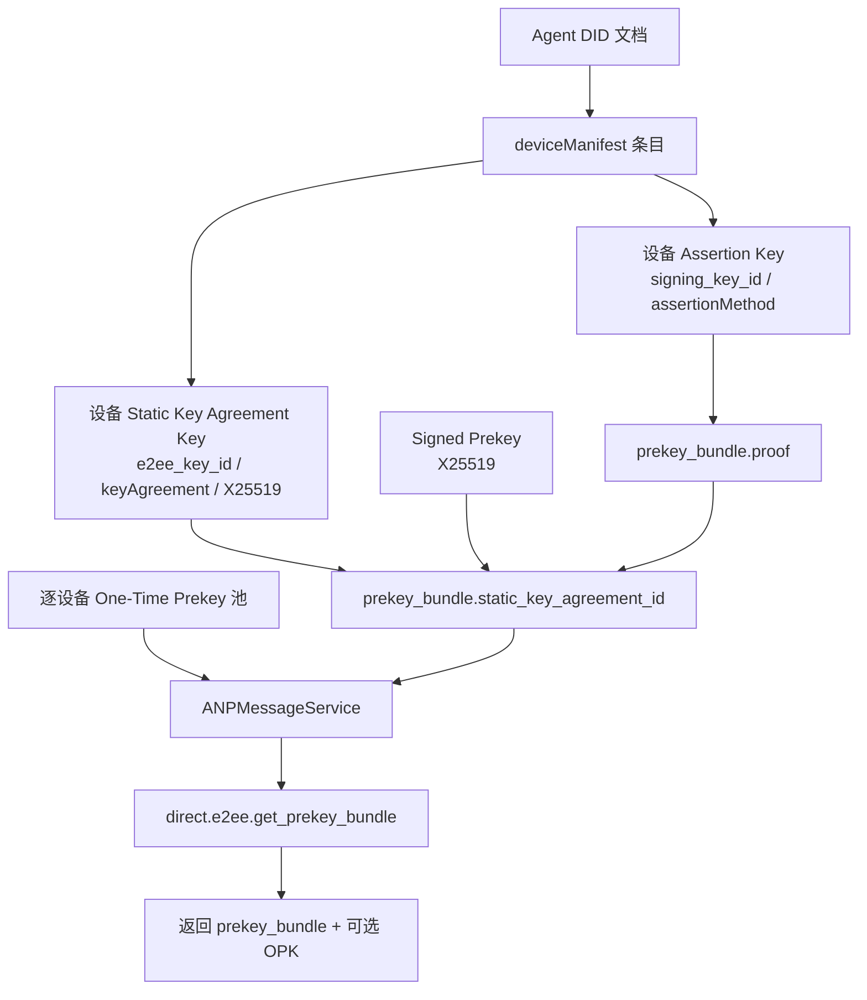
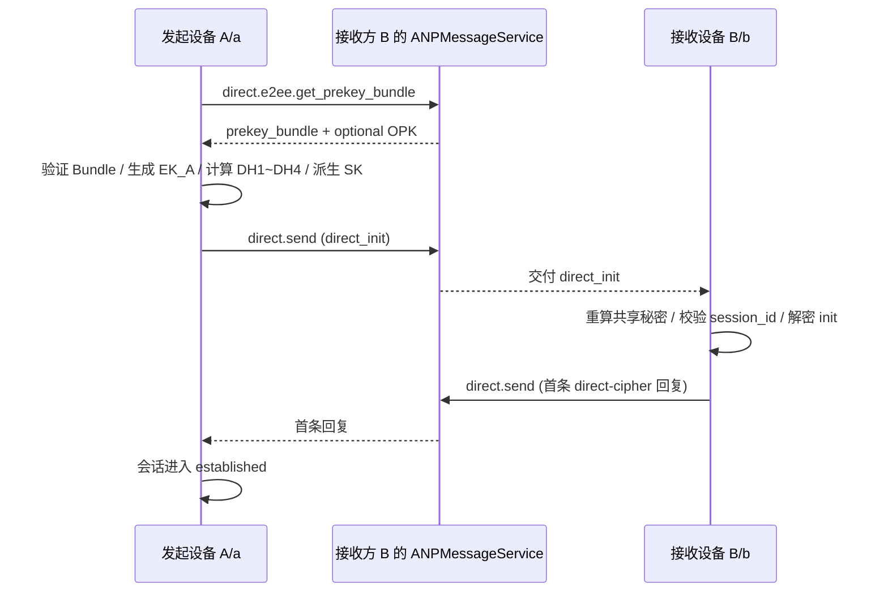
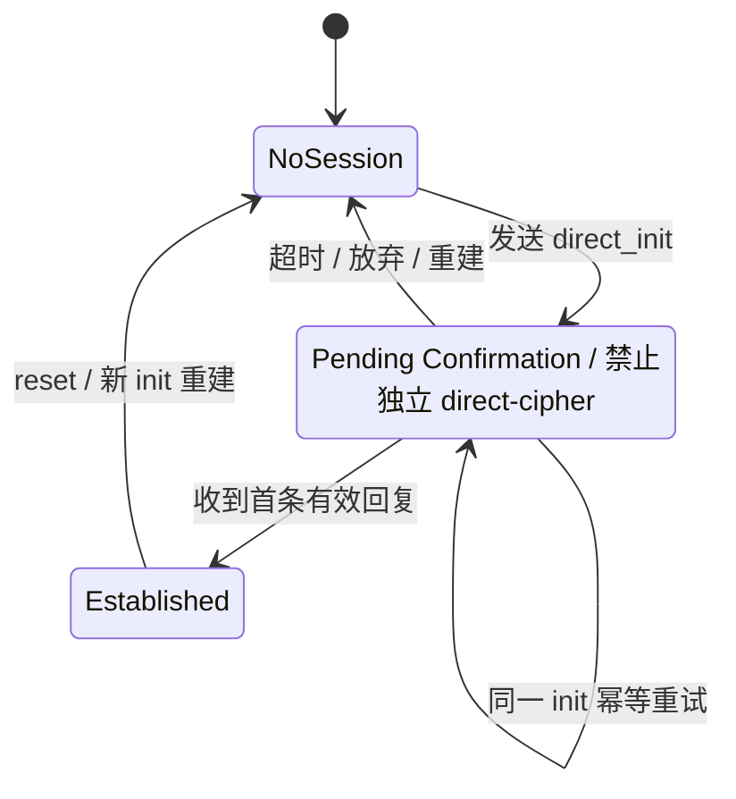

<!-- translation-review: full; source=chinese/message/05-私聊端到端加密.md; basis=every Chinese paragraph and all 25 source code blocks read and compared against the Japanese translation -->
> 日本語参考訳（機械翻訳を基に原文全文を照合済み）。規範となるのは原文です。コード例・識別子・規範キーワードは原文を保持しています。
> 原文: [chinese/message/05-私聊端到端加密.md](../../../chinese/message/05-私聊端到端加密.md) / 基準コミット: `0837cfdfaf4ddcf834f0890ddaf34fc4c824e066`

# ANP Profile 5：私聊のエンドツーエンド暗号化

- 文書番号：ANP-P5
- タイトル：私聊のエンドツーエンド暗号化
- 状態：公開済み
- バージョン：1.2
- 仕様セットのバージョン：ANP Messaging 1.2
- 原文言語：中国語（このファイルは日本語参考訳）。
- Profile：`anp.direct.e2ee.v2`
- 適用範囲：本 Profile は、2 つの Agent DID に属する特定の暗号学的デバイス間の私聊 E2EE に適用します。
- 依存関係：
  - `anp.core.binding.v1`
  - `anp.identity.discovery.v1`
  - `anp.direct.base.v1`
  - [ANP-02 のアイデンティティ入力](../../../chinese/02-ANP-基于DID的身份认证协议.md#identity-input)と適用される DID メソッドのバインディング（規範的依存関係であり、新たな wire Profile は追加しません）。

---

## 1. 目的と範囲

本 Profile は、ANP の私聊エンドツーエンド暗号化について、実装可能な完全な方式を定義し、以下を規定します。

1. メソッド検証済みの DID アイデンティティ、P2 の `deviceManifest`、およびサービス発見を私聊 E2EE に組み込む方法。
2. 現在資格を満たす各デバイスが、自身の Prekey Bundle を公開、発見、検証する方法。
3. 正確な送信デバイスと受信デバイスの対が、`X3DH-like` に基づいて非同期にセッションを確立する方法。
4. 各デバイス対が、独立した `Double Ratchet-like` 状態を維持する方法。
5. デバイスに束縛された AAD、リプレイ防止、順序外処理、セッション再確立、Mailbox 配信、およびエラーの動作。
6. Agent DID を業務上のアイデンティティとして維持し、明示的なデバイスセレクターを暗号学的エンドポイントの選択だけに使う方法。

したがって、1 件の論理的な DID-to-DID メッセージから、デバイスごとに独立した複数の暗号文操作が生じることがあります。本 Profile は、デバイスを連絡先、会話参加者、または新たな `target.kind` にするものではありません。

本 Profile は、以下を定義**しません**。

- デバイスの参加許可や、製品内のデバイス管理手順。
- 過去のメッセージの取得。
- 既読状態。
- Presence。
- グループのエンドツーエンド暗号化。
- デバイス秘密鍵、Ratchet 状態、または過去の平文を、デバイス間で複製すること。
- DID メソッド自体の解決、更新、および無効化の仕組み。

---

## 2. 規範的キーワードと用語

### 2.1 規範的キーワード

本文の **MUST**、**MUST NOT**、**REQUIRED**、**SHALL**、**SHALL NOT**、**SHOULD**、**SHOULD NOT**、**RECOMMENDED**、**NOT RECOMMENDED**、**MAY**、**OPTIONAL** は、大文字で記されている場合、規範的要件として解釈します。

### 2.2 用語

- **Agent DID**：外部との相互運用に使う Agent 識別子。本 Profile では、外側の `direct.send` における業務主体の識別子であるとともに、AAD、Bundle 検証、およびセッションの束縛に使うアイデンティティの基点です。
- **デバイスエンドポイント**：Agent DID に属する暗号学的エンドポイント。その DID の現在の P2 `deviceManifest` にある不透明な `device_id` によって選択します。DID や業務上の参加者ではありません。
- **デバイス対**：1 件の Direct E2EE 操作が束縛される、順序付きの四つ組 `(sender_did, sender_device_id, recipient_did, recipient_device_id)`。
- **Assertion Key**：選択された Manifest エントリの `signing_key_id` が参照し、`assertionMethod` によって認可された署名鍵。そのデバイスの Bundle または Binding Proof に署名するために使い、DH 計算には使いません。
- **Static Key Agreement Key**：選択された Manifest エントリの `e2ee_key_id` が参照し、DID 文書の `keyAgreement` に記述された長期の静的 X25519 公開鍵。
- **Signed Prekey（SPK）**：あるデバイスが生成し、そのデバイスの Assertion Key による署名で束縛された、中期の X25519 公開鍵。
- **One-Time Prekey（OPK）**：あるデバイスに属する、一度限りの X25519 公開鍵。正常に使用した場合は消費しなければならず、再利用できません。
- **Prekey Bundle**：正確に 1 つの `(owner_did, owner_device_id)` に束縛された、セッション確立用の公開材料。そのデバイスの長期の静的鍵共有鍵と現在の SPK を記述しますが、OPK は直接埋め込みません。
- **Direct Session**：順序付きデバイス対の E2EE セッションで、`session_id` によって識別します。その Double Ratchet、順序外処理、およびリプレイの状態を、他のデバイス対と共有してはなりません。
- **Application Plaintext**：暗号化前の私聊のアプリケーション層平文オブジェクト。Direct Base のアプリケーションペイロードを正規化した内側の表現で、AEAD 暗号化への入力に使います。
- **Ratchet Header**：後続メッセージに必要な最小限の公開ヘッダーフィールド。受信者はこれを使って受信チェーンを特定し、DH ratchet の前進が必要かを判断し、順序外のメッセージを処理します。
- **Mailbox**：`(recipient_did, recipient_device_id)` をスコープとする、不透明な暗号文キュー。複数の Session を運べますが、Ratchet 状態は所有しません。
- **Replay Cache**：初期メッセージや後続メッセージの重複を識別するための状態の集合。ローカル状態であり、標準の wire プロトコルのフィールドではありません。

`device_id` は不透明な識別子でなければならず（**MUST**）、削除後に再利用してはなりません（**MUST NOT**）。鍵、ハードウェア識別子、またはユーザーに表示する名前ではありません。

---

## 3. 設計の基本原則

### 3.1 業務上のアイデンティティと暗号学的デバイスエンドポイント

業務上の送信者と受信者は、引き続き `meta.sender_did` と `meta.target.did` で表します。本 Profile は、正確な暗号学的デバイス対を選択するため、さらに `meta.sender_device_id` と `meta.recipient_device_id` を要求します。これらのフィールドは P5 だけに属し、DID 単位の連絡先や会話の意味論は変更しません。

送信者が同じ受信 DID に属する複数の適格デバイスを宛先とする場合、受信デバイスごとに、独立して暗号化した `direct.send` 操作を作成しなければなりません（**MUST**）。サービスは、Ratchet 状態を共有したり、隠れた暗号学的 fan-out を実行したりしてはなりません（**MUST NOT**）。

### 3.2 セキュリティ Overlay と業務上の意味論の分離

本 Profile は、私聊の業務上の意味論を再定義しません。`anp.direct.base.v1` の以下を再利用します。

- `direct.send` メソッド。
- `sender_did` / `target.did` の意味論。
- `message_id` / `operation_id` の意味論。
- 私聊の成功の意味論（宛先 Agent の入口サービスが受理したこと）。
- アプリケーション層のコンテンツ型の意味論。

デバイスごとの暗号文について、双方のデバイスセレクター、デバイス対の暗号学的な束縛、およびデバイスごとの accepted 結果は P5 が規定します。トランスポート保護を使う P3 メッセージは、引き続き DID だけを宛先とし、デバイスセレクターを含めません。

### 3.3 変更しない MTI ベースライン

本 v2 Profile の必須相互運用ベースラインは、引き続き以下を採用します。

- 初期セッション確立：`X3DH-like`（DID 向けの適応）。
- 長期の静的鍵共有鍵：`X25519`。
- KDF：`HKDF-SHA-256`。
- メッセージ AEAD：`ChaCha20-Poly1305`。
- 後続メッセージ：`Double Ratchet-like`。

### 3.4 将来のアップグレード経路

本 Profile は、`PQXDH-like` にアップグレードする余地を残します。本 v2 Profile は既存の MTI 暗号スイートを変更しません。将来のスイートには、独立した明示的な suite 識別子とネゴシエーションが必要です。

`anp.direct.e2ee.v1` は、引き続き独立した単一エンドポイントの契約です。実装は、v1 の相手についてデバイスを推定してはならず（**MUST NOT**）、v1 の Session や Ratchet 状態を v2 のデバイス状態として再利用してもなりません。また、失敗した v2 のデバイス操作を、v1 やトランスポート保護を使う P3 に暗黙にダウングレードしてもなりません。

### 3.5 デフォルトでは init メッセージへの長期署名を必須としない

本 Profile は、デフォルトでは `direct_init` オブジェクト全体への追加の長期 DID アイデンティティ署名を**必須としません**。

理由は以下のとおりです。

1. X3DH-like の認証自体は、長期の静的鍵共有鍵と、受信者の SPK の組合せに由来します。
2. 受信者の SPK は、すでに Assertion Key によって束縛されています。
3. init メッセージ全体に長期署名を要求すると、「帰責可能な制御メッセージ」のモデルに大きく偏り、Signal 型の否認可能性が損なわれます。

より高い監査可能性が必要な配置では、追加で `Direct Init Accountability Extension` を有効にできます。この拡張は、本 Profile のデフォルトの必須選択肢ではありません。

### 3.6 `anp.direct.e2ee.v2` の MTI wire オブジェクトの集合

`method = "direct.send"` かつ `meta.profile = "anp.direct.e2ee.v2"` の場合、変更しない MTI 経路の `meta.content_type` で許されるのは、以下の 2 つの値だけです。

- `application/anp-direct-init+json`
- `application/anp-direct-cipher+json`

送信者は、変更しない MTI 経路で、他の wire オブジェクト型を使ってはなりません（**MUST NOT**）。
受信者が他の `content_type` を受信した場合、拡張ネゴシエーションでその能力が明示的に有効化されている場合を除き、拒否しなければなりません（**MUST**）。

### 3.7 `anp.direct.e2ee.v2` における `direct.send` のメッセージ識別子の制約

`meta.profile = "anp.direct.e2ee.v2"` の `direct.send` には、以下を適用します。

- `meta.message_id` が存在しなければなりません（**MUST**）。
- `meta.operation_id` が存在しなければなりません（**MUST**）。
- `meta.operation_id` は `meta.message_id` と完全に等しくなければなりません（**MUST**）。

受信デバイスごとの各暗号文は、自身に一意の `message_id` / `operation_id` の対を使わなければなりません（**MUST**）。異なるデバイスの暗号文で、暗号化された Application Plaintext が同じ任意の `logical_message_id` を含む場合でも、この識別子対を共有してはなりません。

### 3.8 `anp.direct.e2ee.v2` における `direct.send` の `auth` の制約

`meta.profile = "anp.direct.e2ee.v2"` の `direct.send` では、`params.auth` を省略しなければなりません（**MUST**）。

配置において `Direct Init Accountability Extension` を明示的にネゴシエーションして有効化した場合、追加の証明オブジェクトを導入してもかまいません（**MAY**）。この拡張をネゴシエーションしていない場合、受信者は `params.auth` を受信したら拒否しなければなりません（**MUST**）。

---


### 3.9 P3 の原発信者への束縛要件との関係

P3 第 9.7 節の「`auth.origin_proof.contentDigest` または同等の原発信者証明のダイジェスト」という要件について、本 Profile は以下のオブジェクトを組み合わせて、同等の束縛を満たします。

- `AD_init`
- `AD_msg`
- AEAD によって保護された `Application Plaintext`。

`Direct Init Accountability Extension` をネゴシエーションしていない場合、本 Profile の MTI は、P3 形式の `params.auth.origin_proof` を追加で含めることを**要求しません**。

## 4. DID メソッドに依存しない統合規則

### 4.1 DID 文書の最小要件

本 Profile をサポートする Agent DID 文書は、以下を満たさなければなりません（**MUST**）。

1. 身元認証に使える Authentication Key と、アサーション署名用の Assertion Key が、それぞれ少なくとも 1 つあること。
2. `keyAgreement` の検証メソッドが少なくとも 1 つあること。
3. `ANPMessageService` または同等のサービス入口が少なくとも 1 つあること。
4. 現在の P2 `deviceManifest` が、P5 を使える各デバイスを宣言し、その `device_id`、`signing_key_id`、`e2ee_key_id` と、P1/P2/P3/P5 の完全な Profile 依存関係の集合を対応付けること。
5. その `ANPMessageService` は、呼出元が解決してアクセスでき、本 Profile が必要とするデバイスごとの鍵材料メソッドを提供しなければなりません（**MUST**）。

#### 4.1.1 現在のデバイスの適格性

`(D, d)` の P5 材料を公開、返却、または使用する前に、実装は現在の DID 文書について、以下を検証しなければなりません（**MUST**）。

1. `d` が、Agent DID `D` に属する、現在の P2 Manifest エントリを正確に 1 つ選択すること。
2. そのエントリが、`anp.direct.e2ee.v2` と、その必須の P1/P2/P3 の依存関係を宣言すること。
3. `signing_key_id` が Bundle proof に必要な署名メソッドを参照し、`e2ee_key_id` が `keyAgreement` にある X25519 メソッドを参照すること。さらに、
4. Bundle、Session、AAD、リプレイ状態、および Mailbox 操作で、同じ DID/デバイスおよび鍵参照を使うこと。

選択されたデバイスのいずれかが、これらの規則を満たさなくなった場合、実装は新しい材料と暗号文を拒否しなければならず（**MUST**）、影響を受けるキャッシュと Session の使用を停止しなければなりません（**MUST**）。また、呼出元は DID を再解決しなければなりません（**MUST**）。引き続き適格である他のデバイス対の、変更されていない Session は影響を受けません。

### 4.2 鍵の役割の分離

本 Profile は、鍵の役割の分離を採用しなければなりません（**MUST**）。

1. `assertionMethod` に列挙された鍵は、以下に使います。
   - Prekey Bundle への署名。
   - 強いアイデンティティの帰属が必要な制御オブジェクトへの署名（該当する拡張が有効な場合）。
2. `keyAgreement` に列挙された鍵は、以下に使います。
   - 長期の静的鍵共有。
   - 初期共有鍵の導出。
3. Assertion Key と Static Key Agreement Key を混用してはなりません（**MUST NOT**）。

各 Manifest デバイスは、分離された署名秘密鍵と X25519 秘密鍵、SPK/OPK 秘密鍵、Direct Session、Ratchet 状態、skipped key、およびリプレイ状態を持ちます。2 つのデバイスは、これらの非公開の状態を共有したり、同じ有効な鍵参照を公開したりしてはなりません（**MUST NOT**）。

補足：wire プロトコルでは、通常、前者は `proof.verificationMethod` で、後者は Bundle の `static_key_agreement_id` または init の `sender_static_key_agreement_id` で参照します。実装では、同じ鍵にこの 2 種類の意味を同時に担わせるべきではありません。

### 4.3 DID メソッドの検証

DID 文書は、[P2 のメソッド検証](../../../chinese/message/02-身份与发现.md#method-validation)と、対応するメソッド仕様に従って検証します。デバイスの適格性と Bundle Object Proof は、引き続き、それぞれ第 4.1.1 節と第 6.2 節に従います。

### 4.4 `ANPMessageService` の鍵材料の能力

正確な各 `(owner_did, owner_device_id)` について、`ANPMessageService` は、本 Profile に必要な以下の鍵材料の能力を担わなければなりません（**MUST**）。

- Prekey Bundle を公開する。
- OPK プールを補充またはローテーションする。
- Prekey Bundle を照会する。
- 使用可能な OPK を、要求ごとに 1 つ発行する（存在し、ポリシーが許可する場合）。
- OPK を割当済み、消費済み、または再利用不可として記録する。
- Bundle の失効または無効の状態を返す（実装がサポートする場合）。
- そのデバイスが P5 の適格性を失った場合、Bundle と OPK の提供を停止する。

---


P5 を理解するうえで最初の難所は、アルゴリズムよりも、「誰が署名を担当し、誰が DH を行い、誰が Bundle / OPK の公開を担当するか」です。以下の図では、DID 文書の異なる鍵の役割と公開材料をまとめ、後のセッション確立手順を読みやすくしています。



*図 P5-1：鍵の役割と公開材料の関係（非規範的）。*

この図は、責務の分離を強調しています。Assertion Key はアイデンティティへの束縛を担当し、長期の `keyAgreement` と SPK / OPK は DH 計算を担当します。実装では、同じ鍵にこの 2 種類の意味を同時に担わせるべきではありません。
## 5. 必須相互運用スイート（MTI）

### 5.1 MTI スイート名

v2 Profile は、引き続き以下の変更しない MTI 暗号スイートを使います。

`ANP-DIRECT-E2EE-X3DH-25519-CHACHA20POLY1305-SHA256-V1`

末尾の `V1` は、暗号スイートのバージョンであり、P5 Profile のバージョンではありません。実装は、これを `V2` に置き換えてはなりません（**MUST NOT**）。本文のすべての HKDF `info` 文字列とアルゴリズムのパラメーターは、公開済みスイートから変更しません。

### 5.2 MTI スイートのパラメーター

このスイートのパラメーターは、以下に固定します。

- 静的鍵共有の曲線：`X25519`。
- 一時的鍵共有の曲線：`X25519`。
- HKDF：`HKDF-SHA-256`。
- AEAD：`ChaCha20-Poly1305`。
- Bundle object proof profile：`prekey_bundle.proof` は、P1 付録 B で定義する共有 `Object Proof Profile` を再利用しなければなりません（**MUST**）。


この要件は、少なくとも以下に適用します。

- `prekey_bundle` の被保護文書（本文では `Signed Bundle Object` とも呼びます）。
- `AD_init`
- `AD_msg`
- `Application Plaintext`


### 5.3 推奨する任意のスイート

実装は、追加で以下をサポートしてもかまいません（**MAY**）。

- `ANP-DIRECT-E2EE-X3DH-25519-AES256GCM-SHA256-V1`
- `ANP-DIRECT-E2EE-PQXDH-HYBRID-V1`（予約）。

ただし、`anp.direct.e2ee.v2` のすべての相互運用実装は、この変更しない MTI スイートをサポートしなければなりません（**MUST**）。

---

## 6. 公開材料と Bundle の構造

### 6.1 長期の静的鍵共有鍵

本 Profile を宣言する、現在の各デバイスは、その Manifest の `e2ee_key_id` を使って、Agent DID 文書の `keyAgreement` にある自身の長期の静的 X25519 公開鍵を参照しなければなりません（**MUST**）。

推奨するフィールドは以下のとおりです。

- `id`：たとえば `did:wba:example.com:agent:alice:e1_xxx#ka-1`。
- `type`：実装で選べますが、X25519 であることを明確に示さなければなりません。
- `publicKeyMultibase` または同等の公開鍵表現。


フィールドの使用方法：

- `id`：Bundle、Init メッセージ、および AAD で、「今回はどの長期 DH 鍵を使ったか」を正確に示します。
- `type`：検証メソッドのアルゴリズムとエンコーディングを宣言します。これによって相手は正しくデコードし、X25519 であることを検証できます。
- `publicKeyMultibase` または同等の表現：実際の公開鍵バイトを含み、相手が DH を行う際の入力源になります。

### 6.2 `prekey_bundle` の構造

`prekey_bundle` は、受信者が長期にわたって公開し、選択されたデバイスの P1 付録 B の Object Proof で束縛する、**静的なセッション確立材料**を表します。Signal 型の要求ごとの OPK 発行モデルと一致させるため、`prekey_bundle` に `one_time_prekey` を直接埋め込んではなりません（**MUST NOT**）。OPK は、照会時にサーバーが要求ごとに返します。

`prekey_bundle` の推奨する定義は、以下のとおりです。

```json
{
  "bundle_id": "bundle-20260329-001",
  "owner_did": "did:wba:example.com:agent:alice:e1_xxx",
  "owner_device_id": "dev-a-7N3KQ2",
  "suite": "ANP-DIRECT-E2EE-X3DH-25519-CHACHA20POLY1305-SHA256-V1",
  "static_key_agreement_id": "did:wba:example.com:agent:alice:e1_xxx#ka-1",
  "signed_prekey": {
    "key_id": "spk-001",
    "public_key_b64u": "BASE64URL_X25519_SPK",
    "expires_at": "2026-04-05T00:00:00Z"
  },
  "proof": {
    "type": "DataIntegrityProof",
    "cryptosuite": "eddsa-jcs-2022",
    "verificationMethod": "did:wba:example.com:agent:alice:e1_xxx#assert-1",
    "proofPurpose": "assertionMethod",
    "created": "2026-03-29T00:00:00Z",
    "proofValue": "zBASE58MULTIBASE_PROOF"
  }
}
```

フィールドの使用方法：

- `bundle_id`：その静的 Bundle バージョンの安定した識別子。送信者はこれを `direct_init` と `AD_init` に含めます。受信者は、監査、キャッシュのヒット、およびリプレイ範囲の区別にも使えます。
- `owner_did`：Bundle の所有者である Agent DID。送信者はこれに基づいて DID 文書を解決し、`proof` を検証して、Bundle のアイデンティティの帰属を確認します。
- `owner_device_id`：Bundle が属する正確なデバイスエンドポイント。`owner_did` に属する、現在 P5 の資格を満たす Manifest エントリを選択しなければなりません（**MUST**）。
- `suite`：その Bundle に適用する暗号スイート名。送信者は、ローカルでサポートしているかを先に判断し、その Bundle でセッションを確立するかを決めるべきです。
- `static_key_agreement_id`：`owner_did` の DID 文書にある、長期の静的 X25519 鍵を指す DID URL。相手に「この Bundle はどの長期 DH 鍵に対応するか」を伝えます。
- `signed_prekey.key_id`：現在の SPK の安定した識別子。送信者は `direct_init` でこれを参照し、受信者はこれに基づいて正しい SPK 秘密鍵を特定します。
- `signed_prekey.public_key_b64u`：パディングなしの base64url で表した SPK 公開鍵のバイト。初期 DH の入力の 1 つです。
- `signed_prekey.expires_at`：SPK の失効時刻。送信者は、Bundle の使用前に、まだ期限切れでないことを検証しなければなりません。
- `proof.type`：証明オブジェクトの型。本 Profile の MTI は、引き続き `DataIntegrityProof` に固定します。
- `proof.cryptosuite`：具体的な proof cryptosuite の名前。本 Profile の MTI は、引き続き `eddsa-jcs-2022` に固定します。
- `proof.verificationMethod`：Bundle の署名に使う検証メソッドの DID URL。送信者は、それが `owner_did` の文書で許された `assertionMethod` 関係に属するかを調べるべきです。
- `proof.proofPurpose`：署名に使った認可関係を宣言し、DID 文書の認可関係との対応付けに使います。
- `proof.created`：この証明の生成時刻。監査とポリシーの確認に使います。
- `proof.proofValue`：正規化した Bundle の表現に対して署名した、証明の値。

### 6.2.1 `prekey_bundle.proof` と共有 Object Proof Profile

`prekey_bundle.proof` は、P1 付録 B で定義する共有 **Object Proof Profile** を再利用しなければなりません（**MUST**）。

`prekey_bundle` については、以下のとおりです。

- issuer DID は `owner_did` でなければなりません（**MUST**）。
- owner device は `owner_device_id` であり、現在 P5 の資格を満たす Manifest エントリを選択しなければなりません（**MUST**）。
- 被保護文書は、`proof` を除去した `prekey_bundle` オブジェクト全体でなければなりません（**MUST**）。
- 本文では、この被保護文書を `Signed Bundle Object` と略称します。
- `proof.verificationMethod` は、`owner_did` の DID 文書で `assertionMethod` によって認可された検証メソッドを指さなければなりません（**MUST**）。
- `proofPurpose` は `assertionMethod` に固定しなければなりません（**MUST**）。


### 6.2.2 `bundle_id` の再定義不可の意味論

ローカルの受理期間内では、同じ `bundle_id` は、以下のフィールドの組合せだけに、一意に対応しなければなりません（**MUST**）。

- `owner_did`
- `owner_device_id`
- `suite`
- `static_key_agreement_id`
- `signed_prekey.key_id`
- `signed_prekey.public_key_b64u`

サーバーは、短い猶予期間に、複数の異なる `bundle_id` を同時に受理してもかまいません（**MAY**）。ただし、同じ `bundle_id` を再定義してはなりません（**MUST NOT**）。

ある `bundle_id` が受理期間内にある間、受信者は、対応する SPK 秘密鍵、Bundle のメタデータ、および必要な検索インデックスを、その受理期間が終了するまで保持しなければなりません（**MUST**）。

### 6.2.3 Bundle proof のオブジェクト固有の制約

P1 付録 B の共有規則に加えて、本 Profile の MTI では、`prekey_bundle` は以下も満たさなければなりません（**MUST**）。

- `proof` が存在しなければなりません（**MUST**）。
- `proof.verificationMethod` が属する DID は、`owner_did` と等しくなければなりません（**MUST**）。
- `prekey_bundle.proof` が P1 付録 B を満たさない場合、またはその issuer DID が `owner_did` と一致しない場合、受信者は `anp.direct.e2ee.bundle_invalid` でその Bundle を拒否しなければなりません（**MUST**）。

### 6.3 Bundle フィールドの要件

`prekey_bundle` は、以下を含めなければなりません（**MUST**）。

- `bundle_id`
- `owner_did`
- `owner_device_id`
- `suite`
- `static_key_agreement_id`
- `signed_prekey`
- `proof`

`prekey_bundle` は、以下を直接含めてはなりません（**MUST NOT**）。

- `one_time_prekey`

### 6.4 Bundle proof のオブジェクト固有のフィールド制約

「`proof` を除いたオブジェクト全体」を保護するという P1 付録 B の統一要件に加え、`prekey_bundle` は、少なくとも以下のセキュリティ上重要なフィールドを含み、したがって、それら全体を `proof` で保護しなければなりません（**MUST**）。

- `bundle_id`
- `owner_did`
- `owner_device_id`
- `suite`
- `static_key_agreement_id`
- `signed_prekey`

`proof` が束縛するのは静的な Bundle です。実行時に要求ごとに発行する OPK を、静的な Bundle proof の保護対象に含めてはなりません（**MUST NOT**）。

### 6.5 Bundle の検証要件

送信者は、Bundle の使用前に以下を行わなければなりません（**MUST**）。

1. `owner_did` の現在の DID 文書を解決し、第 4.1.1 節に従って `owner_device_id` を検証する。
2. `proof.verificationMethod` が、その Manifest エントリの `signing_key_id` と等しく、かつ `owner_did` の DID 文書で `assertionMethod` によって認可されていることを検証する。
3. P1 付録 B で定義する共有 Object Proof Profile に従って、`prekey_bundle.proof` を検証する（被保護文書は `Signed Bundle Object`）。
4. `static_key_agreement_id` が、その Manifest エントリの `e2ee_key_id` と等しく、DID 文書の `keyAgreement` に存在することを検証する。
5. `suite` がローカルでサポートしているスイートかを検証する。
6. `signed_prekey.expires_at` が期限切れでないことを検証する。
7. `direct.e2ee.get_prekey_bundle` の成功応答に `one_time_prekey` が付属する場合、送信者は、そのフィールドの形式が正しいことを検証し、後のセッション確立、消費、および監査に使うため、その `key_id` を記録しなければなりません（**MUST**）。
8. 後で送信者が `direct_init` を構築する際、`recipient_signed_prekey_id` は、選択した `prekey_bundle.signed_prekey.key_id` と等しくなければなりません（**MUST**）。

### 6.6 OPK ポリシー

本 Profile の変更しない MTI では、引き続き `one_time_prekey` を使うことが望ましいものの（**SHOULD**）、省略してもかまいません（**MAY**）。

Signal 型のワンタイム事前鍵の発行方式と一致させるため、各受信デバイスは、その `ANPMessageService` に、発行用の OPK のまとまりを事前にアップロードすることが望まれます（**SHOULD**）。サーバーは、`direct.e2ee.get_prekey_bundle` の成功応答で、要求ごとにそのデバイスのプールから、使用可能な OPK を 1 つ返します。

成功応答に OPK が付属する場合、そのオブジェクトの推奨形式は以下のとおりです。

```json
{
  "key_id": "opk-001",
  "public_key_b64u": "BASE64URL_X25519_OPK"
}
```

フィールドの使用方法：

- `key_id`：この OPK レコードの安定した識別子。送信者は `direct_init` の `recipient_one_time_prekey_id` でこれを参照し、受信者はこれを使って対応する秘密鍵を特定し、消費します。
- `public_key_b64u`：パディングなしの base64url で表した OPK 公開鍵のバイト。任意の `DH4` の入力です。

規則は以下のとおりです。

- サーバーは、OPK を返す際、ただちに割当済みとして記録することが望まれます（**SHOULD**）。
- 同じ OPK を、複数の送信者やデバイス対に並行して割り当ててはなりません（**MUST NOT**）。
- ある OPK で初期セッション確立が 1 回成功した場合、サーバーはそれを消費済みとして記録しなければならず（**MUST**）、受信者は対応する OPK 秘密鍵を削除しなければなりません（**MUST**）。
- 割当後にセッション確立が完了しなかった場合、回収を許すかは配置のポリシーで決めます。ただし、セッション確立の成功に使われたと確認された OPK を、再発行してはなりません（**MUST NOT**）。
- `direct.e2ee.get_prekey_bundle` の成功応答に OPK が付属しない場合も、開始者は引き続きセッションを確立できます。ただし、初期共有シークレットの前方秘匿性は、SPK のライフサイクルにより大きく依存します。

---

## 7. Key Service のメソッド

### 7.1 `direct.e2ee.publish_prekey_bundle`

このメソッドは、新しい静的な Prekey Bundle を、送信者自身が公開する `ANPMessageService` に公開するために使います。任意で OPK のまとまりを補充することもできます。

#### 要求の要件

- `meta.profile = anp.direct.e2ee.v2`
- `meta.security_profile = transport-protected`
- `meta.target.kind = "service"`
- `meta.target.did` は、公開者自身が公開する `ANPMessageService.serviceDid` と等しくなければなりません（**MUST**）。
- `meta.sender_did` が存在しなければなりません（**MUST**）。
- `meta.sender_device_id` が存在しなければなりません（**MUST**）。
- `meta.operation_id` が存在しなければなりません（**MUST**）。
- 拡張をネゴシエーションしていない場合、`params.auth` を省略しなければなりません（**MUST**）。
- `body.prekey_bundle` が存在しなければなりません（**MUST**）。
- `body.prekey_bundle.owner_did` は `meta.sender_did` と等しくなければなりません（**MUST**）。
- `body.prekey_bundle.owner_device_id` は `meta.sender_device_id` と等しくなければなりません（**MUST**）。
- `body.one_time_prekeys` が存在してもかまいません（**MAY**）。存在する場合は空でない配列でなければならず（**MUST**）、各要素は少なくとも `key_id` と `public_key_b64u` を含めなければなりません（**MUST**）。

認証の制約：

- このメソッドは、**サービススコープ**の制御プレーンのメソッドです。
- 認証済みコンテキストは、正確な `(meta.sender_did, meta.sender_device_id)` を識別しなければならず（**MUST**）、そのデバイスは現在、第 4.1.1 節に従って P5 の資格を満たしていなければなりません（**MUST**）。
- 標準経路では、呼出元は、認証済みの自ドメインのセッション、または同等の hop / service 認証コンテキスト内で動作しなければなりません（**MUST**）。
- 本 Profile は、このメソッドに追加の新しい業務層の `origin_proof` を定義することを**要求しません**。
- サーバーは、この要求を受理する前に、hop / service レベルの認証の検証に加え、現在の認証済み caller が、`meta.sender_did` に代わって `body.prekey_bundle.owner_did` に対応する材料を公開する権限を持つことも検証しなければなりません（**MUST**）。


冪等性の要件：

- サーバーは、`(meta.sender_did, meta.sender_device_id, meta.target.did, method, meta.operation_id)` を冪等性キーとしなければなりません（**MUST**）。
- 同じ冪等性キーの重複要求で、`body.prekey_bundle` と `body.one_time_prekeys` が意味的に同等である場合、元の結果または同等の結果を返さなければなりません（**MUST**）。
- 同じ冪等性キーに対応する要求本文が意味的に矛盾する場合、`anp.idempotency_conflict` または同等のエラーを返さなければなりません（**MUST**）。

フィールドの使用方法：

- `meta.security_profile = transport-protected` は、これが鍵の制御プレーンの呼出しであり、確立済みセッションでの E2EE 暗号文の転送ではないことを示します。
- `body.prekey_bundle` は、他者が現在取得できる静的なセッション確立材料の公開または置換に使います。
- `body.one_time_prekeys` は、OPK プールを一括で補充するために使います。任意の一括アップロード項目であり、静的な Bundle proof には入りません。

#### 成功応答

成功応答は、少なくとも以下を含めなければなりません（**MUST**）。

- `published = true`
- `owner_did`
- `owner_device_id`
- `bundle_id`
- `published_at`

成功応答は、以下を含めてもかまいません（**MAY**）。

- `published_opk_count`


### 7.2 `direct.e2ee.get_prekey_bundle`

このメソッドは、宛先 Agent が公開する `ANPMessageService` を通じて、使用可能な静的 Bundle を 1 つ取得し、必要に応じて使用可能な OPK を 1 つ付属させるために使います。

#### 要求の要件

- `meta.profile = anp.direct.e2ee.v2`
- `meta.security_profile = transport-protected`
- `meta.target.kind = "service"`
- `meta.target.did` は、宛先 Agent が公開する `ANPMessageService.serviceDid` と等しくなければなりません（**MUST**）。
- `meta.sender_did` が存在しなければなりません（**MUST**）。
- `meta.sender_device_id` が存在しなければなりません（**MUST**）。
- `meta.operation_id` が存在しなければなりません（**MUST**）。
- 拡張をネゴシエーションしていない場合、`params.auth` を省略しなければなりません（**MUST**）。

`body` は、以下を含めなければなりません（**MUST**）。

- `target_did`
- `target_device_id`

`body` は、以下を含めてもかまいません（**MAY**）。

- `preferred_suite`
- `require_opk`

認証の制約：

- このメソッドは、**サービススコープ**の制御プレーンのメソッドです。
- 認証済みコンテキストは、現在 P5 の資格を満たす `(meta.sender_did, meta.sender_device_id)` を識別しなければなりません（**MUST**）。
- 材料を返す前に、サービスは、第 4.1.1 節に従って、正確な `(target_did, target_device_id)` を検証しなければなりません（**MUST**）。
- 最小相互運用ベースラインでは、少なくとも hop / service レベルの認証を要求します。
- 標準経路では、拡張をネゴシエーションしていない場合、`params.auth` を省略しなければなりません（**MUST**）。
- **匿名での Bundle または OPK の取得は、本 Profile の MTI に含まれません**。ある配置で匿名アクセスを開放する場合、それは追加の配置ポリシーです。

フィールドの使用方法：

- `target_did`：誰のセッション確立材料を取得したいかを示します。サーバーは、その DID に束縛された Bundle を返すべきであり、他の主体のキャッシュ結果を返すべきではありません。
- `target_device_id`：`target_did` に属する現在の受信デバイスを 1 つ選択します。サービスは、他のデバイスのキャッシュ済み材料を返してはなりません（**MUST NOT**）。
- `preferred_suite`：サーバーが複数のスイートを同時に維持する場合、呼出元がどのスイートの材料を優先して取得したいかを表します。
- `require_opk`：「使用可能な OPK がなければ、縮退したセッション確立を行わない」ことを示します。`true` の場合、呼出元は、`DH4` に直接使用できるワンタイム事前鍵の取得を期待します。


#### 成功応答

成功応答は、少なくとも以下を含めなければなりません（**MUST**）。

- `target_did`
- `target_device_id`
- `prekey_bundle`

成功応答は、以下を含めてもかまいません（**MAY**）。

- `one_time_prekey`


成功応答のフィールドは、以下のように使います。

- `target_did`：今回返す材料が実際に属する宛先 DID をエコーし、呼出元がキャッシュと要求の宛先が一致するかを確認できるようにします。
- `target_device_id`：返す材料が属する正確なデバイスをエコーします。要求値および `prekey_bundle.owner_device_id` と等しくなければなりません（**MUST**）。
- `prekey_bundle`：対象主体の、現在使用可能な静的なセッション確立材料を返します。送信者は、実際にセッションを確立する前に、なお第 6.5 節に従って検証を完了する必要があります。
- `one_time_prekey`：存在する場合、サーバーが今回の照会に、使用可能な OPK を 1 つ割り当てたことを示します。送信者は、これを後続の init の試行に束縛された材料として扱うべきであり、長期にキャッシュする公開情報として扱うべきではありません。

`require_opk = true` で、現在サーバーに発行できる OPK がない場合、サーバーは、古い OPK を偽造または再利用するのではなく、明示的なエラーを返すことが望まれます（**SHOULD**）。


冪等性と OPK 割当の要件：

- サーバーは、`(meta.sender_did, meta.sender_device_id, target_did, target_device_id, meta.target.did, method, meta.operation_id)` を冪等性キーとしなければなりません（**MUST**）。
- ある成功応答で、その冪等性キーに `one_time_prekey` を割り当てた場合、現在のデバイスの適格性を再検証したうえで、同じ冪等性キーの再試行に、同じ `prekey_bundle` と同じ `one_time_prekey` を返さなければなりません（**MUST**）。
- サーバーは、「冪等性記録の書込み + OPK の割当/予約状態の書込み」を原子的に完了しなければなりません（**MUST**）。
- サーバーは、同じ冪等性キーの再試行によって、別の OPK を再割当してはなりません（**MUST NOT**）。


### 7.3 サーバーの Bundle 発行規則

`ANPMessageService` が Bundle を返す際は、以下のとおりとします。

- まだ有効期間内にある、最新の静的な `prekey_bundle` を優先して返すことが望まれます（**SHOULD**）。
- 使用可能な OPK があり、ポリシーで許可される場合、追加で `one_time_prekey` を 1 つ付属させることが望まれます（**SHOULD**）。
- 返す `one_time_prekey` は、`(owner_did, owner_device_id)` の現在使用可能な OPK プールに由来しなければならず（**MUST**）、静的な Bundle proof の署名対象の一部であるかのように偽装してはなりません（**MUST NOT**）。
- OPK を返した後、それを割当済みとして記録することが望まれます（**SHOULD**）。
- 今回の応答に OPK を付属させる場合、サーバーは、「今回の応答の冪等性記録の書込み + OPK の割当/予約状態の書込み」を原子的に完了しなければなりません（**MUST**）。
- 同じ OPK を、複数の送信者に並行して割り当ててはなりません（**MUST NOT**）。
- 宛先受信者が init の処理に成功した後、サーバーは対応する OPK を消費済みとして記録しなければならず（**MUST**）、受信者は対応する OPK 秘密鍵を削除しなければなりません（**MUST**）。
- 宛先サービスが拒否した場合や処理に失敗した場合、OPK の回収を許すかは配置のポリシーで決めます。ただし、セッション確立の成功に使われたと確認された OPK を、再発行してはなりません（**MUST NOT**）。
- caller identity、レート制限、および不正利用防止のポリシーは、hop / service レベルの認証に基づいて実施しなければなりません（**MUST**）。

---

## 8. 初期セッション確立：X3DH-like（DID 適応版）

## 8.1 設計の説明

本 Profile の初期セッション確立は、Signal X3DH をそのまま再現したものでは**なく**、**X3DH-like** の適応版です。

- X3DH の元の設計における長期のアイデンティティ DH 鍵は、本 Profile では、DID 文書の `keyAgreement` にある長期の静的 X25519 鍵が担います。
- DID の Assertion Key は DH には参加せず、Bundle への署名だけを担当します。
- 署名鍵と DH 鍵を分離しているため、元の X3DH が XEdDSA の同一鍵での使用のために導入した、一部のドメイン分離の詳細は、そのまま再現する必要がありません。

## 8.2 参加する鍵

### 送信デバイス `(A, a)`

- `A` は送信者の Agent DID、`a` はその現在の `sender_device_id` です。
- `KA_A`：送信デバイスの、長期の静的 X25519 `keyAgreement` 公開鍵/秘密鍵の対。wire プロトコルでは、通常 `sender_static_key_agreement_id` で指定します。
- `EK_A`：送信者の、ワンタイムの一時的 X25519 公開鍵/秘密鍵の対。新しい init ごとに再生成し、`sender_ephemeral_pub_b64u` でその公開鍵部分を公開します。

### 受信デバイス `(B, b)`

- `B` は受信者の Agent DID、`b` はその現在の `recipient_device_id` です。
- `KA_B`：受信デバイスの、長期の静的 X25519 `keyAgreement` 公開鍵/秘密鍵の対。送信者は、`recipient_bundle_id` が選択する Bundle バージョンと、その中の `static_key_agreement_id` を通じて、間接的にこれを特定します。
- `SPK_B`：受信者の、署名付きの中期 X25519 事前鍵。wire プロトコルでは `recipient_signed_prekey_id` で指定し、Bundle proof で DID アイデンティティに束縛します。
- `OPK_B`：受信者の、ワンタイムの X25519 事前鍵（任意）。サーバーがこれを返す場合、wire プロトコルでは `recipient_one_time_prekey_id` で指定し、セッション確立の成功後に消費します。

## 8.3 セッション確立の前提条件

本節の `recipient_did` は、外側の `direct.send.params.meta.target.did` の略記であり、独立した wire プロトコルのフィールドは追加しません。`sender_device_id` と `recipient_device_id` は、外側の P5 `meta` に由来し、共同で正確なデバイス対を選択します。

送信者は、セッション確立の開始前に、以下を行わなければなりません（**MUST**）。

1. 宛先の `recipient_did` を解決して検証する。
2. 第 4.1.1 節に従って、双方の選択された Manifest エントリを検証する。
3. 宛先デバイスの `prekey_bundle` を取得して検証する。応答に `one_time_prekey` が付属する場合は、その OPK も記録する。
4. 送信デバイスの Manifest の `e2ee_key_id` に対応する、ローカルの長期の静的秘密鍵を取得する。
5. 新しい一時的 X25519 鍵対 `EK_A` を生成する。

## 8.4 DH の計算

`direct.e2ee.get_prekey_bundle` の成功応答に OPK が**ない**場合、送信者は以下を計算しなければなりません（**MUST**）。

```text
DH1 = DH(KA_A, SPK_B)
DH2 = DH(EK_A, KA_B)
DH3 = DH(EK_A, SPK_B)
IKM = DH1 || DH2 || DH3
```

`direct.e2ee.get_prekey_bundle` の成功応答に OPK が**ある**場合、送信者は追加で以下を計算しなければなりません（**MUST**）。

```text
DH4 = DH(EK_A, OPK_B)
IKM = DH1 || DH2 || DH3 || DH4
```

## 8.5 初期共有シークレットの導出

送信者と受信者は、以下を使わなければなりません（**MUST**）。

```text
PRK = HKDF-Extract(salt = 0x00...00(32 bytes), IKM)
SK  = HKDF-Expand(PRK, info = "ANP Direct E2EE v1 Initial Secret", L = 32)
```

次に、`SK` から以下を導出します。

```text
RK0 = HKDF-Expand(SK, info = "ANP Direct E2EE v1 Root Key", L = 32)
CK0 = HKDF-Expand(SK, info = "ANP Direct E2EE v1 Chain Key", L = 32)
SID = HKDF-Expand(SK, info = "ANP Direct E2EE v1 Session ID", L = 16)
```

ここで、各値の意味は以下のとおりです。

- `RK0`：初期 Root Key。
- `CK0`：最初の init 暗号文が消費する前の、初期チェーンの開始点。
- `SID`：16 バイトのセッション識別子。Base64URL にエンコードして `session_id` とします。


### 8.5.1 最初のメッセージ鍵と nonce

`SK` から `RK0` と `CK0` を導出した後、送信者と受信者は、ただちに `CK0` に対して `kdf_ck` を 1 回実行しなければなりません（**MUST**）。

```text
CK1, MK0, NONCE0 = kdf_ck(CK0)
```

ここで、各値の用途は以下のとおりです。

- `MK0` は、`direct_init.ciphertext_b64u` の暗号化または復号だけに使います。
- `NONCE0` は、その最初の init 暗号文の AEAD nonce だけに使います。
- `CK1` は、init 成功後の後続チェーン状態の唯一の開始点です。

変更しない MTI 規則は、init メッセージがチェーンの第 0 メッセージを消費することです。つまり、`CK0` は `MK0`、`NONCE0`、および `CK1` の導出だけに使います。init 成功後、双方は `CK1` から継続しなければならず（**MUST**）、`CK0` を後続の送信チェーンや受信チェーンの開始点として再利用してはなりません（**MUST NOT**）。

さらに、`ciphertext_b64u` は、**AEAD ciphertext（認証タグを含む）の本体だけを含み**、nonce を追加で連結したり先頭に付けたりしません。nonce は、すべて本 Profile の KDF 規則に従って導出します。


## 8.6 初期 Associated Data

セッション確立時の初期 AEAD AAD を `AD_init` と記します。その規範的な JSON 構造と唯一のバイト列は第 9.4.2 節で定義し、UTF-8 + RFC 8785 JCS でエンコードしなければなりません（**MUST**）。

`AD_init` は、少なくとも以下のフィールドを束縛しなければなりません（**MUST**）。

- `content_type = application/anp-direct-init+json`
- `sender_did`
- `sender_device_id`
- `recipient_did`
- `recipient_device_id`
- `suite`
- `recipient_bundle_id`
- `sender_static_key_agreement_id`
- `recipient_signed_prekey_id`
- `recipient_one_time_prekey_id`（存在する場合）。
- `session_id`
- `message_id`
- `operation_id`
- `profile = anp.direct.e2ee.v2`
- `security_profile = direct-e2ee`

これらのフィールドの役割は以下のとおりです。

- `content_type`：現在の wire オブジェクト型を束縛し、同じ暗号文が他のオブジェクト型として解釈されるのを防ぎます。
- `sender_did` / `recipient_did`：セッションを確立する双方の業務上のアイデンティティを束縛し、誤ったアイデンティティに束縛するリスクを下げます。
- `sender_device_id` / `recipient_device_id`：正確な暗号学的エンドポイントを束縛し、init 暗号文が他のデバイスや Session に転用されるのを防ぎます。
- `suite`：使用する暗号スイートを束縛し、同じ暗号文が異なるスイートのものとして誤解釈されるのを防ぎます。
- `recipient_bundle_id`：受信者が使う具体的な Bundle バージョンを束縛し、異なる Bundle 間で材料が混用されるのを防ぎます。
- `sender_static_key_agreement_id`：送信者が実際に DH に使う、長期の静的鍵を束縛します。
- `recipient_signed_prekey_id`：受信者が今回使う SPK のバージョンを束縛します。
- `recipient_one_time_prekey_id`：存在する場合、今回のセッション確立で消費する OPK レコードを束縛します。
- `session_id`：今回導出したセッション識別子を束縛し、同じ暗号文が他のセッションに転用されるのを防ぎます。
- `message_id` / `operation_id`：ここでは、外側の `direct.send.meta` にある 2 つの識別子を指します。本 Profile が両者の等値を要求する場合でも、AAD は両方を明示的に認証します。
- `profile` / `security_profile`：プロトコルの解釈コンテキストを束縛し、異なる Profile やセキュリティモードへの置換を防ぎます。


## 8.7 初期アプリケーションメッセージ

本 Profile の変更しない MTI では、`direct_init.ciphertext_b64u` は、完全な内側の `Application Plaintext` オブジェクトを格納しなければなりません（**MUST**）。

つまり、本 Profile の MTI は「空の init」オブジェクトを定義しません。送信者は、`SK` の導出に成功した後、`CK0` から `kdf_ck` で導出した `MK0` / `NONCE0` を使って最初の `Application Plaintext` を暗号化し、`ciphertext_b64u` に書き込まなければなりません（**MUST**）。


---


以下のシーケンス図は、Bundle の取得、任意の OPK の選択、`direct_init` の送信、受信者の bootstrap、および最初の返信を、1 つの完全な流れとして示します。後に続く式を読む際に、メッセージと状態がどのように連動して前進するかを確認できます。



*図 P5-2：X3DH-like の初期セッション確立シーケンス（非規範的）。*

ここでの「確立成功」は、Bundle の取得成功ではありません。双方が同じ導出結果に基づいて bootstrap を完了し、開始者が同じ `session_id` で最初の有効な返信を受信したことを指します。
## 9. `application/anp-direct-init+json` オブジェクト

### 9.1 トップレベルの構造

`meta.content_type = application/anp-direct-init+json` の場合、`body` は以下の構造を使わなければなりません（**MUST**）。

```json
{
  "session_id": "BASE64URL_16_BYTES",
  "suite": "ANP-DIRECT-E2EE-X3DH-25519-CHACHA20POLY1305-SHA256-V1",
  "sender_static_key_agreement_id": "did:wba:example.com:agent:alice:e1_xxx#ka-1",
  "recipient_bundle_id": "bundle-20260329-001",
  "recipient_signed_prekey_id": "spk-001",
  "recipient_one_time_prekey_id": "opk-001",
  "sender_ephemeral_pub_b64u": "BASE64URL_X25519_EK_A",
  "ciphertext_b64u": "BASE64URL_INIT_CIPHERTEXT"
}
```

### 9.2 フィールドの要件

`direct_init` は、以下を含めなければなりません（**MUST**）。

- `session_id`
- `suite`
- `sender_static_key_agreement_id`
- `recipient_bundle_id`
- `recipient_signed_prekey_id`
- `sender_ephemeral_pub_b64u`
- `ciphertext_b64u`

`direct_init` は、以下を含めてもかまいません（**MAY**）。

- `recipient_one_time_prekey_id`

フィールドの使用方法：

- `session_id`：今回作成するセッションの識別子。初期共有シークレットから導出し、後続の `application/anp-direct-cipher+json` メッセージで再利用して、ratchet 状態の索引に使います。
- `suite`：今回の init で使う暗号スイートを宣言します。受信者は、まずこれに基づいて、正しい KDF、AEAD、およびメッセージ解釈の規則を選ぶべきです。
- `sender_static_key_agreement_id`：送信者の DID 文書にある、実際に DH に使う長期の静的 `keyAgreement` 鍵を指します。
- `recipient_bundle_id`：今回の init で、受信者のどの静的 Bundle バージョンを使ったかを示します。受信者はこれに基づいて、対応する SPK のライフサイクル、ローカルの受理期間、およびリプレイの範囲を特定できます。
- `recipient_signed_prekey_id`：受信者が今回使う SPK レコードを指します。受信者はこれに基づいて、正しい SPK 秘密鍵を見つける必要があります。送信者が `direct_init` を構築する際、その値は、選択した `prekey_bundle.signed_prekey.key_id` と等しくなければなりません（**MUST**）。
- `recipient_one_time_prekey_id`：存在する場合、今回の init が OPK を 1 つ消費することも示します。受信者はこれに基づいて対応する秘密鍵を特定し、セッション確立の成功後に消費するべきです。
- `sender_ephemeral_pub_b64u`：送信者が今回の init 用に新たに生成した、一時的な X25519 公開鍵。受信者は、ローカルの長期鍵/事前鍵とともに、これを DH 計算に使います。
- `ciphertext_b64u`：init から導出した最初のメッセージ鍵で暗号化した、AEAD 暗号文のバイト。この変更しないスイートでは、nonce は別途転送せず、本 Profile の `kdf_ck` 規則に従って導出します。したがって、`ciphertext_b64u` は、**暗号文の本体だけを含み、nonce を連結しません**。


### 9.3 外側のメソッドの要件

`direct_init` は、`direct.send` で運ばなければならず（**MUST**）、以下を満たします。

- `meta.profile = anp.direct.e2ee.v2`
- `meta.security_profile = direct-e2ee`
- `meta.sender_device_id` が存在しなければなりません（**MUST**）。
- `meta.recipient_device_id` が存在しなければなりません（**MUST**）。
- `meta.content_type = application/anp-direct-init+json`
- `meta.operation_id` は、`meta.message_id` と完全に等しくなければなりません（**MUST**）。
- 拡張をネゴシエーションしていない場合、`params.auth` を省略しなければなりません（**MUST**）。

補足：ここで外側の `meta.content_type` が記述するのは、`body` に使う E2EE 格納オブジェクトの形式です。最初のアプリケーション平文の実際の業務上の型は、`ciphertext_b64u` で暗号化した内側の `Application Plaintext` にあります。

### 9.4 セッション確立と状態初期化の一意のアルゴリズム（規範的）

本節では、init 暗号文の生成、init 後のローカル状態の構築、応答者の最初の返信、および開始者が最初の返信を受信する前後の状態の前進規則を統一して定義します。実装は、他の節で、本節と矛盾する bootstrap の意味論を別に定義してはなりません（**MUST NOT**）。

#### 9.4.1 入力と前提条件

送信者 A は、`direct_init` を開始する前に、以下を完了していなければなりません（**MUST**）。

1. 宛先の `recipient_did` と、双方の選択された現在の Manifest エントリを解決して検証する。
2. 正確な受信デバイスの `prekey_bundle` を取得して検証する。
3. 応答に `one_time_prekey` が付属する場合、その OPK を記録する。
4. 送信者自身の長期の静的 `keyAgreement` 鍵を取得して検証する。
5. 新しい一時的 X25519 鍵対 `EK_A` を生成する。

共有シークレットを導出したり、OPK または Session の状態を変更したりする前に、受信者 B は、以下を検証しなければなりません（**MUST**）。

1. 外側の `(sender_did, sender_device_id)` と `(recipient_did, recipient_device_id)` が、どちらも現在 P5 の資格を満たすデバイスエンドポイントであること。
2. `body.sender_static_key_agreement_id` が、送信者の Manifest エントリの `e2ee_key_id` と等しいこと。
3. `body.recipient_bundle_id` が外側の受信デバイスに属し、`recipient_signed_prekey_id` がその Bundle に属すること。さらに、
4. すべての `recipient_one_time_prekey_id` が、同じ受信デバイスの OPK プールに属すること。

送信者と受信者は、第 8.4、8.5 節に従って、以下を導出します。

- `SK`
- `RK0`
- `CK0`
- `SID`

そして、以下のようにします。

- `session_id = base64url(SID)`

ローカルの Session 索引は、`(local_did, local_device_id, peer_did, peer_device_id, session_id, suite, local_e2ee_key_id, peer_e2ee_key_id)` を含めなければなりません（**MUST**）。異なるデバイス対の間で、Session を選択したり統合したりしてはなりません（**MUST NOT**）。

受信者は、`direct_init` の処理時に、受信した `body.session_id` が、ローカルで導出した `session_id` と完全に一致することを検証しなければなりません（**MUST**）。

#### 9.4.2 `AD_init` の一意のバイト列

`AD_init` は、以下の JSON オブジェクトを UTF-8 + RFC 8785 JCS でエンコードしたバイト列でなければなりません（**MUST**）。

```json
{
  "content_type": "application/anp-direct-init+json",
  "message_id": "<outer meta.message_id>",
  "operation_id": "<outer meta.operation_id>",
  "profile": "anp.direct.e2ee.v2",
  "security_profile": "direct-e2ee",
  "sender_did": "<outer meta.sender_did>",
  "sender_device_id": "<outer meta.sender_device_id>",
  "recipient_did": "<outer meta.target.did>",
  "recipient_device_id": "<outer meta.recipient_device_id>",
  "suite": "<body.suite>",
  "recipient_bundle_id": "<body.recipient_bundle_id>",
  "sender_static_key_agreement_id": "<body.sender_static_key_agreement_id>",
  "recipient_signed_prekey_id": "<body.recipient_signed_prekey_id>",
  "recipient_one_time_prekey_id": "<body.recipient_one_time_prekey_id>",
  "session_id": "<body.session_id>"
}
```

その際の規則は以下のとおりです。

- `recipient_one_time_prekey_id` がない場合、そのフィールドをそのまま省略しなければなりません（**MUST**）。
- 存在しない任意のフィールドは、すべてそのまま省略しなければなりません（**MUST**）。
- 省略するフィールドを、`null`、空文字列、または他のプレースホルダーの値で置き換えてはなりません（**MUST NOT**）。

#### 9.4.3 init の内側の平文バイト

init で暗号化する `Application Plaintext` は、まず第 10.4 節で定義する内側の平文オブジェクトとして構築し、その後 UTF-8 + RFC 8785 JCS でバイト列にエンコードしなければなりません（**MUST**）。

#### 9.4.4 init 暗号文の生成

送信者と受信者は、まず以下を実行しなければなりません（**MUST**）。

```text
CK1, MK0, NONCE0 = kdf_ck(CK0)
```

続いて、以下のとおりとします。

- 送信者は、`MK0`、`NONCE0`、および `AD_init` を使って、init の内側の平文を暗号化しなければなりません（**MUST**）。
- 生成した AEAD ciphertext（tag を含む）を `ciphertext_b64u` に書き込みます。
- `ciphertext_b64u` に nonce を連結してはなりません（**MUST NOT**）。

#### 9.4.5 init はチェーンの第 0 メッセージを消費する

変更しない MTI 規則は、init 暗号文が「初期 A -> B チェーン」の第 0 メッセージであることです。

したがって、送信者 A が `direct_init` の送出に成功した後、ローカル状態を以下のように設定しなければなりません（**MUST**）。

- `RK = RK0`
- `DHs = EK_A`
- `DHr = null`
- `CKs = CK1`
- `CKr = null`
- `Ns = 1`
- `Nr = 0`
- `PN = 0`
- `MKSKIPPED = empty`
- `status = "pending-confirmation"`

ここで、各値の意味は以下のとおりです。

- `Ns = 1` は、第 0 メッセージを init がすでに消費したことを示します。
- `status` はローカルの状態フィールドであり、wire プロトコルのフィールドではありません。

#### 9.4.6 開始者が最初の返信を受信する前の送信制限

ローカルセッションが `status = "pending-confirmation"` の場合、開始者は、独立した `application/anp-direct-cipher+json` を送信してはなりません（**MUST NOT**）。

同じ `direct_init` の冪等な再試行は許されます。ただし、追加のアプリケーションメッセージは、相手から同じ `session_id` の最初の有効な返信を受信して復号に成功するまで、ローカルでバッファしなければなりません（**MUST**）。

#### 9.4.7 受信者が init の処理に成功した後のローカル状態

受信者 B は、`direct_init` の復号に成功した後、以下を行わなければなりません（**MUST**）。

1. `recipient_one_time_prekey_id` が存在する場合、対応する OPK を消費する。
2. 以下のローカル状態を構築する。

- `RK = RK0`
- `DHr = EK_A`
- `CKr = CK1`
- `Nr = 1`
- `DHs = GenerateRatchetKeyPair()`
- `(RK, CKs) = kdf_rk(RK, DH(DHs, DHr))`
- `Ns = 0`
- `PN = 0`
- `MKSKIPPED = empty`
- `status = "established"`

#### 9.4.8 受信者の最初の返信

受信者 B の最初の返信は、`application/anp-direct-cipher+json` を使わなければなりません（**MUST**）。

そのメッセージの `ratchet_header` は、以下を満たさなければなりません（**MUST**）。

- `dh_pub_b64u = DHs.public`
- `pn = "0"`
- `n = "0"`

そのメッセージ鍵と nonce は、1 回の `kdf_ck(CKs)` で導出しなければなりません（**MUST**）。送信完了後、受信者は、導出した `CKs'` でローカルの `CKs` を更新し、`Ns = 1` としなければなりません（**MUST**）。

#### 9.4.9 開始者による最初の返信の受信

開始者 A が、同じ `session_id` の最初の有効な返信を受信した際、現在のセッションが `status = "pending-confirmation"` である場合、受信した `ratchet_header` は、まず以下を満たさなければなりません（**MUST**）。

- `pn = "0"`
- `n = "0"`

満たさない場合、開始者は、`anp.direct.e2ee.bad_init_message` または `anp.direct.e2ee.invalid_security_binding` で拒否しなければならず（**MUST**）、ローカル状態を前進させてはなりません（**MUST NOT**）。

上記の検証を通過した後、開始者は、以下の順で処理しなければなりません（**MUST**）。

1. `DHr_new = ratchet_header.dh_pub_b64u` とする。
2. 以下を計算する。
   - `(RK, CKr) = kdf_rk(RK, DH(DHs, DHr_new))`
3. `DHr = DHr_new` とする。
4. `PN = Ns` とする。
5. `Ns = 0` とする。
6. `Nr = 0` とする。
7. 新しいローカル送信用の DH 鍵対 `DHs_new` を生成する。
8. 以下を計算する。
   - `(RK, CKs) = kdf_rk(RK, DH(DHs_new, DHr))`
9. `DHs = DHs_new` とする。
10. 以下を実行する。
    - `CKr_next, MK_reply0, NONCE_reply0 = kdf_ck(CKr)`
11. `MK_reply0`、`NONCE_reply0`、および第 10.5 節で定義する `AD_msg` を使って、その最初の返信を復号する。
12. 復号に成功した場合、以下のようにする。
    - `CKr = CKr_next`
    - `Nr = 1`
    - `status = "established"`

手順 11 の復号が失敗した場合、実装は、今回の暫定的な状態の前進を破棄し、そのメッセージを受信する前のセッション状態を維持しなければなりません（**MUST**）。

本節の定義に従う処理が完了した後、後続メッセージは第 10 章の定常状態の Double Ratchet 処理に進みます。


文章による説明だけでは、`pending-confirmation` と `established` の境界が実装者に誤解されやすくなります。以下の図は bootstrap の状態を状態図にまとめ、開始者が最初の有効な返信を受信するまでは、独立した後続暗号文を送信できないという制約を強調しています。



*図 P5-3：セッションの bootstrap 状態（非規範的）。*

開始者のローカルバッファ、再送、およびエラー回復を扱う際、実装者はこの状態図に従うべきです。`direct_init` の送出直後に、完全に使用可能な定常状態のセッションとみなすべきではありません。
### 9.5 Init メッセージの署名は必須としない

本 Profile は、デフォルトでは `direct_init` オブジェクト全体に追加の長期 DID 署名を付けることを**要求しません**。

より高い監査可能性が必要な配置では、追加で `Direct Init Accountability Extension` を有効化できます。この拡張は、`params.auth` に `origin_proof` または同等の証明オブジェクトを導入してもかまいません（**MAY**）。この拡張をネゴシエーションしていない場合、`params.auth` を省略しなければなりません（**MUST**）。

この拡張は、本 Profile の MTI の構成要素ではありません。


---

## 10. 後続メッセージ：Double Ratchet-like

## 10.1 初期化状態

init の bootstrap、最初の init 暗号文、受信者の最初の返信、および開始者が最初の返信を受信する前後の状態初期化は、すべて第 9.4 節で定義します。本節では、定常状態のセッションが、少なくとも保存する必要があるフィールドだけを列挙します。

各セッションは、少なくとも以下を保存しなければなりません（**MUST**）。

- `session_id`
- `suite`
- `local_agent_did`
- `local_device_id`
- `peer_did`
- `peer_device_id`
- `local_e2ee_key_id`
- `peer_e2ee_key_id`
- `RK`：Root Key。
- `DHs`：ローカルの送信用 DH 秘密鍵/公開鍵の対。
- `DHr`：相手の直近の DH 公開鍵。
- `CKs`：送信チェーンの Chain Key。
- `CKr`：受信チェーンの Chain Key。
- `Ns`：送信チェーンのメッセージ番号。
- `Nr`：受信チェーンのメッセージ番号。
- `PN`：前の送信チェーンの長さ。
- `MKSKIPPED`：スキップしたメッセージ鍵のキャッシュ。
- `status`：ローカルのセッション状態。推奨値は `pending-confirmation`、`established` です。

各状態フィールドの役割は以下のとおりです。

- `session_id`：このセッションに対応する ratchet 状態の索引に使います。
- `suite`：このセッションで使う暗号スイートを示し、後続メッセージを同じ規則で処理できるようにします。
- `local_agent_did` / `peer_did`：業務上の DID 対を束縛します。
- `local_device_id` / `peer_device_id`：Ratchet と、すべての skipped/リプレイ状態を、正確なデバイス対に束縛します。
- `local_e2ee_key_id` / `peer_e2ee_key_id`：その Session の確立時に実際に使った、Manifest の E2EE 鍵参照を記録します。
- `RK`：Root Key。DH ratchet が前進するたびに、新しいチェーン鍵を引き続き導出するために使います。
- `DHs`：ローカルの現在の送信用 ratchet の DH 鍵対。ローカル側が ratchet を切り替える際に更新します。
- `DHr`：相手から直近に受理した ratchet 公開鍵。受信側の DH ratchet を前進させる必要がある時点を判断するために使います。
- `CKs` / `CKr`：それぞれ送信チェーンと受信チェーンの Chain Key を表し、メッセージごとにメッセージ鍵を導出するために使います。
- `Ns` / `Nr`：それぞれ現在の送信チェーンと受信チェーンのメッセージカウンターを表します。
- `PN`：前の送信チェーンの長さ。`ratchet_header.pn` を通じて、ratchet 切替前の番号が飛んだメッセージを相手が処理する助けになります。
- `MKSKIPPED`：順序外のメッセージに対応する、導出済みのメッセージ鍵をキャッシュし、妥当な範囲内で復号を回復するために使います。
- `status`：ローカルのセッションの段階。開始者は init の送出後に `pending-confirmation` に入り、相手の最初の有効な返信を受信して復号した後に `established` に入ります。

## 10.2 Ratchet Header

`meta.content_type = application/anp-direct-cipher+json` の場合、`body` は `ratchet_header` を含めなければなりません（**MUST**）。

```json
{
  "dh_pub_b64u": "BASE64URL_DH_PUB",
  "pn": "12",
  "n": "3"
}
```

フィールドの要件：

- `dh_pub_b64u`：**MUST**
- `pn`：**MUST**
- `n`：**MUST**

フィールドの使用方法：

- `dh_pub_b64u`：現在の送信者の ratchet 公開鍵。受信者はこれに基づいて、DH ratchet を前進させる必要があるかを判断します。
- `pn`：前の送信チェーンのメッセージ総数。ratchet 切替前の古いチェーンのメッセージが、最大でどれだけ処理対象として残っている可能性があるかを、受信者に知らせます。
- `n`：現在の送信チェーンのメッセージ連番。受信者は、`dh_pub_b64u` と `n` を組み合わせ、どのメッセージ鍵を導出または検索すべきかを判断します。

### 10.2.1 KDF 規則（規範的）

実装間の相互運用性を保証するため、本 Profile は、以下の導出規則に固定しなければなりません（**MUST**）。

**`kdf_rk(RK, dh_out) -> (RK', CK)`**

```text
PRK = HKDF-Extract(salt = RK, IKM = dh_out)
OUT = HKDF-Expand(PRK, info = "ANP Direct E2EE v1 KDF_RK", L = 64)
RK' = OUT[0:32]
CK  = OUT[32:64]
```

**`kdf_ck(CK) -> (CK', MK, NONCE)`**

```text
PRK = HKDF-Extract(salt = 0x00...00(32 bytes), IKM = CK)
OUT = HKDF-Expand(PRK, info = "ANP Direct E2EE v1 KDF_CK", L = 76)
CK'   = OUT[0:32]
MK    = OUT[32:64]
NONCE = OUT[64:76]
```

規則の説明：

- `MK` は、AEAD 鍵として使います。
- `NONCE` は 12 バイトに固定し、ChaCha20-Poly1305 の nonce として直接使います。
- 変更しないスイートでは、**nonce を別途転送せず**、`ciphertext_b64u` に nonce を連結することも**しません**。

### 10.2.2 DH Ratchet の前進（規範的）

本節は、確立済みセッションの定常状態の DH Ratchet の前進だけを定義します。init の bootstrap、最初の init 暗号文、受信者の最初の返信、および開始者が最初の返信を受信する前後の状態初期化は、すべて第 9.4 節で定義します。

現在のセッションがまだ `pending-confirmation` の場合、または現在の `DHr` がまだ確立されていない場合、実装は第 9.4.9 節に従って処理しなければならず（**MUST**）、本節を直接適用してはなりません（**MUST NOT**）。

受信者が受信した `ratchet_header.dh_pub_b64u` が、現在記録している `DHr` と一致しない場合、定常状態の DH ratchet を 1 回実行しなければなりません（**MUST**）。

1. まず `ratchet_header.pn` に従って、古い受信チェーンで、まだ保持する必要がある可能性のある skipped message keys を処理する。
2. `DHr_new = ratchet_header.dh_pub_b64u` とする。
3. 以下を計算する。
   - `(RK, CKr) = kdf_rk(RK, DH(DHs, DHr_new))`
4. `DHr = DHr_new` とする。
5. `PN = Ns` とする。
6. `Ns = 0` とする。
7. `Nr = 0` とする。
8. 新しいローカル送信用の DH 鍵対 `DHs_new` を生成する。
9. 以下を計算する。
   - `(RK, CKs) = kdf_rk(RK, DH(DHs_new, DHr))`
10. `DHs = DHs_new` とする。


### 10.2.3 メッセージ鍵の導出と復号処理（規範的）

本節は、定常状態での最小相互運用処理アルゴリズムを定義します。

#### 10.2.3.1 `RatchetEncrypt()`

送信者は、後続メッセージを 1 件送信する際、以下を行わなければなりません（**MUST**）。

1. `CKs_next, MK, NONCE = kdf_ck(CKs)` を実行する。
2. `ratchet_header = { dh_pub_b64u = DHs.public, pn = decimal(PN), n = decimal(Ns) }` を構築する。
3. 第 10.5 節に従って `AD_msg` を構築する。
4. `MK`、`NONCE`、および `AD_msg` を使って、第 10.4 節の `Application Plaintext` を暗号化する。
5. 送信後、以下のようにする。
   - `CKs = CKs_next`
   - `Ns = Ns + 1`

#### 10.2.3.2 `TrySkippedMessageKeys()`

受信者は、後続メッセージを 1 件処理する前に、まず `MKSKIPPED[(dh_pub_b64u, n)]` を調べなければなりません（**MUST**）。ヒットした場合は、以下のとおりとします。

1. 対応する `MK` と `NONCE` を取り出す。
2. 第 10.5 節に従って `AD_msg` を構築する。
3. 復号を試みる。
4. 成功したかにかかわらず、そのエントリを削除しなければならない（**MUST**）。
5. 復号に成功した場合、そのメッセージの処理を完了する。失敗した場合、`anp.direct.e2ee.decrypt_failed` を返さなければならない（**MUST**）。

#### 10.2.3.3 `SkipMessageKeys(until_n)`

`until_n < Nr` の場合、新しい skipped keys を生成してはなりません（**MUST NOT**）。
`until_n - Nr > MAX_SKIP` の場合、`anp.direct.e2ee.max_skip_exceeded` を返さなければなりません（**MUST**）。

それ以外の場合、受信者は `Nr < until_n` のループで、以下を繰り返さなければなりません（**MUST**）。

1. `CKr_next, MK, NONCE = kdf_ck(CKr)` を実行する。
2. `(DHr, Nr)` または同等のキーで、`(MK, NONCE)` を `MKSKIPPED` に書き込む。
3. `CKr = CKr_next` とする。
4. `Nr = Nr + 1` とする。

#### 10.2.3.4 `RatchetDecrypt()`

受信者は、後続メッセージを 1 件処理する際、以下を行わなければなりません（**MUST**）。

1. まず `TrySkippedMessageKeys()` を実行する。
2. `ratchet_header.dh_pub_b64u` が現在の `DHr` と一致しない場合、まず第 10.2.2 節の定常状態の DH ratchet を実行する。
3. `ratchet_header.n < Nr` で、`MKSKIPPED` にヒットしなかった場合、`anp.direct.e2ee.decrypt_failed` を返さなければならない（**MUST**）。
4. `SkipMessageKeys(ratchet_header.n)` を実行する。
5. `CKr_next, MK, NONCE = kdf_ck(CKr)` を実行する。
6. 第 10.5 節に従って `AD_msg` を構築する。
7. `MK`、`NONCE`、および `AD_msg` を使って復号する。
8. 復号に成功した場合、以下のようにする。
   - `CKr = CKr_next`
   - `Nr = Nr + 1`

実装は、手順 5-8 を、暫定状態または同等のロールバック機構で実行することが望まれます（**SHOULD**）。復号に失敗した場合、`CKr` を消費したり `Nr` を増やしたりしてはならず（**MUST NOT**）、`anp.direct.e2ee.decrypt_failed` を返さなければなりません（**MUST**）。


定常状態に入った後の P5 の難所は、単にチェーンを前進させる場合と、新たな DH ratchet を 1 回実行する必要がある場合の区別に移ります。以下の図は、`RK / DHs / DHr / CKs / CKr / Ns / Nr / PN` の中心的な前進経路をまとめて示します。

```mermaid
flowchart TD
Start[当前会话状态<br/>RK / DHs / DHr / CKs / CKr / Ns / Nr / PN]

Start --> Send[发送后续消息]
Send --> K1[kdf_ck(CKs)]
K1 --> MK1[得到 MK / NONCE / CKs']
MK1 --> SMsg[加密 Application Plaintext]
SMsg --> SUpd[更新 CKs = CKs' ; Ns++]

Start --> RecvSame[接收消息<br/>dh_pub 与当前 DHr 相同]
RecvSame --> K2[kdf_ck(CKr)]
K2 --> MK2[得到 MK / NONCE / CKr']
MK2 --> RMsg[解密并验证 AD_msg]
RMsg --> RUpd[更新 CKr = CKr' ; Nr++]

Start --> RecvNew[接收消息<br/>dh_pub 与当前 DHr 不同]
RecvNew --> RK1[kdf_rk(RK, DH(DHs, DHr_new))]
RK1 --> NewCKr[得到新的 CKr]
NewCKr --> Rotate[生成新的 DHs]
Rotate --> RK2[kdf_rk(RK, DH(DHs_new, DHr_new))]
RK2 --> NewCKs[得到新的 CKs]
NewCKs --> ResetCtr[PN = Ns ; Ns = 0 ; Nr = 0]
```

*図 P5-4：Double Ratchet 状態の前進（非規範的）。*

後に続く `RatchetEncrypt()`、`RatchetDecrypt()`、および skipped message key の処理ロジックは、この状態遷移図を、送信、受信、および順序外の回復について具体的に展開したものとして読むことができます。
### 10.3 `application/anp-direct-cipher+json` オブジェクト

推奨する構造は以下のとおりです。

```json
{
  "session_id": "BASE64URL_16_BYTES",
  "ratchet_header": {
    "dh_pub_b64u": "BASE64URL_DH_PUB",
    "pn": "12",
    "n": "3"
  },
  "ciphertext_b64u": "BASE64URL_CIPHERTEXT"
}
```

フィールドの要件：

- `session_id`：**MUST**
- `ratchet_header`：**MUST**
- `ciphertext_b64u`：**MUST**
- `suite`：**MAY**

フィールドの使用方法：

- `session_id`：この暗号文が属する確立済み Direct Session を示します。受信者はこれに基づいて、対応する ratchet 状態をロードします。
- `suite`：存在する場合、その値は、`session_id` に束縛されたセッションのスイートと完全に一致しなければなりません（**MUST**）。省略した場合、受信者は、ローカルのセッション状態に束縛済みのスイートを使わなければなりません（**MUST**）。
- `ratchet_header`：後続メッセージの、公開されて見えるものの、認証によって束縛しなければならない ratchet の座標を格納します。
- `ciphertext_b64u`：内側の `Application Plaintext` を暗号化した AEAD 暗号文のバイト列。パディングなしの base64url で表します。変更しないスイートでは、その値は**暗号文の本体だけを含み、nonce を含みません**。


### 10.4 内側の `Application Plaintext`

送信者は、暗号化前に、Direct Base のアプリケーションペイロードを以下に正規化しなければなりません（**MUST**）。

```json
{
  "application_content_type": "text/plain | application/json | application/anp-attachment-manifest+json | ...",
  "logical_message_id": "logical-8c9651",
  "conversation_id": "conv-001",
  "reply_to_message_id": "msg-0001",
  "annotations": {},
  "text": "...",
  "payload": {},
  "payload_b64u": "..."
}
```

フィールドの使用方法：

- `application_content_type`：内側の元のアプリケーションペイロードの型。Direct Base の `meta.content_type` に対応する、暗号文の内部のフィールドに相当します。
- `logical_message_id`：任意の DID 単位のアプリケーションの関連付け識別子。同じ論理メッセージの、独立して暗号化した複数のコピーで共有できます。AEAD が保護する平文の中だけに存在し、外側のルーティング、冪等性、または accepted 結果に影響してはなりません（**MUST NOT**）。
- `conversation_id`：任意のアプリケーション会話コンテキスト識別子。会話の統合に使い、E2EE セッションや ratchet 状態の識別子には使いません。
- `reply_to_message_id`：任意の返信参照。この内側のアプリケーションメッセージが、どの業務メッセージに返信しているかを示します。
- `annotations`：暗号化で保護された、拡張アプリケーションメタデータ。P3 の `annotations` フィールドと同じ名前、同じ意味を維持し、外側のルーティングや冪等性の判定には使うべきではありません。
- `text` / `payload` / `payload_b64u`：それぞれ、平文テキスト、構造化 JSON オブジェクト、およびバイナリ拡張ペイロードという、互いに排他的な 3 種類の格納方法に対応します。意味は Direct Base と一致し、位置だけが暗号文の内部に移ります。
  `application_content_type = "application/json"` の場合、`payload` は、
  JSON オブジェクトを直接格納しなければなりません（**MUST**）。本 Profile は、そのオブジェクトの内部フィールドの業務上の意味を定義しません。

さらに、以下を満たします。

- `application_content_type` が存在しなければなりません（**MUST**）。
- `logical_message_id` が存在してもかまいません（**MAY**）。存在する場合、空でない文字列でなければなりません（**MUST**）。
- `text` / `payload` / `payload_b64u` は、ちょうど 1 つだけ現れなければなりません（**MUST**）。

送信者は、暗号化前に `Application Plaintext` オブジェクト全体を UTF-8 + RFC 8785 JCS でバイト列にシリアライズしなければなりません（**MUST**）。受信者は、復号後、同じ規則でそのオブジェクトを解釈しなければなりません（**MUST**）。

通常の JSON application plaintext の例：

```json
{
  "application_content_type": "application/json",
  "logical_message_id": "logical-8c9651",
  "conversation_id": "conv-001",
  "payload": {
    "type": "example",
    "data": {
      "hello": "world"
    }
  }
}
```

存在しない任意のフィールドは、そのまま省略しなければなりません（**MUST**）。`conversation_id`、`reply_to_message_id` がない場合、`null` や空文字列をプレースホルダーに使ってはなりません（**MUST NOT**）。`annotations` がない場合は省略しなければならず（**MUST**）、存在する場合は `{}` でもかまいません（**MAY**）。フィールドの意味で別に規定しない限り、送信者は、空オブジェクト、空配列、または他のプレースホルダーの値を「フィールドが存在しない」ことの代わりに使ってはなりません（**MUST NOT**）。


### 10.5 メッセージ AAD

各後続メッセージの AEAD AAD を `AD_msg` と記し、以下の JSON オブジェクトを UTF-8 + RFC 8785 JCS でエンコードしたバイト列としなければなりません（**MUST**）。

```text
{
  "content_type": "application/anp-direct-cipher+json",
  "message_id": "<outer meta.message_id>",
  "operation_id": "<outer meta.operation_id>",
  "profile": "anp.direct.e2ee.v2",
  "security_profile": "direct-e2ee",
  "sender_did": "<outer meta.sender_did>",
  "sender_device_id": "<outer meta.sender_device_id>",
  "recipient_did": "<outer meta.target.did>",
  "recipient_device_id": "<outer meta.recipient_device_id>",
  "session_id": "<body.session_id>",
  "ratchet_header": { ... }
}
```

これらのフィールドの役割は以下のとおりです。

- `content_type`：現在の wire オブジェクト型を束縛し、同じ暗号文が他のオブジェクトとして解釈されるのを防ぎます。
- `message_id` / `operation_id`：ここでは、外側の `direct.send.meta` にある 2 つの識別子を指します。本 Profile が両者の等値を要求する場合でも、AAD は両方を明示的に認証します。
- `profile` / `security_profile`：異なる Profile やセキュリティモードで暗号文が再利用されるのを防ぎます。
- `sender_did` / `recipient_did`：後続の暗号文が属する業務上の送信者と受信者を束縛します。
- `sender_device_id` / `recipient_device_id`：暗号文を正確なデバイス対に束縛し、他のデバイスの Session に配信されるのを防ぎます。
- `session_id`：特定の Direct Session に束縛し、他のセッション状態に暗号文を持ち込んで解釈されるのを防ぎます。
- `ratchet_header`：公開ヘッダーと暗号文を一体として認証し、ヘッダーと暗号文のフィールドが分離して置換されたり、継ぎ合わせられたりするのを防ぎます。

説明：

- `ratchet_header` は、wire オブジェクトで実際に送信する `ratchet_header` と完全に一致しなければなりません（**MUST**）。
- `application_content_type` は、引き続き内側の `Application Plaintext` だけに存在し、AEAD 自体によって完全性を保護します。
- 本 Profile は、`attachment_manifest_digest` を追加の AAD フィールドとすることを**要求しません**。配置で独自にこの束縛を追加する場合、それは拡張能力であり MTI ではありません。


### 10.6 Header Encryption

本 Profile では、Header Encryption は MTI の必須選択肢では**ありません**。

実装は、Header Encryption の変種をサポートしてもかまいません（**MAY**）。ただし、サポートする場合は、能力ネゴシエーションで明示的に通知し、ヘッダーの AEAD と nonce の規則を定義しなければなりません。

### 10.7 デバイスを限定する `direct.send` と Mailbox

P5 の `direct.send` は、以下を含めなければなりません（**MUST**）。

- `meta.profile = "anp.direct.e2ee.v2"` かつ `meta.security_profile = "direct-e2ee"`。
- `meta.target.kind = "agent"` とし、`meta.target.did` に受信者の Agent DID を含める。
- 正確なデバイス対を選択する `meta.sender_device_id` と `meta.recipient_device_id`。
- デバイスごとに一意の `meta.message_id` と `meta.operation_id`。さらに、第 3.7 節に従って `operation_id = message_id` を満たす。
- 1 つの P5 init または後続暗号文の body と、対応する `meta.content_type`。

宛先サービスは、暗号文を受理する前に、以下を行わなければなりません（**MUST**）。

1. 双方の選択されたデバイスが、それぞれの Agent DID に属する、現在 P5 の資格を満たすエンドポイントであることを検証する。
2. Bundle または Session と AAD が識別するデバイス対が、外側の `meta` と一致することを検証する。
3. `(sender_did, sender_device_id, recipient_did, recipient_device_id, method, operation_id)` を冪等性キーとして使う。
4. 不透明な暗号文は、`(recipient_did, recipient_device_id)` の Mailbox だけにエンキューする。さらに、
5. 復号、再暗号化、または他のデバイスへの暗号文の fan-out を行ってはならない。

Successful Response の `result` は、`accepted = true`、`message_id`、`operation_id`、`target_did`、`recipient_device_id`、および `accepted_at` を含めなければなりません（**MUST**）。エコーする識別子は、受理した要求と等しくなければなりません（**MUST**）。この結果は、その正確なデバイス向けの 1 件の暗号文だけに適用します。他のデバイスの成功または失敗は独立しており、デバイス結果の配列として返してはなりません（**MUST NOT**）。

Acceptance は、その正確な暗号文が受理またはエンキューされたことだけを表します。1 つの Mailbox は、複数の Session からの暗号文を保存できますが、その認可と配信のキーは、受信 DID とデバイスを含めなければなりません（**MUST**）。Mailbox は Ratchet 状態を所有せず、過去の履歴の取得、既読受領通知、またはデバイス同期のメソッドも定義しません。

1 件の論理的な DID-to-DID メッセージについて、送信者は、暗号化する各 Application Plaintext に、同じ任意の `logical_message_id` を入れられます。ただし、受信デバイスごとに、独立した暗号文と外側の識別子対を作成し、再試行しなければなりません（**MUST**）。

#### 10.7.1 P5 の `direct.incoming`

P5 の `direct.incoming` は JSON-RPC Notification なので、`id` や成功応答を持ちません。`meta.profile = "anp.direct.e2ee.v2"` を使わなければならず（**MUST**）、受理済みの P5 `direct.send` から、以下を保持しなければなりません（**MUST**）。

- `meta.profile`、`meta.security_profile`、双方の DID、双方のデバイスセレクター、`message_id`、`operation_id`、および `content_type`。さらに、
- 変更しない P5 init または後続暗号文の `body`。

配信先は `meta.recipient_device_id` だけでなければなりません（**MUST**）。同一ドメインのスケジューラーやドメイン間の中継は、どちらのデバイスセレクターも、追加、削除、推定、または書換えをしてはなりません（**MUST NOT**）。また、P5 Profile を P3 に変更したり、暗号文の body を置換したりしてもなりません。宛先サービスは、Mailbox へのエンキューまたは配信の前に、受信デバイスの適格性を再検証しなければなりません（**MUST**）。P5 の `direct.send` と同様に、accountability extension を明示的にネゴシエーションした場合を除き、`params.auth` は省略します。

---

## 11. 順序外処理、番号の飛び、およびリプレイ防止

### 11.1 状態に基づくリプレイ防止

`anp.direct.e2ee.v2` の `direct.send` では、`operation_id` が `message_id` と完全に等しくなければならないため（**MUST**）、外側のデバイスを限定する冪等性キーとメッセージ識別子は、同じ値に束縛されます。冪等性キーは、双方の DID と双方のデバイス ID を含みます。受信者は、Ratchet 状態を前進させる前に、この検査を完了しなければなりません（**MUST**）。

受信者は、少なくとも以下の観点に基づいてリプレイを防止しなければなりません（**MUST**）。

- `session_id`
- `sender_device_id`
- `recipient_device_id`
- `message_id`
- `ratchet_header.dh_pub_b64u`
- `ratchet_header.n`
- 暗号文のダイジェスト（任意）。

### 11.2 番号の飛びのサポート

実装は、一定範囲内の番号が飛んだメッセージをサポートし、そのために `MKSKIPPED` を維持しなければなりません（**MUST**）。

### 11.3 `MAX_SKIP`

実装は、`MAX_SKIP` を定義しなければなりません（**MUST**）。

変更しない MTI の推奨値は、以下のとおりです。

- `MAX_SKIP = 1000`

実装は、より小さい値や、より大きい値を採用してもかまいません（**MAY**）。ただし、能力ネゴシエーションを通じて、外部に公開しなければなりません。

### 11.4 Skipped Key の削除

実装は、`MKSKIPPED` に対して、以下を設定することが望まれます（**SHOULD**）。

- セッションごとの最大エントリ数。
- 削除ポリシー。
- 決定論的なトリガー条件。

単に壁時計の時刻に基づくのではなく、「受信メッセージ数 / ratchet ステップ数」に基づく、決定論的な削除を優先して採用することを推奨します。

`MKSKIPPED` は、1 つのデバイス対の Session に属し、他のデバイス対から検索したり再利用したりしてはなりません（**MUST NOT**）。

### 11.5 初期メッセージのリプレイと冪等性

受信者は、以下の 2 種類の状態を、同時に維持しなければなりません（**MUST**）。

1. 外側の冪等性記録。キーは少なくとも以下です。
   - `(sender_did, sender_device_id, recipient_did, recipient_device_id, method, operation_id)`

2. init replay 記録。キーは少なくとも以下です。
   - `(recipient_did, recipient_device_id, recipient_bundle_id, sender_did, sender_device_id, sender_ephemeral_pub_b64u, session_id)`

処理規則は以下のとおりです。

- 重複要求が同じ `operation_id` にヒットし、init replay キーも同じ場合、同じ init の冪等な再試行とみなし、元の結果または同等の結果を返さなければなりません（**MUST**）。
- init replay キーが同じでも、`operation_id` または `message_id` が異なる場合、拒否し、`anp.direct.e2ee.replay_detected` を返さなければなりません（**MUST**）。
- 後続の `application/anp-direct-cipher+json` については、重複配信によって ratchet 状態を再度前進させてはなりません（**MUST NOT**）。


---

## 12. セッションの再確立と制御メッセージ

### 12.1 再確立の原則

以下の場合、セッションを再確立することが望まれます（**SHOULD**）。

- 連続した復号失敗がローカルのしきい値に達した場合。
- 明示的な再確立の指示を受信した場合。
- 相手の suite が変更された場合。
- いずれかのデバイスが、削除された、Manifest の E2EE 鍵を変更した、または P5 の資格を失った場合。
- ローカルポリシーが長期材料の更新を要求する場合。

### 12.2 推奨する再確立の方式

本 Profile は、複雑な独立した rekey プロトコルを設計するのではなく、新しい `application/anp-direct-init+json` で直接セッションを再確立することを推奨します。


### 12.2.1 セッションの共存とデフォルトの送信セッション

同じ `(local_agent_did, local_device_id, peer_did, peer_device_id, suite)` の間で、実装は複数の `session_id` を共存させてもかまいません（**MAY**）。デフォルトの送信 Session は、その正確なデバイス対の中だけで選択しなければなりません（**MUST**）。

アプリケーション層が `session_id` を明示的に指定しない場合、デフォルトの送信セッションには、直近の `status = "established"` のセッションを選ぶことが望まれます（**SHOULD**）。`established` セッションが 1 つもない場合、送信者は新たな `direct_init` を開始することが望まれます（**SHOULD**）。`pending-confirmation` セッションの、独立した `application/anp-direct-cipher+json` でメッセージを送信してはなりません（**MUST NOT**）。

受信者が、未知の `session_id` の `application/anp-direct-cipher+json` を受信した場合、`anp.direct.e2ee.session_not_found` を返さなければなりません（**MUST**）。

### 12.3 制御オブジェクト（MTI に含まれない拡張）

`application/anp-direct-control+json` は、本 Profile の MTI に含まれず、`anp.direct.e2ee.v2` における `direct.send` の標準の wire オブジェクトでもありません。

実装が明示的なセッション制御を必要とする場合、拡張ネゴシエーションを通じて、そのオブジェクトを定義してもかまいません（**MAY**）。この拡張をネゴシエーションしていない場合、送信者はこれを使用してはならず（**MUST NOT**）、受信者は拒否しなければなりません（**MUST**）。

推奨する制御の型：

- `reset`
- `close`
- `error`

これらの制御オブジェクトは、確立済みセッション鍵で保護することが望まれます（**SHOULD**）。セッションがすでに無効になっている場合、新しい init による再確立を優先します。

### 12.4 デバイス集合の変更と履歴

1 回の論理的な送信について、送信者は受信者の現在の Manifest を解決し、選択されたデバイス対ごとに Session を確立または再利用し、受信デバイスごとに P5 操作を独立して暗号化、送信、再試行します。各暗号化コピーは、内側の `logical_message_id` を共有してもかまいません（**MAY**）。ただし、外側の `message_id` / `operation_id`、Ratchet の位置、暗号文、accepted 結果、および再試行状態は、すべて独立しています。

デバイスが削除された、Manifest の鍵を変更した、または P5 Profile を失った場合、実装は、その PreKey 材料の公開や返却を停止し、その後の Mailbox へのエンキューと配信を停止し、影響を受ける Session の使用を停止しなければなりません（**MUST**）。他のデバイスの変更されていない Session は、引き続き動作します。再参加を許可されたエンドポイントは、新しいデバイス ID と新しい鍵を使います。

追加されたデバイスは、そのデバイスが資格を得た後に、アプリケーションが送信対象に選んだメッセージだけを受信します。P5 は、他のデバイスの Ratchet 状態を複製せず、過去の平文を自動で与えることもしません。

### 12.5 Agent DID の移行

業務システムが旧 DID と新 DID を同一の継続したアカウントや連絡先とみなす場合でも、受理した Agent DID の移行によって、P5 の暗号学的アイデンティティは変わります。

P2 が返す移行 assurance を受け入れた後、送信者は、旧 DID に束縛された Session での新しい暗号文の生成を停止し、後継 DID の現在の `deviceManifest` を解決し、新しい PreKey 材料を取得して検証し、選択されたデバイス対ごとに新たな Session を確立し、DID に束縛されたすべての AAD、暗号文、および外側の要求フィールドを再構築しなければなりません（**MUST**）。

`provider_asserted` が連絡先や会話関係の継承に十分かは、業務システムが決めます。その判断にかかわらず、P5 は、後継 DID のもとで、旧 DID の Session、Ratchet state、秘密鍵、skipped-message key、または replay state を複製したり再利用したりしてはなりません（**MUST NOT**）。過去の暗号文、header、署名、および DID は変更しません。保持した旧 Session は、ローカルの保持ポリシーに従って、既存の過去の暗号文を処理するためだけに使えます。


---

## 13. エラーモデル

本 Profile は、私聊 E2EE のエラーに `5000-5012` のコード範囲を固定で割り当てます。サーバーが本節のエラーを返す際、`error.data.anp_code` が存在しなければなりません（**MUST**）。

| `code` | `anp_code` | 意味 |
|---|---|---|
| 4000 | `anp.direct.e2ee.bundle_not_found` | 使用可能な Bundle が見つからない。 |
| 4001 | `anp.direct.e2ee.bundle_invalid` | Bundle が無効、または proof の検証に失敗した。 |
| 4002 | `anp.direct.e2ee.bundle_expired` | Bundle または SPK が期限切れである。 |
| 4003 | `anp.direct.e2ee.opk_unavailable` | 要求は OPK を必要としているが、現在使用可能な OPK がない。 |
| 4004 | `anp.direct.e2ee.missing_key_agreement` | 使用可能な `keyAgreement` 材料がない。 |
| 4005 | `anp.direct.e2ee.session_not_found` | セッション状態が見つからない。 |
| 4006 | `anp.direct.e2ee.session_conflict` | セッション状態の競合、または重複したセッション確立の競合。 |
| 4007 | `anp.direct.e2ee.bad_init_message` | init メッセージ構造、または束縛の検証に失敗した。 |
| 4008 | `anp.direct.e2ee.replay_detected` | リプレイ、または冪等性と両立しない重複 init を検出した。 |
| 4009 | `anp.direct.e2ee.decrypt_failed` | 復号に失敗した。 |
| 4010 | `anp.direct.e2ee.max_skip_exceeded` | `MAX_SKIP` の上限を超えた。 |
| 4011 | `anp.direct.e2ee.reset_required` | ローカルポリシーがセッションの再確立を要求している。 |
| 4012 | `anp.direct.e2ee.invalid_security_binding` | 外側の束縛、AAD の束縛、またはセキュリティモードの束縛が一致しない。 |

デバイスセレクターの欠落や無効、および現在の Manifest の変更には、Core の共有エラー `anp.device_binding_required`、`anp.device_binding_invalid`、`anp.device_not_eligible`、および `anp.device_state_changed` を使います。Core の適格性検証を通過した後、P5 Bundle の所有者、鍵参照、Session のデバイス対、AAD、または Mailbox の間の不一致には、既存の `anp.direct.e2ee.invalid_security_binding` エラーを使います。

デバイスエラーは、他のデバイスの一覧、非公開の PreKey 状態、秘密鍵、Ratchet 状態、または内部トポロジーを漏らしてはなりません（**MUST NOT**）。

エラー応答は、`error.data` に、可能な限り以下を含めることが望まれます（**SHOULD**）。

- `target_did`
- `bundle_id`
- `opk_id`
- `session_id`
- `required_security_profile`
- `retryable`


---

## 14. セキュリティ要件と制限

### 14.1 誤ったアイデンティティへの束縛の防止

実装は、初期メッセージの AAD に、以下を束縛しなければなりません（**MUST**）。

- `sender_did`
- `sender_device_id`
- `recipient_did`
- `recipient_device_id`
- 関連する key id。
- `bundle_id`
- `session_id`

これにより、identity misbinding / unknown key share のリスクを下げます。

### 14.2 Bundle の署名は省略不可

DH 計算自体が一定の認証特性を与える場合でも、受信者の Signed Prekey は、DID 文書で `assertionMethod` によって認可された検証メソッドで束縛しなければなりません（**MUST**）。これを省略すると、悪意のあるサーバーが偽造した prekey を提供する余地を与え、前方秘匿性を損ないます。

`one_time_prekey` を静的な Bundle proof に含めることは要求しません。OPK の一度限りという意味論は、サーバーが要求ごとに発行し、消費状態を管理することで保証します。悪意のあるサーバーによって起こり得るのは、せいぜい発行拒否、セッション確立の失敗、または OPK なしの経路への縮退であるべきであり、`signed_prekey` の束縛の検証に代わるものとなってはなりません（**MUST NOT**）。

### 14.3 サーバーの信頼境界

悪意のある Key Service または中継サービスは、なお以下を行えます。

- 転送を拒否する。
- OPK の発行を拒否する。
- セッション確立の失敗を誘発する。

したがって、長期の配置では、透明性のあるディレクトリ、Bundle の監査可能なログ、または同等の仕組みを追加することが望まれます（**SHOULD**）。

### 14.4 変更しない X3DH-like スイートの境界

この X3DH-like スイートを使う際は、以下の境界を明確にしなければなりません。

- 耐量子の方式ではありません。
- 長期の静的 `keyAgreement` 鍵と Assertion Key の分離を要求します。
- デフォルトでは、「すべての制御オブジェクトに長期署名を付ける」という、強い帰責の意味論を提供しません。
- 将来の量子攻撃への、より強い耐性が必要な場合、後続のバージョンで PQXDH-like スイートに切り替えるべきです。

---

## 15. 最小相互運用要件

本 Profile に適合する実装は、少なくとも以下をサポートしなければなりません（**MUST**）。

1. DID 文書の `authentication`、`assertionMethod`、`keyAgreement`、`ANPMessageService` を解決する。
2. `prekey_bundle` を公開して取得する。OPK のサポートを表明する実装は、OPK プールの補充と要求ごとの発行もサポートしなければならない（**MUST**）。
3. `direct.e2ee.publish_prekey_bundle` / `direct.e2ee.get_prekey_bundle` に、`target.kind = "service"` のサービススコープの宛先モデルを明示的に採用する。
4. `prekey_bundle.proof` を検証し、P1 付録 B が定義する共有 `Object Proof Profile` をサポートする。
5. MTI スイートを使って、X3DH-like の初期セッション確立を実行する。
6. `anp.direct.e2ee.v2` では、`direct.send` の変更しない MTI 経路で許すのは、`application/anp-direct-init+json` と `application/anp-direct-cipher+json` だけとする。
7. `anp.direct.e2ee.v2` では、`direct.send.meta.operation_id` は `meta.message_id` と完全に等しくなければならない（**MUST**）。
8. `anp.direct.e2ee.v2` では、拡張をネゴシエーションしていない場合、`direct.send.params.auth` を省略しなければならない（**MUST**）。
9. `direct.send` で `application/anp-direct-init+json` を運ぶ。
10. `direct.send` で `application/anp-direct-cipher+json` を運ぶ。
11. 本 Profile が定義する `kdf_rk`、`kdf_ck`、および nonce の導出規則に固定する。
12. init メッセージは、チェーンの第 0 メッセージを消費しなければならず（**MUST**）、init 成功後、双方は `CK1` から継続しなければならない（**MUST**）。
13. `direct_init.ciphertext_b64u` は、完全な `Application Plaintext` を格納しなければならない（**MUST**）。
14. 開始者は、相手の最初の有効な返信を受信するまで、独立した `application/anp-direct-cipher+json` を送信してはならない（**MUST NOT**）。
15. Double Ratchet-like 状態を維持する。
16. `RatchetEncrypt()`、`RatchetDecrypt()`、`SkipMessageKeys()`、`TrySkippedMessageKeys()` と同等の処理ロジックを実装する。
17. `MAX_SKIP` と `MKSKIPPED` を実装する。
18. `direct.e2ee.publish_prekey_bundle` / `direct.e2ee.get_prekey_bundle` に冪等処理を実装する。`get_prekey_bundle` が OPK を割り当てた場合、同じ冪等性キーでの再試行に、同じ OPK を返さなければならない（**MUST**）。
19. 初期メッセージのリプレイが引き起こす、壊滅的な鍵の再利用を防ぐ。
20. 双方の現在の P2 Manifest エントリについて、選択されたデバイスを検証し、Bundle の署名/E2EE 鍵参照を、それが属するデバイスに束縛する。
21. `AD_init`、`AD_msg`、デバイス対の Session 索引、リプレイキー、および `direct.send` の冪等性キーに、双方のデバイス ID を含め、2 種類の AAD で `message_id` と `operation_id` を明示的に束縛する。
22. 受信デバイスごとに、独立して暗号化した `direct.send` を 1 件送信し、独立した `message_id = operation_id` と accepted 結果を使う。
23. Mailbox の認可と `direct.incoming` の配信を `(recipient_did, recipient_device_id)` に束縛し、ドメインをまたいでもセレクターを保持する。
24. PreKey のすべての非公開材料、Ratchet 状態、skipped key、およびリプレイ状態を、デバイス対ごとに分離する。
25. 任意の暗号化された `logical_message_id` は、アプリケーションの関連付けだけに使い、ルーティング、冪等性、または accepted 結果には決して使わない。
26. デバイス ID は P5 のセキュリティ操作だけに使い、デバイス名、ハードウェア識別子、内部トポロジー、または複製状態は公開しない。


## 16. 例

### 16.1 Bundle の公開

```json
{
  "jsonrpc": "2.0",
  "id": "req-50001",
  "method": "direct.e2ee.publish_prekey_bundle",
  "params": {
    "meta": {
      "profile": "anp.direct.e2ee.v2",
      "security_profile": "transport-protected",
      "sender_did": "did:wba:example.com:agent:alice:e1_xxx",
      "sender_device_id": "dev-a-7N3KQ2",
      "target": {
        "kind": "service",
        "did": "did:wba:example.com"
      },
      "operation_id": "op-50001",
      "created_at": "2026-03-29T12:00:00Z"
    },
    "body": {
      "prekey_bundle": {
        "bundle_id": "bundle-20260329-001",
        "owner_did": "did:wba:example.com:agent:alice:e1_xxx",
        "owner_device_id": "dev-a-7N3KQ2",
        "suite": "ANP-DIRECT-E2EE-X3DH-25519-CHACHA20POLY1305-SHA256-V1",
        "static_key_agreement_id": "did:wba:example.com:agent:alice:e1_xxx#ka-1",
        "signed_prekey": {
          "key_id": "spk-001",
          "public_key_b64u": "BASE64URL_X25519_SPK",
          "expires_at": "2026-04-05T00:00:00Z"
        },
        "proof": {
          "type": "DataIntegrityProof",
          "cryptosuite": "eddsa-jcs-2022",
          "verificationMethod": "did:wba:example.com:agent:alice:e1_xxx#assert-1",
          "proofPurpose": "assertionMethod",
          "created": "2026-03-29T00:00:00Z",
          "proofValue": "zBASE58MULTIBASE_PROOF"
        }
      },
      "one_time_prekeys": [
        {
          "key_id": "opk-001",
          "public_key_b64u": "BASE64URL_X25519_OPK_001"
        },
        {
          "key_id": "opk-002",
          "public_key_b64u": "BASE64URL_X25519_OPK_002"
        }
      ]
    }
  }
}
```

### 16.2 初期セッション確立メッセージ

```json
{
  "jsonrpc": "2.0",
  "id": "req-50002",
  "method": "direct.send",
  "params": {
    "meta": {
      "profile": "anp.direct.e2ee.v2",
      "security_profile": "direct-e2ee",
      "sender_did": "did:wba:example.com:agent:alice:e1_xxx",
      "sender_device_id": "dev-a-7N3KQ2",
      "target": {
        "kind": "agent",
        "did": "did:wba:example.org:agent:bob:e1_yyy"
      },
      "recipient_device_id": "dev-b-4M8P1X",
      "operation_id": "msg-50002",
      "message_id": "msg-50002",
      "created_at": "2026-03-29T12:01:00Z",
      "content_type": "application/anp-direct-init+json"
    },
    "body": {
      "session_id": "BASE64URL_16_BYTES",
      "suite": "ANP-DIRECT-E2EE-X3DH-25519-CHACHA20POLY1305-SHA256-V1",
      "sender_static_key_agreement_id": "did:wba:example.com:agent:alice:e1_xxx#ka-1",
      "recipient_bundle_id": "bundle-bob-20260329-001",
      "recipient_signed_prekey_id": "spk-bob-001",
      "recipient_one_time_prekey_id": "opk-bob-007",
      "sender_ephemeral_pub_b64u": "BASE64URL_EK_A",
      "ciphertext_b64u": "BASE64URL_INIT_CIPHERTEXT"
    }
  }
}
```

### 16.3 後続の暗号化メッセージ

```json
{
  "jsonrpc": "2.0",
  "id": "req-50003",
  "method": "direct.send",
  "params": {
    "meta": {
      "profile": "anp.direct.e2ee.v2",
      "security_profile": "direct-e2ee",
      "sender_did": "did:wba:example.com:agent:alice:e1_xxx",
      "sender_device_id": "dev-a-7N3KQ2",
      "target": {
        "kind": "agent",
        "did": "did:wba:example.org:agent:bob:e1_yyy"
      },
      "recipient_device_id": "dev-b-4M8P1X",
      "operation_id": "msg-50003",
      "message_id": "msg-50003",
      "created_at": "2026-03-29T12:02:00Z",
      "content_type": "application/anp-direct-cipher+json"
    },
    "body": {
      "session_id": "BASE64URL_16_BYTES",
      "ratchet_header": {
        "dh_pub_b64u": "BASE64URL_DH_PUB",
        "pn": "4",
        "n": "1"
      },
      "ciphertext_b64u": "BASE64URL_CIPHERTEXT"
    }
  }
}
```

### 16.4 デバイスごとの受理応答

```json
{
  "jsonrpc": "2.0",
  "id": "req-50003",
  "result": {
    "accepted": true,
    "message_id": "msg-50003",
    "operation_id": "msg-50003",
    "target_did": "did:wba:example.org:agent:bob:e1_yyy",
    "recipient_device_id": "dev-b-4M8P1X",
    "accepted_at": "2026-03-29T12:02:01Z"
  }
}
```

---

## 付録 A（参考情報）：元の X3DH との違い

本 Profile と、元の Signal X3DH の主な違いは以下のとおりです。

1. 長期の DH アイデンティティは、DID 文書の `keyAgreement` が担い、署名用アイデンティティ鍵が直接担うのではありません。
2. 静的な Bundle の束縛は、元の XEdDSA 専用形式ではなく、P1 付録 B の Object Proof を再利用します。OPK は静的な Bundle proof に含めず、サーバーが要求ごとに発行します。
3. Agent DID は引き続き業務主体であり、明示的なデバイスセレクターが、公開材料、Session、AAD、および暗号文の配信を暗号学的エンドポイントに束縛します。
4. Signal 型により近いセキュリティ特性を維持するため、本 Profile は、デフォルトでは init メッセージ全体の長期署名を必須としません。
5. 本 Profile は、PQXDH-like にアップグレードする経路を明示的に残します。

## 付録 B（参考情報）：今後の提案

1. `ANP-DIRECT-E2EE-PQXDH-HYBRID-V1` を、将来、明示的にネゴシエーションするスイートの候補とすることを提案します。
2. Bundle の公開に、透明性のあるディレクトリまたは監査ログを追加することを提案します。
3. オブジェクト proof の正規化とアルゴリズムは P1 付録 B を参照し、メソッド固有の証明規則は複製しません。
4. 監査可能な配置向けに `Direct Init Accountability Extension` を定義することを提案します。ただし、これを MTI に含めないでください。
