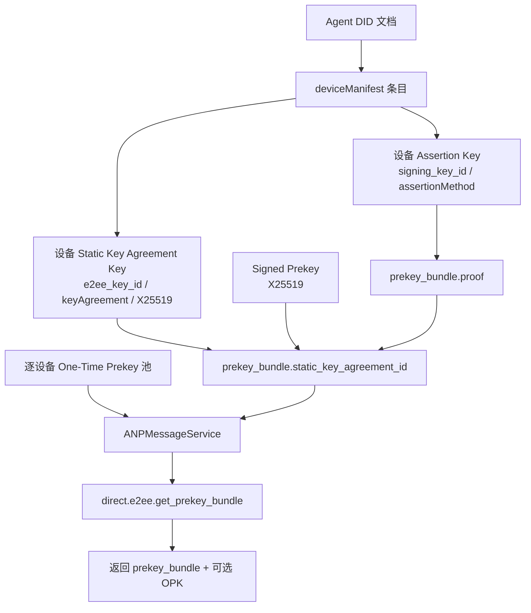
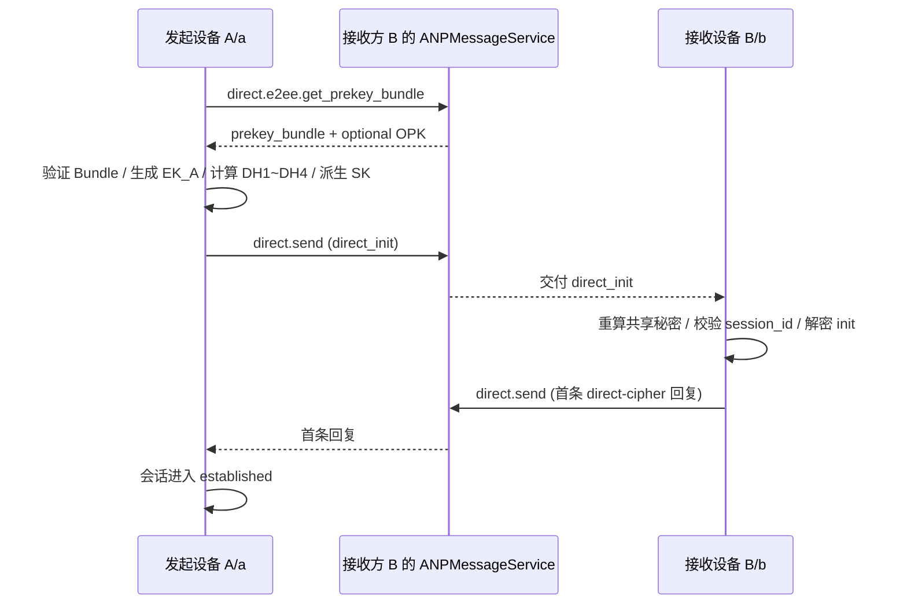
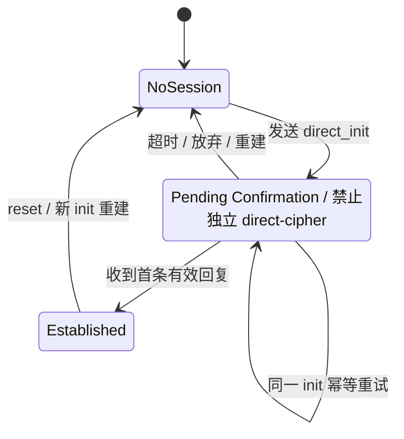

> 日本語参考訳（機械翻訳・未校閲）。規範となるのは原文です。コード例・識別子・規範キーワードは原文を保持しています。
> 原文: [chinese/message/05-私聊端到端加密.md](../../../chinese/message/05-私聊端到端加密.md) / 基準コミット: `0837cfdfaf4ddcf834f0890ddaf34fc4c824e066`

# ANPプロファイル5:プライベートツーエンド暗号化

- 文書番号: ANP-P5
- タイトル:プライベートツーエンドの暗号化
- ステータス:公開
- バージョン: 1.2
- コードブックバージョン: ANP のメッセージング 1.2
- 原文言語: 中文 / このページは日本語参考訳
- プロフィール:`anp.direct.e2ee.v2`
- アプリケーションの範囲: このプロファイルは、2つの Agent DID の下で特定のパスワードデバイス間でプライベートな会話に適用されます。
- 依存関係:
  - `anp.core.binding.v1`
  - `anp.identity.discovery.v1`
  - `anp.direct.base.v1`
  - [ANP-02 入院](../../../chinese/02-ANP-基于DID的身份认证协议.md#identity-input)DID メソッドの結合(依存関係を調節し、新しい WireProfile を割り当てません)を適用します。

---

## 1. 目的とスコープ

このプロファイルは、暗号化するプライベートチャット用の完全なAMP-to-endプログラムを定義します。

1. 方法テストされたID ID、P2の使用方法 `deviceManifest` サービスディスカバリーE2EEとプライベートチャット。
2. 認定されたデバイスの問題が、自分の Prekey Bundle を発見し検証する方法
3. 正確な配達装置対の実行のための装置を基づかせていました受け入れる `X3DH-like` - 世界が描く軌跡
4. 各デバイスがそれぞれどのように維持されるか `Double Ratchet-like` (a) ステータス;
5. (a) 装置がAAD、再配置された保護、無秩序な処理に縛られたか、セッションの復興、郵便箱配達および間違いは働きます;
6. エージェントのIDをビジネスアイデンティティとして保持する方法、およびVibable Device Selectorはパスワードエンドポイントの選択のみに使用されます。

このファイルは、デバイスを連絡先、セッション参加者または新規に変えません。 `target.kind`。

ベンジャー **なし、いいえ。**定義:

- (a) 機器やローカル機器の管理プロセスへのアクセス
- 歴史のアウトリーチ;
- (a) 読み取りステータス;
- プレゼンス
- グループツーエンドの暗号化;
- デバイスの「s プライベートキー、ラチェットの状態または歴史的仕様のクロスデバイスコピー。
- DID 方法論自体は分解、更新および廃炉のメカニズムです。

---

## 2. 規範的なキーワードと用語集

### 2.1 仮鍵

このテキスト **MUST**、**MUST NOT**、**REQUIRED**、**SHALL**、**SHALL NOT**、**SHOULD**、**SHOULD NOT**、**RECOMMENDED**、**NOT RECOMMENDED**、**MAY**、**OPTIONAL** 資本金を基準とする規範的な要件として解釈される。

### 2.2 用語集

- **エージェントID**: 外部に接続されたエージェント識別子。このプロファイルでは、それは両方の外側のレイヤーです `direct.send` 主主体の同一証明は、AAD、バンドル検証およびセッションバインディングのアイデンティティアンカーです。
- **デバイスピア**エージェントの DID のパスワードエンドポイントを、現在 P2 で表示 `deviceManifest` 真ん中の不透明 `device_id` 選択。 DIDやビジネス参加者ではありません。
- **デバイスは右にあります。**: 直行E2EEの4次元グループ `(sender_did, sender_device_id, recipient_did, recipient_device_id)`。
- **インサートキー**: 選択されたマニフェストのエントリ `signing_key_id` 引用し、引用語句 `assertionMethod` 正規の署名キー。 DH計算なしで、デバイスのバンドルまたはビンディングプルーフに署名するために使用されます。
- **静的キーの一致のキー**: 選択されたマニフェストのエントリ `e2ee_key_id` DID ドキュメントで引用 `keyAgreement` . 長期X25519公開鍵が宣言されます。
- **署名されたプレキー(SPK)**: デバイスによって生成された中期X25519公開鍵と、デバイスのAsserv Keyシグネチャでバインドします。
- **ワンタイムプレキー(OPK)**: デバイスに属する単一のX25519公開鍵。正常に使用した場合は、消費されず再使用しなければなりません。
- **プレキーバンドル**: 1つの正確な結合 `(owner_did, owner_device_id)` . それは装置の長期静的な相談主および現在のSPKを、直接受け入れませんOPK記述します。
- **ダイレクトセッション**: オーダーリーE2EEセッション、 `session_id` マーク。そのダブルラチェット、障害および復元状態は他のデバイスと共有されてはならない。
- **アプリケーション プレーンテキスト**: 暗号化前のプライベートチャットアプリケーション用の明示的なオブジェクト。これは、AEADに暗号化するために使用される直接ベースアプリケーションのロードベースのイントラレイヤー式です。
- **ラチェットヘッダー**: フォローアップメッセージに必要な最低のパブリックヘッダフィールド。受信チェーンを見つけるために、受信チェーンが依存し、DHトラッカーが必要かどうかを決定し、処理されていない情報を処理する。
- **メールボックス**: スコープ `(recipient_did, recipient_device_id)` . 1セッション以上を運ぶことができますが、ラチェットの状態はありません。
- **キャッシュを再生する**: 初期メッセージや後続メッセージを識別するためのステータスを設定します。標準の行プロトコルフィールドではなく、ローカルの状態です。

`device_id` **MUST** 透明識別子であり、除去後の **MUST NOT** 再利用します。キー、ハードウェア識別子、またはユーザー可視名ではありません。

---

## 3. 設計全般の規定

### 3.1 ビジネスアイデンティティとパスワード機器のエンドポイント

業務の送信者や受取人はまだ `meta.sender_did` とりあえず `meta.target.did` 式。このプロフィールの追加リクエスト `meta.sender_device_id` とりあえず `meta.recipient_device_id` 正確なパスワードデバイスを選択します。 これらのフィールドはP5のみで、DIDレベルの連絡先やセッションの構文を変更しません。

送信者がDIDの対象となるデバイスの同じ数に向けられている場合、 **MUST** 各受信機に独立した暗号化を作成します。 `direct.send` 業務内容:サービス **MUST NOT** ラチェットステータスをシェアするか、隠しパスワードのファンアウトを実行します。

### 3.2 セキュア・オーバーレイはビジネスの構文から分離

ベンプロファイルは、非正規の言語を再定義しません。再利用 `anp.direct.base.v1` と:

- `direct.send` 方法論;
- `sender_did` / `target.did` 社会;
- `message_id` / `operation_id` 社会;
- プライベートな成功のセマティクス(ターゲットエージェントポータルサービスが受け入れられる)。
- レイヤーコンテンツタイプのセマンティックを適用します。

P5には、各デバイスに対して相互に排他的なデバイス選択、デバイス間結合および分解されたデバイスの結果があります。 転送保護を使用してP3メッセージは、DIDに基づいて依然として機能し、デバイスを人を選択する運びません。

### 3.3 MTIベースラインは変更されないまま

このv2プロファイルの必須相互運用可能なベースラインは引き続き使用しています。

- 初期チェーンビルディング:`X3DH-like`(Did-Face-to-Default) は、
- 長期静的相談のキー:`X25519`
- ケド:`HKDF-SHA-256`
- 電子メール:`ChaCha20-Poly1305`
- フォローアップ:`Double Ratchet-like`

### 3.4 将来のアップグレードへのパス

プロフィール予約 `PQXDH-like` . このV2プロファイルは、既存のMTIパスワードパッケージを変更しません。将来のスイートには、独立した明確なスーツの識別と相談が必要です。

`anp.direct.e2ee.v1` スタンドアローンのシングルエンド契約はまだ。 **MUST NOT** v1 ピアのエキストラポレーション装置では、V1 セッションまたはラチェットの状態は、機器の v2 状態として再利用されず、v2 の動作が無声に低下するか、P3 を使用して伝送保護します。

### 3.5 デフォルトでは、init メッセージの永続的署名を義務付けていません

デフォルトでこのプロファイル **強制しない** えー。 `direct_init` オブジェクト全体として、別の長期の DID アイデンティティ署名が与えられています。

以下は、

1. X3DH のような認証自体は、長期静的コンサルデーションキーと受信者 SPK の組み合わせから。
2. 受信者SPKはAsserveキーに拘束されています。
3. 初期メッセージの署名が完全に要求されると、「アカウント管理」モデルが大幅に支持され、信号の可読性を低下させる。

展開がより大きい可聴性を必要とする場合の追加アクセス `Direct Init Accountability Extension`;this 拡張子は、このProfile のデフォルトオプションではありません。

### 3.6 `anp.direct.e2ee.v2` MTI防火物コレクション

いつ? `method = "direct.send"` とりあえず `meta.profile = "anp.direct.e2ee.v2"` MTI の変容経路で `meta.content_type` 次の2つの値だけを許可します。

- `application/anp-direct-init+json`
- `application/anp-direct-cipher+json`

カレンダー **MUST NOT** MTI の未変更パスで他のワイヤオブジェクトタイプを使用します。
受取人が他の受取人を受け取る場合 `content_type`，**MUST** 拡張協議により、機能が著しく活性化されていない限り拒否。

### 3.7 `anp.direct.e2ee.v2` ダウンダウン `direct.send` ♪ 欲しいものがわからない♪

あり。 `meta.profile = "anp.direct.e2ee.v2"` ・・・ `direct.send`：

- `meta.message_id` **MUST** 存在;
- `meta.operation_id` **MUST** 存在;
- `meta.operation_id` **MUST** とりあえず `meta.message_id` まさに同じです。

受信機器の秘密 **MUST** 自分の1つを使用してください。 `message_id` / `operation_id` はい。異なるデバイスの秘密の暗号化が同じオプションを含んでいる場合でも `logical_message_id`マークが共有されない場合があります。

### 3.8 `anp.direct.e2ee.v2` ダウンダウン `direct.send` ・・・ `auth` 制約

あり。 `meta.profile = "anp.direct.e2ee.v2"` ・・・ `direct.send`，`params.auth` **MUST** デフォルト。

展開が始まると、 `Direct Init Accountability Extension`と **MAY** 証拠の追加の対象を含める; 延長が合意されていない場合を受け取る `params.auth` **MUST** 注射器。

---


### 3.9 P3オリジナイザーの結合の条件との関係

P3セクション 9.7 "のため`auth.origin_proof.contentDigest` このファイルでは、以下のとおりに同等な結合を合致しています。

- `AD_init`
- `AD_msg`
- 保護されるAEAD `Application Plaintext`

相談なし `Direct Init Accountability Extension` , Ben ProfileのMTI **リクエストなし** 追加のP3フォームを運ぶ `params.auth.origin_proof`。

## 4. 関連するメソッドの DID 統合ルール

### 4.1 DIDドキュメントの最小要件

このファイルをサポートするエージェントのDIDドキュメント **MUST** 土産:

1. 少なくとも1つの認証キーとアサートされたシグニチャアサベーションキー。
2. 少なくとも1つ。 `keyAgreement` (a) バリデーションメソッド
3. 少なくとも1つ。 `ANPMessageService` または、同等価格のサービスへのエントリーポイント。
4. 流れ P2 `deviceManifest` P5 の各デバイスが使用できることを宣言し、それをマップすることができます。 `device_id`、`signing_key_id`、`e2ee_key_id` P1/P2/P3/P5 のデータの完全なコレクションは次です:
5. とりあえず `ANPMessageService` **MUST** このProfile に必要なデバイス・キーのマテリアルメソッドを解釈し、アクセスするために呼び出されます。

#### 4.1.1 現在の機器の資格

はい、のために `(D, d)` リリース前に、P5材料の返品または使用、達成 **MUST** 現在の DID ドキュメント認証の場合:

1. `d` 年齢のIDで `D` 現在P2マニフェストのアイテムを以下に選択します。
2. エントリー宣言 `anp.direct.e2ee.v2` と P1/P2/P3 の依存性が必要です。
3. `signing_key_id` ブログは、本を署名する方法のよい例です。`e2ee_key_id` リファレンス `keyAgreement` で X25519 メソッド; と
4. バンドル、セッション、AD、リレイ状態は、メールボックス操作と同じDID/Equipmentとキーリファレンスを使用します。

選択した機器のいずれかが上記の規則を満たしていない場合、 **MUST** 政府は「拒絶」の新素材やテキストの問題に取り組んできました。**MUST** 影響を受けるキャッシュやセッションの使用を中止し、 **MUST** DID を赤くします。他のまだ資格のあるデバイスは変更されません。

### 4.2 キーロール分離

ベンジャー **MUST** 主役割の分離を使用して下さい:

1. `assertionMethod` リストされているキーは以下です。
   - プレキーバンドルで署名;
   - 署名者が強いアイデンティティを必要とする人(拡張機能が有効になっている場合)
2. `keyAgreement` リストされているキーは以下です。
   - (b) 長期静的協議;
   - (a) 初期共有キーの補間;
3. キーと静的なキーの一致キーを節約 **MUST NOT** 混合。

各マニフェストデバイスには、別々のシグネチャとX25519プライベートキー、SKK / OPKプライベートキー、ダイレクトセッション、ラチェット状態、スキャッピングキー、リセットがあります。 2つのデバイス **MUST NOT** これらのプライベートな状況を共有したり、同じアクティブなキーリファレンスを公開したりします。

補足注記:オンライン協定では、元は通常通り `proof.verificationMethod` 引用, 後者は、通常、バンドルを介して `static_key_agreement_id` または、 `sender_static_key_agreement_id` 引用; それを達成する人は、同じキーを両方意味するために許さないべきである。

### 4.3 DIDメソッド検証

DID ドキュメントプレス [P2 方法検証](../../../chinese/message/02-身份与发现.md#method-validation)および対応する方法論的仕様;セクション4.1.1と6.2は、それぞれ、バンドル対象プロジェクトプルーフによって続きます。

### 4.4 `ANPMessageService` 主材料の機能

それぞれ、各々の1つに。 `(owner_did, owner_device_id)`，`ANPMessageService` **MUST** このProfile では、次の重要な材料機能が必要になります。

- プレキーバンドを解放して下さい;
- OPKプールを補うか、または回転させる;
- プレキーバンドルのクエリ
- (a) 一連の時間(利用可能な戦略が許せば)でサービス可能なOPKを発行する。
- マークOPKは、消費または非使用可能な割り当てられます。
- バンドルの呼び出しや無効性(サポートされている場合)を返します。
- デバイスがP5資格を失うと、バンドルとOPKは中止されます。

---


P5のしきい値はアルゴリズムでは理解できませんが、DH を操作するサインは、Bundle/OPK に問題があります。次の図では、DID ファイル内のさまざまな重要な役割を公に利用可能な素材で配置し、チェーン構築プロセスの読み直しを可能にしています。



*図 P5-1: 重要な役割とオープン材料の関係(非放射性)。*

この図は、職務の分離を強調しています。Assertion Keyは、アイデンティティバインディング、長期的に責任があります `keyAgreement` SPK/OPKはDH計算に責任があります。 エクセサは、同じキーを意味のある意味で持たせてはいけません。
## 5. 強制的な相互運用パッケージ(MTI)

### 5.1 MTIパッケージ名

V2Profile は、次の変更されていない MTI パスワード パッケージを使用し続ける:

`ANP-DIRECT-E2EE-X3DH-25519-CHACHA20POLY1305-SHA256-V1`

ラインの終了 `V1` P5Profile 版ではなくパスワードパッケージバージョンです。 **MUST NOT** 交換する `V2`HKDFs の全ての機能 `info` 文字列とアルゴリズムのパラメータは、リリースされたパッケージから変更されないままです。

### 5.2 MTIパッケージのパラメーター

パッケージのパラメーターは、次の通り修正されます。

- 静的な輪郭:`X25519`
- 一時的な相談のカーブ:`X25519`
- HKDF:`HKDF-SHA-256`
- エイエイド:`ChaCha20-Poly1305`
- バンドルオブジェクトの証拠のプロフィール:`prekey_bundle.proof` **MUST** P1付録B定義の共有を適用する `Object Proof Profile`


この条件は少なくともに適用します:

- `prekey_bundle` 保護された文書(またこの記事として知られている) `Signed Bundle Object`）
- `AD_init`
- `AD_msg`
- `Application Plaintext`


### 5.3 推奨オプションパッケージ

受賞作品 **MAY** 追加サポート:

- `ANP-DIRECT-E2EE-X3DH-25519-AES256GCM-SHA256-V1`
- `ANP-DIRECT-E2EE-PQXDH-HYBRID-V1`(保持)

どんなことでも `anp.direct.e2ee.v2` 武道の **MUST** MTIパッケージの交換を未対応にサポート

---

## 6. 素材とバンドル構造のオープン

### 6.1 長期静的コンサルテーションキー

各文の本のための現在のデバイスProfile **MUST** 万博を通じて `e2ee_key_id` 参照の代理店 DID 文書 `keyAgreement` 中型、長期静的X25519公開鍵。

推奨分野:

- `id`: 例: `did:wba:example.com:agent:alice:e1_xxx#ka-1`
- `type`: 自己選択を達成するが、明確な表示X25519と
- `publicKeyMultibase` または公正な鍵等


フィールド使用の説明:

- `id`: バンドル、Init メッセージおよびAADの「この時間にどの長期DHキーが使用されるか」の正確な表示のため。
- `type`: 認証方法を記述するために使用されるアルゴリズムとコードは、最後に正しくデコードし、X25519であることを確認するのが簡単です。
- `publicKeyMultibase` または同等とは、実際の公開鍵バイトが DH 実行の終了の入力ソースであることを示しています。

### 6.2 `prekey_bundle` 構造:

`prekey_bundle` 永続的に受信者によって公開され、選択したデバイスにバインドされるP1付録B主題証拠**静的なチェーン ビル材料**. 信号様式OPKの配分モデルと、保ち続けるため`prekey_bundle` **MUST NOT** 直接インライン `one_time_prekey`;OPK は、サービスから要求されたときにシーケンスで返します。

`prekey_bundle` 提案された定義は、次の通りです。

```json
{
  "bundle_id": "bundle-20260329-001",
  "owner_did": "did:wba:example.com:agent:alice:e1_xxx",
  "owner_device_id": "dev-a-7N3KQ2",
  "suite": "ANP-DIRECT-E2EE-X3DH-25519-CHACHA20POLY1305-SHA256-V1",
  "static_key_agreement_id": "did:wba:example.com:agent:alice:e1_xxx#ka-1",
  "signed_prekey": {
    "key_id": "spk-001",
    "public_key_b64u": "BASE64URL_X25519_SPK",
    "expires_at": "2026-04-05T00:00:00Z"
  },
  "proof": {
    "type": "DataIntegrityProof",
    "cryptosuite": "eddsa-jcs-2022",
    "verificationMethod": "did:wba:example.com:agent:alice:e1_xxx#assert-1",
    "proofPurpose": "assertionMethod",
    "created": "2026-03-29T00:00:00Z",
    "proofValue": "zBASE58MULTIBASE_PROOF"
  }
}
```

フィールド使用の説明:

- `bundle_id`: 静的バンドルバージョンが安定します。 送信者はそれをで持ってきます `direct_init` とりあえず `AD_init`監査、キャッシュライン、再ランゲの区別するために受取人によっても使用できます。
- `owner_did`:Bundle は Agent DID に属します。Sender は DID 文書を解析し、それらを検証するために使用します `proof` バンドルのアイデンティティを確認します。
- `owner_device_id`:Bundleの精密装置エンドポイント;それ **MUST** あり。 `owner_did` 下記のP5対象マニフェストエントリーを選択します。
- `suite`: バンドルに適用されるパスワードパッケージ名。送信者は最初に、ローカルでサポートされているかどうかを決定し、チェーンのバンドルを使用するかどうかを決めるべきです。
- `static_key_agreement_id`: ポイントへ `owner_did` DID 文書の長期静的 X25519 キーのための DID URL。 これは、ピアに "このバンドルキーのどのが長期的な DH キー" であると言う。
- `signed_prekey.key_id`: 現在のSKKは同一証明を着実にしました。送り主はあります `direct_init` , 受信者は正しいSPKプライベートキーを見つけます.
- `signed_prekey.public_key_b64u`: 埋め込まれていないベース64urlとして表現されたSPK用のキーバイトを開き、初期のDH入力の1つです。
- `signed_prekey.expires_at`: SPK が期限切れになります。送信者は、バンドルを使用する前に期限が切れていないことを確認しなければなりません。
- `proof.type`: 証明するオブジェクトの種類;このプロファイルのMTIは、修正され続けます `DataIntegrityProof`。
- `proof.cryptosuite`特定の証拠のcryptosuiteの名前;このProfileのMTIは固定し続けます `eddsa-jcs-2022`。
- `proof.verificationMethod`: バンドルの署名用のDID URL。 性別は、それが属しているかどうかをチェックする必要があります `owner_did` 文書許可 `assertionMethod` 関係。
- `proof.proofPurpose`: 署名を宣言するために使用される認可された関係は、DID文書の認定関係に相当します。
- `proof.created`: 証明書は、その生成時に生成され、監査および戦略的検査に使用されます。
- `proof.proofValue`: 標準化されたバンドルは署名される証明された価値を示します。

### 6.2.1 `prekey_bundle.proof` オブジェクトの ProofProfile と共有

`prekey_bundle.proof` **MUST** P1付録B定義の共有を適用する **オブジェクトの証拠のプロフィール**。

えー。 `prekey_bundle` のために:

- 発行者 DID **MUST** あり あり `owner_did`
- オーナーデバイス **MUST** あり あり `owner_device_id`, 現在のP5の対象となるマニフェストエントリを選択し、
- 保護された文書 **MUST** 削除 `proof` あとで。 `prekey_bundle` オブジェクト
- これは、この保護された文書の短い名前です `Signed Bundle Object`
- `proof.verificationMethod` **MUST** スポット `owner_did` ドキュメント by `assertionMethod` 認証方法
- `proofPurpose` **MUST** 固定式 `assertionMethod`


### 6.2.2 `bundle_id` 未精製性セマティクス

ローカル受け入れ窓では、同じ `bundle_id` **MUST** 示されている唯一のマップと、次のフィールドの組み合わせでのみ表示されます。

- `owner_did`
- `owner_device_id`
- `suite`
- `static_key_agreement_id`
- `signed_prekey.key_id`
- `signed_prekey.public_key_b64u`

業務内容 **MAY** スペース期間内に短時間枠で複数の違いを認める `bundle_id`, しかし **MUST NOT** 同じことを再定義して下さい `bundle_id`。

いつだったか... `bundle_id` 受信機、窓でまだ受け取って下さい **MUST** 対応するSKKのプライベートキー、バンドルメタデータ、およびこの受け入れウィンドウの最後に必要な検索インデックスを保持します。

### 6.2.3 バンドル証拠ターゲット特定の制限

P1付録Bの共有ルールに加えて、このプロフィールMTIは、`prekey_bundle` と... **MUST** 土産:

- `proof` **MUST** プレゼンス
- `proof.verificationMethod` のIDの **MUST** イーグル `owner_did`
- 場合 `prekey_bundle.proof` P1付録B、または発行者DDに満足していない `owner_did` 受取人、受取人 **MUST** 詳細はこちら `anp.direct.e2ee.bundle_invalid` バンドルを注入して下さい

### 6.3 束の分野条件

`prekey_bundle` **MUST** 含まれる:

- `bundle_id`
- `owner_did`
- `owner_device_id`
- `suite`
- `static_key_agreement_id`
- `signed_prekey`
- `proof`

`prekey_bundle` **MUST NOT** 直接に下記のものを含んでいる:

- `one_time_prekey`

### 6.4 バンドルプルーフオブジェクト特定フィールド制約

削除のためのP1付録Bを除く `proof` ポストセクションの全体オブジェクトは、統一された保護範囲の要件を超えています。`prekey_bundle` まさか **MUST** 少なくとも全体として含まれているし、苦しみます。 `proof` 次のセキュリティキーフィールドを保護する:

- `bundle_id`
- `owner_did`
- `owner_device_id`
- `suite`
- `static_key_agreement_id`
- `signed_prekey`

`proof` スタプルされた静的バンドル。ランタイムで発行されるPOPK **MUST NOT** 静的な束カバーとして。

### 6.5 バンドル検証要件

バンドルを使用する前に、送信者 **MUST**：

1. パーシング `owner_did` 現在のDID文書、セクション4.1.1に従って確認 `owner_device_id`；
2. 認証 `proof.verificationMethod` マニフェストの条と同じ `signing_key_id`と `owner_did` ドキュメント by `assertionMethod` (a) 認可;
3. P1 付録 B で定義されている通りの共有 `prekey_bundle.proof`(保護された文書はあります) `Signed Bundle Object`）；
4. 検証 `static_key_agreement_id` マニフェストの条と同じ `e2ee_key_id`DID 文書に存在する `keyAgreement`；
5. 検証 `suite` ローカルでサポートされているパッケージかどうか。
6. 検証 `signed_prekey.expires_at` 期限切れなし
7. 場合 `direct.e2ee.get_prekey_bundle` ♪ 成功への答えも♪ `one_time_prekey`カレンダー **MUST** フィールド形式が有効でレコードであることを確認 `key_id` チェーン構築、消費および監査のため。
8. 送信者のフォローアップ構造 `direct_init` できるかどうかはわかりません。`recipient_signed_prekey_id` **MUST** 選択した資格を履く `prekey_bundle.signed_prekey.key_id`。

### 6.6 OPKポリシー

このプロフィールは変更されていないMTIで、`one_time_prekey` まさか **SHOULD** 利用するが、 **MAY** デフォルト。

シグナルスタイルのワンタイムプレキー分布と一貫性のために、各受信機 **SHOULD** にほんご `ANPMessageService` OPKのバッチをサービスエンドでアップロード `direct.e2ee.get_prekey_bundle` デバイスの s プールから正常に応答して、サービス可能なOPKを返します。

OPKに正常に対応する場合、オブジェクトの形式は次の通り推奨されます。

```json
{
  "key_id": "opk-001",
  "public_key_b64u": "BASE64URL_X25519_OPK"
}
```

フィールド使用の説明:

- `key_id`: OPKレコードの安定識別子。 送信者は `direct_init` 採用実績 `recipient_one_time_prekey_id` 受取人が、対応するプライベートキーを見つけ、消費する手段として引用されます。
- `public_key_b64u`: OPKのキーバイトを開き、標準ベース64urlを埋めないオプションとして表現 `DH4` . . .

ルールは以下の通りです。

- 業務内容 **SHOULD** 返却時にすぐに割り当てられたOPKをマークします。
- 同じOPK **MUST NOT** (a) 複数の送信者または機器のペアに割り当てられます。
- OPKが初期ビルドアップを成功させると、サービスエンド **MUST** 消費されるようにマークして下さい、受取人 **MUST** OPK プライベートキーを削除します。
- 割当のチェーンが完成していない場合、回収が許可されているかどうかは展開戦略で決定されます。ただし、成功したチェーンビルディングのために特定されたOPK **MUST NOT** (a) 再発行;
- 場合 `direct.e2ee.get_prekey_bundle` 成功した応答はOPKを伴っていなかったし、イニシエータはチェーンをビルドし続けることができましたが、初期共有シークレットのプレリリースセキュリティはSPKライフサイクルに多く依存します。

---

## 7. キーサービス方法

### 7.1 `direct.e2ee.publish_prekey_bundle`

この方法は、送信者の公開に新しい静的プレキーバンドルを投稿するために使われます `ANPMessageService`OPKのバッチを追加することを選ぶことができます。

#### リクエスト

- `meta.profile = anp.direct.e2ee.v2`
- `meta.security_profile = transport-protected`
- `meta.target.kind = "service"`
- `meta.target.did` **MUST** 出版社自身と同じです。 `ANPMessageService.serviceDid`
- `meta.sender_did` **MUST** プレゼンス
- `meta.sender_device_id` **MUST** プレゼンス
- `meta.operation_id` **MUST** プレゼンス
- ブロガーは政府が拡張を交渉する立場にあるとは言えません。`params.auth` **MUST** デフォルト
- `body.prekey_bundle` **MUST** プレゼンス
- `body.prekey_bundle.owner_did` **MUST** イーグル `meta.sender_did`
- `body.prekey_bundle.owner_device_id` **MUST** イーグル `meta.sender_device_id`
- `body.one_time_prekeys` **MAY** そこには、あると、**MUST** は非空配列であり、各要素 **MUST** 組織図 `key_id` とりあえず `public_key_b64u`

証明の制約:

- メソッドは、 **サービススコープ** フェイスメソッドの制御
- 認証コンテキスト **MUST** 確かにそうですね。 `(meta.sender_did, meta.sender_device_id)`設備と機器 **MUST** 現在、P5はセクション4.1.1で資格があります。
- 標準的な道、発信者 **MUST** 認証されたローカルセッションのコンテキストで実行するか、ホップ/サービス認証と同等の方法で実行します。
- ベンジャー **リクエストなし** この方法論の新しいビジネスレイヤーの追加定義 `origin_proof`；
- リクエストを受け付ける前に、ホップ/サービスレベルの認証の確認に加えて、 **MUST** 認証されたコールア権限を検証 `meta.sender_did` リリース `body.prekey_bundle.owner_did` 対応材料。


禅ら。 要求:

- 業務内容 **MUST** 詳細はこちら `(meta.sender_did, meta.sender_device_id, meta.target.did, method, meta.operation_id)` 鍵として;
- 同じキーでリクエストを繰り返します。 `body.prekey_bundle` とりあえず `body.one_time_prekeys` 性的等価, その後 **MUST** 元の結果または同等の結果を返す。
- 同じ対称リクエストが競合している場合、 **MUST** バックナンバー `anp.idempotency_conflict` または、等価が間違っています。

フィールド使用の説明:

- `meta.security_profile = transport-protected` これは、キーコントロールのフェイスコールがセッションを作成した後にe2EEテキスト転送されていないことを意味します。
- `body.prekey_bundle` 現在、他者に利用できる静的なチェーン材料を出版または取り替えるため。
- `body.one_time_prekeys` OPKプールのワンタイム補充には、オプションのバッチアップロードエントリであり、静的なバンドルプログラムを入力しません。

#### 成功の応答

成功の応答 **MUST** 少なくとも含まれます:

- `published = true`
- `owner_did`
- `owner_device_id`
- `bundle_id`
- `published_at`

成功の応答 **MAY** 含まれる:

- `published_opk_count`


### 7.2 `direct.e2ee.get_prekey_bundle`

この方法は、ターゲットエージェントの公開を渡すために使われます `ANPMessageService` 静的バンドルとOPKを必要に応じて取得します。

#### リクエスト

- `meta.profile = anp.direct.e2ee.v2`
- `meta.security_profile = transport-protected`
- `meta.target.kind = "service"`
- `meta.target.did` **MUST** ターゲット、エージェントです。 `ANPMessageService.serviceDid`
- `meta.sender_did` **MUST** プレゼンス
- `meta.sender_device_id` **MUST** プレゼンス
- `meta.operation_id` **MUST** プレゼンス
- ブロガーは政府が拡張を交渉する立場にあるとは言えません。`params.auth` **MUST** デフォルト

`body` **MUST** 含まれる:

- `target_did`
- `target_device_id`

`body` **MAY** 含まれる:

- `preferred_suite`
- `require_opk`

証明の制約:

- メソッドは、 **サービススコープ** フェイスメソッドの制御
- 認証コンテキスト **MUST** 現在のP5の資格を認めて下さい `(meta.sender_did, meta.sender_device_id)`；
- 素材の返却前、サービス **MUST** セクション4.1.1に従って精度の検証 `(target_did, target_device_id)`；
- 最小の相互運用可能なベースラインは、ホップ/サービスレベルの認証を最低限に必要とされます。
- 標準的な道の下、拡張のための交渉なしで、`params.auth` **MUST** (a) デフォルト;
- **プロフィールの一部ではないバンドルまたはOPK MTIへの名前変更されていないアクセス**; 展開が匿名訪問にオープンしている場合、追加のデプロイメント戦略です。

フィールド使用の説明:

- `target_did`: チェーン材料を取得したい人; サービスエンドは、他の対象のキャッシュ結果ではなく、DIDをバインドするバンドルを返す必要があります。
- `target_device_id`: 選択 `target_did` 次現在の受信機; サービス **MUST NOT** キャッシュされる他の機器の材料を返します。
- `preferred_suite`: 複数パッケージがサービス終了時に維持されると、発信者を優先してほしいものを記載する材料。
- `require_opk`: 「ONKが使えない」という意味で、チェーンをビルドするという劣化はありません。 `true`コールアは直接使用を期待します。 `DH4` . . .


#### 成功の応答

成功の応答 **MUST** 少なくとも含まれます:

- `target_did`
- `target_device_id`
- `prekey_bundle`

成功の応答 **MAY** 含まれる:

- `one_time_prekey`


応答フィールドの成功は、次のようになります。

- `target_did`: 返された素材の実際の属性に対して、対象となるDIDを見直し、要求対象のキャッシュが一致しているかどうかを確認することができます。
- `target_device_id`: 素材が属する正確な機器を回復します。 **MUST** リクエストした値をリクエストする `prekey_bundle.owner_device_id`。
- `prekey_bundle`: 対象となる対象に現在利用可能な静的チェーン材料を返します。送信者は、実際にチェーンを構築できる前に、6節以下の検証を完了する必要があります。
- `one_time_prekey`: 現時点では、このクエリにサービスが使用可能なOPKを割り当てていることを意味します。送信者は、長期キャッシュされた公開情報ではなく、その後の初期インイトと結合しようとする試みとしてそれを見なければなりません。

場合 `require_opk = true` , そして、サービスは、現在不明なOPKです, その後、サービス **SHOULD** 旧OPKの偽造や再使用ではなく、可視エラーを返します。


& PixarおよびOPKの配分の条件:

- 業務内容 **MUST** 詳細はこちら `(meta.sender_did, meta.sender_device_id, target_did, target_device_id, meta.target.did, method, meta.operation_id)` 鍵として;
- 成功した応答がキーに割り当てられた場合 `one_time_prekey`、現在の装置を再検証した後同じキーを再テストして下さい **MUST** 同じに戻る `prekey_bundle` 同じように `one_time_prekey`；
- 業務内容 **MUST** 原子は「記録等を探し、+OPKの配布/予約状況」を完了します。
- 業務内容 **MUST NOT** 同じキーを再試行するために別のOPKを割り当てます。


### 7.3 サービスエンドバンドル配布規則

`ANPMessageService` 返された束:

- **SHOULD** サービスの最新の静的静止状態の優先リターン `prekey_bundle`；
- OPKが利用可能でポリシーが許せば、PHPを使用するのは良い考えです。**SHOULD** 追加の1つ。 `one_time_prekey`；
- 返品について `one_time_prekey` **MUST** から `(owner_did, owner_device_id)` OPKプール、および **MUST NOT** 静的バンドルの証拠によって署名の一部として偽装される;
- OPKの返送 **SHOULD** 配布としてマークする。
- OPKでこのリターンをとったサービス **MUST** 「この応答などのレコードは+ OPK割当/保持状態に書かれている」の原子補完
- **MUST NOT** (a) 同じOPKは複数の送信者に配布されます。
- ターゲット受取人がサービスの後の巧妙に処理された init **MUST** 消費者、受取人にOPKマーク **MUST** OPK プライベートキーを削除します。
- OPKの回復をターゲットサービス拒否または処理が失敗した場合、展開戦略によって決定されるようにする; しかし、成功したチェーン構築のために特定された任意のOPK **MUST NOT** (a) 再発行;
- コールワー教育、フロー制限、アンチアブラス戦略 **MUST** ホップ/サービスレベルの認証に基づく実行

---

## 8. 初期チェーン:X3DH-like(DDID適合)

## 8.1 設計仕様

ベンプロファイルの初期チェーン **ありません。** 信号 X3DH、代わりに1 **X3DH 様** 付属品版:

- 元のX3DH設計の長期同一ID DHキー、このProfileのDID文書 `keyAgreement` (b) 長期静的X25519の主軸受け;
- DD はキーを DH に参加しませんが、バンドルの署名だけをAsserve します。
- 署名キーは DH キーから分離されるため、XEdDSA キー使用の特定のドメイン分離の詳細の元の X3DH エントリはもはやレプリカする必要はありません。

## 8.2 参加キー

### デバイスを送信します `(A, a)`

- `A` 送信者です。`a` 現行のところです。 `sender_device_id`；
- `KA_A`装置を出荷して下さい 長期静的なX25519 `keyAgreement` 公開鍵/秘密鍵ペア。オンラインプロトコルでは、通常は使用 `sender_static_key_agreement_id` 仕様
- `EK_A`仮称X25519公開鍵/秘密鍵ペア。各新規の入口で再生され、生成される `sender_ephemeral_pub_b64u` 公開鍵コンポーネントの露出

### 受入装置 `(B, b)`

- `B` エージェントのID、受信者。`b` 現行のところです。 `recipient_device_id`；
- `KA_B`: 受信機器長期静的X25519 `keyAgreement` 公開鍵/秘密鍵ペア。 送信者を経由 `recipient_bundle_id` バンドルバージョンとその選択 `static_key_agreement_id` 間接的に決定します。
- `SPK_B`: 受取人の署名を持つ中期X25519プレッキー。オンラインプロトコルでは、 `recipient_signed_prekey_id` バンドルプログラムでDIDにバインドする。
- `OPK_B`: 受取人が1回X25519プレキー(オプション)です。サービスが返ったら、オンラインプロトコルは `recipient_one_time_prekey_id` 成功したチェーンビルディング後に識別し、消費.

## 8.3 事前チェーン条件

このページの目的 `recipient_did` アウターレイヤーです。 `direct.send.params.meta.target.did` 、新しいスタンドアローンラインプロトコルフィールドは追加されません。`sender_device_id` とりあえず `recipient_device_id` 外位レベルP5から `meta`、そして精密な装置組を一緒に選び。

送信機がチェーンを造る前に **MUST**：

1. パーシングと検証対象 `recipient_did`；
2. セクション4.1.1に従ってマニフェストのエントリの選択の検証;
3. ターゲット機器へのアクセスと検証 `prekey_bundle`;if応答が付随的である `one_time_prekey`OPKを一緒に記録し、;
4. 送信者を取得 `e2ee_key_id` 対応するローカル長期静的秘密鍵;
5. 新しい一時的なX25519キーペアを生成する `EK_A`。

## 8.4 DH計算

場合 `direct.e2ee.get_prekey_bundle` ♪ と、成功の反応で♪ **ありません。** OPK、送信者 **MUST** 計算:

```text
DH1 = DH(KA_A, SPK_B)
DH2 = DH(EK_A, KA_B)
DH3 = DH(EK_A, SPK_B)
IKM = DH1 || DH2 || DH3
```

場合 `direct.e2ee.get_prekey_bundle` ♪ と、成功の反応で♪ **あり。** OPK、送信者 **MUST** 余分計算:

```text
DH4 = DH(EK_A, OPK_B)
IKM = DH1 || DH2 || DH3 || DH4
```

## 8.5 秘密の派生物の初期共有

送り主と受信機 **MUST** 使用:

```text
PRK = HKDF-Extract(salt = 0x00...00(32 bytes), IKM)
SK  = HKDF-Expand(PRK, info = "ANP Direct E2EE v1 Initial Secret", L = 32)
```

それからから `SK` ソース:

```text
RK0 = HKDF-Expand(SK, info = "ANP Direct E2EE v1 Root Key", L = 32)
CK0 = HKDF-Expand(SK, info = "ANP Direct E2EE v1 Chain Key", L = 32)
SID = HKDF-Expand(SK, info = "ANP Direct E2EE v1 Session ID", L = 16)
```

の の の の の の の の の の の の の の の の の の の の の の の の の の の の の の の の の の の の の の の の の の の の の の の の の の の の の の の の の の の の の の の の の の の の の の です:

- `RK0`: オリジナルのルートキー
- `CK0`: 初期チェーン開始前の最初の入口の秘密
- `SID`:16 バイトセッションの識別、コード化されたベース64URLとして `session_id`


### 8.5.1 ノスの最初のメッセージキー

`SK` 出産です。 `RK0` とりあえず `CK0` アフター、送信者および受信機 **MUST** すぐそば。 `CK0` 1つの実行 `kdf_ck`：

```text
CK1, MK0, NONCE0 = kdf_ck(CK0)
```

の の の の の の の の の の の の の の の の の の の の の の の の の の の の の の の の の の の の の の の の の の の の の の の の の の の の の の の の の の の の の の の の の の の の の の です:

- `MK0` 暗号化や復号化のみ `direct_init.ciphertext_b64u`
- `NONCE0` 第一号の入口の秘密のためのAEAD nonceだけ
- `CK1` 成功裏に続くチェーンのスタート地点だけ。

定数の MTI ルールは、メッセージの 0 を init メッセージ行です。言い換えれば、メッセージが渡される前には時間の問題ではありません。`CK0` 出産のみです。 `MK0`、`NONCE0` とりあえず `CK1`;成功の後で両方をinit **MUST** から `CK1` と、 **MUST NOT** 繰り返します。 `CK0` 後続の伝送または受信チェーンの開始点として。

blogger は次のように追加します。`ciphertext_b64u` **AEAD Ciphertext のみ (認証ラベル付き)**、余分か前処理のnonce無し; nonceは現在のプロフィールKDFの規則から常に得られます。


## 8.6 初期化データ

チェーンビルAEAD AADの初期値 `AD_init`正規の JSON 構造と唯一のバイトシーケンスは、セクション 9.4.2 で定義され、 **MUST** UTF-8 + RFC 8785 JCS のエンコーディングを使用してください。

`AD_init` **MUST** (b) 少なくとも次のフィールドを結合します。

- `content_type = application/anp-direct-init+json`
- `sender_did`
- `sender_device_id`
- `recipient_did`
- `recipient_device_id`
- `suite`
- `recipient_bundle_id`
- `sender_static_key_agreement_id`
- `recipient_signed_prekey_id`
- `recipient_one_time_prekey_id`(もしあれば)
- `session_id`
- `message_id`
- `operation_id`
- `profile = anp.direct.e2ee.v2`
- `security_profile = direct-e2ee`

これらのフィールドの役割は次のとおりです。

- `content_type`: 別のオブジェクトタイプと同じ秘密テキストが解釈されるのを防ぐため、現在のワイヤオブジェクトタイプを結びます。
- `sender_did` / `recipient_did`:: 両当事者の事業体をチェーンに結び、アイデンティティが不正な危険性を減らすため。
- `sender_device_id` / `recipient_device_id`: 正確なパスワードエンドポイントを結合して、他のデバイスやSecionに移行する際のシークレットテキストが侵入しないようにします。
- `suite`: 同じ秘密テキストの誤った解釈を防止するために使用されるパスワードパッケージをバインドします。
- `recipient_bundle_id`: 異なるバンドル間で材料の混合を防ぐため、受信者によって使用される特定のバンドルバージョンを結ぶ。
- `sender_static_key_agreement_id`: 送信者のDHの長期静的キーで実際の参加を結びます。
- `recipient_signed_prekey_id`: 今回使用したSPKの受信者のバージョンをタイに。
- `recipient_one_time_prekey_id`: 存在する場合は、このチェーンで消費されたOPKレコードを結合します。
- `session_id`: セッションから得た話マークを結び、他のセッションに同じ秘密のテキストが転じないようにします。
- `message_id` / `operation_id`: アウターレイヤーです。 `direct.send.meta` ラベルの2つ。このプロファイルが同じである必要がある場合でも、AADはそれらを著しく認証します。
- `profile` / `security_profile`: 結合契約は、プロファイルまたはクロスセキュリティモードの交換を防ぐためのコンテキストを説明しています。


## 8.7 初期アプリケーションメッセージ

このプロフィールで-変更無しMTI、`direct_init.ciphertext_b64u` **MUST** 完全な内部の層を荷を積んで下さい `Application Plaintext` オブジェクト。

つまり、このプロファイルMTIは「空のinit」オブジェクトを定義しません。 送信者は正常に extrapolates `SK` 確かにそうではありません。**MUST** 利用方法 `CK0` 長い走り。 `kdf_ck` 生まれ。 `MK0` / `NONCE0` ファースト `Application Plaintext` 暗号化して書き込む `ciphertext_b64u`。


---


以下にバンドルが入ります。OPKを選択し、送信します `direct_init`. 受信者のブートストリームは、完全なリンクへの最初の応答をリンクします。それの背後にある式を読み、メッセージと状態がどのように移動するかを見ることができます。



*図P5-2:X3DHのような初期チェーンシーケンス(非放射性)。*

ここで「ビルドの成功」は、バンドルの成功ではありませんが、両当事者は、派生物とスポンサーの同じセットに基づいてブートストリームを完了しました `session_id` 最初の記事は有効な応答です。
## 9. `application/anp-direct-init+json` オブジェクト

### 9.1トップレベル構造

いつ? `meta.content_type = application/anp-direct-init+json` できるかどうかはわかりません。`body` **MUST** 次の構造を採用します:

```json
{
  "session_id": "BASE64URL_16_BYTES",
  "suite": "ANP-DIRECT-E2EE-X3DH-25519-CHACHA20POLY1305-SHA256-V1",
  "sender_static_key_agreement_id": "did:wba:example.com:agent:alice:e1_xxx#ka-1",
  "recipient_bundle_id": "bundle-20260329-001",
  "recipient_signed_prekey_id": "spk-001",
  "recipient_one_time_prekey_id": "opk-001",
  "sender_ephemeral_pub_b64u": "BASE64URL_X25519_EK_A",
  "ciphertext_b64u": "BASE64URL_INIT_CIPHERTEXT"
}
```

### 9.2 フィールド要件

`direct_init` **MUST** 含まれる:

- `session_id`
- `suite`
- `sender_static_key_agreement_id`
- `recipient_bundle_id`
- `recipient_signed_prekey_id`
- `sender_ephemeral_pub_b64u`
- `ciphertext_b64u`

`direct_init` **MAY** 含まれる:

- `recipient_one_time_prekey_id`

フィールド使用の説明:

- `session_id`: この新しいセッションのロゴ。 秘密の初期共有によって作成され、その後アップ `application/anp-direct-cipher+json` インデックスの状態にメッセージが再利用されます。
- `suite`: 受信者が正しいKDF、AEAD、メッセージの解釈規則を選択するために使用するパスワードパッケージがこのinitで使用されることを宣言します。
- `sender_static_key_agreement_id`: 送信者DID文書のDHでの実際の参加の長期静的へのポイント `keyAgreement` キー。
- `recipient_bundle_id`: 受信者の静的バンドルバージョンがこのインイトに使用されます。受信機は、対応するSPKライフサイクル、ローカルアクセプションウィンドウ、再表示範囲を見つけます。
- `recipient_signed_prekey_id`: 受信者が正しいSSPKプライベートキーを見つける必要がある現在のSPKレコードへのポイント。 入札構造 `direct_init` 値引き **MUST** 選択した資格を履く `prekey_bundle.signed_prekey.key_id`。
- `recipient_one_time_prekey_id`: 存在する場合、この init は OPK も消費することを意味します。 受信者はそれに応じて配置され、成功したチェーンビルディング後に秘密鍵で消費されるべきです。
- `sender_ephemeral_pub_b64u`: 送信者は、この初期X25519公開鍵を生成し、受信者がローカルの長/プレキーに参加する。
- `ciphertext_b64u`: 初期メッセージキーで暗号化されたAEADの秘密セクション。この変更されていないパッケージではなく、このプロファイルによって生成されるメッセージキーが非送信されない `kdf_ck` ルールは、そのように由来する。 `ciphertext_b64u` **円筒状テキストのみ、スペルなし**。


### 9.3 外レベルの方法学的要件

`direct_init` **MUST** パス。 `direct.send` 大会:

- `meta.profile = anp.direct.e2ee.v2`
- `meta.security_profile = direct-e2ee`
- `meta.sender_device_id` **MUST** プレゼンス
- `meta.recipient_device_id` **MUST** プレゼンス
- `meta.content_type = application/anp-direct-init+json`
- `meta.operation_id` **MUST** とりあえず `meta.message_id` 正確に等しい
- ブロガーは政府が拡張を交渉する立場にあるとは言えません。`params.auth` **MUST** デフォルト

追加注記: ここにアウターレイヤー `meta.content_type` 説明は... `body` E2EE が使用するオブジェクトフォーマットをロードする。指定された実タイプのビジネスの最初のアプリケーションは、 `ciphertext_b64u` 暗号化された内部の層 `Application Plaintext` 媒体。

### 9.4 独自のチェーン構築とステート初期化アルゴリズム(仮)

このセクションでは、初期の応答が開始パーティとステート主導ルールから始まる、初期のレスポンスが受信した初期の応答から、初期の生成された作成、ローカルポスト・インシットの状態構築の定義を調和させます。 **MUST NOT** 他のセクションでは、このセクションと競合する対称定義は別々に定義されます。

#### 9.4.1 入退会

Sender A, スタートアップ `direct_init` プレス **MUST** 完了:

1. パーシングと検証対象 `recipient_did` 両当事者との現在のマニフェストのエントリ
2. 正確な受入装置の取得と検証 `prekey_bundle`
3. 応答が発生した場合 `one_time_prekey`OPKを録音し、
4. 送信者の自身の長期静的をフェッチし、確認して下さい `keyAgreement` 主キー
5. 新しい一時的なX25519キーペアを生成する `EK_A`

秘密の共有やOPKやセッションステータスの変更前のB受信機 **MUST** 認証:

1. アウター `(sender_did, sender_device_id)` とりあえず `(recipient_did, recipient_device_id)` P5 の対象となるエンドポイントは両方とも使用できます。
2. `body.sender_static_key_agreement_id` 送信者マニフェストのエントリーと同じ `e2ee_key_id`；
3. `body.recipient_bundle_id` 外部受信装置であり、 `recipient_signed_prekey_id` バンドルに属します。
4. どんなに `recipient_one_time_prekey_id` それらは同じ受信機OPKプールに属しています。

送信者と受信機は、次の由来から導き出します。

- `SK`
- `RK0`
- `CK0`
- `SID`

注文:

- `session_id = base64url(SID)`

ローカルセッションインデックス **MUST** 組織図 `(local_did, local_device_id, peer_did, peer_device_id, session_id, suite, local_e2ee_key_id, peer_e2ee_key_id)`.セッション **MUST NOT** 異なる機器のペアから選択または結合します。

受取人がプロセスにいます。 `direct_init` できるかどうかはわかりません。**MUST** 領収書の検証 `body.session_id` 地域から `session_id` 確かに。

#### 9.4.2 `AD_init` バイトのみ

`AD_init` **MUST** UTF-8+RFC 8785 JCS がコードする JSON オブジェクトの次のバイトです。

```json
{
  "content_type": "application/anp-direct-init+json",
  "message_id": "<outer meta.message_id>",
  "operation_id": "<outer meta.operation_id>",
  "profile": "anp.direct.e2ee.v2",
  "security_profile": "direct-e2ee",
  "sender_did": "<outer meta.sender_did>",
  "sender_device_id": "<outer meta.sender_device_id>",
  "recipient_did": "<outer meta.target.did>",
  "recipient_device_id": "<outer meta.recipient_device_id>",
  "suite": "<body.suite>",
  "recipient_bundle_id": "<body.recipient_bundle_id>",
  "sender_static_key_agreement_id": "<body.sender_static_key_agreement_id>",
  "recipient_signed_prekey_id": "<body.recipient_signed_prekey_id>",
  "recipient_one_time_prekey_id": "<body.recipient_one_time_prekey_id>",
  "session_id": "<body.session_id>"
}
```

の の の の の の の の の の の の の の の の の の の の の の の の の の の の の の の の の の の の の の の の の の の の の の の の の の の の の の の の の の の の の の の の の の の の の の です:

- `recipient_one_time_prekey_id` デフォルト **MUST** 直接省略;
- デフォルトフィールド **MUST** 直接省略;
- **MUST NOT** 利用条件 `null`省略されたフィールドの代わりに、空の文字列または他のプレースホルダー。

#### 9.4.3 インラインテキストセクション

暗号化された init `Application Plaintext` **MUST** セクション 10.4 で定義されているインラインオブジェクトを構成し、UTF-8 + RFC 8785 JCS をバイトとして使用します。

#### 9.4.4 シークレットジェネレーション

送り主と受信機 **MUST** 最初:

```text
CK1, MK0, NONCE0 = kdf_ck(CK0)
```

それから:

- カレンダー **MUST** 利用条件 `MK0`、`NONCE0` とりあえず `AD_init` 入口の内部層の明示の暗号化;
- 生成された AEAD Ciphertext (タグ付き) 書き込み `ciphertext_b64u`；
- `ciphertext_b64u` **MUST NOT** 崩壊、ノス。

#### 9.4.5 初期消費チェーン上の 0 メッセージ

定数の MTI ルールは、初期 A-> B チェーンの 0 メッセージです。

そこで、送信者 a. は成功したディスパッチで `direct_init` 現地のステータス **MUST** は:

- `RK = RK0`
- `DHs = EK_A`
- `DHr = null`
- `CKs = CK1`
- `CKr = null`
- `Ns = 1`
- `Nr = 0`
- `PN = 0`
- `MKSKIPPED = empty`
- `status = "pending-confirmation"`

の の の の の の の の の の の の の の の の の の の の の の の の の の の の の の の の の の の の の の の の の の の の の の の の の の の の の の の の の の の の の の の の の の の の の の です:

- `Ns = 1` 第0条のメッセージが不当に消費されたことを意味する。
- `status` 行のプロトコルフィールドではなく、ローカルのステータスフィールドです。

#### 9.4.6 スポンサーによる最初の応答の前に伝達制限

現地セッション `status = "pending-confirmation"` , 開始 **MUST NOT** 別の送信 `application/anp-direct-cipher+json`。

同じことを可能に `direct_init` thallium等の再テストを行うが、追加メッセージを適用 **MUST** 同じ端が受けられ、首尾よく解読されるまでローカルクイックバッファ `session_id` 最初の記事は有効な応答です。

#### 9.4.7 受取人の現地状態を正常に処理

受信パーティBは正常に復号化されます `direct_init` 確かにそうではありません。**MUST**：

1. 場合 `recipient_one_time_prekey_id` 既存の消費はOPKに相当します
2. 下記のローカルステータスを作成します。

- `RK = RK0`
- `DHr = EK_A`
- `CKr = CK1`
- `Nr = 1`
- `DHs = GenerateRatchetKeyPair()`
- `(RK, CKs) = kdf_rk(RK, DH(DHs, DHr))`
- `Ns = 0`
- `PN = 0`
- `MKSKIPPED = empty`
- `status = "established"`

#### 9.4.8 受取人による応急

受取人Bからの最初の返信 **MUST** 利用条件 `application/anp-direct-cipher+json`。

この記事のメッセージ。 `ratchet_header` **MUST** 土産:

- `dh_pub_b64u = DHs.public`
- `pn = "0"`
- `n = "0"`

ノンスでメッセージキー **MUST** 一度に `kdf_ck(CKs)` 発送後、受取人 **MUST** 出産から来るもの。 `CKs'` 地域情報 `CKs`、および順序 `Ns = 1`。

#### 9.4.9 スポンサーからの最初の応答

発射装置 A は同じ受け取りました `session_id` 、現在のセッションが `status = "pending-confirmation"`、受け取られる `ratchet_header` **MUST** ファースト・ミーティング:

- `pn = "0"`
- `n = "0"`

満足していない場合、イニシエータ **MUST** 詳細はこちら `anp.direct.e2ee.bad_init_message` または `anp.direct.e2ee.invalid_security_binding` 注入し、 **MUST NOT** ローカルステータスのアドバンス

上記検証を通過した後、原始者 **MUST** 下記の注文で取引してください。

1. 設定 `DHr_new = ratchet_header.dh_pub_b64u`
2. 計算:
   - `(RK, CKr) = kdf_rk(RK, DH(DHs, DHr_new))`
3. ここまで行くつもりだ。 `DHr = DHr_new`
4. ここまで行くつもりだ。 `PN = Ns`
5. ここまで行くつもりだ。 `Ns = 0`
6. ここまで行くつもりだ。 `Nr = 0`
7. ローカル送信DHキーペアを生成 `DHs_new`
8. 計算:
   - `(RK, CKs) = kdf_rk(RK, DH(DHs_new, DHr))`
9. ここまで行くつもりだ。 `DHs = DHs_new`
10. 導入:
    - `CKr_next, MK_reply0, NONCE_reply0 = kdf_ck(CKr)`
11. 利用条件 `MK_reply0`、`NONCE_reply0` セクション 10.5 `AD_msg` ファーストレスポンスを解読します。
12. 復号が成功すると、次のようになります。
    - `CKr = CKr_next`
    - `Nr = 1`
    - `status = "established"`

ステップ11が失敗した場合、 **MUST** 仮にこの暫定状態を事前に破棄し、メッセージを受信するまでのセッションの状態を維持します。

このセクション定義が完了すると、フォローアップメッセージはステージステートダブルラチェットで10章で処理されます。


ブロガーは、政府が法律に関係しないと述べています。`pending-confirmation` とりあえず `established` 境界は、それを気付いた人物によって簡単に誤解されます。次の図は、ブートストリームの状態をステータスチャートに圧縮し、イニシエータがこの独立したフォローアップを送信できないという事実を強調して、最初の有効な応答を受信するまでに強調します。



*図P5-3:セッションブートストリームステータス(非暫定)。*

実現パーティーは、ローカルバッファ、再発行および開始パーティのエラー回復を扱うときにこのステータスマップによってガイドされるべきです。 `direct_init` ディスパッチ直後に利用可能な setdy-state セッションを完全に検討します。
### 9.5 Init Messageは署名を強制しません

デフォルトでこのプロファイル **リクエストなし** 全体で `direct_init` オブジェクトは、長期のDIDで署名されます。

デプロイメントがより大きい監査性を必要とする場合の追加の有効化 `Direct Init Accountability Extension`;拡張される **MAY** あり。 `params.auth` でん `origin_proof` 延長に合意しない場合は、同じ価格を使用することができます。`params.auth` **MUST** デフォルト。

この拡張子は、このプロファイルMTIの一部ではありません。


---

## 10. フォローアップ:ダブルラチェットのような

## 10.1 初期化

初期の応答の受信前後から、最初にinitシークレットであるInit bootstreamは、最初に、 9.4節で定義されます。 このセクションでは、 sety-stateセッションが少なくとも保存する必要があるフィールドのみをリストします。

セッション **MUST** 少なくとも保存:

- `session_id`
- `suite`
- `local_agent_did`
- `local_device_id`
- `peer_did`
- `peer_device_id`
- `local_e2ee_key_id`
- `peer_e2ee_key_id`
- `RK`:ルートキー
- `DHs`: ローカルにDHの秘密鍵/公開鍵ペアを送信します
- `DHr`: ピアの最後のDH公開鍵
- `CKs`: チェーンキーを送って下さい
- `CKr`: 受信チェーン、チェーンキー
- `Ns`: チェーンメッセージの送信
- `Nr`: 受付チェーンからのメッセージ
- `PN`前の配達チェーンの長さ
- `MKSKIPPED`メッセージキャッシュ: スキップ
- `status`: ローカルセッションのステータス、推奨値:`pending-confirmation`、`established`

ステータスフィールドの関数は次のとおりです。

- `session_id`: トラッカーの状態が対応するセッションをインデックス化します。
- `suite`: 同じルールに従って、フォローアップ情報を処理することができるように、このセッションで使用するパスワードパッケージを指定します。
- `local_agent_did` / `peer_did`: ティエビジネスディドス。
- `local_device_id` / `peer_device_id`: ティ・ラチェットと全てのスキャッピー/レイ状態を精密なデバイスに送ります。
- `local_e2ee_key_id` / `peer_e2ee_key_id`: このセッションを作成する際に実際に使用していたマニフェストE2EEキーリファレンスを録音します。
- `RK`ルートキーは、すべてのDHのトラックセットが新しいチェーン キーを引き続き作り出すために前進します。
- `DHs`: ロケ地の現在のDHキーペアは、トラッカーを送信します。この端がトラッカーに切り替えられたときに更新されます。
- `DHr`: ピアの最後の受入公鍵; DH ラチェットの受信側を事前に進める必要があるときを決定するために使用されます。
- `CKs` / `CKr`: チェーンキーは、それぞれ、伝達鎖と受信チェーンを表すもので、記事ごとのメッセージキーです。
- `Ns` / `Nr`: 受信チェーンのメッセージカウンター、それぞれ。
- `PN`: パスの前の配達鎖の長さ、 `ratchet_header.pn` ジャンパーのメッセージを切り替えるために、ランツーエンドのトラッカーを処理するのに役立ちます。
- `MKSKIPPED`: 壊れ目のメッセージのキャッシュに使用される派生したメッセージキーは、合理的なウィンドウ内の復号を復元します。
- `status`: 現地セッションステージ、スポンサーが入退場 `pending-confirmation`, 受信した後、有効回答を最終エントリの最初のエントリに復号化. `established`。

## 10.2 ラチェットヘッダ

いつ? `meta.content_type = application/anp-direct-cipher+json` できるかどうかはわかりません。`body` **MUST** 組織図 `ratchet_header`：

```json
{
  "dh_pub_b64u": "BASE64URL_DH_PUB",
  "pn": "12",
  "n": "3"
}
```

フィールドは、次のものが必要です。

- `dh_pub_b64u`：**MUST**
- `pn`：**MUST**
- `n`：**MUST**

フィールド使用の説明:

- `dh_pub_b64u`: 現在の送信者 ' の ラチェットの公開鍵, 受信者が DH ラチェットを押し出すかどうかを決定します.
- `pn`: レースネットスイッチの前に、古いリンクが処理される必要がある場合の受信者に対して、以前のチェーン内のメッセージの総数。
- `n`: 現在の伝送チェーンのシリアル番号。 組み合わせを受信する `dh_pub_b64u` とりあえず `n` どのメッセージキーが与えられたか、または見つけられるべきであるかを判断して下さい。

### 10.2.1 KDF ルール(仮)

相互受精を保障するため、ベンプロファイル **MUST** 以下は、誘導ルールを使用します。

**`kdf_rk(RK, dh_out) -> (RK', CK)`**

```text
PRK = HKDF-Extract(salt = RK, IKM = dh_out)
OUT = HKDF-Expand(PRK, info = "ANP Direct E2EE v1 KDF_RK", L = 64)
RK' = OUT[0:32]
CK  = OUT[32:64]
```

**`kdf_ck(CK) -> (CK', MK, NONCE)`**

```text
PRK = HKDF-Extract(salt = 0x00...00(32 bytes), IKM = CK)
OUT = HKDF-Expand(PRK, info = "ANP Direct E2EE v1 KDF_CK", L = 76)
CK'   = OUT[0:32]
MK    = OUT[32:64]
NONCE = OUT[64:76]
```

ルールノート:

- `MK` AEADキーとして;
- `NONCE` 直接Chacha20-Poly1305のnonceとして12バイトに固定される;
- パッケージを交換しない **一人で譲渡しないでください**え、え。 **なし、いいえ。**ノッチを解除 `ciphertext_b64u`。

### 10.2.2 DH ラチェット プッシュ (仮)

このセクションでは、セッションが確立された setdy-state DH ラチェット プッシュのステータスのみを定義します。 Init は、最初の init テキスト、受取人からの応急とスポンサーによる最初の応答が 9.4 で初期化および定義されます。

現在のセッションがまだある場合 `pending-confirmation`、または流れ `DHr` 設立されず、達成される **MUST** セクション 9.4.9 の下の処置および **MUST NOT** 直接このセクションを適用します。

受取人が受け取るとき `ratchet_header.dh_pub_b64u` 現在の記録を使って `DHr` ブロガーは次のように述べています。**MUST** 1回実行

1. プレス第一部 `ratchet_header.pn` 古いチェーンに残っている可能性のあるメッセージキーをスキップ
2. 設定 `DHr_new = ratchet_header.dh_pub_b64u`
3. 計算:
   - `(RK, CKr) = kdf_rk(RK, DH(DHs, DHr_new))`
4. ここまで行くつもりだ。 `DHr = DHr_new`
5. ここまで行くつもりだ。 `PN = Ns`
6. ここまで行くつもりだ。 `Ns = 0`
7. ここまで行くつもりだ。 `Nr = 0`
8. ローカル送信DHキーペアを生成 `DHs_new`
9. 計算:
   - `(RK, CKs) = kdf_rk(RK, DH(DHs_new, DHr))`
10. ここまで行くつもりだ。 `DHs = DHs_new`


### 10.2.3 メッセージの主生成と復号化(仮)

このセクションでは、 sety-state の下の最小相互運用可能な治療アルゴリズムを定義します。

#### 10.2.3.1 `RatchetEncrypt()`

フォローアップメッセージの送信 **MUST**：

1. 導入事例 `CKs_next, MK, NONCE = kdf_ck(CKs)`
2. コンサルティング `ratchet_header = { dh_pub_b64u = DHs.public, pn = decimal(PN), n = decimal(Ns) }`
3. セクション10.5で構成 `AD_msg`
4. 利用条件 `MK`、`NONCE` とりあえず `AD_msg` 暗号化されたセクション 10.4 `Application Plaintext`
5. 注文を送って下さい:
   - `CKs = CKs_next`
   - `Ns = Ns + 1`

#### 10.2.3.2 `TrySkippedMessageKeys()`

受信者がフォローアップメッセージを処理できる前に、 **MUST** まずはチェックしてください。 `MKSKIPPED[(dh_pub_b64u, n)]`. ヒットしたら、次のようになります。

1. カウンターパーツを外す `MK` とりあえず `NONCE`
2. セクション10.5で構成 `AD_msg`
3. 復号化を試みる
4. 政府は、このプロジェクトにパーティーではないとブロガーは言います。**MUST** このエントリを削除
5. 復号化が成功すると、メッセージは処理されます。失敗が発生した場合は、 **MUST** バックナンバー `anp.direct.e2ee.decrypt_failed`

#### 10.2.3.3 `SkipMessageKeys(until_n)`

いつ? `until_n < Nr` できるかどうかはわかりません。**MUST NOT** 新しくスクラブキーを生成します。
いつ? `until_n - Nr > MAX_SKIP` できるかどうかはわかりません。**MUST** バックナンバー `anp.direct.e2ee.max_skip_exceeded`。

それ以外の場合、受取人 **MUST** あり。 `Nr < until_n` 周期の繰り返し:

1. 導入事例 `CKr_next, MK, NONCE = kdf_ck(CKr)`
2. 鍵による `(DHr, Nr)` または同等の。 `(MK, NONCE)` 投稿ナビゲーション `MKSKIPPED`
3. ここまで行くつもりだ。 `CKr = CKr_next`
4. ここまで行くつもりだ。 `Nr = Nr + 1`

#### 10.2.3.4 `RatchetDecrypt()`

受信者がフォローアップメッセージを処理する場合、 **MUST**：

1. 初回実行 `TrySkippedMessageKeys()`
2. 場合 `ratchet_header.dh_pub_b64u` 流れを使って `DHr` 矛盾しないで、まずセクション10.2.2を実装します。
3. 場合 `ratchet_header.n < Nr` とりあえず。 `MKSKIPPED`, それから **MUST** バックナンバー `anp.direct.e2ee.decrypt_failed`
4. 導入事例 `SkipMessageKeys(ratchet_header.n)`
5. 導入事例 `CKr_next, MK, NONCE = kdf_ck(CKr)`
6. セクション10.5で構成 `AD_msg`
7. 利用条件 `MK`、`NONCE` とりあえず `AD_msg` 復号化
8. 復号が成功すると、次のようになります。
   - `CKr = CKr_next`
   - `Nr = Nr + 1`

受賞作品 **SHOULD** 5-8 の手順は、暫定状態または同等のロールバック機構で実装されています。復号化が失敗すると、データは解放されます。**MUST NOT** 消費量 `CKr` または追加 `Nr`とりあえず **MUST** バックナンバー `anp.direct.e2ee.decrypt_failed`。


着実な状態に入ると、P5の難易度がシフトします。チェーンのみ前方で、新しいDHトラッカーが必要な場合は、次の図が必要です。 `RK / DHs / DHr / CKs / CKr / Ns / Nr / PN` コア推進パスは、表示に焦点を合わせています。

```mermaid
flowchart TD
Start[当前会话状态<br/>RK / DHs / DHr / CKs / CKr / Ns / Nr / PN]

Start --> Send[发送后续消息]
Send --> K1[kdf_ck(CKs)]
K1 --> MK1[得到 MK / NONCE / CKs']
MK1 --> SMsg[加密 Application Plaintext]
SMsg --> SUpd[更新 CKs = CKs' ; Ns++]

Start --> RecvSame[接收消息<br/>dh_pub 与当前 DHr 相同]
RecvSame --> K2[kdf_ck(CKr)]
K2 --> MK2[得到 MK / NONCE / CKr']
MK2 --> RMsg[解密并验证 AD_msg]
RMsg --> RUpd[更新 CKr = CKr' ; Nr++]

Start --> RecvNew[接收消息<br/>dh_pub 与当前 DHr 不同]
RecvNew --> RK1[kdf_rk(RK, DH(DHs, DHr_new))]
RK1 --> NewCKr[得到新的 CKr]
NewCKr --> Rotate[生成新的 DHs]
Rotate --> RK2[kdf_rk(RK, DH(DHs_new, DHr_new))]
RK2 --> NewCKs[得到新的 CKs]
NewCKs --> ResetCtr[PN = Ns ; Ns = 0 ; Nr = 0]
```

*図P5-4:ダブルラチェット状態(非放射性)。*

バックを読んでください。 `RatchetEncrypt()`、`RatchetDecrypt()` そして、ススキッピングされたメッセージキーは、この状態の推進マップの特定の拡張子として理解することができ、送受信および不連続回復。
### 10.3 `application/anp-direct-cipher+json` オブジェクト

推奨構造は以下の通りです。

```json
{
  "session_id": "BASE64URL_16_BYTES",
  "ratchet_header": {
    "dh_pub_b64u": "BASE64URL_DH_PUB",
    "pn": "12",
    "n": "3"
  },
  "ciphertext_b64u": "BASE64URL_CIPHERTEXT"
}
```

フィールドは、次のものが必要です。

- `session_id`：**MUST**
- `ratchet_header`：**MUST**
- `ciphertext_b64u`：**MUST**
- `suite`：**MAY**

フィールド使用の説明:

- `session_id`: 確立されたダイレクトセッションのどの部分が、その受信者が対応するラチェットステータスをロードするかどうかを示します。
- `suite`: 現時点での値 **MUST** とりあえず `session_id` 境界セッションパッケージは完全に一貫しています。デフォルトでは、受信者 **MUST** ローカルセッションのステータスにバインドパッケージを使用します。
- `ratchet_header`: 下記の情報は公開していますが、ラチェットの座標については認証が必要です。
- `ciphertext_b64u`: 内側の層にペア `Application Plaintext` 暗号化されていない base64url で表現された AEAD テキスト対称文字列; パッケージの変更の禁止値 **テキストを非暗号ではなく、のみ含める**。


### 10.4 内部の層 `Application Plaintext`

暗号化前の送信者 **MUST** 直接ベースアプリケーションをロードする:

```json
{
  "application_content_type": "text/plain | application/json | application/anp-attachment-manifest+json | ...",
  "logical_message_id": "logical-8c9651",
  "conversation_id": "conv-001",
  "reply_to_message_id": "msg-0001",
  "annotations": {},
  "text": "...",
  "payload": {},
  "payload_b64u": "..."
}
```

フィールド使用の説明:

- `application_content_type`: 未加工内部レベルの適用負荷タイプ。それは直接基盤に対応します `meta.content_type` テキスト内のフィールドに対応します。
- `logical_message_id`: 接続識別子のオプションDIDレベルのアプリケーション。同じ論理メッセージの複数の独立した暗号化されたコピーと共有できます。 AEADによって保護されるエクスプレステキストのみに存在します。 **MUST NOT** 外部ルーター、サリウム等、または受諾された結果への影響。
- `conversation_id`: オプションのアプリケーションセッションコンテキスト識別; E2EE セッションやラチェットステータス識別子ではなく、セッションマージに使用されます。
- `reply_to_message_id`: 業務メッセージがこの内部レベルのアプリケーションに応答するオプションの応答参照。
- `annotations`: 拡張された拡張メタデータが保護されています。 P3 で `annotations` フィールドは同義であり、外部のルートや三次元の決定には使用しないでください。
- `text` / `payload` / `payload_b64u`: 各テキスト、構造化されたJSONオブジェクトとバイナリ拡張の3つの相互反動負荷が、直接ベースと一致していますが、秘密の場所に移動しました。
いつ? `application_content_type = "application/json"` できるかどうかはわかりません。`payload`
  **MUST** JSON オブジェクトを直接読み込みます。このファイルは、そのオブジェクトの内フィールドのビジネスの意味を定義しません。

大会:

- `application_content_type` **MUST** 存在;
- `logical_message_id` **MAY** そこには、あると、**MUST** 空でない文字列です。
- `text` / `payload` / `payload_b64u` **MUST** 一つは、

暗号化前の送信者 **MUST** ♪ みんなで盛りだくさん♪ `Application Plaintext` UTF-8 + RFC 8785 JCS のシーケンスを使用してバイトを強制的に実行するオブジェクト。 受信者による復号化後 **MUST** オブジェクトは同じルールに従って解釈されます。

正常なJSONの塗布分野:

```json
{
  "application_content_type": "application/json",
  "logical_message_id": "logical-8c9651",
  "conversation_id": "conv-001",
  "payload": {
    "type": "example",
    "data": {
      "hello": "world"
    }
  }
}
```

フィールドを選択するデフォルト **MUST** 直接省略;`conversation_id`、`reply_to_message_id` デフォルト **MUST NOT** 利用条件 `null` または空の文字列が配置されている。`annotations` いえ、 **MUST** 省略; 提示すれば、 **MAY** あり あり `{}`. フィールドの構文で提供されているもの以外を除き、送信 **MUST NOT** 空のオブジェクト、空の配列、または他のプレースホルダーの値で「フィールドが存在しません」を置換します。


### 10.5 メッセージ エイド

AEAD AAD、フォローアップメッセージ、 `AD_msg`，**MUST** UTF-8+RFC 8785 JCS がコードする JSON オブジェクトの次のバイトです。

```text
{
  "content_type": "application/anp-direct-cipher+json",
  "message_id": "<outer meta.message_id>",
  "operation_id": "<outer meta.operation_id>",
  "profile": "anp.direct.e2ee.v2",
  "security_profile": "direct-e2ee",
  "sender_did": "<outer meta.sender_did>",
  "sender_device_id": "<outer meta.sender_device_id>",
  "recipient_did": "<outer meta.target.did>",
  "recipient_device_id": "<outer meta.recipient_device_id>",
  "session_id": "<body.session_id>",
  "ratchet_header": { ... }
}
```

これらのフィールドの役割は次のとおりです。

- `content_type`: 現在のワイヤオブジェクトタイプを結び、他のオブジェクトとして解釈されるのと同じ秘密を防ぐ。
- `message_id` / `operation_id`: アウターレイヤーです。 `direct.send.meta` ラベルの2つ。このプロファイルが同じである必要がある場合でも、AADはそれらを著しく認証します。
- `profile` / `security_profile`: 秘密テキストのリユースを防止するため、Profile またはクロスセキュリティモードを渡します。
- `sender_did` / `recipient_did`: 業務送信者とその後の秘密の受信者をバインディングします。
- `sender_device_id` / `recipient_device_id`: 精密機器の秘密を結び、他の機器のセッションで配信を防止します。
- `session_id`: 特定のダイレクトセッションに結び、他のセッションのステータスに移動しないようにします。
- `ratchet_header`: パブリックヘッドと秘密テキストの認証を全体として、ヘッドカバーされたセクションが置換または来場することを防ぐ。

注意:

- `ratchet_header` **MUST** awire オブジェクトで送信される実際の操作 `ratchet_header` (a) 完全な一貫性;
- `application_content_type` それでも内部だけ。 `Application Plaintext` 、完全性はAEAD自身によって保護されます;
- ベンジャー **リクエストなし** - それを置きます。 `attachment_manifest_digest` 追加の AAD フィールドとして、バインディング自体を追加するデプロイすると、MTI ではなく拡張容量です。


### 10.6 ヘッダーの暗号化

このプロファイルでは、ヘッド暗号化 **ありません。** MTI はオプションです。

受賞作品 **MAY** ヘッダー暗号化のバリアントをサポート。ただし、サポートされている場合は、コンピテンシーな相談で表示し、nonceルールでAEADを定義する必要があります。

### 10.7 装置限定 `direct.send` メールボックス付き

プチ5 `direct.send` **MUST** 含まれる:

- `meta.profile = "anp.direct.e2ee.v2"` とりあえず `meta.security_profile = "direct-e2ee"`；
- `meta.target.kind = "agent"`とりあえず `meta.target.did` 受信者エージェントIDで。
- 一致するように正確なデバイスを選択 `meta.sender_device_id` とりあえず `meta.recipient_device_id`；
- 1対1デバイスのみ `meta.message_id` とりあえず `meta.operation_id`セクション3.7の下で会った、そして `operation_id = message_id`；
- P5 の init かそれ以降の秘密ボディ、および `meta.content_type`。

ターゲットサービスは秘密の真ん中に着く前にあります。 **MUST**：

1. 各パーティの 's 選択した機器の Agent DID に基づく現在の P5 エンドポイントの検証
2. AAD 識別デバイス用の外部層に対してバンドルまたはセッションを確認します `meta` (a) 関係;
3. 利用条件 `(sender_did, sender_device_id, recipient_did, recipient_device_id, method, operation_id)` 鍵として;
4. チームに不透明のテキストのみが表示される。 `(recipient_did, recipient_device_id)` メールボックスから。
5. 暗号化、復号化、または他のデバイスに秘密のテキストを渡すことは一切ありません。

英語でのレポーターバージョンが利用可能です。 `result` **MUST** 組織図 `accepted = true`、`message_id`、`operation_id`、`target_did`、`recipient_device_id` とりあえず `accepted_at`. IDの再発 **MUST** リクエストが受け入れられていると同等です。結果は、この精密なデバイスシークレットのみに適用され、他の機器は成功や故障とは独立しており、 **MUST NOT** デバイスの配列として返します。

受諾は、正確な秘密が受け入れられているか、キューに入れられたことのみを示します。 1つのメールボックスは複数のセッションを保存できますが、その承認と配送キー **MUST** DID とデバイスを受信する状態を保持します。 ラチェットの状態を所有せず、歴史的なプル、読み取りバック、またはデバイス同期方法を定義します。

論理DID-to-DIDメッセージでは、送信者は各暗号化されたアプリケーションプラットフォームで同じオプションを置くことができます。 `logical_message_id`でも、それは... **MUST** 各受信デバイスごとに別のシークレットとアウター層識別ペアを作成および再テストします。

#### 10.7.1 P5の特長 `direct.incoming`

プチ5 `direct.incoming` JSON-RPC の非適合性なので、そうありません。 `id` または成功した応答。 それは... **MUST** 利用条件 `meta.profile = "anp.direct.e2ee.v2"`とりあえず **MUST** 受付開始 P5 `direct.send` 宿泊予約:

- `meta.profile`、`meta.security_profile`、党 DID の装置セレクター、`message_id`、`operation_id` とりあえず `content_type`(a) 以下:
- 変更されていないP5 Initまたはその後の秘密 `body`。

・・・ **MUST** のみどころ `meta.recipient_device_id`. コンドミニアムのコントローラーかクロス フィールドのリレー **MUST NOT** P5プロファイルをP3に置き換えたり、秘密のボディを交換したりしない、任意のデバイス選択を追加、削除、または書き換える。 ターゲットサービスは、Mailboxが参加またはドロップする前にあります **MUST** 受取装置の再検証。 `direct.send` 事実の事柄として、明示的な交渉がなければ、 `params.auth` デフォルト。

---

## 11. 散布、ジャンプおよび再生の保護

### 11.1 ステータスがリウェイトされる

あり。 `anp.direct.e2ee.v2` ダウンダウン `direct.send`♪ ・・・ `operation_id` **MUST** とりあえず `message_id` 外部デバイスは、メッセージにバインドするキーの値を制限します。charadeにはDIDと2つのデバイスIDの両方が含まれています。 **MUST** チェックをクリアし、任意のラチェットステータスを押します。

スタッフ **MUST** (b) 少なくとも次の次元に基づいて再積載:

- `session_id`
- `sender_device_id`
- `recipient_device_id`
- `message_id`
- `ratchet_header.dh_pub_b64u`
- `ratchet_header.n`
- シークレットサマリー(オプション)

### 11.2 ジャンプサポート

受賞作品 **MUST** ジャンパーメッセージのサポート範囲と維持 `MKSKIPPED`。

### 11.3 `MAX_SKIP`

受賞作品 **MUST** 定義 `MAX_SKIP`。

変更されていないMTIの推奨値は次のとおりです。

- `MAX_SKIP = 1000`

受賞作品 **MAY** 値が小さくても、容量の相談で露出しなければなりません。

### 11.4 スキップされたキー削除

受賞作品 **SHOULD** あり あり `MKSKIPPED` 設定:

- (a) セッションごとのエントリー数の最大;
- ポリシーの削除
- (c) 特定のトリガー条件。

単に壁時計の時間ではなく、「受取/追跡」ステップに基づいて、特定の削除の使用に優先されることが推奨されます。

`MKSKIPPED` 組織の機器は、プロジェクトが構成するものです。**MUST NOT** 他機器から検索・再利用

### 11.5 初期メッセージ再生とスラスト

スタッフ **MUST** 状態の2種類が維持されます。

1. アウター蓋などは、次のキーで記録されます。
   - `(sender_did, sender_device_id, recipient_did, recipient_device_id, method, operation_id)`

2. 初期レコード、キーは少なくとも:
   - `(recipient_did, recipient_device_id, recipient_bundle_id, sender_did, sender_device_id, sender_ephemeral_pub_b64u, session_id)`

手順のルールは以下の通りです。

- 同じヒットのリクエストを繰り返すと `operation_id`、およびそのinitの再生キーは同じです、それから **MUST** radonと同じ init の retest を考慮し、元のか同等の結果を返します;
- 初期キーが同じである場合、 `operation_id` または `message_id` 別の, その後 **MUST** 取り込みと返し `anp.direct.e2ee.replay_detected`；
- フォローアップ `application/anp-direct-cipher+json`、ラチェットの状態 **MUST NOT** 二重配達のために再び押し出されます。


---

## 12. セッションのリビルドとコントロールメッセージ

### 12.1 復興の原則

セッション **SHOULD** 再構成:

- 局所的なしきい値に達するための連続した復号化障害;
- (a) 再建のための明確な注文を受け取るため;
- (i) スイートの変更をエンドエンド;
- デバイスが削除、変更またはP5キーを紛失した場合。
- 地域戦略では、長期材料の更新が必要です。

### 12.2 再建の推奨方法

Ben Profileは、新しい直接採用をお勧めします `application/anp-direct-init+json` 複雑な別々のリキープロトコルを設計する代わりに再リンクします。


### 12.2.1 セッションは、デフォルト停止会議と併用

まつげ `(local_agent_did, local_device_id, peer_did, peer_device_id, suite)` と、 **MAY** 複数回 `session_id`. デフォルト出口停止 **MUST** 精密な装置内でのみ選択します。

申請レベルが見えないとき `session_id` , デフォルトで, 停止セッション **SHOULD** 最新記事 `status = "established"` . 会議がない場合 `established` セッション、 **SHOULD** 新規登録 `direct_init`とりあえず **MUST NOT** 送信する `pending-confirmation` セッションの独立性 `application/anp-direct-cipher+json` 行進する。

受取人が未知の受領 `session_id` ・・・ `application/anp-direct-cipher+json` できるかどうかはわかりません。**MUST** バックナンバー `anp.direct.e2ee.session_not_found`。

### 12.3 制御オブジェクト(MTI非拡張)

`application/anp-direct-control+json` プロフィールMTIの部分ではなく、その一部です。 `anp.direct.e2ee.v2` ダウンダウン `direct.send` 火物オブジェクトの規格。

これによりセッションの制御ができるようになります。**MAY** 拡張協議でオブジェクトを定義します。 **MUST NOT** 受信者、それを使用してください。 **MUST** それを取り除いて下さい。

推薦された制御タイプ:

- `reset`
- `close`
- `error`

これらの制御オブジェクト **SHOULD** 作成したセッションキーで保存されます。セッションが無効な場合は、新しい init 再リンクを優先します。

### 12.4 装置セットおよび歴史の変更

論理送信のために、送信者は、選択したデバイスごとにセッションを作成または再利用し、各受信機に対して独立してP5操作を暗号化、送受信者を解析します。各デバイスに暗号化されたコピーが利用可能です。 **MAY** 共有された内部の層 `logical_message_id`とはいえ、外にいる。 `message_id` / `operation_id`結果と再試験は独立しています。

デバイスが削除されると、マニフェストキーが変更またはP5ファイルが失われる **MUST** プレキー素材のリリースや返品を止め、フォローアップメールボックスのエントリーと配信を停止し、影響を受けるセッションの使用を中止します。他のデバイスは引き続き機能します。新しいデバイスIDと新しいキーで終了を再エンタリングします。

新規デバイスは、資格を取得した後に送信用に選択したメッセージのみを受信します。 P5は他のデバイスのラチェットステータスをコピーせず、履歴を自動的に付与します。

### 12.5 エージェントの DID 移行

同行アカウントまたは連絡先と同じ古いIDと新しいIDを考慮する場合でも、受諾されたエージェントのDIDマイグレーションはP5パスワードアイデンティティを変更します。

転送後、P2が移行を返す受け入れる, 送信者 **MUST** 古いDIDを結合したセッションで新しいテキストを生成し、その後のDIDの現在のステータスを解析するのを止めます。 `deviceManifest`, 新しい PreKey 素材の取り出し、検証, 各選択したデバイスの新しいセッションを作成し、すべての AAD を再構築します。, 秘密と外部の要求フィールドは DID にバインド.

オペレーションシステム決定 `provider_asserted` 連絡や会話関係に成功する立場にいるかどうか。 **MUST NOT** 古い DID のセッション、ラチェットの状態、プライベートキー、スキップされたメッセジド キーまたは再生状態をコピーまたは再利用します。履歴テキスト、ヘッダー、署名および DID は変更されません。古いセッションを保持することは、ローカル保持ポリシーに従って既存の履歴を処理することができます。


---

## 13. エラーモデル

ベンプロファイル プライベートチャット E2EE エラー固定配布 `5000-5012` . サービスはこのセクションをエラーで返します。`error.data.anp_code` **MUST** そこ。

| `code` | `anp_code` | 意味する |
|---|---|---|
| 4000 | `anp.direct.e2ee.bundle_not_found` | 利用可能なバンドルが見つかりません |
| 4001 | `anp.direct.e2ee.bundle_invalid` | バンドル無効または証拠の検証が失敗しました |
| 4002 | `anp.direct.e2ee.bundle_expired` | バンドルまたはSPK 有効期限 |
| 4003 | `anp.direct.e2ee.opk_unavailable` | OPKをリクエストするが、現在のOPKは使用できません。 |
| 4004 | `anp.direct.e2ee.missing_key_agreement` | ミス `keyAgreement` 素材: |
| 4005 | `anp.direct.e2ee.session_not_found` | セッションのステータスが見つかりません |
| 4006 | `anp.direct.e2ee.session_conflict` | セッションステータスの競合または繰り返しチェーン構築の競合 |
| 4007 | `anp.direct.e2ee.bad_init_message` | 初期メッセージ構造やバインディング検証が失敗しました |
| 4008 | `anp.direct.e2ee.replay_detected` | 検出されるソリウム等の再生または互換性のない繰り返し |
| 4009 | `anp.direct.e2ee.decrypt_failed` | 失敗した復号化 |
| 4010 | `anp.direct.e2ee.max_skip_exceeded` | オーバーオール `MAX_SKIP` 上限 |
| 4011 | `anp.direct.e2ee.reset_required` | ローカル戦略は、再確立セッションを必要とします |
| 4012 | `anp.direct.e2ee.invalid_security_binding` | 外部結合、AAD結合またはセキュリティモードの結合との間の一貫性はありません。 |

デバイス選択の欠損や無効化、コアシェアエラーによる現在のマニフェスト変更 `anp.device_binding_required`、`anp.device_binding_invalid`、`anp.device_not_eligible` とりあえず `anp.device_state_changed`.コア資格が承認された後、P5バンドルオーナー、キーリファレンス、セッションデバイスペア、ADまたはMailboxの間で既存の矛盾 `anp.direct.e2ee.invalid_security_binding` エラー。

デバイスエラー **MUST NOT** 他のデバイスのリスト、プライベートプレキーステータス、プライベートキー、ラチェット状態または内部拡張が漏れています。

エラー応答 **SHOULD** あり。 `error.data` 可能範囲に、提供して下さい:

- `target_did`
- `bundle_id`
- `opk_id`
- `session_id`
- `required_security_profile`
- `retryable`


---

## 14. セキュリティ要件と制限

### 14.1 アイデンティティの不正行為に対する保護

受賞作品 **MUST** 初期メッセージで埋め込む AAD:

- `sender_did`
- `sender_device_id`
- `recipient_did`
- `recipient_device_id`
- 参加条件
- `bundle_id`
- `session_id`

アイデンティティの不正利用/未知の鍵共有のリスクを削減します。

### 14.2 バンドル署名 非橋渡し

DH 計算自体がいくつかの認証属性を提供しても、受信者の署名されたプレキー **MUST** によって DID 文書 `assertionMethod` 認証された認証方法は、結ばれています。このステップの省略は、偽造済みのプレキーを提供している悪意のあるサーバーに、予報セキュリティが低下する機会を与えます。

`one_time_prekey` OPKのワンタイムセマンティックは、サービス終了によって保証され、その順序で消費状況を発行し管理します。悪意のあるサービスは、OPKパスなしでOPKパスへの拒否、チェーン障害または劣化に最も影響するはずです。 **MUST NOT** 置換 はい `signed_prekey` 認証を結びます。

### 14.3 サーバー トラスト・ボーダー

キーサービスまたはリレーサービスの悪意のある文字は、まだ次のことができます。

- (a) 転送する拒否;
- OPKを発行する拒否;
- チェーン故障の発生

その結果、長期展開 **SHOULD** 透明性のあるディレクトリ、バンドルの監査可能なログまたは同等のメカニズムの本。

### 14.4 X3DH のようなパッケージ境界を変更しない

下記のバウンダリを指定するためにX3DH-likeパッケージを使用する必要があります。

- バック量子プログラムではありません。
- 長期静的が必要です。 `keyAgreement` 別のキーはAsservのキーから;
- 強力なインピーテーションの同義語「すべての制御オブジェクトが長時間署名する」を提供しないというデフォルト。
- より大きな量子攻撃抵抗が必要な場合は、PQXDH のようなパッケージがその後のバージョンに切り替える必要があります。

---

## 15. 最小相互運用可能な要件

製品を少なくともマッチする製品 **MUST** サポート:

1. DID 文書のパースペリング `authentication`、`assertionMethod`、`keyAgreement`、`ANPMessageService`；
2. 出版・アクセス `prekey_bundle`;OPKのサポートの請求に達した場合、 **MUST** OPKプール補充と注文への配布のサポート。
3. えー。 `direct.e2ee.publish_prekey_bundle` / `direct.e2ee.get_prekey_bundle` 明確な適用 `target.kind = "service"` (a) サービススコープ対象モデル
4. 認証 `prekey_bundle.proof`P1付録B定義の共有とサポート `Object Proof Profile`；
5. (a) MTIパッケージを使用して初期のX3DHのようなチェーンを実行します。
6. あり。 `anp.direct.e2ee.v2` 就職をしたいという方は、きっとそうではありません。`direct.send` MTIパスの変更は許可されていません `application/anp-direct-init+json` とりあえず `application/anp-direct-cipher+json`；
7. あり。 `anp.direct.e2ee.v2` 就職をしたいという方は、きっとそうではありません。`direct.send.meta.operation_id` **MUST** とりあえず `meta.message_id` (a) 同一です。
8. あり。 `anp.direct.e2ee.v2` 拡大のための交渉なしで、ダウン `direct.send.params.auth` **MUST** (a) デフォルト;
9. パス。 `direct.send` ロード `application/anp-direct-init+json`；
10. パス。 `direct.send` ロード `application/anp-direct-cipher+json`；
11. このプロファイル定義の固定使用 `kdf_rk`、`kdf_ck` 派生物のNonce規則;
12. 初期メッセージ **MUST** 消費者チェーンのメッセージ 0、成功後の初期 **MUST** から `CK1` (a) 続行;
13. `direct_init.ciphertext_b64u` **MUST** 完全な負荷 `Application Plaintext`；
14. スポンサーが記事1の最後に効果的な応答を受け取る前に **MUST NOT** 別の送信 `application/anp-direct-cipher+json`；
15. ダブルラチェットのようなステータスを維持します。
16. 受賞作品 `RatchetEncrypt()`、`RatchetDecrypt()`、`SkipMessageKeys()`、`TrySkippedMessageKeys()` (b) 同等の治療ロジック;
17. 受賞作品 `MAX_SKIP` とりあえず `MKSKIPPED`；
18. えー。 `direct.e2ee.publish_prekey_bundle` / `direct.e2ee.get_prekey_bundle` (a) チアペスなどの治療を達成するために; `get_prekey_bundle` 同じキーで再試行する分散OPK **MUST** 同じOPKを返す。
19. 初期メッセージの再配列から得られるキーの大惨事再利用を防止します。
20. 選択した機器を、現在のP2マニフェストのエントリーで検証し、バンドル署名/E2EEキーの参照をデバイスにバインドします。
21. あり。 `AD_init`、`AD_msg`、セッションの索引への装置、鍵を再再生し、 `direct.send` 両方のデバイスの ID は、ID に含まれています。 2 つの AAD で表示されている境界 `message_id` とりあえず `operation_id`；
22. 独立した暗号化された受信機を各受信機に送って下さい `direct.send`、独立した使用 `message_id = operation_id` 結果を使って;
23. 郵便受けと `direct.incoming` 配達はに限られる `(recipient_did, recipient_device_id)`フィールド全体でセレクターを保ち、
24. (a) プリキーの秘密資料、ラチェットの状態、スキャッピングキーの分離および装置によって再配置;
25. 任意だけ暗号化して下さい `logical_message_id` (a) 申請の接続として、経路やチオペなどで使用することも認められた結果として使用しない。
26. デバイス ID は P5 セキュリティ操作のみで、デバイスの名称、ハードウェアマーク、内部のプロール、コピーを明示しません。


## 16. 事例:

### 16.1 リリースバンドル

```json
{
  "jsonrpc": "2.0",
  "id": "req-50001",
  "method": "direct.e2ee.publish_prekey_bundle",
  "params": {
    "meta": {
      "profile": "anp.direct.e2ee.v2",
      "security_profile": "transport-protected",
      "sender_did": "did:wba:example.com:agent:alice:e1_xxx",
      "sender_device_id": "dev-a-7N3KQ2",
      "target": {
        "kind": "service",
        "did": "did:wba:example.com"
      },
      "operation_id": "op-50001",
      "created_at": "2026-03-29T12:00:00Z"
    },
    "body": {
      "prekey_bundle": {
        "bundle_id": "bundle-20260329-001",
        "owner_did": "did:wba:example.com:agent:alice:e1_xxx",
        "owner_device_id": "dev-a-7N3KQ2",
        "suite": "ANP-DIRECT-E2EE-X3DH-25519-CHACHA20POLY1305-SHA256-V1",
        "static_key_agreement_id": "did:wba:example.com:agent:alice:e1_xxx#ka-1",
        "signed_prekey": {
          "key_id": "spk-001",
          "public_key_b64u": "BASE64URL_X25519_SPK",
          "expires_at": "2026-04-05T00:00:00Z"
        },
        "proof": {
          "type": "DataIntegrityProof",
          "cryptosuite": "eddsa-jcs-2022",
          "verificationMethod": "did:wba:example.com:agent:alice:e1_xxx#assert-1",
          "proofPurpose": "assertionMethod",
          "created": "2026-03-29T00:00:00Z",
          "proofValue": "zBASE58MULTIBASE_PROOF"
        }
      },
      "one_time_prekeys": [
        {
          "key_id": "opk-001",
          "public_key_b64u": "BASE64URL_X25519_OPK_001"
        },
        {
          "key_id": "opk-002",
          "public_key_b64u": "BASE64URL_X25519_OPK_002"
        }
      ]
    }
  }
}
```

### 16.2 初期チェーンメッセージ

```json
{
  "jsonrpc": "2.0",
  "id": "req-50002",
  "method": "direct.send",
  "params": {
    "meta": {
      "profile": "anp.direct.e2ee.v2",
      "security_profile": "direct-e2ee",
      "sender_did": "did:wba:example.com:agent:alice:e1_xxx",
      "sender_device_id": "dev-a-7N3KQ2",
      "target": {
        "kind": "agent",
        "did": "did:wba:example.org:agent:bob:e1_yyy"
      },
      "recipient_device_id": "dev-b-4M8P1X",
      "operation_id": "msg-50002",
      "message_id": "msg-50002",
      "created_at": "2026-03-29T12:01:00Z",
      "content_type": "application/anp-direct-init+json"
    },
    "body": {
      "session_id": "BASE64URL_16_BYTES",
      "suite": "ANP-DIRECT-E2EE-X3DH-25519-CHACHA20POLY1305-SHA256-V1",
      "sender_static_key_agreement_id": "did:wba:example.com:agent:alice:e1_xxx#ka-1",
      "recipient_bundle_id": "bundle-bob-20260329-001",
      "recipient_signed_prekey_id": "spk-bob-001",
      "recipient_one_time_prekey_id": "opk-bob-007",
      "sender_ephemeral_pub_b64u": "BASE64URL_EK_A",
      "ciphertext_b64u": "BASE64URL_INIT_CIPHERTEXT"
    }
  }
}
```

### 16.3 フォローアップ暗号化メッセージ

```json
{
  "jsonrpc": "2.0",
  "id": "req-50003",
  "method": "direct.send",
  "params": {
    "meta": {
      "profile": "anp.direct.e2ee.v2",
      "security_profile": "direct-e2ee",
      "sender_did": "did:wba:example.com:agent:alice:e1_xxx",
      "sender_device_id": "dev-a-7N3KQ2",
      "target": {
        "kind": "agent",
        "did": "did:wba:example.org:agent:bob:e1_yyy"
      },
      "recipient_device_id": "dev-b-4M8P1X",
      "operation_id": "msg-50003",
      "message_id": "msg-50003",
      "created_at": "2026-03-29T12:02:00Z",
      "content_type": "application/anp-direct-cipher+json"
    },
    "body": {
      "session_id": "BASE64URL_16_BYTES",
      "ratchet_header": {
        "dh_pub_b64u": "BASE64URL_DH_PUB",
        "pn": "4",
        "n": "1"
      },
      "ciphertext_b64u": "BASE64URL_CIPHERTEXT"
    }
  }
}
```

### 16.4 装置設計による応答の受け入れ

```json
{
  "jsonrpc": "2.0",
  "id": "req-50003",
  "result": {
    "accepted": true,
    "message_id": "msg-50003",
    "operation_id": "msg-50003",
    "target_did": "did:wba:example.org:agent:bob:e1_yyy",
    "recipient_device_id": "dev-b-4M8P1X",
    "accepted_at": "2026-03-29T12:02:01Z"
  }
}
```

---

## 付録A(情報):元のX3DHとの違い

このファイルと元の信号X3DHのキーの違いは次のとおりです。

1. DID 文書による長期DHアイデンティティ `keyAgreement` (a) 署名のアイデンティティ キーではなく、直接、受け取ること。
2. 静的な束縛は、元のXEdDSAフォーマットの代わりに、付録BからP1にオブジェクトプルーフを繰り返すために;OPKは静的バンドルプルーフに入りませんし、サービス終了によってシリーズで発行されます。
3. エージェント DID は、ビジネスの対象を残します。, 可視デバイスセレクターが公開可能な材料を結合しながら, セッション, AAD とパスワードの最後に秘密の配信;
4. このプロファイルのデフォルトでは、シグナルスタイルに近いセキュリティ属性を保存するために、initメッセージの永久的な署名を強制しません。
5. このプロファイルは、PQXDH のようなアップグレードするパスを明示的に保持します。

## 付録B(情報):フォローアップの推奨事項

1. おすすめ商品 `ANP-DIRECT-E2EE-PQXDH-HYBRID-V1` 今後のオープンエンドの相談に候補者を募集します。
2. より透明なカタログや監査ログがバンドルのために公開されていることを推奨します。
3. (a) オブジェクトの正規化とアルゴリズム、P1付録Bを引用し、特定の証拠規則をコピーしません。
4. 監査可能なデプロイメントの提案された定義 `Direct Init Accountability Extension`しかし、MTIは作らない。
